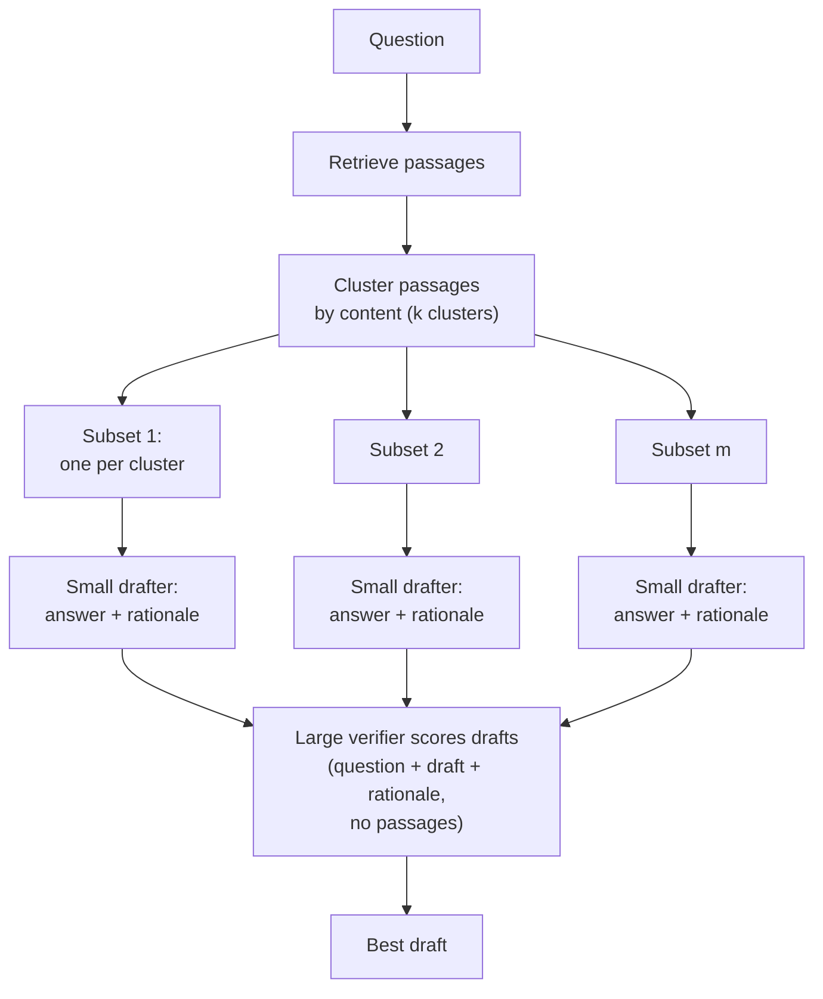

Adding more retrieved passages to a prompt has two costs. The prompt gets longer, so the large model that writes the answer takes longer and costs more. And the passages often repeat each other or pull in different directions, which makes it harder for the model to reason over them. **Speculative RAG** (Wang and colleagues, 2024) splits the work differently: a *small* specialist model writes several draft answers in parallel, each from a different small subset of the passages, and a *large* generalist model only checks the drafts and picks the best one. The large model never reads the passages at all.

The name borrows from **speculative decoding**, where a small model proposes tokens and a large model verifies them. This lesson explains how Speculative RAG builds diverse passage subsets, what the drafter produces, how the verifier scores drafts without the documents, and where the design's risks lie. You will implement the subset construction with clustering and measure how much more diverse it makes each draft's evidence.

## Learning objectives

- Describe the draft-then-verify structure of Speculative RAG and the different roles of the drafter and the verifier.
- Build diverse passage subsets by clustering retrieved passages and sampling one from each cluster, and measure their redundancy.
- Combine drafting, self-consistency and self-reflection scores into a draft ranking, by hand and in code.
- Estimate the latency and token savings of parallel drafting compared with one long prompt to a large model.
- Identify the failure modes that come from a verifier that never sees the evidence.

## Prerequisites

- [Self-RAG](/learn/advanced-rag-patterns/self-rag): per-passage candidates and critique-based selection.
- [Modular RAG](/learn/advanced-rag-patterns/modular-rag): the branching flow pattern.
- [Context windows](/learn/understanding-large-language-models/context-windows) and [Model inference](/learn/understanding-large-language-models/model-inference): why long prompts are slow.
- [Diversity-aware ranking](/learn/advanced-retrieval-optimisation/diversity-aware-ranking): redundancy among retrieved passages.

## Why this matters

Two forces push RAG prompts to grow. Recall improves when more passages are retrieved, and questions that need several facts need several passages. But prompt length has real costs. The time a model spends reading the prompt grows with its length, input tokens are billed, and models do not use long contexts uniformly well (the [lost-in-the-middle problem](/learn/context-engineering/lost-in-the-middle-problem)). Meanwhile, retrieved passages are often redundant: the top five might be three phrasings of the same fact and two others, so most of the extra length adds nothing.

Speculative RAG attacks both at once. It gives each draft a *small* prompt containing a *diverse* subset, so each draft is cheap and sees several perspectives rather than three copies of one. It does the expensive, careful judgement with a large model, but on short inputs: a question plus a draft and its rationale. The paper reports that this both improved accuracy and reduced latency compared with standard RAG on several benchmarks. Whether it pays for you depends on your models and traffic, but the idea of moving long-context reading to a cheap model and keeping the expensive model for short judgements is broadly useful.

## The intuition

A senior partner at a law firm must answer a client's question, and the research has turned up nine documents. She could read all nine herself, which is slow and expensive at her hourly rate. Instead, she gives three junior associates three documents each and asks each for a short answer with a one-paragraph justification. She reads only the three answers and justifications and picks the one whose reasoning holds up best.

Two details make this work. First, she does not hand the documents out in the order the search returned them, because then the first associate would get three near-identical documents about the same point. She makes sure each associate gets one document on each aspect of the question. Second, the associates are specialists at reading documents quickly; she is the expert at judging arguments. Each does what they are best at.

There is an obvious weakness, and it carries straight over to the technique: she never sees the documents. If an associate cites an out-of-date document convincingly, she has no way to notice.

## How it works

### The pipeline

Speculative RAG, as described by Wang and colleagues (2024):

1. **Retrieve** a set of passages for the question, as usual.
2. **Cluster** the passages by content, using an embedding model, into $k$ clusters. Each cluster roughly corresponds to one perspective or aspect of the retrieved evidence.
3. **Build $m$ subsets**, each made by sampling one passage from each cluster. Each subset therefore has $k$ passages that differ from one another.
4. **Draft in parallel.** A small **specialist drafter** model generates, for each subset, a draft answer and a **rationale** explaining it. The drafter is a smaller language model fine-tuned for this task: given a question and passages, produce an answer and a rationale. In the paper, training data for the drafter pairs questions and passages with rationales written by a stronger model.
5. **Verify.** A large **generalist verifier** model scores each draft. It sees the question, the draft answer and the rationale, but *not* the passages. Its input is therefore short.
6. **Select** the highest-scoring draft as the final answer.



In terms of [Modular RAG](/learn/advanced-rag-patterns/modular-rag), this is a branching flow after retrieval in which the merge step is a selection by a judge rather than a fusion of chunks.

### Why clustered subsets

If you split the ranked list into consecutive slices (passages 1 to 3, 4 to 6, 7 to 9), each slice tends to contain passages about the same thing, because similar passages get similar scores and land next to each other in the ranking. A drafter given three near-duplicates has, in effect, one passage, and the subset that lacks the key fact produces a useless draft. Sampling one passage per cluster gives every drafter a spread of the evidence. It also makes the drafts more *independent*: different drafts see different phrasings and sources, so their agreement or disagreement is more informative to the verifier.

### Scoring drafts without the documents

The verifier rates each draft with probabilities computed by the large model. The paper combines three scores:

- **Drafting score** $\rho_{\text{Draft}}$: the drafter's own probability of the draft answer and rationale given the question and its subset. A draft the drafter itself found unlikely is suspect.
- **Self-consistency score** $\rho_{\text{SC}}$: the verifier's probability of generating this answer and rationale given the question. A draft that the large model also finds natural is more plausible.
- **Self-reflection score** $\rho_{\text{SR}}$: the verifier's probability of answering "Yes" when asked whether the rationale supports the answer. This checks the draft's internal logic.

The final score is the product of the three (equivalently, the sum of their logarithms), and the highest wins. These scores require token probabilities from both models, which is why the paper uses open-weight models. With hosted APIs that do not return probabilities, the closest approximation is a structured grading call, as described in [Self-RAG](/learn/advanced-rag-patterns/self-rag), with the same loss of resolution.

### The cost of not reading the evidence

Keeping the passages out of the verifier's prompt is the source of Speculative RAG's speed, and of its distinctive risk. The verifier judges whether the rationale is coherent and whether the answer is plausible. It cannot check whether the rationale quotes its passages faithfully, or whether the passages were current. A drafter that cites the superseded 2023 handbook ("laptops are replaced every 4 years") produces a perfectly coherent draft, and the verifier, which may have no knowledge of Meridian's policies, has no basis to prefer the 3-year answer. Two mitigations follow:

- **Clean the evidence before drafting.** Filter superseded and out-of-scope passages at retrieval time ([Filtered retrieval](/learn/advanced-retrieval/filtered-retrieval)), so that no drafter sees them.
- **Put provenance into the rationale.** Ask the drafter to name its source and date in the rationale; then the verifier at least sees "according to the 2023 handbook" and can be instructed to prefer current sources.

### Relation to speculative decoding

In speculative decoding (Leviathan, Kalman and Matias, 2023), a small model proposes several tokens and a large model checks them in one pass; accepted tokens are guaranteed to follow the same distribution the large model alone would have produced, so output quality is unchanged and only speed improves. Speculative RAG shares the draft-then-verify shape but not that guarantee: the final answer comes from the small drafter, and its quality depends on the drafter and on the verifier's judgement. It is better thought of as a cost-and-quality architecture than as a lossless speed-up.

## The mathematics

### Combining the three scores

For draft $j$ with answer $\alpha_j$ and rationale $\beta_j$ produced from subset $\delta_j$ for question $Q$:

$$
\rho_j = \rho_{\text{Draft}, j} \cdot \rho_{\text{SC}, j} \cdot \rho_{\text{SR}, j}
$$

where $\rho_{\text{Draft}, j} = P_{\text{drafter}}(\beta_j, \alpha_j \mid Q, \delta_j)$, $\rho_{\text{SC}, j} = P_{\text{verifier}}(\alpha_j, \beta_j \mid Q)$, and $\rho_{\text{SR}, j} = P_{\text{verifier}}(\text{"Yes"} \mid Q, \alpha_j, \beta_j, R)$, with $R$ a question such as "Does the rationale support the answer?". The first two are probabilities of whole sequences, which are tiny numbers, so in practice you add logarithms:

$$
\log \rho_j = \log \rho_{\text{Draft}, j} + \log \rho_{\text{SC}, j} + \log \rho_{\text{SR}, j}
$$

**Worked example.** Three drafts have log drafting scores $-6.2, -5.1, -7.5$, log self-consistency scores $-9.0, -8.1, -11.2$, and self-reflection probabilities $0.80, 0.10, 0.90$.

- Draft A: $-6.2 - 9.0 + \ln 0.80 = -15.2 - 0.223 = -15.42$
- Draft B: $-5.1 - 8.1 + \ln 0.10 = -13.2 - 2.303 = -15.50$
- Draft C: $-7.5 - 11.2 + \ln 0.90 = -18.7 - 0.105 = -18.81$

Without self-reflection, B would win: it is the most fluent to both models. The verifier's judgement that B's rationale does not support its answer (0.10) costs it 2.3 in log space, enough for A to win narrowly. Self-reflection is what turns the verifier from a fluency judge into a reasoning judge.

```python
import math
drafts = {"A": (-6.2, -9.0, 0.80), "B": (-5.1, -8.1, 0.10), "C": (-7.5, -11.2, 0.90)}
for name, (log_draft, log_sc, p_sr) in drafts.items():
    print(name, round(log_draft + log_sc + math.log(p_sr), 2))
```

```output
A -15.42
B -15.5
C -18.81
```

Note that sequence log-probabilities grow more negative with length, so longer rationales are penalised unless scores are length-normalised. Whether and how to normalise is an implementation choice worth testing.

## In code

The program implements the part of Speculative RAG that runs without large models: building the passage subsets. Nine passages have been retrieved for "My laptop is 3 years old and was stolen; what do I do?". They cover three aspects: the refresh cycle, reporting a lost or stolen laptop, and support-desk hours. The program compares two ways of giving three passages to each of three drafters: consecutive slices of the ranking, and the Speculative RAG method of clustering and sampling one passage per cluster. For each subset it reports how many clusters (aspects) it covers and its **redundancy**, the mean pairwise cosine similarity of its passages.

```bash
pip install sentence-transformers scikit-learn numpy
```

```python
import numpy as np
from sentence_transformers import SentenceTransformer
from sklearn.cluster import KMeans

RETRIEVED = [   # top 9 passages for "My laptop is 3 years old and was stolen; what do I do?"
    "The laptop refresh cycle is 3 years from the date of issue.",                  # 0
    "IT FAQ: laptops are refreshed every 3 years; IT contacts you when yours is due.",  # 1
    "Laptop refreshes outside the 3-year cycle need a manager's approval.",         # 2
    "Lost laptops must be reported to the support desk at once.",                   # 3
    "If a laptop is lost or stolen, IT disables it remotely and issues a replacement.",  # 4
    "Report a stolen laptop to the support desk immediately.",                      # 5
    "Support desk hours are 08:00 to 18:00 UK time.",                               # 6
    "Outside support hours, call the out-of-hours IT line.",                        # 7
    "All laptops are encrypted and managed by IT.",                                 # 8
]
N_SUBSETS, SUBSET_SIZE = 3, 3

vecs = SentenceTransformer("sentence-transformers/all-MiniLM-L6-v2").encode(
    RETRIEVED, normalize_embeddings=True)

def redundancy(subset):
    """Mean pairwise cosine similarity inside a subset: high means the passages repeat each other."""
    sims = [vecs[a] @ vecs[b] for i, a in enumerate(subset) for b in subset[i + 1:]]
    return float(np.mean(sims))

# Baseline: hand each drafter a consecutive slice of the ranking.
by_rank = [list(range(i, i + SUBSET_SIZE)) for i in range(0, N_SUBSETS * SUBSET_SIZE, SUBSET_SIZE)]

# Speculative RAG: cluster by content, then build each subset from one passage per cluster.
labels = KMeans(n_clusters=SUBSET_SIZE, n_init=10, random_state=0).fit_predict(vecs)
print("clusters:", [[i for i in range(len(RETRIEVED)) if labels[i] == c] for c in range(SUBSET_SIZE)])
rng = np.random.default_rng(0)
pools = [list(rng.permutation(np.flatnonzero(labels == c))) for c in range(SUBSET_SIZE)]
diverse = [sorted(int(pool[j % len(pool)]) for pool in pools) for j in range(N_SUBSETS)]

for name, subsets in [("by rank", by_rank), ("clustered", diverse)]:
    print(f"\n{name}:")
    for s in subsets:
        topics = len({int(labels[i]) for i in s})
        print(f"  {str(s):<11} clusters covered {topics}/{SUBSET_SIZE}  redundancy {redundancy(s):.2f}")
```

```output
clusters: [[3, 4, 5, 8], [6, 7], [0, 1, 2]]

by rank:
  [0, 1, 2]   clusters covered 1/3  redundancy 0.75
  [3, 4, 5]   clusters covered 1/3  redundancy 0.67
  [6, 7, 8]   clusters covered 2/3  redundancy 0.22

clustered:
  [0, 5, 7]   clusters covered 3/3  redundancy 0.26
  [2, 3, 6]   clusters covered 3/3  redundancy 0.31
  [1, 4, 7]   clusters covered 3/3  redundancy 0.33
```

### Reading the output

K-means finds the three aspects: cluster 0 holds the lost-or-stolen passages (plus the encryption passage, which embeds close to them), cluster 1 the support-hours passages, cluster 2 the refresh-cycle passages.

- **By rank**, the first drafter receives three refresh-cycle passages (redundancy 0.75) and nothing about theft; the second receives three theft passages (0.67) and nothing about the refresh cycle. Neither can answer the question, which asks about both. Only the third covers two aspects, and its passages are the least relevant ones.
- **Clustered**, every drafter covers all three aspects, and redundancy falls to about 0.3. Each draft has the evidence for a complete answer, and the three drafts differ in which phrasing of each fact they saw, so the verifier compares genuinely different attempts.

Key lines: `KMeans(...).fit_predict(vecs)` assigns each passage to a cluster; the number of clusters equals the subset size, so that each subset can take one per cluster. `pools` holds a shuffled list per cluster, and drafter $j$ takes the $j$-th passage from each pool, wrapping around for small clusters, so subsets are different from one another as far as the clusters allow. The paper samples passages per cluster for each subset; the round-robin here is a deterministic variant that guarantees distinct subsets on this small example.

**Common errors.** Choosing more clusters than there are distinct aspects splits one aspect into artificial halves and forces irrelevant passages into every subset. Too few clusters puts unrelated passages together. Check cluster assignments on real queries, and consider choosing $k$ per query (for example with a silhouette score) if questions vary widely. Forgetting to normalise embeddings before k-means makes clustering depend on vector length rather than direction.

**Extending it: drafting in parallel.** The drafts are independent, so they should be issued concurrently. The following sketch was not executed (it needs an API key). It uses the Anthropic SDK's asynchronous client. `DRAFT_MODEL` would normally be a smaller, faster model than the verifier; check the models page in the Anthropic documentation for current options.

```python
import asyncio
import os
import anthropic

client = anthropic.AsyncAnthropic()  # reads ANTHROPIC_API_KEY from the environment
DRAFT_MODEL = os.environ.get("DRAFT_MODEL", "claude-opus-5-5")

async def draft(question: str, passages: list[str]) -> str:
    context = "\n".join(f"[{i + 1}] {p}" for i, p in enumerate(passages))
    response = await client.messages.create(
        model=DRAFT_MODEL,
        max_tokens=1024,
        system="Answer only from the passages. Give a short answer, then a rationale citing passage numbers.",
        messages=[{"role": "user", "content": f"Passages:\n{context}\n\nQuestion: {question}"}],
    )
    return "".join(block.text for block in response.content if block.type == "text")

async def draft_all(question: str, subsets: list[list[str]]) -> list[str]:
    return await asyncio.gather(*(draft(question, s) for s in subsets))
```

The verification step would then send each draft, without the passages, to the larger model, using a structured grading call as in the Self-RAG lesson, since the API does not expose the token probabilities the paper's scores need.

## A real-world example

AskMeridian's IT questions often retrieved many overlapping runbook passages: the same VPN fix appears in the runbook, the FAQ and several resolved-ticket summaries. The Platform team was sending the top 12 passages to its largest model and paying for long prompts on every question. An engineer proposed Speculative RAG: a small model drafting from four clustered subsets of three passages, and the large model verifying.

A prototype on the team's IT evaluation set showed the expected latency drop, because the large model's prompt shrank from twelve passages to four short drafts. Answer quality was close to the baseline on most questions, with one systematic failure: questions about E-4012 sometimes got an answer from an old ticket summary describing a workaround IT had since withdrawn. The verifier, seeing only the draft and its rationale, found the workaround coherent and selected it.

The team made two changes. Ticket summaries older than the current runbook version were filtered out before clustering, and the drafter prompt required each rationale to name its source and date, with the verifier instructed to prefer runbooks over ticket summaries and newer over older. With those changes the team kept the design for IT questions with many redundant passages. For HR policy questions, where retrieval typically returns two or three passages, there was nothing to parallelise and they kept single-step generation.

## Common mistakes

- **Splitting passages by rank instead of by content.** Consecutive slices concentrate near-duplicates in one draft and leave other drafts without key evidence.
- **Feeding stale or out-of-scope passages to drafters.** The verifier never sees the passages and cannot catch an answer drawn from a superseded source.
- **Treating Speculative RAG as lossless like speculative decoding.** The answer comes from the small drafter; its quality is not guaranteed to match the large model's.
- **Running drafts sequentially.** The latency benefit depends on drafting in parallel; sequential drafting can be slower than one large-model call.
- **Using it when retrieval returns few passages.** With two or three passages, there is nothing to split, and the extra calls only add cost.
- **Comparing sequence probabilities across very different lengths without thought.** Longer rationales get lower probabilities and can lose for the wrong reason.

## Best practices

- Filter retrieved passages for currency, scope and permissions before clustering, not after drafting.
- Choose the number of clusters to match the number of aspects typically present, and inspect clusters on real queries.
- Require drafters to cite passage sources and dates in their rationales, so that the verifier has provenance to judge.
- Issue drafts concurrently and set a deadline; select among the drafts that finished if one is slow.
- Evaluate against single-step RAG with the large model on the same test set, on both answer quality and latency, before adopting.
- Reserve the pattern for queries with many, redundant passages; route others to a simpler pipeline.

## Performance considerations

Compare two designs for a question with 12 retrieved passages of about 200 tokens each.

**Standard RAG with the large model** reads about $12 \times 200 = 2{,}400$ passage tokens plus the question and instructions, then generates the answer.

**Speculative RAG with $m = 4$ drafts of 3 passages** issues four drafter calls, each reading about $3 \times 200 = 600$ passage tokens, run in parallel, then one verification pass by the large model reading four drafts with rationales, say $4 \times 150 = 600$ tokens. The large model's input falls by roughly a factor of four.

Latency is roughly the drafter's latency (the parallel calls finish at about the same time, so the slowest one sets the pace) plus the verifier's. If the drafter is much faster than the large model, and prompt processing is a significant part of the large model's time, the total can be lower than the baseline. Total token *volume* is not lower: the drafters together read $4 \times 600 = 2{,}400$ passage tokens, the same as the baseline, but at the small model's price. The saving is the price difference, not fewer tokens. If drafter and verifier are the same model, there is no saving at all, only extra calls.

With probabilities unavailable from a hosted API, verification becomes $m$ grading calls or one call that compares all drafts. One comparative call is cheaper but positions drafts side by side, which introduces order effects; shuffle draft order or grade independently.

## Security considerations

Splitting evidence across drafters means a poisoned passage only influences the drafts that receive it, which limits its reach compared with one shared prompt. But the verifier cannot see the passages, so an injected instruction that makes a drafter write a confident, well-structured rationale for a false answer is hard for the verifier to detect. Apply the same retrieval-time permission filters and content controls as any RAG system, delimit passages clearly in drafter prompts, and do not rely on the verifier as a defence against [data poisoning](/learn/rag-security-fundamentals/data-poisoning).

## Summary

- Speculative RAG drafts several answers in parallel with a small specialist model, each from a different subset of passages, and lets a large generalist model verify and select.
- Subsets are built by clustering retrieved passages and taking one per cluster, which gives each draft diverse, low-redundancy evidence.
- The verifier scores drafts using the drafter's probability, its own probability of the draft (self-consistency) and its probability that the rationale supports the answer (self-reflection), without reading the passages.
- The speed and cost benefit comes from shorter large-model inputs and cheaper parallel drafting, not from fewer total tokens.
- Because the verifier never sees the evidence, stale or poisoned passages must be filtered before drafting, and rationales should carry provenance.

## Exercises

1. Explain in two sentences why splitting the top nine passages into consecutive groups of three is likely to produce worse drafts than clustering and sampling one per cluster.

<details><summary>Show solution</summary>

Similar passages get similar retrieval scores, so consecutive groups tend to contain near-duplicates about one aspect and miss the others, leaving each drafter with incomplete evidence. Sampling one passage per cluster gives every drafter one passage per aspect, so each draft can answer the whole question and the drafts differ usefully.

</details>

2. Using the scoring formula, three drafts have $(\log\rho_{\text{Draft}}, \log\rho_{\text{SC}}, \rho_{\text{SR}})$ of $(-4.0, -7.0, 0.5)$, $(-4.5, -7.2, 0.95)$ and $(-3.8, -6.5, 0.05)$. Which is selected? Which would win without self-reflection?

<details><summary>Show solution</summary>

Totals: first $-11.0 + \ln 0.5 = -11.0 - 0.693 = -11.69$; second $-11.7 + \ln 0.95 = -11.7 - 0.051 = -11.75$; third $-10.3 + \ln 0.05 = -10.3 - 2.996 = -13.30$. The first is selected, narrowly. Without self-reflection the third would win ($-10.3$), although the verifier thinks its rationale does not support its answer.

</details>

3. Modify the code to choose the number of clusters automatically: try $k = 2$ to $5$ and pick the $k$ with the highest silhouette score (`sklearn.metrics.silhouette_score`). Which $k$ is chosen for these nine passages, and does it match the three aspects?

<details><summary>Show solution</summary>

```python
from sklearn.metrics import silhouette_score
best = max(range(2, 6), key=lambda k: silhouette_score(
    vecs, KMeans(n_clusters=k, n_init=10, random_state=0).fit_predict(vecs)))
print(best)
```

It prints 3. The silhouette scores are 0.211, 0.243, 0.222 and 0.180 for $k = 2$ to $5$, so $k = 3$ wins and matches the three aspects. The margin over $k = 4$ (which splits the encryption passage into its own cluster) is small, though: on sets this size silhouette scores are noisy, so bound $k$ by the subset size you can afford and check cluster contents rather than trusting the score blindly.

</details>

4. Design: a colleague proposes Speculative RAG for AskMeridian's HR policy questions, where retrieval usually returns three passages and the drafter and verifier would be the same hosted model. Argue for or against.

<details><summary>Show solution</summary>

Against. With three passages there is little redundancy to remove and little to split; each draft would get one passage and lose the context the others provide. With the same model for drafting and verifying there is no price difference to exploit, so the design adds calls (drafts plus verification) for no saving, and the verifier cannot catch drafts based on outdated policy because it never sees the passages. Single-step generation with a support check is cheaper and safer here.

</details>

## Check your understanding

```quiz
[
  {"q": "In Speculative RAG, which model reads the retrieved passages?", "options": ["Only the large verifier", "Only the small drafter", "Both models read all passages", "Neither; passages are summarised first"], "answer": 1, "why": "The drafter reads its subset of passages and writes a draft and rationale. The verifier sees only the question, draft and rationale, which keeps its input short."},
  {"q": "Why are passage subsets built by clustering rather than by rank order?", "options": ["Clustering is faster than sorting", "So that each subset covers different aspects of the evidence with little redundancy", "Because the verifier requires clusters", "To reduce the number of drafts"], "answer": 1, "why": "Taking one passage per cluster gives each draft diverse evidence; consecutive slices concentrate near-duplicates."},
  {"q": "What does the self-reflection score measure?", "options": ["The drafter's confidence in its answer", "The verifier's probability that the rationale supports the answer", "The cosine similarity between the draft and the passages", "How many drafts agree"], "answer": 1, "why": "Self-reflection asks the verifier whether the rationale supports the answer and uses the probability of 'Yes'."},
  {"q": "A drafter cites a superseded 2023 policy convincingly. Why is the verifier likely to miss it?", "options": ["The verifier is smaller than the drafter", "The verifier never sees the passages, so it cannot check sources or currency", "Self-consistency penalises correct answers", "The clustering step removes current policies"], "answer": 1, "why": "The verifier judges coherence and plausibility, not fidelity to sources. Stale passages must be filtered before drafting."},
  {"q": "How does Speculative RAG differ from speculative decoding?", "options": ["They are identical", "Speculative decoding guarantees the large model's output distribution; Speculative RAG's answer comes from the drafter and carries no such guarantee", "Speculative RAG uses one model only", "Speculative decoding needs retrieval"], "answer": 1, "why": "Speculative decoding verifies tokens so that output matches the large model exactly; Speculative RAG selects among drafts written by a smaller model."}
]
```

## Further reading

- Wang, Z. et al. (2024). *Speculative RAG: Enhancing Retrieval Augmented Generation through Drafting.* [arXiv:2407.08223](https://arxiv.org/abs/2407.08223).
- Leviathan, Y., Kalman, M. and Matias, Y. (2023). *Fast Inference from Transformers via Speculative Decoding.* [arXiv:2211.17192](https://arxiv.org/abs/2211.17192).
- Liu, N. F. et al. (2023). *Lost in the Middle: How Language Models Use Long Contexts.* [arXiv:2307.03172](https://arxiv.org/abs/2307.03172).
- scikit-learn user guide on clustering: [scikit-learn.org](https://scikit-learn.org/stable/modules/clustering.html).
