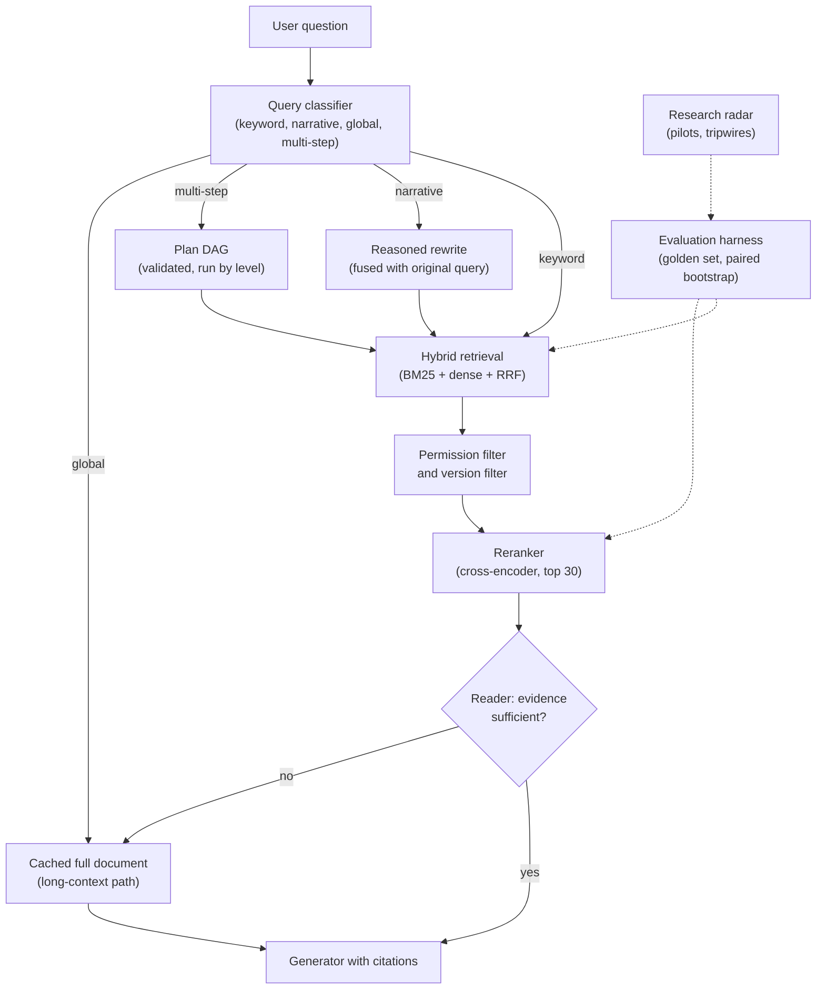

This assessment covers the whole Advanced RAG Research module: reading and grading research, retrieval-augmented pretraining, long context versus RAG, fine-tuned retrievers, late interaction, advanced query planning, retrieval reasoning and emerging directions. It mixes recall, calculation and judgement, because the module is about judgement. The pass mark is 70 per cent on the quiz (13 of 18); the open questions, coding exercises, design challenge and troubleshooting scenarios are for self-assessment, so write your own answer before opening the model answer.

## Quiz

```quiz
[
  {
    "q": "Which of the following best fits the evidence-ladder rung 'established practice'?",
    "options": [
      "A reinforcement-learned search agent reported in a single preprint",
      "A retriever evaluated only on its authors' new benchmark",
      "Reciprocal rank fusion of BM25 and dense results",
      "A technique other groups failed to reproduce"
    ],
    "answer": 2,
    "why": "Reciprocal rank fusion is widely reproduced, built into mainstream libraries and databases, and described consistently. The others are single-source, self-benchmarked or contested."
  },
  {
    "q": "Why does a paired bootstrap on per-query differences usually give a narrower interval than comparing two unpaired averages?",
    "options": [
      "Easy and hard queries affect both systems alike, and differencing removes that shared variation",
      "It draws more samples",
      "It ignores ties",
      "It assumes normality"
    ],
    "answer": 0,
    "why": "Scores are strongly correlated across systems on the same query. Per-query differences cancel the shared component, leaving only the variation between systems."
  },
  {
    "q": "Two retrievers differ by 0.004 nDCG@10 on 300 queries. A team evaluates both on a random 25-query golden set. What should they expect?",
    "options": [
      "The better system wins almost every time",
      "Both systems tie exactly",
      "The worse system wins almost every time",
      "Close to a coin flip as to which wins"
    ],
    "answer": 3,
    "why": "With a tiny true difference and a small sample, sampling noise dominates, so each system wins roughly half of random subsets."
  },
  {
    "q": "In kNN-LM, what is stored in the datastore for each position in the text collection?",
    "options": [
      "The full document and its title",
      "A representation of the context up to that position, paired with the token that actually came next",
      "A pair of questions and answers",
      "The attention weights of the model"
    ],
    "answer": 1,
    "why": "Keys are context representations and values are next tokens. Neighbours vote for their next tokens and the result is interpolated with the model's own prediction."
  },
  {
    "q": "What did the RETRO paper show about adding retrieval to an existing pretrained model?",
    "options": [
      "It cannot be done without retraining from scratch",
      "It makes the model's own weights unnecessary",
      "It requires the retrieval database to be smaller than a million tokens",
      "Retrieval can be added by training only the new cross-attention blocks while most existing weights stay frozen"
    ],
    "answer": 3,
    "why": "The paper's retrofitting experiment converted a pretrained transformer to use retrieval by training the chunked cross-attention weights, which is far cheaper than training from scratch."
  },
  {
    "q": "Why can a REALM-style training loss improve the retriever without document relevance labels?",
    "options": [
      "The retriever's probability over documents appears in the marginal likelihood, so documents that help the reader predict correctly receive a positive gradient",
      "A cross-encoder labels documents in the background",
      "The retriever is frozen and the reader learns to ignore it",
      "BM25 scores replace the retriever's scores"
    ],
    "answer": 0,
    "why": "The marginal likelihood sums retriever probability times reader probability over documents, so gradients flow into the retriever and reward useful documents."
  },
  {
    "q": "What does this code print?\n```python\nr, a, b = 0.9, 0.5, 0.1\nprint(round((1 - r) * a + r * b, 2))\n```\nHere r is retrieval recall, a the chance the reader abstains when evidence is absent, and b the chance it abstains when evidence is present.",
    "options": [
      "0.05",
      "0.09",
      "0.14",
      "0.60"
    ],
    "answer": 2,
    "why": "(1 - 0.9) * 0.5 = 0.05 and 0.9 * 0.1 = 0.09, so the fallback fraction is 0.14."
  },
  {
    "q": "What did harder long-context tests such as RULER find, compared with the simple single-needle test?",
    "options": [
      "Models that pass the simple test pass all harder tasks too",
      "Many models that score near-perfectly on the simple test degrade on multi-needle, tracing and aggregation tasks as length grows",
      "Long context is always worse than retrieval",
      "Models cannot read beyond 8,000 tokens"
    ],
    "answer": 1,
    "why": "RULER showed that effective context length is often shorter than the advertised window once tasks need distractor handling, multi-hop reasoning or aggregation."
  },
  {
    "q": "In a retrieve-then-route design, what mostly drives the extra cost over the cheap path?",
    "options": [
      "The fraction of questions sent to the long-context fallback, often dominated by false abstentions",
      "The size of each retrieved chunk",
      "The number of documents in the corpus",
      "The embedding dimension"
    ],
    "answer": 0,
    "why": "Each fallback costs the whole corpus in tokens, so the fallback fraction dominates; false abstentions on questions retrieval already answered can outnumber genuine misses."
  },
  {
    "q": "A Finance team asks 'which expense types need pre-approval and which do not?', and the answer is scattered over a 60,000-token policy. Which configuration is most likely to fail?",
    "options": [
      "The whole policy in a cached prompt",
      "A router that falls back to the whole policy when the retrieved chunks do not cover the question",
      "Long context with the question restated at the end",
      "Top-5 retrieval with no fallback"
    ],
    "answer": 3,
    "why": "A global question needs information from throughout the document, which five chunks are unlikely to contain."
  },
  {
    "q": "A fine-tuned retriever gains ten nDCG points on a random split of queries, where most test queries share relevant documents with training queries. What should you do before trusting it?",
    "options": [
      "Ship it, since the test set is held out",
      "Evaluate on a split by time or by document, and report the gain on queries about documents unseen in training",
      "Add more epochs",
      "Lower the learning rate"
    ],
    "answer": 1,
    "why": "The gain may come from learning which documents are popular. A document or time split shows whether the model learned relevance."
  },
  {
    "q": "Which deployment option for a fine-tuned retriever requires re-embedding the whole corpus?",
    "options": [
      "A query-side adapter with frozen document vectors",
      "A reranker trained after retrieval",
      "Fine-tuning the document encoder",
      "Raising the number of candidates"
    ],
    "answer": 2,
    "why": "Changing the document encoder changes every document vector, so the index must be rebuilt. The other options leave document vectors untouched."
  },
  {
    "q": "What does generator-supervised retrieval training (as in REPLUG LSR) train the retriever to match?",
    "options": [
      "A distribution over passages derived from how much each passage raises the generator's likelihood of the true answer",
      "The BM25 ranking of the passages",
      "The ordering in which passages appear in the corpus",
      "The length of each passage"
    ],
    "answer": 0,
    "why": "The generator's likelihood of the true continuation given each passage defines a target distribution, and the retriever is trained to put its probability mass accordingly."
  },
  {
    "q": "What problem does MUVERA's fixed-dimensional encoding address?",
    "options": [
      "It removes the need for any reranking",
      "It reads text from page images",
      "It trains ColBERT faster",
      "It lets ordinary single-vector (MIPS) indexes shortlist candidates for multi-vector scoring"
    ],
    "answer": 3,
    "why": "The encoding maps a set of token vectors to one long vector whose inner product approximates the multi-vector similarity, so existing single-vector infrastructure can find candidates, which exact scoring then reranks."
  },
  {
    "q": "Two unit vectors are 60 degrees apart. With 2 random hyperplanes, what is the approximate probability they share a bucket?",
    "options": [
      "0.67",
      "0.44",
      "0.33",
      "0.11"
    ],
    "answer": 1,
    "why": "Per hyperplane the probability is 1 - 60/180 = 0.667; for two hyperplanes, 0.667 squared is about 0.44."
  },
  {
    "q": "A plan has three steps costing 2, 3 and 4 seconds. Step 3 depends on step 2; step 1 is independent. What is the critical-path length and the work?",
    "options": [
      "Critical path 9 s, work 9 s",
      "Critical path 4 s, work 9 s",
      "Critical path 7 s, work 9 s",
      "Critical path 2 s, work 7 s"
    ],
    "answer": 2,
    "why": "The longest dependent chain is step 2 then step 3, 3 + 4 = 7 seconds. Total work is 2 + 3 + 4 = 9 seconds."
  },
  {
    "q": "What does this code print?\n```python\nimport re\ndef parse(text, n):\n    seen = []\n    for m in re.findall(r'\\[(\\d+)\\]', text):\n        i = int(m) - 1\n        if 0 <= i < n and i not in seen:\n            seen.append(i)\n    return seen + [i for i in range(n) if i not in seen]\nprint(parse('[2] > [2] > [7]', 3))\n```",
    "options": [
      "[1, 1]",
      "[0, 1, 2]",
      "[1, 6, 0, 2]",
      "[1, 0, 2]"
    ],
    "answer": 3,
    "why": "Ids 2, 2, 7 become zero-based 1, 1, 6. The repeat and the out-of-range 6 are dropped, leaving [1], and the missing 0 and 2 are appended in order."
  },
  {
    "q": "Why keep the original query alongside a reasoned rewrite and fuse the two result lists?",
    "options": [
      "A wrong inference in the rewrite would otherwise discard a correct literal match",
      "Rewrites are always shorter",
      "Fusion makes the retriever deterministic",
      "Search engines require two queries"
    ],
    "answer": 0,
    "why": "If the reasoning step drifts to the wrong concept, the original query's results still contribute and dilute the error."
  }
]
```

## Conceptual questions

**1.** A preprint claims a new RAG technique improves answer accuracy by eleven points. Describe, in order, how you would decide whether to try it at your company.

<details><summary>Show model answer</summary>

First classify it: which component does it change (retriever, reranker, prompt, generator) and is it one change or a bundle? Then grade the evidence on the ladder: is there code or a released model, has anyone independent reproduced it, does the paper include an ablation? Apply the reading checklist: was the baseline tuned and current, could the benchmark have leaked into model training, does the metric match your use (answer accuracy judged by a model versus retrieval recall), how big is the effect against the noise (intervals, number of queries), and what does it cost in tokens, latency and index size. If it survives, tie it to a measured weakness in your own failure analysis; if it does not touch one, put it on the watch list. If it does, replicate cheaply: a versioned golden set, your current pipeline as the baseline, the new method behind a flag, per-query scores and a paired bootstrap interval, plus a cost column, with an adoption threshold written beforehand. Record the decision and a tripwire. The principle is that a number from someone else's data and benchmark is a hypothesis about yours.

</details>

**2.** Explain what retrieval-augmented pretraining research (REALM, kNN-LM, RETRO, Atlas) tells a practitioner who will never train a model.

<details><summary>Show model answer</summary>

It explains why in-context RAG works and what it leaves out. Retrieval can be attached at the input (the standard recipe, Fusion-in-Decoder), inside the layers (RETRO), at the output probabilities (kNN-LM) or inside the training loss (REALM, Atlas). The research supports putting facts in an editable datastore rather than in weights, because a datastore can be updated or deleted without retraining and can be cited. It shows that generator feedback can train a retriever without relevance labels (the marginal likelihood in REALM, perplexity-based objectives in Atlas, the trained REPLUG variant), which is the basis of generator-aware retriever fine-tuning that practitioners can do. It also shows that models are better at using context if trained for it, which motivates models post-trained for grounded answers. And it warns about datastore and test-set overlap inflating results. What a practitioner should not conclude is that a generic retriever plus a generic model reproduces the headline results of jointly trained systems.

</details>

**3.** Meridian's Finance team asks whether to drop retrieval and put the 60,000-token expense policy in every prompt. Give a balanced recommendation using the research on long context.

<details><summary>Show model answer</summary>

Test, do not assume. The document fits a context window, so long context is plausible, and it handles global questions (which types need pre-approval, and which do not) that top-k retrieval handles poorly. But single-needle tests overstate long-context ability: multi-needle, aggregation and look-alike distractors degrade models, and position effects exist. Retrieval is far cheaper per query, supports citations and permission filtering, and scales when more departments join. A routed design is the sensible default: retrieve first for lookups, fall back to the cached full policy when the reader says the retrieved chunks do not cover the question. Measure the retrieval recall, the reader's abstention behaviour (false and missed abstentions), token cost and latency on a stratified set of lookup and global questions. Set a tripwire (corpus growth, share of fallback queries) to revisit. The cost of the fallback is dominated by false abstentions, so measure those.

</details>

**4.** A teammate's fine-tuned retriever scores much higher than the baseline offline, but the production metric barely moves. List the likely causes and how you would diagnose each.

<details><summary>Show model answer</summary>

Most likely the offline split shares relevant documents with training queries, so the model learned document popularity: diagnose by splitting test queries into those whose relevant documents appear in training and those whose do not, and by re-evaluating on a split by time or by document. Second, the production queries differ from the logged queries used for training (new topics, new documents, different phrasing): compare distributions and check recall on recently added documents. Third, the retriever's gain is not the bottleneck: production failures may be in reranking, chunking or generation; check recall at the depth the reranker consumes before and after. Fourth, an evaluation artefact such as selecting the epoch on the test set, or a baseline that was not given the same candidate list. Fifth, the adapter and index are out of sync (a document encoder changed without re-embedding) so production scores are wrong. Diagnose with subsets, paired intervals and an A/B comparison, not with the headline mean.

</details>

**5.** Why is a graph-structured query plan not simply a faster chain, and what does it cost in reliability and complexity?

<details><summary>Show model answer</summary>

A graph represents true data dependencies, so independent sub-questions can run concurrently and latency follows the critical path, not the step count; it also makes validation possible (unknown dependencies, unbound placeholders, cycles) and failure propagation clean (skip steps whose inputs are missing). It is not faster for accuracy: if every step must be correct, reliability is the product of the step success probabilities, so parallelism does not help and each extra step multiplies in a factor below one; over-decomposition hurts. Complexity costs include the planner call and its latency, the need to validate and repair plans, concurrency limits and rate limits, and the rigidity of plan-first designs when a surprise in one step should change the next (needing replanning or an interleaved agent). The choice of shape should follow the question: most questions need no plan, many need one retrieval, and a minority need a graph or an interleaved loop.

</details>

## Coding exercises

**Exercise 1: a paired bootstrap decision.** Two systems were scored on the same 120 queries. Generate the scores with the seeds below, compute the paired bootstrap 95 per cent interval of B minus A with 10,000 rounds, and adopt B only if the lower end of the interval exceeds 0.01. Also compute an unpaired interval and compare widths.

<details><summary>Show solution</summary>

```python
import numpy as np

rng = np.random.default_rng(42)
n = 120
base = rng.beta(4, 2, n)                                   # per-query difficulty shared by both systems
system_a = np.clip(base + rng.normal(0.00, 0.10, n), 0, 1)
system_b = np.clip(base + rng.normal(0.03, 0.10, n), 0, 1) # B is better by about 0.03 on average

def paired_bootstrap(a, b, rounds=10_000, seed=0):
    rng = np.random.default_rng(seed)
    d = b - a                                              # per-query differences, B minus A
    means = d[rng.integers(0, len(d), (rounds, len(d)))].mean(axis=1)
    lo, hi = np.percentile(means, [2.5, 97.5])
    return d.mean(), lo, hi

mean, lo, hi = paired_bootstrap(system_a, system_b)
print(f"mean diff {mean:+.3f}, 95% CI [{lo:+.3f}, {hi:+.3f}]")
print("adopt B" if lo > 0.01 else "do not adopt B (interval does not clear the 0.01 threshold)")

# Compare with an unpaired interval: resample each system separately.
rng2 = np.random.default_rng(1)
ma = system_a[rng2.integers(0, n, (10_000, n))].mean(axis=1)
mb = system_b[rng2.integers(0, n, (10_000, n))].mean(axis=1)
lo_u, hi_u = np.percentile(mb - ma, [2.5, 97.5])
print(f"unpaired CI [{lo_u:+.3f}, {hi_u:+.3f}] (width {hi_u - lo_u:.3f} versus paired {hi - lo:.3f})")
```

```output
mean diff +0.023, 95% CI [-0.005, +0.050]
do not adopt B (interval does not clear the 0.01 threshold)
unpaired CI [-0.028, +0.072] (width 0.100 versus paired 0.055)
```

The observed gain of 0.023 is real on average but the interval includes zero, so the data cannot support adoption under the rule. Pairing removes the shared per-query difficulty, narrowing the interval from 0.100 to 0.055. More queries (width falls with the square root of $n$) or a larger true effect would be needed.

</details>

**Exercise 2: sliding-window reranking properties.** Implement `sliding_window(n_items, judge, window, stride)` using a robust `parse_ordering`, with a fake judge that orders by hidden relevance. Put the best item at position 27 of 30 and report where it ends, and the number of calls, for (window, stride) of (10, 5), (10, 10) and (10, 9). Then print `parse_ordering("Top: [2], then [2], then [9] and [1]", 3)`.

<details><summary>Show solution</summary>

```python
import re
import random

def parse_ordering(text, n):
    seen = []
    for m in re.findall(r"\[(\d+)\]", text):
        i = int(m) - 1
        if 0 <= i < n and i not in seen:
            seen.append(i)
    return seen + [i for i in range(n) if i not in seen]

def make_judge(relevance):
    """A fake listwise judge: returns '[i] > [j] > ...' ordered by a hidden relevance score."""
    calls = {"n": 0}
    def judge(window_ids):
        calls["n"] += 1
        order = sorted(range(len(window_ids)), key=lambda k: -relevance[window_ids[k]])
        return " > ".join(f"[{k + 1}]" for k in order)
    return judge, calls

def sliding_window(n_items, judge, window, stride):
    order = list(range(n_items))
    start = max(n_items - window, 0)
    while True:
        block = order[start:start + window]
        new = parse_ordering(judge(block), len(block))
        order[start:start + window] = [block[i] for i in new]
        if start == 0:
            break
        start = max(start - stride, 0)
    return order

random.seed(3)
n = 30
relevance = {i: random.random() for i in range(n)}
relevance[27] = 10.0                                       # the best item starts at position 27
for window, stride in ((10, 5), (10, 10), (10, 9)):
    judge, calls = make_judge(relevance)
    order = sliding_window(n, judge, window, stride)
    print(f"window {window:2d} stride {stride:2d}: best item ends at rank {order.index(27) + 1}, {calls['n']} calls")
print(parse_ordering("Top: [2], then [2], then [9] and [1]", 3))
```

```output
window 10 stride  5: best item ends at rank 1, 5 calls
window 10 stride 10: best item ends at rank 21, 3 calls
window 10 stride  9: best item ends at rank 1, 4 calls
[1, 0, 2]
```

With stride below the window, the window above always contains the previous window's top position, so the best item is carried to rank 1 (stride 5 uses $1 + \lceil 20/5 \rceil = 5$ calls; stride 9 uses $1 + \lceil 20/9 \rceil = 4$). With stride equal to the window the windows do not overlap, so the best item reaches the top of its own block (rank 21) and goes no further. The parser drops the repeated and out-of-range ids and appends the forgotten passage.

</details>

**Exercise 3: a routing calculator.** Write `route(r, a, b, k, c, T)` returning the fallback fraction, the expected tokens per question and the wrong-answer rate. For $T = 60{,}000$ and $c = 120$, tabulate $(k, r)$ of $(3, 0.90)$, $(5, 0.95)$ and $(10, 0.98)$ with $a = 0.8$ and $b = 0.05$, then use bisection to find the largest $b$ at which routing with $k = 5$, $r = 0.95$ still costs under half of always sending the full corpus.

<details><summary>Show solution</summary>

```python
def route(r, a, b, k, c, T):
    f = (1 - r) * a + r * b                  # share of questions sent to the long-context fallback
    return f, k * c + f * T, (1 - r) * (1 - a)

T, c = 60_000, 120          # corpus tokens and tokens per retrieved chunk (assumed)
print(" k    r    f    tokens   % of always-long   wrong-answer rate")
for k, r in ((3, 0.90), (5, 0.95), (10, 0.98)):
    f, tokens, wrong = route(r, a=0.8, b=0.05, k=k, c=c, T=T)
    print(f"{k:2d} {r:5.2f} {f:5.3f} {tokens:8.0f} {tokens / T:12.1%} {wrong:18.4f}")

# Largest false-abstention rate b for which routing with k=5, r=0.95 still costs less than half of always-long
lo, hi = 0.0, 1.0
for _ in range(40):
    mid = (lo + hi) / 2
    if route(0.95, 0.8, mid, 5, c, T)[1] < 0.5 * T: lo = mid
    else: hi = mid
print(f"routing costs less than half of always-long only while the false-abstention rate is below {lo:.3f}")
```

```output
 k    r    f    tokens   % of always-long   wrong-answer rate
 3  0.90 0.125     7860        13.1%             0.0200
 5  0.95 0.088     5850         9.8%             0.0100
10  0.98 0.065     5100         8.5%             0.0040
routing costs less than half of always-long only while the false-abstention rate is below 0.474
```

More retrieved chunks raise recall, which lowers both the fallback fraction and the wrong-answer rate, at a small token cost. The hand check for the bisection: tokens $= 600 + (0.04 + 0.95\,b) \times 60{,}000 < 30{,}000$ gives $b < 0.474$. Note how little of the cost is retrieval itself: nearly all of it is the fallback, which is why false abstentions matter.

</details>

## Architecture design challenge

**Brief.** AskMeridian's corpus will grow fivefold over a year as the Support and Finance departments add content (policies in several versions, runbooks, 2,000 Atlas error-code pages, and PDF product manuals with screenshots). Questions are a mix: keyword lookups ("E-4021"), narrative questions ("I left my laptop on a train"), global questions ("which expense types need pre-approval, and which do not?") and occasional multi-step questions ("does the product that exports PDFs support SAML, and how long does Relay keep failed events?"). The p95 latency budget for retrieval is 2.5 seconds; generation is separate. Design the retrieval architecture using the research in this module. State which components are established, which are pilots, how you will evaluate, and what the failure modes and tripwires are.

<details><summary>Show reference design</summary>



**Established components.** Hybrid retrieval with fusion and a cross-encoder reranker over a modest candidate list; permission and version filters before the model sees any text; citations. These carry most traffic and are defaults.

**Routing by question type.** A lightweight classifier picks the cheapest adequate path, following Adaptive-RAG. Keyword questions go straight to hybrid retrieval. Narrative questions use a reasoned rewrite (one model call, cached on the normalised question) fused with the original query by reciprocal rank fusion, so a wrong inference cannot discard a literal match. Global questions go to a cached full document where it fits (long context handles aggregation that top-k retrieval cannot). Multi-step questions get a validated plan graph: independent steps run concurrently, steps with missing inputs are skipped and the answer is marked partial.

**Fallback.** After reranking, a reader decides whether the evidence suffices; if not, the question falls back to the long-context path (Self-Route style). Measure the retrieval recall $r$ and the reader's abstention rates $a$ and $b$ on a stratified set, because the fallback fraction, dominated by false abstentions, sets the cost.

**Pilots, behind flags.** A reasoning reranker over the top 20 for narrative queries (only if parallel pointwise scoring fits the budget; listwise windows are serial); a query-side adapter trained on logged questions, evaluated on a split by time and by new document; late interaction as a *reranker* before any first-stage multi-vector index; a visual retriever for the screenshot-heavy manuals, on a 200-page sample against a table-aware parser baseline. Not built: learned search agents, generative retrieval, reasoning-trained retrievers; recorded on the radar with tripwires.

**Evaluation.** One versioned golden set with question-type labels; per-query scores; paired bootstrap intervals; subsets for recently changed documents; plan-level metrics (validity rate, per-step success, critical path); latency and token columns; a decision rule written before each pilot.

**Latency.** Classifier and rewrite are one model call each (budget about one call for narrative queries), hybrid retrieval and reranking within a few hundred milliseconds, plan levels concurrent. Narrative queries use a single rewrite; the listwise serial reranking path does not fit and is excluded.

**Trade-offs and failure modes.** Routing adds a classifier whose errors send questions down the wrong path: log the route and review samples weekly. Reasoned rewrites can drift; fusion bounds the damage. Plans can be invalid or over-decomposed; validate and cap step count. The fallback can be over-used if the reader abstains too readily; track the fallback share. A cached full document must contain only content every permitted user may see, or be assembled per permission group. Fine-tuned components encode a snapshot and need retraining and monitoring as documents change. **Tripwires:** fallback share above a set level; recall on new documents below a set level; a library release or independent reproduction for a pilot item; corpus growth beyond the cached-document size.

</details>

## Troubleshooting scenarios

**Scenario 1.** A team fine-tuned a retriever on six months of click logs. Offline nDCG@10 rose from 0.62 to 0.73 on a random 15 per cent holdout. After release, the production click-through rate is unchanged, and complaints about questions on the newly rewritten expenses policy continue.

<details><summary>Show diagnosis and fix</summary>

**Diagnosis.** The holdout was a random split of logged queries, and most of those queries point at the same popular pages as the training queries, so the model learned document popularity. The new expenses policy sections were absent from training, so the adapter has no reason to rank them well and may rank them below older popular pages. Check by splitting the offline test queries into those whose relevant documents appear in training and those whose do not, and evaluate on questions about the new sections.

**Fix.** Re-evaluate with a time split and a document split, report the unseen-document subset, and decide on that. Regularise towards the pretrained model, add synthetic or title-derived queries for new documents, keep the base retriever as a fallback for recently changed sections, monitor those questions separately, and schedule retraining after each handbook revision.

</details>

**Scenario 2.** A router sends every question to retrieval first and falls back to the full 120,000-token knowledge base when the reader says it cannot answer. After launch, the monthly bill is about five times the forecast, and the fallback share is 40 per cent, though offline retrieval recall was 96 per cent.

<details><summary>Show diagnosis and fix</summary>

**Diagnosis.** With recall of 0.96 and a fallback of 0.40, almost all fallbacks are false abstentions: the reader declines on questions where the evidence was present ($b$ is large). Cost follows $f = (1 - r)a + rb$, so with $r = 0.96$ and $a$ near 1, $b$ is about 0.37. Likely causes: an abstention prompt that is too cautious, chunks that contain the answer split in a way that looks incomplete to the reader, or a prompt that treats any missing detail as insufficient.

**Fix.** Measure $a$ and $b$ on labelled examples with and without evidence. Retune the abstention instruction, ask for an explicit "answerable from these passages: yes or no" decision with a short justification, test on cases that have the evidence, and cap the fallback with a budget. Consider a cheaper intermediate step (retrieve more chunks, or rerank deeper) before the full-corpus fallback, and cache the fallback's prompt prefix. Track the fallback share and false-abstention rate as production metrics.

</details>

**Scenario 3.** A planner-based assistant answers "Does the product that exports PDFs support SAML, and how long does Relay keep failed events?" with a confident, wrong statement about SAML support. Logs show the first step ("Which product exports PDFs?") returned nothing because of a typo in an index field, and the second step ran anyway.

<details><summary>Show diagnosis and fix</summary>

**Diagnosis.** A failed or empty step let a dependent step run with a missing value (the placeholder became an empty string or a guess), so the second step retrieved something generic and the generator answered confidently. The plan was valid in structure; the execution lacked failure propagation. The empty-result case was also not distinguished from a real "no" answer.

**Fix.** Treat an empty answer as a distinct outcome: a step runs only when all its dependencies have non-empty answers, otherwise it is skipped. Return a partial result, naming the step that failed, and let the independent step (Relay retention) answer. Add a unit test with a planted dead end, alert on skipped steps, and log per-step success so that the index-field problem is visible. Separately, fix the index field and add a retrieval-level check that flags zero-result queries.

</details>
