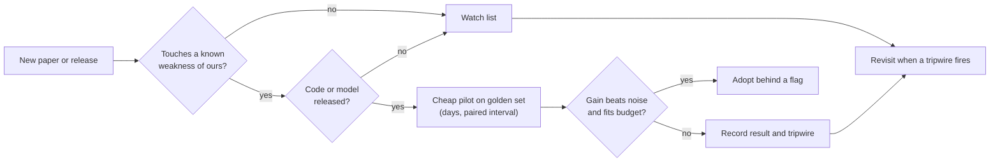

RAG research moves faster than any curriculum can follow, so this final lesson of the module does not try to list everything new. It does two things. First, it surveys the directions that look most consequential at the time of writing, grading each on the evidence ladder from [Modern RAG research](/learn/advanced-rag-research/modern-rag-research): what is established, what is promising and what is still unproven. Second, it gives you a process for tracking a field that will have changed by the time you finish reading, and one experiment that tests a theoretical claim you can verify yourself: that a single-vector embedding cannot, in principle, represent every pattern of relevance, however well it is trained.

Everything in the survey is perishable. Treat the names, papers and claims as a snapshot to be checked against the current literature; treat the *method* (classify, grade, replicate cheaply, record the decision) as the durable part.

## Learning objectives

- Describe the main emerging directions in RAG research and grade the evidence for each.
- Explain the capacity limit of single-vector retrieval, with a counting argument, and reproduce its growth with a free-embedding experiment.
- Estimate the memory cost of two alternatives to retrieval, cache-augmented generation and larger embeddings, from first principles.
- Operate a research radar: triage, tag, pilot cheaply, decide and set tripwires.
- Distinguish a result that changes engineering practice from one that changes only the leaderboard.

## Prerequisites

- [Modern RAG research](/learn/advanced-rag-research/modern-rag-research): the evidence ladder and the paper-reading checklist.
- [Long-context versus RAG](/learn/advanced-rag-research/long-context-versus-rag), [Late interaction](/learn/advanced-rag-research/late-interaction) and [Retrieval reasoning](/learn/advanced-rag-research/retrieval-reasoning): three threads this lesson refers back to.
- [Embeddings](/learn/understanding-large-language-models/embeddings) and [Dense vector search](/learn/dense-retrieval/dense-vector-search): the single-vector setting whose limits are examined.
- [Data poisoning](/learn/rag-security-fundamentals/data-poisoning): background for the security thread.

## Why this matters

An engineer who ignores research ships last year's architecture; one who follows every preprint ships a system nobody can maintain. The practical goal is a calibrated middle: know which results are likely to change what you build, and have a cheap procedure for finding out. That calibration is a skill, and it is learned by looking at several results carefully, not by reading many abstracts.

The theoretical thread in this lesson has a second purpose. Most RAG engineering treats the embedding model as an oracle whose quality improves with each release. A result that shows a hard limit, independent of training, changes how you reason about failures: some queries are not failing because the model is weak but because a fixed-size vector cannot hold the pattern of relevance required. Knowing that boundary tells you when to reach for a different tool (sparse retrieval, multi-vector scoring, reranking, a structured index) rather than a bigger model.

## The intuition

Think of the research frontier as a harbour full of boats, with some tied up at the pier and others still being built. The established ones (hybrid search, cross-encoder reranking) are the working ferries: you can book a passage. The promising ones are prototypes that have crossed the bay once or twice under good conditions: worth a test voyage with your own cargo, not a contract. The unproven are plans on paper. A sensible harbour master does not ban the prototypes or sail them to market; she keeps a ledger of which boats exist, who has ridden them, what a test voyage would cost, and what would make her change her mind.

For the capacity limit, imagine describing every possible *committee of two* chosen from a hundred people using only positions on a short street. If the street is a single line, you can only express "the two people furthest to the right" or "the two furthest to the left": the same two committees however many people there are. Give the street more dimensions and you can describe more committees, but a surprising number of dimensions is needed before every committee is possible.

## How it works

### A survey of directions, with grades

The table lists directions in rough order of how soon they are likely to affect production RAG. The "evidence" column uses the ladder; it is the author's reading of published results at the time of writing, which you should refresh.

| Direction | What it is | Evidence | What to do now |
| --- | --- | --- | --- |
| Reasoning-augmented retrieval | Language-model reasoning before, during or across retrievals ([Retrieval reasoning](/learn/advanced-rag-research/retrieval-reasoning)) | Rewriting and LLM reranking established; reasoning-trained rerankers and retrievers promising | Pilot rewriting on narrative queries |
| Learned search agents | Models trained with reinforcement learning to search and answer (Search-R1 and relatives) | Promising, early | Prototype behind a flag; do not rely on benchmark gains |
| Visual document retrieval | Late interaction over page images (ColPali and successors) | Promising for visually rich documents | Pilot on a sample with your questions |
| Cache-augmented generation | Preload a small corpus into the model's cached context instead of retrieving | Strong evidence for small, stable corpora; limited otherwise | Consider for corpora that fit and rarely change |
| Generative retrieval | A model generates document identifiers directly (DSI and relatives) | Interesting; reported to degrade as the corpus grows | Watch |
| Agent memory | Long-term stores that agents write to and read from (for example MemGPT-style systems) | Early; evaluation immature | Treat as an application of RAG with write access, and secure it |
| Retrieval-aware security research | Attacks that poison corpora or steer retrievers (for example PoisonedRAG) | Strong evidence that the attacks work in studied settings | Adopt defences now ([Data poisoning](/learn/rag-security-fundamentals/data-poisoning)) |
| Limits of single-vector retrieval | Theory and datasets showing what one vector cannot represent | Theory is solid; the practical size of the effect is still being measured | Test your own query types (this lesson's experiment) |

A few of these need a sentence of context.

**Cache-augmented generation.** Chan and colleagues (2024) proposed preloading all of a small knowledge base into the model's context and caching the resulting key-value state, so that no retrieval happens at query time. It is [prompt caching](/learn/introduction-to-rag/rag-versus-long-context-prompting) pushed to its conclusion, and it inherits the limits studied in [Long-context versus RAG](/learn/advanced-rag-research/long-context-versus-rag): it works while the corpus fits and stays stable, and degrades with size and with global or multi-needle questions.

**Generative retrieval.** In the differentiable search index of Tay and colleagues (2022), a sequence-to-sequence model is trained to output the identifier of the relevant document for a query, storing the corpus in its weights. Pradeep and colleagues (2023) examined how this scales to millions of passages and reported a marked difficulty at that scale. The approach is a useful research probe of how much a model can memorise; the evidence does not currently support replacing an index with it, and updating the corpus means retraining.

**Agent memory.** A long-running agent needs state that outlives one conversation. MemGPT (Packer and colleagues, 2023) framed this as managing a memory hierarchy, moving information between a small active context and a larger store. Architecturally this is retrieval over data the agent itself wrote, which means every concern about [indirect prompt injection](/learn/rag-security-fundamentals/indirect-prompt-injection) and poisoning applies to the agent's own past.

**Corpus poisoning.** PoisonedRAG (Zou and colleagues, 2024) showed that inserting a small number of crafted texts into a large knowledge base could steer a RAG system to a chosen answer for chosen questions. The relevance for you is concrete: the corpus is an attack surface, and the write path to it deserves the same care as a database's.

### The capacity limit of a single vector

A dense retriever represents each query and each document as a $d$-dimensional vector and ranks by dot product (or cosine). Weller and colleagues (2025), in a paper on the theoretical limitations of embedding-based retrieval, connected this to a known object in mathematics: the **sign rank** of the relevance matrix. Their argument, in summary, is that the pattern of "which documents each query should retrieve" can only be reproduced by $d$-dimensional embeddings if that matrix has small enough sign rank, and that the set of top-$k$ combinations expressible grows with $d$ but is bounded. They also built a dataset (LIMIT) of simple-looking queries designed to demand many combinations, and reported that strong embedding models performed poorly on it, even though the questions are easy for a person and for sparse or multi-vector methods. Treat the paper as a reminder that capacity is finite, and read its numbers in the original.

A fair reading is that this does not condemn dense retrieval: real queries do not require all combinations, and real systems add reranking and hybrid retrieval. But it identifies a failure family: queries whose relevant sets are arbitrary combinations (for example, "documents about *any two* of these 50 topics") are exactly the ones a fixed-size vector represents worst.

### A research radar, as a process

1. **Collect** weekly from a small, fixed set of sources (a few venue proceedings, a handful of authors and library release notes) rather than the whole feed.
2. **Triage in two minutes**: which component does it change, and is there code or a released model? If not, tag "watch".
3. **Grade** with the ladder and the seven-question reading checklist.
4. **Pilot** only items that touch a known weakness in your own failure analysis. A pilot is days, not weeks, with a golden set and paired intervals.
5. **Decide** adopt, pilot further, watch or ignore, and record the reason.
6. **Set tripwires**: the concrete event that would change the decision (an independent reproduction, a library release, a drop in your metrics).



## The mathematics

### Counting what a vector can express

**Intuition.** Count how many different "top-$k$ answers" a $d$-dimensional embedding can possibly produce. If that number is smaller than the number of answers you need, no training procedure can succeed.

Take one dimension ($d = 1$). Each document is a number $p_i$ and each query a number $q$; the score is $q\,p_i$. If $q > 0$, the top-$k$ documents are the $k$ with the largest $p_i$; if $q < 0$, the $k$ smallest; if $q = 0$ all tie. So only **two** distinct top-$k$ sets are possible, whatever the number of documents.

**Worked example by hand.** Four documents and all $\binom{4}{2} = 6$ pair-queries ("find exactly documents $i$ and $j$"). In one dimension at most 2 of the 6 pairs can be returned exactly, so the best possible share of exactly answered queries is $2/6 = 0.33$. For six documents, with $\binom{6}{2} = 15$ pairs, the bound is $2/15 = 0.13$; for eight documents ($28$ pairs), $2/28 = 0.07$. The experiment below reproduces these numbers in the $d = 1$ column.

For $d \ge 2$ the counting is subtler (for fixed $d$ the number of achievable top-$k$ sets grows only polynomially in $n$, a classical result on $k$-sets of point configurations), but the shape is the same: **the number of achievable answers is bounded by a function of $d$ and $n$ that grows more slowly than the $\binom{n}{k}$ answers that all-combination queries need.** That is why the dimension required to represent every pair grows as the corpus grows.

The formal statement is in terms of sign rank. Let $A$ be the $m \times n$ matrix with $A_{ij} = +1$ if document $j$ is relevant to query $i$ and $-1$ otherwise. Embeddings with a scoring threshold realise $A$ exactly if some real matrix $S = QD^{\top}$ of rank at most $d$ (plus a per-query offset, which adds one to the dimension) has the same signs as $A$. The smallest rank for which that is possible is the sign rank of $A$. The relevance matrices of all-combination queries have sign rank that grows with $n$.

### Memory: alternatives and their costs

The key-value cache of a transformer stores, for every token in the context, a key and a value vector in each layer. Per token,

$$\text{KV bytes per token} = 2 \times n_{\text{layers}} \times n_{\text{kv-heads}} \times d_{\text{head}} \times b ,$$

where $b$ is bytes per number. **Worked example** with an *assumed* configuration of 32 layers, 8 key-value heads, head dimension 128 and 2-byte numbers: $2 \times 32 \times 8 \times 128 \times 2 = 131{,}072$ bytes, or 128 KiB per token. A 100,000-token corpus therefore needs $100{,}000 \times 131{,}072 \approx 1.3 \times 10^{10}$ bytes, about 12.2 gibibytes, *per cached copy*. Real models differ widely in these parameters, so use your model's configuration. For a larger embedding, 1 million documents at 768 dimensions and 4 bytes cost $3.07$ gigabytes; at 3,072 dimensions, $12.3$ gigabytes: more capacity per vector costs memory linearly.

## In code

**The problem.** Test the capacity claim directly. Create $n$ documents and, for every pair of documents, one query whose correct answer is exactly that pair. Give every query and every document a *free* $d$-dimensional vector and train them by gradient descent so that, for each query, its two documents outrank all others. No text encoder is involved: this is the best any embedding model of dimension $d$ could do, so a failure here is not a failure of training data or model quality. The script reports, for each $n$ and $d$, the share of the $\binom{n}{2}$ queries whose top two documents are exactly the right pair.

**An important limit.** Gradient descent is a non-convex optimiser. A value below 1.00 means "this optimiser did not find a solution", which is *evidence* of limited capacity but not a proof; the $d = 1$ column is proven by the counting argument above, the others are empirical. The paper's results concern real embedding models and a specific dataset; this toy shows the mechanism, not their numbers.

**Dependencies.** `torch` only. No download, no API key; the whole grid runs in under a minute on a laptop CPU.

```bash
pip install torch
```

**The source.**

```python
import itertools
import torch

def solves_all_pairs(n_docs: int, dim: int, steps: int = 2500, seed: int = 0) -> float:
    """Free-embedding test: can `dim`-dimensional vectors make every pair of documents the exact top-2 for some query?"""
    torch.manual_seed(seed)
    pairs = list(itertools.combinations(range(n_docs), 2))
    rel = torch.zeros(len(pairs), n_docs, dtype=torch.bool)
    for q, (i, j) in enumerate(pairs):
        rel[q, i] = rel[q, j] = True
    Q = torch.nn.Parameter(torch.randn(len(pairs), dim) * 0.5)      # one free query vector per pair
    D = torch.nn.Parameter(torch.randn(n_docs, dim) * 0.5)          # one free vector per document
    opt = torch.optim.Adam([Q, D], lr=0.05)
    pos_mask, neg_mask = rel.unsqueeze(2), (~rel).unsqueeze(1)      # (q, pos, 1) and (q, 1, neg)
    for _ in range(steps):
        S = Q @ D.T                                                  # scores: queries x documents
        margin = S.unsqueeze(2) - S.unsqueeze(1)                     # score(pos) - score(neg) for every pair
        loss = torch.relu(1.0 - margin)[pos_mask.expand_as(margin) & neg_mask.expand_as(margin)].mean()
        opt.zero_grad(); loss.backward(); opt.step()
        with torch.no_grad():                                        # keep the vectors from growing without bound
            scale = max(Q.norm(dim=1).max().item(), D.norm(dim=1).max().item(), 1.0)
            if scale > 4: Q.mul_(4 / scale); D.mul_(4 / scale)
    with torch.no_grad():
        top2 = torch.topk(Q @ D.T, 2, dim=1).indices
        hit = torch.zeros_like(rel)
        hit.scatter_(1, top2, True)
        return float((hit == rel).all(dim=1).float().mean())         # share of queries whose top-2 is exactly right

print("share of the pair-queries answered exactly (top-2 equals the pair), by documents n and dimension d")
dims = [1, 2, 3, 4, 6, 8, 12]
print("   n " + "".join(f"  d={d:<3d}" for d in dims))
for n in (4, 6, 8, 12, 16, 24):
    print(f"{n:4d} " + "".join(f"  {solves_all_pairs(n, d):5.2f}" for d in dims))
```

**What the important lines do.** `rel` marks the two relevant documents of each pair-query. `Q` and `D` are the free embeddings. The loss is a pairwise hinge: for every query, every (relevant, irrelevant) document pair must be separated by a margin of 1, which is the objective that a retriever's contrastive training approximates. The rescaling step keeps vector norms bounded so that the margin cannot be satisfied simply by growing the numbers. At the end, `topk` finds each query's two highest-scoring documents, and a query counts as solved only if that set equals the relevant pair.

**Output.** (The seeds are fixed; other hardware or library versions may change a value by a digit.)

```output
share of the pair-queries answered exactly (top-2 equals the pair), by documents n and dimension d
   n   d=1    d=2    d=3    d=4    d=6    d=8    d=12 
   4    0.33   1.00   1.00   1.00   1.00   1.00   1.00
   6    0.13   0.33   0.80   1.00   1.00   1.00   1.00
   8    0.07   0.25   0.50   0.93   1.00   1.00   1.00
  12    0.03   0.11   0.33   0.76   1.00   1.00   1.00
  16    0.02   0.08   0.22   0.47   1.00   1.00   1.00
  24    0.01   0.04   0.12   0.26   0.95   1.00   1.00
```

**What the output means.** Read it two ways. Down each column, the share falls as the number of documents grows: with $d = 4$, every pair is solved for 4 and 6 documents, then the share falls to 0.93, 0.76, 0.47 and 0.26 as $n$ rises through 8, 12, 16 and 24. Across each row, the share rises with dimension: for 24 documents, $d = 4$ answers 26 per cent of the pairs, $d = 6$ answers 95 per cent and $d = 8$ answers all. The dimension that suffices grows with the number of documents, as the counting argument predicts. The $d = 1$ column matches the hand calculation exactly: 0.33, 0.13 and 0.07 for 4, 6 and 8 documents, because only two top-2 sets exist in one dimension. (The remaining cells, 0.03, 0.02 and 0.01, are also the $2/\binom{n}{2}$ bound.) Note what is *not* shown: real embedding models have hundreds of dimensions and real corpora have millions of documents, and real queries do not ask for all combinations. The experiment shows that a capacity limit exists and how it scales; whether your queries come near it is a measurement for your own data.

**Common errors.** Reading a value below 1.00 as proof of impossibility for $d \ge 2$ (more steps or restarts might help); forgetting the norm cap, which lets the optimiser cheat by scaling; using cosine similarity with unit-norm vectors, which changes the geometry (the cap here plays a similar role for dot products).

**How to extend it.** Raise `steps` or add random restarts and see which cells improve. Change the queries to *triples* of documents and re-run: the dimension needed rises. Replace the free query vectors with the output of a small learned map from a query description to a vector to see how restricting query vectors lowers capacity further. Then compare with BM25 on the same combinatorial task using a bag-of-words encoding: sparse vectors have as many dimensions as the vocabulary, which is why they are not limited in the same way.

## A real-world example

Every quarter the Platform team at Meridian holds a two-hour research review for AskMeridian. Before the meeting, one engineer prepares the radar: six items collected from the previous quarter's reading, each with a one-paragraph card (what it changes, what evidence exists, what a pilot would cost). This quarter's items include a reasoning-trained reranker, a visual retriever for the PDF manuals, a cache-augmented design for the 60-page expense policy, an agent-memory library, a poisoning attack paper, and the embedding-limits paper.

They decide each in ten minutes. The reasoning-trained reranker is graded promising and tied to a known weakness (narrative IT questions), so it gets a one-week pilot against the current reranker on 80 labelled questions, with a paired interval and a latency measurement. The visual retriever touches a real weakness (screenshots and tables in the Meridian Reports manuals) and is piloted on 200 pages. The cache-augmented design is a candidate for the expense policy alone, because it is small and stable; the team sets a tripwire (corpus above a size, or monthly changes) that would end it. The agent-memory library is put on the watch list, since AskMeridian has no long-running agents. The poisoning paper is treated as a security task, not a research item: the team reviews who can write to the handbook index. For the embedding-limits paper, an engineer runs the lesson's experiment, then checks AskMeridian's failed queries for the failure family it describes ("find documents that mention any two of these systems") and finds almost none; the item is recorded as understood and not urgent.

Nothing in the review depended on any of these being the last word. Each decision has an owner, a date and a tripwire, and the notes are the first thing read at the next review.

## Common mistakes

- **Chasing the feed.** Following every preprint produces a pile of half-tried ideas; limit sources and require a link to a known weakness.
- **Treating "promising" as "ready".** A rung on the ladder is a prior, not a verdict; pilot before relying.
- **Dismissing limits as academic.** A capacity result tells you which queries to test; ignoring it leaves a failure family undiagnosed.
- **Piloting without a golden set.** An experiment without per-query results and an interval cannot reject anything.
- **Forgetting to record negative results.** Teams repeat dead ends when nobody wrote down why the last attempt failed.
- **Letting research items skip security review.** New retrieval components and memory stores add write paths and parsers that attackers will find.
- **Mistaking benchmark novelty for production relevance.** A new benchmark measures what its authors chose; check it resembles your questions.

## Best practices

- Keep a research radar with owners, grades, pilot results and tripwires; review it on a schedule.
- Triage by component and by link to a measured weakness in your system.
- Grade with the evidence ladder and the reading checklist before spending engineering time.
- Pilot in days with a versioned golden set, per-query scores and paired intervals.
- Record decisions and reasons, including rejections.
- Probe theory-backed limits with a small experiment on your own query types.
- Put new retrieval components through the same security review as any service that reads untrusted text.
- Prefer improvements that arrive via libraries you already run; integration cost is evidence.

## Performance considerations

Research adoption has a time budget as well as a compute budget. A pilot of a retrieval technique costs mainly labelling effort and a few days of an engineer's time; the experiments in this module each ran in minutes on a laptop, which is the point: the *test* is cheap even when the *technique* is expensive. Reserve the expensive work for items that pass the cheap one.

The costs of the alternatives in this lesson can be estimated up front. Cache-augmented generation needs a key-value cache of roughly 128 KiB per token for the assumed model configuration in the maths section, about 12 gibibytes for a 100,000-token corpus per cached copy; and every query still pays attention over the whole cached context. Larger embeddings raise capacity at linear memory cost: going from 768 to 3,072 dimensions multiplies the index from 3.07 to 12.3 gigabytes per million documents, and slows every search roughly in proportion. A reasoning step adds model calls ([Retrieval reasoning](/learn/advanced-rag-research/retrieval-reasoning)). A visual index multiplies vectors per page ([Late interaction](/learn/advanced-rag-research/late-interaction)). Before piloting, write the cost in the radar card; many items can be ruled out by arithmetic.

## Security considerations

Several emerging directions enlarge the attack surface. Corpus-poisoning research shows that a few crafted documents can steer answers, so control and log who can write to the index, require provenance, and test retrieval with adversarial documents ([Data poisoning](/learn/rag-security-fundamentals/data-poisoning)). Agent memory is a write path controlled partly by the model: an injected instruction can be stored and replayed in later sessions, so memory writes need validation, expiry and user-scoped isolation ([Tenant isolation](/learn/access-control-and-privacy/tenant-isolation)). Learned search agents with tools can take actions; restrict their tools, budget their steps and log every action. Visual retrieval admits instructions embedded in images. Reproducing research code means running third-party code and loading third-party weights: do it in a sandbox without production credentials, and prefer non-executable weight formats.

## Summary

- The frontier divides into established practice, promising techniques that need local pilots, and unproven ideas; grade each claim with the evidence ladder and re-grade as evidence accumulates.
- A single-vector embedding has finite capacity: the number of distinct top-$k$ answers it can express is bounded by a function of its dimension, so all-combination queries need dimension that grows with the corpus. In the toy experiment, the share of exactly answered pair-queries fell with the number of documents and rose with the dimension, and matched the counting bound exactly in one dimension.
- Cache-augmented generation works for small stable corpora, generative retrieval has not shown it can replace an index at scale, and agent memory is retrieval with write access and its security consequences.
- Corpus poisoning and memory poisoning are demonstrated attacks; adopt defences now.
- A research radar (collect, triage, grade, pilot, decide, set tripwires) turns an endless feed into a few cheap, recorded decisions.
- The durable skill is the method, because the specific results in any survey will date.

## Exercises

**1. (Warm-up)** Using the counting argument, what is the best possible share of exactly answered pair-queries in $d = 1$ for $n = 10$ documents?

<details><summary>Show solution</summary>

There are $\binom{10}{2} = 45$ pair-queries and only 2 distinct top-2 sets, so the best share is $2/45 = 0.044$, about 4 per cent.

</details>

**2. (Applied)** A model has 24 layers, 4 key-value heads, head dimension 128 and 2-byte numbers. How much KV cache does a 50,000-token cached corpus need?

<details><summary>Show solution</summary>

Per token: $2 \times 24 \times 4 \times 128 \times 2 = 49{,}152$ bytes. For 50,000 tokens: $2.46 \times 10^9$ bytes, about 2.3 gibibytes per cached copy. Multiply by the number of simultaneous cached copies you need to serve.

</details>

**3. (Design)** Build the radar card for "a new library that lets AskMeridian store conversation memory for each user". Fill in: component changed, evidence grade, link to a known weakness, pilot design, security review items and a tripwire.

<details><summary>Show solution</summary>

Component: a new store with write access feeding retrieval. Evidence: early; limited independent evaluation. Link to a known weakness: only valid if logs show users repeating context across sessions; otherwise watch. Pilot: 20 volunteers for two weeks, with a golden set of follow-up questions, measuring answer correctness with and without memory and the rate of wrong or stale memories surfaced. Security review: per-user isolation of memory, validation of what may be written (no instructions from retrieved documents), expiry and deletion on request, audit log of writes, and a test that memory from one user never appears for another. Tripwire: an independent evaluation, or a measured rise in repeated-context questions, or a privacy incident in the pilot that ends it.

</details>

**4. (Challenge)** Modify `solves_all_pairs` to ask for exact top-3 sets over all triples of 8 documents and find the smallest dimension (from 1 to 12) at which the share reaches 1.00. Predict whether it will be larger or smaller than for pairs at $n = 8$, and explain.

<details><summary>Show solution</summary>

Build `combinations(range(n_docs), 3)`, mark three relevant documents per query, change `topk` to 3, and compare the sets as before (the margin loss needs no change). There are $\binom{8}{3} = 56$ queries instead of 28, and each must separate three documents from five, so more patterns must be realised; expect a larger required dimension than the pair case (which reached 1.00 at $d = 6$ for $n = 8$ in the lesson's run). Check by running it: the exact threshold depends on the optimiser, so use more steps or restarts before concluding that a cell is impossible. The pattern to explain is that the number of required combinations grows faster than the number of top-$k$ sets that $d$ dimensions can express.

</details>

## Check your understanding

```quiz
[
  {
    "q": "Why can a one-dimensional embedding return at most two distinct top-k sets, regardless of the number of documents?",
    "options": [
      "Dot products are always equal in one dimension",
      "One dimension cannot store numbers",
      "Scores are q times p, so a positive query ranks by largest p and a negative query by smallest p",
      "Top-k sets must contain exactly two documents"
    ],
    "answer": 2,
    "why": "With scalar embeddings the order of documents is fixed up to reversal, so only the k largest or the k smallest can be returned."
  },
  {
    "q": "In the free-embedding experiment, a value below 1.00 at d = 4 means what?",
    "options": [
      "A proof that d = 4 can never represent those queries",
      "The query vectors were not free",
      "The data were mislabelled",
      "The optimiser did not find a solution, which is evidence of limited capacity but not a proof"
    ],
    "answer": 3,
    "why": "The optimisation is non-convex, so a failure to find a solution does not prove none exists; only the d = 1 case follows from the counting argument."
  },
  {
    "q": "Which direction is best described as strong evidence for small, stable corpora and limited otherwise?",
    "options": [
      "Cache-augmented generation",
      "Generative retrieval",
      "Learned search agents",
      "Agent memory"
    ],
    "answer": 0,
    "why": "Preloading and caching a corpus works while it fits in the context and rarely changes; it degrades with size and with global or multi-needle questions."
  },
  {
    "q": "What does PoisonedRAG demonstrate?",
    "options": [
      "Embedding models cannot represent combinations",
      "A few crafted documents inserted into a knowledge base can steer a RAG system's answers",
      "Cache-augmented generation is insecure by design",
      "Reranking removes all poisoned documents"
    ],
    "answer": 1,
    "why": "The paper showed corpus-poisoning attacks that steered answers for chosen questions, so the write path to the corpus is an attack surface."
  },
  {
    "q": "What is the purpose of a tripwire in a research radar?",
    "options": [
      "To block all new techniques",
      "To measure embedding capacity",
      "To rank papers by citation count",
      "To record the concrete event that would change a decision, such as an independent reproduction or a library release"
    ],
    "answer": 3,
    "why": "A tripwire turns 'watch' into a testable condition, so decisions are revisited for a reason and not forgotten."
  }
]
```

## Further reading

- Weller, O. et al. (2025). *On the Theoretical Limitations of Embedding-Based Retrieval*. The sign-rank argument and the LIMIT dataset.
- Zou, W. et al. (2024). *PoisonedRAG: Knowledge Corruption Attacks to Retrieval-Augmented Generation of Large Language Models*.
- Chan, B. J. et al. (2024). *Don't Do RAG: When Cache-Augmented Generation is All You Need for Knowledge Tasks*.
- Tay, Y. et al. (2022). *Transformer Memory as a Differentiable Search Index*. [arXiv:2202.06991](https://arxiv.org/abs/2202.06991).
- Pradeep, R. et al. (2023). *How Does Generative Retrieval Scale to Millions of Passages?*
- Packer, C. et al. (2023). *MemGPT: Towards LLMs as Operating Systems*.
