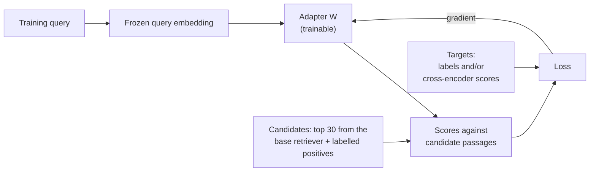

A retriever trained on web search data is a generalist. Put it in front of a corpus of internal policies, scientific abstracts or error codes and it still works, but it was never taught what *relevant* means for your users. Fine-tuning a retriever closes that gap, and a decade of research has produced a menu of ways to do it, distinguished mostly by one question: **where does the training signal come from?** Human labels, a stronger cross-encoder, synthetic questions written by a language model, or the feedback of the generator that will read the passages.

The [embedding optimisation module](/learn/embedding-optimisation/fine-tuning-embeddings) already teaches the mechanics of fine-tuning an embedding model: contrastive loss, hard negatives, training loops. This lesson takes the research view of that same topic. It maps the sources of supervision and what is known about each, then runs an experiment that has a sobering result: on a real benchmark, a small adapter trained on labelled queries improves nDCG by thirteen points under a random split of queries and *loses* under a split that mimics new documents. How you split the data decides what you conclude.

## Learning objectives

- Compare the main sources of retriever supervision (labels, teacher distillation, synthetic queries, generator feedback) and state what each costs and risks.
- Write a listwise distillation loss and the generator-supervised retrieval loss, and compute each by hand.
- Train a query-side adapter on frozen document embeddings and evaluate it correctly.
- Explain why overlap between training and test documents inflates retrieval gains, and design a split that matches the deployment situation.
- Decide between an adapter, a full fine-tune and no fine-tuning for a given corpus and query volume.

## Prerequisites

- [Fine-tuning embeddings](/learn/embedding-optimisation/fine-tuning-embeddings), [Contrastive learning](/learn/embedding-optimisation/contrastive-learning) and [Hard negative mining](/learn/embedding-optimisation/hard-negative-mining): the mechanics assumed here.
- [Cross-encoder models](/learn/reranking-models/cross-encoder-models): the teacher used below.
- [nDCG](/learn/retrieval-evaluation/ndcg): the metric reported.
- [Retrieval-augmented pretraining](/learn/advanced-rag-research/retrieval-augmented-pretraining): where generator-supervised retrieval began.

## Why this matters

A retriever's mistakes are invisible to the generator. If the right passage never appears in the top five, no prompt can recover it, so retrieval quality caps answer quality. Off-the-shelf embedding models are strong averages and weak on particulars: your abbreviations, your product names, the way your users phrase questions. Fine-tuning can move a model towards those particulars with surprisingly little data.

It can also quietly make things worse, and teams find out too late. A fine-tuned retriever is evaluated on questions, and the questions that are easiest to collect (logged queries about popular pages) share documents with those used in training. The model learns *which documents are popular*, scores well on the test set, and then fails on the documents added next month. Understanding the supervision sources, and the evaluation traps, is what separates a retriever that improves in production from one that improved on a spreadsheet.

## The intuition

Imagine training a new librarian. You can teach in four ways.

1. **Show her solved cases**: a reader asked this, and the right book was that one (human labels). The most reliable teacher, and the most expensive: someone has to find all those cases.
2. **Let a senior librarian grade her picks** (a cross-encoder teacher). Cheaper than finding cases yourself and gives graded feedback ("this one is nearly right"), but she inherits the senior's blind spots.
3. **Have her invent practice questions from the books** (synthetic queries). Unlimited, but the questions may not sound like real readers.
4. **Ask the readers' tutor whether the book helped him write his essay** (generator feedback). It trains her on what is *useful*, not only what is *similar*, but needs a tutor in the loop.

There is also a trap common to all four. If she practises on the same few shelves that the final exam covers, she will excel on the exam and be lost in the stacks she never saw.

## How it works

### Sources of supervision

| Source | Signal | Representative work | Strength | Risk |
| --- | --- | --- | --- | --- |
| Human labels | Query with positive passages | DPR (Karpukhin et al., 2020) | Directly measures what users want | Costly; labels are incomplete |
| Mined hard negatives | Wrong but similar passages | DPR; ANCE (Xiong et al., 2020); RocketQA (Qu et al., 2021) | Sharper boundaries | False negatives: unlabelled true answers become "wrong" |
| Cross-encoder distillation | Teacher scores for candidates | Margin-MSE (Hofstätter et al., 2020); RocketQA denoising | Graded signal, no labels needed | Student cannot exceed teacher's bias |
| Synthetic queries | LLM writes a question per passage | GPL (Wang et al., 2021); InPars (Bonifacio et al., 2022); Promptagator (Dai et al., 2022) | Scales to any corpus | Distribution mismatch with real queries |
| Unsupervised pretraining | Two views of one text | Contriever (Izacard et al., 2021) | No queries needed | Weaker than supervised on its own |
| Generator feedback | How much a passage helps the reader | REPLUG LSR (Shi et al., 2023); Atlas (Izacard et al., 2022); RA-DIT (Lin et al., 2023) | Optimises usefulness | Needs generator calls in training |

A few points of context. **DPR** showed that two BERT encoders trained with in-batch negatives plus mined hard negatives could beat BM25 on open-domain question answering with a modest number of labelled questions. **ANCE** observed that negatives sampled once are soon too easy, and refreshed them from the model's own index during training. **RocketQA** used a cross-encoder to remove likely false negatives and to label extra questions. The **BEIR** benchmark ([Retrieval benchmarks](/learn/retrieval-evaluation/retrieval-benchmarks)) then showed that dense retrievers trained on one dataset often fell behind BM25 on others, which is the motivation for domain adaptation.

**Synthetic data** came from that motivation. GPL generates queries with a sequence-to-sequence model, mines negatives, and labels pairs with a cross-encoder's score margins; InPars and Promptagator prompt a large language model to write queries, Promptagator with a few examples of the target task. These are established research techniques with released code; how well they transfer to a particular corpus must be measured.

**Generator feedback** is the idea specific to RAG. The generator reads each candidate passage and assigns the true continuation or answer a likelihood; passages that raise that likelihood are the useful ones. REPLUG's trained variant (LSR) and Atlas's perplexity-based objectives train the retriever to put its probability mass where the generator finds help, and RA-DIT combines such retriever training with a separate instruction-tuning stage for the language model. This is promising and published, but expensive, since each training example needs generator calls per candidate; few production teams have reported using it.

### Where to adapt: the whole encoder or just the query

There are three places to intervene, with very different costs.

1. **Full fine-tune** of both encoders. Maximum flexibility, but every document must be re-embedded afterwards and the index rebuilt.
2. **Query-side only.** Keep document vectors frozen and adapt how queries are encoded: a fine-tuned query tower, or a small learned transform of the query embedding. No re-indexing, so deployment is cheap and reversible.
3. **Post-retrieval.** Leave the retriever alone and train a reranker ([Cross-encoder models](/learn/reranking-models/cross-encoder-models)); the retriever's recall remains the ceiling.

The experiment below uses the second option, because it isolates the effect of the supervision signal and costs seconds, not hours. The adapter is a single matrix $W$ that maps a query embedding $q$ to $\mathrm{normalise}(Wq)$, initialised at the identity so that training starts from the original model.

### The training loop in one picture



### Evaluation: the split decides the conclusion

Two splits answer two different questions.

- A **random split of queries** asks: *for new queries about documents the system has already seen asked about, does the retriever improve?* This matches an FAQ-style workload in which the same documents are asked about repeatedly.
- A **split by document** asks: *for new documents, queries about material never seen in training, does it improve?* This matches a corpus that grows, and is the harder test of whether the model learned relevance rather than document identity.

Neither is wrong. Using the wrong one for your deployment is. The experiment reports both, and a breakdown of the random split by whether a test query's relevant document also appeared in training.

## The mathematics

### Soft targets from a teacher

**Intuition.** Instead of telling the student "document 3 is right, the rest are wrong", the teacher gives each candidate a score; the student is trained to spread its probability the same way.

Let a query have $n$ candidate passages. The student (the retriever) produces similarities $s_1, \dots, s_n$ and a distribution over candidates

$$P_R(i) = \frac{\exp(s_i / \tau)}{\sum_{j=1}^{n} \exp(s_j / \tau)},$$

where $\tau$ is a temperature (small $\tau$ makes the distribution peakier). A teacher assigns each candidate a score $t_i$ giving the target distribution $Q(i) = \exp(t_i/T) / \sum_j \exp(t_j/T)$ with its own temperature $T$. The loss is the Kullback-Leibler divergence from the target to the student:

$$\mathcal{L}_{\text{distil}} = \sum_{i=1}^{n} Q(i)\,\big[\ln Q(i) - \ln P_R(i)\big].$$

It is zero when the two distributions agree and positive otherwise.

### Generator-supervised retrieval

The same loss applies when the target comes from the generator. For a question $x$ with known answer $y$, define the target from how likely the generator finds the answer when it is shown passage $i$:

$$Q_{LM}(i) = \frac{P_{LM}(y \mid x, d_i)^{1/\beta}}{\sum_{j} P_{LM}(y \mid x, d_j)^{1/\beta}},$$

where $d_i$ is the $i$-th passage and $\beta$ is a temperature on the likelihoods. Training the retriever to match $Q_{LM}$ makes it prefer passages that help the reader, with no passage relevance labels at all. Published methods differ in detail (the direction of the divergence, the normalisation, whether the reader sees each passage alone or in combination); this is the common core.

**Worked example by hand.** Three candidates with cosine scores $0.8, 0.6, 0.5$ and $\tau = 0.1$. The exponents are $8, 6, 5$, so the unnormalised weights are $e^8 = 2981$, $e^6 = 403$, $e^5 = 148$, summing to $3533$, and $P_R = (0.844, 0.114, 0.042)$. The retriever is confident in passage 1. Now the generator's likelihood of the true answer given each passage is $(0.02, 0.30, 0.05)$ with $\beta = 1$; they sum to $0.37$, so $Q_{LM} = (0.054, 0.811, 0.135)$: passage 2 is the useful one. The loss is

$$0.054\ln\tfrac{0.054}{0.844} + 0.811\ln\tfrac{0.811}{0.114} + 0.135\ln\tfrac{0.135}{0.042} \approx -0.149 + 1.589 + 0.158 \approx 1.60.$$

Gradient descent on this loss raises the score of passage 2 and lowers that of passage 1. The same arithmetic in Python:

```python
import numpy as np

s = np.array([0.8, 0.6, 0.5])          # cosine scores of three candidate passages
tau = 0.1
p_ret = np.exp(s / tau) / np.exp(s / tau).sum()          # retriever distribution

lm_lik = np.array([0.02, 0.30, 0.05])  # P_LM(true answer | passage, question), one per passage
beta = 1.0
q_lm = lm_lik ** (1 / beta) / (lm_lik ** (1 / beta)).sum()   # target distribution from the generator

kl = float(np.sum(q_lm * (np.log(q_lm) - np.log(p_ret))))
print("retriever :", p_ret.round(4))
print("LM target :", q_lm.round(4))
print("KL(target || retriever) = %.3f" % kl)
```

```output
retriever : [0.8438 0.1142 0.042 ]
LM target : [0.0541 0.8108 0.1351]
KL(target || retriever) = 1.599
```

(The small difference from 1.60 is rounding in the hand calculation.)

## In code

**The problem.** Test, on a real benchmark, how much a small learned adapter helps under each supervision signal and under each split. The data are SciFact from the BEIR benchmark: scientific claims as queries and 5,183 paper abstracts as the corpus. SciFact comes with 809 labelled training queries and 300 test queries. The base retriever is `all-MiniLM-L6-v2`; the teacher is the `cross-encoder/ms-marco-MiniLM-L-6-v2` model.

**Dependencies.** `sentence-transformers`, `datasets`, `torch` and NumPy. The step that scores teacher candidates takes a few minutes on a laptop CPU; training takes under a minute per run. No API key.

```bash
pip install sentence-transformers datasets torch numpy
```

**Step 1: embed and score.**

```python
"""Step 1: embed SciFact once and score each training query's candidates with a cross-encoder teacher."""
import json
import numpy as np
from datasets import load_dataset
from sentence_transformers import SentenceTransformer, CrossEncoder

corpus = load_dataset("BeIR/scifact", "corpus", split="corpus")
ids = [str(x) for x in corpus["_id"]]
texts = [t + ". " + x for t, x in zip(corpus["title"], corpus["text"])]
queries = {str(r["_id"]): r["text"] for r in load_dataset("BeIR/scifact", "queries", split="queries")}
qrels = {}
for split in ("train", "test"):
    qrels[split] = {}
    for r in load_dataset("BeIR/scifact-qrels", split=split):
        if int(r["score"]) > 0:
            qrels[split].setdefault(str(r["query-id"]), []).append(str(r["corpus-id"]))

bi = SentenceTransformer("sentence-transformers/all-MiniLM-L6-v2")
D = bi.encode(texts, batch_size=64, normalize_embeddings=True)
np.save("D.npy", D)
for split in qrels:
    np.save(f"Q_{split}.npy", bi.encode([queries[q] for q in qrels[split]], normalize_embeddings=True))
json.dump({"ids": ids, "qrels": qrels}, open("labels.json", "w"))

# Teacher: top-30 dense candidates per training query (plus any labelled positive), scored by a cross-encoder.
teacher = CrossEncoder("cross-encoder/ms-marco-MiniLM-L-6-v2")
idpos = {d: i for i, d in enumerate(ids)}
Qtr = np.load("Q_train.npy")
cand, scores = [], []
for i, q in enumerate(qrels["train"]):
    top = [int(j) for j in np.argsort(-(D @ Qtr[i]))[:30]]
    top += [idpos[d] for d in qrels["train"][q] if idpos[d] not in top]
    s = teacher.predict([(queries[q], texts[j]) for j in top], batch_size=64, show_progress_bar=False)
    cand.append(top); scores.append([float(x) for x in s])
json.dump({"cand": cand, "scores": scores}, open("teacher.json", "w"))
print("training queries:", len(cand), "| test queries:", len(qrels["test"]))
```

```output
training queries: 809 | test queries: 300
```

**Step 2: train and evaluate.** The adapter has $384 \times 384$ parameters and a penalty on the distance of $W$ from the identity. Three losses are compared: `labels` (put probability mass on the labelled positives among the candidates), `teacher` (match the cross-encoder's distribution) and `both`. Each setting picks the best epoch on *validation queries held out from training*, never on the test set. In the `shared-docs` setting the split is random. In the `new-docs` setting, every training query that shares a relevant document with a test query is removed, test documents never appear as training candidates, and the validation queries share no documents with the training queries.

```python
import json
import numpy as np
import torch
import torch.nn.functional as F

meta = json.load(open("labels.json"))
ids, qrels = meta["ids"], meta["qrels"]

def ndcg10(ranked, relevant):
    dcg = sum(1 / np.log2(i + 2) for i, d in enumerate(ranked[:10]) if d in relevant)
    return dcg / sum(1 / np.log2(i + 2) for i in range(min(10, len(relevant))))

torch.manual_seed(0)
D = torch.tensor(np.load("D.npy"))                         # frozen MiniLM document vectors (5,183 x 384)
Qtr, Qte = (torch.tensor(np.load(f"Q_{s}.npy")) for s in ("train", "test"))
qtr, qte = list(qrels["train"]), list(qrels["test"])
teacher = json.load(open("teacher.json"))                  # cross-encoder scores for each query's top-30 candidates
cand0, tscore0 = teacher["cand"], teacher["scores"]
idpos = {d: i for i, d in enumerate(ids)}
pos = [{idpos[d] for d in qrels["train"][q]} for q in qtr]
test_docs = {idpos[d] for q in qte for d in qrels["test"][q]}
train_docs = set().union(*pos)

def test_ndcg(W, subset=None):
    with torch.no_grad():
        top = torch.topk(F.normalize(Qte @ W, dim=-1) @ D.T, 10, dim=1).indices.numpy()
    rows = [i for i in range(len(qte)) if subset is None or subset[i]]
    return float(np.mean([ndcg10([ids[j] for j in top[i]], set(qrels["test"][qte[i]])) for i in rows]))

def val_ndcg(W, rows):
    with torch.no_grad():
        top = torch.topk(F.normalize(Qtr[rows] @ W, dim=-1) @ D.T, 10, dim=1).indices.numpy()
    return float(np.mean([ndcg10([ids[j] for j in top[k]], set(qrels["train"][qtr[i]])) for k, i in enumerate(rows)]))

def make_setting(name):
    rng = np.random.RandomState(0)
    if name == "shared-docs":                                # random query split: queries may reuse documents
        order = rng.permutation(len(qtr)); cut = 700
        return order[:cut], order[cut:], cand0, tscore0
    keep = [i for i in range(len(qtr)) if not (pos[i] & test_docs)]         # new-docs: no training query
    cand, tsc = [], []                                                       # touches a test document, and
    for i in range(len(qtr)):                                                # test documents never appear
        k = [j for j, d in enumerate(cand0[i]) if d not in test_docs]        # as candidates
        cand.append([cand0[i][j] for j in k]); tsc.append([tscore0[i][j] for j in k])
    parent = {}                                              # group queries that share a relevant document,
    def find(x):                                             # so validation docs are disjoint from training docs
        parent.setdefault(x, x)
        while parent[x] != x: parent[x] = parent[parent[x]]; x = parent[x]
        return x
    for i in keep:
        for d in pos[i]: parent[find(("q", i))] = find(("d", d))
    groups = {}
    for i in keep: groups.setdefault(find(("q", i)), []).append(i)
    glist = list(groups.values()); rng.shuffle(glist)
    val = [i for g in glist[: len(glist) // 8] for i in g]
    tr = [i for g in glist[len(glist) // 8:] for i in g]
    return np.array(tr), np.array(val), cand, tsc

def train(mode, tr, val, cand, tsc, epochs=25, lr=1e-3, tau=0.05, reg=1.0, teacher_T=2.0):
    W = torch.nn.Parameter(torch.eye(384)); opt = torch.optim.Adam([W], lr=lr)
    best = (-1.0, W.detach().clone(), 0)
    for ep in range(epochs):
        for i in np.random.RandomState(ep).permutation(tr):
            c = torch.tensor(cand[i]); q = F.normalize(Qtr[i] @ W, dim=-1)
            logp = torch.log_softmax((D[c] @ q) / tau, dim=0)       # student distribution over candidates
            mask = torch.tensor([j in pos[i] for j in cand[i]], dtype=torch.float)
            loss = 0.0
            if mode in ("labels", "both"):                           # put probability mass on the labelled positives
                loss = loss - torch.logsumexp(logp + torch.log(mask + 1e-12), dim=0)
            if mode in ("teacher", "both"):                          # match the cross-encoder's distribution (KL)
                t = torch.softmax(torch.tensor(tsc[i]) / teacher_T, dim=0)
                loss = loss + (1.0 if mode == "teacher" else 0.5) * torch.sum(t * (torch.log(t + 1e-12) - logp))
            loss = loss + reg * torch.sum((W - torch.eye(384)) ** 2) / len(tr)   # stay near the original encoder
            opt.zero_grad(); loss.backward(); opt.step()
        v = val_ndcg(W, val)                                         # model selection on held-out TRAIN queries
        if v > best[0]: best = (v, W.detach().clone(), ep + 1)
    return best

I = torch.eye(384)
seen = [bool({idpos[d] for d in qrels["test"][q]} & train_docs) for q in qte]
print("test queries whose relevant document is also relevant to a training query:", sum(seen), "of", len(qte))
print("\nsetting       method    train queries  best epoch  test nDCG@10  (shared-doc / other test queries)")
for setting in ("shared-docs", "new-docs"):
    tr, val, cand, tsc = make_setting(setting)
    print(f"{setting:12s}  baseline  {'-':>13s}  {'-':>10s}  {test_ndcg(I):12.3f}")
    for mode in ("labels", "teacher", "both"):
        v, W, ep = train(mode, tr, val, cand, tsc)
        extra = f"  ({test_ndcg(W, seen):.3f} / {test_ndcg(W, [not s for s in seen]):.3f})" if setting == "shared-docs" else ""
        print(f"{setting:12s}  {mode:8s}  {len(tr):13d}  {ep:10d}  {test_ndcg(W):12.3f}{extra}")
```

**What the important lines do.** `make_setting` builds the two splits; the `new-docs` branch groups queries that share relevant documents (a small union-find) so that validation is document-disjoint from training. `train` is a plain loop: the student distribution `logp` is a softmax over the candidates' scaled similarities; the `labels` term is the negative log of the probability mass on positives (`logsumexp` over the log-probabilities of the positives), the `teacher` term is the KL from the formula above, and the last term pulls $W$ towards the identity. The final loop prints test nDCG@10 and, for the random split, the scores on test queries whose relevant document was also relevant to a training query ("shared-doc") versus those whose document was not.

**Output.**

```output
test queries whose relevant document is also relevant to a training query: 196 of 300
setting       method    train queries  best epoch  test nDCG@10  (shared-doc / other test queries)
shared-docs   baseline              -           -         0.648
shared-docs   labels              700           3         0.777  (0.869 / 0.603)
shared-docs   teacher             700          14         0.667  (0.692 / 0.618)
shared-docs   both                700           2         0.782  (0.875 / 0.607)
new-docs      baseline              -           -         0.648
new-docs      labels              476           3         0.596
new-docs      teacher             476           1         0.621
new-docs      both                476           4         0.592
```

**What the output means.** The baseline is 0.648. Under the random split, training on labels raises nDCG@10 to 0.777, a gain of thirteen points that seems to make fine-tuning an obvious win. The breakdown shows where it comes from. For the 196 test queries whose relevant document was also relevant to some training query, the score is 0.869 (from a baseline of 0.635 on those queries); for the other 104 queries it is 0.603 (from a baseline of 0.673). The adapter learned which documents training queries had pointed to, and *raised* them for test queries about the same documents while *lowering* everything else. Under the `new-docs` split, where that shortcut is unavailable, labels give 0.596 and the combined loss 0.592, below the baseline of 0.648. Teacher distillation is the gentlest: it is close to the baseline in both settings (0.667 and 0.621), consistent with a teacher whose own ranking of SciFact is only modestly better than the base model's.

Three cautions. These are single runs on one dataset and 300 test queries, so differences of a point or two are within noise ([Modern RAG research](/learn/advanced-rag-research/modern-rag-research) shows how to put an interval on them). A linear adapter on a 384-dimensional model is a small intervention; a full fine-tune, a larger model or more data could behave differently. And SciFact is unusual in that many queries share their relevant abstracts, which is why the effect is so large; your corpus may have more or less of this structure, so measure the overlap in yours.

**Common errors.** Choosing the best epoch on the test set; leaving labelled positives in the negative pool, which trains the model against its own answers; letting the teacher see test queries.

**How to extend it.** Replace the linear adapter with a fine-tuned query tower using the `sentence-transformers` training API. Add synthetic queries generated by a language model for the *new* documents and see whether they recover the gain. Report paired bootstrap intervals for each row.

## A real-world example

The Platform team at Meridian has six months of AskMeridian logs: about 1,400 questions where the user clicked a "this helped" button on a cited handbook section. A data scientist fine-tunes the retriever's query encoder on that data, holds out a random 15 per cent of questions, and reports a large improvement. A reviewer asks a single question: *do the held-out questions point at sections that also appear in the training clicks?* They do, for most: staff keep asking about annual leave, expenses and the VPN, so a handful of sections attract most clicks.

The team repeats the evaluation two more ways. First, a time split: train on months one to five, test on month six. Second, a section split: hold out the sections added or rewritten after the 1 January 2025 handbook took effect, and test on questions about those. The improvement on popular sections remains; on the new sections it is nil or slightly negative, because the fine-tuned model has learned to prefer last year's popular pages. The team ships the adapter behind a flag with a separate monitor for questions about recently changed sections, and keeps the base retriever as the fallback for them. They also schedule retraining after each handbook revision, since a model that encodes "which pages are popular" goes stale when the pages change.

## Common mistakes

- **Random-splitting queries when documents are shared.** The model learns document popularity, and the headline number is inflated; evaluate with a split that matches deployment (time, document or both).
- **Selecting epochs or hyperparameters on the test set.** The reported number is then optimistic; keep a separate validation set built the same way as the test split.
- **Treating unlabelled passages as negatives.** Incomplete labels turn true answers into penalties; mine negatives carefully or denoise them with a stronger model.
- **Trusting synthetic queries without checking them against real ones.** The model may become excellent at the generator's phrasing and no better at yours.
- **Fine-tuning without re-embedding.** If the document encoder changes and the index does not, scores are meaningless; either freeze the document side or rebuild the index.
- **Forgetting that the adapter encodes a snapshot.** When documents change, retrain or monitor.

## Best practices

- Start by measuring: build a golden set, evaluate the off-the-shelf retriever, and check recall at the depth your reranker uses before spending effort on training.
- Choose the supervision source by what you have: labelled clicks, a teacher, a corpus to synthesise queries from; combine them rather than relying on one.
- Prefer query-side adaptation when you cannot afford to re-index, and keep the original retriever as an instant fallback.
- Evaluate with a split matched to deployment, and report subsets (seen versus unseen documents) as the experiment did.
- Regularise towards the pretrained model; stop early on validation queries.
- Retrain on a schedule tied to document change, and monitor questions about new material separately.

## Performance considerations

Cost depends on what you adapt. The adapter above has $384 \times 384 = 147{,}456$ parameters and trains in seconds. It adds one small matrix multiplication per query at serving time, negligible beside the embedding model. Because document vectors are untouched, there is nothing to re-index. A full fine-tune changes the document encoder, so every document must be re-embedded: embedding SciFact's 5,183 abstracts took about 15 seconds on the laptop used here, so, if throughput held, a million documents would take around 48 minutes on that CPU, and proportionally more with a larger model. Add the index rebuild and a validation period, and a full fine-tune is an operations project, not a training run.

Teacher distillation has a one-off labelling cost: scoring $n = 30$ candidates for each of 809 queries is about 24,000 cross-encoder passes, which took a few minutes here. Generator feedback is the most expensive: if each of $n$ candidates needs a generator call of $T$ tokens, a training set of $M$ queries needs $M \cdot n \cdot T$ input tokens, so 10,000 queries with 20 candidates of 500 tokens each is 100 million tokens before any epoch is repeated. Prefer a smaller $n$ with a good candidate set.

## Security considerations

Training data derived from logs contains whatever users typed: names, internal project details, sometimes credentials. Strip personal and sensitive content before training, apply the same retention rules as for the logs ([Data retention](/learn/access-control-and-privacy/data-retention)), and remember that a model trained on queries can encode them. Click feedback can be **manipulated**: if anyone can mark answers as helpful, a bad actor can steer retrieval; weight feedback by trusted sources and watch for sudden shifts. Synthetic-query pipelines pass documents to a language model, so apply the same confidentiality rules as for any hosted call. Finally, a retriever tuned on one tenant's data must not serve another tenant ([Tenant isolation](/learn/access-control-and-privacy/tenant-isolation)).

## Summary

- Retriever training differs mainly in the source of its signal: human labels, mined negatives, cross-encoder teachers, synthetic queries, or generator feedback; each has a characteristic strength and failure.
- Listwise distillation and generator-supervised retrieval share one loss: the KL divergence from a target distribution over candidates to the retriever's distribution.
- A query-side adapter is cheap, reversible and needs no re-indexing, which makes it a good first experiment.
- In the SciFact experiment, label training gained thirteen nDCG points under a random query split, but the gain came from documents shared with training queries; under a new-documents split, it fell below the baseline.
- The evaluation split must match deployment; report subsets and use validation data built the same way as the test split.
- Fine-tuned retrievers encode a snapshot of the corpus and the query distribution, so plan for monitoring and retraining.

## Exercises

**1. (Warm-up)** In the worked example, the generator's likelihoods are $(0.02, 0.30, 0.05)$. Recompute $Q_{LM}$ with $\beta = 2$ and say what changes.

<details><summary>Show solution</summary>

With $\beta = 2$ the likelihoods are raised to the power 0.5: $(0.1414, 0.5477, 0.2236)$, summing to $0.9127$, so $Q_{LM} = (0.155, 0.600, 0.245)$. Compared with $\beta = 1$ the target is flatter (passage 2 gets 0.60 instead of 0.81): a larger $\beta$ is a softer teacher, which is safer when the generator's likelihoods are noisy.

</details>

**2. (Applied)** A team's test set shares 70 per cent of its relevant documents with the training queries. They report an nDCG gain of 0.10. What two additional numbers would you ask for before believing it will hold in production?

<details><summary>Show solution</summary>

The gain on test queries whose relevant documents were *not* in training, and the gain on a split by time or by new document. If production will mostly see queries about documents that are already popular, the random split is right and the first number matters less; if the corpus grows, the unseen-document gain predicts production. Also useful: the baseline's score on each subset, to see whether the unseen subset was simply harder.

</details>

**3. (Design)** Meridian wants to improve retrieval for IT runbooks (about 600 documents, changing monthly, with 200 logged questions with labels). Choose a supervision strategy and a deployment approach, and justify each.

<details><summary>Show solution</summary>

With only 200 labelled questions and a monthly-changing corpus, avoid a full fine-tune. Use a cross-encoder reranker or a query-side adapter first, regularised and validated with a time or document split. Supplement the labels with synthetic questions generated for each runbook, checked on a sample against real ones, so that new runbooks are covered when they appear. Keep the base retriever as a fallback and retrain after each monthly update. Measure recall at the depth the reranker consumes, since that is the ceiling.

</details>

**4. (Challenge)** Modify the training script to add a *synthetic* signal: for each training document, build a pseudo-query from its title, and add these pseudo-queries to the training set with the document as the single positive. Run the `new-docs` setting with titles of *test* documents included (they are available at deployment time) and compare. Why is this not leakage?

<details><summary>Show solution</summary>

Encode each document's title with the same bi-encoder, create training examples $(\text{title vector}, \text{positive} = \text{that document})$ with candidates taken from the dense top 30 for the title, and append them to `Qtr`, `pos` and `cand`. It is not leakage because titles of documents in the corpus are available when the system is deployed; no *test query* or its label is used. It is a stand-in for the synthetic-query methods in the lesson (GPL, InPars). Expect it to help new documents more than the label-only variant, because the adapter now sees them as positives, but check on your own run; titles are not claims, so the gain may be small, which is exactly the distribution mismatch risk of synthetic queries.

</details>

## Check your understanding

```quiz
[
  {
    "q": "What is the distinguishing feature of generator-supervised retrieval training (as in REPLUG LSR or Atlas)?",
    "options": [
      "It needs human relevance labels for every passage",
      "It replaces the generator with a cross-encoder",
      "The retriever is trained so its probability mass matches how much each passage helps the generator predict the true answer",
      "It only changes the document encoder"
    ],
    "answer": 2,
    "why": "The generator's likelihood of the true answer given each passage defines the target distribution; no passage labels are needed."
  },
  {
    "q": "In the SciFact experiment, why did the label-trained adapter lose to the baseline under the new-docs split?",
    "options": [
      "Most of its gain under the random split came from documents shared with training queries, which the new-docs split removes",
      "The adapter had too many parameters",
      "The cross-encoder was a better model",
      "Test queries were shorter"
    ],
    "answer": 0,
    "why": "The adapter learned which documents training queries pointed at. When test documents are unseen, that shortcut is gone and the pull towards training documents hurts."
  },
  {
    "q": "Which deployment option requires re-embedding the whole corpus?",
    "options": [
      "A query-side linear adapter",
      "A reranker trained after retrieval",
      "Adding a cross-encoder teacher during training",
      "Fine-tuning the document encoder"
    ],
    "answer": 3,
    "why": "Changing the document encoder changes every document vector, so the index must be rebuilt. The other options leave document vectors untouched."
  },
  {
    "q": "The worked example gives a retriever distribution (0.844, 0.114, 0.042) and a generator target (0.054, 0.811, 0.135). What does gradient descent on the KL loss do?",
    "options": [
      "Raises the score of passage 1",
      "Raises the score of passage 2 and lowers the score of passage 1",
      "Leaves the scores unchanged because the loss is already small",
      "Lowers all scores equally"
    ],
    "answer": 1,
    "why": "The target puts most mass on passage 2, so the loss falls when the retriever shifts probability from passage 1 to passage 2."
  },
  {
    "q": "A team treats every passage not labelled relevant as a negative. What is the main risk?",
    "options": [
      "True answers that were simply unlabelled are penalised, teaching the model to avoid them",
      "Training becomes slower",
      "The adapter cannot start from the identity",
      "The temperature becomes undefined"
    ],
    "answer": 0,
    "why": "Relevance labels are incomplete, so some unlabelled passages are genuinely relevant; calling them negatives creates false negatives that push the model away from correct answers."
  }
]
```

## Further reading

- Karpukhin, V. et al. (2020). *Dense Passage Retrieval for Open-Domain Question Answering*. [arXiv:2004.04906](https://arxiv.org/abs/2004.04906).
- Xiong, L. et al. (2020). *Approximate Nearest Neighbor Negative Contrastive Learning for Dense Text Retrieval* (ANCE).
- Qu, Y. et al. (2021). *RocketQA: An Optimized Training Approach to Dense Passage Retrieval for Open-Domain Question Answering*.
- Hofstätter, S. et al. (2020). *Improving Efficient Neural Ranking Models with Cross-Architecture Knowledge Distillation* (Margin-MSE).
- Wang, K. et al. (2021). *GPL: Generative Pseudo Labeling for Unsupervised Domain Adaptation of Dense Retrieval*.
- Shi, W. et al. (2023). *REPLUG: Retrieval-Augmented Black-Box Language Models*. [arXiv:2301.12652](https://arxiv.org/abs/2301.12652).
- Lin, X. V. et al. (2023). *RA-DIT: Retrieval-Augmented Dual Instruction Tuning*.
