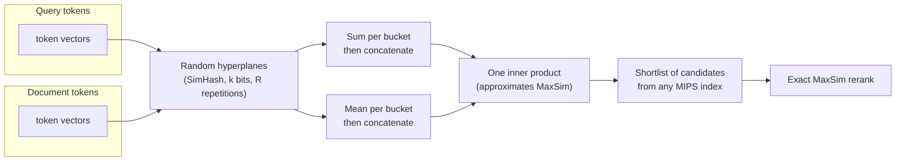

Two lessons in the reranking module already teach late interaction: [ColBERT](/learn/reranking-models/colbert) explains one model and its engine, and [Late interaction](/learn/reranking-models/late-interaction) places the idea between bi-encoders and cross-encoders and shows how to use it in a vector database. This lesson does not repeat them. It takes the **research view**: late interaction has a short list of known engineering problems (finding candidates, storing the vectors, matching training to search, handling images, using ordinary vector infrastructure) and each recent paper is an attack on exactly one of them. If you can place a new paper on that list, you can judge it in a few minutes.

The hands-on part builds the most recent idea on the list, **fixed-dimensional encodings** (the core of the MUVERA paper), in simplified form. It turns a set of token vectors into one long vector whose inner product approximates the multi-vector score. The experiment gives a result that is modest and instructive, including a baseline that the partitioning has to beat, and which on this toy it does not.

## Learning objectives

- Name the engineering bottlenecks of late interaction and match each to the research that addresses it (PLAID, token pooling, XTR, ColPali, MUVERA).
- Explain how a fixed-dimensional encoding approximates MaxSim and compute the collision probability that governs its quality.
- Implement a simplified encoding, measure its fidelity against exact MaxSim, and interpret a negative result honestly.
- Estimate the storage of a multi-vector index and of its compressed alternatives from first principles.
- Grade the evidence for each technique and decide when a pilot is warranted.

## Prerequisites

- [ColBERT](/learn/reranking-models/colbert): MaxSim, the encoders, residual compression and PLAID in outline.
- [Late interaction](/learn/reranking-models/late-interaction): the cost-accuracy spectrum and multi-vector fields.
- [Multi-vector retrieval](/learn/advanced-retrieval/multi-vector-retrieval): other uses of several vectors per document.
- [HNSW](/learn/vector-indexing-algorithms/hnsw): the graph index that single-vector retrieval relies on.
- [Modern RAG research](/learn/advanced-rag-research/modern-rag-research): the evidence ladder used below.

## Why this matters

Late interaction is attractive because it keeps token-level detail that a single vector blurs, and it explains its scores. It has also stayed a specialist tool, and the reasons are engineering, not accuracy. A passage of 100 tokens becomes 100 vectors, so storage is two orders of magnitude above a single-vector index. Retrieval needs a different search engine, since the standard approximate-nearest-neighbour indexes score one vector per document. Training must make token vectors useful for a score that sums over tokens. And the approach was built for text, while real corpora contain tables, charts and scans.

Most 2022 to 2024 progress on late interaction is progress on those four problems. A practitioner who knows this can read a new announcement ("faster", "smaller", "works on page images") and ask the right follow-up: faster than what, smaller at what loss, and measured on which corpus.

## The intuition

Return to the CV analogy from the earlier lessons. A recruiter scores each applicant by matching every job requirement against the applicant's best skill, then adding up the scores. That is accurate, but it raises practical questions once there are a million applicants.

- **Finding candidates.** You cannot compare every requirement with every skill on every CV. You first need a quick way to shortlist.
- **Filing space.** Each CV is stored as a list of separate skills, which takes far more cabinet space than a one-page summary.
- **Training the recruiter.** If the shortlisting step and the scoring step were trained as different skills, errors compound.
- **Scanned CVs.** Some applicants submit a photograph of a typed page; reading it first (OCR) loses the layout.
- **Existing filing system.** The company already owns a fast filing system that holds one card per applicant. Could the full scoring be approximated by one big card?

Each question has a research answer.

## How it works

### Five bottlenecks and their research

**1. Candidate generation: PLAID.** The original ColBERT found candidates by searching a token-level index for each query token and then gathering the full document matrices. PLAID (Santhanam and colleagues, 2022) represents each token by its nearest centroid, shortlists documents using centroid scores alone ("centroid interaction"), prunes weak centroids, and only then decompresses and exactly scores the survivors. The idea is that cheap, coarse scoring removes most documents before expensive scoring starts. It is the engine behind the ColBERTv2 numbers ([ColBERT](/learn/reranking-models/colbert) explains the compression).

**2. Storage: compression and pooling.** Beyond ColBERTv2's residual codes, there are cheaper tricks. **Token pooling** (Clavié and colleagues, 2024) clusters a document's token vectors and replaces each cluster by its mean, which reduces the number of vectors per document; the paper reports that a sizeable reduction is possible with small quality loss on the datasets tested. **Dimension reduction** and **quantisation** of the stored vectors trade accuracy for space in the usual way. All of them shrink the index by discarding redundancy, and none removes the need for a multi-vector engine.

**3. Training that matches search: XTR.** In ColBERT-style systems, the token retrieval step and the exact scoring step see different things, and the model is trained only for the latter. XTR (Lee and colleagues, 2023, *Rethinking the Role of Token Retrieval in Multi-Vector Retrieval*) changes the training objective so that a document's score is computed only from the tokens that the token-level search actually returns. If training matches search, the expensive gathering and full-scoring stage can be dropped or shrunk. This is a training-side fix for a search-side problem.

**4. Beyond text: ColPali.** Faysse and colleagues (2024), in *ColPali: Efficient Document Retrieval with Vision Language Models*, apply late interaction to **page images**. A vision-language model produces a vector for each image patch of a page, a query is embedded as text tokens, and MaxSim scores the page. The point is to skip the parsing pipeline (OCR, layout detection, table extraction) for visually rich documents, and the authors released a benchmark, ViDoRe, for that setting. It is the most direct bridge between late interaction and [multimodal RAG](/learn/multimodal-rag/image-text-matching).

**5. Reusing single-vector infrastructure: MUVERA.** Dhulipala and colleagues (Google Research, 2024), in *MUVERA: Multi-Vector Retrieval via Fixed Dimensional Encodings*, ask whether the multi-vector score can be approximated by an ordinary inner product between two single vectors, so that any maximum inner product search engine (HNSW, DiskANN, a vector database) can shortlist candidates, after which the exact multi-vector score reranks the shortlist. The mapping from a set of vectors to one vector is the **fixed-dimensional encoding** (FDE). The authors give a theoretical guarantee on how well the FDE approximates the multi-vector similarity (the Chamfer similarity, which is MaxSim up to normalisation) and report favourable recall and latency compared with PLAID on BEIR datasets. The next section shows the mechanism.

### How a fixed-dimensional encoding works

The goal is a map $F$ from a set of vectors to one long vector such that, for a query set $Q$ and a document set $P$,

$$\langle F_{\text{query}}(Q),\, F_{\text{doc}}(P) \rangle \;\approx\; \sum_{q \in Q} \max_{p \in P} \langle q, p \rangle .$$

The construction used in the paper, in simplified form, has four steps.

1. **Partition the space.** Draw $k$ random hyperplanes through the origin. A vector's sign pattern against the $k$ hyperplanes is a **bucket** among $2^k$ (this is *SimHash*, a locality-sensitive hash). Vectors that point in similar directions tend to share a bucket.
2. **Encode the query by sum.** For each bucket, add up the query's vectors that fell into it.
3. **Encode the document by mean.** For each bucket, average the document's vectors that fell into it. A bucket the document never reaches would be zero; the paper fills it with the document vector nearest in Hamming distance on the bucket ids, so that a query vector landing there still meets a reasonable partner.
4. **Concatenate and repeat.** Stack the $2^k$ bucket vectors into one long vector. Do this $R$ times with independent hyperplanes and concatenate the results; optionally shrink each bucket vector with a random projection.

Why it approximates MaxSim: the inner product of the two long vectors is, bucket by bucket, the sum of query vectors times the mean of document vectors in the same bucket. If a query vector $q$ falls in a bucket whose document mean is close to the document vector that $q$ matches best, the term is close to $\max_p \langle q, p \rangle$. Two things can go wrong: the best-matching document vector lands in a *different* bucket, and the bucket's mean *blurs* several unlike vectors. Repetitions reduce the first problem, more buckets reduce the second but worsen the first, which is the trade-off.



### Where each technique sits on the evidence ladder

Using the [ladder from the first lesson](/learn/advanced-rag-research/modern-rag-research): **ColBERT-style scoring with a multi-vector engine** has strong evidence with conditions: independent reproductions and library support exist, and the cost is storage. **Token pooling and residual compression** are practical, well-motivated storage reductions with published ablations. **ColPali** is promising and moving quickly for visually rich documents, with open weights and a benchmark, and with the usual caveats about a benchmark built by the same group. **XTR** and **MUVERA** are promising: rigorous papers from strong groups, with less independent production reporting. None of this is a verdict; it is a prior for how much local testing each deserves.

## The mathematics

### Collision probability

**Intuition.** One random hyperplane splits the space in two. Two vectors separated by a small angle are usually on the same side; separated by a large angle, they are not.

For two unit vectors at angle $\theta$ (in radians), a random hyperplane through the origin separates them with probability $\theta / \pi$. So the probability that they share a side is $1 - \theta/\pi$. With $k$ independent hyperplanes they share a *bucket* only if they share a side on every one:

$$P(\text{same bucket}) = \left(1 - \frac{\theta}{\pi}\right)^{k}.$$

Here $\theta$ is the angle between the vectors, $k$ is the number of bits (so there are $2^k$ buckets). With $R$ independent repetitions, the probability that at least one keeps the pair together is $1 - \big(1 - (1 - \theta/\pi)^k\big)^R$.

**Worked example by hand.** Take $\theta = 30^\circ = \pi/6$. Per hyperplane, the pair stays together with probability $1 - 1/6 = 0.833$. With $k = 3$ bits: $0.833^3 = 0.579$. So a document vector that is a very good match for a query vector (30 degrees apart) lands in the same bucket only 58 per cent of the time, and one repetition would miss it 42 per cent of the time. With $R = 4$ repetitions: $1 - 0.421^4 = 1 - 0.0315 = 0.97$. With $k = 5$, a single repetition keeps them together only $0.833^5 = 0.402$ of the time.

The same numbers by simulation, in 384 dimensions:

```python
import numpy as np

rng = np.random.default_rng(0)
d, theta, trials = 384, np.deg2rad(30), 20000

# Two unit vectors exactly 30 degrees apart in 384 dimensions.
a = rng.standard_normal(d); a /= np.linalg.norm(a)
b = rng.standard_normal(d); b -= (b @ a) * a; b /= np.linalg.norm(b)
v = np.cos(theta) * a + np.sin(theta) * b

for k in (1, 3, 5):
    planes = rng.standard_normal((trials, d, k))            # a fresh set of k hyperplanes per trial
    same = (((a @ planes) > 0) == ((v @ planes) > 0)).all(axis=1).mean()
    print(f"k={k}: simulated same-bucket probability {same:.3f}   formula (1 - theta/pi)^k = {(1 - theta/np.pi)**k:.3f}")

p3 = (1 - theta / np.pi) ** 3
print("3 bits, 4 repetitions: P(at least one repetition keeps the pair together) = %.3f" % (1 - (1 - p3) ** 4))
```

```output
k=1: simulated same-bucket probability 0.833   formula (1 - theta/pi)^k = 0.833
k=3: simulated same-bucket probability 0.582   formula (1 - theta/pi)^k = 0.579
k=5: simulated same-bucket probability 0.396   formula (1 - theta/pi)^k = 0.402
3 bits, 4 repetitions: P(at least one repetition keeps the pair together) = 0.968
```

The simulated values match the formula to within sampling error. The practical reading: more bits make buckets purer (less blur) but separate true neighbours more often, so quality needs both a sensible $k$ and enough repetitions $R$, and dimension grows as $R \times 2^k \times d$.

### Storage

An uncompressed multi-vector index stores $N \times L \times d \times b$ bytes for $N$ documents of $L$ token vectors in $d$ dimensions with $b$ bytes per number. An FDE stores $N \times R \times 2^k \times d' \times b$ bytes, where $d'$ is the (possibly projected) dimension of each bucket vector. The experiment below gives exact figures.

## In code

**The problem.** Find out how well a simplified fixed-dimensional encoding reproduces exact MaxSim, and whether it works as a candidate generator in front of an exact MaxSim rerank. The data: 150 SciFact test queries (scientific claims) against a 1,500-abstract sample that contains every relevant abstract of those queries. The token vectors come from `all-MiniLM-L6-v2`, taking its contextual token embeddings, normalised, as stand-ins for a late-interaction model.

**An important limit.** MiniLM was trained to produce one good sentence vector, not token vectors for MaxSim. A trained ColBERT-style model has token vectors that behave differently. So this experiment tests the *encoding* (how faithfully the FDE reproduces MaxSim of whatever token vectors you give it), not late interaction as a retrieval method, and its absolute scores should not be compared with published ColBERT numbers.

**Dependencies.** `sentence-transformers`, `datasets` and NumPy. SciFact (a few MB) and the MiniLM model are downloaded on first use; no API key.

```bash
pip install sentence-transformers datasets numpy
```

**The source.**

```python
import time
import numpy as np
from datasets import load_dataset
from sentence_transformers import SentenceTransformer

rng = np.random.default_rng(0)
corpus = load_dataset("BeIR/scifact", "corpus", split="corpus")
ids = [str(x) for x in corpus["_id"]]
texts = [t + ". " + x for t, x in zip(corpus["title"], corpus["text"])]
queries = {str(r["_id"]): r["text"] for r in load_dataset("BeIR/scifact", "queries", split="queries")}
qrels = {}
for r in load_dataset("BeIR/scifact-qrels", split="test"):
    if int(r["score"]) > 0:
        qrels.setdefault(str(r["query-id"]), set()).add(str(r["corpus-id"]))
qids = list(qrels)[:150]

# A 1,500-document sample that contains every relevant document of the 150 queries.
idpos = {d: i for i, d in enumerate(ids)}
keep = {idpos[d] for q in qids for d in qrels[q]}
others = [i for i in rng.permutation(len(ids)) if i not in keep]
sample = sorted(keep | set(others[: 1500 - len(keep)]))
print("documents:", len(sample), "| queries:", len(qids))

model = SentenceTransformer("sentence-transformers/all-MiniLM-L6-v2")
model.max_seq_length = 128
def token_vectors(batch):
    out = model.encode(batch, output_value="token_embeddings", batch_size=64, show_progress_bar=False)
    vecs = [t.cpu().numpy().astype(np.float32) for t in out]
    return [v / np.linalg.norm(v, axis=1, keepdims=True) for v in vecs]
docs = token_vectors([texts[i] for i in sample])
qvecs = token_vectors([queries[q] for q in qids])
single_d = model.encode([texts[i] for i in sample], normalize_embeddings=True)
single_q = model.encode([queries[q] for q in qids], normalize_embeddings=True)
print("tokens per document: %.0f | vectors stored: %d" % (np.mean([len(d) for d in docs]), sum(len(d) for d in docs)))

def evaluate(score_matrix):                                   # rows: queries, columns: sampled documents
    vals = []
    for qi, q in enumerate(qids):
        top = np.argsort(-score_matrix[qi])[:10]
        rel = qrels[q]
        dcg = sum(1 / np.log2(r + 2) for r, j in enumerate(top) if ids[sample[j]] in rel)
        vals.append(dcg / sum(1 / np.log2(r + 2) for r in range(min(10, len(rel)))))
    return float(np.mean(vals))

# Exact late interaction: MaxSim(q, d) = sum over query tokens of the best-matching document token.
t0 = time.time()
maxsim = np.array([[ (qv @ dv.T).max(axis=1).sum() for dv in docs] for qv in qvecs])
t_exact = time.time() - t0
dense = single_q @ single_d.T
print("single-vector nDCG@10 %.3f | exact MaxSim nDCG@10 %.3f (%.1f s for %d x %d pairs)" %
      (evaluate(dense), evaluate(maxsim), t_exact, len(qids), len(docs)))

# Fixed-dimensional encodings: a simplified version of the idea in MUVERA.
# Hash every token vector into one of 2**k buckets with k random hyperplanes (SimHash). The query keeps the SUM of
# its vectors per bucket, the document the MEAN; the inner product of the two long vectors then approximates MaxSim.
def fde(vectors, planes, proj, is_query):
    R, d, k = planes.shape
    out = []
    for r in range(R):
        bucket = ((vectors @ planes[r]) > 0).astype(int) @ (1 << np.arange(k))
        enc = np.zeros((2 ** k, d), dtype=np.float32)
        for b in range(2 ** k):
            members = vectors[bucket == b]
            if len(members):
                enc[b] = members.sum(0) if is_query else members.mean(0)
            elif not is_query:                                  # empty document bucket: borrow the vector whose
                hamming = [bin(int(x) ^ b).count("1") for x in bucket]       # bucket id is nearest in Hamming distance
                enc[b] = vectors[int(np.argmin(hamming))]
        out.append((enc @ proj).ravel())
    return np.concatenate(out)

def rerank(S, K):                                              # candidates from S, final order from exact MaxSim
    R = np.full_like(maxsim, -1e9)
    for i in range(len(qids)):
        top = np.argsort(-S[i])[:K]
        R[i, top] = maxsim[i, top]
    return R

exact_top = [set(np.argsort(-maxsim[i])[:10]) for i in range(len(qids))]
print("\n bits reps proj  FDE dims  FDE nDCG@10  exact top-10 inside FDE top-50  FDE top-50 + MaxSim rerank")
for k, R, p in [(0, 1, 384), (2, 1, 384), (3, 2, 384), (4, 2, 384), (4, 4, 32)]:
    local = np.random.default_rng(1)
    planes = local.standard_normal((R, 384, k)).astype(np.float32)
    proj = np.eye(384, dtype=np.float32) if p == 384 else \
        (local.choice([-1.0, 1.0], size=(384, p)) / np.sqrt(p)).astype(np.float32)
    Dm = np.stack([fde(d, planes, proj, False) for d in docs])
    Qm = np.stack([fde(q, planes, proj, True) for q in qvecs])
    t0 = time.time(); S = Qm @ Dm.T; t_fde = time.time() - t0
    inside = np.mean([len(exact_top[i] & set(np.argsort(-S[i])[:50])) / 10 for i in range(len(qids))])
    print(f"{k:5d} {R:4d} {p:5d} {Dm.shape[1]:9d}   {evaluate(S):9.3f}   {inside:22.2f}   {evaluate(rerank(S, 50)):28.3f}")
print("scoring time: exact MaxSim %.2f s, FDE inner products %.3f s" % (t_exact, t_fde))
```

**What the important lines do.** `token_vectors` returns one normalised matrix per text (documents truncated to 128 tokens, so every document has 128 vectors). `maxsim` is the exact score, the sum over query tokens of the best dot product with any document token, for every query-document pair. `fde` implements the four steps above: SimHash bucket ids via `(vectors @ planes[r]) > 0`, sum for queries, mean for documents, Hamming-distance filling of empty document buckets, and concatenation over repetitions. `rerank` keeps the top 50 candidates according to a score matrix and orders them by exact MaxSim, which is how an FDE is meant to be used. The configuration `(0, 1, 384)` has zero hyperplanes, so a single bucket: the FDE is then the sum of query vectors dotted with the mean of document vectors, the baseline that partitioning has to beat.

**Output.** (The timings vary from run to run; the other numbers are fixed by the seeds.)

```output
documents: 1500 | queries: 150
tokens per document: 128 | vectors stored: 191446
single-vector nDCG@10 0.755 | exact MaxSim nDCG@10 0.787 (2.3 s for 150 x 1500 pairs)

 bits reps proj  FDE dims  FDE nDCG@10  exact top-10 inside FDE top-50  FDE top-50 + MaxSim rerank
    0    1   384       384       0.737                     0.92                          0.777
    2    1   384      1536       0.700                     0.85                          0.777
    3    2   384      6144       0.718                     0.89                          0.777
    4    2   384     12288       0.723                     0.90                          0.776
    4    4    32      2048       0.532                     0.52                          0.706
scoring time: exact MaxSim 2.31 s, FDE inner products 0.002 s
```

**What the output means.** Exact MaxSim over the untrained MiniLM token vectors reaches nDCG@10 of 0.787, a little above the single-vector 0.755 on this sample. The raw FDE scores are lower, between 0.70 and 0.74 for the full-width settings, and fall to 0.53 when each bucket vector is randomly projected down to 32 dimensions (the last row), so the projection loses real information. The more interesting columns are the last two. A shortlist of the top 50 by FDE contains 85 to 92 per cent of the exact top-10 in the full-width rows, and reranking that shortlist with exact MaxSim gives 0.776 to 0.777, within about one point of exact MaxSim over all 1,500 documents. Scoring time confirms the motivation: 2.3 seconds for exact MaxSim over 150 queries and 1,500 documents, against two milliseconds for the FDE inner products.

Now the negative result. The **single-bucket baseline** (384 dimensions, no partitioning) has the best recall (0.92) and the best raw nDCG (0.737). Adding buckets *lowers* both. Two reasons are plausible on this toy: MiniLM token vectors are contextual and fairly diffuse, so a document's mean already summarises it well; and with only 1,500 documents and a top-50 shortlist (3 per cent of the collection), recall is easy. The paper's partitioning is designed for corpora where token vectors are distinctive and a single mean blurs them, and its guarantees and results concern trained multi-vector models. The honest lesson is not that partitioning does not work. It is that **you must include the no-partition baseline in any evaluation of a multi-vector approximation**, because it is cheap and sometimes unbeaten.

**Common errors.** Hashing vectors that all lie in a narrow cone, so most land in one bucket (check bucket occupancy); forgetting to fill empty document buckets, which zeroes parts of the score; comparing dimensions without comparing recall at equal shortlist sizes.

**How to extend it.** Swap in a trained multi-vector model (for example through the models listed in [ColBERT](/learn/reranking-models/colbert)) and re-run the sweep; grow the sample from 1,500 documents towards the full 5,183 and watch recall at a fixed shortlist size; try a final projection learned or random at several dimensions.

## A real-world example

Meridian ships the product documentation for Meridian Reports as PDF manuals, many pages of which are screenshots of dashboards and tables of export options. AskMeridian's current pipeline extracts text and loses the tables' structure; support staff report wrong answers about which export formats exist on which plan. A Platform engineer proposes a visual late-interaction model in the style of ColPali, indexing page images directly.

The team resists adopting it on enthusiasm. They place it on the evidence ladder as promising: published, with released weights and a benchmark, but little independent production reporting. They estimate cost first. If a page yields on the order of a thousand patch vectors of 128 dimensions stored in 16-bit floats, that is $1000 \times 128 \times 2 = 256$ kilobytes per page, so 100,000 pages would need about 25.6 gigabytes (an assumption to verify against the real model, patch count and pooling). That is affordable, and a single-vector summary per page is four orders of magnitude smaller, so a two-stage design is natural.

They then run a pilot: 200 pages, 40 questions about plans and export formats, with the current text pipeline as the baseline and a text-plus-table-aware parser as a second baseline. The second baseline is cheap, so it must be beaten before the visual model is worth its operational cost. They record per-question results, since 40 questions allow only large effects to be seen, and decide in advance that only a clear improvement on the table questions justifies a new serving component.

## Common mistakes

- **Skipping the simple baseline.** A single mean-pooled vector, or a better parser, is sometimes within a point of the exotic method; as the experiment showed, partitioning did not beat one bucket.
- **Judging a technique on a model it was not designed for.** An encoding or index tuned for trained multi-vector models can behave differently on a single-vector model's tokens.
- **Comparing without equal budgets.** "Faster" and "smaller" claims need the same recall target and the same shortlist size.
- **Forgetting that storage multiplies.** Vectors per document times dimension times bytes: a 100-token passage costs roughly 100 times a single vector before compression.
- **Adopting multi-vector retrieval without a multi-vector engine.** Standard indexes score one vector per document; either use a database with native support or an FDE-style shortlist followed by exact reranking.

## Best practices

- Place every late-interaction paper on the bottleneck list (candidates, storage, training, modality, infrastructure) before reading the results.
- Evaluate multi-vector methods against three baselines: a strong single-vector model, a cross-encoder reranker, and the simplest pooled approximation.
- Use late interaction as a *reranker* first, over candidates from a cheaper retriever, before committing to a first-stage multi-vector index ([Late interaction](/learn/reranking-models/late-interaction)).
- Compare approximations at a fixed recall target and report shortlist size, latency and bytes per document together.
- Check the geometry of your vectors before hashing: look at bucket occupancy.
- Pilot visual retrieval on a small sample with your own questions, and keep a text baseline.

## Performance considerations

Exact MaxSim between a query of $m$ vectors and a document of $L$ vectors costs $m \times L \times d$ multiply-adds. In the experiment, 150 queries against 1,500 documents of 128 vectors took about 2.3 seconds on a laptop; the FDE inner products took about 2 milliseconds because they are one matrix multiplication over fixed-size vectors. The gap grows with collection size, since exact scoring is linear in the number of documents unless a shortlist is used.

Storage: the 1,500-document sample holds 191,446 token vectors, which at 384 dimensions and 4 bytes each is about 294 megabytes, against 2.3 megabytes for single vectors, a factor of 128. The 6,144-dimension FDE (3 bits, 2 repetitions, no projection) occupies $6144 \times 4 \times 1500 \approx 37$ megabytes: eight times smaller than the raw token vectors, but sixteen times larger than the single-vector index. The one-bucket FDE is 384 dimensions, the same size as a single vector. So the choice is not "FDE versus multi-vector": it is a point on a curve between a single vector and the full set, and the experiment suggests testing the cheapest point first.

For a production shortlist-then-rerank design, the dominant cost becomes fetching the exact token matrices of the $K$ candidates, which is a memory or disk read per candidate; keep $K$ as small as the recall target allows.

## Security considerations

Multi-vector and visual indexes keep much more of the source than a single vector does. Token vectors and page-patch vectors can be partially inverted, so treat them with the same access controls as the documents themselves, and apply document-level permissions to the shortlist *before* exact scoring ([Document-level permissions](/learn/access-control-and-privacy/document-level-permissions)). Visual retrieval over page images also inherits **image-borne prompt injection**: text rendered in a screenshot can instruct the generator ([Indirect prompt injection](/learn/rag-security-fundamentals/indirect-prompt-injection)), and a text filter on extracted content will not see it. Third-party model weights for retrieval should be loaded from trusted publishers in non-executable formats.

## Summary

- Late interaction has five known engineering bottlenecks: candidate generation (PLAID), storage (compression, token pooling), training that matches search (XTR), non-text pages (ColPali) and reuse of single-vector infrastructure (MUVERA).
- A fixed-dimensional encoding hashes token vectors into buckets, sums the query's vectors and averages the document's per bucket, so that one inner product approximates MaxSim; its quality depends on $k$, $R$ and the bucket collision probability $(1 - \theta/\pi)^k$.
- In the SciFact experiment, an FDE shortlist of 50 followed by exact MaxSim matched exact MaxSim within about a point of nDCG@10 at a small fraction of the scoring time, but the one-bucket baseline beat the partitioned variants, which shows why the simple baseline belongs in every comparison.
- Storage is the central cost of multi-vector retrieval: vectors per document times dimension times bytes, a factor of about 128 in the experiment.
- Evidence differs by technique: multi-vector scoring is strong with conditions; XTR, MUVERA and visual late interaction are promising and need local pilots.

## Exercises

**1. (Warm-up)** Two unit vectors are at $\theta = 60^\circ$. With $k = 4$ hyperplanes, what is the probability they share a bucket?

<details><summary>Show solution</summary>

Per hyperplane the probability of staying together is $1 - 60/180 = 0.667$. For four hyperplanes: $0.667^4 = 0.1975$, about 20 per cent. Vectors at 60 degrees are rarely in the same bucket, so a partitioned FDE sees them only as separate buckets' contributions.

</details>

**2. (Applied)** A corpus has 2 million documents of 120 token vectors, 128 dimensions, 16-bit values. Compute the raw multi-vector storage and the storage of an FDE with $k = 4$, $R = 4$ and each bucket vector projected to 32 dimensions, also in 16-bit values.

<details><summary>Show solution</summary>

Raw: $2\times10^6 \times 120 \times 128 \times 2$ bytes $= 6.144 \times 10^{10}$ bytes, about 61 gigabytes. FDE: $2^4 \times 4 \times 32 = 2048$ numbers per document, so $2\times10^6 \times 2048 \times 2 = 8.2\times10^9$ bytes, about 8.2 gigabytes: 7.5 times smaller, though still 16 times larger than a 128-dimensional 16-bit single vector per document (about 0.5 gigabytes). Whether the projection keeps enough accuracy is what the recall test decides.

</details>

**3. (Design)** Meridian wants to add late interaction to AskMeridian. List the experiments you would run, in order, and the stopping rule for each.

<details><summary>Show solution</summary>

1. Measure the current pipeline's recall at the reranker's depth; if it is already high, a reranker upgrade is the cheaper lever, and stop here. 2. Use a late-interaction model as a reranker over the current candidates, with a stop if nDCG gains are within the bootstrap interval of zero. 3. If it helps, estimate storage for a first-stage multi-vector index and for pooled or FDE-style shortlists; stop if the storage or the operational cost of a new engine exceeds the budget. 4. Test an FDE or pooled shortlist followed by exact reranking at a fixed recall target (for example, 95 per cent of the exact top-10 inside the shortlist); stop if no setting reaches it at acceptable size. At every step compare against the single-vector baseline and the cross-encoder.

</details>

**4. (Challenge)** In the lesson's script, add a centring step: subtract the mean of all document token vectors from every vector *before* hashing (but encode the original vectors). Predict, then measure, the effect on the partitioned rows. Why might centring change bucket occupancy?

<details><summary>Show solution</summary>

Token vectors from a transformer typically share a large common direction, so random hyperplanes through the origin put most of them on the same side and into a few buckets. Subtracting the mean spreads the vectors around the origin, so buckets are more evenly occupied. In `fde`, compute `bucket` from `(vectors - centre) @ planes[r]` where `centre = np.concatenate(docs).mean(0)`, and add `centre` as a parameter. In a trial run of this variant on projected configurations, nDCG for the raw FDE moved by at most about 0.015 and recall inside the top 50 by a few points, so on these vectors the bucket crowding was not the main limit; the single-bucket baseline remained best. Check occupancy with `np.bincount` before and after to see the effect directly.

</details>

## Check your understanding

```quiz
[
  {
    "q": "Which research addresses the problem that late-interaction models need a specialised multi-vector search engine, by approximating the score with a single long vector?",
    "options": [
      "ColPali",
      "MUVERA",
      "Token pooling",
      "XTR"
    ],
    "answer": 1,
    "why": "MUVERA maps a set of vectors to one fixed-dimensional encoding whose inner product approximates the multi-vector similarity, so ordinary MIPS indexes can shortlist candidates."
  },
  {
    "q": "Two unit vectors are 30 degrees apart. With 3 random hyperplanes, what is the approximate probability they share a bucket?",
    "options": [
      "0.83",
      "0.97",
      "0.58",
      "0.40"
    ],
    "answer": 2,
    "why": "Per hyperplane the probability is 1 - 30/180 = 0.833; for three hyperplanes, 0.833 cubed is about 0.58."
  },
  {
    "q": "In the lesson's experiment, which FDE configuration had the best recall of the exact top-10 inside its top-50?",
    "options": [
      "The 4-bit, 4-repetition configuration projected to 32 dimensions",
      "All configurations tied",
      "The 4-bit, 2-repetition configuration with 12,288 dimensions",
      "The single-bucket configuration with no partitioning"
    ],
    "answer": 3,
    "why": "The one-bucket baseline reached 0.92, above every partitioned variant, which shows that the no-partition baseline must be included in any comparison."
  },
  {
    "q": "What does XTR change compared with the original ColBERT setup?",
    "options": [
      "It trains the model so that a document's score depends only on tokens retrieved by token-level search",
      "It replaces token vectors with image patches",
      "It removes MaxSim and uses cross-attention",
      "It compresses vectors with residual codes"
    ],
    "answer": 0,
    "why": "XTR aligns training with the token-retrieval step so the costly gathering and full-scoring stage can be reduced."
  },
  {
    "q": "A team stores 100 token vectors per passage in 128 dimensions with 16-bit values. Roughly how much larger is its index than one 128-dimensional 16-bit vector per passage?",
    "options": [
      "About 10 times",
      "About 100 times",
      "About 1,000 times",
      "The same size"
    ],
    "answer": 1,
    "why": "The count of vectors per passage multiplies storage directly: 100 vectors cost about 100 times one vector, before compression."
  }
]
```

## Further reading

- Khattab, O. and Zaharia, M. (2020). *ColBERT: Efficient and Effective Passage Search via Contextualized Late Interaction over BERT*. [arXiv:2004.12832](https://arxiv.org/abs/2004.12832).
- Santhanam, K. et al. (2022). *PLAID: An Efficient Engine for Late Interaction Retrieval*.
- Lee, J. et al. (2023). *Rethinking the Role of Token Retrieval in Multi-Vector Retrieval* (XTR).
- Faysse, M. et al. (2024). *ColPali: Efficient Document Retrieval with Vision Language Models*.
- Dhulipala, L. et al. (2024). *MUVERA: Multi-Vector Retrieval via Fixed Dimensional Encodings*.
- Clavié, B. et al. (2024). *Reducing the Footprint of Multi-Vector Retrieval with Minimal Performance Impact via Token Pooling*.
