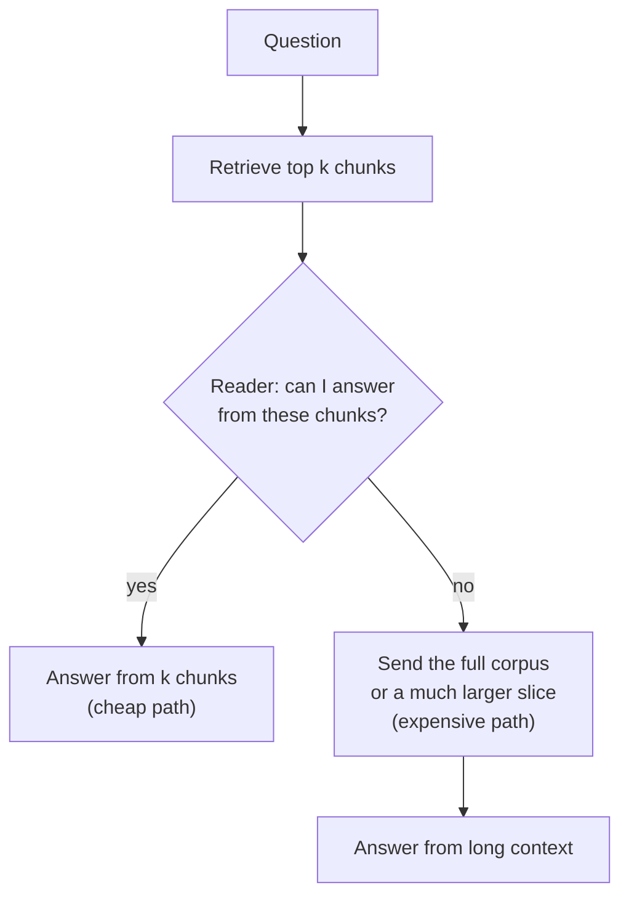

Context windows have grown from a few thousand tokens to hundreds of thousands and, in some models, a million or more. Each increase revives the same question: if the model can read the whole corpus in one prompt, why retrieve at all? The introductory lesson, [RAG versus long-context prompting](/learn/introduction-to-rag/rag-versus-long-context-prompting), gave you a decision framework and the cost arithmetic. This lesson asks a different question: **what does the research evidence say, and how do you test the claim on your own corpus?**

The answer is more interesting than "RAG wins" or "long context wins". Benchmarks show that long-context models do very well on easy tests and degrade on harder ones; head-to-head studies find long context stronger on average and RAG far cheaper; and a hybrid that routes between them recovers most of both. You will see why the easy test misleads, run an experiment on a corpus of near-duplicate facts that stresses retrieval the way multi-needle tests stress long context, and compute what a routing design saves.

## Learning objectives

- Explain what needle-in-a-haystack tests measure, and why they overstate a model's ability to use a long context.
- Summarise the main research findings on position effects, multi-needle and aggregation tasks, and head-to-head comparisons of RAG and long context.
- Describe a retrieve-then-route design (retrieval first, long-context fallback) and derive its expected cost and error rate.
- Run and interpret an experiment that shows how retrieval accuracy changes with corpus size when distractors are near-duplicates.
- Design a decision test for a given corpus, query mix and latency budget.

## Prerequisites

- [RAG versus long-context prompting](/learn/introduction-to-rag/rag-versus-long-context-prompting): the decision framework, prompt caching and cost arithmetic that this lesson builds on.
- [Context windows](/learn/understanding-large-language-models/context-windows) and the [lost-in-the-middle problem](/learn/context-engineering/lost-in-the-middle-problem).
- [Modern RAG research](/learn/advanced-rag-research/modern-rag-research): how to read comparative results critically.
- [Recall@K](/learn/retrieval-evaluation/recall-k): the retrieval metric used in the experiment.

## Why this matters

Architecture decisions made on the claim "the model has a million-token window" go wrong in two directions. A team may drop retrieval, send its whole knowledge base in every prompt, and discover that latency, cost and answer quality all suffer as the corpus grows past what the model reads reliably. Another team may keep a complicated retrieval stack for a corpus of forty pages that would fit in one cached prompt and be answered more accurately that way. Both pay for a decision made on a slogan.

Evidence is the remedy, but the evidence is easy to misread. The most famous long-context test is also the easiest, and vendors' claims of "near-perfect recall at one million tokens" usually refer to it. A model that retrieves a single planted sentence from a haystack has shown that its attention can find a needle, not that it can reason over a thousand pages. Knowing how the tests are built tells you which claim applies to your workload.

## The intuition

Imagine looking up a company policy. In one version, someone hands you the full 900-page handbook and asks one question. In another, an assistant who knows the index gives you the three most relevant pages.

If the question is "what is the receipt threshold for expenses?" and you are good at skimming, the whole handbook works: you find the sentence. But the longer the handbook, and the more passages that look alike ("receipt threshold for contractors", "receipt threshold for interns"), the likelier you are to land on the wrong one, or to tire and skip a page. If the question is "summarise every change between the 2023 and 2025 handbooks", the three-page excerpt fails, because no three pages contain the answer; you do need the whole document.

So neither is simply better. The excerpt wins on **focus and cost** when the answer lives in a few passages and the index is good. The full document wins on **completeness** when the answer is spread across it or when the index would miss. The research is a series of attempts to measure where that boundary lies.

## How it works

### What the standard test measures

The **needle-in-a-haystack** test, popularised informally in 2023, plants one sentence (the needle) at a chosen depth in a long document of unrelated text (the haystack) and asks a question whose answer is the needle. Results are shown as a heatmap of accuracy by context length and needle depth. Frontier models often show an almost uniformly green heatmap.

The test is useful as a sanity check that the model *can* attend to any position, but it is easy for three reasons. The needle is usually lexically distinctive and unlike the haystack, so a simple match finds it. There is exactly one needle, so no distractors compete. And the question needs no reasoning beyond copying the needle. A green heatmap therefore shows a floor, not a ceiling.

### Position effects

Liu and colleagues (2023), in *Lost in the Middle: How Language Models Use Long Contexts*, tested multi-document question answering and key-value retrieval and found a **U-shaped** pattern: accuracy was highest when the relevant passage was at the start or end of the context and lower when it sat in the middle, for the models they tested. Performance also fell as more documents were added. The finding is covered in [Lost in the middle](/learn/context-engineering/lost-in-the-middle-problem) with its practical remedy (put the best evidence first or last, or send less). Later models have improved on this pattern, so *measure* position sensitivity for the model you use.

### Harder tests: many needles, tracing, aggregation

The **RULER** benchmark (Hsieh and colleagues, 2024) extended the needle test along several axes: several needles at once, distractor needles that look like the real one, **multi-hop tracing** (follow a chain of variable assignments), and **aggregation** (count or list common words across a long document). Its central finding was that models which achieved near-perfect scores on the simple test degraded on the harder tasks as length grew, so the *effective* context length (the length at which performance stays acceptable) was often shorter than the advertised window. The exact numbers change with every model release; the pattern is what to remember.

Tasks differ in how hard they are for a long context:

| Task | What the model must do | Typical outcome in long context |
| --- | --- | --- |
| Single needle | Find one distinctive fact | Usually strong |
| Multi-needle, near-duplicate distractors | Find the right one among look-alikes | Degrades with length and similarity |
| Multi-hop | Chain two or more facts spread through the text | Degrades sooner |
| Aggregation | Combine information from throughout the text | Weakest; needs the whole text, not a needle |

### Head-to-head comparisons

Several studies compare retrieval with long context on the same question sets.

- **Xu and colleagues (2023)**, *Retrieval meets Long Context Large Language Models*, found that a model with a short context plus retrieval could match a model fine-tuned for a longer context on several tasks, and that retrieval also helped models that already had long contexts.
- **Li and colleagues (2024)**, *Retrieval Augmented Generation or Long-Context LLMs? A Comprehensive Study and Hybrid Approach*, compared the two across many datasets and models. They reported that long-context models were, on average, stronger when given the whole context, while RAG used far fewer tokens. They then proposed **Self-Route**: retrieve first, ask the model whether the retrieved context suffices to answer, and only if it says no, send the full context. Most queries were answered by the cheap path, with quality close to always using long context.
- **Lee and colleagues (2024)**, with the **LOFT** benchmark, asked whether long-context models can replace retrieval systems, rerankers and even SQL over corpora up to around a million tokens. Their results suggested that long-context models could be competitive with specialised retrieval pipelines on some tasks without any retrieval engineering, while lagging on tasks that need compositional reasoning over structured data.
- **Jin and colleagues (2024)** studied RAG with long inputs and reported that adding more retrieved passages first improves answers and then hurts, because the extra passages include hard distractors that mislead the model.

The studies agree on a qualitative picture, not a single number, and their datasets are mostly Wikipedia-style questions, not your handbook. The consistent messages are: long context is competitive when the whole corpus fits and you can afford the tokens; retrieval stays far cheaper and wins when the corpus is much larger than the window or changes constantly; **more context is not monotonically better**, so retrieving 100 passages is not automatically safer than retrieving 10; and routing between the two is a strong default.

### Why long contexts degrade

Several explanations are offered, and they are hypotheses supported by evidence of varying strength rather than settled mechanisms. Attention is a softmax over all positions, so each additional irrelevant token takes a share of the weight that the relevant one would otherwise have. Models are trained mostly on shorter sequences and extended afterwards, so their long-range behaviour is less practised. Position encodings can bias the model towards the beginning and end. And near-duplicate distractors are a problem for any matcher: they are the same confusion that makes retrieval fail, as the experiment shows.

### The design space



Three designs sit on this diagram. **Pure RAG** always takes the cheap path. **Pure long context** always takes the expensive path (with [prompt caching](/learn/introduction-to-rag/rag-versus-long-context-prompting) lowering its price when the corpus is stable). **Retrieve-then-route** uses the cheap path unless the reader declines. A fourth design, **generous retrieval into a long window** (send 50 to 100 chunks and let the model sort them out), trades precision for recall, and the Jin and colleagues finding is the reason to test it rather than assume it.

### When each side structurally wins

- **RAG wins** when the corpus exceeds the window; when documents change daily and must be honoured within minutes; when per-user permissions must filter what is read ([Document-level permissions](/learn/access-control-and-privacy/document-level-permissions)); when answers need precise citations to a small number of passages; when latency per query must be low; and when cost per query matters at high volume.
- **Long context wins** when the corpus is small and stable; when the task is *global* (summarise, compare, find contradictions across a whole document); when retrieval is the unreliable component (poorly structured documents, tables that chunking destroys); and when engineering time is the scarcest resource.
- **Hybrid** wins when query types are mixed: most are lookups, a minority are global.

## The mathematics

Retrieve-then-route has a cost and an error rate that follow from three probabilities. Let

- $r$ be the retrieval recall: the probability that the evidence is among the $k$ retrieved chunks;
- $a$ be the probability that the reader correctly declines when the evidence is *absent*;
- $b$ be the probability that the reader declines when the evidence is *present* (a false abstention).

**Fraction routed to the expensive path.** A query falls back when the evidence is absent and the reader declines, or when it is present and the reader declines anyway:

$$f = (1 - r)\,a + r\,b .$$

**Expected tokens per question.** Each question pays for the $k$ retrieved chunks (about $c$ tokens each) and, with probability $f$, the whole corpus of $T$ tokens:

$$E[\text{tokens}] = k\,c + f\,T .$$

**Unrecovered wrong answers.** If the evidence is absent and the reader does *not* decline, it answers from the wrong context:

$$e = (1 - r)(1 - a) .$$

**Intuition.** Retrieval recall controls how often the cheap path *could* fail; the reader's abstention behaviour decides whether failure is caught (cost) or hidden (error). False abstentions cost money but not accuracy; missed abstentions cost accuracy.

**Worked example by hand.** Take the numbers from the experiment below, for a corpus of $T = 142{,}592$ tokens: $k = 3$ chunks of $c = 18.6$ tokens, $r = 0.987$. Assume $a = 0.8$ and $b = 0.05$ (assumptions, not measurements). Then

$$f = 0.013 \times 0.8 + 0.987 \times 0.05 = 0.0104 + 0.0494 = 0.0598,$$

$$E[\text{tokens}] = 3 \times 18.6 + 0.0598 \times 142{,}592 \approx 56 + 8{,}527 \approx 8{,}580,$$

which is about 6 per cent of the cost of always sending the full corpus. Note where the cost comes from: the false abstentions on queries that retrieval answered correctly ($0.0494$) are almost five times the genuine misses ($0.0104$). And $e = 0.013 \times 0.2 = 0.0026$: about one question in 400 gets a confident wrong answer that the fallback never sees. Improving $a$ reduces errors; reducing $b$ reduces cost. The same formula in Python appears at the end of the code below.

## In code

**The problem.** Long-context tests with a single needle are too easy. The question that matters for a company corpus is what happens when many documents *look alike*. This experiment builds a corpus of 7,680 near-duplicate facts in the form "In the Leeds office, the receipt threshold for contractors on the Platform team is 75", where only the office, role, team and a random value differ, and asks 60 questions that each need one exact fact. Facts are drawn from eight items, fifteen offices, eight roles and eight teams, so for any question there are many facts that match on most words. It measures how often the right fact appears at rank 1 or in the top 5 as the corpus grows from 100 to 7,680 facts, for a dense retriever (MiniLM) and BM25. It then applies the routing arithmetic to the full corpus, using the measured miss rates.

This is a stress test for retrieval, not a long-context experiment: no language model runs here, so it says nothing directly about how a long-context model would fare. It does show the *difficulty* that RULER-style multi-needle tests exploit, and it gives real token counts for the cost model.

**Dependencies.** `sentence-transformers`, `rank-bm25`, `tiktoken` and NumPy. The MiniLM model is downloaded on first use. `tiktoken` counts tokens with the `cl100k_base` encoding, used here only as a token-counting yardstick. No API key.

```bash
pip install sentence-transformers rank-bm25 tiktoken numpy
```

**The source.**

```python
import re, itertools
import numpy as np
import tiktoken
from rank_bm25 import BM25Okapi
from sentence_transformers import SentenceTransformer

rng = np.random.default_rng(7)
items = ["receipt threshold", "equipment budget", "laptop refresh cycle", "mileage rate",
         "meal allowance", "training budget", "on-call stipend", "parking allowance"]
offices = ["Leeds", "Bristol", "Dublin", "Glasgow", "Cardiff", "Belfast", "Oxford", "York",
           "Bath", "Derby", "Exeter", "Hull", "Leicester", "Norwich", "Perth"]
roles = ["engineer", "analyst", "designer", "contractor", "manager", "intern", "recruiter", "auditor"]
teams = ["Platform", "Finance", "Support", "Sales", "Data", "Legal", "People", "Security"]
combos = list(itertools.product(items, offices, roles, teams))        # 8*15*8*8 = 7,680 distinct facts
rng.shuffle(combos)
value = {c: int(rng.integers(20, 900)) for c in combos}
def fact(c):
    i, o, r, t = c
    return f"In the {o} office, the {i} for {r}s on the {t} team is {value[c]}."
def question(c):
    i, o, r, t = c
    return f"What is the {i} for {r}s on the {t} team in the {o} office?"

model = SentenceTransformer("sentence-transformers/all-MiniLM-L6-v2")
enc = tiktoken.get_encoding("cl100k_base")
tok = lambda s: re.findall(r"[a-z0-9]+", s.lower())
all_texts = [fact(c) for c in combos]
all_emb = model.encode(all_texts, batch_size=128, normalize_embeddings=True)
print("distinct facts:", len(combos), "| tokens per fact: %.1f" % np.mean([len(enc.encode(t)) for t in all_texts[:200]]))

targets = list(range(60))                                              # 60 questions, fixed
q_emb = model.encode([question(combos[i]) for i in targets], normalize_embeddings=True)
print("\n   N   tokens(all)  dense top1  dense top5   bm25 top1  bm25 top5")
for N in (100, 1000, 4000, 7680):
    idx = np.array(sorted(set(targets) | set(range(60, N))))           # corpus always contains the targets
    sub = [all_texts[i] for i in idx]
    bm = BM25Okapi([tok(t) for t in sub])
    d1 = d5 = b1 = b5 = 0
    for qi, ti in enumerate(targets):
        pos = int(np.where(idx == ti)[0][0])
        ds = all_emb[idx] @ q_emb[qi]
        rank_d = int((ds > ds[pos]).sum())
        bs = bm.get_scores(tok(question(combos[ti])))
        rank_b = int((bs > bs[pos]).sum())
        d1 += rank_d < 1; d5 += rank_d < 5; b1 += rank_b < 1; b5 += rank_b < 5
    n = len(targets)
    toks = sum(len(enc.encode(t)) for t in sub)
    print(f"{N:5d}  {toks:10d}   {d1/n:9.2f}  {d5/n:10.2f}   {b1/n:9.2f}  {b5/n:9.2f}")

# --- Routing arithmetic on the full 7,680-fact corpus, 300 questions ---------------
tokens_all = sum(len(enc.encode(t)) for t in all_texts)
per_fact = tokens_all / len(all_texts)
qs = list(range(300))
qe = model.encode([question(combos[i]) for i in qs], normalize_embeddings=True)
ranks = np.array([int((all_emb @ qe[j] > all_emb[i] @ qe[j]).sum()) for j, i in enumerate(qs)])
print("\nfull corpus: %d tokens (%.1f per fact)" % (tokens_all, per_fact))
print(" k   miss rate   route-to-long tokens/query   vs always-long")
for k in (1, 3, 5, 10):
    miss = float((ranks >= k).mean())
    expected = k * per_fact + miss * tokens_all           # assumes the reader abstains perfectly
    print(f"{k:2d}   {miss:8.3f}   {expected:14.0f}   {expected / tokens_all:14.1%}")

def route(r, a, b, k, per_fact, corpus_tokens):
    """r: P(gold in retrieved set); a: P(reader abstains | gold absent); b: P(reader abstains | gold present)."""
    f = (1 - r) * a + r * b                       # fraction sent to the long-context fallback
    tokens = k * per_fact + f * corpus_tokens     # expected tokens per question
    wrong = (1 - r) * (1 - a)                     # confident answers from the wrong context
    return f, tokens, wrong
f, tokens, wrong = route(r=0.987, a=0.8, b=0.05, k=3, per_fact=per_fact, corpus_tokens=tokens_all)
print(f"\nrouter: fallback {f:.3f}, tokens/question {tokens:,.0f} ({tokens / tokens_all:.1%} of always-long), "
      f"unrecovered wrong answers {wrong:.4f}")
```

**What the important lines do.** The corpus is the Cartesian product of items, offices, roles and teams, shuffled, each with a random value, so every fact has hundreds of look-alikes. For each corpus size `N`, the sub-corpus always contains the 60 target facts plus the first facts of the rest. `rank_d` is the number of facts the dense retriever scored strictly above the target, so the target is in the top $k$ when `rank_d < k`. The last block uses the 300-question miss rates to compute the routing cost, assuming the reader abstains perfectly; `route` then applies the formulas from the maths section with explicit assumptions.

**Output.**

```output
distinct facts: 7680 | tokens per fact: 18.5

   N   tokens(all)  dense top1  dense top5   bm25 top1  bm25 top5
  100        1860        1.00        1.00        1.00       1.00
 1000       18560        0.97        1.00        1.00       1.00
 4000       74246        0.92        1.00        1.00       1.00
 7680      142592        0.92        0.98        1.00       1.00

full corpus: 142592 tokens (18.6 per fact)
 k   miss rate   route-to-long tokens/query   vs always-long
 1      0.253            36142            25.3%
 3      0.013             1957             1.4%
 5      0.010             1519             1.1%
10      0.003              661             0.5%

router: fallback 0.060, tokens/question 8,576 (6.0% of always-long), unrecovered wrong answers 0.0026
```

**What the output means.** At 100 facts every retriever is perfect. As the corpus grows, the dense retriever's top-1 accuracy falls to 0.92 on the 60 questions (to 0.75 on the 300-question sample in the routing table), because many facts differ from the question only in one slot (an office, a role or a team) and sentence embeddings blur such differences. BM25 stays perfect here because every slot value is an exact token, which is the case for hybrid retrieval ([Dense versus sparse retrieval](/learn/hybrid-search/dense-versus-sparse-retrieval)). The full corpus is 142,592 tokens: it fits a long-context window, but it is more than two thousand times what a three-fact answer needs. The routing table shows that taking the top 3 and falling back on a miss would cost, with a perfect reader, 1.4 per cent of the tokens of always sending everything; the last line shows that a realistic reader (assuming imperfect abstention) lands at about 6 per cent, mostly because of false abstentions.

**Common errors.** Extrapolating from the 100-fact corpus; counting tokens with a tokeniser unlike the production model's; treating the assumed $a$ and $b$ as facts. Measure them by running the reader on questions with the evidence removed and with it present.

**How to extend it.** Replace the fake structure with real Meridian chunks. Add a long-context step: send the whole corpus (or a 20,000-token slice) to a model and compare accuracy at several lengths and needle positions.

## A real-world example

Meridian's Platform team faces a request from the Finance department: an assistant that answers questions about the 2025 expense policy, a document of about 60,000 tokens. A new engineer proposes dropping retrieval and sending the whole policy in each prompt, citing the model's million-token window.

The team writes a test instead of arguing. They collect 120 real questions from Finance and tag each as a **lookup** ("what is the receipt threshold?") or **global** ("which expense types require pre-approval, and which do not?"). They then run three configurations on the same questions: retrieval with the top 5 chunks, the whole policy in the prompt, and retrieve-then-route. Each answer is scored for correctness and each run for tokens and latency.

The pattern they find is the one the research predicts. Lookups are answered correctly by all three, with retrieval using under a tenth of the tokens. Global questions fail often under retrieval, since no five chunks contain the whole list; the full policy answers them well. The routed design handles lookups cheaply and sends the global questions to the full policy, because the reader reports that the retrieved chunks do not cover a "which of all" question. The team also notices that the policy changes twice a year and will be one of dozens of documents once other departments join, which would exceed what is comfortable to send per query, so they choose the routed design with the full policy cached for the fallback path. They record the measurements and the revisit trigger: if the document set grows past the point at which the fallback is used on more than a fifth of queries, revisit the retriever.

## Common mistakes

- **Trusting a single-needle result.** It shows that attention can find a distinctive sentence, which does not mean the model can reason over, aggregate or disambiguate within the same context.
- **Assuming a bigger window means better answers.** Accuracy often falls as irrelevant tokens are added; more is not monotonically better, for retrieval depth either.
- **Dropping retrieval for cost reasons alone.** Sending a large context on every query multiplies token cost and latency by the context size, which prompt caching mitigates only for stable prefixes.
- **Assuming the router's abstention signal is reliable.** Measure the false-abstention and missed-abstention rates; each has a different cost.
- **Comparing configurations on one question type.** A test of only lookups favours retrieval, a test of only global questions favours long context; stratify the question set.

## Best practices

- Build a test set with both lookup and global questions, labelled by type, and report results per type.
- Test at several corpus sizes and context lengths, and at several evidence positions, with near-duplicate distractors that resemble your data.
- Measure tokens and latency alongside accuracy, using the production model's token counter.
- Put the best evidence at the beginning or end of the context and keep the number of retrieved chunks as small as recall allows.
- Treat retrieve-then-route as the default hybrid; measure $r$, $a$ and $b$ for your reader before relying on it.
- Use [prompt caching](/learn/introduction-to-rag/rag-versus-long-context-prompting) for any stable large prefix, and re-run the cost comparison when prices or windows change; both move often.

## Performance considerations

A language model's cost and latency grow with the number of input tokens it must process. In the experiment, the full corpus was 142,592 tokens and three retrieved facts were about 56 tokens: a ratio of more than 2,500 to 1. Prefill (processing the prompt) dominates latency for long inputs before the first output token appears; the exact figure depends on the model and the serving hardware, so measure it and treat any number you read as a snapshot. Prompt caching reduces the cost of a repeated prefix substantially, but only when the prefix is stable, so documents that change daily or per-user content cannot use it.

The routed design's cost is dominated by the fallback fraction $f$, as the worked example showed. If the full corpus costs 100 units per query and the cheap path costs 0.04 units, then a fallback of 6 per cent costs about $0.04 + 6 = 6.04$ units per query on average, so the average is almost entirely the fallback. Halving false abstentions is worth more than any speed-up of retrieval. For latency, remember that falling back adds the retrieval-plus-reader time to the long-context time for those queries; if the p95 matters, the fallback queries set it.

Retrieval itself scales gently: on this corpus an exhaustive dense search over 7,680 vectors is a single matrix multiplication. The cost to watch there is the quality loss shown in the table, which an index with exact search cannot fix and fusion or reranking can.

## Security considerations

Sending a whole corpus in every prompt removes the access-control point that retrieval provides: with retrieval, you filter chunks by the user's permissions before the model sees them ([Document-level permissions](/learn/access-control-and-privacy/document-level-permissions)); with a full-corpus prompt, anything in the context can appear in the answer, so the corpus must contain only what every permitted user may read, or be assembled per user. A long context is also a larger surface for **prompt injection**: one malicious paragraph in a large pile of documents is hard to notice and the model may follow it ([Prompt injection](/learn/rag-security-fundamentals/prompt-injection)). Cached prefixes are shared state; make sure a cache cannot span users with different permissions.

## Summary

- Single-needle tests are easy; multi-needle, multi-hop and aggregation tasks (as in RULER) show that effective context length is often shorter than the advertised window.
- Position effects are real for the models studied: evidence in the middle is used less well, and more documents can mean worse answers, for long contexts and for generous retrieval alike.
- Head-to-head studies agree qualitatively: long context is strong when the whole corpus fits and tokens are affordable, retrieval is far cheaper and scales beyond the window, and retrieve-then-route recovers most of both.
- Near-duplicate distractors hurt retrieval too: in the experiment, dense top-1 accuracy fell with corpus size while BM25, matching exact tokens, stayed perfect.
- A router's cost is set by the fallback fraction, dominated by false abstentions, and its errors by missed abstentions; measure both.
- Decide with a stratified test on your own corpus (lookup and global questions, several sizes, cost and latency recorded), and repeat it when the model or the corpus changes.

## Exercises

**1. (Warm-up)** A vendor reports "100 per cent recall at one million tokens" on a needle test. Name two reasons this does not tell you the model can answer questions over your million-token corpus.

<details><summary>Show solution</summary>

The needle is usually a single, lexically distinctive sentence in unrelated text, so there are no distractors and no reasoning. Your questions may need several facts, may involve look-alike passages, or may be global (aggregation), all of which degrade at lengths where the simple test still passes. A third reason: the test measures finding a sentence, not answering with the right one when similar sentences exist.

</details>

**2. (Applied)** Using the routing formulas, compute the fallback fraction, the expected tokens per question and the unrecovered error rate for $r = 0.95$, $a = 0.9$, $b = 0.02$, $k = 5$, $c = 100$ tokens, $T = 50{,}000$ tokens.

<details><summary>Show solution</summary>

$f = 0.05 \times 0.9 + 0.95 \times 0.02 = 0.045 + 0.019 = 0.064$. Expected tokens: $5 \times 100 + 0.064 \times 50{,}000 = 500 + 3{,}200 = 3{,}700$, which is 7.4 per cent of $T$. Errors: $e = 0.05 \times 0.1 = 0.005$, one question in 200. Check with `route(0.95, 0.9, 0.02, 5, 100, 50000)` in the lesson's code.

</details>

**3. (Design)** Meridian has three corpora: the employee handbook (60 pages, changes quarterly), the Atlas error-code catalogue (4,000 entries, changes weekly) and the whole support-ticket archive (millions of tokens, grows hourly). For each, recommend pure RAG, pure long context or a routed hybrid and justify it in a sentence.

<details><summary>Show solution</summary>

Handbook: routed hybrid, or long context with caching, since it is small and stable and contains global questions ("what are all the reasons my leave could be refused?"), but retrieval is still the cheap path for the many lookups. Error-code catalogue: pure RAG with exact-match support, since entries are independent and identified by code, changes weekly (which defeats caching) and BM25-style matching on the code is reliable. Ticket archive: pure RAG, since it is far larger than any window, grows continuously and needs access control and citations; global questions about it should be answered by offline aggregation, not by a prompt.

</details>

**4. (Challenge)** Extend the experiment to a hybrid of BM25 and dense scores using reciprocal rank fusion and report top-1 accuracy at $N = 7{,}680$. Then add a *second* distractor type: duplicate every fact with a different value in a "superseded 2023" version, and explain what this does to both retrievers and to a long-context model.

<details><summary>Show solution</summary>

For the fusion, rank the corpus by dense score and by BM25 score, compute $\sum 1/(60 + \text{rank})$ for each fact and take the highest. Because BM25 is already at 1.00 here, fusion will mostly track BM25 and should not fall below it, which shows that fusion protects against the dense retriever's weakness on exact slot values. For the superseded versions: both retrievers now face a near-perfect duplicate that differs only by a "2023" marker and a value, so top-1 accuracy drops and the correct answer depends on handling the effective date (metadata filtering, [Version control](/learn/enterprise-rag-governance/version-control)). A long-context model faces the same ambiguity with two conflicting statements in the same window and may pick either; the fix is the same, which is to exclude the superseded facts before the model sees them, not to rely on the model to prefer the newer.

</details>

## Check your understanding

```quiz
[
  {
    "q": "Why is a single-needle haystack test a weak guide to how a model will answer questions over a long company corpus?",
    "options": [
      "The test uses too many tokens",
      "The needle is usually distinctive, there are no look-alike distractors, and the question needs no reasoning",
      "Models cannot attend to the middle of a context at all",
      "Needle tests only work for retrieval systems"
    ],
    "answer": 1,
    "why": "The simple test shows attention can find one distinctive sentence. Multi-needle, multi-hop and aggregation tasks are harder and degrade sooner."
  },
  {
    "q": "In the retrieve-then-route design, what mainly determines the fraction of queries that pay for the long-context fallback in the lesson's worked example?",
    "options": [
      "The retrieval miss rate alone",
      "The size of each retrieved chunk",
      "The number of offices in the corpus",
      "False abstentions on queries where retrieval had the evidence"
    ],
    "answer": 3,
    "why": "With r = 0.987, a = 0.8 and b = 0.05, false abstentions contribute 0.049 against 0.010 from genuine misses, so they dominate the fallback fraction."
  },
  {
    "q": "A router sends the cheap path's answer to the user whenever the reader does not decline. Which failure produces confident wrong answers?",
    "options": [
      "The evidence was absent and the reader did not decline",
      "The retriever returns exactly k chunks",
      "The reader declines when the evidence was present",
      "The fallback corpus is too large"
    ],
    "answer": 0,
    "why": "That is the missed abstention, with probability (1 - r)(1 - a). It is the unrecovered error rate."
  },
  {
    "q": "In the near-duplicate experiment, why did BM25 stay at 1.00 while dense top-1 accuracy fell as the corpus grew?",
    "options": [
      "BM25 uses a larger model",
      "BM25 retrieves more documents",
      "The questions contained exact slot values (office, role, team) that BM25 matches as tokens, while sentence embeddings blur such small differences",
      "Dense retrieval cannot handle numbers"
    ],
    "answer": 2,
    "why": "Look-alike facts differ in one or two slot words; lexical matching rewards the exact tokens, while embeddings place near-duplicates close together."
  },
  {
    "q": "A Finance question asks 'which expense types require pre-approval and which do not?', answered by scattered sentences across a 60,000-token policy. Which configuration is most likely to fail?",
    "options": [
      "Whole policy in a cached prompt",
      "Retrieve-then-route with a reader that declines when coverage is partial",
      "Whole policy with the answer format specified",
      "Retrieval of the top 5 chunks with no fallback"
    ],
    "answer": 3,
    "why": "A global question needs information spread across the document, which no five chunks are likely to contain."
  }
]
```

## Further reading

- Liu, N. F. et al. (2023). *Lost in the Middle: How Language Models Use Long Contexts*. [arXiv:2307.03172](https://arxiv.org/abs/2307.03172).
- Hsieh, C.-P. et al. (2024). *RULER: What's the Real Context Size of Your Long-Context Language Models?* Introduces the multi-needle, tracing and aggregation tasks.
- Li, Z. et al. (2024). *Retrieval Augmented Generation or Long-Context LLMs? A Comprehensive Study and Hybrid Approach*. Source of the Self-Route design.
- Xu, P. et al. (2023). *Retrieval meets Long Context Large Language Models*.
- Lee, J. et al. (2024). *Can Long-Context Language Models Subsume Retrieval, RAG, SQL, and More?* (the LOFT benchmark).
- Jin, B. et al. (2024). *Long-Context LLMs Meet RAG: Overcoming Challenges for Long Inputs in RAG*.
