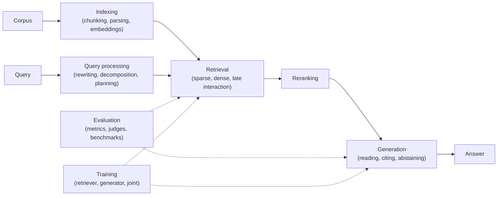

A new RAG paper appears almost every day. Most claim an improvement; a few deserve a place in a production system; many will never be heard of again. The skill this module teaches is not memorising the literature but **reading it as an engineer**: deciding quickly what a paper actually shows, how much of it transfers to your corpus, and what it would cost to find out. This first lesson gives you the map (the components of a RAG system and the landmark work on each), a way of grading evidence, and a reading checklist. Then it puts the checklist to work on a real result, using a paired bootstrap to test whether one retriever really beats another.

The later lessons in the module go deep on specific research threads: [retrieval-augmented pretraining](/learn/advanced-rag-research/retrieval-augmented-pretraining), [long context versus RAG](/learn/advanced-rag-research/long-context-versus-rag), [fine-tuned retrievers](/learn/advanced-rag-research/fine-tuned-retrievers), [late interaction](/learn/advanced-rag-research/late-interaction), [query planning](/learn/advanced-rag-research/advanced-query-planning) and [retrieval reasoning](/learn/advanced-rag-research/retrieval-reasoning). This lesson is the method they all rely on.

## Learning objectives

- Place a RAG paper on the map of components (indexing, retrieval, reranking, generation, evaluation) and name the landmark work for each.
- Grade a claim on the evidence ladder from "established practice" to "unproven" and justify the grade.
- Apply a reading checklist that exposes weak baselines, leaked test sets, metric gaming and missing cost figures.
- Compute a paired bootstrap confidence interval for the difference between two retrievers and interpret it.
- Design a cheap replication of a paper's claim on your own corpus before adopting its technique.

## Prerequisites

- [Retrieval benchmarks](/learn/retrieval-evaluation/retrieval-benchmarks): BEIR, MTEB and the ways benchmarks mislead.
- [nDCG](/learn/retrieval-evaluation/ndcg): the metric used in the code below.
- [Advanced RAG](/learn/advanced-rag-patterns/advanced-rag) and [Modular RAG](/learn/advanced-rag-patterns/modular-rag): the pattern vocabulary that papers build on.
- [RAG versus fine-tuning](/learn/introduction-to-rag/rag-versus-fine-tuning): the context for why retrieval was added to language models.

## Why this matters

Adopting a technique from a paper costs real engineering time: an index rebuild, a new model to serve, a new failure mode to monitor. Adopting a technique that does not work on your data costs that time and then the time to notice. Teams that follow the literature uncritically tend to make one of two errors. They chase every headline (a new fusion trick, a new chunking scheme) and end up with a pipeline nobody can reason about. Or they dismiss the field as hype and miss the handful of results that change what is possible.

The literature is also unusually hard to read well. RAG is an end-to-end system, so a paper that improves the retriever reports end-to-end answer quality, which depends on the generator, the prompt and the judge. Benchmarks are small, labelled by few annotators, and often seen by the models during training. Baselines are frequently under-tuned. Costs (latency, tokens, index size) are reported rarely, and yet cost decides whether a technique is usable. An engineer who can see these problems in a paper, and who has a fast way to test a claim locally, makes better decisions than one who has read more papers.

## The intuition

Think of the literature as a market stall with many sellers. Each shouts that their product is best. A sensible shopper does three things. First, work out **what kind of product it is**: a better engine, a better tyre, a better driver. Papers about retrievers cannot be compared with papers about generators, because they fix different parts of the system. Second, ask **who has tried it besides the seller**. A technique reproduced by several independent teams, and shipped in open-source libraries and products, is a different thing from a claim in one preprint. Third, **try it on your own road**. A tyre that wins on a race track may be poor on gravel.

That is the whole method: classify, weigh the evidence, test locally. The rest of the lesson makes each step concrete.

## How it works

### A map of the field

Every RAG paper changes one or more components of the same pipeline. Locating the component tells you what to compare it with and what else to hold fixed.



The landmark papers, grouped by where they act. Years are those of the first public version; every entry is a paper you can find by title.

| Component | Landmark work | The idea |
| --- | --- | --- |
| The original recipe | Lewis et al. (2020), *Retrieval-Augmented Generation for Knowledge-Intensive NLP Tasks* | A dense retriever feeds passages to a sequence-to-sequence generator; retriever and generator trained together. The paper that named the field. |
| Pretrained retrieval | Guu et al. (2020), *REALM*; Khandelwal et al. (2019), *kNN-LM*; Borgeaud et al. (2021), *RETRO*; Izacard et al. (2022), *Atlas* | Retrieval during pretraining or at the language model's output, not only at inference. See [the next lesson](/learn/advanced-rag-research/retrieval-augmented-pretraining). |
| Dense retrieval | Karpukhin et al. (2020), *Dense Passage Retrieval* | Train two encoders with in-batch and hard negatives so that questions land near their passages. |
| Late interaction | Khattab and Zaharia (2020), *ColBERT* | One vector per token, scored with MaxSim. See [late interaction](/learn/advanced-rag-research/late-interaction). |
| Query processing | Gao et al. (2022), *HyDE*; Press et al. (2022), *Self-Ask*; Trivedi et al. (2022), *IRCoT* | Generate a hypothetical document, or interleave retrieval with reasoning steps. |
| Reading the context | Izacard and Grave (2021), *Fusion-in-Decoder*; Liu et al. (2023), *Lost in the Middle* | Encode passages independently and fuse in the decoder; show that position in the context matters. |
| Adaptive control | Asai et al. (2023), *Self-RAG*; Yan et al. (2024), *Corrective RAG* | The model or an evaluator decides when to retrieve and whether retrieved text is good enough. |
| Structured retrieval | Edge et al. (2024), *From Local to Global: A Graph RAG Approach* | Build an entity graph and community summaries to answer corpus-wide questions. |
| Evaluation | Thakur et al. (2021), *BEIR*; Es et al. (2023), *RAGAS* | Zero-shot retrieval benchmarks; reference-free metrics for RAG answers. |

Several of these have lessons of their own in this course ([Self-RAG](/learn/advanced-rag-patterns/self-rag), [Corrective RAG](/learn/advanced-rag-patterns/corrective-rag), [HyDE](/learn/advanced-retrieval/hyde), [Microsoft GraphRAG](/learn/graph-rag/microsoft-graphrag-concepts)). Notice the pattern in the table: the field moved from a single trained system (2020), to modular pipelines of off-the-shelf parts (2023), to systems in which a language model decides how to retrieve (2023 onwards). Each shift changed what a "paper" can claim, because the more modular the system, the more the answer depends on parts the paper did not vary.

### The evidence ladder

Not all claims deserve the same trust. A practical way to grade them is a four-rung ladder. Rung and evidence go together; a technique earns a rung by what has happened to it, not by how elegant it is.

1. **Established practice.** Reproduced by many independent groups, built into mainstream libraries and databases, and described the same way in several places. Examples: dense retrieval with a hard-negative-trained bi-encoder, BM25 as a baseline that is hard to beat out of domain, cross-encoder reranking of a first-stage candidate list, reciprocal rank fusion, recall and nDCG as retrieval metrics. You adopt these by default and need a reason not to.
2. **Strong evidence, with conditions.** Several independent results agree, but they hold under conditions that may not match yours. Example: late interaction models generalise well on benchmarks such as BEIR, at a storage cost; whether that matters depends on your corpus size. You adopt these after a local test.
3. **Promising.** One or two strong results, perhaps a released model, but little independent replication or production reporting. Examples at the time of writing include some reasoning-trained retrievers and reinforcement-learned search agents ([Retrieval reasoning](/learn/advanced-rag-research/retrieval-reasoning)). You prototype, behind a flag, with an evaluation set you trust.
4. **Unproven or contested.** A single preprint, results only on the paper's own benchmark, no code, or findings that other groups failed to reproduce. You note it and wait.

Two cautions apply to the ladder itself. It moves: what is promising in one year can be established in the next, and a once-established practice can be overtaken. And the labels depend on the question. "Long context models can read a whole book" is established; "so retrieval is unnecessary for your corpus" is not, and the [long-context lesson](/learn/advanced-rag-research/long-context-versus-rag) shows why.

### Reading a paper like an engineer

Work through these questions in order, and stop as soon as a paper fails one badly.

1. **What exactly changed?** One component, or a bundle? If a paper changes the retriever, the prompt and the generator at once, the headline gain cannot be attributed to any of them. Look for an **ablation table** that removes one piece at a time.
2. **What is the baseline, and is it tuned?** The most common weakness is a baseline run with defaults while the new method received a hyperparameter search. Check whether the baseline is a strong, current system: BM25 with sensible tokenisation, a good off-the-shelf embedding model, a reranker.
3. **Which data, and could the model have seen it?** Popular benchmarks are on the public web and may sit in the training data of both embedding models and generators. A gain on a benchmark the model was trained near says little. Dates matter: a benchmark built from documents published after a model's training cutoff is safer.
4. **Which metric, and does it match the use?** A retrieval gain measured by recall at 100 does not show an answer-quality gain at k equal to 5. An answer metric computed by a language-model judge inherits the judge's biases; check whether the judge is named and whether the paper validates it against humans.
5. **How big is the effect compared with the noise?** A difference of one point on a test set of a few hundred queries is often within sampling noise. Look for confidence intervals, multiple seeds, or a significance test. When they are absent, you can often compute them yourself if the per-query outputs are released, as the code section does.
6. **What does it cost?** Extra language-model calls, longer prompts, bigger indexes, slower queries. A technique that doubles latency for a two-point gain may be the wrong trade for an interactive assistant and the right one for an overnight report.
7. **Does it survive independent contact?** Search for reproductions, issue threads in the code repository, and later papers that compare against it. Silence after a year is information.

### Replicating a claim cheaply

Once a paper passes the reading, test it on your own data with the smallest experiment that could falsify it.

1. Build or reuse a **golden set** of queries with known relevant documents ([retrieval benchmarks](/learn/retrieval-evaluation/retrieval-benchmarks) explained how). Fifty to a few hundred queries is typical; below that, only large effects are detectable.
2. Implement the **baseline you already run** and the **new method**, holding everything else fixed.
3. Record **per-query scores**, not only the mean; you need them for the significance test.
4. Test the **difference** with a paired method, and report an interval.
5. Record **cost** (latency per query, index size, tokens) beside quality.
6. Decide in advance what size of effect would justify adoption. A decision rule written before the run resists wishful reading afterwards.

## The mathematics

Comparing two retrievers on the same queries gives paired data: each query has a score under system A and under system B. The natural quantity is the per-query difference.

### The paired bootstrap

**Intuition.** The queries we happened to test are one sample from all the queries users might ask. If we had drawn a different sample, the mean difference would have been a little different. The bootstrap imitates that redrawing: sample queries *with replacement* from the ones we have, recompute the mean difference, repeat many times, and look at the spread.

Let $x_i$ and $y_i$ be the scores of systems A and B on query $i$, for $i = 1, \dots, n$, and let $d_i = x_i - y_i$. The observed effect is

$$\bar{d} = \frac{1}{n} \sum_{i=1}^{n} d_i .$$

For each of $B$ bootstrap rounds $b = 1, \dots, B$, draw $n$ indices with replacement, $i^{(b)}_1, \dots, i^{(b)}_n$, and compute

$$\bar{d}^{(b)} = \frac{1}{n} \sum_{j=1}^{n} d_{i^{(b)}_j} .$$

The 2.5th and 97.5th percentiles of the $B$ values $\bar{d}^{(b)}$ form a 95 per cent **percentile confidence interval** for the true mean difference. If the interval excludes zero, the data favour one system at that confidence level. The fraction of rounds with $\bar{d}^{(b)} \le 0$ is a one-sided bootstrap p-value-like quantity for "A is no better than B"; treat it as a guide, not as an exact p-value.

Pairing matters. Some queries are easy for both systems and some hard for both, so scores are strongly correlated across systems. Differencing per query removes that shared variation, giving a much tighter interval than comparing two separate averages.

**Worked example by hand.** Five queries; nDCG@10 for A is 0.8, 0.5, 0.9, 0.4, 0.6 and for B is 0.7, 0.6, 0.8, 0.4, 0.4. The differences are $d = (0.1, -0.1, 0.1, 0.0, 0.2)$, so $\bar{d} = 0.3 / 5 = 0.06$. One bootstrap draw of indices $(5, 3, 1, 5, 2)$ picks differences $(0.2, 0.1, 0.1, 0.2, -0.1)$ with mean $0.5/5 = 0.10$. Another draw $(4, 2, 4, 2, 4)$ gives $(0.0, -0.1, 0.0, -0.1, 0.0)$ with mean $-0.04$. Across many draws the means spread both sides of 0.06, and with only five queries the interval will comfortably include zero: five queries cannot establish a 0.06 gain.

### Sample size and detectable effect

If the per-query differences have standard deviation $s$, the standard error of their mean is approximately $s/\sqrt{n}$, and a rough 95 per cent interval is $\bar{d} \pm 1.96\, s/\sqrt{n}$. Halving the width needs four times the queries. This is why a 300-query test set cannot distinguish systems that differ by a point or so, whatever the leaderboard suggests.

## In code

**The problem.** A paper reports that a hybrid of BM25 and dense retrieval beats dense retrieval alone. You want to know whether that holds on a scientific-claims corpus, and how much of the gap could be luck. The script runs three retrievers on the SciFact test queries (300 queries over 5,183 abstracts, from the BEIR benchmark), computes per-query nDCG@10, and applies the paired bootstrap. It then asks a second question that papers rarely do: if you had evaluated on a small random subset of queries, how often would you have picked the wrong winner?

**Dependencies.** `sentence-transformers`, `datasets`, `rank-bm25` and NumPy. The first run downloads the MiniLM model and the SciFact data (a few MB); no API key is needed.

```bash
pip install sentence-transformers datasets rank-bm25 numpy
```

**The source.**

```python
import re
import numpy as np
from datasets import load_dataset
from rank_bm25 import BM25Okapi
from sentence_transformers import SentenceTransformer

rng = np.random.default_rng(0)

# 1. Data: SciFact test split (300 queries) and its 5,183 abstracts.
corpus = load_dataset("BeIR/scifact", "corpus", split="corpus")
ids = [str(x) for x in corpus["_id"]]
texts = [t + ". " + x for t, x in zip(corpus["title"], corpus["text"])]
queries = {str(r["_id"]): r["text"] for r in load_dataset("BeIR/scifact", "queries", split="queries")}
qrels = {}
for r in load_dataset("BeIR/scifact-qrels", split="test"):
    if int(r["score"]) > 0:
        qrels.setdefault(str(r["query-id"]), set()).add(str(r["corpus-id"]))
qids = list(qrels)

# 2. Three retrievers.
model = SentenceTransformer("sentence-transformers/all-MiniLM-L6-v2")
D = model.encode(texts, batch_size=64, normalize_embeddings=True)
Q = model.encode([queries[q] for q in qids], normalize_embeddings=True)
tok = lambda s: re.findall(r"[a-z0-9]+", s.lower())
bm25 = BM25Okapi([tok(t) for t in texts])

def rrf(*rankings, k=60):
    score = {}
    for ranking in rankings:
        for r, d in enumerate(ranking):
            score[d] = score.get(d, 0) + 1 / (k + r + 1)
    return sorted(score, key=score.get, reverse=True)

def ndcg10(ranked, relevant):
    dcg = sum(1 / np.log2(i + 2) for i, d in enumerate(ranked[:10]) if d in relevant)
    ideal = sum(1 / np.log2(i + 2) for i in range(min(10, len(relevant))))
    return dcg / ideal

dense_s, bm25_s, hybrid_s = [], [], []
for i, q in enumerate(qids):
    dense = list(np.argsort(-(D @ Q[i]))[:100])
    sparse = list(np.argsort(-bm25.get_scores(tok(queries[q])))[:100])
    hybrid = rrf(dense, sparse)
    for store, ranking in ((dense_s, dense), (bm25_s, sparse), (hybrid_s, hybrid)):
        store.append(ndcg10([ids[d] for d in ranking], qrels[q]))
dense_s, bm25_s, hybrid_s = map(np.array, (dense_s, bm25_s, hybrid_s))
print("nDCG@10  dense %.3f  bm25 %.3f  hybrid %.3f" % (dense_s.mean(), bm25_s.mean(), hybrid_s.mean()))

# 3. Paired bootstrap on the per-query difference.
def bootstrap(x, y, rounds=10_000):
    d = x - y
    means = d[rng.integers(0, len(d), (rounds, len(d)))].mean(axis=1)
    lo, hi = np.percentile(means, [2.5, 97.5])
    return d.mean(), lo, hi, (means <= 0).mean()

for name, (x, y) in {"hybrid - dense": (hybrid_s, dense_s),
                     "dense  - bm25 ": (dense_s, bm25_s),
                     "hybrid - bm25 ": (hybrid_s, bm25_s)}.items():
    mean, lo, hi, frac = bootstrap(x, y)
    print(f"{name}: {mean:+.3f}  95% CI [{lo:+.3f}, {hi:+.3f}]  share of rounds <= 0: {frac:.3f}")

# 4. How often does a small evaluation set pick the wrong winner?
for size in (25, 50, 100):
    wins = sum(dense_s[s].mean() > bm25_s[s].mean()
               for s in (rng.choice(len(dense_s), size, replace=False) for _ in range(2000)))
    print(f"subset of {size:3d} queries: dense beats BM25 in {wins / 2000:.1%} of draws")
```

**What the important lines do.** `rrf` is [reciprocal rank fusion](/learn/hybrid-search/reciprocal-rank-fusion) with the conventional constant 60. `ndcg10` is the standard binary-relevance nDCG; its ideal ordering puts all relevant documents first. The bootstrap indexes the difference vector with a matrix of random indices, so 10,000 rounds are one NumPy operation. The final loop draws random subsets of the test queries and checks which system wins on each, which simulates a team that evaluated on a small golden set.

**Output.**

```output
nDCG@10  dense 0.648  bm25 0.652  hybrid 0.679
hybrid - dense: +0.031  95% CI [+0.005, +0.057]  share of rounds <= 0: 0.011
dense  - bm25 : -0.004  95% CI [-0.041, +0.033]  share of rounds <= 0: 0.578
hybrid - bm25 : +0.027  95% CI [+0.003, +0.050]  share of rounds <= 0: 0.013
subset of  25 queries: dense beats BM25 in 48.1% of draws
subset of  50 queries: dense beats BM25 in 47.0% of draws
subset of 100 queries: dense beats BM25 in 45.2% of draws
```

(Other NumPy versions may differ in the last digit, because random streams are implementation-defined.)

**What the output means.** The hybrid beats each component, and the intervals exclude zero, but only just: the lower ends are 0.003 and 0.005 nDCG points. A claim of "hybrid helps on SciFact" survives; a claim of a large gain does not. The dense versus BM25 comparison is a tie: the interval spans from minus 0.041 to plus 0.033, so the 0.004 point difference is meaningless. The last three lines show the practical danger. With a 25-query golden set, the two systems each "win" about half the time, so a team that picked a winner from such a set would be flipping a coin. Even at 100 queries the answer is nearly a coin flip, because the true difference is close to zero.

**Common errors.** Comparing two means without pairing and then reading overlapping intervals as "no difference" wastes power; pair the data. Computing the bootstrap over *documents* instead of *queries* resamples the wrong unit. Using one fixed seed and one split and calling it a result hides split variance. If `load_dataset` complains about the dataset script, update the `datasets` library or point it at a local copy.

**How to extend it.** Replace the three retrievers with the claimed method and your baseline. Swap SciFact for your own golden set. Add a column for latency and index size. Add a second metric, such as recall at 10, and check that the conclusion does not depend on the metric.

## A real-world example

The Platform team at Meridian owns AskMeridian. In a planning meeting, a staff engineer shares a preprint claiming a new retrieval technique gives an eleven-point gain in answer accuracy. The team lead does not ask "is it good?" but runs the checklist.

The technique changes the retriever and the prompt at once, so the gain cannot be assigned to either; there is no ablation. The baseline is a single dense model at its default settings, whereas AskMeridian already runs hybrid retrieval with reranking. The benchmark is a popular multi-hop question set, whereas Meridian's questions are mostly single-hop lookups of policy ("how many days of annual leave carry over?") and error-code diagnoses. The answer metric is a language-model judge, with no agreement figure against humans. There are no confidence intervals, and extra generation calls triple the token cost.

The preprint fails four of the seven questions, so the team grades it "promising, unreplicated" and does not drop everything. But the idea is interesting, so a junior engineer spends an afternoon on a replication: 120 labelled handbook questions, the current pipeline as baseline, the new method behind a flag, per-query scores, and a paired bootstrap. The result is a gain of two points with an interval that includes zero, at three times the cost. The team records the experiment, the data and the decision in the design log, and revisits it only if the technique shows up in a library they already use. The afternoon cost almost nothing, and it replaced a debate about the preprint's claim with a number about Meridian's data.

## Common mistakes

- **Trusting a headline number.** A single score on one benchmark is the weakest form of evidence, and leaves out noise, cost and transfer to your domain.
- **Comparing against a weak baseline.** The gain evaporates once the baseline is tuned. Always ask what the baseline would score after the same effort.
- **Ignoring leakage.** A benchmark seen during training measures memory as well as skill; results look strong and do not transfer.
- **Evaluating on a tiny golden set.** Thirty queries cannot separate systems that differ by a few points, as the subset experiment above shows; you adopt noise.
- **Treating the means as the result.** Without per-query scores, intervals and a cost column, a mean tells you almost nothing about whether to ship.
- **Adopting a bundle.** Taking a whole paper's pipeline when one component carried the gain leaves you carrying complexity for nothing.
- **Reading only the abstract.** Limitations and ablations, usually in the last pages, are where the conditions of a result are stated.

## Best practices

- Classify every paper by the component it changes before reading further.
- Grade claims on the evidence ladder, and write the grade down next to the decision.
- Keep a standing golden set, versioned, with per-query labels, so any claim can be replicated in an afternoon.
- Record per-query results for every experiment, and report paired intervals.
- Always report cost beside quality: latency, tokens, index size, engineering effort.
- Write the adoption threshold before the experiment.
- Prefer ideas that are available in maintained libraries or products you already run; the integration cost is part of the evidence.
- Keep a decision log of techniques tried and rejected so the team does not repeat them.

## Performance considerations

Replication itself is cheap and worth budgeting for. Embedding the 5,183 SciFact abstracts with a small model took roughly fifteen seconds on a laptop CPU in the run above; the 10,000-round bootstrap over 300 queries took well under a second. A replication of a retrieval claim is therefore dominated by labelling effort, not compute. A typical golden set of 150 queries, labelled at a few minutes each, is a day or two of one person's time, and pays for itself on the first technique it rejects.

The costs to watch in a *paper's* technique can be reasoned out before running anything. If a method adds $m$ language-model calls per query, each with $T$ input tokens, the added input cost per query is about $m \cdot T$ tokens and the added latency is at least $m$ sequential generation latencies unless the calls run in parallel. A multi-vector index multiplies storage roughly by the average number of tokens per passage. A reranker adds one forward pass per candidate. These first-order estimates are usually enough to see whether a technique is plausible for your latency budget, without running it.

## Security considerations

Research code and released checkpoints are third-party software. Model weights from a public hub should be loaded from formats that cannot execute code (for example safetensors) and from publishers you trust; pickled checkpoints can run arbitrary code on load. Replication scripts often download datasets and run notebooks: run them in an environment without production credentials or access to your internal corpus. Do not paste private documents into a hosted tool to "test a paper's idea". Evaluate on data you are allowed to share, or on a synthetic set shaped like yours.

## Summary

- A RAG paper changes one or more components of the pipeline; locate the component first so you know what to compare against and what else to hold fixed.
- Grade claims on an evidence ladder: established practice, strong evidence with conditions, promising, unproven. A technique earns its rung by replication and use, not by elegance.
- Read with a checklist: what changed, what the baseline was, whether the data could have leaked, whether the metric matches the use, how large the effect is against the noise, what it costs, and whether it has survived independent contact.
- Per-query scores plus a paired bootstrap give an honest interval for a difference. In the SciFact run, hybrid retrieval beat each of its parts by about three nDCG points, with intervals that only just excluded zero, while dense and BM25 were statistically tied.
- Small golden sets pick winners almost at random when systems are close; plan for hundreds of queries and report intervals.
- The cheapest defence against hype is a local replication on your own data with a decision rule written beforehand.

## Exercises

**1. (Warm-up)** A paper compares a new reranker with a baseline on 40 queries and reports 0.71 versus 0.68. Name three questions from the checklist you would ask before believing the improvement matters.

<details><summary>Show solution</summary>

Any three of the following. Is there a confidence interval or significance test, given only 40 queries? Was the baseline tuned (candidate list size, model choice) to the same degree as the new reranker? Did the benchmark appear in the reranker's training data? What are the latency and cost per query? Is the judge or metric appropriate for how the system will be used? With 40 queries a three-point difference is almost certainly within noise, so the first question matters most.

</details>

**2. (Applied)** Using the five-query example from the maths section, compute $\bar{d}$ by hand for the differences $(0.1, -0.1, 0.1, 0.0, 0.2)$ and then write six lines of NumPy that run 5,000 bootstrap rounds and print the 95 per cent interval. Does the interval exclude zero?

<details><summary>Show solution</summary>

The mean is $0.06$. A short script:

```python
import numpy as np
rng = np.random.default_rng(0)
d = np.array([0.1, -0.1, 0.1, 0.0, 0.2])
means = d[rng.integers(0, len(d), (5000, len(d)))].mean(axis=1)
print(d.mean(), np.percentile(means, [2.5, 97.5]))
```

It prints a mean of 0.06 and an interval that runs from about minus 0.02 to about 0.14, so it includes zero: five queries cannot establish the gain. (The exact end points depend on the random stream.)

</details>

**3. (Design)** Meridian wants to test whether adding a reranker to AskMeridian helps. Design the replication: the golden set, the systems, the metrics, the decision rule and the cost measurements. State one threat to validity.

<details><summary>Show solution</summary>

Golden set: 150 to 200 real staff questions sampled from logs (with personal data removed), each labelled with the handbook or runbook chunks that answer it, stratified over leave, expenses, IT and product questions. Systems: the current hybrid retriever (A) and the same retriever followed by a reranker over the top 30 (B), nothing else changed. Metrics: recall at 5 and nDCG at 10 per query, plus answer correctness on a smaller sample judged by humans. Decision rule, written first: adopt B if the paired bootstrap interval of the nDCG difference excludes zero and the mean gain is at least 0.02, and p95 latency stays within the latency budget. Costs: p50 and p95 added latency, reranker memory, and per-query compute. Threat: the golden set was labelled by looking at what system A retrieved, which biases labels in A's favour; label from the documents, not from system output.

</details>

**4. (Challenge)** Extend the main code to compute the bootstrap over the *difference in recall@10* as well, and check whether the conclusion for hybrid versus dense changes. Explain why a different metric can change a conclusion even on the same retrievals.

<details><summary>Show solution</summary>

Add a `recall10(ranked, relevant)` function that returns `len(set(ranked[:10]) & relevant) / len(relevant)`, collect per-query values for each system, and call `bootstrap` on them. The conclusion can change because the metrics reward different things: nDCG cares about *where* in the top 10 a relevant document sits, while recall at 10 only asks whether it is there. A fusion that moves relevant documents up within the top 10 helps nDCG without touching recall; one that brings in a relevant document from rank 15 helps recall. A claimed improvement should therefore be checked on the metric that matches the downstream use: recall at k for a pipeline whose generator reads all k chunks equally, nDCG when order matters.

</details>

## Check your understanding

```quiz
[
  {
    "q": "A paper improves answer accuracy by changing the retriever, the prompt template and the generator model at once. What is the main problem with this evidence?",
    "options": [
      "The gain cannot be attributed to any one change without an ablation",
      "Changing the generator always lowers answer accuracy",
      "Prompt templates cannot be compared across papers",
      "Retrievers cannot be evaluated on answer accuracy"
    ],
    "answer": 0,
    "why": "When several components change together, the headline gain mixes their effects. An ablation that removes one change at a time is what separates them."
  },
  {
    "q": "Which technique best fits the rung 'established practice' on the evidence ladder?",
    "options": [
      "A retriever trained with reinforcement learning, reported in one preprint",
      "A new fusion method with no released code",
      "Cross-encoder reranking of a first-stage candidate list",
      "A technique whose gain other groups failed to reproduce"
    ],
    "answer": 2,
    "why": "Cross-encoder reranking has been reproduced widely and ships in mainstream libraries and products. The others are single-source, unreleased or contested."
  },
  {
    "q": "Why does a paired bootstrap usually give a tighter interval than comparing two separate averages?",
    "options": [
      "It uses more bootstrap rounds",
      "It removes variation shared by both systems, such as easy and hard queries, by working with per-query differences",
      "It ignores queries on which the systems tie",
      "It assumes the scores are normally distributed"
    ],
    "answer": 1,
    "why": "Queries that are hard for one system tend to be hard for the other, so scores are correlated. The per-query difference cancels that shared component."
  },
  {
    "q": "In the SciFact run, dense minus BM25 had a 95% interval of roughly -0.041 to +0.033. What should you conclude?",
    "options": [
      "BM25 is clearly better",
      "Dense retrieval is clearly better",
      "The bootstrap failed because the interval includes zero",
      "The data do not separate the two systems"
    ],
    "answer": 3,
    "why": "An interval that spans zero means the observed 0.004 gap is compatible with no difference or a small difference either way."
  },
  {
    "q": "A team picks a retriever after evaluating on 25 queries. The two candidates differ by about 0.004 nDCG on the full set. What does the subset experiment suggest about their choice?",
    "options": [
      "It is reliable because the subset was random",
      "It is close to a coin flip",
      "It is reliable because 25 queries is enough for nDCG",
      "It favours the older system"
    ],
    "answer": 1,
    "why": "On random 25-query subsets, each system won roughly half the time, so a winner chosen from such a set is little better than chance."
  }
]
```

## Further reading

- Lewis, P. et al. (2020). *Retrieval-Augmented Generation for Knowledge-Intensive NLP Tasks*. [arXiv:2005.11401](https://arxiv.org/abs/2005.11401). The paper that introduced the term and the original recipe.
- Thakur, N. et al. (2021). *BEIR: A Heterogeneous Benchmark for Zero-shot Evaluation of Information Retrieval Models*. [arXiv:2104.08663](https://arxiv.org/abs/2104.08663). Why zero-shot, multi-domain evaluation changed how retrievers are judged.
- Gao, Y. et al. (2023). *Retrieval-Augmented Generation for Large Language Models: A Survey*. A widely cited survey that organises the field into naive, advanced and modular RAG.
- Efron, B. and Tibshirani, R. (1993). *An Introduction to the Bootstrap*. Chapman and Hall. The standard textbook for the method used above.
- Sakai, T. (2014). *Statistical reform in information retrieval?* SIGIR Forum. A short argument for significance testing and effect sizes in retrieval evaluation.
