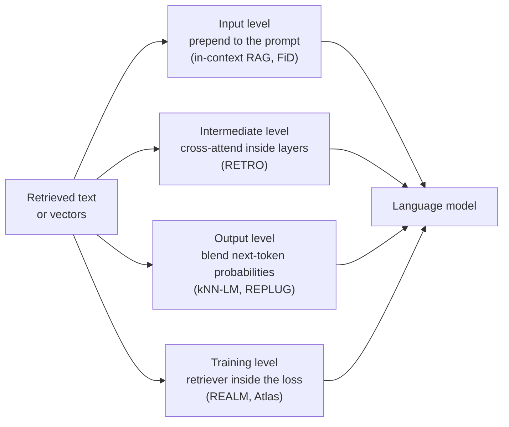

Almost everything in this course treats the language model as a finished product: you hand it a prompt that contains retrieved text, and it reads. But the model was never taught that retrieval would happen. A line of research asks what changes if retrieval is part of the model's training, or part of how it predicts every word. These are the systems behind the early results that launched the field: REALM, kNN-LM, RETRO and Atlas. They are mostly not what you deploy (they need large training budgets and custom infrastructure), yet they explain why RAG works, what the standard recipe leaves on the table, and where the training-time ideas have leaked into everyday practice.

This lesson explains the four ways of attaching retrieval to a model, works through the mathematics of the two clearest ones, and runs a small kNN-LM so that you can watch a datastore teach a model facts it never saw in training. The retrieval-augmented *fine-tuning* of retrievers is the subject of [the fine-tuned retrievers lesson](/learn/advanced-rag-research/fine-tuned-retrievers).

## Learning objectives

- Distinguish input-level, output-level, intermediate-layer and pretraining-time integration of retrieval, and place REALM, kNN-LM, RETRO, FiD and Atlas among them.
- Write the kNN-LM interpolation and the REALM marginalisation, explain every variable and compute a small case by hand.
- Explain why training a model with retrieval can reduce what the model must memorise, and what it cannot fix.
- Estimate the datastore size and memory cost of a nearest-neighbour language model from first principles.
- Decide, for a given product, whether retrieval-aware training is worth considering or whether in-context retrieval is enough.

## Prerequisites

- [Parametric versus non-parametric knowledge](/learn/introduction-to-rag/parametric-versus-non-parametric-knowledge): what a model stores in weights versus what it looks up.
- [Why RAG was introduced](/learn/introduction-to-rag/why-rag-was-introduced): the original motivation.
- [Embeddings](/learn/understanding-large-language-models/embeddings) and [Attention mechanisms](/learn/understanding-large-language-models/attention-mechanisms): the representations and the cross-attention that some designs reuse.
- [Modern RAG research](/learn/advanced-rag-research/modern-rag-research): how to grade the evidence in the papers named here.

## Why this matters

The standard RAG recipe is sometimes called *in-context retrieval*: retrieve, paste into the prompt, generate. It works because modern language models are good at reading. But it has structural limits that the training-time literature set out to remove. The model never learned to **trust** the passages or to **ignore** bad ones; it must infer that from instructions. The retriever was never told what the generator finds useful, so it optimises a similarity proxy. Every retrieved token competes for space in the context window and adds to the cost of every query. And the model still stores a huge amount of world knowledge in its weights, which is expensive to train and impossible to edit.

Retrieval-augmented pretraining attacks these limits at the root. Its claim is that a smaller model that *looks things up* can match a larger one that *memorises*, and that knowledge in a datastore can be updated or deleted without retraining. For a practitioner, the value is that you learn which parts of your own pipeline are borrowed from this research and can judge announcements of "retrieval-native" models with some calibration.

## The intuition

Compare two students preparing for a history exam. The first memorises thousands of dates and quotations; on the day, she writes from memory. The second learns the *structure* of the subject and, in an open-book exam, knows how to find a fact fast and weave it into an argument. If the textbook is revised, the second student simply reads the new edition; the first must relearn.

In-context RAG is an open-book exam for a student who trained for a closed-book one: she is clever enough to cope, but never practised looking things up. Retrieval-augmented pretraining is the second student's whole education. Three variants differ in *when* the student opens the book:

- **Before reading the question** (input level): the examiner puts the relevant pages on her desk. This is standard RAG.
- **While choosing each word** (output level): at every word she writes, she glances at a card index of similar situations and blends what they suggest with her own instinct. This is kNN-LM.
- **While thinking** (intermediate level): the book is wired into her reasoning, so that each paragraph she writes is shaped by pages consulted as she goes. This is RETRO.

## How it works

### Four places to plug retrieval in



These levels combine: Atlas pairs a trained retriever (training level) with a reader that fuses passages in its decoder (input level). They answer one design question: *how tightly should the model and the datastore be coupled?* Loose coupling is simple and works with any model; tight coupling can use the datastore more efficiently but needs a trained model.

### Output level: the nearest-neighbour language model

Khandelwal and colleagues (2019, published 2020) proposed **kNN-LM**. A language model predicts the next token from a context. kNN-LM keeps the model unchanged and adds a **datastore** built from a text collection: for every position in the collection, store a pair

- the **key**: the model's internal representation of the context up to that position (a vector), and
- the **value**: the token that actually came next.

At prediction time, the model computes the same kind of representation for the current context, finds the $k$ nearest keys in the datastore, and looks at what token followed in those situations. Neighbours vote for their next tokens, weighted by closeness. That vote is a second probability distribution, and the final prediction **interpolates** it with the model's own. Because the model is untouched, you can attach a datastore built from a *new* domain and obtain gains with no training. The paper reported lower perplexity on standard language-modelling benchmarks, with particularly useful gains when the datastore came from the target domain.

Why does it help? Neighbours capture facts and rare patterns that a model's finite weights smooth over: after the context "the support desk is open from", neighbours say "08:00" with a confidence a generic model cannot have. The cost is a nearest-neighbour search *per generated token*, which is far heavier than one retrieval per question.

### Intermediate level: RETRO

Borgeaud and colleagues (DeepMind, 2021, published 2022) built **RETRO**, a transformer whose layers can attend to retrieved text. The design has four features worth knowing.

1. **Chunked retrieval.** The input is split into fixed chunks of 64 tokens. For each chunk, a frozen BERT encoder embeds it and a nearest-neighbour index over a database of about 2 trillion tokens returns neighbours, together with the text that *follows* each neighbour (the continuation).
2. **Neighbours for the next chunk.** The neighbours retrieved for chunk $i$ condition the generation of chunk $i+1$, which preserves the left-to-right nature of language modelling.
3. **Chunked cross-attention.** Inside some transformer layers, a cross-attention block lets each chunk's tokens attend to the encoded neighbours. The cross-attention is done chunk by chunk so that cost scales linearly with sequence length.
4. **Retrofitting.** The paper also showed that an existing pretrained transformer can be converted to use retrieval by freezing most of its weights and training only the new cross-attention blocks, which is far cheaper than training from scratch.

The headline result was that RETRO, with far fewer parameters, reached language-modelling performance comparable to much larger models without retrieval. The paper also analysed a point every reader should keep in mind: gains depend partly on how much the evaluation text overlaps with the retrieval database, and a datastore holding near-copies of the test set measures copying, not understanding.

### Input level, trained: Fusion-in-Decoder and Atlas

Izacard and Grave (2021) proposed **Fusion-in-Decoder (FiD)**. Each retrieved passage is encoded *separately* together with the question; the decoder then attends over all the encoded passages at once. Independent encoding keeps cost linear in the number of passages, while joint decoding lets the answer combine evidence. FiD showed that giving a generator many passages (not just one) keeps improving open-domain question answering.

**Atlas** (Izacard and colleagues, 2022) went further: a pretrained retriever (Contriever) and a FiD-style T5 reader are trained *jointly*, including during pretraining, with the document index refreshed as the retriever changes. The paper's main claim was strong few-shot performance on knowledge-intensive tasks with a model far smaller than the best closed-book models, and it compared several ways to train the retriever from the reader's behaviour, among them losses based on how much each document lowers the reader's perplexity. The idea of using the reader's feedback to train the retriever is the thread that continues in [the next lessons](/learn/advanced-rag-research/fine-tuned-retrievers).

### Training level: REALM and the latent retriever

Guu and colleagues (2020) introduced **REALM**, a masked language model whose pretraining treats the retrieved document as a **latent variable**. To fill in a masked span, the model first retrieves documents given the input, then predicts the span given input *and* document. Maths in the next section shows how the training signal reaches the retriever: documents that make the correct prediction likelier are rewarded. Retrieval over millions of documents must sit inside the training loop, so the index is refreshed asynchronously every few hundred steps. REALM also masked salient spans such as names and dates, so that predicting them requires world knowledge.

The original **RAG** model (Lewis and colleagues, 2020) belongs here too: a DPR retriever and a BART generator, fine-tuned together by marginalising over retrieved passages, with the document encoder frozen so the index need not be rebuilt.

### Black-box variants: REPLUG and in-context RALM

Not everyone can train a model. **In-Context RALM** (Ram and colleagues, 2023) showed that simply prepending retrieved passages to an unmodified language model's input improved language modelling, which is the ancestor of today's standard practice. **REPLUG** (Shi and colleagues, 2023) treats the model as a black box: it retrieves several passages, runs the model once per passage, and combines the output probabilities weighted by retrieval scores (an output-level ensemble). Its trained variant, REPLUG LSR, tunes only the *retriever* so that its distribution over documents matches which documents lower the black-box model's loss on the true continuation. That recipe, supervising retrieval with the generator's likelihood, is a bridge to what practitioners can actually do.

### What carried over into everyday practice

Most teams will never train a retrieval-augmented model, but pieces of this research are everywhere: retrievers fine-tuned with feedback from the generator ([Fine-tuned retrievers](/learn/advanced-rag-research/fine-tuned-retrievers)); models post-trained to answer from provided context and cite it, which is retrieval-awareness added late rather than in pretraining; FiD's lesson that independently encoded passages scale better than one giant concatenation; and the argument that facts belong in an editable datastore rather than in weights ([RAG versus fine-tuning](/learn/introduction-to-rag/rag-versus-fine-tuning)).

## The mathematics

### kNN-LM interpolation

**Intuition.** Two experts each give a probability for the next word: the language model, and a panel of neighbours drawn from memory. We take a weighted average, with weight $\lambda$ on the panel.

Let $x$ be the context and $y$ the next token. Let $f(x)$ be the model's vector representation of the context and $\mathcal{N}$ the set of the $k$ nearest datastore entries $(k_j, v_j)$ to $f(x)$, where $k_j$ is a stored key and $v_j$ its stored next token. Then

$$p_{kNN}(y \mid x) \;\propto\; \sum_{(k_j, v_j) \in \mathcal{N}} \mathbb{1}[v_j = y] \; \exp\!\big(-d(f(x), k_j)\big),$$

$$p(y \mid x) \;=\; \lambda \, p_{kNN}(y \mid x) \;+\; (1 - \lambda)\, p_{LM}(y \mid x).$$

Here $d$ is a distance (squared Euclidean in the original paper; the code below uses cosine similarity, scaled), $\mathbb{1}[\cdot]$ is 1 when its condition holds and 0 otherwise, and $\lambda \in [0, 1]$ is a mixing weight tuned on held-out text. The $\propto$ means the neighbour weights are normalised to sum to 1 over the neighbours. The exponential makes closer neighbours count much more than distant ones.

**Worked example by hand.** Context: "the support desk is open from". Suppose $k = 3$ neighbours with distances 1, 1 and 3, whose stored next tokens are "08:00", "08:00" and "09:00". Weights $e^{-1} = 0.368$, $0.368$, $e^{-3} = 0.050$ sum to $0.786$. So $p_{kNN}(\text{08:00}) = 0.736 / 0.786 = 0.936$ and $p_{kNN}(\text{09:00}) = 0.064$. Suppose the language model gives $p_{LM}(\text{08:00}) = 0.01$. With $\lambda = 0.5$,

$$p(\text{08:00} \mid x) = 0.5 \times 0.936 + 0.5 \times 0.01 = 0.473 .$$

The model's own estimate of 0.01 has become 0.473 in one step, and the loss on this token, $-\ln p$, has dropped from $-\ln 0.01 = 4.61$ to $-\ln 0.473 = 0.75$. A token the datastore *has* seen is cheap; a token it has not is still covered by the $(1-\lambda)\,p_{LM}$ term, which is why the mixture degrades gracefully rather than collapsing.

### REALM marginalisation

**Intuition.** We do not know which document helps, so we sum over all candidates, weighting each by how likely the retriever is to pick it.

$$p(y \mid x) \;=\; \sum_{z \in \mathcal{Z}} p(y \mid z, x)\; p(z \mid x), \qquad p(z \mid x) \;=\; \frac{\exp\big(\mathrm{Emb}_q(x)^{\top} \mathrm{Emb}_d(z)\big)}{\sum_{z'} \exp\big(\mathrm{Emb}_q(x)^{\top} \mathrm{Emb}_d(z')\big)} .$$

Here $x$ is the input, $y$ the target (the masked span), $z$ a document from the corpus $\mathcal{Z}$, $\mathrm{Emb}_q$ and $\mathrm{Emb}_d$ are the query and document encoders, and the second formula is a softmax over inner products, so $p(z \mid x)$ is the retriever's probability of document $z$. In practice the sum is truncated to the top few documents found by maximum inner product search. The training loss is $-\ln p(y \mid x)$. Because $p(z \mid x)$ appears in the loss, its gradient flows into both encoders: a document that makes the right answer likelier has its score pushed up.

**Worked example by hand.** Two documents. The retriever gives $p(z_1 \mid x) = 0.7$ and $p(z_2 \mid x) = 0.3$. The reader gives the correct answer probability 0.2 given $z_1$ and 0.9 given $z_2$. Then $p(y \mid x) = 0.7 \times 0.2 + 0.3 \times 0.9 = 0.41$. The gradient of $\ln p(y \mid x)$ with respect to the retriever's logits is positive for $z_2$ (a good document) and negative for $z_1$, so training shifts probability mass towards $z_2$, even though no human ever labelled either document.

## In code

**The problem.** Show the mechanics of kNN-LM at toy scale. A bigram language model trained on science abstracts has never seen Meridian's handbook, so it assigns very low probability to handbook sentences. A datastore built from 14 handbook sentences is attached *without retraining the model*, and we measure perplexity on nine held-out handbook sentences that paraphrase them. We also compare with the alternative of retraining the bigram model on the handbook text.

**Honest limits.** This is a toy. The "language model" is a bigram table, not a neural network; the keys are sentence embeddings of the *text of the prefix* from MiniLM rather than a language model's hidden state; the test sentences are close paraphrases of the datastore, which is the favourable case; and the vocabulary is closed (the union of all words), so probabilities are properly normalised. It demonstrates the interpolation and what a datastore contributes, not the size of gains on real language models.

**Dependencies.** `sentence-transformers`, `datasets` and NumPy. SciFact (a few MB) and the MiniLM model are downloaded on first use. No API key.

```bash
pip install sentence-transformers datasets numpy
```

**The source.**

```python
import re
import numpy as np
from collections import Counter, defaultdict
from datasets import load_dataset
from sentence_transformers import SentenceTransformer

tok = lambda s: re.findall(r"[a-z0-9£]+|[.,]", s.lower())

# General text: SciFact abstracts. Domain text: Meridian handbook sentences.
general = load_dataset("BeIR/scifact", "corpus", split="corpus")["text"][:3000]
domain_train = [
    "Employees receive 25 days of annual leave each year.",
    "Up to 5 unused days of annual leave carry over and must be used by 31 March.",
    "Staff may work remotely up to 3 days a week.",
    "The home-office equipment budget is £400 per employee.",
    "Expenses must be submitted within 30 days of purchase.",
    "Any expense over £75 needs a receipt.",
    "Passwords must be rotated every 90 days.",
    "The VPN is required whenever you use public Wi-Fi.",
    "Laptops are refreshed on a 3 year cycle.",
    "The support desk is open from 08:00 to 18:00 UK time.",
    "A lost laptop must be reported to the support desk at once.",
    "Contractors are not eligible for the home-office equipment budget.",
    "Error E-4021 means the VPN client is out of date.",
    "Update the VPN client from the IT portal to fix error E-4021.",
]
domain_test = [
    "Staff receive 25 days of annual leave per year.",
    "Unused annual leave carries over up to 5 days and must be used by 31 March.",
    "Employees may work remotely up to 3 days a week.",
    "Every employee has a home-office equipment budget of £400.",
    "Expenses over £75 need a receipt.",
    "Passwords must be rotated every 90 days.",
    "A VPN is required when you use public Wi-Fi.",
    "The support desk is open from 08:00 to 18:00.",
    "Error E-4021 means that the VPN client is out of date.",
]

gen_tokens = [["<s>"] + tok(d) for d in general]
dom_tokens = [["<s>"] + tok(d) for d in domain_train]
test_tokens = [["<s>"] + tok(d) for d in domain_test]
vocab = sorted({w for s in gen_tokens + dom_tokens + test_tokens for w in s})
w2i = {w: i for i, w in enumerate(vocab)}
V = len(vocab)

def train_bigram(sentences, alpha=0.01):
    uni, bi = Counter(), defaultdict(Counter)
    for s in sentences:
        for a, b in zip(s, s[1:]):
            uni[b] += 1
            bi[a][b] += 1
    u = np.array([uni[w] for w in vocab], float) + alpha
    u /= u.sum()
    def dist(prev):
        c = bi.get(prev, {})
        n = sum(c.values())
        p = np.array([c.get(w, 0) for w in vocab], float)
        lam = n / (n + 5.0)          # more evidence about this word -> trust bigram counts more
        return lam * (p / max(n, 1)) + (1 - lam) * u
    return dist

base = train_bigram(gen_tokens)
tuned = train_bigram(gen_tokens + dom_tokens)       # the "fine-tuned" alternative

# Datastore: key = embedding of the prefix text, value = the next word.
enc = SentenceTransformer("sentence-transformers/all-MiniLM-L6-v2")
def prefixes(sentences):
    keys, vals = [], []
    for s in sentences:
        for i in range(1, len(s)):
            keys.append(" ".join(s[1:i]) if i > 1 else "start")
            vals.append(s[i])
    return keys, vals
dk, dv = prefixes(dom_tokens)
K = enc.encode(dk, normalize_embeddings=True)
dv_idx = np.array([w2i[w] for w in dv])
print("datastore entries:", len(dv))

def p_knn(prefix_text, k=8, temp=0.05):
    q = enc.encode([prefix_text], normalize_embeddings=True)[0]
    sims = K @ q
    top = np.argsort(-sims)[:k]
    w = np.exp((sims[top] - sims[top].max()) / temp)   # closer neighbours count more
    p = np.zeros(V)
    for weight, j in zip(w, top):
        p[dv_idx[j]] += weight
    return p / p.sum()

def perplexity(lm, lam):
    nll, n = 0.0, 0
    for s in test_tokens:
        for i in range(1, len(s)):
            pl = lm(s[i - 1])
            if lam > 0:
                pk = p_knn(" ".join(s[1:i]) if i > 1 else "start")
                pl = lam * pk + (1 - lam) * pl
            nll -= np.log(pl[w2i[s[i]]])
            n += 1
    return float(np.exp(nll / n))

print("base bigram LM            : %.1f" % perplexity(base, 0))
print("bigram retrained on domain: %.1f" % perplexity(tuned, 0))
for lam in (0.2, 0.4, 0.6, 0.8):
    print("base + kNN, lambda=%.1f    : %.1f" % (lam, perplexity(base, lam)))
print("retrained + kNN, lambda=0.4: %.1f" % perplexity(tuned, 0.4))

prefix = "Staff receive 25 days of annual"
pk = p_knn(prefix)
pb = base(prefix.lower().split()[-1])
for name, p in (("base", pb), ("knn ", pk), ("mix 0.6", 0.6 * pk + 0.4 * pb)):
    top = np.argsort(-p)[:3]
    print(name, [(vocab[i], round(float(p[i]), 3)) for i in top])
```

**What the important lines do.** `train_bigram` builds a backed-off bigram model: the weight on the bigram counts grows with how often the previous word was seen. The datastore stores one entry per prefix of each domain sentence; the key is the MiniLM embedding of that prefix text and the value is the next word. `p_knn` takes the eight nearest keys, weights them by `exp` of the scaled similarity (the cosine-similarity counterpart of $\exp(-d)$), and sums the weights by next word. `perplexity` mixes the two distributions exactly as in the interpolation formula and averages the log loss over all test tokens.

**Output.**

```output
datastore entries: 159
base bigram LM            : 22911.9
bigram retrained on domain: 277.8
base + kNN, lambda=0.2    : 36.1
base + kNN, lambda=0.4    : 23.6
base + kNN, lambda=0.6    : 19.0
base + kNN, lambda=0.8    : 17.6
retrained + kNN, lambda=0.4: 20.4
base [('incidence', 0.122), ('first', 0.049), ('screening', 0.049)]
knn  [('leave', 0.592), ('annual', 0.139), ('of', 0.103)]
mix 0.6 [('leave', 0.355), ('annual', 0.084), ('of', 0.064)]
```

**What the output means.** The base model's perplexity of about 22,900 means it is almost clueless about handbook text, because most handbook words never appeared in its training data and it falls back on near-uniform smoothing. Retraining on the handbook sentences brings it to 278, but a bigram model sees only one word of context, so it cannot tell "annual leave" from "annual report". Attaching the datastore to the *unchanged* base model brings it to 17.6 at $\lambda = 0.8$, because the datastore key covers the *whole* prefix. The last three lines show the mechanism on one prediction: after "Staff receive 25 days of annual" the base model suggests "incidence" (an echo of science prose), the neighbours say "leave" with probability 0.59, and the mixture picks "leave".

Two cautions. The comparison with retraining is unfair to retraining, because the datastore sees longer context than a bigram model. And $\lambda = 0.8$ is best here only because the test sentences paraphrase the datastore; on unrelated text a high $\lambda$ would hurt, which is why $\lambda$ is tuned on held-out text from the target domain.

**Common errors.** Unnormalised distributions (perplexity becomes meaningless), test sentences leaking into the datastore, and a vocabulary that differs between the language model and the datastore values.

**How to extend it.** Delete the two E-4021 sentences from `domain_train` and re-run (measured at $\lambda = 0.6$): the perplexity of the E-4021 test sentence jumps from 4.9 to over 160,000 while the average over the other eight sentences stays at about 69, which is the "edit the datastore, not the model" property in miniature. Replace MiniLM prefix embeddings with the hidden state of a small causal language model for a closer replica of the original method.

## A real-world example

Meridian's Platform team is asked by a director whether AskMeridian should "get its own model, trained on our handbook, so it doesn't need retrieval". The team lead walks through the four integration levels in the design review.

Pretraining is out: a handbook is far too small to train a model from scratch. *Fine-tuning* an existing model on the handbook would bake the 2025 policies into its weights, and the team already knows from [RAG versus fine-tuning](/learn/introduction-to-rag/rag-versus-fine-tuning) that the superseded 2023 handbook (4-year laptop cycle, 250-pound equipment budget) would linger as a competing memory, and that the model could not show its source. An output-level datastore like kNN-LM needs access to model internals and a nearest-neighbour search per generated token, which a hosted model does not offer.

So the team stays with in-context retrieval and takes two lessons from the research instead. First, the retriever should be trained against what the generator finds useful, so they schedule the work described in [the next lessons](/learn/advanced-rag-research/fine-tuned-retrievers) using logged questions. Second, they keep the facts in the datastore, where a change to the policy is a re-index of one document rather than a training run. The director gets a one-page answer: the research confirms that the architecture is right for Meridian, and it names the two investments that would make it better.

## Common mistakes

- **Equating "retrieval-augmented" with "RAG as deployed".** Many headline results come from jointly trained retriever and generator; plugging a generic retriever into a generic model does not reproduce them.
- **Ignoring datastore leakage.** Evaluation text in the datastore inflates every metric; check the overlap.
- **Underestimating datastore size.** Per-token keys multiply storage, as the arithmetic below shows.

## Best practices

- Start with in-context retrieval; consider tighter coupling only when you control the model and have evidence that the input-level approach is the bottleneck.
- Supervise the retriever with signal from the generator where you can ([Fine-tuned retrievers](/learn/advanced-rag-research/fine-tuned-retrievers)).
- Choose a generator tuned for grounded answers and test its behaviour with irrelevant, conflicting and empty context ([Hallucinations and factual reliability](/learn/introduction-to-rag/hallucinations-and-factual-reliability)).
- Keep facts in an editable datastore and keep a deletion path for documents that must be removed.

## Performance considerations

Reason with arithmetic. A kNN-LM stores one key per token. For a collection of 1 billion tokens with 1,024-dimensional keys in 16-bit floating point, the keys occupy $10^9 \times 1024 \times 2$ bytes, about 2 terabytes. Product quantisation to 64 bytes per key reduces this to roughly 64 gigabytes, at some loss of accuracy ([Product quantisation](/learn/vector-indexing-algorithms/product-quantisation)). Compare with a chunk-level RAG index: 1 billion tokens in 256-token chunks is about 3.9 million chunks, and even at 1,024 dimensions and 16 bits that is under 8 gigabytes. The token-level datastore is 256 times larger because it has one key per token rather than one per chunk. kNN-LM also searches *for every generated token*, where chunk-level RAG searches once per question.

RETRO's database makes the same point at the other extreme. Two trillion tokens in 64-token chunks is about 31 billion chunks; at 768 dimensions in 16-bit floats, the raw vectors would be about 48 terabytes, so the system depends on compressed approximate search. The paper's argument for retrieval is therefore not that it saves resources overall, but that it moves them: fewer parameters to train and serve, more storage and search to operate.

Training-time retrieval adds the cost of refreshing the index as the encoder changes (REALM did so asynchronously) and a retrieval call in every training step.

## Security considerations

A datastore that a model trusts is a channel for **poisoning**: anyone who can add documents can influence predictions, and tighter coupling gives less room for the model to apply judgement. Treat the datastore's write path as a security boundary ([Prompt injection](/learn/rag-security-fundamentals/prompt-injection) and [Data poisoning](/learn/rag-security-fundamentals/data-poisoning) cover the attack and defences). A token-level datastore also **memorises text verbatim**, so deleting a record means deleting its entries, which you can only do if each entry carries per-document provenance.

## Summary

- Retrieval can be attached at four levels: the input (in-context RAG, FiD), inside the layers (RETRO), at the output probabilities (kNN-LM, REPLUG), and inside the training loss (REALM, Atlas).
- kNN-LM mixes the model's next-token distribution with a distribution formed from the next tokens of the nearest stored contexts, weighted by $\lambda$; a datastore from a new domain helps without retraining.
- REALM marginalises over retrieved documents so that the training signal reaches the retriever; generator feedback trains the retriever without any document labels.
- The research argues that facts belong in an editable datastore and that retrieval can substitute for some parameters, at the price of storage, search and index maintenance.
- Results depend on datastore and test-set overlap and on joint training; both limit how far they transfer to a generic retriever plus a generic model.
- For most teams the takeaways are generator-aware retriever training, grounded-answer models, and keeping facts out of the weights.

## Exercises

**1. (Warm-up)** In the kNN-LM formula with $k = 2$, the neighbours are at distances 0 and 2, with next tokens "yes" and "no". Compute $p_{kNN}(\text{yes})$.

<details><summary>Show solution</summary>

The weights are $e^{0} = 1$ and $e^{-2} = 0.135$. The normaliser is $1.135$. So $p_{kNN}(\text{yes}) = 1 / 1.135 = 0.881$ and $p_{kNN}(\text{no}) = 0.119$.

</details>

**2. (Applied)** Using the REALM example (retriever probabilities 0.7 and 0.3, reader probabilities 0.2 and 0.9), compute the posterior probability that document $z_2$ was "the useful one", $p(z_2 \mid x, y)$, and explain what it means for training.

<details><summary>Show solution</summary>

By Bayes' rule, $p(z_2 \mid x, y) = \dfrac{p(y \mid z_2, x)\,p(z_2 \mid x)}{p(y \mid x)} = \dfrac{0.9 \times 0.3}{0.41} = 0.66$. Before seeing the answer the retriever gave $z_2$ only 0.3; after seeing which document made the answer likely, 0.66. The gradient of the REALM loss pushes the retriever's probability for $z_2$ towards that posterior, which is how document usefulness is learned without labels.

</details>

**3. (Design)** Meridian's IT runbooks are updated weekly, and a runbook step that has been withdrawn must disappear from AskMeridian's answers within a day. Compare in-context RAG, fine-tuning, and a kNN-LM-style datastore on how each handles this requirement.

<details><summary>Show solution</summary>

In-context RAG: re-index the changed runbook (delete old chunks, insert new ones); the next query cannot see the withdrawn text. Fine-tuning: the withdrawn step is in the weights; removing it needs retraining or an unreliable editing method, and the model may still repeat it; weekly updates imply weekly training. kNN-LM-style datastore: deletion is possible by removing the document's entries, but each document contributes an entry per token, the deletion must be tracked by provenance, and the approach needs access to model internals a hosted model does not provide. In-context RAG meets the requirement most simply; it also keeps per-document provenance for audit.

</details>

**4. (Challenge)** Modify the code so that the datastore uses only the *last three words* of the prefix as its key text instead of the whole prefix. Predict whether perplexity gets better or worse, then run it and explain the result in terms of the trade-off between match specificity and recall.

<details><summary>Show solution</summary>

In `prefixes`, use `" ".join(s[max(1, i-3):i])` for the key text, and likewise for the text passed to `p_knn` inside `perplexity`. Run on the lesson's data, perplexity gets slightly *worse*: 19.2 instead of 17.6 at $\lambda = 0.8$ and 24.7 instead of 23.6 at $\lambda = 0.4$. (Interestingly, the combination with the retrained model improves, from 20.4 to 16.9, because the two sources now cover each other's gaps.) The prediction after "Staff receive 25 days of annual" also changes: the neighbours now favour "days" with probability 0.38 and give "leave" only 0.10, because the last three words "days of annual" are also found inside other stored sentences ("25 days of annual leave" and "5 unused days of annual leave"), while the longer key pinned the match to a single sentence. Shorter keys increase recall but lose specificity; which is better depends on the model that consumes the neighbours.

</details>

## Check your understanding

```quiz
[
  {
    "q": "Which description matches kNN-LM?",
    "options": [
      "It retrieves whole documents and places them in the prompt",
      "It adds cross-attention layers over retrieved 64-token chunks",
      "It trains the retriever and generator jointly on masked-language-model loss",
      "It blends the model's next-token distribution with one built from the next tokens that followed similar stored contexts"
    ],
    "answer": 3,
    "why": "kNN-LM keeps the model unchanged and interpolates its prediction with a nearest-neighbour vote over a datastore of (context representation, next token) pairs."
  },
  {
    "q": "In RETRO, what is the role of chunked cross-attention?",
    "options": [
      "It compresses the vector index",
      "It lets tokens in each chunk attend to encoded retrieved neighbours inside the transformer layers",
      "It re-ranks passages after generation",
      "It splits the training data into train and test chunks"
    ],
    "answer": 1,
    "why": "RETRO retrieves neighbours for each fixed-size chunk and uses cross-attention blocks, applied chunk by chunk, to condition the model on them."
  },
  {
    "q": "In the kNN-LM worked example, p_LM(08:00) = 0.01, p_kNN(08:00) = 0.936 and lambda = 0.5. What is the mixed probability?",
    "options": [
      "0.473",
      "0.01",
      "0.936",
      "0.947"
    ],
    "answer": 0,
    "why": "0.5 * 0.936 + 0.5 * 0.01 = 0.473. The model's own estimate still contributes, which is what protects tokens the datastore has not seen."
  },
  {
    "q": "Why does a REALM-style training loss improve the retriever without document relevance labels?",
    "options": [
      "A human ranks the documents after each step",
      "The retriever is frozen and only the reader learns",
      "The retriever's probability over documents appears in the marginal likelihood, so documents that make the correct output likelier receive a positive gradient",
      "The loss compares retrieved documents with BM25 results"
    ],
    "answer": 2,
    "why": "The marginal likelihood sums retriever probability times reader probability over documents, so the gradient rewards documents that help the reader predict correctly."
  },
  {
    "q": "A team reports excellent perplexity from a retrieval-augmented language model, but the datastore was built from a web crawl that contains the evaluation articles. What is the main concern?",
    "options": [
      "The datastore is too small",
      "Perplexity cannot be computed with a datastore",
      "The model measures copying from the datastore rather than generalisation",
      "The language model must be retrained"
    ],
    "answer": 2,
    "why": "Overlap between datastore and test set lets the model retrieve the answer verbatim, inflating the result."
  }
]
```

## Further reading

- Lewis, P. et al. (2020). *Retrieval-Augmented Generation for Knowledge-Intensive NLP Tasks*. [arXiv:2005.11401](https://arxiv.org/abs/2005.11401).
- Guu, K. et al. (2020). *REALM: Retrieval-Augmented Language Model Pre-Training*. [arXiv:2002.08909](https://arxiv.org/abs/2002.08909).
- Khandelwal, U. et al. (2020). *Generalization through Memorization: Nearest Neighbor Language Models*. [arXiv:1911.00172](https://arxiv.org/abs/1911.00172).
- Borgeaud, S. et al. (2022). *Improving Language Models by Retrieving from Trillions of Tokens* (RETRO). [arXiv:2112.04426](https://arxiv.org/abs/2112.04426).
- Izacard, G. and Grave, E. (2021). *Leveraging Passage Retrieval with Generative Models for Open Domain Question Answering* (Fusion-in-Decoder). [arXiv:2007.01282](https://arxiv.org/abs/2007.01282).
- Izacard, G. et al. (2022). *Atlas: Few-shot Learning with Retrieval Augmented Language Models*. [arXiv:2208.03299](https://arxiv.org/abs/2208.03299).
