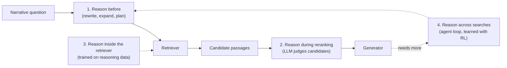

Most retrieval assumes that a relevant document looks like the query: it shares words, or it shares meaning in the sense an embedding model captures. Many real questions break that assumption. "My laptop was left on a train an hour ago. Who do I tell first?" shares almost no vocabulary with the policy that answers it ("a lost or stolen laptop must be reported to the support desk at once"), and "I still have 9 days of holiday left on 20 February. How many can I take in April?" needs a small inference (the carry-over rule says unused days expire on 31 March) before the right page can even be named. The document is relevant because of a *chain of reasoning* from the question, not because it resembles it.

This lesson is about the research on **reasoning-intensive retrieval**: what the benchmark that named it shows, the four places where a reasoning step can be added (before retrieval, during reranking, inside the retriever, and across repeated searches), and what each costs. Some of this is established practice (query rewriting, LLM reranking) and some is recent research; the lesson marks which. The code runs two experiments: a small one that shows how a reasoning step closes a vocabulary gap, and a measured one on a real benchmark of the sliding-window listwise reranking algorithm used by LLM rerankers.

## Learning objectives

- Explain why similarity-based retrievers struggle when relevance requires inference, and describe the BRIGHT benchmark's contribution.
- Compare four ways to add reasoning to retrieval (reason before retrieving, while reranking, inside the retriever, across searches) and state the cost and risk of each.
- Implement sliding-window listwise reranking with a robust output parser, and compute its call count and token cost.
- Explain the guarantee that overlapping windows give and what non-overlapping windows lose.
- Decide, for a given query mix and latency budget, where a reasoning step is worth its cost.

## Prerequisites

- [Query rewriting](/learn/advanced-retrieval/query-rewriting) and [HyDE](/learn/advanced-retrieval/hyde): the simplest forms of reasoning before retrieval.
- [Cross-encoder models](/learn/reranking-models/cross-encoder-models) and [Candidate selection](/learn/reranking-fundamentals/candidate-selection): the reranking setting.
- [Advanced query planning](/learn/advanced-rag-research/advanced-query-planning): plans over several retrievals.
- [Agentic retrieval](/learn/agentic-rag/agentic-retrieval): loops where a model decides what to search.
- [Modern RAG research](/learn/advanced-rag-research/modern-rag-research): the evidence ladder.

## Why this matters

When retrieval fails on a reasoning-shaped question, the system fails quietly. The generator receives passages about related but wrong policies and produces a fluent answer, or declines. Because the failure is in the *match* between a narrative question and a document written in policy vocabulary, no prompt change fixes it. Users describe what happened, not which clause applies.

The research matters because it separates three situations that call for different spending. If your questions are keyword-like, a reasoning step is wasted latency. If they are narrative but the corpus is small and distinctive, a good dense retriever may cope, as the experiment below shows. If they need real inference over a large, repetitive corpus, reasoning-augmented retrieval may decide whether the system works. Telling which situation you are in is an evaluation question.

## The intuition

Imagine asking a very literal librarian "my laptop was left on a train an hour ago; who do I tell first?" She searches the catalogue for "laptop", "train" and "hour", finds a page about laptop refresh cycles and another about train-travel expenses, and hands you both. A *reasoning* librarian first thinks: this is a lost-equipment situation, so the relevant material is the lost-or-stolen-equipment policy, and the key words in it will be "lost", "stolen", "report" and "support desk". She searches for those and finds the right page in one go.

There are two ways to get the reasoning librarian. You can have the clever person translate the question *before* the search (reason, then retrieve). Or you can search broadly with the literal method and have the clever person *read the top results and pick* (retrieve, then reason). A third option trains the librarian so that the translating is built in, and a fourth lets the clever person search repeatedly, learning from each result. Each costs more than the literal search; the question is where the money is best spent.

## How it works

### The benchmark: relevance that needs reasoning

**BRIGHT** (Su and colleagues, 2024) is a benchmark of queries whose relevant documents require reasoning to identify. Its queries come from sources such as Stack Exchange questions in biology, economics, coding and mathematics, and relevant documents include the concept or theorem page that explains the problem, not a passage that repeats its words. The paper's central observation was that retrievers which score well on standard benchmarks scored much lower on BRIGHT, and that having a language model first reason about the query and then using that reasoning as the query improved results noticeably. Treat it as strong evidence of a real gap, and be cautious about claims of "solving" retrieval: its scores are specific to its domains, and models can be tuned towards any benchmark.

### Four places to add reasoning



**1. Reason before retrieving (established practice).** A language model rewrites or expands the query into the corpus's vocabulary: it states the underlying rule, names the concepts, and writes one to three search queries. This is query rewriting and [HyDE](/learn/advanced-retrieval/hyde) with a reasoning prompt: one call before retrieval, any retriever. The risks are **query drift** (a wrong inference sends the search to the wrong page) and **hallucinated vocabulary**. The standard mitigations are to keep the original query alongside the rewrites and to fuse the result lists with [reciprocal rank fusion](/learn/hybrid-search/reciprocal-rank-fusion), so that a bad rewrite dilutes rather than replaces a good literal match.

**2. Reason during reranking (established, with evolving methods).** A language model reads the candidates and orders them. Four prompting styles exist:

- **Pointwise**: score each passage independently. $N$ calls, all parallelisable, no comparison between passages.
- **Pairwise**: compare two passages at a time. Many calls, since sorting needs about $N \log N$ comparisons.
- **Listwise**: show a window of passages and ask for an ordering. **RankGPT** (Sun and colleagues, 2023) showed that a large model could rerank this way, and introduced the **sliding window** to rank lists longer than the model's context. RankVicuna and RankZephyr (Pradeep and colleagues, 2023) are open distilled rerankers.
- **Setwise**: ask which passage in a small set is best, a compromise that reduces calls.

Listwise methods let the model weigh passages against each other, but their windows run in sequence and are sensitive to prompt order. More recent work (2025) trains rerankers to produce an explicit reasoning trace before the judgement, with reported gains on reasoning-heavy benchmarks; this is promising, with fewer independent reproductions and higher latency from the extra generated tokens.

**3. Reason inside the retriever (promising, early).** Instead of paying for a language-model call per query, train the embedding model on data where relevance requires reasoning, often synthetic: a language model writes hard queries and hard negatives for documents. ReasonIR (Shao and colleagues, 2025) is an example in this direction. The attraction is ordinary query cost; the open questions are generalisation beyond the training data and whether a single vector can carry multi-step inference at all (see [the theoretical limits in the last lesson](/learn/advanced-rag-research/emerging-research-directions)).

**4. Reason across searches (experimental).** The model decides what to search, reads the results, and searches again. Training this with **reinforcement learning**, rewarding correct final answers, is the idea behind Search-R1 (Jin and colleagues, 2025), R1-Searcher and the research-agent products often called "deep research". The model learns when to search and how to phrase queries from outcome reward alone. Results are reported on multi-hop question sets; concerns include cost, run-to-run variance, reward hacking, and benchmarks resembling the training data. Prompted agent loops ([Iterative search](/learn/agentic-rag/iterative-search)) are established; the *learned* versions are research.

| Where | Cost per query | Status | Main risk |
| --- | --- | --- | --- |
| Before retrieval | 1 model call | Established | Query drift |
| During reranking | $N$ pointwise calls, or about $N/s$ sequential windows | Established; reasoning variants emerging | Latency, order sensitivity |
| Inside the retriever | None at query time; training cost | Promising | Generalisation |
| Across searches | Many turns | Experimental (learned), established (prompted) | Cost, variance, runaway loops |

### Sliding-window listwise reranking

A listwise judge sees $w$ passages at a time. To rerank $N > w$ candidates, start at the **bottom** of the list, reorder the last $w$ passages, then move the window up by a **stride** $s$ and reorder again, repeating until the window reaches the top. Because windows overlap when $s < w$, the best passage of a lower window sits at that window's top, which falls inside the next window up, so the best passage of the whole list can climb all the way to rank 1 in one pass. With $s = w$ the windows do not overlap, nothing can cross a window boundary, and the method only reorders within blocks.

Two implementation details decide whether this works in production. First, **parse the judge's output defensively**: models return duplicate ids, ids that are out of range, prose around the list, or omit a passage. A robust parser keeps valid ids in first-seen order and appends the ones the judge forgot, so no passage is ever lost. Second, **randomise or fix the input order carefully**: since listwise judges can favour passages shown first, feeding them the first-stage order has a bias that shuffling then aggregating can reduce, at the cost of more calls.

## The mathematics

### Cost of reranking strategies

**Intuition.** Reasoning costs model calls and tokens; how many depends on the prompting style and on whether calls can run in parallel.

Let $N$ be the number of candidates, $w$ the window size, $s$ the stride, $L$ the tokens per passage and $o$ the fixed instruction overhead per call. Then

$$\text{pointwise: } N \text{ calls},\quad N(L + o) \text{ tokens}; \qquad \text{listwise: } 1 + \left\lceil \frac{N - w}{s} \right\rceil \text{ calls},\quad \left(1 + \left\lceil \tfrac{N - w}{s} \right\rceil\right)(wL + o) \text{ tokens}.$$

Pointwise calls are independent, so latency is about one call if you can issue $N$ in parallel; listwise windows depend on one another, so latency is the number of calls times the call time.

**Worked example by hand.** $N = 30$, $w = 10$, $s = 5$, $L = 250$, $o = 150$ (assumed figures). Listwise: $1 + \lceil 20 / 5 \rceil = 5$ calls and $5 \times (10 \times 250 + 150) = 13{,}250$ input tokens, with a serial latency of five calls. Pointwise: 30 calls, $30 \times (250 + 150) = 12{,}000$ tokens, with a parallel latency of about one call. Token costs are similar, but latency differs by up to a factor of five. With $s = w = 10$, listwise takes $1 + 2 = 3$ calls.

## In code

**Experiment 1: closing a vocabulary gap.** Eight staff-style questions are matched against ten policy snippets. Each question comes with the policy vocabulary that a reasoning step *would add*. **These expansions are written by hand, not produced by a model**; they stand in for the output of the reasoning step, so the experiment shows what the step can achieve when it reasons correctly (an upper bound), not how often a model does. The Claude code that would produce them is shown at the end of the lesson and was not run.

**Dependencies.** `rank-bm25`, `sentence-transformers` and NumPy; the MiniLM model downloads on first use. No API key.

```bash
pip install rank-bm25 sentence-transformers numpy
```

```python
import re, numpy as np
from rank_bm25 import BM25Okapi
from sentence_transformers import SentenceTransformer
DOCS = {
 "leave-carry": "Annual leave: up to 5 unused days carry over into the next leave year and must be used by 31 March; anything left after that is lost.",
 "leave-entitle": "Annual leave: every employee receives 25 days of annual leave per leave year, plus public holidays.",
 "leave-part": "Part-time staff receive annual leave pro rata to their contracted hours.",
 "remote-days": "Remote work: employees may work from home up to 3 days a week.",
 "remote-abroad": "Remote work abroad requires written approval from the People team and is limited to 20 working days a year for tax reasons.",
 "equip-budget": "Home-office equipment: each employee has a one-off budget of 400 pounds; contractors are not eligible.",
 "expenses-window": "Expenses must be submitted within 30 days of the purchase date; later claims are rejected.",
 "vpn": "A VPN connection is required on public Wi-Fi networks, such as cafes, hotels and airports.",
 "laptop-lost": "A lost or stolen laptop must be reported to the support desk at once so it can be locked remotely.",
 "e4021": "Error E-4021 means the VPN client is out of date; update it from the IT portal.",
}
# (user question, relevant document, the policy vocabulary a reasoning step would add; written by hand)
Q = [
 ("I still have 9 days of holiday left on 20 February. How many can I take in April?", "leave-carry", "carry over unused annual leave limit deadline 31 March lost"),
 ("I joined as a freelancer last month and want a standing desk. Can the company pay?", "equip-budget", "contractors not eligible home-office equipment budget"),
 ("I bought a monitor on 2 January and it is now 15 February. Can I still get the money back?", "expenses-window", "expenses must be submitted within 30 days purchase date rejected"),
 ("I want to work from my parents' house in Spain for a month. Who do I ask?", "remote-abroad", "remote work abroad written approval People team limited working days tax"),
 ("The airport lounge wifi is free. Is it fine to check my work email there?", "vpn", "VPN required on public Wi-Fi airports"),
 ("My laptop was left on a train an hour ago. Who do I tell first?", "laptop-lost", "lost stolen laptop report support desk at once locked remotely"),
 ("I work 3 days a week. How much holiday do I get?", "leave-part", "part-time staff annual leave pro rata contracted hours"),
 ("The VPN tool tells me I need to upgrade before it will connect. What do I do?", "e4021", "error E-4021 VPN client out of date update IT portal"),
]
ids=list(DOCS); texts=[DOCS[i] for i in ids]
tok=lambda s: re.findall(r"[a-z0-9]+", s.lower())
bm=BM25Okapi([tok(t) for t in texts])
m=SentenceTransformer("sentence-transformers/all-MiniLM-L6-v2"); De=m.encode(texts,normalize_embeddings=True)
def ranking(name, text):
    if name.startswith("bm25"): return np.argsort(-bm.get_scores(tok(text)))
    return np.argsort(-(De @ m.encode([text], normalize_embeddings=True)[0]))

print("retriever          hit@1  MRR   queries where the right document is not first")
for name in ("bm25", "dense", "bm25+reasoning", "dense+reasoning"):
    ranks, misses = [], []
    for q, rel, step in Q:
        order = [ids[i] for i in ranking(name, q + (" " + step if "reasoning" in name else ""))]
        ranks.append(order.index(rel) + 1)
        if ranks[-1] > 1: misses.append(f"{rel}@{ranks[-1]}")
    print(f"{name:17s}  {np.mean(np.array(ranks) == 1):.2f}  {np.mean(1 / np.array(ranks)):.2f}  {', '.join(misses) or '-'}")
```

```output
retriever          hit@1  MRR   queries where the right document is not first
bm25               0.25  0.42  leave-carry@4, equip-budget@8, expenses-window@10, vpn@5, laptop-lost@2, leave-part@5
dense              0.88  0.90  leave-part@6
bm25+reasoning     1.00  1.00  -
dense+reasoning    1.00  1.00  -
```

**What it shows.** BM25 puts the right policy first for only 2 of 8 questions: the staff wrote "left on a train", "freelancer", "standing desk" and "holiday", and the policies say "lost or stolen", "contractors", "home-office equipment" and "annual leave". The dense retriever does far better, 7 of 8, because this is a small corpus with distinctive pages, which is the situation where an embedding model copes. Its one miss is instructive: "I work 3 days a week. How much holiday do I get?" puts other pages first (the remote-work page also says "3 days a week") and the part-time leave page only sixth. Adding the reasoning step fixes both retrievers, to 8 of 8. The limits are plain: a tiny corpus, expansions written by someone who knew the answers, and a model that would sometimes be wrong. The shape of the effect is the point: a reasoning step helps lexical retrieval most, helps dense retrieval where surface similarity misleads, and is worth only as much as it is accurate.

**Experiment 2: sliding-window listwise reranking on a real benchmark.** The `judge` below plays the part of a listwise language model: given a window of passages it returns an ordering as text such as `[3] > [1] > [2]`. To run offline and cheaply, the ordering comes from a cross-encoder (`cross-encoder/ms-marco-MiniLM-L-6-v2`) that scores each passage, so the experiment measures the windowing algorithm and the parser, *not* the quality of a language-model judge. The data are the 300 SciFact test queries ([Cross-encoder models](/learn/reranking-models/cross-encoder-models) uses the same set), with the top 30 dense candidates per query. The script reads the embeddings and labels produced by the preparation step of [Fine-tuned retrievers](/learn/advanced-rag-research/fine-tuned-retrievers); to run it standalone, replace those three file loads with your own embeddings, ids and labels.

```python
import json, math, re
import numpy as np
from datasets import load_dataset
from sentence_transformers import CrossEncoder

meta = json.load(open("labels.json")); ids, qrels = meta["ids"], meta["qrels"]["test"]
D, Q = np.load("D.npy"), np.load("Q_test.npy")
corpus = load_dataset("BeIR/scifact", "corpus", split="corpus")
texts = [t + ". " + x for t, x in zip(corpus["title"], corpus["text"])]
queries = {str(r["_id"]): r["text"] for r in load_dataset("BeIR/scifact", "queries", split="queries")}
qids = list(qrels)

# A stand-in for a listwise LLM judge: it sees one window of passages and returns an ordering as text, like
# "[3] > [1] > [2]". Here the ordering comes from a cross-encoder so that the experiment runs offline and cheaply;
# only the windowing algorithm and the output parsing are the subject, not the quality of the judge.
ce = CrossEncoder("cross-encoder/ms-marco-MiniLM-L-6-v2")
calls = 0
def judge(query, passages):
    global calls; calls += 1
    scores = ce.predict([(query, p) for p in passages], show_progress_bar=False)
    return " > ".join(f"[{i + 1}]" for i in np.argsort(-scores))

def parse_ordering(text, n):
    """Robust parse: keep valid, first-seen ids; append any the judge forgot, in their original order."""
    seen = []
    for m in re.findall(r"\[(\d+)\]", text):
        i = int(m) - 1
        if 0 <= i < n and i not in seen:
            seen.append(i)
    return seen + [i for i in range(n) if i not in seen]

def sliding_window_rerank(query, passages, window=10, stride=5):
    order = list(range(len(passages)))                    # indices into passages, best first
    start = max(len(order) - window, 0)
    while True:                                           # slide from the bottom of the list to the top
        block = order[start:start + window]
        new = parse_ordering(judge(query, [passages[i] for i in block]), len(block))
        order[start:start + window] = [block[i] for i in new]
        if start == 0: break
        start = max(start - stride, 0)
    return order

def ndcg10(ranked, relevant):
    dcg = sum(1 / np.log2(i + 2) for i, d in enumerate(ranked[:10]) if d in relevant)
    return dcg / sum(1 / np.log2(i + 2) for i in range(min(10, len(relevant))))

print("parse check:", parse_ordering("[3] > [1] > [3] > [9]", 4), "(duplicate, out-of-range and missing ids handled)")
configs = {"first stage only": None, "top-10 reordered (window 10, stride 10)": (10, 10),
           "sliding window (10, stride 5)": (10, 5), "sliding window (5, stride 5)": (5, 5)}
n_cand, results, call_counts = 30, {k: [] for k in configs}, {}
for name, cfg in configs.items():
    calls = 0
    for qi, q in enumerate(qids):
        top = list(np.argsort(-(D @ Q[qi]))[:n_cand])
        if cfg is None:
            order = list(range(n_cand))
        elif cfg == (10, 10):                              # reorder only the top-10 block, once
            block = parse_ordering(judge(queries[q], [texts[j] for j in top[:10]]), 10)
            order = block + list(range(10, n_cand))
        else:
            order = sliding_window_rerank(queries[q], [texts[j] for j in top], *cfg)
        results[name].append(ndcg10([ids[top[i]] for i in order], set(qrels[q])))
    call_counts[name] = calls / len(qids)
full = []
for qi, q in enumerate(qids):                             # reference: score all 30 at once and sort
    top = list(np.argsort(-(D @ Q[qi]))[:n_cand])
    s = ce.predict([(queries[q], texts[j]) for j in top], show_progress_bar=False)
    full.append(ndcg10([ids[top[i]] for i in np.argsort(-s)], set(qrels[q])))
print(f"\n{'method':40s} judge calls/query  nDCG@10")
for name in configs:
    print(f"{name:40s} {call_counts[name]:15.1f}  {np.mean(results[name]):.3f}")
print(f"{'cross-encoder over all 30 (reference)':40s} {'-':>15s}  {np.mean(full):.3f}")
```

```output
parse check: [2, 0, 1, 3] (duplicate, out-of-range and missing ids handled)
method                                   judge calls/query  nDCG@10
first stage only                                     0.0  0.648
top-10 reordered (window 10, stride 10)              1.0  0.682
sliding window (10, stride 5)                        5.0  0.694
sliding window (5, stride 5)                         6.0  0.690
cross-encoder over all 30 (reference)                  -  0.692
```

**What the important lines do.** `parse_ordering` is the defensive parser: the check on its first line shows that `[3] > [1] > [3] > [9]` for four passages becomes `[2, 0, 1, 3]` (zero-based): the duplicate and the out-of-range id are dropped and the forgotten passages appended in their original order. `sliding_window_rerank` starts at the bottom and moves up by `stride`, rewriting the order inside each window. The loop compares four configurations and counts judge calls per query; the final loop scores all 30 candidates at once as a reference.

**What the output means.** The first-stage retriever scores 0.648 nDCG@10. A single call that reorders only the top 10 raises it to 0.682, since it can fix order but cannot admit anything from ranks 11 to 30. The sliding window with window 10 and stride 5 uses five calls per query and reaches 0.694, matching the 0.692 of the cross-encoder scoring all 30 at once (the 0.002 difference is noise). With window 5 and stride 5, six calls give 0.690: non-overlapping windows still help here because the window boundaries are small, but they lose the guarantee that the best passage reaches the top. Cautions: the judge here is a pointwise scorer, so windowing can only lose information relative to the reference, while a real listwise model gains from seeing passages side by side and suffers position bias, which this cannot show; differences under about 0.01 on 300 queries are noise; and SciFact is not a reasoning-intensive benchmark.

**With a language model.** This block was **not executed** (it needs an API key), and the model's output will differ between runs. `reasoned_queries` is the reasoning step that Experiment 1 simulated, and `llm_judge` is a drop-in replacement for `judge` in Experiment 2; `parse_ordering` still protects against malformed replies.

```python
import anthropic
from pydantic import BaseModel

client = anthropic.Anthropic()          # reads ANTHROPIC_API_KEY from the environment

class ReasonedQuery(BaseModel):
    underlying_rule: str                # the policy the question really depends on
    queries: list[str]                  # search queries in the handbook's vocabulary

def reasoned_queries(question: str) -> list[str]:
    response = client.messages.parse(
        model="claude-opus-5-5",
        max_tokens=600,
        system=("Work out which company policy the employee's question depends on, then write up to three "
                "short search queries in the words that policy would use. Do not answer the question."),
        messages=[{"role": "user", "content": question}],
        output_format=ReasonedQuery,
    )
    return [question] + response.parsed_output.queries        # always keep the original question too

def llm_judge(query: str, passages: list[str]) -> str:
    """Drop-in replacement for `judge` in the window script: one listwise call per window."""
    listing = "\n".join(f"[{i + 1}] {p}" for i, p in enumerate(passages))
    response = client.messages.create(
        model="claude-opus-5-5",
        max_tokens=100,
        system="Rank the passages by usefulness for the question. Reply with ids only, as [2] > [1] > [3].",
        messages=[{"role": "user", "content": f"Question: {query}\n\nPassages:\n{listing}"}],
    )
    return "".join(block.text for block in response.content if block.type == "text")
```

**How to extend it.** Fuse the original query's results with each rewrite's by reciprocal rank fusion, and average the judge's ranks over several shuffled runs.

## A real-world example

The Platform team at Meridian sorts a month of failed AskMeridian queries and finds a pattern: staff write narratives. "I left my laptop on a train", "my manager says I can't expense the taxi", "the contractor we hired needs a monitor". The answers exist in the handbook, in policy vocabulary, and the hybrid retriever finds them for keyword-like questions but not reliably for narratives.

The team tests the cheapest remedy first: a rewriting step that states the underlying policy and writes two queries, fused with the original by reciprocal rank fusion. On a labelled sample of narrative questions the right page moves up; on keyword-like questions it adds a second of latency for nothing, so a lightweight classifier applies it only to narrative queries. They then consider a reasoning reranker over the top 20 and measure it honestly: a pointwise judge over candidates in parallel fits the latency budget, while a sliding-window listwise judge would take five serial calls, which does not. They decline to build a learned search agent: its cost and run-to-run variance would be hard to defend for an assistant whose commonest questions are simple, and they record what would reopen the decision.

## Common mistakes

- **Applying reasoning to every query.** Keyword-like questions gain nothing and pay the latency; route by query type.
- **Replacing the original query with the rewrite.** A wrong inference then discards a correct literal match; keep both and fuse.
- **Trusting model output formats.** Unparsed rankings drop or duplicate passages; always parse defensively and append missing ids.
- **Assuming sequential windows are fast.** Five dependent calls take five call-times.

## Best practices

- Diagnose first: classify failed queries as vocabulary gaps, inference gaps or corpus gaps, and spend on the largest class.
- Start with the cheapest step, a rewrite fused with the original query, before reranking or training.
- Parse every model output defensively.

## Performance considerations

Reasoning adds model calls, and model calls dominate latency. In the worked example, a five-window listwise rerank of 30 candidates consumes about 13,000 input tokens and five serial call-times; if a call takes about 1.5 seconds (an assumption), that is 7 to 8 seconds before the first answer token, against roughly 1.5 seconds for the same quality from 30 parallel pointwise calls (subject to rate limits and a model that is cheap enough to call 30 times). A rewriting step is one call of a few hundred tokens and typically the best value per second. Candidate depth sets both the recall ceiling and the reranking cost.

Rewrites of repeated questions can be cached on the normalised question. Reasoning traces from reasoning-trained rerankers add generated tokens, which are slower and costlier than input tokens, so budget output length. Agent loops grow with turns and re-sent context ([Advanced query planning](/learn/advanced-rag-research/advanced-query-planning)); cap both.

## Security considerations

Every reasoning step reads text an attacker may influence. A listwise judge shown passages can be told by one of them to rank it first (a form of indirect prompt injection, [Indirect prompt injection](/learn/rag-security-fundamentals/indirect-prompt-injection)); constrain the judge to output only ids, parse strictly, and never execute instructions found in passages. Apply the user's permissions to every retrieval a rewritten query triggers ([Document-level permissions](/learn/access-control-and-privacy/document-level-permissions)). Treat logged reasoning traces like other logs, and give learned search agents an allow-list of tools and a hard cap on actions.

## Summary

- Some relevance cannot be seen from the surface of a query: the document is relevant through inference. BRIGHT showed retrievers that excel on standard benchmarks lose much of their lead on such queries, and that reasoning about the query first helps.
- Reasoning can be added before retrieval (rewrite or expand), during reranking (pointwise, pairwise, listwise, setwise judges), inside the retriever (reasoning-aware training) or across searches (agent loops, learned with reinforcement learning); the first two are established, the last two are still research.
- A reasoning rewrite fixes lexical gaps best; keep the original query and fuse to guard against drift.
- Sliding-window listwise reranking needs overlapping windows (stride below window) for passages to travel, costs $1 + \lceil (N - w)/s \rceil$ serial calls, and needs a defensive output parser. In the SciFact run, window 10 with stride 5 matched scoring all 30 candidates at once.
- Reasoning costs latency and tokens, so apply it by query type and cap it.

## Exercises

**1. (Warm-up)** Compute the number of listwise calls for $N = 50$, $w = 20$, $s = 10$, and the input tokens for $L = 200$, $o = 100$.

<details><summary>Show solution</summary>

Calls: $1 + \lceil (50 - 20)/10 \rceil = 1 + 3 = 4$. Tokens: $4 \times (20 \times 200 + 100) = 4 \times 4100 = 16{,}400$. Pointwise would use $50 \times (200 + 100) = 15{,}000$ tokens in 50 parallelisable calls.

</details>

**2. (Applied)** Using `parse_ordering` from the lesson, what does it return for the reply `"The best is [2], then [2] again, then [5] > [1]"` with $n = 3$? Explain each step.

<details><summary>Show solution</summary>

The regular expression finds ids 2, 2, 5, 1. Zero-based they are 1, 1, 4, 0. The first 1 is kept, the repeated 1 is dropped, 4 is out of range for $n = 3$ and dropped, and 0 is kept: `[1, 0]`. The missing id 2 is appended: result `[1, 0, 2]`. Prose around the ids is ignored by the pattern.

</details>

**3. (Design)** Meridian's latency budget for retrieval is 1.2 seconds at the 95th percentile, and a model call takes about 0.8 seconds. Which reasoning steps fit, and in what combination?

<details><summary>Show solution</summary>

One model call fits (0.8 seconds), so a rewriting step before retrieval fits, provided retrieval and reranking after it stay within about 0.4 seconds; a parallel pointwise rerank would add another model-call time (about 0.8 seconds) and exceed the budget unless it replaces the rewrite or uses a much faster model. A sliding-window listwise rerank (four or five serial calls) cannot fit. A sensible design: classify the query, rewrite only narrative queries (one call, cached), and rerank with a fast cross-encoder rather than a language model.

</details>

**4. (Challenge)** In the SciFact experiment, a pointwise judge cannot benefit from seeing passages together. Describe an experiment that would measure whether a *real* listwise judge's position bias matters, and how you would reduce it.

<details><summary>Show solution</summary>

Take the top 10 candidates for each query. Run the judge on the original order and on several random shufflings of the same window, record the final ranking each time, and measure how often the top-ranked passage differs between runs and how nDCG changes with the input order (for example, nDCG when the relevant passage is placed first versus last in the prompt). A large spread means position bias. Reduce it by averaging each passage's rank across shuffled runs (more calls), or by using a pointwise or setwise scheme; report the extra calls beside the gain.

</details>

## Check your understanding

```quiz
[
  {
    "q": "Why can a question like 'my laptop was left on a train an hour ago, who do I tell first?' be hard for BM25?",
    "options": [
      "The relevant policy uses different words (lost, stolen, report, support desk), so little vocabulary overlaps",
      "BM25 cannot handle questions",
      "BM25 only works on short documents",
      "The question is too long for any retriever"
    ],
    "answer": 0,
    "why": "BM25 scores shared terms; the policy shares few terms with the narrative, so pages about laptop refresh or train expenses can score higher."
  },
  {
    "q": "In sliding-window listwise reranking, what does choosing stride equal to window size do?",
    "options": [
      "Reduces the number of calls and lets passages move freely between windows",
      "Makes the judge's output unparseable",
      "Guarantees the best passage reaches rank 1",
      "Prevents any passage from crossing a window boundary, so it only reorders within blocks"
    ],
    "answer": 3,
    "why": "Without overlap, the previous window's top positions are not seen by the next, so no passage can climb past a boundary."
  },
  {
    "q": "N = 30, w = 10, s = 5. How many sequential listwise calls are needed?",
    "options": [
      "3",
      "5",
      "4",
      "30"
    ],
    "answer": 1,
    "why": "1 + ceil((30 - 10) / 5) = 1 + 4 = 5 calls, each waiting on the previous window's result."
  },
  {
    "q": "Why should you keep the original query alongside a reasoned rewrite and fuse the results?",
    "options": [
      "Rewrites are always longer",
      "Fusion removes the need for a retriever",
      "A wrong inference in the rewrite would otherwise discard a correct literal match (query drift)",
      "Search engines require two queries"
    ],
    "answer": 2,
    "why": "If the reasoning step is wrong, the original query's results still contribute and dilute the error."
  },
  {
    "q": "Which of these is the best-supported statement about reinforcement-learned search agents such as Search-R1?",
    "options": [
      "They are established practice in production RAG",
      "They require no model calls at query time",
      "They have been shown to make retrievers unnecessary",
      "They are a promising research direction with reported gains on multi-hop benchmarks and open concerns about cost, variance and evaluation"
    ],
    "answer": 3,
    "why": "The learned agents are recent research: promising results exist, but cost, run-to-run variance and benchmark resemblance to training data remain open concerns."
  }
]
```

## Further reading

- Su, H. et al. (2024). *BRIGHT: A Realistic and Challenging Benchmark for Reasoning-Intensive Retrieval*.
- Sun, W. et al. (2023). *Is ChatGPT Good at Search? Investigating Large Language Models as Re-Ranking Agents* (RankGPT).
- Pradeep, R. et al. (2023). *RankVicuna* and *RankZephyr*: open-source listwise rerankers.
- Gao, L. et al. (2022). *Precise Zero-Shot Dense Retrieval without Relevance Labels* (HyDE). [arXiv:2212.10496](https://arxiv.org/abs/2212.10496).
- Jin, B. et al. (2025). *Search-R1: Training LLMs to Reason and Leverage Search Engines with Reinforcement Learning*.
- Yao, S. et al. (2022). *ReAct: Synergizing Reasoning and Acting in Language Models*. [arXiv:2210.03629](https://arxiv.org/abs/2210.03629).
