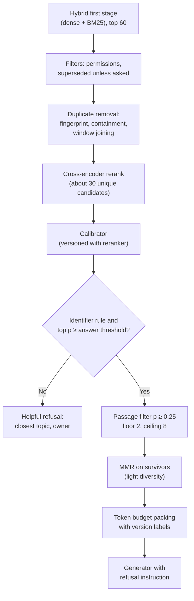

This assessment covers the whole Advanced Retrieval Optimisation module: two-stage and multi-stage retrieval, diversity-aware ranking and MMR, context precision and context recall, duplicate removal, score calibration and retrieval thresholding. The quiz mixes beginner, intermediate and advanced questions; aim for at least 80 per cent (15 of 18) before moving on. The open sections have hidden model answers: write your own answer first, then compare.

```quiz
[
  {
    "q": "In a two-stage pipeline, the first stage retrieves 50 candidates and a cross-encoder keeps the top 5. The first stage's Recall@50 is 0.82. What is the best possible Recall@5 of the whole pipeline?",
    "options": [
      "1.0, because the reranker can find anything",
      "0.82",
      "0.82 multiplied by 5/50",
      "It cannot be bounded"
    ],
    "answer": 1,
    "why": "The reranker only reorders what the first stage returned, so the first stage's Recall@N is a ceiling on everything after it."
  },
  {
    "q": "A three-stage cascade keeps 90% of the relevant chunks at each boundary after a first stage with Recall@200 of 0.95. Roughly what end-to-end recall should you expect?",
    "options": [
      "About 0.69",
      "0.95",
      "0.90",
      "About 0.86"
    ],
    "answer": 0,
    "why": "Survival rates multiply: 0.95 × 0.9 × 0.9 × 0.9 ≈ 0.69. Small losses at each boundary compound."
  },
  {
    "q": "In MMR with relevance and redundancy both measured as cosine similarity, what does setting λ = 1 do?",
    "options": [
      "Maximises diversity, ignoring relevance",
      "Selects chunks at random",
      "Reduces to plain relevance ranking",
      "Selects only chunks from different documents"
    ],
    "answer": 2,
    "why": "The score is λ × relevance − (1 − λ) × redundancy; with λ = 1 the redundancy term vanishes."
  },
  {
    "q": "Why can MMR behave badly when relevance comes from cross-encoder logits and redundancy from embedding cosines?",
    "options": [
      "Cross-encoders cannot be used with MMR licences",
      "The two terms are on different scales, so λ no longer means what it appears to",
      "Cosines are always negative",
      "MMR requires BM25 scores"
    ],
    "answer": 1,
    "why": "Logits span roughly ±10 while cosines lie within ±1, so one term dominates whatever λ is set to. Both terms must be on comparable scales."
  },
  {
    "q": "Which statement best distinguishes redundancy-based diversification (such as MMR) from aspect-based diversification (such as xQuAD)?",
    "options": [
      "MMR needs labelled aspects; xQuAD does not",
      "They are identical algorithms with different names",
      "Aspect-based methods only work on images",
      "MMR avoids repeating similar chunks; aspect-based methods try to cover each aspect of the query explicitly"
    ],
    "answer": 3,
    "why": "Avoiding repeats and covering aspects are different goals. Similarity-based methods target the first; aspect-based methods target the second using explicit sub-queries or aspects."
  },
  {
    "q": "A context of 6 passages contains all the facts of the reference answer, but the two passages that state them are ranked 5th and 6th, below 4 irrelevant ones. Which metric is high and which is low?",
    "options": [
      "Context recall high, context precision low",
      "Both high",
      "Context recall low, context precision high",
      "Both low"
    ],
    "answer": 0,
    "why": "Recall asks whether every needed fact is present (yes). Rank-weighted context precision rewards useful passages ranked early; here they come last. Had they been ranked 1st and 2nd, context precision would be perfect despite the 4 irrelevant passages."
  },
  {
    "q": "Why does claim-level context recall survive a change of chunk size better than chunk-level recall?",
    "options": [
      "It does not need a judge",
      "It is computed on the candidate list",
      "Its ground truth is facts from a reference answer, not chunk identifiers that change when the corpus is re-chunked",
      "It ignores unanswerable questions"
    ],
    "answer": 2,
    "why": "Chunk labels name specific chunks; re-chunking invalidates them. Claims describe the domain and remain valid."
  },
  {
    "q": "Claim recall is 0.97 at 100 candidates, 0.95 after the reranker's top 10, 0.94 after thresholding and 0.71 after packing into the token budget. Where should you look first?",
    "options": [
      "The first-stage retriever",
      "Context packing and the token budget",
      "The reranker",
      "The threshold"
    ],
    "answer": 1,
    "why": "The large drop happens at the token budget; that stage is losing evidence the earlier stages delivered."
  },
  {
    "q": "What does this code print?\n```python\nA = set(range(10))\nB = set(range(2, 22))\nshared = len(A & B)\nprint(round(shared / len(A | B), 3), round(shared / min(len(A), len(B)), 3))\n```",
    "options": [
      "0.8 0.364",
      "0.4 0.8",
      "0.364 0.4",
      "0.364 0.8"
    ],
    "answer": 3,
    "why": "A has 10 items, B has 20, they share 8 (2 to 9), and the union has 22. Jaccard is 8/22 ≈ 0.364; containment is 8/10 = 0.8."
  },
  {
    "q": "The 2023 and 2025 handbook paragraphs differ only in the equipment budget amount. A query-time deduplicator merges near-duplicates and keeps the higher-scoring copy. What is the risk, and the fix?",
    "options": [
      "No risk; near-duplicates are always interchangeable",
      "The stale version may be kept; filter or label superseded versions with metadata before deduplicating",
      "Both are always kept; raise the threshold",
      "The current version is always kept because it is newer"
    ],
    "answer": 1,
    "why": "Versions that disagree are conflicts, not copies. Score-based choice lets the stale one win whenever it ranks higher."
  },
  {
    "q": "Two sliding-window chunks from the same file have overlapping character spans. What should duplicate removal do?",
    "options": [
      "Join them, keeping the shared text once",
      "Drop the lower-ranked one",
      "Keep both unchanged",
      "Replace both with the document title"
    ],
    "answer": 0,
    "why": "Each window holds text the other lacks; joining keeps all of it and removes only the repetition."
  },
  {
    "q": "You want 6 distinct passages after deduplication and measure that about 40% of candidates are absorbed as duplicates. Roughly how many candidates should you fetch at minimum?",
    "options": [
      "6",
      "8",
      "10",
      "24"
    ],
    "answer": 2,
    "why": "n ≈ k / (1 − d) = 6 / 0.6 = 10, plus a margin for queries with higher redundancy."
  },
  {
    "q": "What does this code print?\n```python\nimport math\na, b = 2.0, -2.0\nfor s in (1.0,):\n    print(round(1 / (1 + math.exp(-(a * s + b))), 2))\n```",
    "options": [
      "0.88",
      "0.12",
      "1.0",
      "0.5"
    ],
    "answer": 3,
    "why": "a × s + b = 2 × 1 − 2 = 0, and the sigmoid of 0 is 0.5. This Platt map crosses 0.5 at s = −b/a = 1."
  },
  {
    "q": "Which of these is a calibrated probability of relevance?",
    "options": [
      "A score p such that, among pairs scored about p, a fraction about p are relevant",
      "The sigmoid of a cross-encoder logit",
      "A cosine similarity rescaled to lie between 0 and 1",
      "A per-query min-max normalised score"
    ],
    "answer": 0,
    "why": "Calibration is agreement between predicted probability and observed frequency on your data. The other three are in 0 to 1 but carry no such guarantee."
  },
  {
    "q": "A team fits a Platt map and then measures ranking quality. What should they expect, assuming a positive slope?",
    "options": [
      "NDCG improves because probabilities are more accurate",
      "Ranking within a query is unchanged, because the map is monotone",
      "Ranking gets worse because of ties",
      "Ranking becomes random"
    ],
    "answer": 1,
    "why": "A strictly increasing map preserves order. Calibration changes what scores mean, not which passage comes first."
  },
  {
    "q": "A calibrator was fitted on the reranker's top 20 candidates. The pipeline now reranks the top 100. What is the likely effect?",
    "options": [
      "None; calibration depends only on the model",
      "It will under-predict relevance",
      "It will over-predict relevance, because the extra candidates lower the base rate of relevance",
      "Scores will exceed 1"
    ],
    "answer": 2,
    "why": "Calibration belongs to a population. Adding many low-ranked candidates, mostly irrelevant, lowers the base rate, so the old map over-predicts."
  },
  {
    "q": "Answering an unanswerable question is judged 4 times as bad as refusing an answerable one. With a calibrated probability that the question is answerable, when should the system answer?",
    "options": [
      "When p is at least 0.2",
      "When p is at least 0.5",
      "When p is at least 0.75",
      "When p is at least 0.8"
    ],
    "answer": 3,
    "why": "Answer when (1 − p) × 4 ≤ p × 1, that is p ≥ 4 / (4 + 1) = 0.8."
  },
  {
    "q": "A score threshold that rejects 'Does Meridian Sync support SAML?' (whose top passage is about Meridian Reports' SAML support) also rejects several answerable colloquial questions. What is the most effective additional defence?",
    "options": [
      "Raise the threshold further",
      "An identifier rule requiring product names and codes in the question to appear in the passage, plus a generator refusal instruction",
      "Lower k to 1",
      "Switch from a cross-encoder to cosine similarity"
    ],
    "answer": 1,
    "why": "Near misses with substituted names or codes share almost every word with their passage, so scores cannot separate them without collateral refusals. A cheap exact-match rule and generator-side refusal can."
  }
]
```

## Conceptual questions

**1.** Explain why a pipeline can have excellent Recall@50 at the first stage and still give incomplete answers, and describe how you would find which stage is responsible.

<details><summary>Show solution</summary>

The generator does not read the 50 candidates; it reads what survives reranking, the cut to $k$, any threshold, duplicate removal and the token budget. Each of those steps can drop a passage holding a needed fact. Multi-part questions are the usual victims: the second part's passage ranks below several passages about the first part, and the cut removes it.

To locate the loss, measure claim-level context recall on the same questions and the same reference claims at each stage: candidates, reranked top $k$, after thresholding and deduplication, and in the final packed context. Recall cannot increase from stage to stage, so the numbers form a waterfall, and the largest drop identifies the stage to fix. Then read the list of missing claims at that stage, grouped by question type, to see the pattern (for example, second halves of two-part questions).

</details>

**2.** Compare MMR and query-time duplicate removal. When would you use each, and why run both?

<details><summary>Show solution</summary>

Duplicate removal is a hard rule with precise textual tests: exact fingerprints, shingle containment above a threshold, and overlapping windows from the same file. It removes passages that add no new text (or joins overlapping windows), and it is predictable and auditable. It cannot judge whether two *different* passages are too alike to both deserve a slot.

MMR is a soft trade-off between relevance and similarity to passages already chosen, controlled by λ. It reduces redundancy among different passages, but it depends on the similarity measure (usually embeddings, which treat versions differing by one number as near-identical), is sensitive to λ and to the candidate pool, and can admit off-topic passages at low λ.

Run duplicate removal first, so exact and near copies never compete, then MMR (or another diversity method) for the softer question. Using MMR alone to suppress exact copies spends its diversity weight on a problem that has an exact solution.

</details>

**3.** Why is per-query min-max normalisation not a substitute for calibration, and when is it still useful?

<details><summary>Show solution</summary>

Min-max maps each query's candidates onto 0 to 1 using that query's own minimum and maximum. The best candidate always gets 1.0, whether it answers the question or is the least bad of an irrelevant set. It therefore discards absolute information that thresholds need ("how good is the best candidate?"), and it can damage comparisons across queries, which is why it lowered AUC in the Score calibration lesson's experiment. It is still useful where only within-query order and relative spacing matter, for example to put two retrievers' scores on a similar range before weighted fusion within a single query.

</details>

**4.** A product manager asks for "a confidence threshold of 0.7 so the assistant never gives wrong answers". Explain what you would need to agree on and measure before choosing the threshold.

<details><summary>Show solution</summary>

First, which decision: passage filtering or query-level abstention. Second, what 0.7 is measured on; it only has meaning if it is a calibrated probability on the current model, corpus and candidate depth. Third, the cost ratio: how much worse a wrong answer is than an unnecessary refusal. That ratio, not a round number, determines the threshold ($p \geq C_{\text{wrong}}/(C_{\text{wrong}} + C_{\text{refuse}})$). Fourth, "never" is not achievable with scores alone: near-miss questions score like answerable ones, so the plan should include identifier checks and generator-side refusal. Finally, measure coverage and selective risk on held-out, labelled real questions including near misses, show the risk–coverage curve, and agree on the operating point and on monitoring (abstention rate, periodic labelled samples) to keep it there.

</details>

## Coding exercises

**1.** Implement greedy MMR over unit vectors and show, on a toy Meridian example, that it replaces a near-copy with a passage that covers the second half of a two-part question.

<details><summary>Show solution</summary>

```python
import numpy as np

def mmr(query, docs, k, lam=0.7):
    """Greedy Maximal Marginal Relevance over unit vectors; returns selected indices."""
    rel = docs @ query                     # relevance: cosine with the query
    sim = docs @ docs.T                    # redundancy: cosine between documents
    selected, remaining = [], list(range(len(docs)))
    while remaining and len(selected) < k:
        def score(i):
            redundancy = max(sim[i, j] for j in selected) if selected else 0.0
            return lam * rel[i] - (1 - lam) * redundancy
        best = max(remaining, key=score)
        selected.append(best)
        remaining.remove(best)
    return selected

def unit(v):
    v = np.asarray(v, dtype=float)
    return v / np.linalg.norm(v)

# Axes: [leave entitlement, carry-over rule, expenses]
docs = np.array([unit([1.0, 0.1, 0.0]),    # 0 handbook: 25 days
                 unit([1.0, 0.12, 0.0]),   # 1 FAQ: 25 days (near copy of 0)
                 unit([0.5, 1.0, 0.0]),    # 2 carry-over rule
                 unit([0.1, 0.0, 1.0])])   # 3 expenses
query = unit([1.0, 0.6, 0.0])              # "How much leave, and can I carry it over?"

print("relevance:", np.round(docs @ query, 3))
print("top-2 by relevance:", [int(i) for i in np.argsort(-(docs @ query))[:2]])
print("MMR top-2, lambda=0.7:", mmr(query, docs, 2))
print("MMR top-2, lambda=1.0:", mmr(query, docs, 2, lam=1.0))
```

```output
relevance: [0.904 0.913 0.844 0.085]
top-2 by relevance: [1, 0]
MMR top-2, lambda=0.7: [1, 2]
MMR top-2, lambda=1.0: [1, 0]
```

Plain relevance ranking keeps the handbook passage and its FAQ near-copy (indices 1 and 0). With λ = 0.7, the second pick's redundancy penalty for passage 0 (cosine about 1.0 with passage 1) outweighs its small relevance advantage, so MMR selects passage 2, the carry-over rule, which the question also needs. With λ = 1.0 MMR reduces to relevance ranking.

</details>

**2.** Given labelled reranker logits, fit a Platt map, compare its expected calibration error with the raw sigmoid's, and filter passages with the cost-optimal threshold when dropping a relevant passage is twice as bad as keeping an irrelevant one. The data is simulated with no query structure, so a random split by pair is acceptable here; with real data, split by query.

<details><summary>Show solution</summary>

```python
import numpy as np
from sklearn.linear_model import LogisticRegression

rng = np.random.default_rng(7)
# Simulated labelled reranker logits: 400 relevant and 1,600 irrelevant candidate pairs.
y = np.r_[np.ones(400, int), np.zeros(1600, int)]
s = np.r_[rng.normal(2.0, 1.5, 400), rng.normal(-2.0, 1.5, 1600)]
idx = rng.permutation(len(y))
fit, test = idx[:1000], idx[1000:]

def ece(p, y, bins=10):
    b = np.minimum((p * bins).astype(int), bins - 1)
    return sum((b == i).mean() * abs(y[b == i].mean() - p[b == i].mean())
               for i in range(bins) if (b == i).any())

platt = LogisticRegression(C=1e6).fit(s[fit].reshape(-1, 1), y[fit])
p_raw = 1 / (1 + np.exp(-s[test]))
p_cal = platt.predict_proba(s[test].reshape(-1, 1))[:, 1]
print(f"ECE raw sigmoid: {ece(p_raw, y[test]):.3f}   ECE Platt: {ece(p_cal, y[test]):.3f}")

C_NOISE, C_MISS = 1.0, 2.0
t = C_NOISE / (C_NOISE + C_MISS)
keep = p_cal >= t
print(f"keep threshold p >= {t:.3f}: kept {keep.sum()} of {len(keep)}, "
      f"recall {y[test][keep].sum() / y[test].sum():.3f}, precision {y[test][keep].mean():.3f}")
```

```output
ECE raw sigmoid: 0.121   ECE Platt: 0.013
keep threshold p >= 0.333: kept 227 of 1000, recall 0.869, precision 0.758
```

The raw sigmoid is noticeably miscalibrated (ECE 0.121) and Platt scaling reduces the error to 0.013 on held-out pairs. The cost ratio gives a keep threshold of $1/(1+2) \approx 0.333$, which keeps 227 of 1,000 test pairs with recall 0.869 and precision 0.758. Raising $C_{\text{miss}}$ would lower the threshold and trade precision for recall.

</details>

## Architecture design challenge

AskMeridian's Platform team wants to redesign the stage between the first-stage retriever and the generator. Requirements: the corpus includes PDF and wiki copies of the handbook, superseded 2023 documents kept for "what changed" questions, and sliding-window chunks; the assistant must refuse questions the documents cannot answer, including near misses about products and error codes; the reranker will be upgraded twice a year; latency for this stage must stay under 300 ms at the 95th percentile on CPU. Design the stage: components, order, thresholds and what is measured.

<details><summary>Show solution</summary>

**Design.**



**Key choices and trade-offs.**

- **Filters before everything.** Permission and version filters run on metadata before deduplication and reranking, so restricted or stale passages never influence representatives, scores or refusals. Superseded documents pass only when the query asks about changes, and then carry version labels into the context.
- **Deduplicate before reranking.** Removing copies first means the cross-encoder scores about 30 unique candidates instead of 60, which is what keeps the 300 ms budget on CPU; the over-fetch of 60 is sized from the measured redundancy rate.
- **Calibrate, then threshold in probabilities.** The answer and passage thresholds are written as probabilities derived from agreed cost ratios. Each reranker upgrade refits the calibrator on the existing labelled set (labels belong to pairs, not models), and thresholds stay unchanged.
- **Near-miss defences.** The identifier rule (codes and product names must appear in the top passage) plus the generator's refusal instruction handle substitution near misses that scores cannot separate.
- **Diversity late and light.** MMR runs only on survivors, with a high λ, to break up remaining paraphrases without admitting off-topic passages.
- **Measurement.** A labelled set of real questions with reference claims (for context recall at each stage), pair labels (for calibration and context precision) and near-miss and off-topic questions (for coverage and selective risk). In production: abstention rate by query type, top-score percentiles, redundancy rate, reranker latency percentiles, and a weekly labelled sample.

The main trade-off is latency against recall: a deeper first stage raises the recall ceiling but costs reranker time; deduplication buys some of it back. The second is coverage against risk, set by the cost ratio rather than by engineering preference.

</details>

## Troubleshooting scenarios

**1.** After a reranker upgrade, the share of AskMeridian questions ending in "I couldn't find that" rose from 6% to 31% overnight. Offline NDCG of the new reranker was better than the old one's. What happened and how do you fix it?

<details><summary>Show solution</summary>

**Diagnosis.** The abstention threshold is on raw reranker scores (or on a calibrator fitted for the old model). The new model ranks better but has a different score scale, so the same raw threshold now sits above many correct top passages. Better NDCG and more refusals are consistent: NDCG measures order, the threshold acts on values.

**Fix.** Roll back the threshold or the model immediately to restore service. Then refit the calibration map for the new reranker on the existing labelled pairs (they remain valid), keep the threshold expressed as a probability, check the reliability table on held-out queries, and re-run the coverage and selective-risk sweep. Prevent recurrence by versioning calibrators with reranker versions and making "calibrator fitted and validated" a release check; alert on step changes in abstention rate.

</details>

**2.** Users report that answers about the home-office equipment budget sometimes say £250 and sometimes £400. Logs show both the 2023 and the 2025 handbook paragraphs in the context. Deduplication is enabled. Why did it not help, and what should change?

<details><summary>Show solution</summary>

**Diagnosis.** The two paragraphs are near-duplicates textually, but deduplication either compared each with a different cluster head (head-only comparison means the two versions may never be compared directly) or kept both because a changed number altered enough shingles. Even when they are merged, choosing the representative by score lets the stale version win whenever it ranks higher. The underlying fault is that a version conflict is being treated as a duplication problem.

**Fix.** Mark superseded documents at ingestion with lineage metadata (a stable document ID across versions, an effective date and a status) and filter superseded versions before deduplication, except for queries about changes, where both should appear labelled with their versions. Add a conflict check that flags near-duplicate pairs whose numbers differ, and route the flagged clusters to the document owners.

</details>

**3.** A new team starts using AskMeridian. Over two months the abstention rate creeps up from 8% to 14%, while selective risk measured on the weekly labelled sample is unchanged. Is this a fault?

<details><summary>Show solution</summary>

**Diagnosis.** Probably not a fault in the threshold. A gradual rise with unchanged selective risk suggests the new team asks questions the corpus does not cover, so more questions are correctly refused. A threshold or calibration fault would usually show as a step change, or as rising refusal of answerable questions in the labelled sample.

**Action.** Split abstention by user group and query topic to confirm. Read a sample of the refused questions: if they are answerable from documents the team owns but that are not indexed, this is a content gap, and the fix is to ingest those documents (then re-check calibration, since the corpus changed). If a share of refusals turn out to be answerable, the traffic mix has shifted towards phrasings that score lower, and the calibrator and threshold should be refitted with labelled questions from the new team.

</details>
