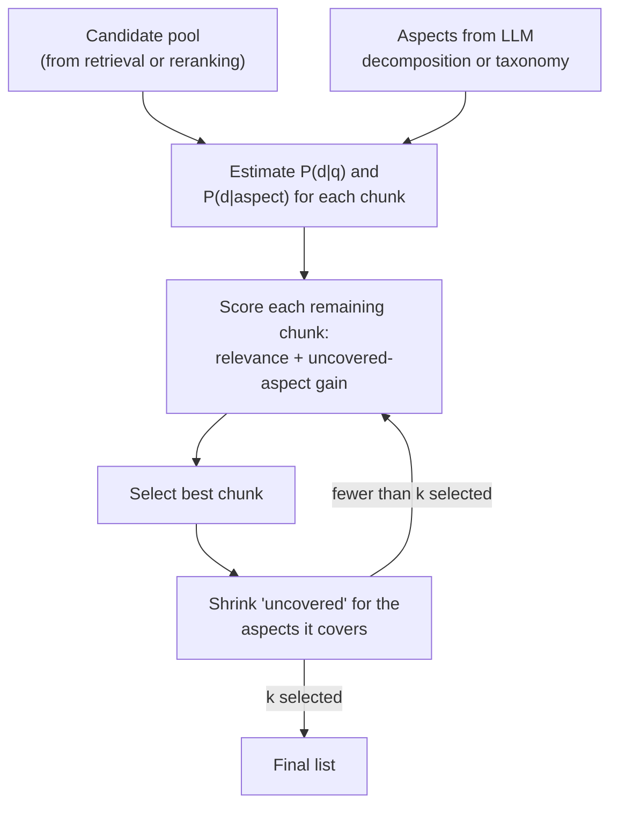

A retriever that sorts chunks by relevance treats each chunk on its own: how well does *this* chunk match the query? It never asks what the chunks above it already said. When five near-identical chunks all match well, all five reach the prompt, and the generator receives one fact five times while the other facts it needed are pushed out. **Diversity-aware ranking** changes the question to: given what is already selected, which chunk adds the most?

This lesson explains when relevance ranking produces redundant or one-sided results, the main families of diversification method (similarity-based, aspect-based and structural), how to measure diversity, and when not to diversify at all. You will implement an aspect-based method, xQuAD, compare it with plain relevance and a per-source cap, and watch how one parameter trades relevance against coverage. The best-known similarity-based method, MMR, gets its own lesson: [MMR](/learn/advanced-retrieval-optimisation/mmr).

## Learning objectives

- Explain why ranking chunks independently by relevance leads to redundancy and missed aspects, with reference to the probability ranking principle.
- Distinguish redundancy from coverage, and implicit (similarity-based) from explicit (aspect-based) diversification.
- Implement xQuAD and a per-source cap, and compare them using subtopic recall.
- Choose a diversification strategy, or none, for a given query type and corpus.

## Prerequisites

- [Top-K retrieval](/learn/retrieval-fundamentals/top-k-retrieval): why the final k slots are scarce.
- [Two-stage retrieval](/learn/advanced-retrieval-optimisation/two-stage-retrieval) and [Multi-stage retrieval](/learn/advanced-retrieval-optimisation/multi-stage-retrieval): diversification is a late stage in the cascade.
- [Query decomposition](/learn/advanced-retrieval/query-decomposition): one source of the "aspects" that explicit methods need.
- [Embeddings](/learn/understanding-large-language-models/embeddings): cosine similarity between chunk vectors.

## Why this matters

RAG corpora are full of repetition. The same policy appears in the handbook, in an FAQ and in an HR bulletin. Overlapping chunking puts the same sentence into two neighbouring chunks. Old and new versions of a runbook sit side by side. A relevance ranker sees each copy as an equally good match, so the copies arrive together.

Two kinds of harm follow.

**Wasted context.** The final k is small, often 3 to 8 chunks. If three slots hold the same fact, the effective context is smaller than it looks. Information that would have been at position 4 or 5 never reaches the generator.

**Missed aspects.** Many questions have more than one part. "I'm starting to work from home, what do I need to know?" touches the remote-work allowance, the equipment budget and security rules. If one aspect matches the query's wording best, all of its chunks outrank the other aspects, and the answer covers one part well and the others not at all. The user sees a confident, incomplete answer.

Neither failure shows up in Recall@K computed against a single "gold" chunk. Both show up in user complaints: "it only told me half of it".

## The intuition

Imagine asking a librarian for books to prepare for a trip to Japan. A librarian who ranks purely by relevance brings five guidebooks to Tokyo: each one, individually, is the best match for "trip to Japan". A good librarian brings one Tokyo guide, a phrasebook, a rail-pass guide and a book on etiquette. Each later choice depends on the earlier ones: once you have a Tokyo guide, a second Tokyo guide adds little, and the phrasebook adds a lot.

That is the whole idea. The value of a chunk depends on what else is in the list. Relevance ranking ignores this; diversity-aware ranking accounts for it, usually by choosing chunks one at a time and asking at each step which candidate adds most to what is already chosen.

## How it works

### Why relevance ranking is redundant: the probability ranking principle

Classical retrieval rests on the **probability ranking principle** (Robertson, 1977): ranking documents in decreasing order of their probability of relevance is optimal, under the assumption that each document's relevance is independent of the others. That assumption is exactly what fails with duplicates. If chunk B says the same as chunk A, then once A is shown, B's usefulness is close to zero, whatever its relevance score. Diversification methods drop the independence assumption.

### Two problems: redundancy and coverage

It helps to separate the two goals.

- **Redundancy** (or **novelty**): avoid chunks that repeat what is already selected. This needs a notion of similarity between chunks. It applies to almost every query.
- **Coverage**: make sure each aspect, or **subtopic**, of the query is represented. This needs a notion of what the aspects are. It applies to broad or ambiguous queries: "remote working", "Meridian Reports", "what changed in the 2024 handbook?".

Removing exact and near-exact duplicates is a separate, cheaper job done before any of this; see [Duplicate removal](/learn/advanced-retrieval-optimisation/duplicate-removal). Diversification handles the softer cases: chunks that are different text but carry the same information, and lists that are distinct but lopsided.

### Three families of method

**Implicit, similarity-based.** These use only the similarity between chunks. A candidate is penalised for being similar to chunks already chosen. [MMR](/learn/advanced-retrieval-optimisation/mmr) is the standard method; determinantal point processes (DPPs) are a more principled probabilistic relative used mainly in recommendation research. Similarity-based methods need nothing beyond the embeddings you already have, which is why they are the most common in RAG. Their weakness is that they reduce redundancy without knowing what is missing: they make the list varied, not necessarily complete.

**Explicit, aspect-based.** These first decide what the query's aspects are, then select chunks so that each aspect is covered in proportion to its importance. Classic examples from web search are IA-Select (Agrawal and colleagues, 2009), xQuAD (Santos, Macdonald and Ounis, 2010) and PM-2 (Dang and Croft, 2012). In RAG, aspects can come from an LLM that decomposes the question into sub-questions, from a topic taxonomy over the corpus, or from metadata categories. Explicit methods target coverage directly, but they are only as good as the aspect list.

**Structural, rule-based.** These use metadata: at most one or two chunks per source document, quotas per source type (handbook, runbook, product docs), or a round-robin across sources. They are cheap, predictable and easy to explain. Their weakness is that a source is a proxy for content: two documents can say the same thing, and one document can contain three different aspects.

### xQuAD, step by step

xQuAD (eXplicit Query Aspect Diversification) builds the list greedily. At each step it chooses the candidate that maximises a mixture of relevance to the query and coverage of aspects that are not yet covered.

1. Obtain a candidate pool, typically the top tens from retrieval or reranking.
2. Obtain aspects $a_1, \dots, a_m$ with importance weights $P(a \mid q)$ (equal weights if you have no better information).
3. Estimate $P(d \mid q)$, how well candidate $d$ matches the query, and $P(d \mid a)$, how well it matches each aspect.
4. Start with an empty selection. For each aspect, keep a running value "how uncovered is this aspect": initially 1.
5. For every remaining candidate, compute $(1-\lambda) P(d \mid q) + \lambda \sum_a P(a \mid q) \, P(d \mid a) \cdot \text{uncovered}(a)$.
6. Add the best candidate. Multiply each aspect's "uncovered" value by $1 - P(d \mid a)$ for the chosen chunk.
7. Repeat until k chunks are chosen.



Step 6 is where the diversity comes from. Once a chunk that strongly matches the "days" aspect is chosen, that aspect's uncovered value drops close to zero, so a second "days" chunk gains almost nothing from the diversity term and must win on relevance alone.

### Greedy selection and diminishing returns

All three families build the list greedily, one item at a time, because choosing the best set of k from N candidates exactly is a combinatorial problem. Greedy selection is well justified for coverage objectives. A coverage-style objective has **diminishing returns**: adding a chunk to a small selection helps at least as much as adding it to a larger one that contains the small one. Functions with this property are called **submodular**, and a classical result (Nemhauser, Wolsey and Fisher, 1978) shows that for monotone submodular objectives, greedy selection achieves at least $1 - 1/e \approx 63\%$ of the best possible value. In practice greedy usually does much better than that bound.

### Measuring diversity

Standard relevance metrics do not reward diversity, so diversification needs its own metrics, and its own labels: you must know which aspect(s) each chunk covers.

- **Subtopic recall at k** (S-recall@k), from Zhai, Cohen and Lafferty (2003): the fraction of the query's aspects covered by at least one chunk in the top k.
- **α-NDCG** (Clarke and colleagues, 2008): a version of [NDCG](/learn/retrieval-evaluation/ndcg) in which each additional chunk covering an already-covered aspect earns less, by a factor of $(1-\alpha)$ per repetition. It rewards both coverage and early placement.

For RAG specifically, the most meaningful end-to-end test is whether the generated answer covers every part of the question, which [Answer correctness](/learn/generation-evaluation/answer-correctness) and related generation metrics can measure.

### When not to diversify

Diversification has a cost: it may push a relevant chunk out of the top k to make room for one that is less relevant but different. That is a bad trade when:

- The question has **one precise answer** ("what is the receipt threshold for expenses?"). Here the second-best chunk is a distraction, not a complement.
- **Agreement is evidence.** In fact-checking style use, three independent sources saying the same thing increase confidence. Collapsing them into one loses that signal (though keeping their citations can preserve it).
- The **candidate pool is weak**. Diversifying a list with only one good chunk promotes irrelevant ones.

A common production pattern is to diversify only when the query is broad, detected by a classifier, by the spread of the top scores, or by whether decomposition produced several sub-questions.

## The mathematics

### The xQuAD objective

**Intuition.** Score a candidate by how relevant it is, plus how much it helps with aspects that the chunks already chosen have not covered.

**Formula.** With $S$ the chunks selected so far,

$$
\text{xQuAD}(d) = (1-\lambda)\, P(d \mid q) \;+\; \lambda \sum_{a} P(a \mid q)\, P(d \mid a) \prod_{d_j \in S} \big(1 - P(d_j \mid a)\big)
$$

- $P(d \mid q)$: how strongly chunk $d$ matches the query, as a value in $[0, 1]$.
- $P(a \mid q)$: the importance of aspect $a$ for this query; the weights sum to 1.
- $P(d \mid a)$: how strongly $d$ matches aspect $a$.
- $\prod_{d_j \in S} (1 - P(d_j \mid a))$: the probability that aspect $a$ is still not covered by any selected chunk. Before anything is chosen it is 1.
- $\lambda \in [0, 1]$: the trade-off. $\lambda = 0$ is pure relevance ranking; $\lambda = 1$ ignores relevance to the whole query and chases aspect coverage only.

The "probabilities" in practice are normalised scores. The original paper derived them from retrieval scores; in this lesson's code they come from a softmax over cosine similarities. They behave like probabilities (between 0 and 1, comparable across chunks) without being calibrated ones.

### Worked example

Two aspects with equal weight 0.5, $\lambda = 0.5$, and three candidates:

| Chunk | $P(d \mid q)$ | $P(d \mid a_1)$ | $P(d \mid a_2)$ |
| --- | --- | --- | --- |
| A | 0.5 | 0.9 | 0.0 |
| B | 0.4 | 0.8 | 0.1 |
| C | 0.1 | 0.0 | 0.9 |

**Step 1** (nothing selected, both aspects fully uncovered):

- A: $0.5 \times 0.5 + 0.5 \times (0.5 \times 0.9 + 0.5 \times 0) = 0.25 + 0.225 = 0.475$
- B: $0.5 \times 0.4 + 0.5 \times (0.5 \times 0.8 + 0.5 \times 0.1) = 0.20 + 0.225 = 0.425$
- C: $0.5 \times 0.1 + 0.5 \times (0 + 0.5 \times 0.9) = 0.05 + 0.225 = 0.275$

A is selected. Aspect 1's uncovered value becomes $1 - 0.9 = 0.1$; aspect 2's stays 1.

**Step 2:**

- B: $0.20 + 0.5 \times (0.5 \times 0.8 \times 0.1 + 0.5 \times 0.1 \times 1) = 0.20 + 0.5 \times 0.09 = 0.245$
- C: $0.05 + 0.5 \times (0 + 0.5 \times 0.9 \times 1) = 0.05 + 0.225 = 0.275$

C is selected, although B is four times as relevant to the query, because B mostly repeats aspect 1, which A has covered. Pure relevance ranking would have chosen A, B.

```python
import numpy as np

p_q = np.array([0.5, 0.4, 0.1])                       # P(d|q) for A, B, C
p_a = np.array([[0.9, 0.0], [0.8, 0.1], [0.0, 0.9]])  # P(d|a1), P(d|a2)
w, lam, uncovered, left = np.array([0.5, 0.5]), 0.5, np.ones(2), [0, 1, 2]
for step in (1, 2):
    scores = {d: (1 - lam) * p_q[d] + lam * np.sum(w * p_a[d] * uncovered) for d in left}
    best = max(scores, key=scores.get)
    print(f"step {step}:", {"ABC"[d]: round(float(s), 3) for d, s in scores.items()}, "->", "ABC"[best])
    uncovered *= 1 - p_a[best]
    left.remove(best)
```

```output
step 1: {'A': 0.475, 'B': 0.425, 'C': 0.275} -> A
step 2: {'B': 0.245, 'C': 0.275} -> C
```

### Subtopic recall

$$
\text{S-recall@}k = \frac{\big|\bigcup_{i=1}^{k} \text{aspects}(d_i)\big|}{m}
$$

where $\text{aspects}(d_i)$ is the set of aspects chunk $d_i$ covers and $m$ the number of aspects of the query. If the top 4 covers 2 of 3 aspects, S-recall@4 $= 2/3 \approx 0.67$.

## In code

**The problem.** AskMeridian receives a broad question: "I'm about to start working from home. What do I need to know?" The corpus has four chunks about the remote-work allowance (from the handbook, an FAQ and an HR bulletin), two about the equipment budget, two security rules, and some unrelated chunks. With k = 4, compare three rankers on subtopic recall: plain relevance, a one-chunk-per-source cap, and xQuAD. Then sweep λ.

**Install:**

```bash
pip install sentence-transformers numpy
```

```python
import numpy as np
from sentence_transformers import SentenceTransformer

# (chunk id, source document, aspect it answers (for evaluation only), text)
CHUNKS = [
    ("hb-remote",  "handbook",    "days",      "Staff may work remotely up to 3 days a week with their manager's agreement."),
    ("faq-remote", "remote-faq",  "days",      "Remote working FAQ: you can work from home for at most three days in any week."),
    ("hr-notice",  "hr-bulletin", "days",      "Reminder from HR: the limit on working from home remains 3 days per week."),
    ("faq-days",   "remote-faq",  "days",      "Remote working FAQ: agree your home-working days with your manager in advance."),
    ("hb-equip",   "handbook",    "equipment", "Employees can claim a home-office equipment budget of £400."),
    ("hb-contr",   "handbook",    "equipment", "Contractors are not eligible for the home-office equipment budget."),
    ("rb-vpn",     "it-runbook",  "security",  "Connect to the VPN whenever you use public Wi-Fi."),
    ("rb-lock",    "it-runbook",  "security",  "Lock your screen whenever you leave your laptop unattended."),
    ("hb-expense", "handbook",    None,        "Expense claims must be submitted within 30 days of the purchase."),
    ("rb-laptop",  "it-runbook",  None,        "Laptops are refreshed every 3 years."),
    ("hb-leave",   "handbook",    None,        "Full-time employees receive 25 days of annual leave per year."),
    ("rb-desk",    "it-runbook",  None,        "The support desk is open 08:00 to 18:00 UK time."),
]
QUERY = "I'm about to start working from home. What do I need to know?"
ASPECTS = [  # sub-questions; in production an LLM or a topic taxonomy proposes these
    "How many days a week can I work from home?",
    "Is there a budget for home-office equipment?",
    "How do I keep my laptop and connection secure outside the office?",
]
K, TAU = 4, 0.05

model = SentenceTransformer("sentence-transformers/all-MiniLM-L6-v2")
D = model.encode([c[3] for c in CHUNKS], normalize_embeddings=True)
q = model.encode([QUERY], normalize_embeddings=True)[0]
A = model.encode(ASPECTS, normalize_embeddings=True)

def as_distribution(sims):
    """Turn cosine similarities into a distribution over chunks (softmax)."""
    z = np.exp(sims / TAU)
    return z / z.sum(axis=0)

p_d_q = as_distribution(D @ q)        # P(d | q): shape (chunks,)
p_d_a = as_distribution(D @ A.T)      # P(d | aspect): shape (chunks, aspects)
p_a = np.full(len(ASPECTS), 1 / len(ASPECTS))   # aspects equally important

def relevance_only(k):
    return list(np.argsort(-p_d_q)[:k])

def per_source_cap(k, cap=1):
    chosen, used = [], {}
    for i in np.argsort(-p_d_q):
        source = CHUNKS[i][1]
        if used.get(source, 0) < cap:
            chosen.append(i)
            used[source] = used.get(source, 0) + 1
        if len(chosen) == k:
            break
    return chosen

def xquad(k, lam=0.5):
    chosen, remaining = [], list(range(len(CHUNKS)))
    not_yet_covered = np.ones(len(ASPECTS))   # prod over chosen of (1 - P(d_j | a))
    while len(chosen) < k:
        def score(i):
            diversity = np.sum(p_a * p_d_a[i] * not_yet_covered)
            return (1 - lam) * p_d_q[i] + lam * diversity
        best = max(remaining, key=score)
        chosen.append(best)
        remaining.remove(best)
        not_yet_covered *= 1 - p_d_a[best]
    return chosen

def subtopic_recall(sel):
    covered = {CHUNKS[i][2] for i in sel} - {None}
    return len(covered) / len(ASPECTS)

for name, ranker in [("relevance only", relevance_only),
                     ("one per source", per_source_cap),
                     ("xQuAD, lambda=0.5", xquad)]:
    sel = ranker(K)
    print(f"{name:<18} S-recall@{K} = {subtopic_recall(sel):.2f}  {[CHUNKS[i][0] for i in sel]}")

print("\nlambda  S-recall@4  selection")
for lam in (0.0, 0.25, 0.5, 0.75, 1.0):
    sel = xquad(K, lam)
    print(f"{lam:>5}  {subtopic_recall(sel):>10.2f}  {[CHUNKS[i][0] for i in sel]}")
```

```output
relevance only     S-recall@4 = 0.67  ['faq-remote', 'faq-days', 'hr-notice', 'hb-equip']
one per source     S-recall@4 = 1.00  ['faq-remote', 'hr-notice', 'hb-equip', 'rb-vpn']
xQuAD, lambda=0.5  S-recall@4 = 1.00  ['faq-remote', 'hb-equip', 'faq-days', 'rb-lock']

lambda  S-recall@4  selection
  0.0        0.67  ['faq-remote', 'faq-days', 'hr-notice', 'hb-equip']
 0.25        1.00  ['faq-remote', 'faq-days', 'hb-equip', 'rb-lock']
  0.5        1.00  ['faq-remote', 'hb-equip', 'faq-days', 'rb-lock']
 0.75        1.00  ['faq-remote', 'hb-equip', 'rb-lock', 'hr-notice']
  1.0        1.00  ['hb-equip', 'rb-lock', 'hr-notice', 'faq-remote']
```

**The important lines.**

- The aspect label in each tuple is used only by `subtopic_recall`. The rankers never see it; xQuAD sees only the aspect *questions*, as it would in production.
- `as_distribution` applies a softmax with temperature `TAU` over all chunks, separately for the query and for each aspect. This puts relevance and aspect matches on the same scale and makes the best few chunks for an aspect take most of its mass. Without it, raw cosines (which here sit between about 0 and 0.75 for everything) let relevance swamp the diversity term. `TAU` is a tuning knob, not a law.
- `not_yet_covered` is the product term of the formula, updated after each choice.
- `per_source_cap` is the structural baseline: walk down the relevance ranking and skip a chunk if its source document already has a chunk in the list.

**What the output means.**

- **Relevance ranking is lopsided.** Three of its four slots are about the number of remote days, and two of those (`faq-remote`, `hr-notice`) state the same fact. Security, which matters to anyone working from a café, is absent.
- **The source cap reaches full coverage here, by luck of the corpus.** It keeps `faq-remote` and `hr-notice` because they come from different documents, though they say the same thing. It covers security only because the IT runbook happens to be the next unused source. A source is a proxy for content.
- **xQuAD covers all three aspects with four different facts**: the day limit, the budget, agreeing days with a manager, and locking your screen. The second "3 days" chunk is gone.
- **λ moves the balance.** At 0 it is relevance ranking. From 0.25 it covers every aspect. At 0.75 and 1.0, once each aspect has some coverage, the remaining diversity credit goes back to the "days" aspect and `hr-notice` returns; at 1.0 the order no longer follows relevance to the whole query at all (the equipment chunk comes first). Middle values are the usual choice.
- **S-recall is blind to redundancy within an aspect.** It scores the source cap and xQuAD equally, although one wastes a slot on a repeat. α-NDCG with fact-level labels would separate them.

**Common errors.**

- Passing raw cosine similarities into xQuAD. They are not on a probability-like scale, and the relevance term usually dominates.
- Generating aspects that overlap heavily ("days allowed" and "remote-work limit"). Overlapping aspects double-count one topic.
- Diversifying a pool that is too small. If the pool holds no security chunk, no method can cover security; diversification reorders, it does not retrieve.

**Extending it.** Generate the aspect questions with an LLM call (the [Query decomposition](/learn/advanced-retrieval/query-decomposition) lesson shows how), weight aspects unequally, or replace the cosine-based $P(d \mid a)$ with cross-encoder scores passed through a sigmoid. Add α-NDCG by labelling each chunk with the facts it contains.

## A real-world example

AskMeridian's logs showed a pattern in answers to broad onboarding questions. "What do I need to know about expenses?" produced answers that explained the 30-day submission deadline in detail and never mentioned the £75 receipt rule. The retrieved chunks explained why: the deadline appeared in the handbook, the finance FAQ, a finance bulletin and two runbook pages, and all five copies outranked the single receipt-rule chunk.

The Platform team first tried a cap of one chunk per source document. It helped on some questions and hurt others: a long finance policy document that contained both the deadline and the receipt rule in separate sections could now contribute only one of them. They raised the cap to two per document, which fixed that but let some repeats back in.

They then added explicit diversification for broad queries only. A cheap classifier flagged a query as broad when an LLM decomposition step returned two or more sub-questions; those sub-questions became the aspects for xQuAD over the reranker's top 30. Narrow questions skipped diversification entirely, because for "what is the receipt threshold?" the second chunk should be the best supporting evidence, not a different topic.

To evaluate, the HR and finance teams labelled 80 broad questions with their aspects and labelled which aspects each candidate chunk covered. S-recall@5 rose clearly on that set, and on the 300 narrow questions the final hit rate did not drop, which was the check that diversification was not harming the queries it should not touch. Exact copies across the handbook and FAQ were also removed at indexing time, a fix that belongs to [Duplicate removal](/learn/advanced-retrieval-optimisation/duplicate-removal) and made every later stage's job easier.

## Common mistakes

- **Diversifying every query.** On single-fact questions, diversity pushes the second-best evidence out for something less relevant.
- **Using source caps as a content signal.** Different documents can repeat one fact; one document can hold several aspects.
- **Unnormalised scores in a mixed objective.** Relevance and diversity terms on different scales make λ meaningless.
- **Evaluating with single-answer metrics only.** Recall@K against one gold chunk cannot see coverage; you need aspect labels and S-recall or α-NDCG.
- **Diversifying before reranking with a tiny pool.** Diversification can only choose among the candidates it is given.
- **Low-quality aspects.** Overlapping or off-topic aspects from a careless decomposition prompt steer selection towards irrelevant chunks.

## Best practices

- Remove exact and near-duplicates first, then diversify what remains.
- Diversify late in the cascade, over a pool of tens of reranked candidates, so relevance is trustworthy before trading it away.
- Gate diversification on query breadth; measure that narrow queries do not get worse.
- Normalise relevance and aspect scores to comparable ranges before mixing; tune λ (and any temperature) on labelled broad queries.
- Prefer explicit aspects when you can get them; fall back to similarity-based methods such as MMR when you cannot.
- Keep citations for removed near-duplicates if source agreement matters to users.

## Performance considerations

Greedy diversification over a pool of $N$ candidates choosing $k$ makes $k$ passes, each scoring up to $N$ candidates. For xQuAD with $m$ aspects that is about $k \times N \times m$ multiply-adds, plus updating the coverage vector: for $N = 50$, $k = 8$ and $m = 4$, about 1,600 operations, negligible. The real costs are upstream: embedding the aspect questions ($m$ extra embedding calls, or one batched call) and, if an LLM generates the aspects, one generation call, which can easily cost more latency than the rest of retrieval together. Cache decompositions for repeated queries, and run decomposition in parallel with first-stage retrieval when the retriever does not depend on it.

Similarity-based methods need chunk-to-chunk similarities: for $N$ candidates of dimension $d$, an $N \times N$ matrix costs $N^2 d$ multiply-adds, about $50^2 \times 384 \approx 1$ million for 50 candidates, also negligible. Neither should run over thousands of candidates.

## Security considerations

Diversification can be gamed. An attacker who can add documents may write one that sits in an otherwise empty region of the topic, so that a diversity-seeking ranker promotes it as "new information". Treat diversity as a reason to look at a candidate, never as evidence that it is trustworthy, and keep corpus write access controlled. If an LLM generates aspects from the user's question, a crafted question can steer which aspects are pursued; this matters only if aspects can widen the search beyond the user's permissions, so apply access filters to every sub-query.

## Summary

- Relevance ranking scores chunks independently, so near-duplicates arrive together and broad questions get lopsided context. The probability ranking principle's independence assumption is what fails.
- Redundancy (avoid repeats) and coverage (represent every aspect) are different goals; similarity-based methods target the first, aspect-based methods the second, and structural caps approximate both with metadata.
- xQuAD greedily maximises a λ-weighted mix of relevance and coverage of not-yet-covered aspects; its scores must be on comparable, probability-like scales.
- Measure diversity with aspect labels: S-recall@k for coverage, α-NDCG for coverage with diminishing credit for repeats.
- Diversify broad queries late in the pipeline, and check that narrow queries do not get worse.

## Exercises

**1.** A query has four aspects. The top 5 chunks cover aspects {1}, {1}, {1, 2}, {2} and {1}. What is S-recall@5? Which chunks are wholly redundant given the ones above them?

<details><summary>Show solution</summary>

The union of covered aspects is {1, 2}, so S-recall@5 $= 2/4 = 0.5$. Chunks 2 and 5 add no new aspect beyond chunk 1, and chunk 4 adds none beyond chunk 3 (they are redundant at aspect level; they might still add new facts within an aspect).

</details>

**2.** Recompute step 2 of the worked example with $\lambda = 0.2$. Which chunk is chosen now, and why?

<details><summary>Show solution</summary>

B: $0.8 \times 0.4 + 0.2 \times 0.09 = 0.32 + 0.018 = 0.338$. C: $0.8 \times 0.1 + 0.2 \times 0.45 = 0.08 + 0.09 = 0.17$. B is chosen. With a small λ the relevance term dominates, so B's much higher relevance outweighs C's coverage of the uncovered aspect.

</details>

**3.** Modify `per_source_cap` in the script to cap per (source, aspect-question best match) rather than per source: assign each chunk to the aspect question it is most similar to, and allow at most one chunk per aspect until every aspect has one. Compare its selection with xQuAD's.

<details><summary>Show solution</summary>

```python
def per_aspect_round_robin(k):
    best_aspect = np.argmax(D @ A.T, axis=1)          # nearest aspect per chunk
    order = list(np.argsort(-p_d_q))
    chosen, seen = [], set()
    for i in order:                                    # first pass: one per aspect
        if best_aspect[i] not in seen:
            chosen.append(i)
            seen.add(best_aspect[i])
    for i in order:                                    # then fill by relevance
        if len(chosen) >= k:
            break
        if i not in chosen:
            chosen.append(i)
    return chosen[:k]
```

On this corpus it returns `['faq-remote', 'hb-equip', 'rb-vpn', 'faq-days']`, which, like xQuAD, covers all three aspects (it picks the VPN rule where xQuAD picked the screen lock). The first pass takes the most relevant chunk nearest to each aspect. Note that every chunk is assigned to some aspect, including unrelated ones (the annual-leave chunk is nearest to "how many days a week"), so this rule needs a similarity floor in practice. It is a hard version of xQuAD's soft coverage: simpler, but blind to chunks that cover two aspects at once and unable to weigh relevance against coverage.

</details>

**4.** Design decision. A user asks AskMeridian "Compare the 2023 and current home-office equipment budgets." Should you diversify? If so, what are the aspects, and what could go wrong with a per-source cap?

<details><summary>Show solution</summary>

Yes: a comparison needs both sides, so the aspects are "the 2023 budget" and "the current budget". The 2023 handbook chunk (£250) and the current handbook chunk (£400) must both be present; without diversification, several chunks about the current budget may outrank the single 2023 chunk. A per-source cap could go wrong if both budgets are in the same document (for example a changelog section of the current handbook), in which case a cap of one per source would drop one side of the comparison. Explicit aspects handle this correctly because they target content, not documents.

</details>

## Check your understanding

```quiz
[
  {"q": "Which assumption of the probability ranking principle does diversity-aware ranking drop?", "options": ["That relevance can be estimated", "That each document's relevance is independent of the others shown", "That users read results from the top", "That the corpus is static"], "answer": 1, "why": "Diversification recognises that a chunk's usefulness depends on what has already been selected, which the independence assumption ignores."},
  {"q": "What is the difference between redundancy and coverage?", "options": ["They are the same thing", "Redundancy is about repeated content; coverage is about representing every aspect of the query", "Redundancy applies only to exact duplicates; coverage only to near-duplicates", "Coverage is measured by Recall@K against one gold chunk"], "answer": 1, "why": "A list can be free of repeats yet miss aspects, or cover every aspect yet repeat content within one."},
  {"q": "In xQuAD, what happens to an aspect's 'uncovered' value after a chunk with P(d|a) = 0.8 for that aspect is selected?", "options": ["It is multiplied by 0.2", "It is multiplied by 0.8", "It becomes 0.8", "It is unchanged"], "answer": 0, "why": "The product term multiplies by 1 minus P(d|a), here 1 - 0.8 = 0.2."},
  {"q": "For which query is diversification most likely to hurt?", "options": ["What should I know before working from home?", "Tell me about Meridian Reports", "What is the receipt threshold for expenses?", "Compare the 2023 and current support desk hours"], "answer": 2, "why": "A single-fact question has one answer; diversifying replaces supporting evidence with less relevant material."},
  {"q": "Why does a one-chunk-per-source cap not guarantee non-redundant context?", "options": ["Because sources are always unique", "Because two different documents can state the same fact", "Because caps only work on embeddings", "Because the cap changes relevance scores"], "answer": 1, "why": "A cap enforces diversity of documents, which is only a proxy for diversity of content."}
]
```

## Further reading

- Robertson, S. E. (1977). *The Probability Ranking Principle in IR*. Journal of Documentation 33(4). The principle whose independence assumption diversification relaxes.
- Santos, R. L. T., Macdonald, C. and Ounis, I. (2010). *Exploiting Query Reformulations for Web Search Result Diversification*. WWW 2010. The xQuAD paper.
- Agrawal, R., Gollapudi, S., Halverson, A. and Ieong, S. (2009). *Diversifying Search Results*. WSDM 2009. Intent-aware selection and metrics.
- Clarke, C. L. A. et al. (2008). *Novelty and Diversity in Information Retrieval Evaluation*. SIGIR 2008. Introduces α-NDCG.
- Zhai, C., Cohen, W. W. and Lafferty, J. (2003). *Beyond Independent Relevance: Methods and Evaluation Metrics for Subtopic Retrieval*. SIGIR 2003. Defines subtopic recall.
- Santos, R. L. T., Macdonald, C. and Ounis, I. (2015). *Search Result Diversification*. Foundations and Trends in Information Retrieval. A full survey of the field.
