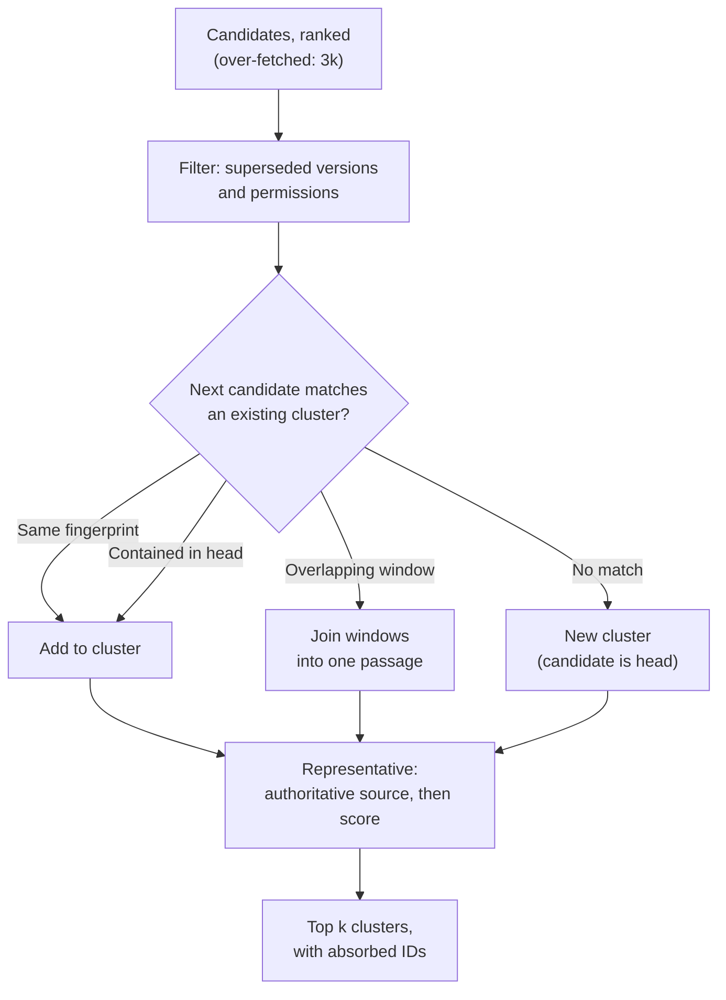

Ask a real corpus a question and the top results often contain the same passage more than once: the handbook paragraph from the PDF, the same paragraph from the wiki export, an HR notice that quotes it, and two overlapping windows cut from one guide. Each copy takes a slot in the top $k$, and every slot taken by a copy is a slot denied to a passage that says something new. **Duplicate removal** is the retrieval-time step that collapses those copies into one representative before the final cut, so that the $k$ passages the generator reads are $k$ different pieces of evidence.

This lesson covers what counts as a duplicate at query time, the three tests used to find them (fingerprints, shingle containment and span overlap), how to group candidates and choose which copy to keep, and the trap that catches most teams: an older version of a document looks exactly like a duplicate of the current one, but it is a conflict, not a copy. Ingestion-time deduplication of whole documents is covered in [Duplicate detection](/learn/data-processing/duplicate-detection), and this lesson reuses its shingles and Jaccard similarity rather than re-deriving them. Trimming repeated sentences inside the assembled prompt is a later topic, [Context deduplication](/learn/context-engineering/context-deduplication).

## Learning objectives

- Distinguish exact, near, containment, overlapping-window and semantic duplicates in a ranked result list, and choose a test for each.
- Implement rank-order clustering of candidates with fingerprints, shingle containment and span overlap, and explain why each candidate is compared with the cluster head rather than with every member.
- Choose a cluster representative by source authority and version, and justify filtering superseded versions before deduplication.
- Compute how many candidates to over-fetch so that $k$ distinct passages survive deduplication.
- Explain how hard duplicate removal differs from diversity-aware ranking such as MMR, and when to use both.

## Prerequisites

- [Duplicate detection](/learn/data-processing/duplicate-detection): normalised hashing, shingles, Jaccard similarity and MinHash at ingestion time.
- [Chunk overlap](/learn/chunking-fundamentals/chunk-overlap): why neighbouring chunks share text.
- [Document versioning](/learn/document-engineering/document-versioning): how current and superseded versions of a document are recorded.
- [Two-stage retrieval](/learn/advanced-retrieval-optimisation/two-stage-retrieval): the candidate list that duplicate removal operates on.

## Why this matters

Retrieval scores each chunk independently. If three chunks contain the same sentence, they receive nearly the same score, and if that score is high they arrive at the top together. Nothing in a similarity ranking says "you already have this one".

The damage is concrete:

- **Lost evidence.** With $k = 4$ and three copies of one paragraph, only one slot is left for everything else. A multi-part question whose second half lives in a different chunk loses that half; [Context recall](/learn/advanced-retrieval-optimisation/context-recall) at the final stage drops even though candidate recall is fine.
- **Wasted tokens and distorted emphasis.** Every copy costs tokens and adds nothing, and citations list three "sources" that are really one.
- **Stale answers.** The most dangerous near-copy is the superseded version: the 2023 handbook paragraph with a £250 equipment budget sits beside the current one with £400, and the generator has to guess which to believe.

Ingestion-time deduplication removes many copies, but not all. Copies in different systems with different owners (a wiki export, an HR notice quoting the handbook) are often indexed deliberately so that each source stays searchable. Overlapping windows are created on purpose by the chunker. Query-time removal is the safety net that works on whatever the index contains.

## The intuition

Ask a colleague for the four most useful pages on the home-office equipment budget. A careless assistant prints the top four hits: the HR notice, a page of the remote-work guide, and the 2023 and 2025 handbook pages. You hold two handbook pages that differ by one number, a notice repeating one of them, and one genuinely different page.

A careful assistant prints the top ten and sorts them into piles before choosing. "These three say the same thing; keep the official handbook page from the pile. These two are consecutive pages of one guide; staple them together. This one is last year's handbook; it does not belong in the pile at all." Then the assistant hands you the best page from each of the top four piles. The search did not change. The selection did.

## How it works

### What counts as a duplicate

At query time, "duplicate" covers several different relationships, and each needs its own test.

| Kind | Example | Test |
| --- | --- | --- |
| Exact, after normalisation | The PDF and the wiki export of one paragraph, differing in whitespace and case | Hash of normalised text |
| Near duplicate | Two copies with a typo fixed or a footer added | Shingle Jaccard or containment above a threshold |
| Containment | An HR notice that quotes two sentences of the handbook paragraph | Shingle containment (share of the smaller text found in the larger) |
| Overlapping windows | Chunks 7 and 8 of one guide sharing 40 characters of overlap | Same file and intersecting character spans |
| Semantic duplicate | An FAQ answer that paraphrases the policy | Embedding similarity, used with great care |
| Superseded version | The 2023 handbook paragraph with £250 instead of £400 | Not a duplicate: a version conflict, resolved with metadata |

The first four are **textual redundancy**: one chunk adds no words the other lacks (or, for windows, the two can be joined without loss). The fifth is a judgement about meaning, and the sixth is not redundancy at all.

### Fingerprints for exact copies

Normalise the text (collapse whitespace, lower-case) and hash it, for example with SHA-256. This is cheap, exact and transitive: if A equals B and B equals C, then A equals C, so it does not matter which member of a group you compare against. Store the fingerprint on each chunk at indexing time and the query-time test is a string comparison.

### Containment for near copies and quotations

Near copies are found by comparing sets of **shingles**, the overlapping $n$-word sequences of each text, as [Duplicate detection](/learn/data-processing/duplicate-detection) explains. That lesson uses **Jaccard similarity**, the size of the intersection divided by the size of the union. At query time a second measure is often more useful: **containment**, the size of the intersection divided by the size of the *smaller* set. Jaccard asks "are these the same text?"; containment asks "is one of these inside the other?"

The difference matters for quotations. An HR notice that repeats two of the handbook paragraph's three sentences shares most of its shingles with the paragraph, but Jaccard is diluted by the paragraph's extra sentence and lands well below a near-duplicate threshold. Containment sees that nearly all of the notice is inside the paragraph. The decision runs one way: the smaller text adds nothing beyond the larger, so the larger (or more authoritative) one is kept, never the reverse.

### Span overlap for sliding windows

When a chunker uses overlap, chunk $n$ and chunk $n+1$ of one file share a stretch of text by design, as [Chunk overlap](/learn/chunking-fundamentals/chunk-overlap) explains. Their shingle similarity is usually low (they share a sentence, not a paragraph), so text tests miss them. The reliable test is metadata: same file, and character spans that intersect. Such neighbours should not be dropped, because each holds text the other lacks. They should be **joined**: the first window plus the part of the second that follows the overlap. The joined passage is one coherent piece of evidence, shorter than the two windows together.

This needs each chunk's source file ID and character offsets in the index; citations and [parent-child retrieval](/learn/chunking-optimisation/parent-child-chunking) need them too.

### Semantic duplicates: handle with care

It is tempting to call two candidates duplicates when their embedding cosine exceeds, say, 0.95. Embeddings capture topic and meaning, and that is the problem. Two paragraphs that differ only in a number (£250 against £400) have nearly identical embeddings, because a number barely moves a sentence's vector, so the test merges them and keeps whichever ranks higher. And a paraphrase that *adds one detail* may land above the threshold and be dropped, losing the detail.

Use semantic similarity for soft decisions, such as penalising redundancy during ranking (which is what [MMR](/learn/advanced-retrieval-optimisation/mmr) does), and keep hard removal for textual tests whose meaning you can state precisely.

### Superseded versions are conflicts, not copies

The 2023 and 2025 handbook paragraphs share almost every shingle. Every duplicate test will call them near-duplicates. But they disagree, and the disagreement is the whole point. If deduplication picks the representative by score, the stale version wins whenever it happens to rank higher. The fix is not a better threshold; it is **metadata**:

- Mark superseded versions at ingestion (see [Document versioning](/learn/document-engineering/document-versioning)) and exclude them with a filter, before deduplication runs.
- If both versions must remain searchable (for questions such as "what changed since 2023?"), keep them, but label each passage with its version and effective date in the context, so that the generator can tell them apart.
- When near-duplicate members of a cluster differ in numbers, dates or other short tokens, log the cluster for review: it is often a version conflict that ingestion missed.

### Clustering in rank order

With tests defined, deduplication groups the candidate list into **clusters** of mutually redundant passages and keeps one representative per cluster:

1. **Over-fetch.** Retrieve more candidates than you need, typically two to four times the final $k$, so that $k$ distinct passages survive.
2. **Filter.** Remove superseded versions and anything the user is not permitted to see.
3. **Walk the candidates in rank order.** For each candidate, compare it with the existing clusters in order: an exact fingerprint match with any member, containment above a threshold with the cluster's **head** (its best-ranked member), or a span overlap with the cluster's joined passage. Join the first cluster that matches.
4. **Otherwise start a new cluster** with the candidate as its head.
5. **Choose each cluster's representative** by a stated policy: most authoritative source first, then the highest score. For overlapping windows, the representative is the joined passage.
6. **Give each cluster the score of its best member** and keep the clusters in the order they were created, which is rank order.
7. **Cut to $k$ clusters.** Record which chunks each representative absorbed, for citations and debugging.



Why compare with the head and not every member? Near-duplicate similarity is not transitive: A may resemble B and B resemble C while A and C share little. Comparing with every member ("single-link" clustering) lets clusters grow along such chains. Comparing with the head bounds every member's distance from one fixed text. Exact fingerprints are the exception, since equality is transitive.

### Duplicate removal and diversity are different tools

[Diversity-aware ranking](/learn/advanced-retrieval-optimisation/diversity-aware-ranking) and [MMR](/learn/advanced-retrieval-optimisation/mmr) trade relevance against novelty with a tunable weight: a passage similar to one already selected is penalised, not forbidden. Duplicate removal is a hard rule: a passage that adds no text is removed. Run it first, so obvious copies never compete; then let MMR decide whether two *different* passages are too alike to both deserve a slot, rather than spending its diversity weight on a problem with an exact solution.

## The mathematics

### Jaccard and containment

**Intuition.** Jaccard measures how much two shingle sets agree overall; containment measures how much of the smaller set is inside the larger one.

$$
J(A, B) = \frac{|A \cap B|}{|A \cup B|}, \qquad C(A, B) = \frac{|A \cap B|}{\min(|A|, |B|)}
$$

$A$ and $B$ are the shingle sets of two passages, $|A \cap B|$ the number of shingles they share and $|A \cup B| = |A| + |B| - |A \cap B|$ the number in either. Both lie between 0 and 1. Containment is always at least as large as Jaccard, and the two are equal only when the sets are the same size.

**By hand.** In the code below, the HR notice has 18 three-word shingles and the 2025 handbook paragraph has 28; they share 15. Jaccard is $15 / (18 + 28 - 15) = 15/31 \approx 0.484$. Containment is $15/18 \approx 0.833$. A Jaccard threshold of 0.8 would keep both copies; a containment threshold of 0.8 recognises the notice as a quotation of the paragraph.

### How many candidates to fetch

**Intuition.** If half the candidates are copies of something above them, you need about twice as many candidates to end with $k$ distinct passages.

If a fraction $d$ of candidates (the **redundancy rate**) are absorbed into earlier clusters, then $n$ candidates yield about $n(1-d)$ distinct passages. To keep $k$:

$$
n \approx \frac{k}{1 - d}
$$

$k$ is the number of distinct passages wanted and $d$ the redundancy rate measured on your own traffic. Redundancy varies by query, so fetch with a margin above the average.

**By hand.** With $k = 6$ and $d = 0.4$, $n \approx 6 / 0.6 = 10$. If the most redundant tenth of queries have $d = 0.7$, they need $6/0.3 = 20$. Fetching 20 candidates covers both; the cost is scoring and comparing 20 rather than 10.

```python
import numpy as np

A, B, shared = 18, 28, 15
print(f"Jaccard     = {shared / (A + B - shared):.3f}")
print(f"containment = {shared / min(A, B):.3f}")

k = 6
for d in (0.2, 0.4, 0.7):
    print(f"redundancy {d:.1f}: fetch about {int(np.ceil(k / (1 - d)))} candidates")
```

```output
Jaccard     = 0.484
containment = 0.833
redundancy 0.2: fetch about 8 candidates
redundancy 0.4: fetch about 10 candidates
redundancy 0.7: fetch about 20 candidates
```

## In code

**The problem.** Retrieve passages about Meridian's home-office equipment budget from a small index that contains a PDF and a wiki copy of the same handbook paragraph, an HR notice quoting it, the superseded 2023 version, two overlapping windows from a guide, and an FAQ. Compare the plain top 4 with a filtered, deduplicated top 4.

**Dependencies.** sentence-transformers and NumPy; the embedding model downloads on first use. No API key.

```bash
pip install sentence-transformers numpy
```

```python
import hashlib, re
import numpy as np
from sentence_transformers import SentenceTransformer

GUIDE = ("The equipment budget covers a desk, a chair and a monitor for working from home. "
         "Claims go through the expenses system. Anything over £75 needs a receipt, "
         "and expenses must be submitted within 30 days.")

def window(text, cid, start, end):
    return dict(id=cid, doc="remote-guide", current=True, source="wiki",
                span=(start, end), text=text[start:end])

# Each chunk: id, document, version status, source priority, character span, text.
CHUNKS = [
    dict(id="hb25-pdf-7",  doc="handbook-2025", current=True,  source="pdf",   span=(0, 190),
         text="Remote work: staff may work from home up to 3 days a week. The home-office equipment "
              "budget is £400 per employee. Contractors are not eligible for the equipment budget."),
    dict(id="hb25-wiki-7", doc="handbook-2025", current=True,  source="wiki",  span=(0, 190),
         text="Remote work:  Staff may work from home up to 3 days a week.\nThe home-office equipment "
              "budget is £400 per employee. Contractors are not eligible for the equipment budget."),
    dict(id="hb23-pdf-7",  doc="handbook-2023", current=False, source="pdf",   span=(0, 190),
         text="Remote work: staff may work from home up to 3 days a week. The home-office equipment "
              "budget is £250 per employee. Contractors are not eligible for the equipment budget."),
    dict(id="hr-notice",   doc="hr-notice-14", current=True,  source="intranet", span=(0, 120),
         text="Reminder from HR: the home-office equipment budget is £400 per employee. "
              "Contractors are not eligible for the equipment budget."),
    window(GUIDE, "guide-1", 0, 120),       # sliding windows over one document,
    window(GUIDE, "guide-2", 81, 201),      # overlapping by 39 characters
    dict(id="faq-monitor", doc="faq",          current=True,  source="wiki",  span=(0, 90),
         text="FAQ: Can I buy a monitor for my home office? Yes, from the £400 equipment budget."),
    dict(id="leave",       doc="handbook-2025", current=True, source="pdf",   span=(400, 500),
         text="Annual leave is 25 days per year. Up to 5 unused days carry over and must be used by 31 March."),
    dict(id="vpn",         doc="it-runbook",   current=True,  source="wiki",  span=(0, 60),
         text="VPN is required on public Wi-Fi."),
    dict(id="laptop",      doc="it-runbook",   current=True,  source="wiki",  span=(60, 120),
         text="Laptops are refreshed every 3 years."),
]
SOURCE_PRIORITY = {"pdf": 0, "wiki": 1, "intranet": 2}   # lower is more authoritative

def normalise(text):
    return re.sub(r"\s+", " ", text).strip().lower()

def fingerprint(text):
    return hashlib.sha256(normalise(text).encode()).hexdigest()

def shingles(text, n=3):
    words = re.findall(r"\w+|£\d+", normalise(text))
    return {tuple(words[i:i + n]) for i in range(len(words) - n + 1)}

def containment(a, b):
    """Share of the smaller shingle set that also appears in the larger one."""
    return len(a & b) / min(len(a), len(b))

def overlaps(a, b):
    """Windows cut from the same file whose character spans intersect."""
    return (a["doc"], a["source"]) == (b["doc"], b["source"]) and \
        a["span"][0] < b["span"][1] and b["span"][0] < a["span"][1]

def join_windows(a, b):
    first, second = sorted([a, b], key=lambda c: c["span"][0])
    tail = second["text"][first["span"][1] - second["span"][0]:]   # skip the shared part
    return dict(first, id=f"{first['id']}+{second['id']}", text=first["text"] + tail,
                span=(first["span"][0], max(first["span"][1], second["span"][1])))

def preference(member):
    chunk, score = member
    return (SOURCE_PRIORITY[chunk["source"]], -score)   # authoritative source, then score

def deduplicate(ranked, k, near=0.8):
    """ranked: (chunk, score) pairs, best first. Returns up to k representatives."""
    clusters = []
    for chunk, score in ranked:
        fp, sh = fingerprint(chunk["text"]), shingles(chunk["text"])
        for cl in clusters:
            head = cl["head"]                   # best-ranked member: compare with it only
            if any(fp == fingerprint(m["text"]) for m, _ in cl["members"]):
                reason = "exact"
            elif containment(sh, shingles(head["text"])) >= near:
                reason = "near"
            elif overlaps(chunk, cl["rep"]):
                reason = "overlap"
                cl["rep"] = join_windows(cl["rep"], chunk)
            else:
                continue
            cl["members"].append((chunk, score))
            cl["absorbed"].append(f"{chunk['id']} ({reason})")
            if reason != "overlap":
                cl["rep"] = min(cl["members"], key=preference)[0]
            break
        else:                                   # no match: start a new cluster
            clusters.append({"head": chunk, "rep": chunk, "score": score,
                             "members": [(chunk, score)], "absorbed": []})
    return clusters[:k]                         # clusters were created in rank order

model = SentenceTransformer("sentence-transformers/all-MiniLM-L6-v2")
query = "What is the home-office equipment budget, and who can use it?"
D = model.encode([c["text"] for c in CHUNKS], normalize_embeddings=True)
scores = D @ model.encode([query], normalize_embeddings=True)[0]
order = np.argsort(-scores)
ranked = [(CHUNKS[i], float(scores[i])) for i in order]
current = [(c, s) for c, s in ranked if c["current"]]     # superseded versions are filtered, not deduplicated

k = 4
print("Plain top-4:")
for c, s in ranked[:k]:
    print(f"  {s:.3f}  {c['id']}")
print(f"\nFiltered and deduplicated top-4 (from {len(current)} current candidates):")
for cl in deduplicate(current, k):
    print(f"  {cl['score']:.3f}  {cl['rep']['id']:<16} absorbed: {cl['absorbed']}")
    print(f"         {cl['rep']['text']!r}")
```

```output
Plain top-4:
  0.747  hr-notice
  0.666  guide-1
  0.616  hb23-pdf-7
  0.604  hb25-pdf-7

Filtered and deduplicated top-4 (from 9 current candidates):
  0.747  hb25-pdf-7       absorbed: ['hb25-pdf-7 (near)', 'hb25-wiki-7 (exact)']
         'Remote work: staff may work from home up to 3 days a week. The home-office equipment budget is £400 per employee. Contractors are not eligible for the equipment budget.'
  0.666  guide-1+guide-2  absorbed: ['guide-2 (overlap)']
         'The equipment budget covers a desk, a chair and a monitor for working from home. Claims go through the expenses system. Anything over £75 needs a receipt, and expenses must be submitted within 30 days.'
  0.588  faq-monitor      absorbed: []
         'FAQ: Can I buy a monitor for my home office? Yes, from the £400 equipment budget.'
  0.197  leave            absorbed: []
         'Annual leave is 25 days per year. Up to 5 unused days carry over and must be used by 31 March.'
```

**The important lines.**

- `fingerprint()` hashes normalised text, so the wiki copy, with its double space, newline and capital S, matches the PDF copy exactly.
- `containment(sh, shingles(head["text"]))` compares with the cluster head only. The pattern `£\d+` keeps amounts as tokens, so a changed amount changes the shingles around it.
- `overlaps()` requires the same document *and* the same source, because character offsets in a PDF extraction and a wiki export of the same document are not comparable.
- `join_windows()` appends only the part of the later window that lies beyond the earlier window's end, so the shared sentence appears once.
- `preference()` encodes the representative policy (authoritative source, then score) in one place.

**What the output means.**

- **The plain top 4 is two copies, a stale version and one useful window.** Three passages state the budget, one with the wrong number. Only `guide-1` adds anything, and it stops before the receipt rule.
- **The HR notice cluster is represented by the handbook PDF.** The notice ranked highest and became the head; the 2025 PDF paragraph contains 83% of its shingles and joined as a near duplicate, the wiki copy as an exact match. The policy chose the PDF paragraph, the authoritative and more complete text, while the cluster kept the notice's higher score.
- **The two guide windows became one passage.** Their shared sentence appears once, and the receipt and 30-day rules that were in the second window now reach the generator.
- **The FAQ survived.** It shares no three-word sequence with the handbook paragraph and adds a fact (a monitor is an allowed purchase), so it is not a duplicate. Its embedding cosine with the handbook paragraph is about 0.40, which shows how little a semantic test would have to go on.
- **The fourth slot went to an irrelevant passage.** Once the copies collapsed, the index had only three relevant passages left, and `leave` filled the last slot with a score of 0.197. Deduplication made the poverty of the candidate set visible. A floor on the score, the subject of [Retrieval thresholding](/learn/advanced-retrieval-optimisation/retrieval-thresholding), would drop it.

Had the superseded filter not run, the 2023 paragraph would have been a near duplicate of the 2025 one (containment 0.89, embedding cosine 0.998) and its fate would have depended on which cluster it met first. That is not a decision to leave to rank order.

**Errors people commonly hit.**

- Normalising so aggressively (removing digits or currency symbols) that versions with different numbers fingerprint as identical.
- Joining windows whose stored offsets are wrong, which duplicates or drops text at the seam. Validate at ingestion that `full_text[start:end] == chunk_text`.

**Extending it.** For larger candidate lists, store MinHash signatures at indexing time with [datasketch](https://ekzhu.com/datasketch/) instead of recomputing shingle sets. Note one simplification: if a cluster receives both an overlapping window and a near duplicate, the code replaces the joined passage with the preferred member, which can lose the join.

## A real-world example

AskMeridian's Platform team noticed the problem through citations. Answers about expenses often ended with "Sources: Employee handbook; Employee handbook; Finance FAQ", and when an engineer opened the three sources, the two handbook entries were the same paragraph, once from the PDF and once from the wiki export that the HR team maintained separately. Tomás, who owned retrieval, sampled 200 logged queries and found copies among the six context passages in many of them.

Removing the wiki export was rejected: HR edited the wiki first and the PDF lagged by weeks. Instead the team added query-time deduplication with a policy agreed with HR (when copies agree, cite the PDF; when they disagree, log the cluster and show both with their last-modified dates) and raised the candidate count from 12 to 24 so that six distinct passages survived.

The disagreement log turned out to be the most valuable part. In its first week it surfaced several clusters where the wiki and the PDF disagreed on a number, and in two of them the PDF was the one out of date. The team had assumed the PDF was always authoritative; the log showed that "most authoritative source" has to mean "authoritative for this document right now", which became a field the document owners maintain rather than a constant in code.

## Common mistakes

- **Relying on embedding similarity as a duplicate test.** Versions that differ by one number look identical, and genuinely different paraphrases with extra detail may be dropped.
- **Letting score choose between versions.** The stale version wins whenever it ranks higher. Filter or label versions with metadata.
- **Deduplicating without over-fetching.** Removing copies from a top 6 leaves three or four passages; the slots freed by deduplication are only useful if there are candidates to fill them.
- **Single-link clustering.** Comparing with every member lets chains of small edits merge passages that are not redundant with each other.
- **Dropping overlapping windows instead of joining them.** Each window holds text the other lacks; dropping one loses evidence.
- **Hiding the absorbed copies.** Without the list of absorbed chunk IDs, citations cannot point to alternative sources and debugging cannot explain why a chunk disappeared.

## Best practices

- Deduplicate whole documents at ingestion as well; query-time removal is the safety net, not the only defence.
- Store a fingerprint, source file ID and character span on every chunk at indexing time, so query-time tests are cheap.
- Filter by permission and version before deduplicating; deduplicate before reranking or before the final cut, never after it.
- Use containment rather than Jaccard for quotation-style duplicates, and keep thresholds conservative (0.8 or higher) so only genuine redundancy is removed.
- Write the representative policy down with the document owners, and log clusters whose members disagree on numbers or dates.
- Measure context recall and the redundancy rate before and after enabling deduplication.

## Performance considerations

Duplicate removal operates on the candidate list, not the index, so its cost depends on the number of candidates $n$, not on the corpus size.

- **Fingerprints.** Precomputed at indexing time, so comparison is a string equality; with a set of seen fingerprints it is $O(n)$ per query.
- **Containment.** At most $n(n-1)/2$ comparisons: 276 for $n = 24$, 1,225 for $n = 50$. Each is a set intersection of a few dozen to a few hundred shingles, so the total is on the order of milliseconds in Python.
- **Over-fetching.** The main cost is upstream: $3k$ candidates means $3k$ cross-encoder pairs if a reranker follows. Deduplicate *before* reranking so copies are never scored, and size $n$ from the measured redundancy rate.
- **Tokens.** With $k = 6$ passages of 300 tokens, two of them copies, deduplication frees 600 tokens per query for new evidence.

## Security considerations

- **Permissions first.** If deduplication runs before permission filtering, a cluster's representative may be a document the user cannot see; filtering it afterwards removes the whole cluster, and the user loses a copy they *were* allowed to read. Worse, a pipeline that cites "also found in" can leak the existence and title of restricted documents. Filter by permission before clustering, and list only permitted sources as absorbed copies.
- **Authority from trusted metadata.** Source preference must come from metadata set by your ingestion pipeline, never from text inside the document, or an attacker can write a near-copy of a policy page with altered numbers that claims to be official. Conflict logging surfaces such copies; see [Data poisoning](/learn/rag-security-fundamentals/data-poisoning).

## Summary

- Copies get similar scores, arrive in the top $k$ together and push out new evidence; duplicate removal collapses them before the final cut.
- Use exact fingerprints for copies, shingle containment for near copies and quotations, and span overlap for sliding windows, which should be joined rather than dropped.
- Embedding similarity is a poor hard-removal test: versions that differ by a number look identical. Keep it for soft diversity methods such as MMR.
- Superseded versions are conflicts, not duplicates; remove or label them with metadata before deduplication runs.
- Cluster in rank order, compare with the cluster head, choose the representative by a written policy, and over-fetch about $k/(1-d)$ candidates.

## Exercises

**1.** Your logs show that, on average, 35% of the top 20 candidates are absorbed by deduplication, but on 10% of queries the rate is 65%. You want $k = 5$. How many candidates should you fetch, and what happens to the high-redundancy queries if you fetch only the average requirement?

<details><summary>Show solution</summary>

Average requirement: $5 / 0.65 \approx 7.7$, so 8. High-redundancy queries need $5 / 0.35 \approx 14.3$, so 15. Fetching 8 leaves the high-redundancy queries with about $8 \times 0.35 \approx 2.8$ distinct passages, three rather than five. Those are usually questions about heavily copied policies, which are among the most common, so fetch 15 (or fetch adaptively: request more if fewer than $k$ clusters result).

</details>

**2.** Remove the superseded filter by passing `ranked` instead of `current` to `deduplicate()`. Predict what the deduplicated top 4 contains, using these containment values against the HR notice (the first cluster's head): `hb23-pdf-7` 0.667, `hb25-pdf-7` 0.833. Then propose a check that would flag the problem even without version metadata.

<details><summary>Show solution</summary>

The ranked order begins `hr-notice`, `guide-1`, `hb23-pdf-7`, `hb25-pdf-7`. The 2023 paragraph contains only 67% of the notice's shingles (the words around "£250" differ), so it starts its own cluster. The 2025 paragraph then joins the notice's cluster at 83%. The top 4 is: the 2025 paragraph (0.747), the joined guide (0.666), **the 2023 paragraph (0.616)** and the FAQ (0.588). The stale £250 budget reaches the generator beside the current one, and the head-only rule never compares the two handbook versions with each other, although their mutual containment is 0.893.

A metadata-free check: after clustering, compare cluster representatives pairwise; when two have containment above the threshold but different numbers (extract `£?\d+` from each and compare the sets), log them as a conflict and show both with their document dates, or drop the one with the older date. The robust fix is still lineage metadata (a stable document ID shared across versions), recorded at ingestion.

</details>

**3.** A teammate proposes replacing all three textual tests with a single rule: drop any candidate whose embedding cosine with a higher-ranked kept candidate exceeds 0.9. Give two concrete Meridian examples where this rule does the wrong thing, one in each direction.

<details><summary>Show solution</summary>

**Wrongly removed.** The 2025 and 2023 handbook paragraphs have cosine 0.998. If the 2023 one ranks higher, the rule keeps it and drops the current version, giving the generator the £250 budget. More generally, any two passages that differ only in a number, a date or a negation are at risk.

**Wrongly kept.** The HR notice and the handbook paragraph have cosine 0.67, so the rule keeps both, though the notice adds nothing. Likewise the two overlapping guide windows (cosine about 0.44) are both kept with their shared sentence repeated, rather than joined.

</details>

## Check your understanding

```quiz
[
  {
    "q": "Why does duplicate removal compare a candidate with the cluster's head rather than with every member?",
    "options": [
      "It is faster, and speed is the only concern",
      "Near-duplicate similarity is not transitive, so comparing with every member lets chains of small edits merge passages that are not redundant",
      "Embeddings require it",
      "The head always has the shortest text"
    ],
    "answer": 1,
    "why": "Single-link clustering grows along chains. Comparing with one fixed text bounds every member's distance from the representative. Exact fingerprints are the exception, because equality is transitive."
  },
  {
    "q": "A notice has 18 shingles, all but 3 of which appear in a 28-shingle handbook paragraph. Which measure recognises the notice as redundant at a 0.8 threshold?",
    "options": [
      "Jaccard, at about 0.48",
      "Both Jaccard and containment",
      "Neither",
      "Containment, at about 0.83"
    ],
    "answer": 3,
    "why": "They share 15 shingles. Jaccard is 15/31, diluted by the paragraph's extra sentence; containment is 15/18, measuring how much of the smaller text is inside the larger."
  },
  {
    "q": "The 2023 and 2025 handbook paragraphs differ only in the equipment budget (250 versus 400 pounds). How should the pipeline treat them?",
    "options": [
      "As near-duplicates, keeping whichever ranks higher",
      "As semantic duplicates, because their embedding cosine is very high",
      "As a version conflict: filter the superseded one by metadata, or keep both and label each with its version",
      "As distinct passages, both shown without labels"
    ],
    "answer": 2,
    "why": "They disagree, so they are not redundant. Score-based choice lets the stale version win; metadata decides correctly."
  },
  {
    "q": "Two sliding-window chunks from one guide share a 39-character overlap. What should duplicate removal do?",
    "options": [
      "Join them into one passage, keeping the shared text once",
      "Drop the lower-ranked window",
      "Keep both unchanged",
      "Drop both, since they overlap"
    ],
    "answer": 0,
    "why": "Each window holds text the other lacks. Joining keeps all the evidence and removes only the repetition."
  },
  {
    "q": "You want 8 distinct passages and measure that about half of candidates are absorbed as duplicates. Roughly how many should you fetch?",
    "options": [
      "8",
      "16, plus a margin for high-redundancy queries",
      "4",
      "12, exactly"
    ],
    "answer": 1,
    "why": "n is about k / (1 - d) = 8 / 0.5 = 16. Redundancy varies by query, so fetch with a margin above the average."
  }
]
```

## Further reading

- Andrei Z. Broder (1997), *On the resemblance and containment of documents*, Proceedings of Compression and Complexity of Sequences. Defines both resemblance (Jaccard) and containment over shingles.
- Jure Leskovec, Anand Rajaraman and Jeffrey D. Ullman, *Mining of Massive Datasets*, Chapter 3, "Finding Similar Items". Shingling, MinHash and locality-sensitive hashing. Free online at [mmds.org](http://www.mmds.org/).
- [datasketch documentation](https://ekzhu.com/datasketch/): MinHash and LSH implementations in Python, including containment-oriented LSH Ensemble.
- Jaime Carbonell and Jade Goldstein (1998), *The use of MMR, diversity-based reranking for reordering documents and producing summaries*, SIGIR. The soft alternative to hard duplicate removal.
