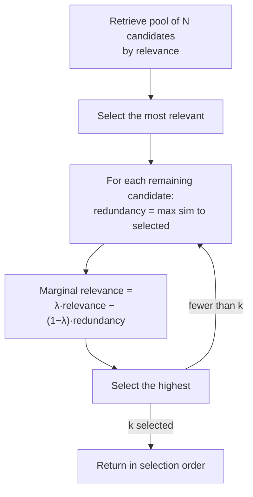

**Maximal Marginal Relevance** (MMR) is the most widely used way to stop a retriever from filling its top k with near-copies of the same chunk. It builds the result list one chunk at a time, and at each step picks the candidate that is most relevant to the query *after* a penalty for resembling anything already picked. One parameter, λ (lambda), sets the balance between relevance and novelty.

The [Diversity-aware ranking](/learn/advanced-retrieval-optimisation/diversity-aware-ranking) lesson placed MMR in the family of similarity-based diversification methods. This lesson takes it apart: the formula and where it comes from, the greedy algorithm step by step, how λ behaves in practice, the scale problem that breaks many implementations, and how MMR is exposed in LangChain and Qdrant (whose parameters point in opposite directions). You will implement MMR from scratch and check it against both libraries.

## Learning objectives

- State the MMR selection rule and explain each term, including why the redundancy term uses a maximum.
- Run the greedy MMR algorithm by hand on a small example and in NumPy.
- Predict how the selection changes as λ and the candidate pool size change, and recognise when MMR starts selecting irrelevant chunks.
- Use MMR through LangChain and Qdrant, converting correctly between their parameters.
- Identify and fix the score-scale mismatch that arises when relevance and redundancy come from different models.

## Prerequisites

- [Diversity-aware ranking](/learn/advanced-retrieval-optimisation/diversity-aware-ranking): why redundancy hurts and how diversification is measured.
- [Query-document similarity](/learn/retrieval-fundamentals/query-document-similarity): cosine similarity and dot products on normalised vectors.
- [Top-K retrieval](/learn/retrieval-fundamentals/top-k-retrieval): candidate pools and cut-offs.

## Why this matters

Dense retrieval returns the chunks closest to the query vector. Chunks that are close to the query are frequently close to each other: the same policy stated in three documents, overlapping chunks cut from one page, a paragraph and its later revision. Without intervention, a top 5 can easily be three restatements of one fact plus two useful chunks, and the generator answers with less information than the corpus holds.

MMR is the standard first remedy for three reasons. It needs nothing you do not already have: the query vector and the candidate vectors. It is cheap: a few thousand multiply-adds for typical pool sizes. And it is built into common tools, so it is often one parameter away. That availability is also its danger. It is easy to switch on with a default λ, see "more varied" results and assume they are better, when the default may be trading away relevant chunks for irrelevant ones. Using MMR well means understanding exactly what the parameter does.

## The intuition

You are packing a small suitcase with five slots for a work trip. You pick the most useful item first: a laptop. For the second slot, the most useful item on its own is a second laptop, but given that you have one already, its value is small. A charger is less useful in isolation, but adds something the laptop does not. So for each later slot you ask: how useful is this item, minus how much it overlaps with what is already packed?

MMR makes this exact. "How useful" is the item's similarity to the query. "How much it overlaps" is its similarity to the *most similar* item already packed. A charger is penalised a little for resembling the laptop; a second laptop is penalised heavily. λ sets how much you care about the overlap. At one extreme you ignore it and pack two laptops; at the other you care only about novelty and pack an umbrella, a frying pan and a tennis racket, which are certainly different from each other and useless for the trip.

## How it works

### The selection rule

Carbonell and Goldstein introduced MMR in 1998, for both document retrieval and summarisation. Given a query $q$, a candidate pool $R$, and the set $S$ of chunks already selected, the next chunk is

$$
d^{*} = \arg\max_{d \in R \setminus S} \Big[ \lambda \, \text{sim}(d, q) \;-\; (1 - \lambda) \max_{d_j \in S} \text{sim}(d, d_j) \Big]
$$

- $\text{sim}(d, q)$ is the **relevance** of candidate $d$: its similarity to the query.
- $\max_{d_j \in S} \text{sim}(d, d_j)$ is its **redundancy**: its similarity to the single most similar chunk already selected.
- $\lambda \in [0, 1]$ weights the two. $\lambda = 1$ is pure relevance ranking; $\lambda = 0$ picks whatever is least like the current selection, ignoring the query after the first pick.
- The bracketed value is the candidate's **marginal relevance**: relevance net of overlap with what you already have.

Why the maximum, not the average? A candidate that duplicates one selected chunk is redundant even if it is unlike all the others. The average would dilute that one high similarity; the maximum catches it.

### The algorithm

1. Retrieve a candidate pool of size $N$ (often called `fetch_k`) by plain relevance. MMR only reorders and selects from this pool.
2. Compute relevance $\text{sim}(d, q)$ for every candidate. With unit-normalised embeddings this is a dot product.
3. Select the most relevant candidate. (With an empty $S$ the redundancy term is defined as zero, so the first pick is always the top-relevance chunk.)
4. For every remaining candidate, compute its redundancy: the maximum similarity to any selected chunk.
5. Compute each candidate's marginal relevance and select the highest.
6. Repeat steps 4 and 5 until $k$ chunks are selected or the pool is empty.



The output is a list in selection order. That order is meaningful: the first item is the most relevant, and each later one is the best addition given the earlier ones. The interactive visualiser below lets you move λ and watch the selection change.

```playground
mmr
```

### How λ behaves

λ does not move results smoothly. Because marginal relevance is a difference of two similarities on the same scale, small changes in λ can flip which candidate wins when two are close, and the selection changes in jumps. Three regions are worth knowing:

- **High λ (about 0.7 to 1).** Relevance dominates. Near-duplicates are skipped only when the penalty for resembling a selected chunk outweighs a small relevance lead. This is the safe region for question answering.
- **Middle λ (about 0.5).** Relevance and redundancy count equally. With embedding models whose similarities between unrelated texts are not near zero, this can already select chunks that are off-topic. 0.5 is the default in LangChain's MMR functions, which is a reason to tune it rather than accept it.
- **Low λ (below about 0.4).** After the first pick, novelty dominates. The list fills with whatever is most different from the first chunk, which in a pool of size $N$ tends to be the least relevant candidates.

### The pool size matters as much as λ

MMR selects only from the pool. If $N$ equals $k$, MMR can reorder but not replace anything: it has no effect on which chunks reach the prompt. If $N$ is very large, the pool contains many irrelevant chunks, and any λ that gives novelty real weight will find them attractive, because irrelevant chunks are usually also dissimilar to the selected ones. A pool of a few times $k$ (for example $N = 20$ for $k = 5$) bounds how far MMR can stray. LangChain's `max_marginal_relevance_search` exposes this as `fetch_k`, and Qdrant as `candidates_limit`.

### The scale problem

MMR subtracts one similarity from another, so both must be on the same scale. That holds when both come from the same embedding model. It breaks in a common pattern: relevance comes from a [cross-encoder](/learn/reranking-fundamentals/cross-encoders) (logits that might range from −10 to +10) and redundancy from cosine similarity between embeddings (roughly 0 to 1). The relevance term then dominates at any λ short of zero, and MMR silently does nothing. If you mix sources, rescale relevance into the same range first, for example min-max over the pool or a sigmoid of the logits, and tune λ afterwards. [Score calibration](/learn/advanced-retrieval-optimisation/score-calibration) discusses rescaling in depth.

### Where MMR sits in a pipeline

MMR runs after relevance is established and before the context is assembled. In a [multi-stage cascade](/learn/advanced-retrieval-optimisation/multi-stage-retrieval) it usually follows the reranker: rerank 50 candidates, take the top 20 as the pool, and MMR-select the final 5. Running MMR before a reranker is also seen (vector databases offer it at query time), but then the reranker may re-sort the diverse set by relevance, which is fine, or receive a pool already thinned of relevant near-duplicates, which may not be. Exact duplicates are better removed earlier still, by [Duplicate removal](/learn/advanced-retrieval-optimisation/duplicate-removal): MMR can only lower their chance of selection, not guarantee their removal.

## The mathematics

**Intuition.** Each candidate's score is its relevance, reduced by how much it repeats the closest chunk already chosen.

**Formula.** The rule from the previous section, written for the score of one candidate $d$ given selected set $S$:

$$
\text{MMR}(d \mid S) = \lambda \, s_{q}(d) - (1-\lambda) \max_{d_j \in S} s(d, d_j)
$$

with $s_q(d)$ the query–candidate similarity, $s(d, d_j)$ the candidate–candidate similarity, and the max taken as 0 when $S$ is empty.

**By hand.** Three candidates, $\lambda = 0.7$:

| Candidate | $s_q$ | similarity to A | similarity to B |
| --- | --- | --- | --- |
| A | 0.90 | 1.00 | 0.95 |
| B | 0.85 | 0.95 | 1.00 |
| C | 0.60 | 0.20 | 0.30 |

Step 1: $S$ is empty, so scores are $0.7 \times s_q$: A 0.630, B 0.595, C 0.420. Select A.

Step 2: redundancy is similarity to A.

- B: $0.7 \times 0.85 - 0.3 \times 0.95 = 0.595 - 0.285 = 0.310$
- C: $0.7 \times 0.60 - 0.3 \times 0.20 = 0.420 - 0.060 = 0.360$

Select C. B was the second most relevant chunk, but at 0.95 similarity to A it is nearly a copy.

At what λ would B win step 2? B wins when $0.85\lambda - 0.95(1-\lambda) > 0.60\lambda - 0.20(1-\lambda)$, which simplifies to $0.25\lambda > 0.75(1-\lambda)$, so $\lambda > 0.75$. Between 0.7 and 0.8 the choice flips: this is the jumpiness described above.

```trace
{"title": "MMR step 2 with lambda = 0.7", "code": ["rel = {'A': 0.90, 'B': 0.85, 'C': 0.60}", "sim_to_A = {'B': 0.95, 'C': 0.20}", "selected = ['A']", "for d in ['B', 'C']:", "    redundancy = sim_to_A[d]", "    score = 0.7 * rel[d] - 0.3 * redundancy", "best = max(['B', 'C'], key=score_of)"], "steps": [{"line": 1, "vars": {"rel": "{A: 0.90, B: 0.85, C: 0.60}"}, "note": "Relevance of each candidate to the query."}, {"line": 3, "vars": {"selected": "['A']"}, "note": "Step 1 already chose A, the most relevant."}, {"line": 4, "vars": {"d": "'B'"}, "note": "Consider B."}, {"line": 5, "vars": {"d": "'B'", "redundancy": "0.95"}, "note": "B is almost identical to A."}, {"line": 6, "vars": {"d": "'B'", "score": "0.595 - 0.285 = 0.310"}, "note": "High relevance, heavy penalty."}, {"line": 4, "vars": {"d": "'C'"}, "note": "Consider C."}, {"line": 5, "vars": {"d": "'C'", "redundancy": "0.20"}, "note": "C is unlike A."}, {"line": 6, "vars": {"d": "'C'", "score": "0.420 - 0.060 = 0.360"}, "note": "Lower relevance, light penalty."}, {"line": 7, "vars": {"best": "'C'"}, "out": ["selected = ['A', 'C']"], "note": "C wins: 0.360 beats 0.310."}]}
```

```python
import numpy as np

rel = np.array([0.90, 0.85, 0.60])
sim = np.array([[1.00, 0.95, 0.20], [0.95, 1.00, 0.30], [0.20, 0.30, 1.00]])
for lam in (0.7, 0.8):
    selected = [int(np.argmax(rel))]
    rest = [1, 2]
    scores = [lam * rel[i] - (1 - lam) * sim[i, selected].max() for i in rest]
    print(f"lambda={lam}: step-2 scores B={scores[0]:.3f}, C={scores[1]:.3f} -> {'BC'[int(np.argmax(scores))]}")
```

```output
lambda=0.7: step-2 scores B=0.310, C=0.360 -> C
lambda=0.8: step-2 scores B=0.490, C=0.440 -> B
```

### Cost

Each of the $k - 1$ steps after the first compares every remaining candidate with every selected chunk. Done naively, that is about $N k^2 / 2$ similarity look-ups, with the $N \times N$ similarity matrix costing $N^2 d$ multiply-adds to build for $d$-dimensional vectors. A standard optimisation keeps, for each candidate, its running maximum similarity to the selected set and updates it with one comparison against the newly selected chunk, so each step costs $O(N)$ and the whole selection $O(Nk)$ after the similarities are known. For $N = 20$, $k = 5$ and $d = 384$, building the matrix is $20^2 \times 384 \approx 154{,}000$ multiply-adds: microseconds.

## In code

**The problem.** A staff member asks AskMeridian "What are the rules for working from home?" The corpus contains three chunks stating the 3-day limit in different words, plus chunks on agreeing days with a manager, the equipment budget, security, and some unrelated topics. Implement MMR, see what each λ selects, and confirm that LangChain and Qdrant compute the same thing.

**Install:**

```bash
pip install sentence-transformers numpy langchain-core qdrant-client
```

Qdrant runs here in local in-memory mode (`QdrantClient(":memory:")`), so no server is needed. MMR queries require a recent `qdrant-client` (this was run with 1.20) and, against a server, a Qdrant version that supports MMR; check the Qdrant documentation for your version.

```python
import numpy as np
from langchain_core.vectorstores.utils import maximal_marginal_relevance
from qdrant_client import QdrantClient, models
from sentence_transformers import SentenceTransformer

CHUNKS = {
    "hb-remote":  "Staff may work remotely up to 3 days a week with their manager's agreement.",
    "faq-remote": "Remote working FAQ: you can work from home for at most three days in any week.",
    "hr-notice":  "Reminder from HR: the limit on working from home remains 3 days per week.",
    "faq-days":   "Remote working FAQ: agree your home-working days with your manager in advance.",
    "equip":      "Employees can claim a home-office equipment budget of £400.",
    "equip-contr": "Contractors are not eligible for the home-office equipment budget.",
    "vpn":        "Connect to the VPN whenever you use public Wi-Fi.",
    "lock":       "Lock your screen whenever you leave your laptop unattended.",
    "expenses":   "Expense claims must be submitted within 30 days of the purchase.",
    "leave":      "Full-time employees receive 25 days of annual leave per year.",
}
ids = list(CHUNKS)
QUERY = "What are the rules for working from home?"
K = 4

model = SentenceTransformer("sentence-transformers/all-MiniLM-L6-v2")
D = model.encode(list(CHUNKS.values()), normalize_embeddings=True)
q = model.encode([QUERY], normalize_embeddings=True)[0]

def mmr(q, D, k, lam=0.5):
    """Greedy MMR over unit vectors; returns indices in selection order."""
    rel = D @ q                       # similarity of each candidate to the query
    sim = D @ D.T                     # similarity between candidates
    selected = [int(np.argmax(rel))]  # the first pick is the most relevant
    while len(selected) < min(k, len(D)):
        rest = [i for i in range(len(D)) if i not in selected]
        redundancy = sim[np.ix_(rest, selected)].max(axis=1)
        scores = lam * rel[rest] - (1 - lam) * redundancy
        selected.append(rest[int(np.argmax(scores))])
    return selected

rel = D @ q
names = lambda sel: [ids[i] for i in sel]
print("similarity to query:", {ids[i]: round(float(rel[i]), 2) for i in np.argsort(-rel)})
for lam in (1.0, 0.7, 0.5, 0.3):
    print(f"MMR lambda={lam}: {names(mmr(q, D, K, lam))}")

# The same algorithm in two libraries.
lc = maximal_marginal_relevance(q, D.tolist(), lambda_mult=0.7, k=K)
print("\nLangChain lambda_mult=0.7:", names(lc))

client = QdrantClient(":memory:")      # local mode, no server needed
client.create_collection(
    "handbook",
    vectors_config=models.VectorParams(size=D.shape[1], distance=models.Distance.COSINE),
)
client.upsert("handbook", points=[models.PointStruct(id=i, vector=v.tolist()) for i, v in enumerate(D)])
hits = client.query_points(
    "handbook",
    query=models.NearestQuery(nearest=q.tolist(), mmr=models.Mmr(diversity=0.3, candidates_limit=10)),
    limit=K,
)
print("Qdrant diversity=0.3:     ", names([p.id for p in hits.points]))
print("Qdrant scores:            ", [round(p.score, 3) for p in hits.points])
```

```output
similarity to query: {'faq-remote': 0.6, 'hr-notice': 0.56, 'faq-days': 0.53, 'hb-remote': 0.38, 'equip': 0.37, 'equip-contr': 0.31, 'leave': 0.27, 'vpn': 0.2, 'lock': 0.16, 'expenses': 0.07}
MMR lambda=1.0: ['faq-remote', 'hr-notice', 'faq-days', 'hb-remote']
MMR lambda=0.7: ['faq-remote', 'equip', 'hr-notice', 'faq-days']
MMR lambda=0.5: ['faq-remote', 'equip-contr', 'vpn', 'leave']
MMR lambda=0.3: ['faq-remote', 'equip-contr', 'vpn', 'expenses']

LangChain lambda_mult=0.7: ['faq-remote', 'equip', 'hr-notice', 'faq-days']
Qdrant diversity=0.3:      ['faq-remote', 'equip', 'hr-notice', 'faq-days']
Qdrant scores:             [0.602, 0.37, 0.556, 0.526]
```

**The important lines.**

- `rel = D @ q` and `sim = D @ D.T` are cosine similarities because the vectors were encoded with `normalize_embeddings=True`. Both terms of MMR come from the same model, so they share a scale.
- `sim[np.ix_(rest, selected)].max(axis=1)` is the redundancy term: for each remaining candidate, the highest similarity to any selected chunk.
- `maximal_marginal_relevance(query_embedding, embedding_list, lambda_mult, k)` is LangChain's implementation of the same rule; its `lambda_mult` is our λ. Vector-store classes call it from `max_marginal_relevance_search(query, k, fetch_k, lambda_mult)`.
- `models.Mmr(diversity=..., candidates_limit=...)` is Qdrant's version. Its `diversity` runs the other way: 0 means relevance only. Qdrant `diversity=0.3` matched our λ = 0.7, and running the comparison at other values also matched with diversity $= 1 - \lambda$. `candidates_limit` is the pool size $N$.

**What the output means.**

- **λ = 1.0 is the redundant baseline.** All four slots concern the 3-day rule, and three of them state the same number.
- **λ = 0.7 is the useful setting here.** The equipment budget enters at slot 2. But look closely at why: at step 2 the equipment chunk scored 0.167 and the near-copy `hr-notice` 0.166. That is a margin of one thousandth, and `hr-notice` still arrives at slot 3. The penalty is weak because this embedding model gives the two "3 days" chunks a similarity of only about 0.74, not the 0.95 of the worked example. MMR is only as good as the similarity function's sense of "the same".
- **λ = 0.5 already goes too far.** It picks the contractors' exclusion over the main budget rule, the VPN rule, and then annual leave, which is not about working from home at all. Unrelated chunks are dissimilar to everything selected, so once novelty has equal weight they look attractive. LangChain's default λ is 0.5.
- **λ = 0.3** swaps annual leave for expenses, the least relevant chunk in the corpus.
- **Both libraries agree with the from-scratch version.** Qdrant reports each point's original similarity to the query as its score (0.602, 0.37, 0.556, 0.526), not its MMR score, so the returned scores are not in descending order. Code that assumes sorted scores, for example to apply a threshold by stopping at the first low score, breaks on MMR results.

**Common errors.**

- Reading Qdrant's `diversity` as λ. They are complements; diversity 0.7 is λ 0.3.
- Passing unnormalised vectors to a hand-written MMR. Dot products then mix length and direction, and the two terms are no longer cosines.
- Setting `fetch_k` (or `candidates_limit`) equal to k. MMR then reorders but cannot change the set.

**Extending it.** Replace the relevance term with cross-encoder scores passed through a sigmoid and compare with the cosine version. Implement the $O(Nk)$ incremental update. Add a relevance floor: never select a candidate whose query similarity is below a fraction of the top one, whatever its MMR score.

## A real-world example

The Platform team enabled MMR in AskMeridian's retriever by switching the LangChain call from `similarity_search` to `max_marginal_relevance_search` with default arguments. The next week, the quality review flagged a new kind of failure: answers that drifted into unrelated topics. A question about rotating passwords produced an answer that also mentioned the support desk's hours and laptop refresh cycles.

The team inspected the retrieved chunks. With `lambda_mult=0.5` and `fetch_k=20` over a corpus where many password chunks were similar to each other, MMR was taking the best password chunk and then filling the remaining slots with the most different chunks in a 20-candidate pool, several of which were not about passwords. The generator, told to use the context, used it.

They made three changes, each tested on their labelled evaluation set. First, they set λ to 0.75 after a sweep from 0.5 to 1.0, choosing the lowest λ at which the hit rate on single-fact questions did not drop. Second, they reduced `fetch_k` to 3 times k. Third, they added a relevance floor: candidates whose similarity was far below the top candidate's were excluded from the pool before MMR ran. The drifting answers disappeared, and the three-copies-of-one-policy problem stayed fixed.

## Common mistakes

- **Accepting the default λ.** A λ of 0.5 can select off-topic chunks; tune it on labelled queries.
- **Confusing parameter directions.** LangChain's `lambda_mult` and Qdrant's `diversity` are complements; a copied setting can do the opposite of what was intended.
- **Mixing score scales.** Cross-encoder logits for relevance with cosine for redundancy make MMR a no-op.
- **A pool equal to k.** MMR cannot replace anything; it only reorders.
- **A very large pool with low λ.** MMR promotes whatever is most different, which in a big pool is usually irrelevant.
- **Assuming sorted scores.** MMR output is in selection order, and libraries may return the original similarities, which are not monotonic.

## Best practices

- Use MMR after relevance is trustworthy (after reranking, where you have one) and after exact duplicates are removed.
- Sweep λ on labelled data, including narrow single-fact questions, and choose the lowest λ that does not hurt them.
- Keep the pool a small multiple of k, and add a relevance floor so that no candidate far below the best can be selected.
- Put relevance and redundancy on the same scale before combining them.
- Log the selection order and each chunk's relevance and redundancy at selection, so you can explain why a chunk was chosen.
- Document the library's parameter convention next to the setting.

## Performance considerations

MMR is cheap compared with everything around it. For a pool of $N$ candidates of dimension $d$, building the similarity matrix costs $N^2 d$ multiply-adds and selection with incremental updates costs about $Nk$ more. At $N = 50$, $d = 1{,}024$ that is about 2.6 million multiply-adds, well under a millisecond in NumPy. Even at $N = 500$ it is about 256 million, still only tens of milliseconds on a CPU, though by then the pool is too large for MMR to behave well anyway.

The hidden cost is retrieving vectors. Many vector databases return ids and scores but not vectors by default; client-side MMR then needs the vectors fetched (in Qdrant, `with_vectors=True`), adding $N \times d \times 4$ bytes of transfer: for 50 candidates of 1,024 dimensions, about 200 KB per query. Server-side MMR, as in Qdrant's query API, avoids that transfer.

## Security considerations

MMR rewards being different from what has already been selected. A document planted in a corner of the embedding space that is weakly related to common queries can be promoted by a low-λ MMR precisely because it is unlike the legitimate results. A high λ and a relevance floor limit this. MMR does nothing for access control: filter the pool by permissions before MMR, never after, so that a restricted chunk cannot displace a permitted one and then be removed, leaving fewer than k results.

## Summary

- MMR selects chunks greedily, scoring each candidate by $\lambda \times$ relevance minus $(1-\lambda) \times$ its maximum similarity to the chunks already selected.
- λ near 1 is relevance ranking; λ around 0.5 can already admit off-topic chunks; low λ chases novelty for its own sake. Changes are jumpy because they come from flipped comparisons.
- The candidate pool bounds what MMR can do: too small and it cannot change the set, too large and it finds irrelevant chunks to add.
- Relevance and redundancy must be on the same scale; mixing cross-encoder logits with cosines breaks MMR.
- LangChain's `lambda_mult` is λ; Qdrant's `diversity` is $1 - \lambda$. Qdrant returns original similarities, not in descending order.

## Exercises

**1.** With $\lambda = 0.6$, relevances A 0.8, B 0.75, C 0.5, and similarities A–B 0.9, A–C 0.1, B–C 0.2, which two chunks does MMR select for $k = 2$? Show the step-2 scores.

<details><summary>Show solution</summary>

Step 1 selects A (highest relevance). Step 2: B scores $0.6 \times 0.75 - 0.4 \times 0.9 = 0.45 - 0.36 = 0.09$; C scores $0.6 \times 0.5 - 0.4 \times 0.1 = 0.30 - 0.04 = 0.26$. MMR selects A and C.

</details>

**2.** In the worked example, B won step 2 for λ above 0.75. Derive the general condition under which a candidate $x$ beats a candidate $y$ at some step, in terms of their relevances $r_x, r_y$ and redundancies $m_x, m_y$.

<details><summary>Show solution</summary>

$x$ wins when $\lambda r_x - (1-\lambda) m_x > \lambda r_y - (1-\lambda) m_y$, that is $\lambda (r_x - r_y) > (1 - \lambda)(m_x - m_y)$. If $x$ is both more relevant and less redundant, it wins at every λ in (0, 1). If it is more relevant but more redundant, it wins when $\lambda / (1-\lambda) > (m_x - m_y) / (r_x - r_y)$. For B against C: $(0.95 - 0.20)/(0.85 - 0.60) = 3$, so $\lambda > 0.75$.

</details>

**3.** Add a relevance floor to `mmr`: exclude any candidate whose query similarity is below 60% of the top candidate's. Run it at λ = 0.5 on the lesson's corpus. What does it select, and why?

<details><summary>Show solution</summary>

```python
def mmr_with_floor(q, D, k, lam=0.5, floor=0.6):
    rel = D @ q
    pool = np.where(rel >= floor * rel.max())[0]
    chosen = mmr(q, D[pool], k, lam)
    return [int(pool[i]) for i in chosen]

print(names(mmr_with_floor(q, D, K, 0.5)))
```

The top similarity is about 0.60, so the floor is about 0.36 and the pool shrinks to `faq-remote`, `hr-notice`, `faq-days`, `hb-remote` and `equip`. MMR at λ = 0.5 can no longer reach the VPN, leave or expenses chunks; it returns `['faq-remote', 'equip', 'hr-notice', 'faq-days']`, the same as λ = 0.7 without a floor. The floor bounds how far novelty can pull the selection away from the query. Note it also excludes the security chunks, which are relevant to working from home; a floor trades some useful diversity for safety, and its level needs tuning like λ.

</details>

**4.** Design decision. Your pipeline reranks 40 candidates with a cross-encoder, then applies MMR to choose 6. The cross-encoder's logits range roughly from −8 to +9 and you compute redundancy with embedding cosines. Describe two ways to make the scales compatible, and one risk of each.

<details><summary>Show solution</summary>

**Min-max rescaling over the pool:** map the 40 logits to [0, 1]. Risk: the result depends on the pool's extremes, so one very high or very low score stretches or squeezes everyone else, and the effective λ varies from query to query. **Sigmoid of the logits:** maps each logit to (0, 1) independently of the pool. Risk: many logits saturate near 0 or 1, so relevance differences among strong candidates vanish and redundancy dominates more than λ suggests. Either way, retune λ after rescaling, and compare against using embedding cosine for relevance, which is already on the redundancy scale.

</details>

## Check your understanding

```quiz
[
  {"q": "Why does MMR's redundancy term use the maximum similarity to the selected chunks rather than the average?", "options": ["The maximum is cheaper to compute", "A candidate that nearly duplicates even one selected chunk is redundant, and an average would dilute that", "The average can be negative", "The original paper used the minimum"], "answer": 1, "why": "Redundancy is about whether the candidate repeats anything already chosen; one near-copy is enough, and the maximum captures it."},
  {"q": "With lambda = 1, what does MMR return?", "options": ["A random selection", "The k most relevant candidates in relevance order", "The k most mutually dissimilar candidates", "Nothing; lambda must be below 1"], "answer": 1, "why": "With lambda = 1 the redundancy term has weight 0, so selection is pure relevance ranking."},
  {"q": "In Qdrant, which diversity value corresponds to LangChain's lambda_mult = 0.8?", "options": ["0.8", "0.2", "1.8", "0.5"], "answer": 1, "why": "Qdrant's diversity runs the other way: 0 means relevance only, and diversity equals 1 minus lambda."},
  {"q": "A pipeline computes relevance with cross-encoder logits (about -8 to +9) and redundancy with cosine similarity. What is the likely effect?", "options": ["MMR becomes too diverse", "MMR behaves almost like plain relevance ranking because the relevance term dominates", "MMR crashes", "No effect; MMR is scale-invariant"], "answer": 1, "why": "Differences of several logit units swamp cosine differences below 1, so redundancy barely changes any decision."},
  {"q": "fetch_k equals k. What can MMR change?", "options": ["Which chunks are returned", "Only the order of the same k chunks", "The embedding model", "The relevance scores"], "answer": 1, "why": "MMR selects from the pool; if the pool has exactly k chunks, all of them are returned and only the order can change."}
]
```

## Further reading

- Carbonell, J. and Goldstein, J. (1998). *The Use of MMR, Diversity-Based Reranking for Reordering Documents and Producing Summaries*. SIGIR 1998. The original MMR paper.
- LangChain documentation for `max_marginal_relevance_search` on vector stores and `maximal_marginal_relevance` in `langchain_core.vectorstores.utils`: [python.langchain.com](https://python.langchain.com/).
- Qdrant documentation, "Search relevance" and the query API's MMR option: [qdrant.tech/documentation](https://qdrant.tech/documentation/).
- Santos, R. L. T., Macdonald, C. and Ounis, I. (2015). *Search Result Diversification*. Foundations and Trends in Information Retrieval. Places MMR among implicit diversification methods.
