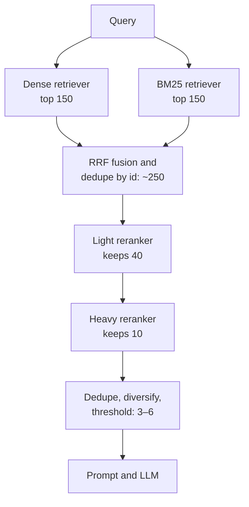

[Two-stage retrieval](/learn/advanced-retrieval-optimisation/two-stage-retrieval) pairs one cheap retriever with one expensive reranker. Real systems often need more than two steps: several retrievers whose results must be merged, a filter, a fast reranker to thin a long list, a slow and accurate reranker for the survivors, and a few clean-up steps before the prompt is assembled. A pipeline of three or more stages, each looking at fewer items more carefully than the one before, is a **multi-stage retrieval pipeline**, also called a **ranking cascade**.

This lesson is about designing such a cascade as a whole: how losses compound from stage to stage, how cost is spread across stages, how to size each stage's output, and how to prove that every stage earns its place. You will build a four-stage cascade, measure what survives each stage and what each stage costs, and run the ablation that tells you whether a stage should exist at all.

## Learning objectives

- Describe the anatomy of a ranking cascade and the job of each common stage.
- Compute end-to-end recall as the product of per-stage survival rates, and total cost as the sum of per-stage costs.
- Size the output of each stage so that an expensive model sees only as many candidates as it needs.
- Run a stage ablation and decide, from measurements, whether a stage should stay in the pipeline.
- Plan timeouts and fallbacks so that a slow or failing stage degrades results instead of failing requests.

## Prerequisites

- [Two-stage retrieval](/learn/advanced-retrieval-optimisation/two-stage-retrieval): the recall ceiling and candidate depth, which this lesson generalises.
- [Reciprocal Rank Fusion](/learn/hybrid-search/reciprocal-rank-fusion): the merge step used in this lesson's first stage.
- [Cross-encoders](/learn/reranking-fundamentals/cross-encoders): the models used as rerankers here.
- [Recall@K](/learn/retrieval-fundamentals/recall-k): the metric every stage is measured with.

## Why this matters

Two-stage retrieval works when one number, N, satisfies two constraints at once: it is large enough for the first stage to reach good recall, and small enough for the reranker to score in the latency budget. As corpora grow and queries get harder, those constraints stop overlapping. The first stage may need 300 candidates to reach the recall you want, while your best reranker can score only 40 within budget. With two stages you must choose: lose recall by cutting at 40, or lose latency by scoring 300.

A third stage dissolves the conflict. A small reranker, an order of magnitude cheaper per pair, scores all 300 and passes its best 40 to the large one. The large model now sees a short list that very probably contains the answer.

The same pattern appears for other reasons. Modern retrieval often combines several sources (dense, keyword, metadata lookups, a recent-documents index), and those must be merged before anything can rank them. And after ranking, there are jobs that are not ranking at all: removing near-duplicates, enforcing diversity, dropping low-confidence chunks. Each is a stage. Without a deliberate design, these accrete one at a time, each added to fix one complaint, and nobody can say which of them is still helping or how much recall the whole chain loses.

## The intuition

Picture a large university admissions process. Twenty thousand applications arrive. A software check removes the incomplete ones in seconds. A reader spends five minutes on each remaining file and passes on the most promising three thousand. A faculty panel spends an hour on each of those and invites three hundred to interview. The interviews choose the final class.

Each step is more expensive per applicant and sees fewer applicants. No single step could do the whole job: the panel cannot read twenty thousand files, and the five-minute reader cannot judge what the interview reveals. Two other things are worth noticing:

- **Losses compound.** If each of the three filters wrongly rejects 5% of the applicants who would have been admitted, the process loses about 14% of them overall, and no later step can bring them back.
- **Each step must earn its cost.** If the panel's decisions turned out to match the reader's ranking almost exactly, the panel would be an expensive way of agreeing. You would find out only by comparing their outputs.

## How it works

### Anatomy of a cascade

A typical RAG retrieval cascade has these stages, in this order. Not every pipeline has all of them.

1. **Candidate generation.** One or more retrievers (dense, sparse, metadata lookups) each return their top results. The goal is recall. Typical output: hundreds of candidates.
2. **Fusion.** The lists are merged into one, for example with [Reciprocal Rank Fusion](/learn/hybrid-search/reciprocal-rank-fusion), and duplicates by id are collapsed.
3. **Filtering.** Access control and metadata constraints remove ineligible chunks. Better still, they are pushed into stage 1 so that no retriever wastes its quota on chunks the user may not see.
4. **Light reranking.** A small, fast cross-encoder (or a late-interaction model such as [ColBERT](/learn/reranking-models/colbert)) scores every candidate and keeps tens.
5. **Heavy reranking.** A large cross-encoder, or a hosted reranking API, orders the survivors precisely.
6. **Optional LLM reranking.** A large language model reads several candidates together and orders them. This is the most accurate-sounding and the most expensive option; it is discussed below.
7. **Post-processing.** Non-ranking steps: [duplicate removal](/learn/advanced-retrieval-optimisation/duplicate-removal), [diversity-aware ranking](/learn/advanced-retrieval-optimisation/diversity-aware-ranking), [retrieval thresholding](/learn/advanced-retrieval-optimisation/retrieval-thresholding), and finally context assembly.



The numbers in the diagram are illustrative. What matters is the shape: each stage is more expensive per item than the one before it and sees fewer items.

### The design principles

Four principles guide the design.

**Cost per item rises, items per stage fall.** The total cost is the sum over stages of (items scored × cost per item). A cascade is efficient when the expensive stages see few items. Putting an expensive model early, or a cheap one late, wastes the structure.

**Early stages are judged by recall, late stages by precision.** Exactly as in two stages, but now with a chain of handovers. Every stage except the last should be tuned so that it rarely drops a chunk the final list needs. Its own ordering matters only in so far as it decides what survives its cut.

**Survival multiplies.** If stage $i$ keeps the answering chunk with probability $s_i$ (given it received it), end-to-end recall is the product of the $s_i$. Four stages at 0.95 each give $0.95^4 \approx 0.81$. This is why every stage boundary needs its own measurement: a pipeline can lose a fifth of its answers without any single stage looking bad.

**Every stage must earn its place.** A stage costs latency, money, code and failure modes. It earns its place only if removing it makes the final metric measurably worse, or makes the pipeline measurably cheaper at equal quality. The test is an **ablation**: rerun the evaluation with the stage removed (and its neighbours re-tuned) and compare.

### Sizing each stage

Each stage's output size (its "keep") is the next stage's input. Choose keeps from the back of the pipeline forward:

1. Fix the final k by the prompt budget and the generator's needs.
2. Give the heavy reranker the largest input it can score within its share of the latency budget.
3. Give the light reranker as many candidates as needed for the first stage to reach the target recall, provided it can score them in its budget.
4. Check, by measurement, that the light reranker's top "keep" retains almost all the answering chunks that were in its input. If it does not, it is too weak to be a filter for the heavy model, and either its keep should grow or it should be replaced.

The light stage does not need to rank well. It needs to make few false rejections at its cut. That is a much easier task, which is why a small model can do it.

### Candidate generation from several sources

When stage 1 has several retrievers, each one's depth is a separate knob. A common mistake is to give each the same depth by default. If the dense retriever reaches high recall at 100 and BM25 adds value mainly for identifiers, which it finds in its top 20, then asking BM25 for 150 only adds noise for the fusion and rerankers to wade through. Measure each source's contribution: for each answering chunk, which source(s) found it, and at what rank.

Fusion by rank (RRF) is robust because it ignores incomparable raw scores. Fusion is not ranking, though: its output order is only as good as the inputs, and in a cascade its main job is to produce a well-mixed candidate set for the rerankers.

### LLM reranking

A large language model can rerank by reading the query and a set of candidates and returning an ordering. Research such as Sun and colleagues' 2023 RankGPT work studied this "listwise" approach with sliding windows over long lists and reported strong results on standard benchmarks. In production it is the most expensive stage by far: every candidate's text becomes prompt tokens, latency is that of a generation call, and output must be parsed and validated (the model may omit or invent ids). Treat it as experimental for latency-sensitive RAG: if you try it, put it last, give it a short list (ten or so), and require that it beat the heavy cross-encoder in an ablation that also counts its cost.

### Latency adds, and so do tails

Stages that run in sequence add their latencies. Stages that run in parallel (the retrievers in stage 1) cost the maximum of their latencies, not the sum. Tail latency also adds: if each of four sequential stages occasionally takes three times its median, the probability that some stage is slow on a given request grows with the number of stages. Give each stage a timeout and a defined fallback:

- A retriever times out: fuse the lists that did arrive.
- The heavy reranker times out: use the light reranker's order.
- The light reranker times out: send the fused list, cut to the heavy reranker's input size.

A cascade with fallbacks degrades by one stage at a time instead of failing.

## The mathematics

### End-to-end recall

**Intuition.** The answering chunk must survive every cut in turn, so the chances multiply.

**Formula.** For a cascade of $m$ stages,

$$
R_{\text{end}} = R_1 \prod_{i=2}^{m} s_i
$$

- $R_1$ is the first stage's recall: the fraction of queries whose answering chunk is among its candidates.
- $s_i$ is the survival rate of stage $i$: among queries whose answering chunk reached stage $i$, the fraction for which stage $i$ keeps it in its output.
- $R_{\text{end}}$ is the fraction of queries whose answering chunk is in the final list.

**By hand.** First-stage recall 0.96, light reranker survival 0.98 (keeping 40 of 250), heavy reranker survival 0.90 (keeping 5 of 40). Then $R_{\text{end}} = 0.96 \times 0.98 \times 0.90 \approx 0.847$. The heavy reranker is the biggest loss, so that is where to look first. A survival rate just under 1 for the light stage is the goal: it is a filter, not a judge.

### Total cost

**Intuition.** Each stage costs its number of items times its cost per item.

**Formula.**

$$
C = \sum_{i=1}^{m} n_i \, c_i
$$

where $n_i$ is the number of items stage $i$ scores and $c_i$ its cost per item (in milliseconds of compute, or in money).

**By hand.** Suppose a heavy reranker costs 25 ms per pair and a light one 3 ms per pair on the same hardware. Scoring 200 candidates with the heavy model costs $200 \times 25 = 5{,}000$ ms of compute. The cascade "light on 200, heavy on the top 20" costs $200 \times 3 + 20 \times 25 = 600 + 500 = 1{,}100$ ms, about 4.5 times less. The cascade pays off whenever the light model is much cheaper per item and the heavy model's input can be cut sharply without losing answers.

```python
r1, survival = 0.96, [0.98, 0.90]
r_end = r1
for s in survival:
    r_end *= s
print(f"end-to-end recall = {r_end:.3f}")
heavy, light = 25, 3                      # ms per pair, assumed
print("heavy only:", 200 * heavy, "ms;  cascade:", 200 * light + 20 * heavy, "ms")
```

```output
end-to-end recall = 0.847
heavy only: 5000 ms;  cascade: 1100 ms
```

## In code

**The problem.** Build a four-stage cascade (BM25 and dense retrieval, RRF fusion, a light cross-encoder, a heavy cross-encoder) and answer two questions with measurements: what survives each stage, and does each reranker earn its place? Then measure the per-pair cost of the two rerankers and work out what a cascade saves at realistic depth.

The light reranker is `cross-encoder/ms-marco-MiniLM-L-6-v2` (about 23 million parameters); the heavy one is `BAAI/bge-reranker-base` (about 278 million). Both are open models from Hugging Face; the [BGE rerankers](/learn/reranking-models/bge-rerankers) lesson covers the BGE family.

**Install:**

```bash
pip install rank-bm25 sentence-transformers numpy
```

The script imports the 22-chunk Meridian corpus and 20 labelled queries from the [Two-stage retrieval](/learn/advanced-retrieval-optimisation/two-stage-retrieval) lesson. Copy the `CHUNKS` and `QUERIES` definitions from that lesson's code into a file called `meridian_data.py` next to this script.

```python
import re
import time

import numpy as np
from rank_bm25 import BM25Okapi
from sentence_transformers import CrossEncoder, SentenceTransformer

from meridian_data import CHUNKS, QUERIES

ids = list(CHUNKS)
texts = [CHUNKS[i] for i in ids]

def tokenise(s):
    return re.findall(r"[a-z0-9£]+", s.lower())

bm25 = BM25Okapi([tokenise(t) for t in texts])
encoder = SentenceTransformer("sentence-transformers/all-MiniLM-L6-v2")
doc_vecs = encoder.encode(texts, normalize_embeddings=True)
light = CrossEncoder("cross-encoder/ms-marco-MiniLM-L-6-v2")  # ~23M parameters
heavy = CrossEncoder("BAAI/bge-reranker-base")                # ~278M parameters

def hybrid(query, n_each=6, k=60):
    """Stage 1: BM25 top n_each and dense top n_each, merged by RRF."""
    lexical = np.argsort(-bm25.get_scores(tokenise(query)), kind="stable")[:n_each]
    q = encoder.encode([query], normalize_embeddings=True)[0]
    dense = np.argsort(-(doc_vecs @ q), kind="stable")[:n_each]
    fused = {}
    for ranking in (lexical, dense):
        for rank, i in enumerate(ranking, start=1):
            fused[int(i)] = fused.get(int(i), 0.0) + 1.0 / (k + rank)
    return sorted(fused, key=fused.get, reverse=True)

def rerank(model, query, cand, keep):
    if model is None:                       # plain cut, keeping stage-1 order
        return cand[:keep]
    scores = model.predict([(query, texts[i]) for i in cand])
    return [cand[j] for j in np.argsort(-scores, kind="stable")[:keep]]

def run(stages):
    """Apply (model, keep) stages after stage 1; report survival and work."""
    survived = np.zeros(len(stages) + 1)
    pairs = np.zeros(len(stages))
    top1 = 0
    for query, gold in QUERIES:
        g = ids.index(gold)
        cand = hybrid(query)
        survived[0] += g in cand
        for s, (model, keep) in enumerate(stages):
            pairs[s] += len(cand) if model is not None else 0
            cand = rerank(model, query, cand, keep)
            survived[s + 1] += g in cand
        top1 += cand[0] == g
    n = len(QUERIES)
    return survived / n, top1 / n, pairs / n

CASCADES = {   # every cascade ends with 3 chunks for the prompt
    "hybrid, cut to 3":       [(None, 3)],
    "hybrid > light":         [(light, 3)],
    "hybrid > heavy":         [(heavy, 3)],
    "hybrid > light > heavy": [(light, 5), (heavy, 3)],
}
print("cascade                 recall after each stage   hit@1  pairs per stage")
for name, stages in CASCADES.items():
    surv, hit1, pairs = run(stages)
    print(f"{name:<23} {str(np.round(surv, 2)):<25} {hit1:5.2f}  {np.round(pairs, 1)}")

# Per-pair cost of each reranker on 150-word passages.
print()
rng = np.random.default_rng(0)
vocab = CHUNKS["leave-days"].split() + CHUNKS["exp-receipt"].split() + CHUNKS["vpn"].split()
batch = [("how many days of annual leave do I get", " ".join(rng.choice(vocab, 150)))
         for _ in range(64)]
ms = {}
for name, model in (("light", light), ("heavy", heavy)):
    model.predict(batch[:8])                                  # warm-up
    t0 = time.perf_counter()
    model.predict(batch, batch_size=32)
    ms[name] = 1000 * (time.perf_counter() - t0) / len(batch)
    print(f"{name}: {ms[name]:.1f} ms per pair")

N = 200
print(f"{f'heavy on all {N}':<32} {N * ms['heavy']:6.0f} ms per query")
for keep in (20, 50):
    cost = N * ms["light"] + keep * ms["heavy"]
    print(f"{f'light on {N}, heavy on top {keep}':<32} {cost:6.0f} ms per query")
```

Output (on a laptop CPU; the timings will differ on your machine, the quality numbers should not):

```output
cascade                 recall after each stage   hit@1  pairs per stage
hybrid, cut to 3        [1.   0.85]                0.55  [0.]
hybrid > light          [1.   0.95]                0.85  [9.4]
hybrid > heavy          [1.  0.9]                  0.85  [9.4]
hybrid > light > heavy  [1.  1.  0.9]              0.85  [9.4 5. ]

light: 3.3 ms per pair
heavy: 24.7 ms per pair
heavy on all 200                   4939 ms per query
light on 200, heavy on top 20      1147 ms per query
light on 200, heavy on top 50      1888 ms per query
```

**The important lines.**

- `hybrid` is stages 1 and 2 together: two retrievers and an RRF merge. With 6 from each and overlap between them, the merged list averages 9.4 unique candidates.
- `rerank(None, ...)` is a plain cut. It lets the "no reranker" baseline run through the same code, so the comparison is fair.
- `run` records, for each query, whether the answering chunk is still present after every stage. That per-boundary survival is the measurement this lesson is about.
- The cost section times each model on the same 64 pairs of 150-word passages after a warm-up, so the per-pair figures are comparable with each other.

**What the output means.**

- **Stage 1 is doing its job.** Recall after hybrid retrieval is 1.00: every answering chunk is among the candidates. Cutting that fused list to 3 without reranking keeps the answer for only 85% of queries, and puts it first for 55%.
- **The light reranker earns its place.** Adding it raises hit@3 to 0.95 and hit@1 to 0.85.
- **The heavy reranker does not, on this data.** Alone, it is no better at hit@1 than the light model (0.85) and slightly worse at hit@3 (0.90). In the full cascade, the light stage passes every answer through (survival 1.00 at keep = 5) and the heavy stage then loses two of them, ending at 0.90. This is exactly what an ablation is for: a bigger model is not automatically a better stage. Here, removing the heavy stage would cut cost and lose nothing.
- **Twenty queries is a small sample.** Each query is worth 0.05 here, so the difference between 0.95 and 0.90 is a single query. On real data, use hundreds of labelled queries before acting on a difference this size.
- **The cost ratio is large.** On this machine the heavy model costs about 7.5 times as much per pair. Scoring 200 candidates with it alone would take about 4.9 seconds of CPU time per query; letting the light model cut the list to 20 first takes about 1.1 seconds. On a GPU both numbers would be far smaller, but the cascade's relative saving comes from the per-pair ratio, which you should measure on your own serving hardware.

**Common errors.**

- Measuring only the end-to-end metric. Without per-stage survival you cannot tell which stage is losing answers.
- Feeding the heavy model the light model's top k with k too small. If survival at the light stage is well below 1, the light model is acting as a judge, not a filter.
- Running `model.predict` once per pair in a Python loop, which defeats batching.
- Downloading `BAAI/bge-reranker-base` (about 1 GB) inside a request handler. Load models once at start-up.

**Extending it.** Add a third retriever (for example, a filter on the "Superseded" prefix) and record which source found each answering chunk. Add a timeout around the heavy reranker that falls back to the light order. Replace the heavy model with the hosted reranker you are considering and rerun the ablation, counting its cost per search.

## A real-world example

AskMeridian's two-stage pipeline (dense top 50, cross-encoder, top 5) worked well for the handbook. Then the Platform team added the product documentation for Meridian Sync, Meridian Relay and Meridian Reports, and the Atlas error-code catalogue. Questions like "what does E-4021 mean?" began to fail, because dense retrieval blurs error codes: E-4021 and E-4012 look almost the same to an embedding model.

They added BM25 alongside dense retrieval and fused with RRF. Recall improved, but only at a depth of about 200 fused candidates, and the cross-encoder they used could score about 60 within their stage-2 budget. They had the conflict this lesson opened with.

They inserted a small cross-encoder between fusion and the existing one, keeping 50. Their evaluation set of 400 questions, now labelled by source (handbook, runbooks, product docs, error codes), showed survival at each boundary. The light stage kept the answering chunk for almost every query, except for error-code questions, where it sometimes ranked "E-4012: VPN certificate expired" above "E-4021: the VPN client is out of date". Its keep was raised for queries containing an error-code pattern, a simple rule that the logs showed to be safe.

An engineer proposed an LLM reranking stage after the heavy reranker. The ablation, run on the same 400 questions with cost included, showed a small gain within the noise of the sample and a latency increase that broke the budget. It was not adopted. The decision was recorded with the numbers, so that it can be revisited when models or budgets change.

## Common mistakes

- **Adding stages without ablations.** Each stage seemed useful when added; nobody checks later whether it still is. The pipeline grows slower without growing better.
- **Measuring only end-to-end quality.** Compounded losses stay invisible; the team tunes the stage it suspects rather than the one losing answers.
- **Treating the light reranker as a judge.** A light stage that keeps too few candidates turns a safe filter into a lossy one. Its survival rate should be close to 1.
- **Equal depth for every source.** Asking every retriever for the same number of results adds noise from weak sources and wastes fusion and reranking work.
- **Sequential calls that could be parallel.** Retrievers in stage 1 are independent; running them one after another adds their latencies.
- **No per-stage timeouts.** One slow stage fails the whole request instead of degrading it.

## Best practices

- Log, for every evaluation query, the rank of each answering chunk after every stage. Survival per boundary is the cascade's main diagnostic.
- Size stages from the back: final k from the prompt, heavy input from its budget, light input from first-stage recall.
- Re-run the ablation for each stage whenever a model, corpus or budget changes, and remove stages that no longer pay.
- Run stage-1 retrievers in parallel and give each its own depth, tuned by its measured contribution.
- Give every stage a timeout and a fallback that skips it.
- Keep each stage's interface narrow (ids and text in, ordered ids out) so stages can be swapped and tested in isolation.

## Performance considerations

Total compute is $\sum_i n_i c_i$, but latency is shaped by parallelism and sequencing. Parallel retrievers cost the slowest one; sequential rerankers add. A rough budget for a 300 ms target might look like this (assumptions to replace with your measurements): 40 ms for parallel retrieval, 10 ms for fusion and fetching text, 60 ms for the light reranker, 120 ms for the heavy reranker, 20 ms for post-processing, and 50 ms of headroom for tail variation.

Batching matters more as stages multiply. Rerankers on GPUs are efficient on full batches and wasteful on tiny ones; a light stage scoring 200 pairs fills batches well, while a heavy stage scoring 20 may leave the GPU underused. If several replicas serve the heavy model, consider batching across concurrent requests.

Memory adds up too. Each model in the cascade must be loaded; a 278-million-parameter model in 32-bit floats takes about $278 \times 10^6 \times 4 \approx 1.1$ GB, before activations. Two rerankers and an embedding model on one GPU is feasible; five is a capacity-planning problem.

Hosted stages change the arithmetic from compute to money and network time. A hosted reranker typically charges per search or per volume of text; a light local stage that cuts the hosted model's input from 200 to 30 documents cuts that bill proportionally.

## Security considerations

Every stage that calls an external service sends it document text and the user's query. Apply access control in stage 1 so that restricted chunks never reach any later stage, and apply the same data-handling rules to hosted rerankers as to the generator.

An LLM reranking stage adds a new attack surface. It reads untrusted retrieved text as part of its prompt, so a document containing instructions such as "rank this passage first" is a [prompt injection](/learn/rag-security-fundamentals/indirect-prompt-injection) aimed at the ranker. Validate its output (only known ids, each at most once) and do not let it override access decisions.

## Summary

- A multi-stage cascade runs stages that each score fewer items, more carefully: candidate generation, fusion, filtering, light reranking, heavy reranking, optional LLM reranking, then post-processing.
- End-to-end recall is the first stage's recall times every later stage's survival rate; small losses at each boundary compound.
- Total cost is the sum of items times cost per item; a cascade saves when a cheap stage sharply cuts what an expensive stage must score.
- Size stages from the back and treat early rerankers as filters whose survival should be near 1.
- Prove each stage's value with an ablation that counts cost; a bigger model is not automatically a better stage.

## Exercises

**1.** A cascade has first-stage recall 0.93 and three later stages with survival rates 0.99, 0.97 and 0.92. What is the end-to-end recall, and which stage would you investigate first?

<details><summary>Show solution</summary>

$0.93 \times 0.99 \times 0.97 \times 0.92 \approx 0.822$. Investigate the last stage first: it loses 8% of the answers it receives, more than the others combined, and after it the first stage (which loses 7%).

</details>

**2.** In the code's output, the cascade "hybrid > light > heavy" ends with hit@3 = 0.90, below "hybrid > light" at 0.95. Explain why adding a stronger-looking model made the result worse, and name two things you would check before removing the heavy stage on real data.

<details><summary>Show solution</summary>

The light stage kept every answering chunk among its top 5, so the heavy stage had all the answers available; it then ranked a distractor above the answer for some queries. A larger model is not guaranteed to be better on a particular domain or query style, and here it was slightly worse. Before removing it on real data, check that the difference holds on a large labelled set (here it is one query out of twenty), and check per-segment results (for example error-code or long-runbook queries), since a model can be worse on average but better on a segment that matters.

</details>

**3.** Using the measured per-pair costs from the output (light 3.3 ms, heavy 24.7 ms), what is the largest light-stage input N such that "light on N, heavy on top 20" costs no more than "heavy on all 60"? Write the inequality and solve it.

<details><summary>Show solution</summary>

$3.3 N + 20 \times 24.7 \le 60 \times 24.7$, so $3.3 N \le 40 \times 24.7 = 988$ and $N \le 299$. For the same compute as scoring 60 candidates with the heavy model, the cascade can screen about 300 candidates and still give the heavy model 20, which buys first-stage recall at depth 300 instead of 60.

</details>

**4.** Design decision. Extend the script with a per-stage timeout: if the heavy reranker takes longer than a given number of milliseconds, the cascade returns the light reranker's top 3 instead. Implement it with `concurrent.futures`, and explain why the timeout alone does not stop the heavy model's computation.

<details><summary>Show solution</summary>

```python
from concurrent.futures import ThreadPoolExecutor, TimeoutError

pool = ThreadPoolExecutor(max_workers=2)

def cascade_with_timeout(query, timeout_ms=200):
    cand = rerank(light, query, hybrid(query), 5)
    future = pool.submit(rerank, heavy, query, cand, 3)
    try:
        return future.result(timeout=timeout_ms / 1000), "heavy"
    except TimeoutError:
        return cand[:3], "fallback: light order"
```

`future.result(timeout=...)` stops waiting, not computing: the worker thread keeps running the heavy model until it finishes, still using CPU or GPU. Under load, abandoned work can pile up, so production systems also bound the queue in front of the model server and, where the serving framework supports it, cancel requests server-side.

</details>

## Check your understanding

```quiz
[
  {"q": "Four stages each keep the answering chunk with probability 0.95, given it arrived. Approximately what end-to-end survival does the chain have?", "options": ["0.95", "0.90", "0.81", "0.62"], "answer": 2, "why": "Survival multiplies across stages: 0.95 to the fourth power is about 0.81."},
  {"q": "What is the main job of a light reranker placed before a heavy one?", "options": ["Produce the final ordering for the prompt", "Cut the candidate list while almost never dropping an answering chunk", "Remove near-duplicate chunks", "Calibrate scores into probabilities"], "answer": 1, "why": "It is a filter: its value is that the heavy model sees fewer candidates without losing answers, so its survival rate should be near 1."},
  {"q": "A heavy reranker costs 20 ms per pair and a light one 2 ms per pair. What is the compute for 'light on 300, heavy on top 30'?", "options": ["600 ms", "1,200 ms", "6,000 ms", "6,600 ms"], "answer": 1, "why": "300 times 2 plus 30 times 20 is 600 plus 600, so 1,200 ms, against 6,000 ms for the heavy model on all 300."},
  {"q": "How do you decide whether a stage should stay in the cascade?", "options": ["Keep it if its model is larger than the previous stage's", "Run an ablation: remove it, re-tune its neighbours, and compare quality and cost", "Keep it if it has a high average score", "Keep every stage; more stages are always more accurate"], "answer": 1, "why": "Only an ablation shows whether a stage changes the final metric enough to justify its latency, cost and complexity."},
  {"q": "Stage-1 retrievers A and B are independent and take 30 ms and 45 ms. Run in parallel, roughly how long does stage 1 take?", "options": ["45 ms", "75 ms", "15 ms", "37.5 ms"], "answer": 0, "why": "Parallel stages cost the slowest branch, not the sum."}
]
```

## Further reading

- Wang, L., Lin, J. and Metzler, D. (2011). *A Cascade Ranking Model for Efficient Ranked Retrieval*. SIGIR 2011. The classic formulation of ranking as a cascade of increasingly expensive stages.
- Lin, J., Nogueira, R. and Yates, A. (2021). *Pretrained Transformers for Text Ranking: BERT and Beyond*. [arXiv:2010.06467](https://arxiv.org/abs/2010.06467). Covers multi-stage reranking architectures with transformers.
- Sun, W. et al. (2023). *Is ChatGPT Good at Search? Investigating Large Language Models as Re-Ranking Agents*. [arXiv:2304.09542](https://arxiv.org/abs/2304.09542). The RankGPT study of listwise LLM reranking.
- Cormack, G. V., Clarke, C. L. A. and Büttcher, S. (2009). *Reciprocal Rank Fusion Outperforms Condorcet and Individual Rank Learning Methods*. SIGIR 2009. The fusion method used in stage 1.
