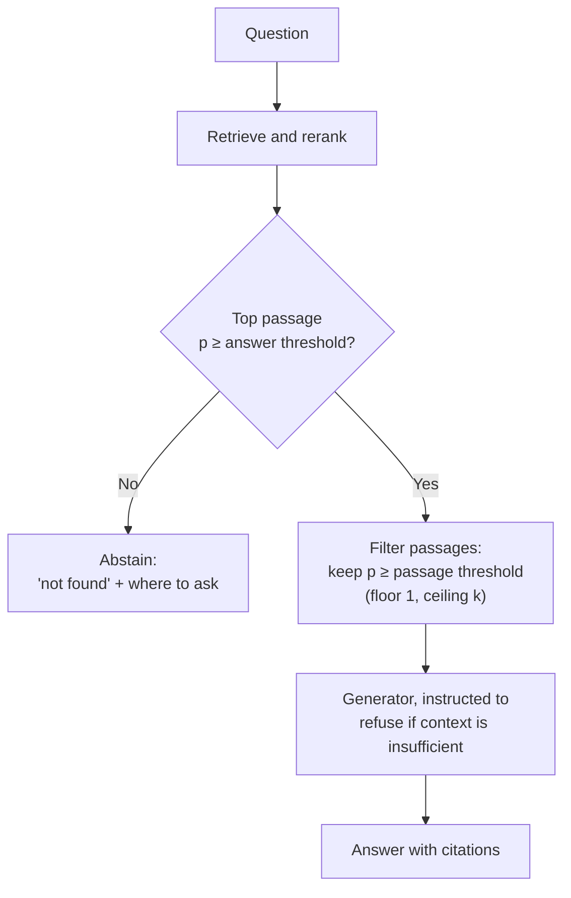

A retriever always returns something. Ask AskMeridian about parental leave, which its documents do not cover, and the top passage will be about annual leave, because that is the closest thing in the index. **Retrieval thresholding** is the decision, made on scores, to say "not good enough": to drop a passage that is too weak to be worth the generator's attention, or to conclude that nothing retrieved answers the question and the system should say so instead of answering.

This lesson separates the two decisions (passage-level filtering and query-level abstention), shows how to derive a threshold from the costs of each kind of error rather than picking a round number, and runs the whole procedure with a real cross-encoder on Meridian questions, including near-miss questions that look answerable and are not. It builds on [Score calibration](/learn/advanced-retrieval-optimisation/score-calibration), which turns raw scores into probabilities that a threshold can be stated in, and on [Similarity distributions](/learn/embedding-mathematics/similarity-distributions), which showed why a threshold on raw cosine similarity is fragile. Adaptive top-$k$ rules (relative thresholds and largest-gap cuts) are covered in [Top-K retrieval](/learn/retrieval-fundamentals/top-k-retrieval) and are not repeated here.

## Learning objectives

- Distinguish passage-level thresholds (filtering context) from query-level thresholds (abstaining), and state the error each one trades.
- Derive a threshold on a calibrated probability from the costs of false positives and false negatives.
- Sweep thresholds on labelled data, compute coverage and selective risk, and choose an operating point.
- Explain why near-miss questions defeat score thresholds and what additional defences are needed.
- Design floors, ceilings, per-segment thresholds and monitoring so that a threshold stays correct in production.

## Prerequisites

- [Score calibration](/learn/advanced-retrieval-optimisation/score-calibration): calibrated probabilities, Platt scaling, and why calibration drifts.
- [Similarity distributions](/learn/embedding-mathematics/similarity-distributions): the overlap between relevant and irrelevant scores and the near-miss problem.
- [Top-K retrieval](/learn/retrieval-fundamentals/top-k-retrieval): fixed and adaptive cut-offs, floors and ceilings.
- [Cross-encoders](/learn/reranking-fundamentals/cross-encoders): the reranker whose scores are thresholded here.

## Why this matters

Without a threshold, two failures are guaranteed.

The first is **noise in the context**. A fixed top $k$ fills every slot, so a single-fact question receives its one good passage plus four weak ones. Weak passages cost tokens, and a passage on a neighbouring topic can mislead the generator, especially when it contains a plausible-looking number.

The second is **answering the unanswerable**. If the corpus has nothing on parental leave, the generator still receives five passages, the best of them about annual leave. A well-prompted model will often refuse, as [Refusal behaviour](/learn/prompt-engineering-for-rag/refusal-behaviour) teaches, but not always: a passage about "leave" that states "25 days" invites an answer. Every wrong answer given confidently costs trust, and in an HR or IT assistant it can cost more (a missed deadline, a security step skipped).

But thresholds have their own failure: refusing questions the system *could* have answered. Colloquial questions match their passages weakly, so a threshold set to block every bad answer tends to block casual phrasings of good questions too. The job is to choose that trade deliberately.

## The intuition

Think of a pharmacist checking prescriptions, who can dispense or query the doctor. Dispensing a wrong prescription is serious; querying a correct one costs a phone call. So the pharmacist dispenses only when quite sure, and "quite sure" is set by how bad each mistake is, not by rounding to 50%. If wrong dispensing were five times as costly as a phone call, the pharmacist would dispense only when the chance of a problem was below about one in six.

Now add a twist: some forged prescriptions are excellent forgeries. They look exactly like real ones. No bar on "how real it looks" will catch them without also rejecting many real prescriptions. Catching them needs a different check, such as calling the doctor about a particular drug. Near-miss questions are retrieval's excellent forgeries.

## How it works

### Two decisions, two thresholds

Thresholding in RAG means one of two different decisions, and mixing them up causes most threshold bugs.

| | Passage-level | Query-level |
| --- | --- | --- |
| Question | Is this passage worth putting in the context? | Does anything retrieved answer the question? |
| Acts on | Each candidate's score | A summary of the query's scores, usually the best one |
| False positive | A weak passage enters the context (noise) | The system answers an unanswerable question |
| False negative | A useful passage is dropped (lost recall) | The system refuses an answerable question |
| Typical action | Filter, with a floor of 1 or 2 passages | Return a fixed "not found" response, or route elsewhere |

The passage-level false negative is measured by [context recall](/learn/advanced-retrieval-optimisation/context-recall); the false positive by plain precision ([context precision](/learn/advanced-retrieval-optimisation/context-precision) sees noise only when it outranks useful passages). The query-level errors are measured with **coverage**, the fraction of questions the system answers, and **selective risk**, the fraction of answered questions that should not have been answered (or were answered wrongly).

### Threshold on calibrated scores

A threshold should be written in a unit that means something. Raw cosine similarities and logits shift with every model, corpus and candidate setting; a calibrated probability of relevance has a stable meaning ("about 30% of passages at this score are relevant") as long as the calibrator is refitted when the population changes. In practice:

1. Calibrate the scorer you threshold on (usually the reranker, whose scores separate relevant from irrelevant far better than first-stage scores).
2. Express the threshold as a probability.
3. When the model changes, refit the calibrator and keep the probability threshold.

If you have too few labels to calibrate, you can still threshold raw scores, but then the threshold is tied to one model and must be re-chosen at every change, using the sweep procedure below.

### Choosing the threshold from costs

The right threshold depends on what mistakes cost. For a passage with calibrated probability of relevance $p$:

- Keeping it costs $(1-p) \cdot C_{\text{noise}}$ in expectation: with probability $1-p$ it is irrelevant noise.
- Dropping it costs $p \cdot C_{\text{miss}}$: with probability $p$ it was useful evidence.

Keep it when the first is smaller, which gives the threshold $p \geq C_{\text{noise}} / (C_{\text{noise}} + C_{\text{miss}})$, derived in the mathematics section. If losing evidence is three times as bad as including noise, keep passages with $p \geq 0.25$. Notice how low that is: when the generator can ignore noise reasonably well, it pays to be generous.

The query-level decision has the same shape with different costs. If answering an unanswerable question is five times as bad as refusing an answerable one, answer only when the probability that the question is answerable is at least $5/6 \approx 0.83$. Here the bar is high, because the expensive error is the false positive.

The costs are product decisions. An HR assistant's wrong policy answers erode trust far more than an occasional "I couldn't find that", so its $C_{\text{wrong}}$ is high; a tool for engineers who read the sources can afford a low bar. Write the ratio down and get it agreed.

### Sweeping thresholds on labelled data

When the probability of answerability is not directly available (it rarely is), choose the query-level threshold empirically:

1. Build a labelled question set from real traffic, with answerable questions and unanswerable ones, including **near misses**: questions on topics the corpus covers that it nonetheless cannot answer.
2. Run the pipeline and record each question's summary score (usually the reranker's top-1 score, calibrated or not).
3. For every candidate threshold, count the four outcomes: answered correctly, refused wrongly, refused correctly, answered wrongly.
4. Compute coverage, selective risk and total cost.
5. Choose the threshold with the lowest cost, or the highest coverage whose selective risk stays below a target.
6. Check stability: a threshold that sits on a single data point is fitted to noise. Prefer the middle of a flat region of low cost.



The diagram has two thresholds and a third safeguard. The generator's own refusal instruction catches cases that pass the score threshold but still do not answer the question; it is the defence against near misses that scores cannot catch.

### Near misses defeat score thresholds

A near-miss question shares its topic, vocabulary and often its entities with a passage that does not answer it: "parental leave" against the annual-leave passage, "error E-5310" against the passage on E-4021, "Does Meridian Sync support SAML?" against the passage on Meridian Reports' SAML support. A cross-encoder reads the pair jointly and is much better than a cosine at noticing a mismatch, but a substituted name or code can still look like a strong match, because almost every word agrees. Any threshold high enough to reject such a question will also reject the answerable questions that happen to score as low.

Defences beyond the score:

- **Generator-side refusal.** Instruct the generator to answer only when the context states the answer, and test that it does (see [Handling missing information](/learn/prompt-engineering-for-rag/handling-missing-information)).
- **Entity and identifier checks.** If the question contains an identifier (an error code, a product name), require it to appear in the passage. A cheap exact-match rule catches most code and product substitutions.
- **Answerability classifiers.** A model trained or prompted to judge "does this passage answer this question?" is a stronger signal than relevance. Using an LLM for that judgement costs a call but can share the generation call.

### Floors, ceilings and segments

A passage threshold alone can leave zero passages or too many. Two bounds fix that:

- A **floor** keeps at least $k_{\min}$ passages for answerable questions even if they are below the passage threshold, because the query-level decision has already judged the question answerable. Without a floor, a correct answer can be refused because its supporting passage scored 0.29 against a 0.30 bar.
- A **ceiling** keeps at most $k_{\max}$, bounding cost and context length.

Different kinds of traffic may deserve different thresholds. Identifier lookups score high when they match and low when they do not, so a high bar suits them; colloquial policy questions score lower even when answerable. **Per-segment thresholds** (by query type, language or corpus section) help, but each segment needs enough labelled questions to set its threshold; otherwise you are fitting noise many times over.

### Thresholds drift

A threshold is fitted to a model, a corpus and a traffic mix. When any of them changes, the threshold's error rates change. Monitor in production:

- **Abstention rate** by day and by segment. A sudden rise after a deployment usually means a scale change (a new model, a new calibrator not fitted). A slow rise may mean new topics the corpus does not cover, which is useful content-gap information.
- **Score percentiles** of the top passage, as described in [Similarity distributions](/learn/embedding-mathematics/similarity-distributions).
- **Periodic labelled samples** of answered and refused questions to re-estimate selective risk and the refusal of answerable questions.

## The mathematics

### The cost-optimal threshold

**Intuition.** Act when the expected cost of acting is lower than the expected cost of not acting.

For a passage with probability of relevance $p$, keeping it costs $(1-p)\,C_{\text{noise}}$ and dropping it costs $p\,C_{\text{miss}}$ in expectation. Keep it when

$$
(1-p)\,C_{\text{noise}} \leq p\,C_{\text{miss}} \iff p \geq \frac{C_{\text{noise}}}{C_{\text{noise}} + C_{\text{miss}}}
$$

$C_{\text{noise}}$ is the cost of including an irrelevant passage, $C_{\text{miss}}$ the cost of dropping a relevant one, and $p$ must be calibrated for the comparison to mean anything. For the query-level decision, replace $p$ by the probability the question is answerable, $C_{\text{noise}}$ by the cost of a wrong answer $C_{\text{wrong}}$ and $C_{\text{miss}}$ by the cost of an unnecessary refusal $C_{\text{refuse}}$: answer when $p \geq C_{\text{wrong}} / (C_{\text{wrong}} + C_{\text{refuse}})$.

**By hand.** With $C_{\text{noise}} = 1$ and $C_{\text{miss}} = 3$: $1/(1+3) = 0.25$. With $C_{\text{wrong}} = 5$ and $C_{\text{refuse}} = 1$: $5/6 \approx 0.833$.

### Coverage and selective risk

**Intuition.** Coverage says how often the system answers; selective risk says how often those answers should not have been given.

$$
\text{coverage}(t) = \frac{|\{i : s_i \geq t\}|}{N}, \qquad \text{risk}(t) = \frac{|\{i : s_i \geq t,\ i \text{ unanswerable}\}|}{|\{i : s_i \geq t\}|}
$$

$s_i$ is question $i$'s summary score, $t$ the threshold and $N$ the number of questions. Raising $t$ lowers coverage and, if scores carry any signal, lowers risk. Plotting risk against coverage over all $t$ gives the **risk–coverage curve**, the standard picture of selective prediction.

**By hand.** In the code below, with 20 questions: at $t = -0.89$, 14 are answered and 2 of them are unanswerable, so coverage is $14/20 = 0.70$ and risk $2/14 \approx 0.143$. At $t = 4.41$, 9 are answered and none is unanswerable: coverage $0.45$, risk $0$.

```python
C_WRONG, C_REFUSE = 5.0, 1.0
print(f"answer if P(answerable) >= {C_WRONG / (C_WRONG + C_REFUSE):.3f}")
C_NOISE, C_MISS = 1.0, 3.0
print(f"keep passage if P(relevant) >= {C_NOISE / (C_NOISE + C_MISS):.3f}")

for t, answered, wrong in [(-0.89, 14, 2), (4.41, 9, 0)]:
    print(f"threshold {t:>5}: coverage {answered / 20:.2f}, selective risk {wrong / answered:.3f}")
```

```output
answer if P(answerable) >= 0.833
keep passage if P(relevant) >= 0.250
threshold -0.89: coverage 0.70, selective risk 0.143
threshold  4.41: coverage 0.45, selective risk 0.000
```

## In code

**The problem.** Choose a query-level abstention threshold for AskMeridian from labelled questions, using a real cross-encoder, and compare it with a threshold on dense cosine similarity.

**Data.** Ten Meridian passages and 20 questions: 12 that the passages answer, 5 near misses (parental leave, working from another country, the mileage rate, error E-5310, SAML for Meridian Sync) and 3 off-topic questions. The costs say a wrong answer is five times as bad as a refusal. Twenty questions is far too few for production; it keeps every row readable.

**Dependencies.** sentence-transformers and NumPy; both models download on first use. No API key.

```bash
pip install sentence-transformers numpy
```

```python
import numpy as np
from sentence_transformers import SentenceTransformer, CrossEncoder

chunks = {
    "leave":    "Annual leave is 25 days per year. Up to 5 unused days carry over and must be used by 31 March.",
    "remote":   "Staff may work remotely up to 3 days a week.",
    "equip":    "The home-office equipment budget is £400. Contractors are not eligible for it.",
    "expenses": "Expenses must be submitted within 30 days. Anything over £75 needs a receipt.",
    "password": "Passwords must be rotated every 90 days.",
    "vpn":      "VPN is required on public Wi-Fi.",
    "laptop":   "Laptops are refreshed every 3 years. Report a lost laptop to the support desk at once.",
    "desk":     "The support desk is open 08:00 to 18:00 UK time.",
    "atlas":    "Atlas error E-4021 means the VPN client is out of date; update it from the IT portal.",
    "reports":  "Meridian Reports exports to PDF and CSV. SAML single sign-on is available on the Enterprise plan.",
}
# (question, answering chunk or None if the corpus cannot answer it)
questions = [
    ("How many days of annual leave do I get?", "leave"),
    ("Can I carry over unused holiday?", "leave"),
    ("How many days a week can I work from home?", "remote"),
    ("What is the budget for home-office equipment?", "equip"),
    ("Do I need a receipt for a £90 dinner?", "expenses"),
    ("How often do I have to change my password?", "password"),
    ("Do I need the VPN in a coffee shop?", "vpn"),
    ("When will my laptop be replaced?", "laptop"),
    ("What time does the support desk open?", "desk"),
    ("What does error E-4021 mean?", "atlas"),
    ("Can Meridian Reports export to CSV?", "reports"),
    ("Does Meridian Reports support single sign-on?", "reports"),
    ("How much parental leave do I get?", None),            # near misses: same topic, no answer
    ("Can I work remotely from another country?", None),
    ("What is the mileage rate for expenses?", None),
    ("What does error E-5310 mean?", None),
    ("Does Meridian Sync support SAML?", None),
    ("Who is the CEO of Meridian?", None),                   # off-topic
    ("What is the capital of France?", None),
    ("Is the office open on bank holidays?", None),
]
ids, texts = list(chunks), list(chunks.values())
reranker = CrossEncoder("cross-encoder/ms-marco-MiniLM-L-6-v2")
embedder = SentenceTransformer("sentence-transformers/all-MiniLM-L6-v2")
D = embedder.encode(texts, normalize_embeddings=True)

answerable = np.array([gold is not None for _, gold in questions])
top_ce, top_cos = [], []
for q, gold in questions:
    s = reranker.predict([(q, t) for t in texts])         # raw logits for every chunk
    top_ce.append(s.max())
    top_cos.append((D @ embedder.encode([q], normalize_embeddings=True)[0]).max())
    assert gold is None or ids[int(np.argmax(s))] == gold  # every answerable question ranks its chunk first
top_ce, top_cos = np.array(top_ce), np.array(top_cos)

def outcome(top, t):
    answer = top >= t
    return {"coverage": round(float(answer.mean()), 2),
            "answered_ok": int((answer & answerable).sum()),
            "refused_ok": int((~answer & answerable).sum()),          # answerable but refused
            "answered_bad": int((answer & ~answerable).sum())}        # unanswerable but answered

COST_BAD, COST_REFUSE = 5.0, 1.0       # a wrong answer is judged five times worse than a refusal
def cost(o):
    return COST_BAD * o["answered_bad"] + COST_REFUSE * o["refused_ok"]

for name, top, show_table in [("cross-encoder logit", top_ce, True), ("dense cosine", top_cos, False)]:
    print(f"\n{name}: answerable top-1 {top[answerable].min():.2f} to {top[answerable].max():.2f}, "
          f"unanswerable top-1 {top[~answerable].min():.2f} to {top[~answerable].max():.2f}")
    candidates = np.sort(top)                  # every observed top score is a possible threshold
    if show_table:
        print(f"  {'threshold':>9} {'coverage':>9} {'ok':>3} {'refused':>8} {'wrong':>6} {'cost':>5}")
        for t in candidates[5:16]:
            o = outcome(top, t)
            print(f"  {t:>9.2f} {o['coverage']:>9.2f} {o['answered_ok']:>3} {o['refused_ok']:>8}"
                  f" {o['answered_bad']:>6} {cost(o):>5.0f}")
    best = min(candidates, key=lambda t: cost(outcome(top, t)))
    print(f"  lowest-cost threshold: {best:.2f} -> {outcome(top, best)}")
```

```output

cross-encoder logit: answerable top-1 -0.89 to 10.14, unanswerable top-1 -11.08 to 4.05
  threshold  coverage  ok  refused  wrong  cost
      -2.11      0.75  12        0      3    15
      -0.89      0.70  12        0      2    10
       0.48      0.65  11        1      2    11
       1.49      0.60  10        2      2    12
       2.64      0.55   9        3      2    13
       4.05      0.50   9        3      1     8
       4.41      0.45   9        3      0     3
       4.88      0.40   8        4      0     4
       5.03      0.35   7        5      0     5
       8.10      0.30   6        6      0     6
       8.71      0.25   5        7      0     7
  lowest-cost threshold: 4.41 -> {'coverage': 0.45, 'answered_ok': 9, 'refused_ok': 3, 'answered_bad': 0}

dense cosine: answerable top-1 0.54 to 0.86, unanswerable top-1 0.07 to 0.56
  lowest-cost threshold: 0.60 -> {'coverage': 0.45, 'answered_ok': 9, 'refused_ok': 3, 'answered_bad': 0}
```

**The important lines.**

- `reranker.predict(...)` scores the question against every passage; in the installed sentence-transformers version this model returns raw logits, so the scores are unbounded and uncalibrated. With only 20 questions there is too little data to calibrate them, so the sweep works on raw logits, and the chosen threshold is tied to this model.
- The `assert` checks that every answerable question ranks its passage first. Ranking is not the problem here; deciding whether to answer is.
- `outcome()` counts outcomes per threshold; `cost()` applies the cost ratio.
- `candidates = np.sort(top)` tries every observed top score as a threshold. Between two observed scores, the outcome cannot change.

**What the output means.**

- **The two populations overlap for both scorers.** Answerable questions' best logits run from −0.89 to 10.14; unanswerable ones reach 4.05. For cosine, answerable questions start at 0.54 and unanswerable ones reach 0.56.
- **The lowest-cost logit threshold is 4.41.** It answers 9 questions, all correctly, and refuses the other 11, including 3 answerable ones: the receipt for a £90 dinner (0.48), the VPN in a coffee shop (−0.89) and the laptop replacement (1.49). These are the colloquial phrasings, which match their passages weakly. Coverage falls to 0.45.
- **The two highest-scoring unanswerable questions are near misses with a substituted name or code.** "Does Meridian Sync support SAML?" scores 4.05 against the Reports passage; "What does error E-5310 mean?" scores 2.64 against the E-4021 passage. Off-topic questions (the capital of France, −11.08) are trivially rejected. Raising the threshold to block the near misses is what costs the three colloquial questions.
- **The cosine threshold reaches the same outcome here**, at 0.60. On this tiny set the cross-encoder's advantage does not show at the cost-optimal point; it would need hundreds of questions to see whether one scorer separates better. Both thresholds sit just above a single unanswerable question's score, which is a sign of fitting to noise: one more near miss scoring 4.5 would change the answer.
- **A threshold alone is the wrong tool for the near misses.** An identifier rule ("the code E-5310 must appear in the passage") rejects one near miss outright, and a product-name rule rejects the other. With both rules in place, a much lower score threshold would be cost-optimal and the colloquial questions would be answered. Exercise 3 asks you to verify this.

**Errors people commonly hit.**

- Building the labelled set without near misses. Off-topic questions are easy to reject, and a threshold tuned on them looks perfect until real users arrive.
- Choosing the threshold on the same questions used to report its performance. Hold out a test set, or report cross-validated figures.

**Extending it.** Grow the set to a few hundred labelled real questions, fit a Platt map on the top-1 logit with question-level labels (answerable or not), and choose the threshold as a probability using the cost formula. Then add the identifier rule and the top-1 margin (top score minus second score) as features and compare costs on held-out questions.

## A real-world example

AskMeridian launched with a refusal rule on the reranker's top score, set by the Platform team from a batch of test questions they had written themselves. Complaints arrived from both directions within weeks: staff asking casual questions were told "I couldn't find that", and an engineer asking about an Atlas error code that was not yet documented received a confident explanation of a neighbouring code.

Kofi, the engineer who took over the problem, separated it into the two decisions. For passages, the team agreed with HR and IT that losing evidence was about three times as bad as including a weak passage, calibrated the reranker on 400 labelled real questions, and set the passage threshold at a calibrated probability of 0.25 with a floor of 2 and a ceiling of 8. For abstention, the stakeholders agreed that a wrong answer was about five times as bad as a refusal, and they swept thresholds on held-out questions, including 80 near misses collected from logs.

The sweep confirmed what the code above shows in miniature: no score threshold rejected the code-substitution near misses without refusing many casual questions. So the team added an identifier rule for error codes, runbook numbers and product names, strengthened the generator's refusal instruction, and lowered the score threshold to the point where the remaining near misses were mostly caught by the generator. The refusal message changed too: instead of "I couldn't find that", it named the closest topic found and the team to ask, which made a refusal useful rather than a dead end. The abstention rate went onto the team's daily dashboard, split by query type.

## Common mistakes

- **Choosing a round-number threshold on raw scores.** Raw scores change meaning with every model and corpus change; a threshold picked by eye is wrong in both directions.
- **Treating passage filtering and abstention as one decision.** They have different costs and therefore different thresholds; one number cannot serve both.
- **Tuning on easy negatives.** Off-topic questions are trivially rejected; near misses decide whether a threshold works.
- **Expecting a threshold to catch near misses.** Topic-level similarity cannot distinguish a substituted product or code; add identifier checks and generator-side refusal.
- **No floor on passage filtering.** An answerable question loses its only supporting passage to a threshold that sits a hair above it.
- **Setting a threshold once.** Model upgrades, corpus growth and new user groups move score distributions; without monitoring, the threshold quietly decays.

## Best practices

- Write down the cost ratio for each decision with the product owners, and derive thresholds from it.
- Threshold calibrated reranker scores where labels allow; otherwise version raw-score thresholds with their model.
- Build the labelled set from real traffic with answerable, near-miss and off-topic questions, and choose the threshold on held-out questions.
- Prefer thresholds in the middle of a flat low-cost region, and report coverage and selective risk with uncertainty.
- Combine the score threshold with identifier checks and a generator refusal instruction; test all three together.
- Make refusals helpful (closest topic found, who to ask) and log them; the refused questions are a list of content gaps.

## Performance considerations

Applying a threshold is a comparison per candidate, effectively free. The performance effects come from what it removes:

- **Abstention saves generator calls.** If 10% of questions are refused before generation, 10% of generation cost and latency disappears for those questions. With a typical input of 3,000 tokens per generation call (an assumption), every 1,000 refused questions save about 3 million input tokens.
- **Passage filtering saves input tokens.** Dropping an average of 3 weak passages of 300 tokens saves 900 input tokens per question, which also shortens time to first token, since prompt processing time grows with input length.
- **The cost of the signal.** Thresholding the reranker's score requires running the reranker; if your pipeline would otherwise skip reranking, that is the cost. An LLM answerability check costs a model call, but it can be folded into the generation call through the refusal instruction.

## Security considerations

- **Threshold probing.** A user who can see whether the system answered or refused learns something about what the corpus contains. If access control is enforced by filtering *after* the threshold, a refusal pattern can reveal the existence of documents the user may not read. Apply permission filters before scoring and thresholding, so that restricted documents never influence the decision.
- **Score inflation by planted content.** Anyone who can add documents can write text that scores highly for many questions, pushing them over the threshold. Restrict who can write to the corpus and watch for documents in the top results of unusually many queries; see [Retrieval manipulation](/learn/rag-security-fundamentals/retrieval-manipulation).
- **Refusal messages.** Do not echo retrieved text from restricted or untrusted sources in a refusal; a refusal should name topics and owners from trusted metadata only.

## Summary

- Retrievers always return something; thresholding decides when retrieved passages are too weak to use (passage level) or when nothing answers the question (query level).
- Derive each threshold from the costs of its two errors: keep a passage when $p \geq C_{\text{noise}}/(C_{\text{noise}} + C_{\text{miss}})$, answer when the probability of answerability clears $C_{\text{wrong}}/(C_{\text{wrong}} + C_{\text{refuse}})$.
- State thresholds on calibrated probabilities where possible; otherwise sweep raw scores on labelled held-out questions and version the threshold with the model.
- Near misses with substituted names or codes defeat score thresholds; add identifier checks and generator-side refusal.
- Use floors and ceilings, consider per-segment thresholds, and monitor abstention rates and score percentiles for drift.

## Exercises

**1.** A team agrees that dropping a relevant passage is twice as bad as including an irrelevant one, and that answering an unanswerable question is ten times as bad as refusing an answerable one. Compute both cost-optimal thresholds on calibrated probabilities.

<details><summary>Show solution</summary>

Passage level: $C_{\text{noise}} = 1$, $C_{\text{miss}} = 2$, threshold $1/3 \approx 0.333$. Query level: $C_{\text{wrong}} = 10$, $C_{\text{refuse}} = 1$, threshold $10/11 \approx 0.909$. The query-level bar is very high, which means many refusals unless the answerability signal is strong; this is a cue to invest in better signals (identifier checks, an answerability judge) rather than only tuning the bar.

</details>

**2.** In the table from the In code section, find the threshold with the highest coverage whose selective risk is at most 0.15. How many answerable questions does it refuse?

<details><summary>Show solution</summary>

At $t = -0.89$: 14 answered, 2 wrong, risk $2/14 \approx 0.143 \leq 0.15$, coverage 0.70, no answerable questions refused. At $t = -2.11$: 15 answered, 3 wrong, risk $0.2$, too high. So $t = -0.89$ is the answer, refusing no answerable questions, but letting 2 near misses through to the generator, which must then refuse them itself. That is a reasonable design if the generator's refusal has been tested on near misses.

</details>

**3.** Add an identifier rule to the code: if the question contains an error code matching `E-\d{4}` or one of the product names "Meridian Sync", "Meridian Relay" or "Meridian Reports", the top passage must contain the same string, otherwise the question is refused regardless of score. Re-run the sweep. What is the new lowest-cost threshold and its outcome?

<details><summary>Show solution</summary>

```python
import re
PATTERN = re.compile(r"E-\d{4}|Meridian (?:Sync|Relay|Reports)")

top_text = []
for q, gold in questions:
    s = reranker.predict([(q, t) for t in texts])
    top_text.append(texts[int(np.argmax(s))])

def passes_rule(q, passage):
    return all(m in passage for m in PATTERN.findall(q))

rule_ok = np.array([passes_rule(q, p) for (q, _), p in zip(questions, top_text)])
top_ce_ruled = np.where(rule_ok, top_ce, -np.inf)   # rule failures are always refused
```

Then sweep `top_ce_ruled` over its finite values, as before. The rule refuses exactly the two substitution near misses, "What does error E-5310 mean?" and "Does Meridian Sync support SAML?", and no answerable question. The highest remaining unanswerable score is −2.11 (working from another country), below every answerable question, so the sweep reports:

```output
refused by rule: ['What does error E-5310 mean?', 'Does Meridian Sync support SAML?']
lowest-cost threshold with rule: -0.89 -> {'coverage': 0.6, 'answered_ok': 12, 'refused_ok': 0, 'answered_bad': 0}
```

All 12 answerable questions are answered and all 8 unanswerable ones refused, at cost 0. On this small set, a cheap rule turns an impossible trade-off into a clean separation; on real traffic expect an improvement, not perfection.

</details>

**4.** Design the monitoring for AskMeridian's abstention threshold. Which numbers do you chart, how do you split them, and what change in each would trigger which action?

<details><summary>Show solution</summary>

Chart daily the abstention rate and the p10, p50 and p90 of the top-1 calibrated score; weekly, label about 50 answered and 50 refused questions to estimate selective risk and the share of refusals that were answerable. Split by query type and user group. A step change right after a deployment means a scale or calibration problem: roll back or refit. A gradual rise in abstention in one topic is a content gap: send the refused questions to the document owners. Rising selective risk with stable abstention means new near-miss patterns: add them to the labelled set and review the identifier rules.

</details>

## Check your understanding

```quiz
[
  {
    "q": "What is the difference between passage-level and query-level thresholds?",
    "options": [
      "Passage-level thresholds act on first-stage scores, query-level ones on reranker scores",
      "There is no difference; both drop passages",
      "Passage-level thresholds decide what enters the context; query-level thresholds decide whether to answer at all",
      "Query-level thresholds are only used for off-topic questions"
    ],
    "answer": 2,
    "why": "They are different decisions with different errors and costs: noise versus lost evidence for passages, wrong answers versus unnecessary refusals for queries."
  },
  {
    "q": "Including an irrelevant passage costs 1 and dropping a relevant one costs 4. Above what calibrated probability should passages be kept?",
    "options": [
      "0.2",
      "0.5",
      "0.8",
      "0.25"
    ],
    "answer": 0,
    "why": "Keep when p is at least C_noise / (C_noise + C_miss) = 1 / 5 = 0.2."
  },
  {
    "q": "Why do near-miss questions such as 'Does Meridian Sync support SAML?' defeat score thresholds?",
    "options": [
      "Cross-encoders cannot process product names",
      "They share topic, vocabulary and most words with a passage that does not answer them, so they can score as high as answerable questions",
      "They are always off-topic",
      "They have no retrieved passages"
    ],
    "answer": 1,
    "why": "A substituted name or code changes the answer but barely changes the match. Identifier checks and generator-side refusal are needed in addition to scores."
  },
  {
    "q": "At a threshold, 40 of 100 questions are answered and 4 of those are unanswerable. What are coverage and selective risk?",
    "options": [
      "Coverage 0.4, risk 0.04",
      "Coverage 0.6, risk 0.1",
      "Coverage 0.4, risk 0.4",
      "Coverage 0.4, risk 0.1"
    ],
    "answer": 3,
    "why": "Coverage is 40/100 = 0.4; selective risk is measured among answered questions, 4/40 = 0.1."
  },
  {
    "q": "Why give a passage-level filter a floor of one or two passages for questions judged answerable?",
    "options": [
      "So that a supporting passage scoring just under the bar is not dropped after the system has already decided to answer",
      "To reduce token cost",
      "Because generators reject empty contexts with an error",
      "To improve calibration"
    ],
    "answer": 0,
    "why": "Without a floor, the system can decide to answer and then give the generator nothing, producing a refusal or an unsupported answer."
  }
]
```

## Further reading

- Ran El-Yaniv and Yair Wiener (2010), *On the Foundations of Noise-free Selective Classification*, Journal of Machine Learning Research. Risk–coverage trade-offs for systems that may abstain.
- Yonatan Geifman and Ran El-Yaniv (2017), *Selective Classification for Deep Neural Networks*, NeurIPS, [arXiv:1705.08500](https://arxiv.org/abs/1705.08500). Choosing a confidence threshold to meet a target risk.
- Pranav Rajpurkar, Robin Jia and Percy Liang (2018), *Know What You Don't Know: Unanswerable Questions for SQuAD*, ACL, [arXiv:1806.03822](https://arxiv.org/abs/1806.03822). A dataset built around plausible but unanswerable questions, the reading-comprehension version of near misses.
- Christopher M. Bishop (2006), *Pattern Recognition and Machine Learning*, Section 1.5, "Decision theory". Minimising expected loss and the reject option.
