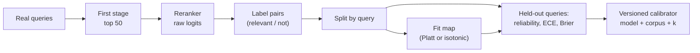

A reranker gives a passage the score 2.7. Another passage, for another question, gets 0.4. Is the first one relevant? Is it more likely to be relevant than the second? How likely? Raw retrieval scores cannot answer these questions, because they were trained to put passages in the right *order*, not to mean anything on their own. **Score calibration** is the step that turns a score into a number with a stated meaning: the probability that the passage is relevant.

This lesson explains what a calibrated score is and why rankers do not produce one, how to fit the two standard calibration maps (Platt scaling and isotonic regression) from labelled data, how to measure calibration with reliability tables, expected calibration error and the Brier score, and why per-query normalisation such as min-max scaling is not calibration. It also covers the limits: calibration is relative to the population it was fitted on, and it drifts when that population changes. The next lesson, [Retrieval thresholding](/learn/advanced-retrieval-optimisation/retrieval-thresholding), uses calibrated scores to make keep-or-drop and answer-or-abstain decisions.

## Learning objectives

- Define calibration and explain why a monotone calibration map changes what a score means but not the ranking it produces.
- Fit Platt scaling and isotonic regression to labelled reranker scores, splitting data by query, and compare them.
- Measure calibration with a reliability table, expected calibration error and the Brier score, and compute each by hand.
- Explain why per-query min-max normalisation and the sigmoid of a raw logit are not calibrated probabilities.
- Identify when a calibrator must be refitted: model changes, corpus changes, candidate-pool changes and shifts in the base rate of relevance.

## Prerequisites

- [Similarity distributions](/learn/embedding-mathematics/similarity-distributions): score distributions of relevant and irrelevant pairs, the AUC, and why raw thresholds fail.
- [Ranking scores](/learn/reranking-fundamentals/ranking-scores): what bi-encoder and cross-encoder scores are and the scales they live on.
- [Cross-encoders](/learn/reranking-fundamentals/cross-encoders): the reranker whose scores are calibrated here.
- [Weighted score fusion](/learn/hybrid-search/weighted-score-fusion): combining scores from different retrievers.

## Why this matters

Ranking needs only order. Three other jobs in a RAG pipeline need scores that *mean* something:

- **Thresholds.** "Drop passages below 0.3" or "refuse to answer if nothing scores above 0.5" only works if 0.3 and 0.5 mean the same thing for every query, every month. On a raw scale they do not.
- **Combining scores.** A dense cosine of 0.62, a BM25 score of 14.1 and a cross-encoder logit of 2.7 live on unrelated scales. If each is turned into a probability of relevance, they can be compared and combined on one scale.
- **Surviving model changes.** Swap the reranker for a better one and every raw threshold in the system is wrong, because the new model has its own scale. With a calibration layer, you refit the map for the new model and keep the threshold "probability at least 0.5" unchanged.

Without calibration, teams pick thresholds by eye from a handful of examples, as [Similarity distributions](/learn/embedding-mathematics/similarity-distributions) showed, and the thresholds break silently whenever anything upstream changes.

## The intuition

Think of a weather forecaster. Ranking is the claim "tomorrow is more likely to rain than Thursday". Calibration is the claim "on days I say 70%, it rains on about 70% of them". A forecaster can rank days perfectly and still be badly calibrated, for example by saying 99% whenever rain is merely likely. You would trust their order and ignore their numbers.

Calibrating that forecaster does not require a new forecaster. Keep a record: on all the days they said "99%", how often did it actually rain? If the answer is 70%, then their "99%" means 70%. Build a lookup from what they say to what happens, and you have turned a well-ordered but meaningless number into a probability. That lookup, learned from labelled history, is a calibration map.

## How it works

### What "calibrated" means

A score $p$ is **calibrated** if, among all query-passage pairs that receive $p \approx 0.7$, about 70% are relevant, and likewise for every other value. Formally, $P(\text{relevant} \mid p) = p$.

Three things follow:

1. Calibration is a property of scores **across many pairs**, not of one score. A single pair is relevant or not.
2. Calibration needs a **definition of relevant** (the labelling guideline) and a **population** of pairs (which queries, which candidates). Change either, and the same map may stop being calibrated.
3. Calibration and ranking quality are **separate**. A ranker can order passages perfectly and output useless numbers, or output calibrated numbers that barely separate relevant from irrelevant. Calibration fixes the numbers; it cannot improve the order.

### Why rankers are not calibrated

A cross-encoder trained for ranking produces a **logit**, an unbounded real number. The `cross-encoder/ms-marco-MiniLM-L-6-v2` model, run through the installed sentence-transformers version for the [Context recall](/learn/advanced-retrieval-optimisation/context-recall) lesson, returned values from about −11.5 to +7.5 for Meridian passages. Passing a logit through the sigmoid function $\sigma(z) = 1/(1 + e^{-z})$ squeezes it into 0 to 1, which looks like a probability, but there are several reasons it is not one for your system:

- **Training objective.** Many rerankers are trained with ranking or contrastive losses that reward correct order and are indifferent to the absolute value.
- **Training population.** A model trained on web search questions with one labelled relevant passage per question has learned a base rate of relevance unlike your candidate pool's.
- **Definition of relevance.** "Contains the answer" in the training data may differ from what your labellers call relevant.
- **Domain shift.** Meridian's policy text is not web text, and scores shift with domain.

A dense retriever's cosine similarity is even further from a probability: it is bounded between −1 and 1, but its typical values depend entirely on the model, as [Similarity distributions](/learn/embedding-mathematics/similarity-distributions) measured.

### Normalisation is not calibration

A common shortcut is to rescale scores per query, for example **min-max** normalisation, $(s - s_{\min}) / (s_{\max} - s_{\min})$ over the query's candidates, or a per-query z-score. These put scores in a fixed range, which is useful when [fusing rankings](/learn/hybrid-search/weighted-score-fusion), but they are not probabilities. Min-max always gives the top candidate 1.0 and the bottom one 0.0, whether the query has five relevant passages or none. An unanswerable question's best passage looks exactly as "certain" as an easy question's. Normalisation discards the one piece of information a threshold needs: how good the best candidate is in absolute terms.

### Calibration maps

A **calibration map** $f$ turns a raw score $s$ into a probability $p = f(s)$. It is fitted on labelled pairs $(s_j, y_j)$, where $y_j = 1$ if the pair is relevant and 0 otherwise. Two maps are standard.

**Platt scaling** fits a logistic curve to the score:

$$
p = \sigma(a s + b) = \frac{1}{1 + e^{-(a s + b)}}
$$

It has two parameters, found by logistic regression. It assumes the right shape is a sigmoid of a linear function of $s$, which often holds approximately for logits. With few labels, it is the safer choice because two parameters cannot overfit much. Platt introduced it in 1999 to turn support-vector machine outputs into probabilities. **Temperature scaling**, popular for neural classifiers, is the special case with $b = 0$ (only a scale), which for a single relevance logit is usually too restrictive.

**Isotonic regression** fits the best non-decreasing step function from score to probability. It makes no assumption about shape beyond "higher score never means lower probability", so it can fix miscalibration that a sigmoid cannot. The price is data: with few labels per region of the score range, the steps are noisy, and it tends to produce flat plateaus where different scores map to the same probability (ties), which slightly blurs ranking within a plateau.

Both are **monotone**: if $s_1 > s_2$ then $f(s_1) \geq f(s_2)$. Within one model's scores, calibration therefore preserves the ranking (exactly for Platt with $a > 0$; up to ties for isotonic). You can add it after the reranker without changing which passages are retrieved, only what their numbers mean.

### Fitting a calibrator, step by step

1. **Choose the population.** Calibrate on the pairs the scores will be applied to: if thresholds act on the reranker's top 50, collect (query, candidate) pairs from the first-stage top 50 for real queries, not random pairs from the corpus. Random pairs are almost all irrelevant and teach the map a base rate you will never see.
2. **Label.** Mark each pair relevant or not using a written guideline. Include unanswerable questions; their candidates are all negatives and are exactly what thresholds must reject.
3. **Split by query.** Pairs from one query share its difficulty, so a random split by pair leaks information and makes calibration look better than it is. Hold out whole queries (or use grouped cross-validation).
4. **Fit** Platt and isotonic maps on the calibration queries.
5. **Evaluate** on the held-out queries with a reliability table, ECE and the Brier score, defined below. Prefer Platt unless isotonic is clearly better on held-out data.
6. **Version** the map with the model, corpus and candidate settings it was fitted for, and refit when any of them changes.



### Measuring calibration

- A **reliability table** (or reliability diagram, when plotted) groups pairs into bins of predicted probability and compares each bin's mean prediction with its observed fraction of relevant pairs. A calibrated scorer has the two close in every bin.
- **Expected calibration error (ECE)** summarises the table: the bin-size-weighted average gap between prediction and observation. It depends on the binning, so report the scheme and treat small differences cautiously.
- **Brier score** is the mean squared difference between prediction and outcome. It rewards both calibration and separation, so it is a good single number for comparing maps on the same data.
- **AUC** (from the [Similarity distributions](/learn/embedding-mathematics/similarity-distributions) lesson) measures separation only. Report it alongside to confirm that calibration did not damage ranking.

### Calibration drifts

A calibrator is a summary of one population. Several changes break it:

- **Model change.** A new reranker has a new scale; refit.
- **Candidate-pool change.** Fetching the top 100 instead of the top 20 adds many low-scoring negatives, changing the base rate of relevance among candidates.
- **Corpus or traffic change.** New documents, a new team using the assistant, or a seasonal topic shifts both scores and base rates.

A base-rate shift is especially quiet. If relevant candidates become rarer, every score is less likely to be relevant than before, so the old map over-predicts everywhere. Monitor the mean predicted probability against a periodically labelled sample; a growing gap means it is time to refit.

### Calibrating several scorers

If dense, sparse and reranker scores are each calibrated to "probability relevant" on the same population, they share a scale and can be compared directly. Combining them is better done with a small logistic regression on all of them as features (a **stacked** calibrator) than by averaging their probabilities, because the scorers' errors are correlated. Keep the stacked model small (a handful of features, such as the scores and the query's top-1 margin) and fit it on held-out queries.

## The mathematics

### Platt scaling

**Intuition.** Stretch and shift the score, then squash it into 0 to 1.

$$
p = \frac{1}{1 + e^{-(a s + b)}}
$$

$s$ is the raw score, $a$ the slope (how quickly probability rises with score; $a > 0$ keeps the order), $b$ the offset (where on the score axis probability crosses 0.5, at $s = -b/a$), and $p$ the calibrated probability. $a$ and $b$ minimise the log loss on labelled pairs.

**By hand.** With $a = 0.8$, $b = -1.2$ and $s = 2.0$: $a s + b = 1.6 - 1.2 = 0.4$; $e^{-0.4} \approx 0.670$; $p = 1/1.670 \approx 0.599$. The probability crosses 0.5 at $s = 1.2/0.8 = 1.5$.

### Expected calibration error and Brier score

**Intuition.** ECE asks "how far off are the predictions, bin by bin?"; Brier asks "how far off is each prediction from what happened?"

$$
\text{ECE} = \sum_{b=1}^{B} \frac{n_b}{N} \left| \bar{y}_b - \bar{p}_b \right|, \qquad \text{Brier} = \frac{1}{N} \sum_{j=1}^{N} (p_j - y_j)^2
$$

$N$ is the number of pairs, $B$ the number of bins, $n_b$ the number of pairs in bin $b$, $\bar{p}_b$ their mean prediction and $\bar{y}_b$ their observed fraction relevant; $p_j$ and $y_j$ are pair $j$'s prediction and label (0 or 1). Both are 0 at best. ECE ignores separation (a scorer that predicts the base rate for every pair has ECE 0); Brier does not.

**By hand.** Six pairs, predictions $(0.9, 0.8, 0.7, 0.2, 0.1, 0.1)$, labels $(1, 1, 0, 0, 1, 0)$, two bins split at 0.5.

- High bin: mean prediction $0.8$, observed $2/3 \approx 0.667$, gap $0.133$, weight $3/6$.
- Low bin: mean prediction $0.133$, observed $1/3 \approx 0.333$, gap $0.2$, weight $3/6$.
- ECE $= 0.5 \times 0.133 + 0.5 \times 0.2 \approx 0.167$.
- Brier $= (0.01 + 0.04 + 0.49 + 0.04 + 0.81 + 0.01)/6 = 1.4/6 \approx 0.233$.

```python
import numpy as np

a, b, s = 0.8, -1.2, 2.0
print(f"Platt: sigmoid({a}*{s} + {b}) = {1 / (1 + np.exp(-(a * s + b))):.3f}")

p = np.array([0.9, 0.8, 0.7, 0.2, 0.1, 0.1])
y = np.array([1,   1,   0,   0,   1,   0])
high, low = p >= 0.5, p < 0.5
ece = sum(m.mean() * abs(y[m].mean() - p[m].mean()) for m in (high, low))
print(f"ECE   = {ece:.3f}")
print(f"Brier = {np.mean((p - y) ** 2):.3f}")
```

```output
Platt: sigmoid(0.8*2.0 + -1.2) = 0.599
ECE   = 0.167
Brier = 0.233
```

## In code

**The problem.** Given reranker logits for labelled (query, candidate) pairs, compare four ways of turning them into probabilities: the sigmoid of the raw logit, per-query min-max normalisation, Platt scaling and isotonic regression. Then apply the fitted map to traffic with a different base rate of relevance.

**The data is simulated**, and the text says so plainly: calibration needs thousands of labelled pairs to measure, which a toy Meridian corpus cannot supply. The simulation keeps the features that matter in practice. Each query has 20 candidates; the fraction relevant varies by query (some queries have none); each query has a difficulty offset that shifts all its scores; relevant and irrelevant logits overlap. The raw logits are deliberately too high, as a reranker trained on a different population might be.

**Dependencies.** NumPy and scikit-learn.

```bash
pip install numpy scikit-learn
```

```python
import numpy as np
from sklearn.linear_model import LogisticRegression
from sklearn.isotonic import IsotonicRegression
from sklearn.metrics import brier_score_loss, roc_auc_score

rng = np.random.default_rng(42)

def simulate(n_queries, mean_rel_rate):
    """Simulated reranker logits for 20 candidates per query."""
    rows = []
    for q in range(n_queries):
        rate = rng.beta(1.0, 1.0 / mean_rel_rate - 1.0)      # some queries have many relevant, some none
        offset = rng.normal(0.0, 1.0)                        # query difficulty shifts all its scores
        rel = rng.random(20) < rate
        logit = np.where(rel, rng.normal(3.0, 1.5, 20), rng.normal(-1.5, 2.0, 20)) + offset
        rows += [(q, l, r) for l, r in zip(logit, rel)]
    q, s, y = map(np.array, zip(*rows))
    return q, s, y.astype(int)

def ece(p, y, bins=10):
    """Expected calibration error with equal-width bins."""
    idx = np.minimum((p * bins).astype(int), bins - 1)
    total = 0.0
    for b in range(bins):
        m = idx == b
        if m.any():
            total += m.mean() * abs(y[m].mean() - p[m].mean())
    return total

def minmax_per_query(q, s):
    out = np.empty_like(s)
    for qid in np.unique(q):
        m = q == qid
        out[m] = (s[m] - s[m].min()) / (s[m].max() - s[m].min())
    return out

# Calibration split and test split are different queries.
q_cal, s_cal, y_cal = simulate(1500, 0.15)
q_test, s_test, y_test = simulate(1500, 0.15)
print(f"calibration pairs: {len(y_cal)}, relevant: {y_cal.mean():.3f}")

platt = LogisticRegression(C=1e6).fit(s_cal.reshape(-1, 1), y_cal)
iso = IsotonicRegression(out_of_bounds="clip", y_min=0.0, y_max=1.0).fit(s_cal, y_cal)
print(f"Platt: p = sigmoid({platt.coef_[0,0]:.3f} * s + {platt.intercept_[0]:.3f})")

methods = {
    "sigmoid(raw logit)": 1 / (1 + np.exp(-s_test)),
    "min-max per query":  minmax_per_query(q_test, s_test),
    "Platt scaling":      platt.predict_proba(s_test.reshape(-1, 1))[:, 1],
    "isotonic":           iso.predict(s_test),
}
print(f"\n{'method':<20}{'ECE':>8}{'Brier':>8}{'AUC':>8}")
for name, p in methods.items():
    print(f"{name:<20}{ece(p, y_test):>8.3f}{brier_score_loss(y_test, p):>8.3f}"
          f"{roc_auc_score(y_test, p):>8.3f}")

print("\nReliability on test pairs (Platt):")
p = methods["Platt scaling"]
for lo in (0.0, 0.2, 0.4, 0.6, 0.8):
    m = (p >= lo) & (p < lo + 0.2)
    print(f"  predicted {lo:.1f}-{lo+0.2:.1f}: n={m.sum():>5}  mean predicted={p[m].mean():.3f}"
          f"  observed relevant={y_test[m].mean():.3f}")

# The same calibrator on traffic with a lower base rate of relevant candidates.
q_new, s_new, y_new = simulate(1500, 0.05)
p_new = platt.predict_proba(s_new.reshape(-1, 1))[:, 1]
print(f"\nNew traffic, relevant rate {y_new.mean():.3f}: ECE={ece(p_new, y_new):.3f}"
      f"  mean predicted={p_new.mean():.3f}")
```

```output
calibration pairs: 30000, relevant: 0.154
Platt: p = sigmoid(1.045 * s + -2.606)

method                   ECE   Brier     AUC
sigmoid(raw logit)     0.234   0.155   0.942
min-max per query      0.325   0.207   0.907
Platt scaling          0.011   0.066   0.942
isotonic               0.005   0.066   0.941

Reliability on test pairs (Platt):
  predicted 0.0-0.2: n=23122  mean predicted=0.033  observed relevant=0.031
  predicted 0.2-0.4: n= 2328  mean predicted=0.289  observed relevant=0.317
  predicted 0.4-0.6: n= 1437  mean predicted=0.496  observed relevant=0.511
  predicted 0.6-0.8: n= 1383  mean predicted=0.700  observed relevant=0.659
  predicted 0.8-1.0: n= 1730  mean predicted=0.905  observed relevant=0.869

New traffic, relevant rate 0.052: ECE=0.052  mean predicted=0.104
```

**The important lines.**

- `simulate(1500, ...)` is called twice, so the calibration and test sets contain **different queries**. This is the split-by-query rule; splitting pairs at random would put candidates of one query on both sides.
- `LogisticRegression(C=1e6)` fits Platt's $a$ and $b$. A very large `C` makes regularisation negligible, which is what you want for a two-parameter map on plenty of data. With few labels, the default regularisation is a reasonable guard.
- `IsotonicRegression(out_of_bounds="clip", ...)` clips scores outside the fitted range to the end values instead of returning NaN, which matters when a new query produces a score more extreme than any in the calibration set.
- `roc_auc_score` is printed for every method to show what calibration does and does not change.

**What the output means.**

- **The sigmoid of the raw logit is badly calibrated** (ECE 0.234). The fitted Platt map, $\sigma(1.045 s - 2.606)$, says the honest probability crosses 0.5 at a logit of about $2.606 / 1.045 \approx 2.5$, not at 0. A threshold of "sigmoid at least 0.5" accepts passages at logit 0, where the calibrated probability is $\sigma(-2.606) \approx 0.07$.
- **Min-max is worse still**, and it is the only method that lowers the AUC (0.907 against 0.942). Rescaling each query separately destroys the comparison between queries: a weak query's best candidate is pushed to 1.0 alongside a strong query's.
- **Platt and isotonic both calibrate well** on held-out queries, and the AUC is unchanged (Platt) or changes in the third decimal (isotonic, through ties). Ranking is preserved; meaning is added. Isotonic's lower ECE reflects its flexibility, which it can afford here because 30,000 labelled pairs is a lot; with a few hundred, Platt is usually the safer choice.
- **The reliability table shows Platt's residual shape error.** At the top it over-predicts slightly (0.905 predicted, 0.869 observed). The query difficulty offsets make the true curve not quite logistic. This is the kind of gap isotonic regression closes.
- **The calibrator does not survive a base-rate shift.** On traffic where only about 5% of candidates are relevant, the map predicts 10.4% on average, about twice the truth, and ECE rises from 0.011 to 0.052. Nothing about the model changed; the population did.

**Errors people commonly hit.**

- Fitting the map on random corpus pairs rather than on retrieved candidates. The base rate is far too low and the map under-predicts on real candidates.
- Passing a 1-D array to `LogisticRegression.fit`. It expects a 2-D feature matrix, hence `reshape(-1, 1)`.
- Fitting isotonic regression on a few hundred pairs and trusting its steps; inspect the fitted step function and compare with Platt on held-out queries.

**Extending it.** Replace the simulated logits with real ones: run your reranker over the first-stage candidates of a few hundred labelled real queries, then fit and evaluate the same way. Add the query's top-1 margin as a second feature to the logistic regression and see whether held-out Brier improves.

## A real-world example

AskMeridian's Platform team dropped passages whose cross-encoder logit was below 0. They had chosen 0 because "sigmoid of 0 is 0.5". When they replaced the reranker with a larger model to improve ranking on IT runbooks, the share of queries that ended with no passages at all jumped overnight. The new model's logits were lower across the board; ranking was better, but the threshold now cut most relevant passages too.

Fatima, who led the investigation, pointed out that the old threshold had never meant 0.5 either. The team took 400 logged questions, retrieved the first-stage top 30 for each, and had HR and IT owners label the pairs (with a written guideline: "relevant means the passage states at least part of the answer"). They fitted a Platt map for each reranker on 300 questions and evaluated on the other 100. The old model's logit of 0 corresponded to a calibrated probability well below 0.5; the new model's map put 0.5 at a different logit altogether.

They redefined the threshold in calibrated terms ("keep passages with probability of relevance at least 0.3") and stored each map with the reranker version it belonged to. At the next reranker upgrade they refitted the map on the existing labels and checked the reliability table; the threshold itself did not change. They also added a weekly job that labels 50 sampled pairs and compares observed relevance with mean predicted probability, which caught a base-rate drift when the product documentation was added to the index.

## Common mistakes

- **Treating a sigmoid of a logit, or a cosine, as a probability.** The value is between 0 and 1, but nothing makes it a frequency of relevance on your data.
- **Using per-query normalisation as if it were calibration.** Min-max gives every query's best candidate 1.0, including unanswerable queries, and harms cross-query comparisons.
- **Splitting calibration data by pair rather than by query.** The evaluation leaks query difficulty and overstates calibration quality.
- **Calibrating on the wrong population.** Random pairs, a different candidate depth or a different corpus give a different base rate and a map that is wrong where it is used.
- **Never refitting.** A map fitted for one reranker, one corpus and one candidate depth silently goes stale when any of them changes.
- **Expecting calibration to improve ranking.** A monotone map cannot change the order; if ranking is poor, improve the ranker.

## Best practices

- Define calibrated outputs as "probability that this passage is relevant to this query, under guideline G, among the top-$k$ candidates of pipeline P", and write that sentence next to the map.
- Start with Platt scaling; use isotonic regression only when held-out reliability tables show a shape Platt cannot fit and you have thousands of labelled pairs.
- Always include unanswerable and near-miss questions in the calibration set.
- Report reliability tables, ECE (with the binning) and Brier on held-out queries, together with AUC to confirm ranking is unaffected.
- Version calibration maps with the model, corpus snapshot and candidate depth, and refit as part of every model upgrade.
- Monitor mean predicted probability against small periodic labelled samples to detect base-rate drift.

## Performance considerations

At query time calibration is nearly free: Platt is one multiply, one add and one exponential per candidate; isotonic is a binary search over its breakpoints. For 50 candidates this is microseconds, negligible beside a cross-encoder forward pass.

The real cost is labelling. With 30 candidates per question, 400 questions is 12,000 pairs to judge. At, say, 10 seconds per judgement (an assumption; it varies with passage length and domain) that is about 33 hours of expert time. Ways to reduce it:

- Label fewer candidates per question, but sample them across the whole score range rather than only the top, so every region of the map has data.
- Use an LLM judge for a first pass and have people review a stratified sample, after checking the judge's agreement with human labels (see [LLM-as-a-judge](/learn/testing-and-benchmarking/llm-as-a-judge)).
- Reuse labels: when only the reranker changes, the same labelled pairs serve to refit the map, because labels belong to (query, passage) pairs, not to a model. If the first stage changes, add labels for new candidates.

## Summary

- A calibrated score means a probability: among pairs scored 0.7, about 70% are relevant. Rankers are trained for order, so their raw scores are not calibrated.
- Platt scaling (a fitted logistic curve) and isotonic regression (a fitted monotone step function) map raw scores to probabilities while preserving ranking.
- Per-query normalisation is not calibration; it hides how good a query's best candidate is and can even damage cross-query comparisons.
- Measure calibration on held-out queries with reliability tables, ECE and Brier, and check AUC to confirm ranking is untouched.
- Calibration belongs to a population. Model, corpus, candidate-depth and base-rate changes all require a refit.

## Exercises

**1.** A Platt map has $a = 1.5$ and $b = -3$. At what raw score is the calibrated probability 0.5? What probability does a raw score of 4 receive?

<details><summary>Show solution</summary>

$p = 0.5$ when $a s + b = 0$, so $s = 3/1.5 = 2$. For $s = 4$: $a s + b = 6 - 3 = 3$, $p = 1/(1 + e^{-3}) \approx 1/1.0498 \approx 0.953$.

</details>

**2.** Two bins: 100 pairs with mean prediction 0.1, of which 20 are relevant; 50 pairs with mean prediction 0.8, of which 30 are relevant. Compute ECE. Is the scorer over- or under-confident?

<details><summary>Show solution</summary>

Low bin: observed 0.2, gap $|0.2 - 0.1| = 0.1$, weight $100/150$. High bin: observed 0.6, gap $|0.6 - 0.8| = 0.2$, weight $50/150$. ECE $= (2/3)(0.1) + (1/3)(0.2) = 0.0667 + 0.0667 \approx 0.133$. Low predictions are too low and high ones too high: the scorer is over-confident, pushing probabilities towards the extremes. A Platt map with $a < 1$ (relative to the current scale) would pull them in.

</details>

**3.** In the code, fit the Platt map on the candidates of the top 20 but apply it to a pipeline that now reranks the top 100. Without running anything, predict the direction of the miscalibration, and describe the cheapest correct fix.

<details><summary>Show solution</summary>

The extra 80 candidates per query are mostly low-scoring negatives, so the base rate of relevance among candidates falls. In regions of the score range that both populations share, the map was fitted with a higher proportion of positives, so it will **over-predict** relevance, as the base-rate experiment in the code showed. The cheapest correct fix is to label a sample of the new candidates (stratified across the score range, especially ranks 21 to 100) and refit on the combined set drawn from the top-100 population. Reusing the old labels is fine; they remain valid pairs.

</details>

**4.** Design a calibrator that combines a dense cosine, a BM25 score and a cross-encoder logit into one probability of relevance. Say what data you need, how you split it, and how you would check it is better than calibrating the cross-encoder alone.

<details><summary>Show solution</summary>

Collect labelled (query, candidate) pairs from the hybrid candidate pool, recording all three scores for each pair (missing scores, such as a BM25 score for a candidate found only by dense search, need a defined value plus an indicator feature). Split by query into fit and held-out sets. Fit a logistic regression with the three scores (and optionally the cross-encoder's per-query top-1 margin) as features. On the held-out queries, compare Brier, ECE and AUC against a Platt map on the cross-encoder logit alone. Adopt the stacked model only if held-out Brier improves clearly; correlated features add little, and each added feature is another thing that drifts.

</details>

## Check your understanding

```quiz
[
  {
    "q": "What does it mean for a relevance score to be calibrated?",
    "options": [
      "It lies between 0 and 1",
      "It ranks relevant passages above irrelevant ones",
      "Among pairs with score near p, about a fraction p are relevant",
      "It has mean 0 and standard deviation 1 within each query"
    ],
    "answer": 2,
    "why": "Calibration is agreement between predicted probability and observed frequency. Being in 0 to 1, ranking well and being standardised are all different properties."
  },
  {
    "q": "A team applies Platt scaling (with positive slope) after its reranker. What happens to the ranking of candidates for a query?",
    "options": [
      "It is unchanged, because the map is monotone increasing",
      "It improves, because probabilities are more accurate",
      "It gets worse, because information is lost",
      "It becomes random within each query"
    ],
    "answer": 0,
    "why": "A strictly increasing map preserves order. Calibration changes what scores mean, not which passages come first."
  },
  {
    "q": "Why is per-query min-max normalisation unsuitable as a basis for an 'answer or abstain' threshold?",
    "options": [
      "It is too slow to compute",
      "It always gives the best candidate of every query 1.0, including queries with no relevant candidate",
      "It changes the order of candidates within a query",
      "It only works for cosine scores"
    ],
    "answer": 1,
    "why": "Min-max rescales each query to its own range, discarding how good the best candidate is in absolute terms, which is exactly what an abstention threshold needs."
  },
  {
    "q": "Why should calibration data be split by query rather than by pair?",
    "options": [
      "Because isotonic regression requires it",
      "Because pairs cannot be shuffled",
      "Because there are more queries than pairs",
      "Because pairs from one query share its difficulty, so a pair split leaks information and overstates calibration quality"
    ],
    "answer": 3,
    "why": "Candidates of the same query are correlated. Holding out whole queries tests the map on queries it has never seen, as production will."
  },
  {
    "q": "A calibrator fitted when 15% of candidates were relevant is applied after a change that makes only 5% relevant. What is the expected effect?",
    "options": [
      "No effect; calibration depends only on the model",
      "It under-predicts relevance",
      "It over-predicts relevance and must be refitted on the new population",
      "Ranking quality falls"
    ],
    "answer": 2,
    "why": "Calibration is relative to the population. With fewer relevant candidates, each score is less likely to be relevant than the map assumes, so it over-predicts."
  }
]
```

## Further reading

- John C. Platt (1999), *Probabilistic Outputs for Support Vector Machines and Comparisons to Regularized Likelihood Methods*, in Advances in Large Margin Classifiers. The origin of Platt scaling.
- Bianca Zadrozny and Charles Elkan (2002), *Transforming Classifier Scores into Accurate Multiclass Probability Estimates*, KDD. Isotonic regression for calibration.
- Chuan Guo, Geoff Pleiss, Yu Sun and Kilian Q. Weinberger (2017), *On Calibration of Modern Neural Networks*, ICML, [arXiv:1706.04599](https://arxiv.org/abs/1706.04599). Reliability diagrams, ECE and temperature scaling for neural networks.
- [scikit-learn user guide: Probability calibration](https://scikit-learn.org/stable/modules/calibration.html). Platt (sigmoid) and isotonic calibration, calibration curves, and their trade-offs.
- Glenn W. Brier (1950), *Verification of Forecasts Expressed in Terms of Probability*, Monthly Weather Review. The Brier score.
