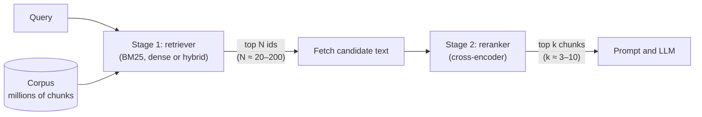

The [Reranking fundamentals](/learn/reranking-fundamentals) module introduced two kinds of scorer: a fast one that can search millions of chunks but judges each chunk crudely, and a slow one that judges carefully but can only afford to look at a handful. **Two-stage retrieval** is the architecture that puts them in sequence: a cheap first stage narrows the whole corpus to a few dozen candidates, and an expensive second stage reorders those candidates and keeps the best few for the model.

This lesson treats two-stage retrieval as a system rather than as a pair of models. It covers the contract between the stages, the recall ceiling that the first stage imposes on everything after it, how to choose the candidate depth, what to do with the first-stage scores, and how to budget latency. You will build a working pipeline, sweep its candidate depth and read off the trade-off from real measurements.

## Learning objectives

- Describe the two-stage retrieve-then-rerank architecture and state what each stage is optimised for.
- Explain why the final quality can never exceed the first stage's Recall@N, and compute that ceiling from measurements.
- Choose a candidate depth N by sweeping it against both quality and latency, and explain why quality is not always monotonic in N.
- Estimate the latency and compute cost of a second stage from the number of pairs it scores.
- Identify the operational failure modes of a two-stage pipeline (timeouts, truncation, filters applied too late) and how to guard against them.

## Prerequisites

- [Recall@K](/learn/retrieval-fundamentals/recall-k): the metric that measures the first stage.
- [Top-K retrieval](/learn/retrieval-fundamentals/top-k-retrieval): what the cut-off K does and costs.
- [Bi-encoders](/learn/reranking-fundamentals/bi-encoders) and [Cross-encoders](/learn/reranking-fundamentals/cross-encoders): the two scorer families this architecture combines.
- [Retrieval versus reranking](/learn/reranking-fundamentals/retrieval-versus-reranking): why the two jobs need different tools.
- [BM25](/learn/sparse-retrieval/bm25): the lexical scorer used as the first stage in this lesson's code.

## Why this matters

A RAG system has two conflicting demands on retrieval. It must search the whole corpus, which may hold millions of chunks, within a few tens of milliseconds. And it must put the right chunk in the handful the generator reads, because a model told to answer only from its context cannot use evidence it never sees.

No single scorer meets both demands. Scorers that can search millions of chunks quickly do so by computing a representation of each chunk once, at indexing time, and comparing it cheaply with the query at search time. That cheapness is exactly what limits their judgement: the chunk was summarised before the question was known. A [cross-encoder](/learn/reranking-fundamentals/cross-encoders) reads the query and the chunk together and judges far better, but it must run once per chunk per query. Run it over a million chunks and a single query takes minutes.

Without two stages, teams either return the first stage's top 5 and lose any chunk it ranked 7th, or put a large top K into the prompt and pay in tokens, latency and distraction. Two-stage retrieval removes the dilemma, but only if the stages are tuned together. Most disappointing two-stage pipelines fail for a system reason, not a model reason: the first stage hands over too few candidates, and the second stage cannot recover what it was never given.

## The intuition

Think of how Meridian hires. Four hundred CVs arrive for one job. Nobody interviews four hundred people. A recruiter spends thirty seconds on each CV, looking for a few signals, and produces a shortlist of fifteen. The hiring panel then spends an hour with each shortlisted candidate and picks the best two.

Three things about this process are the whole of two-stage retrieval:

- **The screen must not lose the best candidate.** If the ideal hire is rejected at the CV stage, the best interview panel in the world will not find them. The recruiter's job is not to pick the winner; it is to make sure the winner is on the list. A shortlist that is too short is the commonest way to fail.
- **The panel does the real ranking.** The interview sees things a CV cannot show. Its judgement, not the recruiter's, decides the order.
- **Shortlist length is a budget decision.** Each extra interview costs an hour. Fifteen is a balance between "do not miss anyone good" and "do not spend the whole month interviewing".

And one less obvious thing: a longer shortlist is not automatically better. Add five borderline candidates and one may interview well enough to beat the person you should have hired. The panel is good, not perfect.

## How it works

### The pipeline

A two-stage retriever runs these steps for every query:

1. **Retrieve.** The first-stage retriever scores the whole corpus (in practice, an index over it) and returns the top **N** candidates. N is the **candidate depth**, typically tens to a few hundred.
2. **Filter.** Access-control and metadata filters are applied, ideally inside the first stage so that N counts only chunks the user may see.
3. **Fetch.** The text of each candidate is loaded, because the second stage needs text, not vectors or ids.
4. **Rerank.** The second-stage model scores each (query, candidate) pair. This is N model inferences, usually sent as one or a few batches.
5. **Cut.** The candidates are sorted by the second-stage score and the top **k** are kept, with k small (often 3 to 10).
6. **Assemble.** The k chunks, in order, become the context for generation.



### Two stages, two objectives

The two stages are judged by different metrics, and confusing them is the root of most tuning mistakes.

The first stage is judged by **Recall@N**: is the answering chunk anywhere in the candidate list? Its order within the list barely matters, because the second stage will reorder everything. A first stage that puts the right chunk at position 38 out of 50 has done its job perfectly.

The second stage is judged by **precision at the top**: Precision@k, MRR or NDCG over the final k. It does not need to search; it needs to sort a short list well. Each stage is free to be bad at the other's job: BM25 is a poor judge of meaning but a fast way to collect fifty plausible chunks; a cross-encoder is too slow to search but an excellent judge of fifty.

### The recall ceiling

The second stage can only reorder what it was given. If the answering chunk is not among the N candidates, no reranker can produce it. So:

> [!KEY]
> The final hit rate at k can never exceed the first stage's Recall@N. Stage 1 sets the ceiling; stage 2 decides how close to it you get.

This gives you a diagnostic. If the final hit rate is far below Recall@N, the reranker is losing chunks it was handed (wrong domain, truncation): fix the reranker. If the two are close but both low, raise N or improve the first stage.

### Choosing the candidate depth N

N is the main tuning knob, and it pulls in two directions.

**Larger N raises the ceiling.** Recall@N never decreases as N grows. If the first stage often ranks the answering chunk 15th or 40th, only a deep list catches it.

**Larger N costs linearly.** The reranker runs once per candidate. Doubling N roughly doubles stage-2 compute and, once batches are full, its latency.

**Larger N gives the reranker more chances to be wrong.** This is the effect from the hiring analogy. Every extra candidate is a new chunk that might outscore the right one. If the reranker were perfect this would not matter; real rerankers are not, so final quality is usually a rising curve that flattens and can dip. You will see a dip in this lesson's output.

The practical procedure is a sweep: measure Recall@N and the final metric for a range of N on a labelled query set, then pick the smallest N at which the final metric stops improving, subject to the latency budget. Typical published pipelines use N between about 20 and 1,000 depending on the corpus and how expensive the reranker is; treat any specific number you read as a starting point for your own sweep, not a constant. [Candidate selection](/learn/reranking-fundamentals/candidate-selection) discusses the choice of N from the reranker's side.

### What to do with the first-stage score

After reranking, you hold two scores for each candidate. There are three common policies:

- **Discard it.** Order purely by the reranker. This is the default and the right starting point, because the reranker is the better judge.
- **Use it as a tie-breaker or fallback.** If the reranker times out or errors, return the first-stage order. This is cheap insurance.
- **Blend them.** Combine the two scores, for example a weighted sum after normalising each. This can help when the first stage carries information the reranker lacks (a BM25 exact match on a product code, a recency signal). It needs care: the scores live on unrelated scales, a problem the [Weighted score fusion](/learn/hybrid-search/weighted-score-fusion) lesson and this module's [Score calibration](/learn/advanced-retrieval-optimisation/score-calibration) lesson address. Blend only if a sweep on labelled data shows a gain.

### What the stages exchange

Stage 2 needs the **full text** of each candidate, which means a fetch from a document store if stage 1 returned only ids. The text should be in the **same form** the generator will see (with or without the title, consistently). And it must fit the reranker's **input limit**: many BERT-sized cross-encoders accept 512 tokens of query and chunk together and silently truncate the rest, so a chunk whose answer is in its last paragraph may be judged on its first.

### Where the first stage can come from

Any retriever can be stage 1. BM25 is the classic choice in the research literature: the influential 2019 paper by Nogueira and Cho reranked BM25 candidates with BERT and greatly improved on BM25 alone. Dense retrieval and [hybrid retrieval](/learn/hybrid-search/hybrid-retrieval-architecture) are the common choices in RAG systems today. The better the first stage's recall, the smaller the N you need, and the cheaper stage 2 becomes. When a first stage is itself a combination of retrievers, or when more than one reranker is chained, you have a [multi-stage pipeline](/learn/advanced-retrieval-optimisation/multi-stage-retrieval), the subject of the next lesson.

## The mathematics

### The ceiling as a product

**Intuition.** For the right chunk to reach the final k, two things must happen in sequence: stage 1 must include it among N, and stage 2 must then rank it in the top k. The chance of both is the product of the chances.

**Formula.** Over a set of queries with one answering chunk each:

$$
\text{Hit@}k_{\text{final}} = \text{Recall@}N_{\text{stage 1}} \times P(\text{stage 2 ranks it in the top } k \mid \text{it is among the } N)
$$

- $\text{Hit@}k_{\text{final}}$ is the fraction of queries whose answering chunk is in the final top k.
- $\text{Recall@}N_{\text{stage 1}}$ is the fraction of queries whose answering chunk is among the first stage's N candidates.
- The conditional probability is the reranker's success rate on the queries where it had a chance. Call it the **reranker efficiency**.

Since a probability is at most 1, the final hit rate is at most Recall@N.

**By hand.** Suppose that over 20 queries the first stage includes the answering chunk among its 20 candidates for 19 queries, and the final top 1 is correct for 15. Then $\text{Recall@}20 = 19/20 = 0.95$, $\text{Hit@}1 = 15/20 = 0.75$, and the reranker efficiency is $0.75 / 0.95 \approx 0.79$: given the chance, the reranker put the right chunk first about four times in five. Raising N cannot lift the result above 0.95; improving the reranker could lift it to 0.95 at most.

### Stage-2 cost

**Intuition.** A cross-encoder's work is proportional to the number of pairs times the tokens in each pair.

**Formula.** Ignoring batching overheads,

$$
T_2 \approx \frac{N \cdot t_{\text{pair}}}{P}
$$

where $T_2$ is the stage-2 latency, $N$ the candidate depth, $t_{\text{pair}}$ the time to score one pair on one worker, and $P$ the number of pairs processed in parallel (batch parallelism on a GPU, or several CPU workers).

**By hand.** Assume (an assumption, not a benchmark) that one pair takes 2 ms on your hardware and you can process 16 pairs in parallel. For $N = 50$: $T_2 \approx 50 \times 2 / 16 \approx 6$ ms. For $N = 400$: $T_2 \approx 400 \times 2 / 16 = 50$ ms. Longer chunks raise $t_{\text{pair}}$.

```python
recall_n, hit_k = 19 / 20, 15 / 20
print(f"reranker efficiency = {hit_k / recall_n:.2f}")
t_pair_ms, parallel = 2.0, 16           # assumptions, not measurements
for n in (50, 100, 400):
    print(f"N={n:>3}: stage-2 latency ~ {n * t_pair_ms / parallel:.1f} ms")
```

```output
reranker efficiency = 0.79
N= 50: stage-2 latency ~ 6.2 ms
N=100: stage-2 latency ~ 12.5 ms
N=400: stage-2 latency ~ 50.0 ms
```

## In code

**The problem.** Build a working two-stage retriever over a small Meridian corpus and answer the question every team must answer: how deep should the first stage go? The script sweeps N and reports, for each value, the first stage's Recall@N, the final hit rate at k = 1, and the time each stage takes.

The first stage is BM25 with deliberately naive tokenisation (no stemming, no stop-word removal). That makes its vocabulary-mismatch failures easy to see, which is exactly the situation in which a second stage earns its keep. The second stage is the small `cross-encoder/ms-marco-MiniLM-L-6-v2` model, a cross-encoder trained on MS MARCO web search data.

**Install:**

```bash
pip install rank-bm25 sentence-transformers numpy
```

The cross-encoder (about 90 MB) downloads from Hugging Face on first use.

```python
import re
import time

import numpy as np
from rank_bm25 import BM25Okapi
from sentence_transformers import CrossEncoder

CHUNKS = {
    "leave-days":   "Full-time employees receive 25 days of annual leave per year.",
    "leave-carry":  "Up to 5 unused leave days carry over and must be used by 31 March.",
    "leave-book":   "Book annual leave in the HR portal at least two weeks in advance.",
    "sick":         "If you are ill, tell your manager before 10:00 on the first day of absence.",
    "remote-days":  "Staff may work remotely up to 3 days a week with their manager's agreement.",
    "equip":        "Employees can claim a home-office equipment budget of £400.",
    "equip-contr":  "Contractors are not eligible for the home-office equipment budget.",
    "equip-2023":   "Superseded 2023 handbook: the home-office equipment budget was £250.",
    "exp-deadline": "Expense claims must be submitted within 30 days of the purchase.",
    "exp-receipt":  "Any expense over £75 needs a receipt attached to the claim.",
    "exp-owner":    "Expenses are handled by the finance department.",
    "pw-rotate":    "Passwords must be rotated every 90 days.",
    "pw-length":    "Passwords need at least 14 characters and may not reuse your last 5.",
    "vpn":          "Connect to the VPN whenever you use public Wi-Fi.",
    "laptop-cycle": "Laptops are refreshed every 3 years.",
    "laptop-lost":  "Report a lost or stolen laptop to the support desk at once.",
    "desk-hours":   "The support desk is open 08:00 to 18:00 UK time.",
    "desk-2023":    "Superseded 2023 handbook: support desk hours were 09:00 to 17:00.",
    "reports-exp":  "Meridian Reports can export dashboards as PDF or CSV.",
    "reports-sso":  "Meridian Reports supports SAML single sign-on on the Enterprise plan.",
    "sync":         "Meridian Sync keeps project files in step across devices.",
    "relay":        "Meridian Relay forwards webhook events to customer endpoints.",
}
QUERIES = [  # (query, id of the chunk that answers it)
    ("how much holiday do I get each year", "leave-days"),
    ("what's the deadline to use carried over leave", "leave-carry"),
    ("how far ahead should I request time off", "leave-book"),
    ("I'm off sick today, who do I tell and by when", "sick"),
    ("can I work from home on Fridays", "remote-days"),
    ("I want to buy a monitor for working at home", "equip"),
    ("I'm a contractor, can I get money for a desk chair", "equip-contr"),
    ("how long do I have to claim back a train ticket", "exp-deadline"),
    ("do I need to keep the till slip for a £90 taxi", "exp-receipt"),
    ("who pays for my expenses", "exp-owner"),
    ("how often must I change my password", "pw-rotate"),
    ("what are the rules for a new password", "pw-length"),
    ("working from a café, what should I do about security", "vpn"),
    ("when will I get a new laptop", "laptop-cycle"),
    ("someone stole my work computer", "laptop-lost"),
    ("what time does IT support close", "desk-hours"),
    ("can I download a report as a spreadsheet", "reports-exp"),
    ("does Reports work with our Okta login", "reports-sso"),
    ("files out of date on my second machine", "sync"),
    ("how do webhooks reach customers", "relay"),
]

ids = list(CHUNKS)
texts = [CHUNKS[i] for i in ids]

def tokenise(s):
    return re.findall(r"[a-z0-9£]+", s.lower())

bm25 = BM25Okapi([tokenise(t) for t in texts])
reranker = CrossEncoder("cross-encoder/ms-marco-MiniLM-L-6-v2")
reranker.predict([("warm-up", "warm-up")])  # first call is slow; keep it out of the timings

def retrieve(query, n):
    """Stage 1: BM25 over the whole corpus, keep the top n indices."""
    scores = bm25.get_scores(tokenise(query))
    return list(np.argsort(-scores, kind="stable")[:n])

def rerank(query, candidates, k):
    """Stage 2: the cross-encoder reads each (query, chunk) pair."""
    scores = reranker.predict([(query, texts[i]) for i in candidates])
    order = np.argsort(-scores, kind="stable")[:k]
    return [candidates[j] for j in order]

def evaluate(n, k=1):
    recall_n = hits_k = 0
    t_retrieve = t_rerank = 0.0
    for query, gold in QUERIES:
        g = ids.index(gold)
        t0 = time.perf_counter()
        cands = retrieve(query, n)
        t1 = time.perf_counter()
        final = rerank(query, cands, k)
        t2 = time.perf_counter()
        recall_n += g in cands
        hits_k += g in final
        t_retrieve += t1 - t0
        t_rerank += t2 - t1
    q = len(QUERIES)
    return recall_n / q, hits_k / q, 1000 * t_retrieve / q, 1000 * t_rerank / q

base = np.mean([ids.index(g) in retrieve(q, 1) for q, g in QUERIES])
print(f"BM25 alone, hit@1 = {base:.2f}\n")
print(" N  | stage-1 recall@N | hit@1 after rerank | ms/query stage 1 | stage 2")
for n in (1, 3, 5, 10, 20):
    r, h, t1, t2 = evaluate(n)
    print(f"{n:>3} | {r:>16.2f} | {h:>18.2f} | {t1:>16.2f} | {t2:>7.1f}")
```

Output (run on a laptop CPU; your timings will differ, the quality columns will not):

```output
BM25 alone, hit@1 = 0.25

 N  | stage-1 recall@N | hit@1 after rerank | ms/query stage 1 | stage 2
  1 |             0.25 |               0.25 |             0.08 |     7.1
  3 |             0.55 |               0.50 |             0.08 |    11.2
  5 |             0.70 |               0.65 |             0.08 |    10.5
 10 |             0.70 |               0.60 |             0.08 |    14.8
 20 |             0.95 |               0.75 |             0.08 |    14.0
```

**The important lines.**

- `retrieve` and `rerank` are the two stages, and the only thing they share is a list of indices. That narrow interface is deliberate: either stage can be replaced without touching the other.
- `kind="stable"` makes ties sort in corpus order. BM25 gives a score of exactly 0 to every chunk sharing no term with the query, so ties are common; a stable sort makes the output reproducible.
- `reranker.predict` scores a list of (query, text) pairs in batches (32 by default) and returns raw logits, useful only for ordering.
- `evaluate` records Recall@N and the final hit together, which is what lets you separate first-stage misses from reranker mistakes.

**What the output means.**

- **Reranking multiplies BM25's quality.** BM25 alone puts the right chunk first for 25% of queries; with 20 candidates reranked, 75%.
- **The ceiling holds in every row.** The hit rate after reranking never exceeds Recall@N. At N = 1 there is nothing to reorder, so reranking changes nothing.
- **Quality dipped from N = 5 to N = 10.** Recall did not change, but one query got worse: for "how far ahead should I request time off", the chunk "Expense claims must be submitted within 30 days of the purchase" enters the list at depth 10, and the cross-encoder prefers it to the leave-booking chunk. This is the "more chances to be wrong" effect, observed rather than theorised.
- **The gap at N = 20 is reranker error.** Recall@20 is 0.95 but the final hit rate is 0.75: the reranker misplaced three of the 19 chunks it was handed (efficiency 0.79, as computed in the mathematics section). For instance, it ranks the remote-working chunk above the VPN chunk for the café question. That points at the reranker, not at N.
- **Stage 1 is almost free; stage 2 is the cost.** On a corpus this small, batch overhead dominates and the growth with N is uneven.

One caution: with 22 chunks, N = 20 is nearly the whole corpus, and several answering chunks enter only because BM25 gave them the same zero score as most others. In a corpus of millions, a chunk with no lexical overlap would never reach the top 20. Vocabulary mismatch is better fixed in stage 1, with dense or hybrid retrieval, than left to stage 2.

**Common errors.**

- Calling `reranker.predict` one pair at a time in a loop. It works but loses batching; pass all N pairs at once.
- Comparing scores across queries. Cross-encoder logits are not calibrated.
- Timing the first call, which includes one-off work; warm the model up first.

**Extending it.** Replace BM25 with a dense retriever (exercise 3), add MRR at k = 3 as the final metric, and add a timeout that falls back to the stage-1 order.

## A real-world example

The Platform team at Meridian runs AskMeridian over the employee handbook and IT runbooks, about 40,000 chunks in a Qdrant cluster, with dense retrieval returning the top 5 straight into the prompt. Support tickets complained that obvious questions ("my laptop was nicked on the train, what now?") got unhelpful answers.

An engineer added a cross-encoder reranker, but kept the existing retriever call unchanged: it still returned 5 chunks, which were now reordered and passed on. Offline evaluation on 300 labelled questions showed almost no improvement. The reason was the ceiling: the reranker was reordering the same 5 chunks, so it could change which chunk came first but not which chunks were present. Questions failing because the answering chunk was at rank 9 were still failing.

The team then measured the first stage on its own and plotted Recall@N for N from 5 to 200. Recall rose steeply up to about N = 50 and then flattened. They set N = 50 and k = 5, and re-ran the evaluation, which now improved clearly. They also checked the efficiency (final hit rate divided by Recall@50) by document type and found it much lower on runbooks than on the handbook. The runbook chunks were long, and their answers were often past the cross-encoder's 512-token input limit. Splitting runbook steps into smaller chunks fixed most of it.

Finally, they added a stage-2 timeout: if the reranker does not answer in time, AskMeridian uses the dense order, so a reranker outage degrades answers instead of failing requests.

## Common mistakes

- **Reranking only the final k.** The set of chunks is unchanged; only their order in the prompt moves.
- **Tuning N without measuring Recall@N.** You cannot tell a missing candidate from a reranker error, and you tune the wrong stage.
- **Assuming more candidates is always better.** Past the point where recall flattens, extra candidates add cost and give the reranker more chances to be wrong.
- **Filtering after reranking.** It wastes reranker work, can leave fewer than k chunks, and may expose restricted text to a hosted reranker.
- **Ignoring truncation.** Over-long chunks are cut silently, so the reranker judges different text from what the generator reads.
- **Mismatched domains.** A reranker trained on web search may misjudge internal jargon. Measure on your own data.

## Best practices

- Measure both stages separately on a labelled query set: Recall@N for stage 1, the final metric at k for stage 2, and their ratio as reranker efficiency.
- Choose N with a sweep: the smallest N past which the final metric stops improving, within the latency budget.
- Push filters into stage 1 so that N counts only eligible chunks.
- Rerank exactly the text the generator will see, within the reranker's input limit.
- Send all candidates in one batched call, set a timeout, and fall back to the stage-1 order on failure.
- Log the stage-1 and stage-2 rank of every returned chunk; large jumps are the most useful debugging traces.

## Performance considerations

Stage 1 cost depends on the index (an inverted index or an approximate nearest-neighbour index) and barely depends on N, because the index produces the top N in one pass. Stage 2 cost is almost entirely $N \times$ pair cost.

A worked budget. Suppose the end-to-end retrieval budget is 150 ms, stage 1 takes 20 ms, fetching candidate text from a document store takes 10 ms, and your reranker scores a batch of 32 pairs in 40 ms on your serving hardware (assumptions to replace with your own measurements). Then you have 120 ms for stage 2, which is three batches, so N can be at most 96. If your recall curve flattens at N = 50, two batches suffice and you have headroom. If it flattens at N = 200, you either need a faster reranker, more parallel hardware, or a [multi-stage cascade](/learn/advanced-retrieval-optimisation/multi-stage-retrieval) that puts a cheaper reranker in between.

Tokens matter as much as pair count: 50 candidates of 400 tokens cost several times more than 50 of 100 tokens. Hosted rerankers bill per search or per unit of text; check your provider's current pricing page.

## Security considerations

The candidate list is where access control must already have been applied. If restricted chunks reach stage 2 and are filtered afterwards, their text has been processed by the reranker, which may be a third-party API. Treat a hosted reranker as a data processor that receives your document text and the user's query, and apply the same data-handling rules as for the generator.

Retrieved text is untrusted, and text written to resemble likely questions can climb a cross-encoder's ranking just as it can a first-stage scorer's. Reranking improves relevance, not trustworthiness; see [Retrieval manipulation](/learn/rag-security-fundamentals/retrieval-manipulation).

## Summary

- Two-stage retrieval runs a cheap, high-recall retriever over the whole corpus to get N candidates, then an expensive, precise reranker over those N to keep the top k.
- Stage 1 is judged by Recall@N, stage 2 by precision at the top. Each stage may be poor at the other's job.
- Final quality can never exceed the first stage's Recall@N; the ratio between them measures the reranker's efficiency and tells you which stage to fix.
- N trades recall against cost and against the reranker's chances to err; choose it by sweeping on labelled data, not by default.
- Filters belong in stage 1, reranked text must match generated-from text, and a timeout with a stage-1 fallback keeps the system available.

## Exercises

**1.** A first stage has Recall@30 = 0.88 on your evaluation set, and the final hit rate at k = 5 after reranking is 0.80. What is the reranker's efficiency, and what is the best final hit rate you could reach by improving only the reranker?

<details><summary>Show solution</summary>

Efficiency is $0.80 / 0.88 \approx 0.91$. Improving only the reranker can raise the final hit rate to the ceiling, 0.88, and no higher. To go beyond 0.88 you must raise Recall@N, by increasing N or improving the first stage.

</details>

**2.** In the code's output, the hit rate at N = 10 is lower than at N = 5 although Recall@N is the same. Explain the mechanism in two sentences, and say what you would do if this happened on a large evaluation set.

<details><summary>Show solution</summary>

Raising N added candidates without adding any new answering chunk, and one of the new candidates (the expense-deadline chunk) received a higher reranker score than the correct leave-booking chunk. On a large set, a dip like this means the extra depth only adds distractors in that range; I would pick N at the point where the final metric peaks or plateaus, and inspect the queries that got worse to see whether the reranker has a systematic weakness (for example, matching "how far ahead" with "within 30 days").

</details>

**3.** Modify the script so that stage 1 is a dense retriever using `all-MiniLM-L6-v2`, and print the same table. Compare the BM25 and dense first stages: which has the higher Recall@5, and how much does reranking add to each?

<details><summary>Show solution</summary>

Replace the BM25 parts with an embedding search:

```python
from sentence_transformers import SentenceTransformer

encoder = SentenceTransformer("sentence-transformers/all-MiniLM-L6-v2")
doc_vecs = encoder.encode(texts, normalize_embeddings=True)

def retrieve(query, n):
    q = encoder.encode([query], normalize_embeddings=True)[0]
    return list(np.argsort(-(doc_vecs @ q), kind="stable")[:n])
```

Everything else is unchanged (the first line of output still says "BM25 alone" but now measures the dense retriever). On this corpus the dense retriever puts the right chunk first for 0.85 of queries and reaches Recall@3 = 1.00, against BM25's 0.25 and 0.55, because it is not defeated by synonyms such as "holiday" and "annual leave". Reranking adds nothing here: the hit rate stays at 0.85 up to N = 5 and drops to 0.80 at N = 10, because the cross-encoder overrules a correct dense ranking. The general lesson: the reranking gain depends on how good the first stage already is, and a small general-purpose reranker can hurt a strong first stage. Measure; do not assume.

</details>

**4.** Design decision. Your retrieval budget is 120 ms. Stage 1 takes 25 ms and the fetch takes 15 ms. Your reranker processes 16 pairs per batch in 30 ms, and batches run one after another. Your Recall@N curve is 0.71 at N = 16, 0.86 at N = 32, 0.90 at N = 48 and 0.93 at N = 96. Which N do you choose, and what would you change if product insists on reaching 0.93?

<details><summary>Show solution</summary>

The stage-2 budget is $120 - 25 - 15 = 80$ ms, which allows two batches of 16 (60 ms) but not three (90 ms). So N = 32, with a ceiling of 0.86. To reach the 0.93 ceiling at N = 96 you need six batches: either run batches in parallel (more or larger hardware, so six batches fit in about one batch's time), use a faster reranker, or add an intermediate stage that cheaply cuts 96 candidates to 32 before the expensive reranker. The last option is a multi-stage cascade.

</details>

## Check your understanding

```quiz
[
  {"q": "In a two-stage pipeline, which metric best describes the first stage's job?", "options": ["Precision@k of the final list", "Recall@N of the candidate list", "MRR of the candidate list", "Latency of the reranker"], "answer": 1, "why": "Stage 1 only needs to include the answering chunks somewhere in its N candidates; the reranker decides their order."},
  {"q": "Stage 1 has Recall@50 = 0.80. A new reranker is three times better than the old one. What is the highest final hit rate it can achieve with N = 50?", "options": ["0.80", "1.00", "2.40", "It depends on k only"], "answer": 0, "why": "The reranker can only reorder the 50 candidates it receives, so the final hit rate is capped at stage 1's Recall@50."},
  {"q": "An engineer adds a reranker but leaves the retriever returning k = 5 chunks, which are reranked and all 5 passed to the prompt. Why does answer quality barely change?", "options": ["Cross-encoders cannot score five pairs", "The same five chunks reach the prompt, only in a different order", "The reranker needs a GPU to work", "BM25 scores must be normalised first"], "answer": 1, "why": "With N equal to k, reranking cannot add any chunk that stage 1 missed; it only reorders the same set."},
  {"q": "Raising N from 20 to 40 leaves Recall@N unchanged but lowers the final hit rate. What is the most likely cause?", "options": ["The first stage became less accurate", "The new candidates include distractors that the reranker scores above the right chunk", "The reranker ran out of memory", "Recall@N is computed incorrectly"], "answer": 1, "why": "Extra candidates that add no relevant chunks only add chances for an imperfect reranker to prefer a wrong one."},
  {"q": "Where should access-control filters be applied in a two-stage pipeline?", "options": ["After reranking, on the final k", "In or before stage 1, so N counts only permitted chunks", "Inside the LLM prompt", "Filters are unnecessary if the reranker is accurate"], "answer": 1, "why": "Filtering early avoids wasting reranker work, keeps the final list full, and keeps restricted text away from the reranker."}
]
```

## Further reading

- Nogueira, R. and Cho, K. (2019). *Passage Re-ranking with BERT*. [arXiv:1901.04085](https://arxiv.org/abs/1901.04085). The paper that established BM25 retrieval plus BERT cross-encoder reranking.
- Lin, J., Nogueira, R. and Yates, A. (2021). *Pretrained Transformers for Text Ranking: BERT and Beyond*. [arXiv:2010.06467](https://arxiv.org/abs/2010.06467). A book-length survey; its chapters on multi-stage ranking architectures cover this lesson in depth.
- Sentence Transformers documentation, the "Retrieve & Re-Rank" example and the CrossEncoder API: [sbert.net](https://www.sbert.net/).
- Manning, C. D., Raghavan, P. and Schütze, H. (2008). *Introduction to Information Retrieval*, chapter 7, "Computing scores in a complete search system", on inexact top-K retrieval and tiered scoring.
