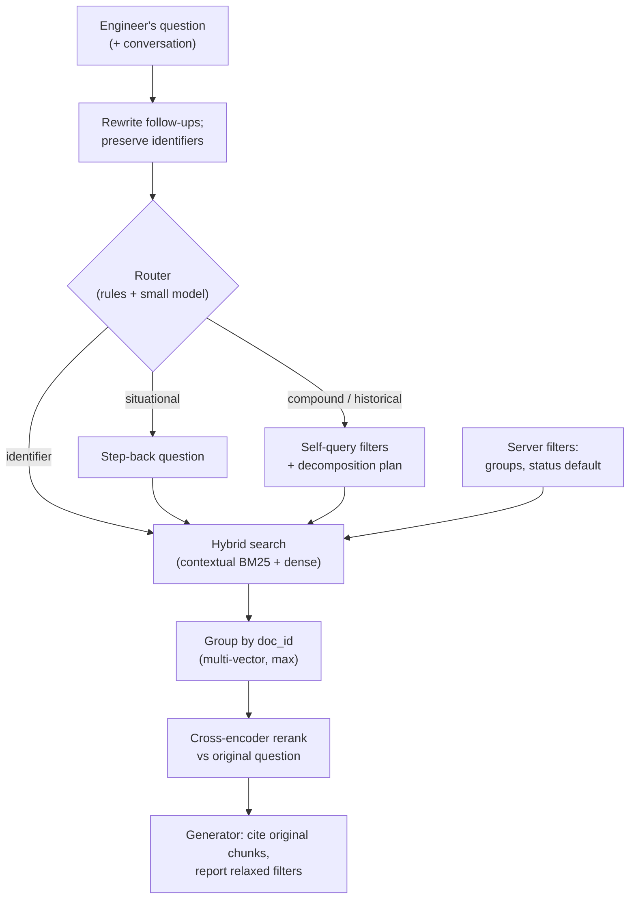

This assessment covers all ten lessons of **Advanced Retrieval**: metadata-aware retrieval, filtered retrieval, multi-query retrieval, query decomposition, query rewriting, step-back prompting, HyDE, self-query retrieval, contextual retrieval and multi-vector retrieval. Answer the 18 multiple-choice questions first; the pass mark is 70% (13 of 18). Then work through the conceptual questions, the coding exercises, the design challenge and the troubleshooting scenarios, writing your own answer before opening the model answer. The written parts are not scored, but they test whether you can choose and combine these techniques for a real system rather than recognise them in a list. Any latencies, token counts or prices are assumptions for arithmetic practice.

```quiz
[
  {"q": "A chunk from the superseded 2023 handbook and its 2025 replacement are near-paraphrases. Which mechanism reliably returns only the current one?", "options": ["A larger top-k", "HyDE with three hypothetical passages", "A metadata constraint such as status = current, applied in the retrieval call", "A better embedding model"], "answer": 2, "why": "Eligibility (version, scope, permission) is a constraint on which documents may be returned; similarity cannot express it reliably."},
  {"q": "Which filters must come only from the authenticated session and never be relaxed?", "options": ["Security filters such as tenant and permission groups", "Scope filters such as product", "Inferred filters such as year", "Policy defaults such as status = current"], "answer": 0, "why": "Security filters are not preferences. If a model, a user or a relaxation ladder could change them, restricted documents could leak."},
  {"q": "A filtered query returns nothing. A count query shows that 0 documents match the filter at all. What does that tell you?", "options": ["The embedding model failed", "The filter is empty: relaxing scope or inferred conditions (and telling the generator) is appropriate", "The relevance floor is too high", "The index is corrupt"], "answer": 1, "why": "Distinguishing an empty filter from irrelevant results decides the right response: relaxation for the first, an honest 'not found' for the second."},
  {"q": "Multi-query retrieval with paraphrase variants is usually merged with RRF. Why does that suit paraphrases?", "options": ["RRF is the only merge that removes duplicates", "RRF uses raw cosine scores", "RRF guarantees each variant one slot", "Paraphrases should agree, and RRF rewards documents that several variants rank highly"], "answer": 3, "why": "Consensus across rephrasings is evidence of relevance; round-robin suits perspective variants, which are meant to differ."},
  {"q": "What does this code print?\n```python\nscores = {}\nfor ranking in [[\"a\", \"b\"], [\"b\", \"c\"]]:\n    for r, d in enumerate(ranking, start=1):\n        scores[d] = scores.get(d, 0) + 1 / (60 + r)\nprint(max(scores, key=scores.get))\n```", "options": ["a", "b", "c", "It raises a KeyError"], "answer": 1, "why": "b appears in both lists (1/62 + 1/61), beating a (1/61) and c (1/62)."},
  {"q": "'Which Meridian product has the error code catalogue, and what does E-4021 mean in it?' Which technique fits best?", "options": ["Query decomposition into a chain whose second step uses the first step's answer", "Step-back prompting", "HyDE", "Contextual retrieval"], "answer": 0, "why": "It is a multi-hop question: the product must be identified before the specific code can be looked up in its documents."},
  {"q": "In a conversational assistant, the follow-up 'and for contractors?' retrieves nothing useful. What is the standard fix?", "options": ["Increase top-k", "Use HyDE", "Rewrite the follow-up into a standalone query using the conversation history", "Add a recency boost"], "answer": 2, "why": "Follow-ups depend on earlier turns; a rewriter makes them standalone ('Are contractors eligible for the home-office equipment budget?')."},
  {"q": "A query rewriter turns 'fix E-4021 Atlas' into 'how to resolve Atlas client errors'. What has gone wrong?", "options": ["Nothing; the rewrite is more general", "Negation loss", "Over-specification", "Identifier loss: the exact code that identified the right page was dropped"], "answer": 3, "why": "Rewriters must preserve exact identifiers; validation should reject rewrites that drop codes present in the original."},
  {"q": "What is the defining move of step-back prompting?", "options": ["Generating a more general question about the governing principle, and retrieving for it as well as the original", "Splitting a question into narrower sub-questions", "Writing a hypothetical answer passage", "Removing filter words from the query"], "answer": 0, "why": "Step-back abstracts upwards; decomposition goes down into parts, and HyDE moves towards the answer's form."},
  {"q": "For which question is step-back prompting most likely to help?", "options": ["What does Relay error R-310 mean?", "I'm at a conference using the hall's open Wi-Fi; anything I must do before opening internal tools?", "Does Reports support SAML SSO?", "How many days of annual leave do I get?"], "answer": 1, "why": "Situational questions full of particulars (conference, hall, open Wi-Fi) pull towards distractors; the step-back question finds the VPN rule."},
  {"q": "In HyDE, why is it acceptable that a hypothetical passage contains wrong facts?", "options": ["The generator corrects them", "Embedding models ignore all numbers", "Wrong facts are removed by RRF", "It is used only to produce a search vector and is never shown to the generator"], "answer": 3, "why": "The passage influences which real documents are retrieved, and embeddings capture topic more strongly than specific values; but distinctive wrong details can still mislead, which is why the query stays in the average."},
  {"q": "With unit vectors and dot-product scoring, a HyDE vector built as the mean of the query and two passage embeddings ranks documents by what?", "options": ["The maximum cosine to any of the three", "The cosine to the query only", "The average of each document's cosines to the three vectors", "The sum of ranks"], "answer": 2, "why": "The dot product is linear, so the mean vector's score is the mean of the individual scores; normalising afterwards divides all scores by the same constant."},
  {"q": "A self-query model returns product = 'Meridian Reports' but the allowed value is 'Reports'. What is the safest correct behaviour?", "options": ["Repair it with an explicit synonym table, or drop the condition and record it; never send it unchecked", "Send it to the database unchanged", "Fuzzy-match it to the closest allowed value of any field", "Fail the whole request"], "answer": 0, "why": "Unvalidated values silently match nothing; a curated synonym table repairs known variants without guessing."},
  {"q": "Why does self-query retrieval remove words such as '2023 handbook' from the semantic query?", "options": ["Vector databases reject numbers", "The filter already enforces them exactly, and leaving them in adds noise to the embedding", "To save embedding cost", "Because embedding models cannot represent years"], "answer": 1, "why": "Structural words belong in the filter; in the vector they only dilute the semantic match."},
  {"q": "Contextual retrieval often improves BM25 more than dense retrieval. Why?", "options": ["BM25 indexes are smaller", "Dense models read the whole document anyway", "The context replaces the chunk text in the dense index only", "BM25 matches only literal terms, so adding identifiers and names that the chunk lacks turns zero scores into matches"], "answer": 3, "why": "A fix chunk without 'E-4021' scores nothing for that term in BM25; the generated context supplies the literal term."},
  {"q": "A document of 10,000 tokens has 25 chunks. Without caching, how many document tokens are sent as input in total during contextualisation?", "options": ["10,000", "35,000", "250,000", "25,000"], "answer": 2, "why": "Each of the 25 prompts contains the whole document: 25 x 10,000 = 250,000. Caching makes all but the first a discounted read."},
  {"q": "A document's five vectors score 0.80, 0.30, 0.25, 0.20, 0.20 against a query; another's two vectors score 0.50 and 0.48. Which wins under max, and which under mean?", "options": ["First under both", "Second under both", "First under max, second under mean", "Second under max, first under mean"], "answer": 2, "why": "Max: 0.80 against 0.50. Mean: 1.75 / 5 = 0.35 against 0.49. Mean penalises the multi-topic document."},
  {"q": "In multi-vector retrieval, what does the generator receive when a generated question vector is the best match?", "options": ["The generated question", "The summary and the question", "The stored document, fetched by its doc_id", "Nothing; generated vectors are only used for reranking"], "answer": 2, "why": "Generated representations are retrieval aids; the answer and its citations come from the real document."}
]
```

## Conceptual questions

1. Four techniques in this module put a model call in front of retrieval: query rewriting, multi-query retrieval, step-back prompting and HyDE. For each, say what the model produces, which query problem it targets, and one query type for which it should be skipped.

<details><summary>Show model answer</summary>

- **Query rewriting** produces one better query: standalone, in the corpus's vocabulary, identifiers preserved. It targets conversational follow-ups, shorthand and filler. Skip it for queries that are already well-formed standalone searches, especially exact-identifier lookups where any change is a risk.
- **Multi-query retrieval** produces several variants, searched separately and merged. It targets wording mismatch (paraphrases) and questions with several aspects (perspectives). Skip it for short, unambiguous lookups where every variant returns the same results.
- **Step-back prompting** produces a more general question about the governing principle, retrieved alongside the original. It targets situational questions whose particulars pull towards distractors. Skip it for identifier lookups and already-general questions.
- **HyDE** produces a hypothetical answer passage whose embedding (averaged with the query's) is used for the search. It targets short, informal or jargon-heavy queries far from the documents' style. Skip it for identifier lookups, where hallucinated codes pull retrieval to the wrong page, and for questions about content the model knows nothing about.

All four share the costs (a model call on the critical path, except where it can overlap a first retrieval) and the safeguards: keep the original query, preserve identifiers, gate by query type, and measure per category.

</details>

2. Contextual retrieval, multi-vector retrieval and HyDE all use generated text to improve matching. Compare them by *when* the text is generated, *which side* (query or document) it represents, and what happens to it after retrieval.

<details><summary>Show model answer</summary>

| | When generated | Represents | After retrieval |
| --- | --- | --- | --- |
| HyDE | Query time, per query | The query side: an imagined answer | Discarded; never shown to the generator |
| Contextual retrieval | Indexing time, per chunk | The document side: the chunk situated in its document | Stays in the index text; the original chunk is cited |
| Multi-vector (questions, summaries) | Indexing time, per document | The document side: extra handles on the document | Points only lead back to the stored document, which is what is used |

The timing drives the cost profile: HyDE adds latency and cost to every routed query; the indexing-time methods add none at query time but must be regenerated whenever documents change. In every case, generated text is a retrieval aid and must never be presented as source content.

</details>

3. Explain why "status = current" should usually be a default constraint with an override rather than a ranking boost, and how the override is triggered safely.

<details><summary>Show model answer</summary>

Superseded and current versions of the same policy are often near-paraphrases, so their similarity scores are almost equal. A boost has to be large enough to beat any similarity difference, at which point it acts like a constraint anyway, but with a failure mode: on some query the superseded chunk is similar enough to win, and the answer quotes the old rule. A constraint excludes it completely. The override exists because some users do want history ("what did the 2023 handbook say?"). It is triggered by an explicit signal in the question, detected by a self-query model or rules, and validated: the model may set `status = superseded` or a `year`, which then replaces the default. The override only widens a policy default; it never touches security filters, and the generator is told which version it is reading.

</details>

4. Query decomposition with a sequential chain has worse latency and reliability properties than fan-out decomposition. Explain both with arithmetic, and say how to limit the damage.

<details><summary>Show model answer</summary>

Latency in a chain grows with its depth, because each step waits for the previous answer: three steps of (retrieval plus a model call), at an assumed 1.5 seconds each, is about 4.5 seconds, whereas a fan-out of three independent sub-questions runs concurrently in about the time of one. Reliability multiplies: if each step independently gets the right intermediate answer with probability 0.9, a three-step chain is right about 0.9 cubed, or 0.73, of the time, while fan-out errors stay independent per sub-question. To limit the damage: decompose only when the question needs it, keep chains to two or three steps, validate each intermediate answer (does it come from a retrieved document? is it the expected type?), carry the original question through to the final generation, and fall back to a single retrieval when a step fails.

</details>

## Coding exercises

### Exercise 1: fuse query variants and aggregate multi-vector hits

Write two functions. `rrf(rankings, k=60)` fuses several ranked lists of document IDs with Reciprocal Rank Fusion, breaking ties alphabetically. `multi_vector_max(hits)` takes `(doc_id, kind, cosine)` tuples and returns documents ranked by their best vector, recording which kind of representation won. Test them on the rankings for the original, step-back and paraphrased versions of the Lisbon-hotel question, and on a set of multi-vector hits.

<details><summary>Show solution</summary>

```python
def rrf(rankings, k=60):
    scores = {}
    for ranking in rankings:
        for rank, doc in enumerate(ranking, start=1):
            scores[doc] = scores.get(doc, 0.0) + 1.0 / (k + rank)
    return sorted(scores.items(), key=lambda item: (-item[1], item[0]))

def multi_vector_max(hits):
    """hits: (doc_id, kind, cosine) for every matched vector. Max per document."""
    best = {}
    for doc_id, kind, score in hits:
        if score > best.get(doc_id, (-1.0, ""))[0]:
            best[doc_id] = (score, kind)
    return sorted(best.items(), key=lambda item: -item[1][0])

original  = ["guestwifi", "finance", "vpn"]
step_back = ["vpn", "remote", "guestwifi"]
paraphrase = ["vpn", "guestwifi", "password"]
for doc, score in rrf([original, step_back, paraphrase]):
    print(f"{doc:<10} {score:.4f}")

print()
hits = [("wfh", "text", 0.41), ("security", "text", 0.47), ("wfh", "question", 0.81),
        ("security", "question", 0.47), ("wfh", "summary", 0.52), ("travel", "summary", 0.25)]
for doc, (score, kind) in multi_vector_max(hits):
    print(f"{doc:<10} {score:.2f} via {kind}")
```

```output
vpn        0.0487
guestwifi  0.0484
finance    0.0161
remote     0.0161
password   0.0159

wfh        0.81 via question
security   0.47 via text
travel     0.25 via summary
```

`vpn` wins the fusion because all three lists contain it near the top (1/63 + 1/61 + 1/61), even though the original query ranked it third. `guestwifi`, which the original query ranked first, is a very close second: RRF is a vote, and the distractor appears in all three lists too. In the multi-vector case, `wfh` wins on its question vector, and the output records it, which is the information you need when debugging why a document was retrieved. Pure Python; no dependencies.

</details>

### Exercise 2: validate a self-query filter

Write `build_filter(raw_conditions, session_groups)` that validates model-written conditions with Pydantic (allowed fields `product`, `status`, `year`; known product names; integer years), repairs known product synonyms, adds a `status = current` default when no time condition survives, and appends a permission condition from the session. Conditions that fail validation are returned separately. Test it with a model output that contains a synonym, an attempt to set the permission field, and a non-integer year.

<details><summary>Show solution</summary>

```bash
pip install pydantic
```

```python
from typing import Literal
from pydantic import BaseModel, ValidationError, field_validator

PRODUCTS = {"Atlas", "Relay", "Reports", "Sync"}
SYNONYMS = {"meridian reports": "Reports", "meridian relay": "Relay", "meridian sync": "Sync"}

class Condition(BaseModel):
    field: Literal["product", "status", "year"]
    value: str | int

    @field_validator("value", mode="before")
    @classmethod
    def repair(cls, v):
        return SYNONYMS.get(v.lower(), v) if isinstance(v, str) else v

def build_filter(raw_conditions, session_groups):
    kept, rejected = [], []
    for raw in raw_conditions:
        try:
            c = Condition.model_validate(raw)
            if c.field == "product" and c.value not in PRODUCTS:
                raise ValueError("unknown product")
            if c.field == "status" and c.value not in {"current", "superseded"}:
                raise ValueError("unknown status")
            if c.field == "year" and not isinstance(c.value, int):
                raise ValueError("year must be an integer")
            kept.append(c)
        except (ValidationError, ValueError):
            rejected.append(raw)
    if not any(c.field in ("status", "year") for c in kept):
        kept.append(Condition(field="status", value="current"))
    must = [{c.field: c.value} for c in kept]
    must.append({"groups_any": sorted(session_groups)})   # server-side, never from the model
    return must, rejected

model_output = [
    {"field": "product", "value": "Meridian Reports"},
    {"field": "groups_any", "value": "admins"},
    {"field": "year", "value": "last year"},
]
must, rejected = build_filter(model_output, session_groups={"staff", "it"})
print("filter:  ", must)
print("rejected:", rejected)
```

```output
filter:   [{'product': 'Reports'}, {'status': 'current'}, {'groups_any': ['it', 'staff']}]
rejected: [{'field': 'groups_any', 'value': 'admins'}, {'field': 'year', 'value': 'last year'}]
```

The synonym was repaired to `Reports`; the attempt to set `groups_any` was rejected because the field is not in the model's allowed list (permissions are appended by the server from the session, never accepted from the model); the year "last year" was rejected as not an integer, so no time condition survived and the `status = current` default was added. A production version would pass `rejected` to the generator and log it, and compile `must` into the vector database's filter syntax in one place.

</details>

## Architecture design challenge

Meridian is extending AskMeridian to the Platform team's on-call engineers. The corpus is about 3,000 runbooks and product pages for Sync, Relay, Reports and Atlas, each with several versions (one current, older ones superseded), plus incident postmortems. Engineers ask three kinds of question: identifier lookups ("R-310 on Relay"), situational questions in the middle of an incident ("queue backing up after the 2.3 deploy, workers look fine, what next?"), and compound or historical ones ("which postmortems mention R-310, and what changed in the runbook afterwards?"). Runbooks are written as long sections with many "to fix it" paragraphs. Postmortems are restricted to the Platform team. Answers must cite the source, and latency for identifier lookups should stay low. Design the retrieval system using techniques from this module, and say which you would *not* use.

<details><summary>Show reference design</summary>



**Indexing.** Contextual retrieval for runbooks, because their "to fix it" paragraphs lose the error code and product; index context plus chunk in both a BM25 index and the dense index, store original chunks for citation, regenerate all of a runbook's contexts on any edit, and use prompt caching per document. Multi-vector representations for product pages (full text, a summary and a few generated questions, linked by `doc_id`), because they are returned whole and cover several features. Every point carries `product`, `doc_type`, `status`, `version`, `effective_date` and `groups`.

**Query time.** A conversational rewriter makes follow-ups standalone and must preserve identifiers (validated by checking that codes in the original survive). A router sends identifier lookups straight to hybrid search, the fast path with no extra model call; situational questions get a step-back question retrieved alongside the original (merged by RRF); compound and historical questions get self-query filters (validated against a schema generated from the same configuration as the validator) and, where needed, a two-step decomposition. Server-side filters add the user's groups (so only Platform engineers see postmortems) and a `status = current` default that historical questions can override explicitly. Grouping by `doc_id` with max aggregation returns documents rather than points; a cross-encoder reranks against the original question.

**Not used.** HyDE, because the traffic is dominated by identifiers and technical phrasing, where invented codes are dangerous and a fast path matters. Multi-query paraphrasing on every question, because the router plus step-back already covers wording problems for the situational class; it could be added later for that class only if evaluation shows a gain.

**Trade-offs.** Contextual retrieval and multi-vector representations add indexing cost and maintenance (regeneration on every edit), paid once instead of per query. The router misclassifying questions is the main risk, contained by always retrieving for the original question. Relaxation of scope filters is reported in the answer; group filters are never relaxed, and the same filter specification is compiled for both the BM25 and the vector index so that the keyword path cannot leak postmortems. Evaluate with a labelled set stratified by the three question types.

</details>

## Troubleshooting scenarios

### Scenario 1: the old hours keep coming back

After HyDE was enabled for short queries, AskMeridian started answering "when can I ring IT?" with "09:00 to 17:00". Before HyDE, the same query returned the correct 08:00 to 18:00. Nothing else changed.

<details><summary>Show diagnosis and fix</summary>

**Diagnosis.** The hypothetical passages describe conventional office hours ("9am to 5pm"), which is what the superseded 2023 handbook says. Averaged together they reinforce that shared belief, and the superseded page now outranks the current one. HyDE did not create the underlying bug: superseded documents were eligible for retrieval all along, and the plain query happened to rank the current page first.

**Fix.** Add a `status = current` default constraint to every retrieval call, with an explicit override only for historical questions. Keep the original query in the HyDE average. Consider routing: "when can I ring IT?" is a full question, not shorthand, and may not need HyDE. Add a version-conflict test case (current versus superseded paraphrases) to the evaluation set.

</details>

### Scenario 2: a filtered search leaks through the keyword branch

A Sales employee received an answer quoting a Platform-only postmortem. The vector search applies the `groups` filter correctly; the team confirmed this with a test. The system uses hybrid search with contextual BM25.

<details><summary>Show diagnosis and fix</summary>

**Diagnosis.** Leaks usually come through a second path. The BM25 index was built separately and its query does not apply the group filter, so the postmortem entered the candidate set through the keyword branch and survived fusion and reranking. Contextual retrieval made it more likely, because the generated contexts added matching terms (product names, error codes) to the postmortem chunks.

**Fix.** Define the filter once, as a typed specification built from the session, and compile it for every backend: the vector index, the BM25 index, any document-store lookups (such as multi-vector parent fetches) and caches. Add an invariant test that runs representative queries for users in each group across the full pipeline and asserts that no returned chunk violates its filter. Make sure generated contexts and representation points inherit their document's `groups` field.

</details>

### Scenario 3: self-query returns empty contexts

After a product rename (Meridian Relay's documentation now says "Relay Streams"), questions about Relay increasingly get "I don't have information about that". Logs show self-query filters such as `product = "Relay Streams"`, and the search returns zero results.

<details><summary>Show diagnosis and fix</summary>

**Diagnosis.** The model is copying the new name from user questions, but the indexed metadata still uses `Relay`, and the allowed-values list was never updated. Either validation is missing (the value reached the database unchecked), or the validator allows free text for `product`. An exact-match filter on a value no document has returns nothing, and without relaxation the generator gets an empty context.

**Fix.** Validate against an allow-list generated from the same configuration as the schema description, add `"relay streams": "Relay"` to the synonym table, and decide deliberately whether metadata should be migrated to the new name. Add relaxation: when a valid filter matches nothing, drop the product condition (never the security filters), retry, and tell the generator. Monitor the rate of rejected conditions and empty filtered results; a sudden rise is the signal that vocabulary has drifted.

</details>
