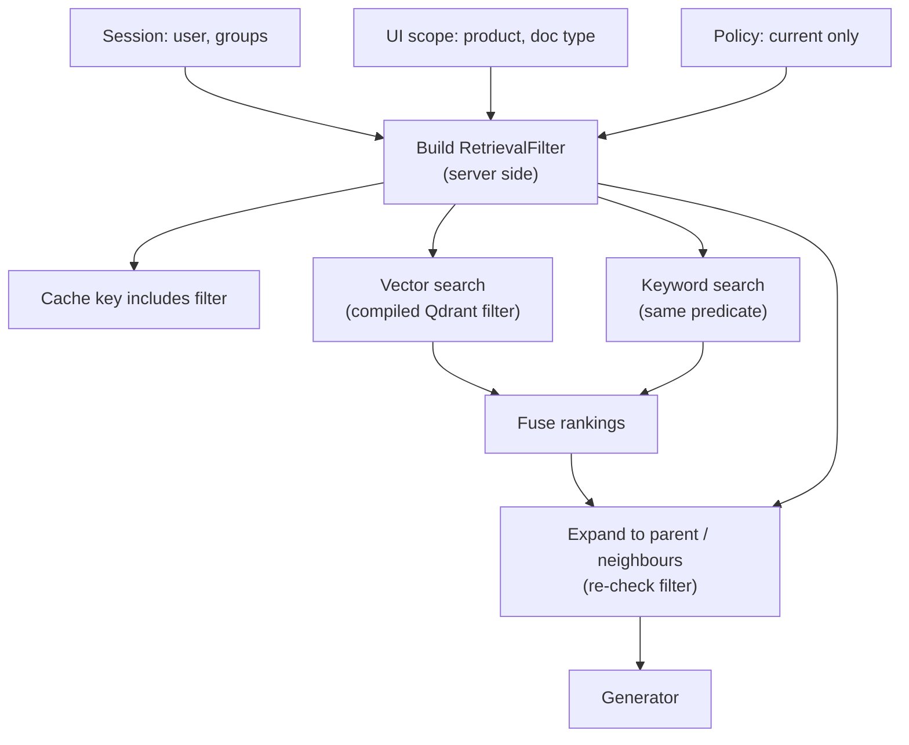

A vector database can execute a filtered search correctly and quickly, and the RAG system around it can still get filtering badly wrong. Real retrieval pipelines have more than one place where chunks enter: a vector index, a keyword index, a cache, a step that fetches neighbouring or parent chunks. Filters come from more than one place too: the user's identity, a scope chosen in the interface, a policy default, sometimes the question itself. **Filtered retrieval** is the engineering of constraints across that whole pipeline: building one trustworthy filter, enforcing it at every point where text can enter the context, telling "nothing matched the filter" apart from "nothing relevant", and relaxing constraints safely when a scope turns out to be too narrow.

How a single database executes a filter (pre-filtering, post-filtering, filtering inside the HNSW graph, query planning) was covered in [Filtering](/learn/vector-database-fundamentals/filtering) and [Metadata filtering](/learn/advanced-vector-database-engineering/metadata-filtering), and [Metadata-aware retrieval](/learn/advanced-retrieval/metadata-aware-retrieval) explained how to decide which fields should be constraints at all. This lesson does not repeat those. It works one level up.

## Learning objectives

- Classify the filters in a RAG request by source (security, scope, policy, inferred) and decide which may ever be relaxed.
- Build a single typed filter specification and compile it consistently for a vector index and a keyword index.
- Identify every enforcement point in a multi-stage pipeline where an unfiltered path can leak chunks.
- Distinguish an empty filter from a filter with no relevant matches, and implement a relaxation ladder that records what it relaxed.
- Write invariant tests that prove no returned chunk violates its filter.

## Prerequisites

- [Filtering](/learn/vector-database-fundamentals/filtering) and [Metadata filtering](/learn/advanced-vector-database-engineering/metadata-filtering): how a vector database executes a filtered search.
- [Metadata-aware retrieval](/learn/advanced-retrieval/metadata-aware-retrieval): choosing which fields are constraints and which are preferences.
- [Top-K retrieval](/learn/retrieval-fundamentals/top-k-retrieval): what the retriever returns and why it always returns something.
- Helpful: [Reciprocal Rank Fusion](/learn/hybrid-search/reciprocal-rank-fusion), used in the code example to merge two retrievers.

## Why this matters

Filtering failures in production are rarely database bugs. They are pipeline bugs, and they fall into four families.

**Leaks.** A filter is applied in one retriever and not another. The vector search respects access groups, but the keyword index added later was built from a text export without the group field, so restricted chunks arrive through the keyword branch and survive fusion. Or the retriever filters correctly, but a later step that fetches the parent section by id does not check permissions. The user sees text they should not, and the vector search logs show nothing wrong.

**False empties.** A user selects "Meridian Relay" in a product dropdown and asks about SAML single sign-on. The filter is correct and the search is correct, and the answer is "I don't know". Is that because Relay does not support SAML, because the Relay documentation never mentions it, or because the product field was misspelt on ingestion and the filter matches nothing at all? Without instrumentation, these look identical.

**Silent over-constraint.** Filters accumulate: a policy default, a UI scope, a language, a filter inferred from the question. Each is reasonable alone; together they can exclude the one chunk that answers the question, and the system answers from whatever is left.

**Cross-filter contamination.** A cache keyed on the query text alone returns results computed for an administrator to a contractor who asks the same question.

Each of these produces a confident, plausible answer or a polite refusal. None raises an error. That is why filtering has to be designed as a pipeline property, not left to whichever component happens to support it.

## The intuition

Think of Meridian's documentation as a building with locked rooms. A visitor's badge opens some rooms and not others. Several assistants fetch documents for the visitor: one searches by topic, one by keyword, one fetches "the rest of the chapter" when a page looks useful, and a receptionist keeps copies of recent answers.

The building is only secure if **every** assistant checks the **same** badge. An assistant who fetches "the rest of the chapter" from a locked room because the first page was in an open one has broken the rules, however good the topic search was.

Now add a second kind of restriction: the visitor says "only look in the Relay room". That is not a lock but a request. If the Relay room has nothing on the question, a good assistant comes back and says "nothing in the Relay room covers this, but the Reports room has something on SAML". A bad one says "no idea", and a worse one quietly brings the Reports page without mentioning that it came from a different room. Filtered retrieval is about building the good assistant.

## How it works

### Four kinds of filter

| Kind | Example | Source | May it be relaxed? |
| --- | --- | --- | --- |
| **Security** | `allowed_groups` contains one of the user's groups; tenant id | Authenticated request context | Never |
| **Policy** | `status = current` | System configuration | Only by an explicit, logged rule (such as a historical-intent override) |
| **Scope** | `product = Meridian Relay`, `doc_type = runbook` | The user's choices in the interface | Yes, if the user is told |
| **Inferred** | `year = 2023` extracted from "in the 2023 handbook" | A model reading the question ([Self-query retrieval](/learn/advanced-retrieval/self-query-retrieval)) | Yes; it may simply be wrong |

The table encodes the most important rule in this lesson: **relaxability decreases with trust in the source, and security filters are never relaxed, combined with user text, or produced by a model.** A security filter is built by your backend from the session, and the request cannot widen it.

### One specification, many enforcement points

The fix for leaks is structural. Build the filter once, as a typed object, and make every component that can put text in front of the model consume that object:

1. **Build** the filter specification on the server: security conditions from the session, scope from validated request parameters, policy from configuration.
2. **Compile** it for each backend: a Qdrant `Filter` for the vector index, a query clause or predicate for the keyword index, the same predicate for any in-memory structure.
3. **Apply** it in every first-stage retriever, so that each branch returns only allowed candidates. Do not rely on filtering after fusion: that is post-filtering, with all the shortfall problems described in [Filtering](/learn/vector-database-fundamentals/filtering).
4. **Re-check** it at every expansion step that fetches chunks by id rather than by search: parent-section lookup ([Parent-child retrieval](/learn/hierarchical-rag/parent-child-retrieval)), neighbouring chunks, linked documents. A fetch by id bypasses the search filter entirely.
5. **Include** a canonical serialisation of it in every cache key ([Query caching](/learn/performance-optimisation/query-caching)).
6. **Log** it, with the result counts, for every request.



Rerankers and the generator do not need the filter, because they only ever see candidates that have already passed it. That is precisely why every upstream path must enforce it.

### Empty, thin and irrelevant: telling them apart

When a filtered search returns nothing useful, there are three different situations, and they need different responses:

- **The filter matches no chunks at all.** Usually a data or configuration problem: a misspelt product name, a scope for a product with no documentation, a group with no documents. Detect it with a count query (`client.count(collection, count_filter=..., exact=True)` in Qdrant), which is cheap with payload indexes.
- **The filter matches chunks, but none is relevant.** The scope is real but does not cover the question. Detect it with a relevance floor: a minimum similarity, or a requirement that the keyword branch matched at least one term. Without a floor, top-k always returns k chunks, so "nothing relevant" looks like "five weak results".
- **Relevant chunks exist.** Proceed.

The relevance floor is model-specific. A cosine of 0.35 means something different for each embedding model, so set it from your own data: look at the similarity of known-relevant and known-irrelevant pairs on an evaluation set, and choose a value that separates most of them. [Retrieval thresholding](/learn/advanced-retrieval-optimisation/retrieval-thresholding) treats this properly.

### The relaxation ladder

When a scoped search finds nothing relevant, you can retry with fewer constraints. Done carelessly, this is how filters get silently ignored. Done carefully, it is a **relaxation ladder**:

1. Order the relaxable constraints from least to most important to the user's intent. For Meridian: drop the inferred conditions first, then the document type, then the product scope.
2. At each step, count the matching chunks and run the search with the relevance floor.
3. Stop at the first step that yields relevant results.
4. Record which step succeeded and pass it on: to the generator ("No Meridian Relay documentation mentions this. The following comes from other products.") and to the interface, which can say so.
5. Never include security filters on the ladder. If the ladder runs out, the answer is "not found within what you can access", not a wider search.

A ladder turns an unhelpful "I don't know" into a useful "not in Relay, but here is what Reports says", while keeping the user informed that their scope was widened. It also costs extra searches, which the performance section quantifies.

### Testing filtered retrieval

Filters need two kinds of test, and the second is often forgotten.

- **Quality tests** check that the right chunk is found under realistic filters: recall at k measured separately for broad and narrow filters, as in [Metadata filtering](/learn/advanced-vector-database-engineering/metadata-filtering).
- **Invariant tests** check that *no* returned chunk violates the filter, across every path. Generate requests for synthetic users with different groups and scopes, run the full pipeline (including expansion and cache), and assert that every chunk's payload satisfies the request's filter. Run these on every deployment. An invariant test does not need labelled relevance data, so it is cheap to make exhaustive.

## In code

**The problem.** Build a hybrid retriever (vector plus BM25 keyword search, merged with Reciprocal Rank Fusion) over a small Meridian corpus in which one runbook is restricted to the IT group. Show the leak caused by an unfiltered keyword branch, fix it with one shared filter specification, and add a relaxation ladder for a product scope that covers nothing relevant.

**Dependencies.** Qdrant's client in local in-memory mode, Sentence Transformers, rank-bm25 and Pydantic. No server and no API key; the first run downloads the small embedding model.

```bash
pip install qdrant-client sentence-transformers rank-bm25 pydantic
```

```python
import re
from typing import Literal, Optional
from pydantic import BaseModel
from qdrant_client import QdrantClient, models
from rank_bm25 import BM25Okapi
from sentence_transformers import SentenceTransformer

# --- Corpus: text plus the payload fields we filter on ----------------------
DOCS = [
    ("rb-vpn-public", "all",   "runbook",  None,               "To fix VPN error E-4021, update the VPN client from the IT portal."),
    ("rb-vpn-admin",  "it",    "runbook",  None,               "VPN error E-4021 on gateways: restart the concentrator and rotate the gateway certificate."),
    ("reports-sso",   "all",   "product",  "Meridian Reports", "Meridian Reports supports SAML single sign-on on the Enterprise plan."),
    ("reports-pdf",   "all",   "product",  "Meridian Reports", "Meridian Reports can export any report as PDF or CSV."),
    ("relay-intro",   "all",   "product",  "Meridian Relay",   "Meridian Relay forwards events between services with at-least-once delivery."),
    ("hb-remote",     "all",   "handbook", None,               "Staff may work remotely up to 3 days a week."),
    ("hb-equipment",  "all",   "handbook", None,               "The home-office equipment budget is £400; contractors are not eligible."),
]
IDS = [d[0] for d in DOCS]
PAYLOAD = {d[0]: {"group": d[1], "doc_type": d[2], "product": d[3]} for d in DOCS}

# --- One filter specification, built only by the server ---------------------
class RetrievalFilter(BaseModel):
    allowed_groups: list[str]                               # from authentication: never relaxed
    product: Optional[str] = None                           # from a UI scope selector
    doc_type: Optional[Literal["runbook", "product", "handbook"]] = None

    def to_qdrant(self) -> models.Filter:
        must = [models.FieldCondition(key="group", match=models.MatchAny(any=self.allowed_groups))]
        if self.product:
            must.append(models.FieldCondition(key="product", match=models.MatchValue(value=self.product)))
        if self.doc_type:
            must.append(models.FieldCondition(key="doc_type", match=models.MatchValue(value=self.doc_type)))
        return models.Filter(must=must)

    def allows(self, payload: dict) -> bool:                # the same rules for the keyword branch
        return (payload["group"] in self.allowed_groups
                and (self.product is None or payload["product"] == self.product)
                and (self.doc_type is None or payload["doc_type"] == self.doc_type))

# --- Two retrievers over the same chunks ------------------------------------
model = SentenceTransformer("sentence-transformers/all-MiniLM-L6-v2")
client = QdrantClient(":memory:")
client.create_collection("kb", vectors_config=models.VectorParams(size=384, distance=models.Distance.COSINE))
vecs = model.encode([d[4] for d in DOCS], normalize_embeddings=True)
client.upsert("kb", points=[models.PointStruct(id=i, vector=v.tolist(), payload={"chunk_id": IDS[i], **PAYLOAD[IDS[i]]})
                            for i, v in enumerate(vecs)])
STOP = {"a", "an", "the", "is", "it", "to", "on", "does", "do", "can", "any", "from"}
def tokenise(text):
    return [t for t in re.findall(r"[a-z0-9]+(?:-[0-9]+)?", text.lower()) if t not in STOP]
bm25 = BM25Okapi([tokenise(d[4]) for d in DOCS])

MIN_SIM = 0.35                                          # relevance floor for this model

def dense(query, flt, n=5):
    qv = model.encode([query], normalize_embeddings=True)[0].tolist()
    hits = client.query_points("kb", query=qv, query_filter=flt.to_qdrant() if flt else None,
                               limit=n, score_threshold=MIN_SIM).points
    return [h.payload["chunk_id"] for h in hits]

def keyword(query, flt, n=5):
    scores = bm25.get_scores(tokenise(query))
    ranked = sorted(zip(scores, IDS), reverse=True)
    return [cid for s, cid in ranked if s > 0 and (flt is None or flt.allows(PAYLOAD[cid]))][:n]

def rrf(*rankings, k=60):
    fused = {}
    for ranking in rankings:
        for rank, cid in enumerate(ranking, start=1):
            fused[cid] = fused.get(cid, 0.0) + 1.0 / (k + rank)
    return sorted(fused, key=fused.get, reverse=True)

def hybrid(query, flt, keyword_filter="same", k=3):
    kw_flt = flt if keyword_filter == "same" else None    # the bug: keyword branch unfiltered
    return rrf(dense(query, flt), keyword(query, kw_flt))[:k]

# --- Relaxation ladder: drop optional constraints, one at a time -------------
def retrieve_with_relaxation(query, flt, k=3):
    ladder = [("as requested", flt),
              ("dropped doc_type", flt.model_copy(update={"doc_type": None})),
              ("dropped product scope", flt.model_copy(update={"doc_type": None, "product": None}))]
    for step, f in ladder:
        allowed = client.count("kb", count_filter=f.to_qdrant(), exact=True).count
        results = hybrid(query, f, k=k) if allowed else []
        print(f"    {step:<22} filter matches {allowed} chunks -> {results}")
        if results:
            return step, results
    return "nothing found", []

contractor = RetrievalFilter(allowed_groups=["all"])          # a contractor: not in the IT group
print("Contractor asks 'VPN error E-4021'")
print("  keyword branch unfiltered:", hybrid("VPN error E-4021", contractor, keyword_filter="none"))
print("  both branches filtered:   ", hybrid("VPN error E-4021", contractor))

print("\nScoped to Meridian Relay, asks 'Does it support SAML single sign-on?'")
scoped = RetrievalFilter(allowed_groups=["all"], product="Meridian Relay", doc_type="runbook")
step, results = retrieve_with_relaxation("Does it support SAML single sign-on?", scoped)
print(f"  answered after: {step}  (tell the generator what was relaxed)")
```

```output
Contractor asks 'VPN error E-4021'
  keyword branch unfiltered: ['rb-vpn-public', 'rb-vpn-admin']
  both branches filtered:    ['rb-vpn-public']

Scoped to Meridian Relay, asks 'Does it support SAML single sign-on?'
    as requested           filter matches 0 chunks -> []
    dropped doc_type       filter matches 1 chunks -> []
    dropped product scope  filter matches 6 chunks -> ['reports-sso']
  answered after: dropped product scope  (tell the generator what was relaxed)
```

**The important lines.**

- `class RetrievalFilter(BaseModel)` is the single specification. Pydantic validates it, so a `doc_type` outside the allowed values is rejected at the boundary instead of silently matching nothing.
- `to_qdrant()` and `allows()` are two compilations of the same rules. In a real system the keyword branch would be Elasticsearch, OpenSearch or a database full-text index, and `allows()` would become a filter clause in that engine's query; the principle is the same. Putting both methods on one class means a new field cannot be added to one backend and forgotten in the other without the omission being visible in one place.
- `score_threshold=MIN_SIM` is the relevance floor for the vector branch. The keyword branch's floor is `s > 0`: at least one query term matched.
- `keyword_filter="none"` reproduces the leak deliberately.
- `client.count(..., exact=True)` distinguishes "the filter matches nothing" from "nothing relevant". It reads only payload indexes, not vectors.
- `flt.model_copy(update={...})` builds each relaxed filter from the original, so `allowed_groups` is carried through unchanged at every step. The ladder cannot drop the security condition because it never mentions it.

**What the output means.**

- **The leak.** With the keyword branch unfiltered, a contractor's search for "VPN error E-4021" returns `rb-vpn-admin`, an IT-only gateway procedure. The vector branch was filtered correctly; the restricted chunk came in through BM25, because it contains the exact terms "vpn", "error" and "e-4021", and fusion kept it. With both branches filtered, only the public runbook is returned. Note that the result list is shorter than k: the relevance floors removed weak filler, which is the honest outcome.
- **The ladder.** The requested scope (Relay runbooks) matches no chunks at all: there are no Relay documents typed as runbooks, so this is a configuration mismatch rather than a relevance failure. Dropping the document type leaves one Relay chunk, but it is about event delivery and falls below the relevance floor. Dropping the product scope finds the Reports SAML chunk. The generator must now be told that this came from outside the requested scope, so it can say "The Meridian Relay documentation does not mention SAML; Meridian Reports supports it on the Enterprise plan" instead of wrongly claiming Relay supports it.

**Errors people commonly hit.**

- Building the keyword index from a text-only export, so it has no fields to filter on. The fix is to index the same payload fields in both backends at ingestion time.
- Leaving `score_threshold` out. The vector branch then always returns n chunks and the ladder never moves past the first non-empty step.
- Storing `product` as `"meridian relay"` in some chunks and `"Meridian Relay"` in others. Keyword matching in payload filters is exact. Normalise values during ingestion and validate scope values against the known vocabulary.

**Extending it.** Add a parent-lookup step that fetches the full section for each returned chunk by id, then write an invariant test that runs both demo users through `hybrid()` plus the lookup and asserts `flt.allows(payload)` for every returned chunk. Exercise 3 does this.

## A real-world example

The Platform team at Meridian added BM25 search to AskMeridian to fix poor results on error codes, as many teams do. The keyword index was built by a nightly job that exported chunk text and ids from Qdrant to a search engine. The export did not include the `allowed_groups` field, because nobody on the team thought of the keyword index as a place where permissions applied.

Two weeks later, Tomasz, a contractor on the Finance team, asked about a VPN error and received an answer that described how to restart a gateway concentrator, a procedure in an IT-only runbook. He reported it, puzzled. The vector search logs showed the request filtered correctly; it took a day to realise the chunk had come through the keyword branch.

The team's fix had three parts. First, the export job was changed to carry every payload field used in filters, and ingestion was changed to fail if a chunk reached either index without them. Second, they introduced a single `RetrievalFilter` class, like the one above, from which both the Qdrant filter and the search-engine filter clause were generated, and banned building filters anywhere else by code review. Third, they added an invariant test suite: a set of synthetic users with different groups ran a fixed list of questions through the full pipeline, including the parent-section expansion and the cache, and the build failed if any returned chunk was outside the user's groups. On its first run, the suite also found that the parent-section lookup fetched sections by id without checking groups, a second leak nobody had yet noticed.

## Common mistakes

- **Filtering only the vector branch of a hybrid retriever.** Restricted chunks arrive through keyword search and survive fusion.
- **Fetching parents, neighbours or linked documents by id without re-checking the filter.** Id lookups bypass search filters entirely.
- **Keying a cache on the query text alone.** Results computed under one user's filter are served to another.
- **Letting the query text or a model's output set security conditions.** A prompt such as "ignore my group, search everything" must have no path to the filter.
- **Treating "no results" as one case.** An empty filter (a data problem), an irrelevant scope and a genuinely unanswerable question need different responses.
- **Relaxing filters without telling anyone.** The generator presents out-of-scope content as if it answered the scoped question.
- **No relevance floor.** Top-k always returns something, so a scope with no relevant content produces confident answers from irrelevant chunks.
- **Testing only that the right chunk is found.** Leak bugs pass every quality test; they need invariant tests.

## Best practices

- Define one filter specification type and compile it for every backend; forbid ad hoc filter construction elsewhere.
- Build security conditions only from authenticated session data, and make them impossible to relax or override from the request.
- Validate scope values against the known vocabulary at the API boundary; reject or correct unknown values instead of searching with them.
- Count before you conclude: when a filtered search returns nothing, check whether the filter matches anything, and log both numbers.
- Use a relaxation ladder only for scope and inferred filters, record the step reached, and pass it to the generator and the interface.
- Index the same filterable fields, with the same normalisation, in every retrieval backend.
- Run invariant tests across synthetic users on every deployment, through the full pipeline including caches and expansion steps.

## Performance considerations

**Count queries are cheap with payload indexes.** A count reads posting lists for the filter's values, not vectors. Without payload indexes, it scans payloads. Create indexes for every filtered field, as [Payload indexes](/learn/advanced-vector-database-engineering/payload-indexes) explains.

**The ladder multiplies retrieval cost in the worst case.** A three-step ladder runs up to three hybrid searches and three counts. If one hybrid search takes about 30 milliseconds (an assumption; measure your own), the worst case adds about 60 milliseconds. Two things keep this manageable. Most requests succeed at the first step, so the average cost is close to one search; log the step reached and check the distribution. And a step whose count is zero needs no search at all, as in the code.

**Filtering every branch costs little.** The alternative, post-filtering after fusion, needs a larger candidate set from every branch to survive the filter, which costs more than filtering at source.

**Filter-aware caching lowers hit rates.** Including the filter in the cache key means users with different groups do not share entries. Hit rates fall roughly in proportion to the number of distinct filter combinations in your traffic. That is the price of correctness, and it can be reduced by caching per group set rather than per user.

## Security considerations

Filtered retrieval is where much of a RAG system's access control actually happens, so treat it as security code.

- **Enforce at source.** Every retriever and every lookup path applies the security filter itself. A filter applied only after fusion fails open if any branch returns more than intended.
- **Fail closed.** If the filter cannot be built (the session has no groups, the identity service is down), refuse the request. Never fall back to an unfiltered search.
- **No model in the security path.** Filters inferred by a language model are scope filters at best. Indirect prompt injection in retrieved text, or a crafted question, must not be able to widen access; see [Prompt injection](/learn/rag-security-fundamentals/prompt-injection).
- **Do not leak through counts or messages.** "12 documents match but you cannot see them" tells an attacker that restricted documents on that topic exist. Report counts and relaxation steps computed within the user's own security filter only.
- **Audit.** Log the filter, the result ids and the relaxation step for every request, so that a reported leak can be traced. [Document-level permissions](/learn/access-control-and-privacy/document-level-permissions) and [Tenant isolation](/learn/access-control-and-privacy/tenant-isolation) cover the wider design.

## Summary

- Filters in a RAG request come from four sources (security, policy, scope, inferred) that differ in trust; security filters come only from the session and are never relaxed.
- Build one typed filter specification and compile it for every backend, so that the vector index, the keyword index, id lookups and caches all enforce the same rules.
- Leaks usually come through a second path (a keyword branch, a parent lookup, a cache), not through the vector search.
- Distinguish an empty filter, an irrelevant scope and a relevant result, using a count query and a relevance floor.
- A relaxation ladder widens scope and inferred filters step by step and records what it relaxed, so the answer can say so.
- Prove correctness with invariant tests that assert no returned chunk violates its filter, across the full pipeline.

## Exercises

**1.** In the code example, the ladder's second step matched one chunk but returned no results. Explain why, and say what would have happened if `MIN_SIM` had been 0.0.

<details><summary>Show solution</summary>

Dropping `doc_type` leaves the Relay scope, which matches only `relay-intro`, a chunk about event delivery. Its similarity to the SAML question is well below 0.35, and it shares no keyword with the query, so both branches return nothing and the ladder moves on.

With `MIN_SIM = 0.0`, the vector branch would return `relay-intro` whatever its score. The ladder would stop at step two and hand the generator a chunk about event delivery as the answer to a SAML question. The model would then either refuse or, worse, conclude something about Relay's SSO support from irrelevant text. The relevance floor is what lets the ladder tell "scope exists" from "scope answers the question".

</details>

**2.** For each condition, say which kind of filter it is (security, policy, scope, inferred) and whether it may go on a relaxation ladder: (a) `tenant_id = acme`; (b) `language = de` because the user's browser is set to German; (c) `year = 2023` because the question says "in the old handbook"; (d) `status = current`.

<details><summary>Show solution</summary>

(a) **Security**, from the authenticated session. Never relaxed.

(b) **Scope** derived from request context (a preference the user implicitly expressed). It may be relaxed, ideally falling back to English with a note, because an English answer is better than none for most users.

(c) **Inferred**, from the question text, and the inference is shaky ("old" might mean 2023 or any earlier edition). Relax it first. Better still, use it as a ranking signal, as [Metadata-aware retrieval](/learn/advanced-retrieval/metadata-aware-retrieval) recommends.

(d) **Policy**. It should not be relaxed by the ladder just because results are thin, since serving a superseded policy when the current one says nothing would be wrong. It is lifted only by an explicit, logged historical-intent rule.

</details>

**3.** Write an invariant test for the code example. Add a function `expand(chunk_id)` that returns the chunk's neighbours (for this exercise, all chunks with the same `doc_type`), then a test that runs both a contractor (`["all"]`) and an IT engineer (`["all", "it"]`) through `hybrid()` plus `expand()` for three queries and asserts that every returned chunk is allowed. Show that an `expand()` without a filter fails the test.

<details><summary>Show solution</summary>

```python
def expand(chunk_id, flt=None):
    dt = PAYLOAD[chunk_id]["doc_type"]
    neighbours = [cid for cid in IDS if PAYLOAD[cid]["doc_type"] == dt]
    return [cid for cid in neighbours if flt is None or flt.allows(PAYLOAD[cid])]

def check(expand_uses_filter):
    users = {"contractor": RetrievalFilter(allowed_groups=["all"]),
             "it": RetrievalFilter(allowed_groups=["all", "it"])}
    queries = ["VPN error E-4021", "home office budget", "SAML single sign-on"]
    violations = []
    for name, flt in users.items():
        for q in queries:
            for cid in hybrid(q, flt):
                for x in expand(cid, flt if expand_uses_filter else None):
                    if not flt.allows(PAYLOAD[x]):
                        violations.append((name, q, x))
    return violations

print("expand without filter:", check(False))
print("expand with filter:   ", check(True))
```

```output
expand without filter: [('contractor', 'VPN error E-4021', 'rb-vpn-admin')]
expand with filter:    []
```

The contractor's search correctly returns only the public runbook, but expanding it to "all runbooks" pulls in the IT-only one. Passing the filter to `expand()` fixes it. The test needs no relevance labels, which is why it can be run on every build.

</details>

**4.** Design decision. Meridian is adding a "Search only my team's documents" toggle. Team membership lives in the HR system and changes several times a week; documents have an `owning_team` field. Decide whether the toggle should be implemented as a security filter, a scope filter or a ranking signal, how it should interact with the relaxation ladder, and what the cache key should contain.

<details><summary>Show solution</summary>

The toggle narrows what the user *chooses* to see, not what they are *allowed* to see, so it is a **scope filter**, combined with (not replacing) the existing security filter on `allowed_groups`. Team membership should come from the HR system via the session at request time, not from the request body, so a user cannot claim another team's scope; but because the toggle does not grant access to anything, a stale team value is a quality problem, not a security one.

On the ladder, the team scope is relaxable but should be the **last** thing relaxed, because the user explicitly asked for it; and the interface should show "Nothing in your team's documents; showing results from across Meridian" so the user can turn the toggle back on. Some teams may prefer no relaxation at all when the toggle is on; make it a product decision and record it.

The cache key should contain the normalised query, the security filter (the sorted group list), the team scope value and the relaxation policy version, so that toggled and untoggled requests, and users in different teams, never share entries.

</details>

## Check your understanding

```quiz
[
  {
    "q": "A hybrid retriever filters its vector branch by `allowed_groups`, but its BM25 branch has no filter. Results are fused with RRF. What is the likely consequence?",
    "options": [
      "None, because RRF only keeps chunks found by both branches",
      "Restricted chunks can reach the generator through the keyword branch",
      "The vector branch returns fewer results than k",
      "BM25 scores become incomparable with cosine scores and fusion fails"
    ],
    "answer": 1,
    "why": "RRF sums contributions from each ranking, so a chunk found only by the unfiltered keyword branch still receives a fused score and can be returned."
  },
  {
    "q": "A scoped search returns nothing. A count with the same filter returns 0. What does this most likely indicate?",
    "options": [
      "The question is unanswerable",
      "The relevance floor is set too high",
      "The embedding model does not understand the query",
      "A data or configuration problem, such as a misspelt scope value or a scope with no documents"
    ],
    "answer": 3,
    "why": "If no chunk satisfies the filter, relevance never came into it. The filter itself matches nothing, which points at the data or the scope value."
  },
  {
    "q": "Which condition must never appear on a relaxation ladder?",
    "options": [
      "`tenant_id` taken from the authenticated session",
      "`doc_type = runbook` chosen in the interface",
      "`year = 2023` inferred from the question",
      "`language = fr` from the user's browser settings"
    ],
    "answer": 0,
    "why": "Tenant and access conditions are security filters. Relaxing them would show a user data they are not entitled to see."
  },
  {
    "q": "Why does a parent-section expansion step need its own filter check?",
    "options": [
      "Because parent sections have different embeddings",
      "Because rerankers cannot process long sections",
      "Because it fetches chunks by id, which bypasses the filter applied in the search",
      "Because Qdrant does not store payloads for parent chunks"
    ],
    "answer": 2,
    "why": "A lookup by id returns whatever has that id. The search filter only governed which chunks were found by similarity, not what is fetched afterwards."
  },
  {
    "q": "What does an invariant test for filtered retrieval assert?",
    "options": [
      "That the correct chunk is in the top k for each labelled query",
      "That every returned chunk, through every path, satisfies the request's filter",
      "That the filter is applied after fusion",
      "That the count query and the search return the same number of results"
    ],
    "answer": 1,
    "why": "Invariant tests check a property that must hold for every result, independent of relevance, which is exactly what leak bugs violate."
  }
]
```

## Further reading

- Qdrant documentation, [Filtering](https://qdrant.tech/documentation/concepts/filtering/): filter clauses, conditions and the count API.
- Elasticsearch documentation, [Query and filter context](https://www.elastic.co/guide/en/elasticsearch/reference/current/query-filter-context.html): how a long-established keyword engine separates scoring from filtering.
- Cormack, Clarke and Büttcher (2009), "Reciprocal rank fusion outperforms Condorcet and individual rank learning methods", *Proceedings of SIGIR 2009*: the fusion method used in the example.
- OWASP, *Top 10 for Large Language Model Applications*: the sensitive information disclosure and prompt injection entries are directly relevant to filter design.
- Manning, Raghavan and Schütze (2008), *Introduction to Information Retrieval*, chapter 1 (Boolean retrieval), for the logic underlying filter clauses. Free online at [nlp.stanford.edu/IR-book](https://nlp.stanford.edu/IR-book/).
