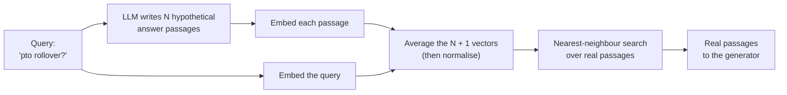

A query and the passage that answers it are different kinds of text. "pto rollover?" is two words of shorthand; the passage that answers it is a full sentence about annual leave that never says "PTO" or "rollover". [Semantic search](/learn/dense-retrieval/semantic-search) showed that retrieval-trained embedding models are taught to bridge this gap, and that they do so imperfectly. **HyDE** (Hypothetical Document Embeddings) bridges it from the other side. Instead of embedding the question, it asks a language model to *write a passage that would answer the question*, embeds that invented passage, and searches for real documents near it. The invented passage may be wrong in its details, and that is mostly fine: it is used to find documents, never shown as an answer.

This lesson explains why searching with a fake answer works, the averaging step that makes it robust, the mathematics of that average, and the two ways HyDE fails in practice (invented details that match the wrong document, and outdated knowledge that matches superseded documents). You will run it on Meridian's handbook, including its superseded 2023 pages, and see both the gains and the failures.

## Learning objectives

- Explain the query-document asymmetry that HyDE addresses, and why a hypothetical passage can be closer to the answer than the query is.
- Implement HyDE with one or several hypothetical passages, combining their embeddings with the query embedding by averaging.
- Show that ranking by the averaged vector is equivalent to ranking by the average of the individual similarities.
- Identify the failure modes of HyDE (hallucinated specifics, stale knowledge, domain mismatch) and the safeguards for each.
- Estimate the latency and cost HyDE adds, and decide when it is worth applying.

## Prerequisites

- [Semantic search](/learn/dense-retrieval/semantic-search): symmetric and asymmetric search, and why queries and passages differ.
- [Query embeddings](/learn/dense-retrieval/query-embeddings): how a query becomes a vector, and the role of query prefixes.
- [Cosine similarity](/learn/embedding-mathematics/cosine-similarity) and [vector normalisation](/learn/embedding-mathematics/vector-normalisation).
- [Step-back prompting](/learn/advanced-retrieval/step-back-prompting): another way of using a model to transform the query before retrieval.

## Why this matters

Dense retrieval compares a query vector with passage vectors. That comparison works best when the two texts are alike. A query is typically short, informal, phrased as a question and missing the very information it is asking for; a passage is long, formal, phrased as a statement and full of that information. A retrieval-trained model learns to map questions near their answers, but it learns this from the questions and passages in its training data. Internal shorthand ("pto", "ring IT", "the Atlas thing"), unusual phrasing and very short queries are where it fails.

HyDE was proposed for the hardest version of this problem. Gao, Ma, Lin and Callan (2022) wanted good dense retrieval with **no relevance labels at all**: an encoder trained without any question-passage pairs, which therefore knows how to compare passages with passages but not questions with passages. Their insight was that a language model can turn the question-passage problem into a passage-passage problem. Generate a passage that answers the question, and you can use the encoder for the comparison it is good at.

In production you are rarely label-free and modern embedding models are trained on question-passage pairs, so the gap is smaller than in the paper. It does not vanish, though: HyDE remains one of the simplest ways to repair short, jargon-heavy queries without retraining anything, and it has a distinctive way of going wrong that you must understand first.

## The intuition

You are looking for a book in a library where the books are arranged by subject and you are not allowed to read the catalogue. You know your question ("how do I carry over unused holiday?") but not the shelf. One strategy is to walk around until the topic feels close. A better one: imagine what the answering page would look like ("Unused leave may be carried over to next year, up to a limit, and must be used by an early-year deadline"), and go to the shelf where pages like that are kept. Your imagined page might get the limit wrong. It does not matter. It will still be shelved next to the real page, because it is *about* the same thing *in the same style*.

That is HyDE. The imagined page is the hypothetical document; the shelf is the neighbourhood in embedding space. Its weak point is also visible in the analogy. If you imagine the page with a very specific wrong detail ("error E-4012 means your client is out of date"), you may walk confidently to the shelf of the page that really does say that, which is a different error.

## How it works

### The mechanism



1. **Generate.** Prompt a language model: "Write a short passage from a company handbook that answers this question." Ask for $N$ passages (one to five is typical). The passages should look like your corpus: same register, same length, same kind of document.
2. **Encode.** Embed each hypothetical passage with the *same* model and the same encoding mode as your indexed documents. If your model uses prefixes (E5 expects `passage: ` for documents and `query: ` for queries), the hypothetical passages are passages and get the document prefix, while the original query keeps the query prefix.
3. **Combine.** Average the passage vectors together with the query vector, and normalise the result. Including the original query anchors the search to what the user actually asked.
4. **Search.** Use the combined vector for an ordinary nearest-neighbour search over the real index. Nothing about the index changes.
5. **Discard the hypothetical passages.** They exist only to produce a vector. The generator sees the real retrieved passages, never the invented ones.

Step 5 is the safety property of the method. Hallucinated content never reaches the answer directly; it can only influence *which* real documents are retrieved. That is why HyDE tolerates factual errors that would be unacceptable in an answer.

### Why a wrong passage still finds the right document

An embedding is a lossy summary. It records what a text is about, its register and its key terms, much more strongly than the exact values inside it. "Up to 5 unused days carry over" and "up to 3 unused days carry over" land very close together, because they are about the same thing in the same words. Gao and colleagues described the encoder as a "bottleneck" that filters out such details: the generated passage supplies relevance patterns (topic, vocabulary, structure) and the encoder keeps those and largely discards the specifics.

The word "largely" matters. When a hypothetical passage's wrong details are themselves *distinctive* (an error code, a product name, a year), they can survive the bottleneck and pull the vector towards a real document that contains them. The code below shows exactly this.

### One passage or several

Each generated passage is a sample from the model's idea of an answer, with its own incidental details. Averaging several passages keeps what they agree on (the topic) and dilutes what varies (the invented specifics). The paper averaged the embeddings of several generated documents together with the query's. With modern models you can get several varied passages in a single call by asking for $N$ distinct ones in a structured output, rather than relying on sampling settings.

Averaging is not free of trade-offs. It reduces variance from any one hallucination, but if every passage shares the same wrong belief (all three say support hours are 09:00 to 17:00 because that was true for years), averaging *reinforces* it.

### HyDE compared with other query transformations

| Technique | What is embedded | Best for |
| --- | --- | --- |
| [Query rewriting](/learn/advanced-retrieval/query-rewriting) | A better-phrased query | Typos, chatty phrasing, conversation context |
| [Multi-query retrieval](/learn/advanced-retrieval/multi-query-retrieval) | Several paraphrased queries, searched separately and fused | Ambiguous queries, recall |
| [Step-back prompting](/learn/advanced-retrieval/step-back-prompting) | A more general question, plus the original | Situational questions about rules |
| **HyDE** | An imagined *answer*, averaged with the query | Short or jargon-heavy queries, weak query encoders |

The structural difference from multi-query retrieval is worth noticing. Multi-query searches once per query variant and fuses the result *lists*; HyDE as described averages the *vectors* and searches once. You can also run HyDE in the multi-query style (one search per hypothetical passage, fused with [RRF](/learn/hybrid-search/reciprocal-rank-fusion)), which preserves documents that only one passage points at, at the cost of $N$ searches.

### Where HyDE fails

- **Distinctive hallucinations.** An invented error code, version or product name pulls retrieval towards the document that really contains it.
- **Stale knowledge.** The model's idea of an answer reflects its training data and general practice, not your current policy. If your corpus contains superseded documents that match common practice better than the current ones do, HyDE pulls towards the superseded ones. Version filtering ([filtered retrieval](/learn/advanced-retrieval/filtered-retrieval)) is the fix; the embedding cannot be trusted to prefer the current version.
- **Domain mismatch.** For a question about something the model knows nothing about (an internal project codename, a niche product), the hypothetical passage is generic filler and adds little.
- **Exact-match queries.** For identifier lookups, keyword search already works and HyDE adds risk. Skip it, or rely on the sparse side of a [hybrid search](/learn/hybrid-search/hybrid-retrieval-architecture).

## The mathematics

### The HyDE vector

**Intuition.** Each hypothetical passage is a noisy guess at where the answer lives in embedding space. Averaging several guesses, plus the query itself, gives a steadier estimate than any single one.

$$
\hat{\mathbf{v}} = \frac{1}{N+1}\left(\sum_{k=1}^{N} f(\hat{d}_k) + f(q)\right), \qquad \mathbf{v} = \frac{\hat{\mathbf{v}}}{\lVert \hat{\mathbf{v}} \rVert}
$$

$f$ is the embedding model, $q$ the query, $\hat{d}_1, \dots, \hat{d}_N$ the generated passages, $N$ how many there are, $\hat{\mathbf{v}}$ the average and $\mathbf{v}$ its normalised version, used for search.

### Averaging vectors is averaging scores

**Intuition.** You might worry that averaging vectors and then searching is some new, opaque operation. It is not: with dot-product scoring, it ranks documents exactly as averaging their similarity to each of the $N+1$ vectors would.

For any document vector $\mathbf{d}$, the dot product is linear, so

$$
\hat{\mathbf{v}} \cdot \mathbf{d} = \frac{1}{N+1}\left(\sum_{k=1}^{N} f(\hat{d}_k) \cdot \mathbf{d} + f(q) \cdot \mathbf{d}\right)
$$

and normalising $\hat{\mathbf{v}}$ divides every document's score by the same constant $\lVert \hat{\mathbf{v}} \rVert$, which cannot change the order. When all vectors are unit length, each term is a cosine, so the HyDE vector ranks documents by their **average cosine to the query and the hypothetical passages**. A document that is close to most of the guesses wins; one close to a single eccentric guess does not.

**By hand.** Two dimensions, unit vectors: query $\mathbf{q} = (0.6, 0.8)$, hypothetical passages $\mathbf{h}_1 = (1, 0)$ and $\mathbf{h}_2 = (0.8, 0.6)$, document $\mathbf{d} = (0.96, 0.28)$.

- Dot products with $\mathbf{d}$: $\mathbf{h}_1 \cdot \mathbf{d} = 0.96$; $\mathbf{h}_2 \cdot \mathbf{d} = 0.768 + 0.168 = 0.936$; $\mathbf{q} \cdot \mathbf{d} = 0.576 + 0.224 = 0.8$.
- Their average: $(0.96 + 0.936 + 0.8)/3 = 0.8987$.
- Mean vector: $\hat{\mathbf{v}} = ((1 + 0.8 + 0.6)/3,\ (0 + 0.6 + 0.8)/3) = (0.8, 0.4667)$, and $\hat{\mathbf{v}} \cdot \mathbf{d} = 0.768 + 0.1307 = 0.8987$, the same number.
- Length $\lVert \hat{\mathbf{v}} \rVert = \sqrt{0.64 + 0.2178} = 0.9262$, so the cosine is $0.8987 / 0.9262 = 0.9703$.

The query alone scored 0.8 against this document; the HyDE vector scores 0.97, because both hypothetical passages point closer to it.

```python
import numpy as np

q  = np.array([0.6, 0.8])    # query embedding (unit length)
h1 = np.array([1.0, 0.0])    # hypothetical passage 1
h2 = np.array([0.8, 0.6])    # hypothetical passage 2
d  = np.array([0.96, 0.28])  # a real document

v = np.mean([h1, h2, q], axis=0)
print("mean vector:", v.round(4), " length:", round(float(np.linalg.norm(v)), 4))
print("cos(mean, d):", round(float(v @ d / np.linalg.norm(v)), 4))
print("average of the three dot products:", round(float(np.mean([h1 @ d, h2 @ d, q @ d])), 4))
print("cos(q, d) for comparison:", round(float(q @ d), 4))
```

```output
mean vector: [0.8    0.4667]  length: 0.9262
cos(mean, d): 0.9703
average of the three dot products: 0.8987
cos(q, d) for comparison: 0.8
```

## In code

**The problem.** Retrieve for five short Meridian queries over a handbook that includes three superseded 2023 pages, comparing the plain query, HyDE with one passage, and HyDE averaged over three passages plus the query.

**Dependencies.** NumPy and sentence-transformers (the model downloads once, about 90 MB).

```bash
pip install numpy sentence-transformers
```

The hypothetical passages are written into the script so that the experiment is reproducible and needs no API key. They are realistic stand-ins for model output, and some contain wrong details on purpose, of the kind models genuinely produce: generic "9 to 5" office hours, and a confident but wrong meaning for an error code. The model call that would generate them follows in a separate block.

```python
import numpy as np
from sentence_transformers import SentenceTransformer

DOCS = {
    "leave":       "Annual leave is 25 days per year. Up to 5 unused days carry over and must be used by 31 March.",
    "remote":      "Staff may work remotely up to 3 days a week.",
    "equipment":   "The home-office equipment budget is £400. Contractors are not eligible for it.",
    "expenses":    "Expenses must be submitted within 30 days. Anything over £75 needs a receipt.",
    "laptop":      "The laptop refresh cycle is 3 years.",
    "hours":       "The support desk is open 08:00 to 18:00 UK time.",
    "vpn":         "VPN is required on public Wi-Fi.",
    "e4021":       "Atlas error E-4021: the client is out of date. Update it from the IT portal.",
    "e4012":       "Atlas error E-4012: the certificate has expired. Reinstall it from the IT portal.",
    "old_hours":   "2023 handbook (superseded): the support desk is open 09:00 to 17:00.",
    "old_laptop":  "2023 handbook (superseded): laptops are replaced every 4 years.",
    "old_budget":  "2023 handbook (superseded): the home-office equipment budget is £250.",
}
ids = list(DOCS)

# query -> (gold id, hypothetical passages a model might write)
# The passages stand in for LLM output. Some contain wrong details on purpose.
CASES = {
    "pto rollover?": ("leave", [
        "Unused paid time off can be carried over into the next year, up to a limit, "
        "and carried-over days must be taken by a deadline early in the year.",
        "Employees may roll over a few unused holiday days; any carried-over days expire if not used.",
        "Annual leave that is not taken can partly be carried forward to the following leave year.",
    ]),
    "can I get money for a desk for my flat": ("equipment", [
        "Employees working from home can claim a home-office equipment allowance for items such as desks and chairs.",
        "Meridian provides a budget for home-office furniture and equipment for remote workers.",
        "Staff can buy a desk for home working and be reimbursed from the equipment budget.",
    ]),
    "atlas says my client is too old": ("e4021", [
        "Atlas error: the client version is out of date. Update the client to the latest version.",
        "If Atlas reports an outdated client, download and install the newest client release.",
        "An old Atlas client triggers a version error; upgrading the client resolves it.",
    ]),
    "when can I ring IT?": ("hours", [
        "The IT support desk can be reached by phone from 9am to 5pm, Monday to Friday.",
        "IT support is available during office hours, 09:00 to 17:00.",
        "You can call the IT helpdesk between 9 and 5 on working days.",
    ]),
    "what does E-4012 mean?": ("e4012", [
        "Atlas error E-4012 means the client is out of date. Update the client to fix it.",
        "E-4012 is shown when the Atlas client version is too old and must be upgraded.",
        "Error E-4012 indicates an outdated client; install the latest version.",
    ]),
}

model = SentenceTransformer("sentence-transformers/all-MiniLM-L6-v2")
D = model.encode([DOCS[i] for i in ids], normalize_embeddings=True)

def unit(v):
    return v / np.linalg.norm(v)

def ranking(qvec):
    order = np.argsort(-(D @ qvec))
    return [ids[i] for i in order]

for query, (gold, hypos) in CASES.items():
    q = model.encode([query], normalize_embeddings=True)[0]
    H = model.encode(hypos, normalize_embeddings=True)
    vectors = {
        "query only":       q,
        "HyDE, 1 passage":  H[0],
        "HyDE, mean of 3+q": unit(np.vstack([H, q[None, :]]).mean(axis=0)),
    }
    print(f"Q: {query!r}  (gold: {gold})")
    for name, v in vectors.items():
        r = ranking(v)
        s = D @ v
        print(f"   {name:<18} gold rank {r.index(gold) + 1}  gold cos {s[ids.index(gold)]:.2f}  "
              f"top 2: {r[0]} {s[ids.index(r[0])]:.2f}, {r[1]} {s[ids.index(r[1])]:.2f}")
```

```output
Q: 'pto rollover?'  (gold: leave)
   query only         gold rank 2  gold cos 0.15  top 2: old_hours 0.17, leave 0.15
   HyDE, 1 passage    gold rank 1  gold cos 0.60  top 2: leave 0.60, expenses 0.45
   HyDE, mean of 3+q  gold rank 1  gold cos 0.67  top 2: leave 0.67, expenses 0.37
Q: 'can I get money for a desk for my flat'  (gold: equipment)
   query only         gold rank 1  gold cos 0.45  top 2: equipment 0.45, old_budget 0.38
   HyDE, 1 passage    gold rank 1  gold cos 0.61  top 2: equipment 0.61, old_budget 0.55
   HyDE, mean of 3+q  gold rank 1  gold cos 0.67  top 2: equipment 0.67, old_budget 0.65
Q: 'atlas says my client is too old'  (gold: e4021)
   query only         gold rank 1  gold cos 0.71  top 2: e4021 0.71, e4012 0.60
   HyDE, 1 passage    gold rank 1  gold cos 0.84  top 2: e4021 0.84, e4012 0.71
   HyDE, mean of 3+q  gold rank 1  gold cos 0.81  top 2: e4021 0.81, e4012 0.69
Q: 'when can I ring IT?'  (gold: hours)
   query only         gold rank 2  gold cos 0.24  top 2: old_hours 0.29, hours 0.24
   HyDE, 1 passage    gold rank 1  gold cos 0.70  top 2: hours 0.70, old_hours 0.68
   HyDE, mean of 3+q  gold rank 2  gold cos 0.66  top 2: old_hours 0.67, hours 0.66
Q: 'what does E-4012 mean?'  (gold: e4012)
   query only         gold rank 1  gold cos 0.37  top 2: e4012 0.37, e4021 0.25
   HyDE, 1 passage    gold rank 2  gold cos 0.83  top 2: e4021 0.84, e4012 0.83
   HyDE, mean of 3+q  gold rank 1  gold cos 0.73  top 2: e4012 0.73, e4021 0.69
```

**Reading the output.** Each query teaches something different.

- **"pto rollover?"** is the case HyDE exists for. The two-word query shares no vocabulary with the leave policy and the plain query ranks it second behind an irrelevant page, with every score below 0.2: the model has essentially no idea. The hypothetical passages, written in handbook language about carrying over unused leave, lift the right page to 0.60 to 0.67 with a wide margin.
- **The desk query** works either way, but look at the margin over the superseded £250 budget page: 0.07 for the plain query, 0.02 for the averaged HyDE vector. The hypothetical passages describe a budget *in general*, which matches the old page as well as the new one. HyDE made the topic match stronger and the version distinction weaker.
- **The Atlas client query** already works; HyDE raises the scores without changing the order.
- **"when can I ring IT?"** shows stale knowledge. All three passages assume conventional 9-to-5 office hours, which is exactly what the superseded 2023 page says. The single passage just about ranks the current page first (0.70 against 0.68); the average of three, which agree on the wrong hours, puts the superseded page first. Averaging reduced noise and reinforced a shared error.
- **"what does E-4012 mean?"** shows a distinctive hallucination. The passages confidently state the meaning of the *other* error code, so the single-passage HyDE vector ranks E-4021 first. Averaging with the query (which contains the literal code) rescues it, narrowly.

The lessons in the numbers: HyDE helps most when the query is short and lexically distant; including the original query in the average is a real safeguard; and **HyDE must never be the thing that decides between document versions**. A filter on document status removes the superseded pages before similarity is consulted at all, and would have fixed both the desk and the IT-hours cases outright.

**Common errors.** Forgetting `normalize_embeddings=True` on either side makes the average weight longer vectors more heavily and breaks the score equivalence. Embedding the hypothetical passages with a query prefix (for models that use prefixes) wastes the point of the method: they are passages. Passing the hypothetical passages to the generator, "for extra context", turns a retrieval aid into a hallucination channel.

### Generating the passages with Claude

This block was not executed (it needs an API key). It asks for three distinct passages in one call and validates the result with a Pydantic model.

```python
import anthropic
from pydantic import BaseModel, Field

client = anthropic.Anthropic()  # reads ANTHROPIC_API_KEY from the environment

class Hypotheticals(BaseModel):
    passages: list[str] = Field(description="Distinct handbook-style passages, 1 to 3 sentences each")

HYDE_SYSTEM = """You write short passages in the style of an internal company handbook or
IT runbook. Given an employee's question, write passages that would plausibly answer it.
Write each passage as a statement of policy or procedure, not as a reply to the employee.
Vary the wording between passages. Do not invent error codes, product names or version
numbers that are not in the question."""

def hypothetical_passages(question: str, n: int = 3) -> list[str]:
    response = client.messages.parse(
        model="claude-opus-5-5",
        max_tokens=600,
        system=HYDE_SYSTEM,
        messages=[{"role": "user", "content": f"Write {n} different passages answering: {question}"}],
        output_format=Hypotheticals,
    )
    return response.parsed_output.passages[:n]
```

The system prompt does three jobs. It asks for the corpus's register (handbook statements, not chatty replies), because the closer the passages are in style to the real documents, the closer they land in embedding space. It asks for variety, so that averaging has something to average. And it forbids inventing identifiers, the most damaging kind of hallucination for HyDE, as the E-4012 case showed. The instruction reduces the problem; it does not eliminate it, so keep the query in the average and keep version filters in place.

LangChain (`HypotheticalDocumentEmbedder`, now in the `langchain_classic` package) and LlamaIndex (`HyDEQueryTransform`) provide wrappers, but the version above keeps the prompt, the averaging and the safeguards visible.

**Extending it.** Run HyDE in the multi-query style, one search per passage fused with RRF, and compare. Add a metadata filter that removes superseded documents and rerun the desk and IT-hours queries. Measure [Recall@K](/learn/retrieval-fundamentals/recall-k) on a labelled set of short queries with and without HyDE.

## A real-world example

Meridian's Platform team noticed that AskMeridian handled full questions well and very short ones ("pto rollover", "byod?", "relay sso", "atlas e-4021 fix") badly; the short ones had a much higher thumbs-down rate.

They trialled HyDE on all queries for a week behind a flag and compared against the control on their labelled evaluation set. The pattern matched what the code above shows. Short natural-language queries ("pto rollover", "ring IT") improved clearly. Identifier queries got slightly worse, because the model occasionally described the wrong error code. And one new failure appeared that had not been visible before: questions about support hours and equipment budgets started returning the superseded 2023 handbook pages, which described conventional arrangements closer to the model's priors.

The fix had three parts: superseded documents were excluded by a metadata filter on every query (HyDE had merely exposed a missing filter); HyDE was routed only to short queries with no identifier pattern, where the evaluation showed a gain; and the original query was always included in the average. The extra model call's latency then fell only on the queries that benefited.

## Common mistakes

- **Showing the hypothetical passage to the user or the generator.** It is invented text; once it is in the context, the generator may cite it as fact.
- **Leaving the original query out of the average.** The query is the only part guaranteed to reflect what the user asked; without it, a single confident hallucination can steer retrieval entirely.
- **Relying on embeddings to choose between document versions.** HyDE draws on general knowledge, which often matches older or more conventional versions. Filter by status and effective date instead.
- **Applying HyDE to identifier lookups.** Invented codes and names pull towards the wrong document; keyword search already handles these.
- **Hypothetical passages in the wrong style.** A chatty reply ("Great question! You can...") lands far from handbook prose in embedding space. Prompt for the corpus's register.
- **Turning it on everywhere without measurement.** Strong retrieval-trained embedders already handle well-formed questions; HyDE then adds latency and risk for little gain.

## Best practices

- Prompt for passages in the style and length of your documents, and forbid invented identifiers.
- Average several passages with the query, normalising all vectors, so that no single passage dominates.
- Use the same embedding model and the document-side encoding (prefix or instruction) for hypothetical passages as for indexed documents.
- Route HyDE to queries that benefit (short, informal, lexically distant) and skip it for identifier queries.
- Keep version and permission filters in the retrieval call, independent of the query vector.
- Measure Recall@K on a labelled set, broken down by query type, before and after.

## Performance considerations

HyDE puts a generation step in front of retrieval, and generation is slow compared with search.

- **Latency.** The search cannot start until the passages are written. Generating three passages of about 50 tokens each is roughly 150 output tokens. At an assumed output speed of 50 to 100 tokens per second (an assumption; it varies widely by model and provider), that is 1.5 to 3 seconds before retrieval starts, plus time to the first token. That is far more than the vector search. One passage cuts this roughly by three; a small fast model cuts it further.
- **Cost.** Per query: perhaps 150 to 250 input tokens of instructions and question, and 50 to 200 output tokens. At 100,000 queries a day and 150 output tokens each, that is 15 million output tokens a day. Routing HyDE to a fifth of queries cuts it to 3 million. Check current pricing; output tokens are usually priced well above input tokens.
- **Caching.** Repeated short queries ("pto rollover") recur. Cache the HyDE vector keyed on the normalised query text and the prompt version; a hit skips the model call entirely.

## Security considerations

The hypothetical passages are model output driven by user input. A user can phrase a query so that the passage describes a topic other than the one asked about, steering retrieval towards documents they would not normally reach. That is acceptable only if access control is enforced as a filter in every retrieval call, independently of the query vector; the vector can then only choose among documents the user may see. Never pass hypothetical passages to the generator, and never log them as if they were source content. If you cache HyDE vectors, key the cache so that one tenant's cached vector cannot be served to another where tenants have different corpora or prompts.

## Summary

- HyDE turns question-to-passage matching into passage-to-passage matching: a model writes a plausible answer passage, and its embedding is used to search the real corpus.
- The hypothetical passage is used only to produce a vector; it is never shown to the generator, which is why wrong details are tolerable.
- Averaging several passages with the query is ranking-equivalent to averaging their cosines with each document, which dampens any single hallucination but reinforces shared errors.
- HyDE fails on distinctive hallucinations (wrong codes), stale knowledge (matching superseded documents) and identifier lookups; filters and routing are the safeguards.
- It adds a full generation step to the critical path, so route it to the short, informal queries where it measurably helps.

## Exercises

1. A query vector and two hypothetical-passage vectors have cosines 0.30, 0.70 and 0.50 with document A, and 0.45, 0.40 and 0.35 with document B. Which document does the averaged HyDE vector rank higher? Which does the query alone rank higher?

<details><summary>Show solution</summary>

The HyDE ranking is by the average cosine (the normalisation constant is shared by both documents). A: (0.30 + 0.70 + 0.50) / 3 = 0.50. B: (0.45 + 0.40 + 0.35) / 3 = 0.40. HyDE ranks A first. The query alone ranks B first (0.45 against 0.30). The hypothetical passages have overruled the query, which is the intended effect when the query is uninformative, and the risk when the passages are wrong.

</details>

2. Modify the code so that HyDE runs in the multi-query style: search once per hypothetical passage and once for the query, then fuse the four rankings with RRF ($k = 60$). Compare the gold ranks with the averaged version for the IT-hours and E-4012 queries.

<details><summary>Show solution</summary>

```python
def rrf(rankings, k=60):
    scores = {}
    for r in rankings:
        for pos, doc in enumerate(r, start=1):
            scores[doc] = scores.get(doc, 0.0) + 1.0 / (k + pos)
    return sorted(scores, key=scores.get, reverse=True)

for query, (gold, hypos) in CASES.items():
    q = model.encode([query], normalize_embeddings=True)[0]
    H = model.encode(hypos, normalize_embeddings=True)
    fused = rrf([ranking(q)] + [ranking(h) for h in H])
    print(f"{query!r:42} gold rank {fused.index(gold) + 1}  top: {fused[0]}")
```

```output
'pto rollover?'                            gold rank 1  top: leave
'can I get money for a desk for my flat'   gold rank 1  top: equipment
'atlas says my client is too old'          gold rank 1  top: e4021
'when can I ring IT?'                      gold rank 2  top: old_hours
'what does E-4012 mean?'                   gold rank 1  top: e4012
```

The results match the averaged version here: E-4012 is rescued because the query's own ranking puts it first and RRF gives that position real weight, while the IT-hours query still loses to the superseded page because three passages sharing the same stale belief outvote the query in either scheme. Neither fusion method substitutes for filtering out superseded documents.

</details>

3. Design the routing rule that decides whether a query gets HyDE in AskMeridian, and the evaluation that would justify it.

<details><summary>Show solution</summary>

Rule: skip HyDE if the query contains an identifier pattern (an error code such as `E-\d{4}`, a ticket number, a version string) or a quoted phrase; apply it if the query has few words (for example five or fewer) and is not a well-formed question; otherwise skip. Evaluation: build a labelled set stratified by query type (short informal, full question, identifier). For each stratum, measure Recall@5 and the rank of the gold document with and without HyDE, with superseded documents filtered out in both arms. Adopt HyDE only for strata with a clear gain, and set the word-count threshold where the gain disappears. Track the share of traffic routed to HyDE to estimate added cost and latency.

</details>

## Check your understanding

```quiz
[
  {"q": "What is embedded and used for the nearest-neighbour search in HyDE?", "options": ["The query, after spelling correction", "A model-written passage that would answer the query, usually averaged with the query embedding", "The top retrieved document from a first search", "A summary of the whole corpus"], "answer": 1, "why": "HyDE embeds a hypothetical answer passage, turning question-to-passage matching into passage-to-passage matching."},
  {"q": "Why is it acceptable for a hypothetical passage to contain wrong facts?", "options": ["Because the generator corrects them", "Because embedding models ignore all numbers", "Because the passage is only used to produce a search vector and is never shown to the generator, and embeddings capture topic more strongly than specific values", "Because wrong facts are filtered by the vector database"], "answer": 2, "why": "The passage only influences which real documents are retrieved; the embedding bottleneck keeps topic and style more than details."},
  {"q": "With normalised vectors and dot-product scoring, ranking by the averaged HyDE vector is equivalent to what?", "options": ["Ranking by each document's average cosine to the query and the hypothetical passages", "Ranking by the maximum cosine over the passages", "Ranking by the query's cosine only", "Reciprocal Rank Fusion of the individual rankings"], "answer": 0, "why": "The dot product is linear, so the mean vector's score is the mean of the individual scores; normalising divides all scores by the same constant."},
  {"q": "HyDE starts returning the superseded 2023 handbook page for 'when can I ring IT?'. What is the right fix?", "options": ["Generate more hypothetical passages", "Remove the query from the average", "Increase top-k", "Filter out superseded documents by metadata on every query"], "answer": 3, "why": "The passages reflect conventional office hours, which match the old page. Version selection belongs in a filter, not in the embedding."},
  {"q": "For which query is HyDE least advisable?", "options": ["'pto rollover?'", "'what does E-4012 mean?'", "'can I get money for a desk at home'", "'ring IT when?'"], "answer": 1, "why": "Identifier lookups are handled well by keyword matching, and a hallucinated meaning for the code can pull retrieval to a different error's page."}
]
```

## Further reading

- Gao, L., Ma, X., Lin, J. and Callan, J. (2022). *Precise Zero-Shot Dense Retrieval without Relevance Labels*. [arXiv:2212.10496](https://arxiv.org/abs/2212.10496). The original HyDE paper, published at ACL 2023.
- Izacard, G. et al. (2021). *Unsupervised Dense Information Retrieval with Contrastive Learning* (Contriever). [arXiv:2112.09118](https://arxiv.org/abs/2112.09118). The label-free encoder HyDE was designed around.
- Karpukhin, V. et al. (2020). *Dense Passage Retrieval for Open-Domain Question Answering*. [arXiv:2004.04906](https://arxiv.org/abs/2004.04906). The supervised question-passage training that HyDE's zero-shot setting does without.
- LlamaIndex documentation: query transformations, including `HyDEQueryTransform`.
