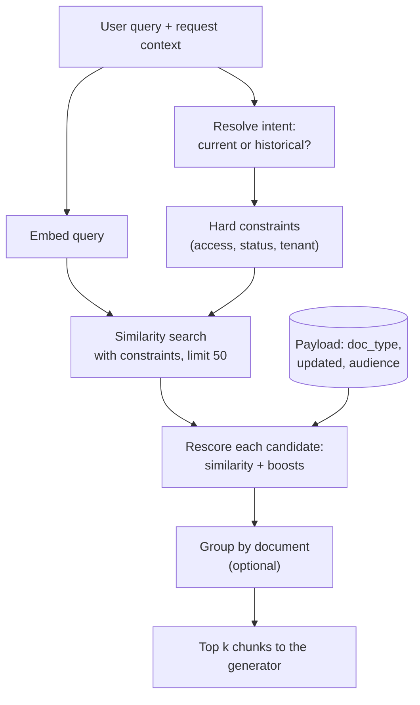

A similarity score answers one question: *how close is this chunk's meaning to the query's?* It has no idea whether the chunk comes from the handbook that was replaced two years ago, from an official runbook or from a half-remembered forum post, or whether it applies to the person asking. Those facts live in the chunk's metadata. **Metadata-aware retrieval** is the practice of letting that metadata take part in retrieval itself: as constraints, as ranking signals, as part of what gets embedded, and as rules for how results are grouped.

Earlier modules built the pieces. [Document metadata](/learn/document-engineering/document-metadata) designed the fields, [Metadata](/learn/vector-database-fundamentals/metadata) stored them as payloads, and [Filtering](/learn/vector-database-fundamentals/filtering) and [Metadata filtering](/learn/advanced-vector-database-engineering/metadata-filtering) showed how a database executes a filtered search. This lesson is about the retrieval *design* above all that: deciding, field by field, what role metadata should play when a question arrives, and expressing soft preferences such as "prefer official, recent sources" as a scoring formula you can reason about. The next lesson, [Filtered retrieval](/learn/advanced-retrieval/filtered-retrieval), takes the hard-constraint role further.

## Learning objectives

- Classify a metadata field into one of four retrieval roles (constraint, ranking signal, representation, result shaping) and justify the choice.
- Write a combined score that adds recency and authority boosts to similarity, and compute it by hand.
- Calculate the boost weight needed for one candidate to overtake another, and explain what that weight implies about relevance.
- Implement a filter plus score-boosting query in Qdrant with a two-stage prefetch and rescore.
- Identify where query-side metadata comes from and which sources can be trusted.

## Prerequisites

- [Document metadata](/learn/document-engineering/document-metadata): the fields a chunk carries and where they come from.
- [Metadata](/learn/vector-database-fundamentals/metadata) and [Filtering](/learn/vector-database-fundamentals/filtering): payloads and filtered vector search.
- [Semantic search](/learn/dense-retrieval/semantic-search): similarity search with embeddings.
- [Top-K retrieval](/learn/retrieval-fundamentals/top-k-retrieval): why only the order of scores matters.

## Why this matters

Most real document collections contain several kinds of text that look alike to an embedding model but are not equally useful. Meridian's index holds the 2023 handbook alongside the current one, because HR wants old versions kept for reference. It holds official runbooks alongside staff forum posts. To a similarity function, "Laptops are replaced every four years" (2023) and "Staff laptops follow a 3-year refresh cycle" (current) are both excellent matches for "How often are laptops replaced?". Often the *wrong* one scores higher, for reasons that have nothing to do with correctness: shorter text, closer wording, or phrasing that happens to mirror the question.

Three failure patterns recur:

- **Stale answers.** A superseded document outranks its replacement because its wording is closer to the query. The model answers confidently from it, and nothing in the answer reveals the problem.
- **Unofficial answers.** A forum post that *asks* the user's question scores highly, because questions are similar to questions. It may contain a guess, or no answer at all, and it takes a slot in the top k that an authoritative source should have had.
- **Inapplicable answers.** A policy that applies to permanent staff is returned to a contractor, or a UK procedure to someone in another office.

No embedding model can fix these, because the information needed is not in the text the model sees. It is in the metadata. A retriever that ignores metadata is throwing away the most reliable signals it has.

## The intuition

Picture an experienced reference librarian at Meridian. You ask how often laptops are replaced. She does not simply hand you the page whose wording best matches your sentence. Without being asked, she:

- takes the 2023 handbook off the pile, because it has been replaced (unless you said you wanted the old rule);
- prefers the official handbook to a note pinned on the staff notice board, even though the note is worded almost exactly like your question;
- leans towards the newer of two otherwise equal documents;
- and gives you one page from each relevant document rather than three pages from the same one.

The first is a **rule**: some documents are simply out. The second and third are **preferences**: they tip the balance between good candidates but never make an irrelevant document win. The fourth is about **presentation**. A metadata-aware retriever does all four, and the craft lies in putting each piece of metadata into the right category.

## How it works

### Four roles for metadata at retrieval time

| Role | What it does | Typical fields | Failure if misused |
| --- | --- | --- | --- |
| **Constraint** (hard filter) | Removes chunks from consideration entirely | access groups, tenant, language, version status | A wrong filter makes the right chunk invisible |
| **Ranking signal** (soft boost or penalty) | Adjusts the score of chunks that are already candidates | updated date, source type, audience, owner | A heavy weight lets an irrelevant chunk win |
| **Representation** | Becomes part of the text that is embedded or keyword-indexed | title, section path, product name | Noise in the vector if overdone |
| **Result shaping** | Changes how results are grouped or deduplicated | document id, version id | Several near-identical chunks crowd out others |

**Constraints** are covered in depth by the filtering lessons and [Filtered retrieval](/learn/advanced-retrieval/filtered-retrieval). The defining property is that no amount of similarity can bring a filtered-out chunk back.

**Representation** means putting metadata into the text itself, for example prefixing each chunk with "Employee handbook (2025) > Equipment > Laptops" before embedding it. This helps when users name the document or section in their question, and when a chunk on its own is ambiguous. [Document metadata](/learn/document-engineering/document-metadata) introduced the idea; [Contextual retrieval](/learn/advanced-retrieval/contextual-retrieval) takes it further by having a model write that context.

**Result shaping** stops one long document from filling the top k. Qdrant, for example, offers grouped queries (`query_points_groups` with a `group_by` payload key and a `group_size`) that return the best few chunks *per document* rather than overall.

The rest of this lesson concentrates on **ranking signals**, because they are the role most often missing from a first system, and the one that needs the most care to get right.

### Choosing a role for each field

Ask three questions about each field, in this order:

1. **Is a violation ever acceptable?** If showing a chunk that fails the condition would be a security, legal or correctness error (another tenant's data, a document the user may not read, a draft that was never approved), the field is a **constraint**. Security conditions are always constraints and never boosts: a penalty, however large, can be outweighed.
2. **Does the right answer depend on what the user is asking?** Version status is the classic case. For "How often are laptops replaced?" the superseded handbook is wrong. For "What was the laptop policy before 2025?" it is the only right answer. Such fields are **conditional constraints**: applied by default and lifted when the query's intent calls for it.
3. **Is it a preference between otherwise good candidates?** Recency, source authority and audience match usually are. A two-year-old runbook that answers the question beats a fresh one that does not. These fields are **ranking signals**.

### Where query-side metadata comes from

A boost or filter compares a chunk's metadata with something about the query. That something has four possible sources, and they differ sharply in trustworthiness:

- **Request context**: the authenticated user's identity, groups, employment type and office, supplied by your own backend. Trustworthy, and the only acceptable source for security constraints.
- **Explicit user choices**: a product selector or a "search the 2023 handbook" toggle in the interface. Trustworthy as a statement of intent, but must still be validated against what the user may see.
- **The query text**: "in the 2023 handbook", "for Meridian Relay". Extracting these with a language model is the subject of [Self-query retrieval](/learn/advanced-retrieval/self-query-retrieval). Useful, but the extraction can be wrong, so extracted conditions are better used as preferences or confirmed defaults than as unconditional filters.
- **Policy defaults**: "current documents only", "prefer official sources". Set by the team that owns the system and applied unless something overrides them.

### Ranking signals in practice

The commonest ranking signals are:

- **Recency.** Newer content is more likely to be correct for policies and procedures. It is usually expressed as a **decay function** of the document's age, so that the boost fades smoothly rather than dropping off a cliff at an arbitrary date.
- **Authority.** Official sources (the handbook, approved runbooks) are preferred to informal ones (forum posts, chat exports). Usually a fixed bonus per source type.
- **Audience match.** A chunk tagged for contractors gets a bonus when a contractor asks.
- **Engagement.** Click or feedback counts; beware the loop in which whatever is shown first gets clicked and so stays first.

The safest way to combine them with similarity is **retrieve, then rescore**:

1. Run the similarity search with any hard constraints applied, and fetch a candidate set that is larger than you need (for example 50 when you will keep 5).
2. For each candidate, compute a final score: similarity plus weighted boosts.
3. Sort the candidates by the final score and keep the top k.

Because boosts are applied only to candidates that were already similar enough to make the first cut, a heavily boosted but irrelevant document cannot appear from nowhere. The candidate limit is a safety rail as well as a performance measure.



### Doing it in the database or in your application

You can rescore in application code (fetch 50 candidates with payloads, compute the formula in Python) or server-side. Elasticsearch and OpenSearch have long offered a `function_score` query with decay functions. Qdrant added formula-based rescoring to its Query API: a `FormulaQuery` evaluated over the results of a `Prefetch`, where `$score` stands for the prefetch score and payload conditions, arithmetic and decay expressions can be combined. Server-side rescoring avoids transferring payloads; application-side rescoring is easier to unit-test and to port. Either way, keep the formula in one place, versioned with the rest of your retrieval configuration.

## The mathematics

### Exponential recency decay

**Intuition.** A document's recency bonus should halve every fixed period, so that a one-year-old document gets half the bonus of a brand-new one and a two-year-old document a quarter.

$$
r(a) = 0.5^{\,a / h}
$$

$a$ is the document's age (here in days), $h$ is the **half-life**, the age at which the bonus has fallen to one half, and $r(a)$ runs from 1 for a brand-new document towards 0 for a very old one. Qdrant's `ExpDecayExpression` computes exactly this shape when `midpoint` is 0.5 and `scale` is the half-life.

### The combined score

$$
s_{\text{final}} = s_{\text{sim}} + w_a \cdot A + w_r \cdot r(a)
$$

$s_{\text{sim}}$ is the similarity score from the vector search (here a cosine), $A$ is 1 for an official source and 0 otherwise, $w_a$ is the authority weight and $w_r$ the recency weight. The weights are in **similarity units**: $w_a = 0.15$ means "being official is worth as much as 0.15 of cosine similarity".

### The break-even weight

**Intuition.** If an unofficial chunk $u$ outscores an official chunk $o$ on similarity, the authority weight must cover the gap, including any recency difference, before $o$ can win.

$$
w_a > \big(s_{\text{sim}}(u) + w_r\, r(a_u)\big) - \big(s_{\text{sim}}(o) + w_r\, r(a_o)\big)
$$

**By hand.** These are the numbers from the code below, with "now" fixed at 1 November 2026, a half-life of 365 days and $w_r = 0.05$.

- Forum post: similarity 0.938, updated 42 days ago. $r = 0.5^{42/365} = 0.9233$, recency bonus $0.05 \times 0.9233 = 0.046$.
- Current handbook: similarity 0.658, updated 636 days ago. $r = 0.5^{636/365} = 0.2990$, recency bonus $0.05 \times 0.2990 = 0.015$.
- Break-even: $w_a > (0.938 + 0.046) - (0.658 + 0.015) = 0.984 - 0.673 = 0.311$.

So an authority weight of 0.15 cannot lift the handbook above the forum post, and 0.40 can. This calculation is the real lesson: a weight of 0.31 says "an official document beats an unofficial one unless the unofficial one is at least 0.31 more similar". That is a strong statement. On another query it would also let an official but barely relevant chunk beat a forum post that contains the actual answer. Before choosing a weight, look at how spread out your similarity scores are; a boost of 0.1 is enormous for a model whose relevant and irrelevant scores differ by 0.05, and negligible for one where they differ by 0.5.

```python
half_life, w_rec = 365, 0.05
forum = 0.938 + w_rec * 0.5 ** (42 / half_life)
handbook = 0.658 + w_rec * 0.5 ** (636 / half_life)
print(f"forum with recency:    {forum:.3f}")
print(f"handbook with recency: {handbook:.3f}")
print(f"break-even w_auth:     {forum - handbook:.3f}")
```

```output
forum with recency:    0.984
handbook with recency: 0.673
break-even w_auth:     0.311
```

## In code

**The problem.** Meridian's index contains a superseded handbook, the current handbook, a runbook and a forum post. Show what plain similarity returns, then add a hard status filter, then add authority and recency boosts, and observe what each layer fixes.

**Dependencies.** Qdrant's Python client in local in-memory mode (no server), and Sentence Transformers for embeddings. The first run downloads the small `all-MiniLM-L6-v2` model.

```bash
pip install qdrant-client sentence-transformers
```

The `FormulaQuery` used here needs a recent Qdrant (the feature arrived in 2025, in the 1.14 line); this example was run with `qdrant-client` 1.20 in local mode. Check the documentation for your server version before relying on it.

```python
from qdrant_client import QdrantClient, models
from sentence_transformers import SentenceTransformer

NOW = "2026-11-01T00:00:00Z"          # fixed "now" so the output is reproducible
chunks = [
    ("hb23-laptop",  "handbook", "superseded", "2023-01-09", "Laptops are replaced every four years."),
    ("hb25-laptop",  "handbook", "current",    "2025-02-03", "Staff laptops follow a 3-year refresh cycle, managed by IT."),
    ("forum-laptop", "forum",    "current",    "2026-09-20", "Does anyone know how often laptops are replaced? Mine is five years old."),
    ("rb-lost",      "runbook",  "current",    "2026-04-02", "Report a lost laptop to the support desk at once."),
    ("hb23-support", "handbook", "superseded", "2023-01-09", "The support desk is open from 09:00 to 17:00 UK time."),
    ("hb25-support", "handbook", "current",    "2025-02-03", "Support desk hours are 08:00 to 18:00 UK time."),
]

model = SentenceTransformer("sentence-transformers/all-MiniLM-L6-v2")
client = QdrantClient(":memory:")                     # local mode, no server needed
client.create_collection(
    "askmeridian",
    vectors_config=models.VectorParams(size=384, distance=models.Distance.COSINE),
)
vectors = model.encode([c[4] for c in chunks], normalize_embeddings=True)
client.upsert("askmeridian", points=[
    models.PointStruct(
        id=i, vector=v.tolist(),
        payload={"chunk_id": cid, "doc_type": dt, "status": st, "updated": f"{up}T00:00:00Z"},
    )
    for i, ((cid, dt, st, up, _), v) in enumerate(zip(chunks, vectors))
])

CURRENT_ONLY = models.Filter(must=[
    models.FieldCondition(key="status", match=models.MatchValue(value="current")),
])

def boosted(w_auth, w_rec=0.05):
    """score = similarity + w_auth * is_official + w_rec * recency (half-life one year)."""
    is_official = models.FieldCondition(key="doc_type", match=models.MatchAny(any=["handbook", "runbook"]))
    recency = models.ExpDecayExpression(exp_decay=models.DecayParamsExpression(
        x=models.DatetimeKeyExpression(datetime_key="updated"),
        target=models.DatetimeExpression(datetime=NOW),
        scale=365 * 24 * 3600,            # seconds: one year ...
        midpoint=0.5,                     # ... at which the decay equals 0.5
    ))
    return models.FormulaQuery(formula=models.SumExpression(sum=[
        "$score",                                          # the prefetch similarity
        models.MultExpression(mult=[w_auth, is_official]),  # condition evaluates to 1 or 0
        models.MultExpression(mult=[w_rec, recency]),
    ]))

def search(query, mode, w_auth=0.0, k=3):
    qv = model.encode([query], normalize_embeddings=True)[0].tolist()
    flt = None if mode == "similarity" else CURRENT_ONLY
    if mode == "boost":
        hits = client.query_points(
            "askmeridian",
            prefetch=models.Prefetch(query=qv, filter=flt, limit=50),  # candidates first
            query=boosted(w_auth),                                     # then re-score them
            limit=k,
        ).points
    else:
        hits = client.query_points("askmeridian", query=qv, query_filter=flt, limit=k).points
    return [(h.payload["chunk_id"], h.score) for h in hits]

runs = [
    ("When is the support desk open?",   "similarity", 0.0),
    ("When is the support desk open?",   "filter",     0.0),
    ("How often are laptops replaced?",  "similarity", 0.0),
    ("How often are laptops replaced?",  "filter",     0.0),
    ("How often are laptops replaced?",  "boost",      0.15),
    ("How often are laptops replaced?",  "boost",      0.40),
]
for query, mode, w in runs:
    label = mode if mode != "boost" else f"filter + boost, w_auth={w}"
    hits = search(query, mode, w)
    print(f"{query} [{label}]")
    print("   " + "   ".join(f"{cid} {score:.3f}" for cid, score in hits))
```

```output
When is the support desk open? [similarity]
   hb23-support 0.851   hb25-support 0.626   rb-lost 0.339
When is the support desk open? [filter]
   hb25-support 0.626   rb-lost 0.339   hb25-laptop 0.288
How often are laptops replaced? [similarity]
   forum-laptop 0.938   hb23-laptop 0.867   hb25-laptop 0.658
How often are laptops replaced? [filter]
   forum-laptop 0.938   hb25-laptop 0.658   rb-lost 0.408
How often are laptops replaced? [filter + boost, w_auth=0.15]
   forum-laptop 0.984   hb25-laptop 0.823   rb-lost 0.591
How often are laptops replaced? [filter + boost, w_auth=0.4]
   hb25-laptop 1.073   forum-laptop 0.984   rb-lost 0.841
```

**The important lines.**

- `payload={... "updated": "2025-02-03T00:00:00Z"}` stores the date as an RFC 3339 string, which Qdrant can read as a datetime inside a formula.
- `CURRENT_ONLY` is a hard constraint. It is passed as `query_filter` for a plain search and as the `filter` of the `Prefetch` for the boosted one, so it applies before any scoring.
- `models.Prefetch(query=qv, filter=flt, limit=50)` is stage one: the 50 most similar chunks that pass the filter. The formula only ever sees these.
- `"$score"` inside `SumExpression` refers to the prefetch's similarity score.
- `MultExpression(mult=[w_auth, is_official])` multiplies the weight by a condition. A condition inside a formula evaluates to 1 when it matches and 0 when it does not, so this adds `w_auth` to official chunks only.
- `ExpDecayExpression` with `midpoint=0.5` and `scale` of one year is the half-life decay from the mathematics section. For datetime inputs the scale is in seconds.

**What the output means.**

- **Support hours.** Plain similarity puts the superseded 2023 hours (0.851) well above the current ones (0.626). The 2023 sentence ("is open from ... to ...") simply mirrors the question's wording better. The status filter removes it, and the current hours come first. One hard constraint fixed this query completely.
- **Laptops, similarity only.** The forum post comes first (0.938): a question is very similar to a question. The superseded handbook is second. The correct chunk is third.
- **Laptops, filter.** The superseded chunk is gone, but the forum post still leads by 0.28. Filtering cannot fix this, because the forum post is current and the user may see it.
- **Laptops, boost with 0.15.** Every current chunk gains about 0.15 to 0.18, and the forum post gains 0.046 from recency alone. The gap narrows but the order does not change, as the break-even calculation predicted.
- **Laptops, boost with 0.40.** Now the handbook leads (1.073 against 0.984). Scores above 1 are expected: the formula output is no longer a cosine, so do not apply cosine-based thresholds to it.

The honest conclusion is that a weight of 0.40 is a policy decision, not a tuning detail. If forum posts should only ever supplement official sources, the cleaner design may be a hard rule (forum posts excluded by default, or capped at one slot), which is a result-shaping choice rather than a boost.

**Errors people commonly hit.**

- Storing dates as `"09/01/2023"` or as Python `date` objects converted with `str()` in inconsistent formats. Decay functions need a datetime the engine can parse; a field it cannot read falls back to the formula's default value, or makes the query fail.
- Forgetting the `Prefetch` limit and leaving the default. If the candidate set is smaller than k after filtering, the boosts cannot help.
- Applying a score threshold tuned for raw cosine to boosted scores.

**Extending it.** Add an `audience` field and a third boost for chunks whose audience includes the requester's employment type, taken from request context. Exercise 3 adds intent detection that lifts the status filter.

## A real-world example

When Meridian's HR team published the 2025 handbook, the Platform team indexed it alongside the 2023 edition, which HR wanted kept for staff who needed to check what had changed. Within days, the support desk reported that AskMeridian was telling people their laptops would be replaced every four years and that the support desk closed at 17:00. Both answers were quoted correctly from a real document; the document had just been replaced.

Amara, the engineer who picked up the ticket, first proposed deleting the 2023 handbook, but HR refused, and deletion would also have broken the legitimate question "what changed in the 2025 handbook?". Instead the team added a `status` field to every handbook chunk during ingestion, applied `status = current` as a default filter, and added a small rule that lifted the filter when the query mentioned an earlier year or words such as "previous" or "old policy". They logged every query in which the rule fired.

Two weeks later a second pattern appeared: questions about laptops were being answered from a staff forum that had been indexed for "community knowledge". The answers were vague because the forum posts were mostly questions. The team experimented with authority boosts and found, as in the code above, that the weight needed to lift the handbook was large enough to distort other queries. They settled on a different design: forum posts were kept in the index but limited to at most one of the five context slots, and only when they cleared the similarity threshold on their own. The decision record they wrote down was short: *status is a constraint with an intent override; authority is a quota, not a boost; recency is a gentle boost with a one-year half-life*.

## Common mistakes

- **Treating every field as a filter.** Hard date windows or source restrictions hide the one older or unofficial document that answers the question. Preferences belong in the score.
- **Treating access control as a boost.** A penalty can be outweighed by a high similarity; a user then sees a document they should not. Security conditions are always constraints.
- **Choosing weights without looking at score spread.** A boost that is small relative to the gap between relevant and irrelevant scores does nothing; one that is large swamps relevance. Both happen silently.
- **Boosting before candidate selection.** Adding boosts across the whole collection lets an official but irrelevant document beat relevant ones. Rescore a similarity-selected candidate set.
- **Hard-coding "now".** Using the indexing time instead of the query time for recency makes every document's age wrong by the time since the last reindex.
- **Applying cosine thresholds to boosted scores.** The final score has a different scale; a "minimum relevance 0.5" rule now means something else.
- **Assuming a superseded document is always wrong.** Historical questions exist, and deleting or permanently filtering old versions breaks them.

## Best practices

- Write down, for each metadata field, its role (constraint, conditional constraint, ranking signal, representation or shaping) and the reason. Review it when fields are added.
- Take security constraints only from authenticated request context, never from the query text or a model's interpretation of it.
- Use retrieve-then-rescore with a generous candidate limit (tens, not k), and apply hard constraints in the first stage.
- Express weights in similarity units and justify each with a break-even calculation on real queries.
- Keep the boost formula small: two or three signals. Each additional signal interacts with the others and makes the ranking harder to explain.
- Evaluate with queries that exercise each signal: stale-versus-current pairs, official-versus-informal pairs, and historical questions that should *not* be filtered.
- Log the components of the final score (similarity, each boost) for every returned chunk, so a surprising ranking can be explained.

## Performance considerations

Metadata-aware retrieval is cheap relative to everything else in the request. Rescoring 50 candidates with a three-term formula is a few hundred arithmetic operations, negligible next to an embedding call or a generation call.

The costs that matter are elsewhere:

- **Candidate limit.** A larger prefetch costs more index search work. In an HNSW index, the search list must be at least as large as the number of candidates requested, so asking for 200 rather than 50 roughly quadruples the candidate list the search maintains. Pick the smallest limit that still contains the right chunk on your evaluation set.
- **Payload transfer.** Application-side rescoring returns payloads for every candidate: 50 candidates of 1 KB is about 50 KB per query, trivial at ten queries per second and worth avoiding at a thousand.
- **Filter selectivity.** Default constraints such as `status = current` usually remove a minority of the collection and so are cheap. Restrictive ones bring in the planning problems described in [Metadata filtering](/learn/advanced-vector-database-engineering/metadata-filtering). Create payload indexes for every field used in filters or formulas.

## Security considerations

Ranking signals are an attack surface whenever the people who write documents can influence the metadata that earns boosts. If authors can set `doc_type: handbook` on their own uploads, or push `updated` into the future, they can lift their content above official sources. Derive authority and status fields from the source system (which repository, which approval workflow) during ingestion, not from document front matter that anyone can edit, and validate dates against sensible bounds.

Access control must never be implemented as a ranking signal, and conditions extracted from the query text must never widen what a user can see. [Document-level permissions](/learn/access-control-and-privacy/document-level-permissions) covers enforcement properly.

## Summary

- Similarity cannot see whether a chunk is current, official or applicable to the user; metadata can, and retrieval should use it.
- Metadata plays four roles: constraint, ranking signal, representation and result shaping. Choosing the right role per field is the core design decision.
- Security and correctness conditions are constraints; intent-dependent conditions such as version status are constraints with an override; preferences such as recency and authority are ranking signals.
- Combine signals by retrieving candidates on similarity (with constraints) and rescoring them with a small, explicit formula whose weights are in similarity units.
- A break-even calculation turns an abstract weight into a concrete statement about relevance, and often shows that a quota or rule is cleaner than a large boost.

## Exercises

**1.** Using the formula and weights from the code ($w_r = 0.05$, half-life 365 days, $w_a = 0.15$), compute the final score of the runbook chunk `rb-lost` for the laptop query. Its similarity is 0.408 and it was updated 213 days before "now". Check your answer against the output.

<details><summary>Show solution</summary>

Recency: $r = 0.5^{213/365} = 0.5^{0.5836} \approx 0.6673$, so the recency bonus is $0.05 \times 0.6673 = 0.0334$. The runbook is official, so the authority bonus is $0.15$. Final score: $0.408 + 0.15 + 0.0334 = 0.5914$, which matches the 0.591 in the output.

</details>

**2.** Classify each Meridian field by role and give a one-line reason: `allowed_groups`, `language`, `updated`, `doc_type`, `section_path`, `document_id`, `status`.

<details><summary>Show solution</summary>

- `allowed_groups`: **constraint**. Showing a chunk to someone outside the groups is a security failure.
- `language`: usually a **constraint** with a fallback (return English if nothing exists in the user's language), because an answer in the wrong language is rarely useful; a ranking signal is defensible for bilingual staff.
- `updated`: **ranking signal** (recency decay). Age makes a document less likely to be right, not certainly wrong.
- `doc_type`: **ranking signal** or **shaping** (a quota for informal sources), depending on how strongly you prefer official content.
- `section_path`: **representation**. Prefixing it to the chunk text helps queries that name a section and disambiguates short chunks.
- `document_id`: **result shaping**. Group by it so that one long document does not fill the top k.
- `status`: **conditional constraint**. Current-only by default, lifted for historical questions.

</details>

**3.** Extend the code example with a function `resolve_status_filter(query)` that returns `None` (no status constraint) when the query mentions a year earlier than 2025 or contains "previous", "old" or "used to", and `CURRENT_ONLY` otherwise. Test it on "What was the laptop policy in 2023?" and "How often are laptops replaced?". What risk does this rule carry, and how would you monitor it?

<details><summary>Show solution</summary>

```python
import re

HISTORICAL_WORDS = ("previous", "old ", "used to", "before")

def resolve_status_filter(query):
    q = query.lower()
    years = [int(y) for y in re.findall(r"\b(20\d\d)\b", q)]
    if any(y < 2025 for y in years) or any(w in q for w in HISTORICAL_WORDS):
        return None
    return CURRENT_ONLY
```

Pass the result as `flt` in `search`. For "What was the laptop policy in 2023?" it returns `None`, so both handbooks are candidates and the 2023 chunk can rank first; for the present-tense question it returns the filter.

The risk is false positives: "old " also matches "my old laptop is slow, can I get a new one?", which then lets superseded policies back in. Monitor by logging every query where the override fires and sampling them weekly. A more robust version asks a language model to classify intent, which is the direction [Self-query retrieval](/learn/advanced-retrieval/self-query-retrieval) takes, but the same logging applies.

</details>

**4.** Design decision. Meridian wants to add 3,000 Slack threads from the #it-help channel. They are often the only place certain workarounds are written down, but many are outdated or wrong. Propose how they should take part in retrieval (filter, boost, quota or something else), and how you would decide the parameters.

<details><summary>Show solution</summary>

A sensible design combines three things. First, a **ranking penalty** relative to official sources (or equivalently no authority boost), so that when a runbook answers the question it wins. Second, a **quota**: at most one or two Slack chunks in the final context, so they can supplement but never crowd out official content. Third, a **stronger recency decay** for Slack content than for documents (a shorter half-life, such as 90 days), because workarounds go stale quickly. Consider also a constraint that excludes threads older than a cut-off entirely, if the IT team agrees that anything older is more likely wrong than right.

To set the parameters, build an evaluation set with three kinds of question: those answered only by runbooks, those answered only by Slack, and those answered by both (where the runbook should win). Measure, for each setting of penalty, quota and half-life, how often the correct source appears in the top k for each kind. Choose the setting that keeps the runbook-only and both-sources groups at their current quality while lifting the Slack-only group. Write the decision and the numbers down, because these parameters will be questioned later.

</details>

## Check your understanding

```quiz
[
  {
    "q": "A chunk must never be shown to users outside the Legal group. Which role should the `allowed_groups` field play?",
    "options": [
      "A ranking signal with a large negative weight for non-members",
      "Representation: add the group name to the embedded text",
      "A hard constraint applied before scoring",
      "Result shaping: group results by `allowed_groups`"
    ],
    "answer": 2,
    "why": "Security conditions must be constraints. Any finite penalty can be outweighed by a high enough similarity score."
  },
  {
    "q": "With final = similarity + w * is_official, an unofficial chunk has similarity 0.80 and an official one 0.62 (no other boosts). What is the smallest w that makes the official chunk win?",
    "options": [
      "Any w greater than 0.18",
      "Any w greater than 0.62",
      "Any w greater than 0.80",
      "Any w greater than 1.0"
    ],
    "answer": 0,
    "why": "The official chunk wins when 0.62 + w > 0.80, that is when w exceeds the similarity gap of 0.18."
  },
  {
    "q": "Why apply boosts to a prefetched candidate set rather than to every chunk in the collection?",
    "options": [
      "Because vector databases cannot read payloads during a full scan",
      "So that a heavily boosted but irrelevant chunk cannot reach the top k without first being similar to the query",
      "Because boosts only work on normalised vectors",
      "So that recency can be computed at indexing time"
    ],
    "answer": 1,
    "why": "The first stage guarantees relevance; boosts then reorder good candidates. Boosting everything lets metadata override relevance."
  },
  {
    "q": "A user asks \"What was the support desk's opening time under the 2023 handbook?\" and the system applies `status = current` unconditionally. What happens?",
    "options": [
      "The 2023 hours are returned because they match the query best",
      "The query fails with a filter error",
      "Both versions are returned and the model chooses",
      "The 2023 chunk is invisible, so the answer comes from the current handbook or is refused"
    ],
    "answer": 3,
    "why": "A hard filter removes the superseded chunk entirely. Version status is intent-dependent, so it needs an override for historical questions."
  },
  {
    "q": "With a half-life of 180 days, what recency value does a 360-day-old document get under r = 0.5^(age/half-life)?",
    "options": [
      "0.5",
      "0.25",
      "0.0",
      "0.125"
    ],
    "answer": 1,
    "why": "360 days is two half-lives, so the value is 0.5 squared, which is 0.25."
  }
]
```

## Further reading

- Manning, Raghavan and Schütze (2008), *Introduction to Information Retrieval*, section 6.1, "Parametric and zone indexes" (weighted scoring over document fields). Free online at [nlp.stanford.edu/IR-book](https://nlp.stanford.edu/IR-book/).
- Qdrant documentation, [qdrant.tech/documentation](https://qdrant.tech/documentation/): the Query API pages on hybrid queries and score boosting with formulas, and grouping.
- Elasticsearch documentation, [function score query](https://www.elastic.co/guide/en/elasticsearch/reference/current/query-dsl-function-score-query.html): decay functions and field-based boosting in a long-established engine.
- Li and Croft (2003), "Time-based language models", *Proceedings of CIKM 2003*: an early study of incorporating document recency into retrieval scoring.
