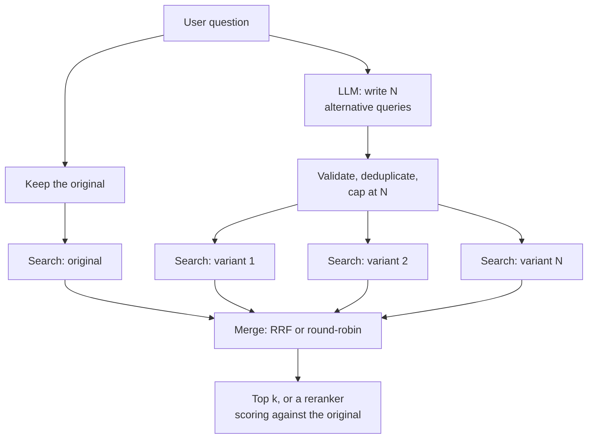

A single query embedding is a single guess at where the answer lives in vector space. If the user's wording is unusual, or the question touches several topics at once, that one guess can land among chunks that are near the words but far from what the user needs. **Multi-query retrieval** hedges the guess: a language model rewrites the question into several alternative queries, each is run as a separate search, and the result lists are merged into one. It is one of the simplest query-side techniques to add to a RAG pipeline, and one of the easiest to get subtly wrong, because the way you merge the lists matters as much as the variants themselves.

This lesson covers how variants are generated, why they help, the two main ways to merge their results and when each is right, and what the technique costs. Its siblings take different routes from one question to several searches: [Query decomposition](/learn/advanced-retrieval/query-decomposition) splits a question into sub-questions that are answered separately, [Query rewriting](/learn/advanced-retrieval/query-rewriting) replaces one query with a single better one, and [HyDE](/learn/advanced-retrieval/hyde) searches with a hypothetical answer instead of a question.

## Learning objectives

- Explain why one query embedding can miss relevant chunks that alternative phrasings find.
- Generate query variants with a language model using a structured-output call, and validate them.
- Merge per-variant results with Reciprocal Rank Fusion and with round-robin interleaving, and choose between them for a given question type.
- Compute a fused RRF score by hand and explain why it rewards chunks that appear in many lists.
- Estimate the latency and cost of multi-query retrieval and decide when it is worth running.

## Prerequisites

- [Semantic search](/learn/dense-retrieval/semantic-search) and [Query embeddings](/learn/dense-retrieval/query-embeddings): how a query becomes a vector and is matched.
- [Recall@K](/learn/retrieval-fundamentals/recall-k): the metric used to judge the technique.
- [Reciprocal Rank Fusion](/learn/hybrid-search/reciprocal-rank-fusion): the standard way to merge rankings, introduced for hybrid search.
- [Query expansion](/learn/hybrid-search/query-expansion): adding terms to one query, a close relative.

## Why this matters

Retrieval failures caused by the query, rather than by the index, come in a few recognisable shapes:

- **Wording mismatch.** The user says "WFH kit allowance"; the handbook says "home-office equipment budget". An embedding model bridges some of this gap, but not all of it, especially for slang, abbreviations and internal jargon.
- **Mixed intent.** "I'm a new starter and I'll mostly be working from home. What do I need to know?" contains two topics. The embedding of the whole sentence is a blend, and a blend can sit closer to chunks about one topic (here, onboarding) than to anything about the other.
- **Vague questions.** "What are the rules for remote work?" could be about days per week, equipment, security or expenses. One vector cannot point at all of them.

In each case the right chunks exist and would be found by a better-phrased query. The user does not know what the better phrasing is, but a language model can propose several, and it costs very little to try them all.

## The intuition

Imagine asking three colleagues to search Meridian's intranet for you. You tell each the same question, and each types a different search: one thinks about remote-working days, one about the equipment budget, one about VPN rules. You then pool their findings.

Two ways of pooling suggest themselves. You could hold a **vote**: documents that several colleagues found go to the top. That is good when they were all searching for the same thing in different words, because a document everyone found is probably the right one. Or you could **take turns**: each colleague's best find, then each one's second-best, and so on. That is better when they were searching for different parts of your question, because a vote would bury the one document that only the VPN-minded colleague was ever going to find.

Multi-query retrieval is this, with a language model writing the searches. The choice between voting and taking turns is the part most implementations get wrong.

## How it works

### The pipeline

1. **Generate variants.** Send the user's question to a language model with instructions to produce N alternative search queries (typically 3 to 5). Ask for structured output so the result is a list, not prose.
2. **Validate and deduplicate.** Drop empty or near-duplicate variants, cap the count, and always keep the original question as one of the queries.
3. **Retrieve for each query.** Run the normal retriever (dense, sparse or hybrid) once per query, ideally in parallel, each returning a short list.
4. **Merge.** Fuse the lists into one ranking with RRF or interleave them round-robin, removing duplicates.
5. **Truncate.** Keep the top k of the merged list, or pass a larger set to a [reranker](/learn/reranking-fundamentals/why-reranking-is-needed), which scores every candidate against the *original* question.



### Writing the variant prompt

The prompt decides what kind of variants you get, and so which merge is appropriate. Two styles are common:

- **Paraphrase variants** restate the same need in different words: "home-office equipment budget", "allowance for a desk and monitor at home", "WFH kit reimbursement". They target wording mismatch.
- **Perspective variants** approach the question from different angles, each emphasising one aspect: remote days, equipment, security. They target mixed and vague intent.

Good prompts share a few features. They say what the variants are for ("search queries against an internal knowledge base"), ask for self-contained queries that do not depend on the conversation, forbid answering the question, and tell the model to keep identifiers (error codes, product names) exactly as written. They also ask for a fixed maximum number, because more variants mean more searches.

### Merging: vote or take turns

**Reciprocal Rank Fusion** gives each chunk a score of $1/(c + \text{rank})$ in every list it appears in and sums them; [Reciprocal Rank Fusion](/learn/hybrid-search/reciprocal-rank-fusion) derives it. It is a vote weighted by position, and it rewards **consensus**: a chunk ranked moderately in many lists beats a chunk ranked first in one. This is exactly right for paraphrase variants, where every list is trying to find the same thing and agreement is evidence. The open-source RAG-Fusion project popularised this combination of multi-query and RRF.

**Round-robin interleaving** takes the first result of every list, then the second of every list, and so on, skipping duplicates. It guarantees that each variant's best chunk reaches the merged list early. This is right for perspective variants, where each list is searching for a *different* part of the answer and agreement is often a sign of a generic, uninformative chunk.

You can also take the **union** of all results and let a [cross-encoder reranker](/learn/reranking-fundamentals/cross-encoders) sort it against the original question. For paraphrase variants this is usually the strongest option. For multi-aspect questions it has a catch: the reranker scores against the original question, so it inherits whatever emphasis that question's wording has. Exercise 3 shows this happening.

### What multi-query does not fix

- **Missing content.** If no chunk contains the answer, more searches find more irrelevant chunks.
- **Exact identifiers.** Variants of "error E-4021" are unlikely to beat a keyword search for the code. Instruct the model to preserve identifiers, and rely on [hybrid search](/learn/hybrid-search/dense-versus-sparse-retrieval) for them.
- **Questions that need chaining.** "Who owns the system that indexes the IT runbooks, and what are their support hours?" needs one answer before the next search can be written. That is [Query decomposition](/learn/advanced-retrieval/query-decomposition).

### Variants can drift

A language model asked for "different perspectives" will sometimes invent one the user did not mean: asked about remote work, it may add a variant about office parking. That variant's results enter the merge. Round-robin is more exposed to drift than RRF, because it gives every variant a guaranteed slot. Keeping the original question in the set, capping N, and reranking against the original question are the standard defences.

## The mathematics

### The RRF score of a chunk

$$
\text{RRF}(d) = \sum_{i=1}^{N} \frac{1}{c + r_i(d)}
$$

$N$ is the number of result lists (one per query), $r_i(d)$ is the rank of chunk $d$ in list $i$ (1 for the top), the term is omitted when $d$ is absent from list $i$, and $c$ is a constant, conventionally 60, that damps the advantage of the very top ranks.

**By hand**, with the lists from the code below and $c = 60$:

- `laptop` is 2nd in one list, 3rd in another and 5th in a third: $\frac{1}{62} + \frac{1}{63} + \frac{1}{65} = 0.016129 + 0.015873 + 0.015385 = 0.047387$.
- `vpn-wifi` is 1st in exactly one list: $\frac{1}{61} = 0.016393$.

A chunk that was never anyone's best answer outscores the only chunk about VPN rules by a factor of almost three. That is what "rewards consensus" means in numbers, and it is why RRF is a poor fit for perspective variants.

### Union recall and its limit

**Intuition.** If each query found a given relevant chunk independently with probability $p$, then running $N$ queries would miss it only if all of them did.

$$
P(\text{found by at least one}) = 1 - (1 - p)^{N}
$$

With $p = 0.5$ and $N = 4$: $1 - 0.5^4 = 1 - 0.0625 = 0.9375$. In practice the variants come from the same question and the same model, and they search the same index with the same embedding model, so their failures are strongly **correlated**: a chunk that one phrasing cannot reach is often unreachable by the others too. The formula is therefore an upper bound on the benefit, not a forecast. It explains why diversity among variants matters more than their number: two genuinely different variants are worth more than five near-paraphrases.

```python
c = 60
laptop = 1 / (c + 2) + 1 / (c + 3) + 1 / (c + 5)
vpn = 1 / (c + 1)
print(f"RRF(laptop)   = {laptop:.6f}")
print(f"RRF(vpn-wifi) = {vpn:.6f}   ratio {laptop / vpn:.2f}")
for n in (1, 2, 4, 8):
    print(f"N={n}: upper bound on union recall with p=0.5 -> {1 - 0.5 ** n:.4f}")
```

```output
RRF(laptop)   = 0.047387
RRF(vpn-wifi) = 0.016393   ratio 2.89
N=1: upper bound on union recall with p=0.5 -> 0.5000
N=2: upper bound on union recall with p=0.5 -> 0.7500
N=4: upper bound on union recall with p=0.5 -> 0.9375
N=8: upper bound on union recall with p=0.5 -> 0.9961
```

## In code

**The problem.** A new starter asks a two-part question. Show that a single query is dominated by one part, that variants recover the other, and that the merge strategy decides whether the recovered chunks reach the top.

**Dependencies.** NumPy and Sentence Transformers; no API key. The variant generator is a fixed stand-in so that the example is reproducible; the real LLM call follows it.

```bash
pip install numpy sentence-transformers
```

```python
import numpy as np
from sentence_transformers import SentenceTransformer

CHUNKS = {
    "remote-days":  "Staff may work remotely up to 3 days a week, agreed with their manager.",
    "equip-budget": "The home-office equipment budget is £400; contractors are not eligible.",
    "vpn-wifi":     "VPN is required whenever you connect from public Wi-Fi.",
    "expenses":     "Expenses must be submitted within 30 days; anything over £75 needs a receipt.",
    "leave":        "Annual leave is 25 days; up to 5 unused days carry over until 31 March.",
    "password":     "Passwords must be rotated every 90 days.",
    "laptop":       "Staff laptops follow a 3-year refresh cycle.",
    "support":      "The support desk is open 08:00 to 18:00 UK time.",
    "hot-desk":     "Hot desks in the London office are booked through the facilities app.",
    "lost":         "Report a lost laptop to the support desk at once.",
    "onboard-week": "New starters spend their first week on the onboarding programme.",
    "onboard-kit":  "New starters receive their laptop and badge on their first day.",
    "office-hours": "The London office building is open from 07:00 to 20:00.",
    "buddy":        "Every new starter is paired with an onboarding buddy from their team.",
    "parking":      "Parking at the London office is limited and allocated by facilities.",
}
IDS = list(CHUNKS)
RELEVANT = {"remote-days", "equip-budget", "vpn-wifi"}     # labelled by hand for this question

model = SentenceTransformer("sentence-transformers/all-MiniLM-L6-v2")
D = model.encode(list(CHUNKS.values()), normalize_embeddings=True)

def search(query, n=10):
    scores = D @ model.encode([query], normalize_embeddings=True)[0]
    return [IDS[i] for i in np.argsort(-scores)[:n]]

def generate_variants(question):
    """Stand-in for the LLM call shown later: these are the kind of variants it returns."""
    return [
        "How many days a week can staff work remotely?",
        "Is there a budget for home-office equipment?",
        "What security rules apply when working outside the office network?",
        "What happens in a new starter's first week?",
    ]

def rrf(rankings, k=60):
    fused = {}
    for ranking in rankings:
        for rank, cid in enumerate(ranking, start=1):
            fused[cid] = fused.get(cid, 0.0) + 1.0 / (k + rank)
    return sorted(fused, key=fused.get, reverse=True)

def round_robin(rankings):
    """Take each list's 1st result, then each list's 2nd, and so on, skipping duplicates."""
    merged = []
    for depth in range(max(len(r) for r in rankings)):
        for ranking in rankings:
            if depth < len(ranking) and ranking[depth] not in merged:
                merged.append(ranking[depth])
    return merged

def recall(results, k):
    return len(RELEVANT & set(results[:k])) / len(RELEVANT)

question = "I'm a new starter and I'll mostly be working from home. What do I need to know?"
queries = [question] + generate_variants(question)        # keep the original query
rankings = [search(q, n=5) for q in queries]               # retrieve for each, in parallel in production

print("Single query:  ", rankings[0])
for q, r in zip(queries[1:], rankings[1:]):
    print(f"  {q[:50]:<50} -> {r[:3]}")
results = {"single": rankings[0], "RRF": rrf(rankings), "round-robin": round_robin(rankings)}
for name, res in results.items():
    print(f"{name:<12} top 5 {res[:5]}  recall@3 {recall(res, 3):.2f}  recall@5 {recall(res, 5):.2f}")
```

```output
Single query:   ['onboard-week', 'buddy', 'onboard-kit', 'equip-budget', 'remote-days']
  How many days a week can staff work remotely?      -> ['remote-days', 'laptop', 'leave']
  Is there a budget for home-office equipment?       -> ['equip-budget', 'expenses', 'laptop']
  What security rules apply when working outside the -> ['vpn-wifi', 'remote-days', 'office-hours']
  What happens in a new starter's first week?        -> ['onboard-week', 'buddy', 'onboard-kit']
single       top 5 ['onboard-week', 'buddy', 'onboard-kit', 'equip-budget', 'remote-days']  recall@3 0.00  recall@5 0.67
RRF          top 5 ['remote-days', 'laptop', 'onboard-week', 'buddy', 'equip-budget']  recall@3 0.33  recall@5 0.67
round-robin  top 5 ['onboard-week', 'remote-days', 'equip-budget', 'vpn-wifi', 'buddy']  recall@3 0.67  recall@5 1.00
```

**The important lines.**

- `queries = [question] + generate_variants(question)` keeps the original. If every variant drifts, the original's results are still in the merge.
- `search(q, n=5)` keeps each list short. Longer lists give RRF more opportunities to reward chunks that are mediocre everywhere.
- `rrf()` and `round_robin()` take exactly the same input. Only the merge differs.
- `RELEVANT` labels the three remote-working chunks. The onboarding chunks are also useful for the new-starter half of the question; the ideal top 5 holds the three remote-working chunks plus one or two onboarding ones.

**What the output means.**

- **The single query is captured by one topic.** "New starter" pulls the three onboarding chunks to the top; the remote-working chunks are 4th and 5th and the VPN rule is missing. Recall at 3 is zero.
- **Each perspective variant finds its own target first.** The days, budget and security variants each rank the chunk they were aimed at in first place.
- **RRF promotes a generic chunk.** `laptop` reaches second place because it is 2nd, 3rd and 5th in three different lists, exactly the calculation in the mathematics section. `vpn-wifi`, first in one list only, does not make the top 5.
- **Round-robin covers both topics.** It interleaves each list's best result, so the top 5 contains all three remote-working chunks and two onboarding chunks. For perspective variants, it is the better merge.

On a different question, with paraphrase variants that all target the same chunk, RRF would be the better choice and round-robin would let the weakest variant's top result in. Measure both on your own evaluation set.

### Generating the variants with Claude

The call below replaces the stand-in. It was not executed for this lesson (it needs an API key), so no output is shown. It uses structured output so that the result is a validated list.

```bash
pip install anthropic pydantic
export ANTHROPIC_API_KEY=...   # your key
```

```python
import anthropic
from pydantic import BaseModel

class QueryVariants(BaseModel):
    variants: list[str]

client = anthropic.Anthropic()  # reads ANTHROPIC_API_KEY from the environment

SYSTEM = (
    "You write search queries for an internal company knowledge base. "
    "Given a user's question, write up to {n} alternative search queries that together "
    "cover the different things the user may need. Each query must be self-contained "
    "and under 15 words. Keep product names and error codes exactly as written. "
    "Do not answer the question."
)

def generate_variants(question: str, n: int = 4) -> list[str]:
    response = client.messages.parse(
        model="claude-opus-5-5",
        max_tokens=512,
        system=SYSTEM.format(n=n),
        messages=[{"role": "user", "content": question}],
        output_format=QueryVariants,
    )
    seen, cleaned = {question.strip().lower()}, []
    for v in response.parsed_output.variants:
        key = v.strip().lower()
        if key and key not in seen:          # drop empties and exact duplicates
            seen.add(key)
            cleaned.append(v.strip())
    return cleaned[:n]                       # enforce the cap even if the model ignores it
```

A smaller, faster model is usually adequate for writing search queries and cuts the latency this step adds; see the model overview in Anthropic's documentation for current options. Frameworks offer the same pattern ready-made: LangChain, for example, has a `MultiQueryRetriever` that wraps a retriever and a variant-generating model.

**Errors people commonly hit.**

- Letting the model answer instead of rephrasing, which turns the "variant" into a hypothetical answer. That is a different technique ([HyDE](/learn/advanced-retrieval/hyde)) with different behaviour; instruct against it.
- Parsing a numbered list out of free text with a regular expression, which breaks on the first unexpected format. Use structured output.
- Running the searches one after another. Four sequential searches cost four times the latency; run them concurrently.

**Extending it.** Write paraphrase variants for "Can I claim for a monitor for working at home?" and compare RRF and round-robin on that question; exercise 3 adds a reranker.

## A real-world example

AskMeridian's evaluation set showed that broad onboarding questions, the kind new staff ask in their first week, had the worst retrieval quality of any category. The questions were long and mixed several topics, and the retrieved chunks clustered on whichever topic dominated the sentence.

Ifeoma on the Platform team added multi-query retrieval with four variants and RRF, following a tutorial. The onboarding category improved slightly, but she noticed in the traces that a handful of generic chunks (the laptop refresh policy, the support desk hours) now appeared in the context for almost every broad question. They were mentioned moderately often in every variant's results, so RRF kept promoting them. Switching to round-robin fixed the onboarding questions but made a different category worse: short, precise questions such as "Can I expense a co-working pass?", where the variants were paraphrases and one weak variant's top result now took a context slot.

The team's final design made the variant type explicit. The generator was asked to label its output as either paraphrases or aspects; paraphrase sets were pooled and reranked with a cross-encoder, and aspect sets were reranked per variant and interleaved so that every aspect kept a slot. They also routed only questions longer than a threshold, or containing more than one clause, through multi-query; short questions went straight to the single-query path, saving the LLM call on the majority of traffic.

## Common mistakes

- **Using RRF for perspective variants.** Consensus rewards chunks that are vaguely related to every aspect and buries chunks that answer one aspect precisely.
- **Dropping the original query.** If the variants drift, nothing anchors the results to what the user asked.
- **Too many variants.** Beyond a handful, extra variants are mostly paraphrases of earlier ones; they add cost and amplify consensus effects without adding coverage.
- **Generating variants sequentially or searching sequentially.** Latency grows with N instead of staying roughly flat.
- **Letting variants alter identifiers.** A model that "helpfully" rewrites E-4021 as "VPN client error" has removed the one term that a keyword search would have matched.
- **Running multi-query on every question.** Short, precise questions rarely benefit, and every one pays for an LLM call.
- **Judging the technique by eye.** A few impressive examples prove nothing; measure recall per question category with and without it.

## Best practices

- Decide which kind of variants you want (paraphrase or perspective) and choose the merge to match; with a reranker, rerank the pool for paraphrases but keep a slot per aspect for perspectives.
- Keep the original question, cap N at three to five, and deduplicate variants before searching.
- Use structured output for the variant list and validate it: non-empty, within length, identifiers preserved.
- Run all searches concurrently, and keep each per-variant list short.
- Gate multi-query behind a simple rule or classifier (question length, number of clauses, prior failure) rather than applying it everywhere.
- Log the variants with each request; drift is only visible if you can read what was searched.
- Evaluate per question category, because the technique helps some categories and hurts others.

## Performance considerations

The costs are one LLM call plus N extra searches per request.

- **Latency.** With concurrent searches, added latency is roughly the LLM call plus the slowest single search, not the sum. If variant generation takes 800 milliseconds and a search 40 milliseconds (both assumptions; measure your own), multi-query adds about 840 milliseconds to the retrieval stage, most of it the LLM. That is why model choice for this step matters more than N.
- **Search load.** Four variants plus the original multiply retrieval load by five. A vector database sized for 100 queries per second at peak must now handle 500. Budget for this before enabling the technique for all traffic.
- **Tokens.** The variant call is small: a few hundred input tokens and perhaps 100 output tokens. Its monetary cost is usually minor next to the generation call, but it is paid on every routed request; [LLM inference costs](/learn/cost-engineering/llm-inference-costs) shows how to estimate it.
- **Downstream.** A pooled candidate set of 20 chunks sent to a cross-encoder means 20 reranker pairs instead of perhaps 10. Cross-encoder cost is linear in pairs.
- **Caching.** Variants for frequent questions can be cached by normalised question text, removing the LLM call for repeated queries.

## Security considerations

The variant generator reads untrusted user input and its output drives searches, so treat it like any other LLM step. A user can instruct the model to produce variants that search for topics outside the question ("also search for salary bands"), but this only matters if retrieval would otherwise permit it: every variant's search must carry the same security filter as the original, built from the session, exactly as [Filtered retrieval](/learn/advanced-retrieval/filtered-retrieval) describes. The variants must never be used to construct filters. Log variants alongside the request for audit.

## Summary

- Multi-query retrieval runs several LLM-written variants of a question and merges the results, recovering chunks that one embedding misses because of wording, mixed intent or vagueness.
- Paraphrase variants target wording mismatch; perspective variants target questions with several aspects.
- RRF rewards consensus and suits paraphrase variants; round-robin guarantees each variant a slot and suits perspective variants; reranking the pool against the original question suits paraphrases but can undo perspective variants.
- Keep the original query, cap and deduplicate variants, preserve identifiers, and search concurrently.
- The main cost is the LLM call's latency, so gate the technique to the questions that benefit and measure per category.

## Exercises

**1.** Using $c = 60$ and the five lists printed in the code example (the original and four variants, five results each), compute the RRF score of `remote-days`, which appears 5th, 1st, 2nd and 4th in four of the lists. Why does it come first?

<details><summary>Show solution</summary>

$\frac{1}{65} + \frac{1}{61} + \frac{1}{62} + \frac{1}{64} = 0.015385 + 0.016393 + 0.016129 + 0.015625 = 0.063532$.

It appears in four of the five lists, more than any other chunk, and high in two of them. Here consensus points at a genuinely relevant chunk: remote-working days are relevant to both the "days" variant and the "security outside the office" variant.

</details>

**2.** For each question, say whether you would generate paraphrase or perspective variants, and which merge you would use without a reranker: (a) "WFH kit allowance?"; (b) "What should I sort out before going on parental leave?"; (c) "VPN error E-4021".

<details><summary>Show solution</summary>

(a) **Paraphrase**, merged with **RRF**. The need is single (the equipment budget) but the wording is slang. Variants such as "home-office equipment budget" and "allowance for home working equipment" all target the same chunk, so agreement is evidence.

(b) **Perspective**, merged **round-robin**. The question spans leave entitlement, handing over work, expenses, equipment and perhaps payroll. Each aspect lives in a different chunk, and a vote would favour generic HR chunks.

(c) Probably **neither**. The query is an exact identifier; variants add little and risk dropping the code. Route it to keyword or hybrid search. If you do generate variants, require the code to appear verbatim in each.

</details>

**3.** Modify the code example to add a third merge: pool the union of all five lists and rerank it against the original question with the cross-encoder `cross-encoder/ms-marco-MiniLM-L-6-v2` (`from sentence_transformers import CrossEncoder`; `CrossEncoder(name).predict(list_of_pairs)` returns one score per pair). Report its top 5 and recall at 3 and 5.

<details><summary>Show solution</summary>

```python
from sentence_transformers import CrossEncoder

reranker = CrossEncoder("cross-encoder/ms-marco-MiniLM-L-6-v2")
pool = list(dict.fromkeys(cid for r in rankings for cid in r))      # union, order kept
scores = reranker.predict([(question, CHUNKS[cid]) for cid in pool])
reranked = [pool[i] for i in np.argsort(-scores)]
print(f"pool of {len(pool)}; reranked top 5 {reranked[:5]}  "
      f"recall@3 {recall(reranked, 3):.2f}  recall@5 {recall(reranked, 5):.2f}")
```

```output
pool of 14; reranked top 5 ['buddy', 'onboard-kit', 'onboard-week', 'remote-days', 'equip-budget']  recall@3 0.00  recall@5 0.67
```

The reranker does no better than the single query. The variants did their job (the pool of 14 contains all three remote-working chunks), but the cross-encoder scores each chunk against the original question, and that question's "new starter" wording pulls the onboarding chunks to the top, exactly as it did for the bi-encoder. Reranking against the original question undoes the diversification that perspective variants were meant to provide. Two fixes are worth trying: rerank each chunk against the variant that retrieved it and then interleave, or reserve at least one slot per variant (a quota) after reranking. For paraphrase variants, where every variant targets the same need, plain rerank-the-union is usually the right choice.

</details>

**4.** Design decision. AskMeridian handles about 20 questions per second at peak. The team wants multi-query with four variants for all traffic. Estimate the extra search load and the number of LLM calls per hour at peak, and propose a gating rule that would keep most of the benefit for a fraction of the cost. What would you measure to set the rule?

<details><summary>Show solution</summary>

At 20 questions per second, four variants plus the original means 100 searches per second instead of 20: five times the retrieval load. The variant generator adds 20 LLM calls per second, which is $20 \times 3{,}600 = 72{,}000$ calls per hour at peak.

A sensible gate sends a question through multi-query only if it is long (for example more than 12 words), contains a conjunction or several question clauses, or has a weak first retrieval (the best similarity below a floor). Short, precise questions and identifier lookups take the single-query path.

To set the rule, label a sample of questions by category and measure recall at k with and without multi-query in each category. Enable the technique only for categories where recall improves meaningfully, then check what fraction of traffic the gate routes; if it routes, say, a quarter of questions, the LLM load falls to about 18,000 calls per hour at peak and search load to twice the baseline rather than five times.

</details>

## Check your understanding

```quiz
[
  {
    "q": "Why does multi-query retrieval keep the original question among the queries it searches with?",
    "options": [
      "Because the vector database requires at least one unmodified query",
      "So that results stay anchored to the user's actual question if the variants drift",
      "Because RRF needs an odd number of lists",
      "To make the LLM call cheaper"
    ],
    "answer": 1,
    "why": "Variants can wander away from the user's intent. The original's result list keeps relevant chunks in the merge even if every variant drifts."
  },
  {
    "q": "With c = 60, chunk A is ranked 1st in one list only; chunk B is ranked 3rd in each of three lists. Which has the higher RRF score?",
    "options": [
      "A, because a first place always wins",
      "They are equal",
      "B, because 3 x 1/63 is about 0.048, against 1/61, about 0.016",
      "It cannot be computed without the similarity scores"
    ],
    "answer": 2,
    "why": "RRF sums contributions across lists, so appearing in several lists at moderate ranks outweighs a single top rank."
  },
  {
    "q": "A question asks about three distinct aspects, and you generate one variant per aspect. Without a reranker, which merge best guarantees each aspect a chunk in the top results?",
    "options": [
      "Round-robin interleaving",
      "Reciprocal Rank Fusion",
      "Keeping only the list with the highest top similarity",
      "Averaging the similarity scores across lists"
    ],
    "answer": 0,
    "why": "Round-robin places each list's best result near the top, so each aspect's best chunk is included. RRF favours chunks that appear in many lists."
  },
  {
    "q": "Variant generation takes 800 ms and each of five concurrent searches takes 40 ms. Roughly how much latency does multi-query add to retrieval, compared with a single 40 ms search?",
    "options": [
      "About 40 ms",
      "About 200 ms",
      "About 1,000 ms",
      "About 800 ms"
    ],
    "answer": 3,
    "why": "Concurrent searches finish in about the time of the slowest one (40 ms), so the total is about 840 ms against 40 ms for one search: roughly 800 ms extra, dominated by the LLM call."
  },
  {
    "q": "Which question benefits least from multi-query retrieval?",
    "options": [
      "\"What do I need to know about working from home as a new starter?\"",
      "\"WFH kit allowance?\"",
      "\"VPN error E-4021\"",
      "\"What are the rules for remote work?\""
    ],
    "answer": 2,
    "why": "An exact identifier is best served by keyword matching. Rephrasings add little and risk losing the code."
  }
]
```

## Further reading

- Cormack, Clarke and Büttcher (2009), "Reciprocal rank fusion outperforms Condorcet and individual rank learning methods", *Proceedings of SIGIR 2009*.
- Rackauckas (2024), "RAG-Fusion: a New Take on Retrieval-Augmented Generation", arXiv preprint: an account of multi-query generation combined with RRF, evaluated in an industry setting.
- LangChain documentation, [python.langchain.com](https://python.langchain.com/): the `MultiQueryRetriever` how-to guide.
- Anthropic documentation, [Structured outputs](https://docs.anthropic.com/): `messages.parse` with a Pydantic model, used here to obtain the variant list.
- Manning, Raghavan and Schütze (2008), *Introduction to Information Retrieval*, chapter 9, "Relevance feedback and query expansion", for the older lineage of reformulating queries to improve recall. Free online at [nlp.stanford.edu/IR-book](https://nlp.stanford.edu/IR-book/).
