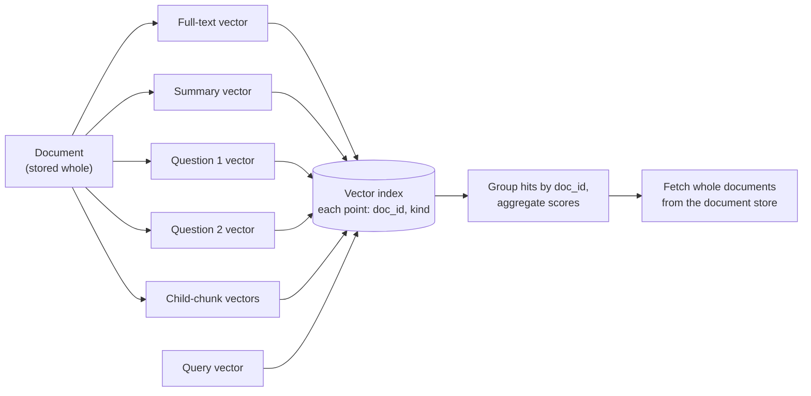

One vector per chunk is a strong assumption. It says that a single point in embedding space can stand for everything a passage is about, and for every question someone might ask of it. A handbook section on working from home covers remote days, an equipment budget, who is excluded from that budget, and when to use the VPN; squeezed into one vector, the VPN sentence is a fifth of the meaning and easily outvoted. **Multi-vector retrieval** drops the assumption. Each document is indexed under *several* vectors, each computed from a different representation of it (the full text, a summary, questions it answers, its smaller parts), and a match on any of them retrieves the document.

This lesson covers the representations worth generating, how hits on many vectors are turned back into a ranking of documents, the aggregation choices and their biases, and the storage and indexing costs. You will compare single-vector and multi-vector indexes on Meridian documents, and build the same thing in Qdrant using its grouping query.

## Learning objectives

- Explain why a single vector per document under-represents multi-topic documents, and how several vectors per document fix it.
- Choose representations (full text, summary, hypothetical questions, child chunks) and say what each contributes.
- Aggregate vector-level scores into document scores with max, mean or sum, and predict the bias each introduces.
- Implement multi-vector retrieval with a flat index and with grouped queries in a vector database.
- Estimate the storage, indexing and maintenance costs of multiplying the vectors per document.

## Prerequisites

- [Parent-child chunking](/learn/chunking-optimisation/parent-child-chunking) and [small-to-big retrieval](/learn/chunking-optimisation/small-to-big-retrieval): matching on one unit and returning another.
- [Document embeddings](/learn/embedding-fundamentals/document-embeddings): what a single vector for a long text captures and loses.
- [HyDE](/learn/advanced-retrieval/hyde): using generated text to close the gap between questions and passages.
- [Payload indexes](/learn/advanced-vector-database-engineering/payload-indexes): metadata on points, used here to link vectors to their documents.

## Why this matters

A single embedding of a passage is, roughly, an average of what the passage is about. When a passage has one topic, that average is a good address. When it has four, the average sits somewhere between them, close to none. A question about one of the four topics is then competing against other documents whose single topic matches it more fully: in Meridian's handbook, "are contractors entitled to the home-office allowance?" is closer to the short page *about contractors* than to the working-from-home section that actually answers it in one sentence.

Smaller chunks give each vector one topic, and [parent-child chunking](/learn/chunking-optimisation/parent-child-chunking) formalises that, but some units must be returned whole (an FAQ entry, a table, a code function), and even a single-topic chunk is phrased as a statement while users ask questions. Multi-vector retrieval generalises the parent-child idea: the unit you *return* stays whole, and you are free to create as many *ways of finding it* as help, whether smaller pieces, summaries or questions.

## The intuition

Think of a book index at the back of a manual. The section on working from home appears once in the book, but the index lists it under several entries: "remote working", "equipment budget", "contractors, eligibility", "VPN, public Wi-Fi". A reader looking up any of those terms lands on the same pages. Nobody would suggest indexing a section under only one entry, its title, and hoping readers think of it.

Multi-vector retrieval builds that index for an embedding search. Each entry is a vector made from a different description of the document. A query finds whichever entry is closest, and every entry leads back to the same document.

## How it works

### The structure



Two stores are involved. The **vector index** holds many points per document, each with a payload recording which document it belongs to (`doc_id`) and what kind of representation it is (`kind`). The **document store** (a key-value store, a database table, or the vector database's own payload) holds each document once, under its ID. LangChain's `MultiVectorRetriever` (now in the `langchain_classic` package) packages exactly this pair: a vector store, a document store and the ID key that links them.

At query time:

1. **Embed the query** once.
2. **Search the vector index** for more points than documents you need, because several hits will belong to the same document.
3. **Group the hits by `doc_id`** and aggregate each group's scores into one document score.
4. **Rank documents** by that score and keep the top $k$.
5. **Fetch the documents** from the document store and pass them to the generator.

Step 3 is the heart of the method and gets its own section below.

### Representations

Each representation is a different answer to "how might someone describe what they are looking for?"

- **Full text.** The baseline. It keeps the document's own words, so it matches queries that quote it, and it is free.
- **Summary.** A model-written summary of a few sentences. It concentrates the main points and drops boilerplate, which helps for long documents whose full-text vector is dominated by incidental content. It tends to lose minor points, so it complements rather than replaces the full text.
- **Hypothetical questions.** A model writes several questions the document answers. These close the question-statement gap from the document side: where [HyDE](/learn/advanced-retrieval/hyde) generates a hypothetical *answer* at query time, here you generate hypothetical *questions* at indexing time, so there is no query-time model call. The idea has a sparse-retrieval ancestor, *doc2query* (Nogueira and colleagues, 2019), which appended predicted queries to documents before keyword indexing.
- **Child chunks.** Smaller pieces of the document, each embedded separately. This is the parent-child structure seen as one case of multi-vector retrieval.
- **Other views.** Titles, a table's caption and column names, an image's caption, a function's signature and docstring. Anything that gives a different handle on the same unit.

Ask for questions the document *answers*, phrased as users would ask them and spread across all its points; three to five per document is common.

### Turning vector hits into document scores

A document now has a set of vectors $\{\mathbf{v}_1, \dots, \mathbf{v}_m\}$, and the query has a cosine with each. How should these become one score?

- **Max**: the document's best vector decides. One strong match, such as a generated question that is nearly the user's own question, is enough. This is the usual default, and it matches the book-index intuition: you only need one entry to lead you to the page.
- **Mean**: all vectors vote equally. A document matching moderately everywhere beats one matching strongly in one place. This punishes exactly the multi-topic documents the method exists to help.
- **Sum**: rewards documents with many matching vectors, and therefore documents with *more vectors*. Useful when the count of matching children is itself evidence (several retrieved children of one parent), as [small-to-big retrieval](/learn/chunking-optimisation/small-to-big-retrieval) discussed for parent scoring.

Max has a bias of its own. With more vectors per document, the chance that *some* vector happens to sit close to an unrelated query grows. If one document has twenty generated questions and another has three, the first gets more chances of a spurious high score. Keep the number of vectors per representation roughly equal across documents, or compare documents within each representation kind and fuse ranks (for example with [RRF](/learn/hybrid-search/reciprocal-rank-fusion)) rather than taking a raw max across kinds.

### Fetching enough hits

If you want $k = 5$ documents and each document has 5 vectors, asking the index for the top 5 *points* may return only one or two documents, because one document's vectors crowd the list. Either over-fetch (ask for $k \times m$ points, or more, and group in your code) or use the vector database's grouping feature, which returns the top groups directly. Qdrant's `query_points_groups` does this, and other engines have equivalents; the code below uses it.

### Where this sits among neighbours

Several techniques in this course create more than one vector per unit, and they are easy to confuse:

| Technique | Vectors per unit | Scored how |
| --- | --- | --- |
| [Parent-child chunking](/learn/chunking-optimisation/parent-child-chunking) | One per child chunk | Child scores mapped to parent |
| **Multi-vector retrieval** (this lesson) | One per representation: text, summary, questions, children | Group by document, aggregate (usually max) |
| [Late interaction (ColBERT)](/learn/reranking-models/late-interaction) | One per *token* | Sum over query tokens of the max similarity to any document token |
| [Contextual retrieval](/learn/advanced-retrieval/contextual-retrieval) | Still one per chunk | Ordinary similarity on a contextualised text |

Vector-database documentation sometimes calls token-level late interaction "multi-vector" too (Qdrant's multivector configuration with a MaxSim comparator, for instance). That is a different mechanism with its own models, covered in the reranking module.

## The mathematics

### Aggregating vector scores

**Intuition.** The aggregation decides what kind of document wins: one with a single excellent match, or one with many middling ones.

For a query $\mathbf{q}$ and document $D$ with unit vectors $\mathbf{v}_1, \dots, \mathbf{v}_m$:

$$
s_{\max}(D) = \max_{j} \; \mathbf{q} \cdot \mathbf{v}_j, \qquad
s_{\text{mean}}(D) = \frac{1}{m}\sum_{j=1}^{m} \mathbf{q} \cdot \mathbf{v}_j, \qquad
s_{\text{sum}}(D) = \sum_{j=1}^{m} \mathbf{q} \cdot \mathbf{v}_j
$$

$m$ is the number of vectors for $D$, and each $\mathbf{q} \cdot \mathbf{v}_j$ is a cosine because all vectors are normalised.

**By hand.** Two documents with five vectors each. Document A (the working-from-home section) has one vector, a generated question, that matches the query strongly: cosines $0.81, 0.30, 0.25, 0.20, 0.22$. Document B (a page loosely related to everything) matches moderately everywhere: $0.47, 0.45, 0.44, 0.46, 0.43$.

- Max: A $= 0.81$, B $= 0.47$. A wins.
- Mean: A $= (0.81 + 0.30 + 0.25 + 0.20 + 0.22)/5 = 1.78/5 = 0.356$; B $= 2.25/5 = 0.45$. B wins.
- Sum: A $= 1.78$, B $= 2.25$. B wins, and would win by more if B had more vectors.

Only max rewards the one representation that was written to answer this question.

```python
import numpy as np

# Cosines between one query and each vector of two documents
doc_a = np.array([0.81, 0.30, 0.25, 0.20, 0.22])   # one vector matches strongly
doc_b = np.array([0.47, 0.45, 0.44, 0.46, 0.43])   # every vector matches moderately

for name, s in [("A", doc_a), ("B", doc_b)]:
    print(f"doc {name}: max={s.max():.3f}  mean={s.mean():.3f}  sum={s.sum():.3f}")
```

```output
doc A: max=0.810  mean=0.356  sum=1.780
doc B: max=0.470  mean=0.450  sum=2.250
```

## In code

**The problem.** Twelve Meridian documents, several of which cover more than one topic, and eight questions, most aimed at a point that is a small part of its document. Compare five indexes: one full-text vector per document, one summary vector, three question vectors (max), all five vectors with max, and all five with mean. Report the rank of the right document for each question, the number ranked first, and the mean reciprocal rank (MRR: the average of 1/rank, so 1.0 means every answer was first).

**Dependencies.** NumPy and sentence-transformers; the Qdrant part also needs qdrant-client (in-memory mode, no server).

```bash
pip install numpy sentence-transformers qdrant-client
```

The summaries and questions are written into the script as stand-ins for what an indexing-time model would generate. One caution about honesty: they were written by someone who could see the test questions, which flatters the question-based indexes. A model generating questions blind will cover a document's points less evenly. That is one reason to keep the full-text vector alongside the generated ones.

```python
import numpy as np
from sentence_transformers import SentenceTransformer

# Each document: full text, plus a summary and questions an LLM would write at indexing time.
DOCS = {
    "wfh": dict(
        text="Working from home. Staff may work remotely up to 3 days a week, agreed with their line "
             "manager. The home-office equipment budget is £400 and covers desks, chairs and monitors. "
             "Contractors are not eligible for the budget. VPN is required on public Wi-Fi.",
        summary="Remote working rules: 3 days a week, a £400 equipment budget (not for contractors), "
                "and VPN on public Wi-Fi.",
        questions=["How many days a week can I work from home?",
                   "Can contractors use the home-office equipment budget?",
                   "Do I need the VPN when working from a café or hotel?"]),
    "leave": dict(
        text="Annual leave. Annual leave is 25 days per year. Book leave in the HR portal; your line "
             "manager approves each request. Up to 5 unused days carry over and must be used by 31 March.",
        summary="Annual leave: 25 days a year, booked in the HR portal; up to 5 days carry over until 31 March.",
        questions=["How many days of holiday do I get?",
                   "How do I book time off?",
                   "What happens to holiday I don't use by the end of the year?"]),
    "expenses": dict(
        text="Expenses. Expenses must be submitted within 30 days through the finance portal. Anything "
             "over £75 needs a receipt. The finance department reviews every claim.",
        summary="Expense claims: submit within 30 days; receipts needed over £75.",
        questions=["How long do I have to submit an expense claim?",
                   "When do I need a receipt for an expense?",
                   "Who reviews expense claims?"]),
    "laptops": dict(
        text="Laptops. The laptop refresh cycle is 3 years. Report a lost laptop to the support desk at "
             "once. New starters choose a MacBook or a Windows laptop.",
        summary="Laptop policy: replaced every 3 years; report losses to the support desk immediately.",
        questions=["How often are laptops replaced?",
                   "What should I do if I lose my laptop?",
                   "Can I choose a Mac or a Windows laptop?"]),
    "support": dict(
        text="IT support. The support desk is open 08:00 to 18:00 UK time. Passwords must be rotated "
             "every 90 days.",
        summary="IT support hours (08:00 to 18:00 UK time) and the 90-day password rotation rule.",
        questions=["When is the IT support desk open?",
                   "How often must I change my password?",
                   "What are the helpdesk hours?"]),
    "atlas": dict(
        text="Atlas client errors. E-4021 means the installed client is out of date: download the latest "
             "installer from the IT portal and restart. E-4012 means the certificate has expired: "
             "reinstall it from the IT portal.",
        summary="Fixes for Atlas client errors E-4021 (outdated client) and E-4012 (expired certificate).",
        questions=["How do I fix Atlas error E-4021?",
                   "What does Atlas error E-4012 mean?",
                   "My Atlas certificate has expired; what do I do?"]),
    "reports": dict(
        text="Meridian Reports. Reports can export any dashboard as PDF or CSV. SAML single sign-on is "
             "available on the Enterprise plan.",
        summary="Meridian Reports features: PDF and CSV export, and SAML SSO on the Enterprise plan.",
        questions=["Can I export a Reports dashboard to PDF?",
                   "Does Meridian Reports support single sign-on?",
                   "Which plan includes SAML SSO?"]),
    "relay": dict(
        text="Meridian Relay operations. R-310 means the sync queue is full; restart the worker and wait "
             "for the queue to drain.",
        summary="Relay operations: error R-310 (full sync queue) and how to clear it.",
        questions=["What does Relay error R-310 mean?",
                   "How do I clear a full Relay sync queue?",
                   "Relay worker needs restarting; what are the steps?"]),
    "security": dict(
        text="Information security. Lock your screen when you leave your desk. Download the VPN client "
             "from the IT portal. Report phishing emails to the security team.",
        summary="Security basics: screen locking, installing the VPN client, reporting phishing.",
        questions=["Where do I download the VPN client?",
                   "How do I report a phishing email?",
                   "Do I have to lock my screen?"]),
    "travel": dict(
        text="Business travel. Book hotels through the travel portal. Hotel Wi-Fi charges can be claimed "
             "as expenses. Keep boarding passes for your claim.",
        summary="Travel rules: book hotels via the travel portal; Wi-Fi charges and travel are claimable.",
        questions=["How do I book a hotel for a work trip?",
                   "Can I claim hotel Wi-Fi charges?",
                   "What do I need to keep for a travel claim?"]),
    "contractors": dict(
        text="Contractors. Contractors are engaged through an agency and invoice monthly. They follow "
             "the same security rules as staff.",
        summary="How contractors are engaged and invoiced, and the security rules that apply to them.",
        questions=["How are contractors paid?",
                   "Do security rules apply to contractors?",
                   "How do we engage a contractor?"]),
    "onboarding": dict(
        text="Onboarding. On day one, new starters collect their laptop from the support desk and set "
             "a password for their account.",
        summary="First-day onboarding: collecting a laptop and setting an account password.",
        questions=["What happens on my first day?",
                   "Where do I collect my laptop as a new starter?",
                   "How do I set up my account password?"]),
}
QUERIES = [
    ("are contractors entitled to the home office allowance?", "wfh"),
    ("is the VPN needed in a coffee shop?", "wfh"),
    ("what happens to leave I don't take?", "leave"),
    ("do I need a receipt for a £50 lunch?", "expenses"),
    ("I left my laptop on the train", "laptops"),
    ("how often do I have to change my password?", "support"),
    ("can Reports log in through our identity provider?", "reports"),
    ("Atlas says the certificate is no longer valid", "atlas"),
]

# Build one flat index: every vector remembers which document it belongs to and what kind it is.
rows, owner, kind = [], [], []
for doc_id, d in DOCS.items():
    for k, texts in [("text", [d["text"]]), ("summary", [d["summary"]]), ("question", d["questions"])]:
        for t in texts:
            rows.append(t); owner.append(doc_id); kind.append(k)
owner, kind = np.array(owner), np.array(kind)

model = SentenceTransformer("sentence-transformers/all-MiniLM-L6-v2")
V = model.encode(rows, normalize_embeddings=True)
Q = model.encode([q for q, _ in QUERIES], normalize_embeddings=True)
doc_ids = list(DOCS)

def doc_ranking(qvec, kinds, agg="max"):
    """Score each document by aggregating the scores of its vectors of the given kinds."""
    mask = np.isin(kind, kinds)
    s = V[mask] @ qvec
    own = owner[mask]
    scores = {d: (s[own == d].max() if agg == "max" else s[own == d].mean()) for d in doc_ids}
    return sorted(doc_ids, key=scores.get, reverse=True)

configs = {
    "full text only (1 vector)":  (["text"], "max"),
    "summary only (1 vector)":    (["summary"], "max"),
    "questions only (3, max)":    (["question"], "max"),
    "all 5 vectors, max":         (["text", "summary", "question"], "max"),
    "all 5 vectors, mean":        (["text", "summary", "question"], "mean"),
}
print(f"{'representation':<28}{'ranks of the right document':<30}hit@1  MRR")
for name, (kinds, agg) in configs.items():
    ranks = [doc_ranking(Q[i], kinds, agg).index(gold) + 1 for i, (_, gold) in enumerate(QUERIES)]
    mrr = np.mean([1 / r for r in ranks])
    print(f"{name:<28}{str(ranks):<30}{sum(r == 1 for r in ranks)}/8   {mrr:.3f}")
```

```output
representation              ranks of the right document   hit@1  MRR
full text only (1 vector)   [2, 2, 1, 1, 1, 2, 1, 1]      5/8   0.812
summary only (1 vector)     [2, 1, 1, 1, 1, 1, 1, 1]      7/8   0.938
questions only (3, max)     [1, 1, 1, 1, 1, 1, 1, 1]      8/8   1.000
all 5 vectors, max          [1, 1, 1, 1, 1, 1, 1, 1]      8/8   1.000
all 5 vectors, mean         [2, 1, 1, 1, 1, 1, 1, 1]      7/8   0.938
```

**Reading the output.**

- **Full text only** misses three of eight. For the contractor question, the short Contractors page (about how contractors are engaged) beats the working-from-home section that actually answers it; for the VPN question, the Information security page (about downloading the VPN client) wins. Both are the dilution problem: the answering sentence is one of four topics in its document. The password question goes, oddly, to the annual leave page first, a reminder that single-vector scores on short queries can be fragile.
- **Summary only** fixes two of those, because the summaries name every main point compactly, but still loses the contractor question.
- **Questions only** and **all five with max** rank every answer first. A generated question such as "Can contractors use the home-office equipment budget?" is almost a paraphrase of the user's question, and max lets that single strong match decide.
- **All five with mean** loses the contractor question again. Averaging lets the document's four other vectors, which are about remote days, the budget in general and the VPN, drag it down: the bias worked through by hand above.

Questions alone matched all five vectors here, but keep the full text in production: blind-generated questions miss some points, and the full-text vector is the safety net.

### The same in Qdrant, with grouping

The flat-matrix version shows the mechanism; a vector database does the grouping for you. This continues from the script above (it reuses `rows`, `owner`, `kind`, `V`, `model` and `DOCS`).

```python
from qdrant_client import QdrantClient, models

client = QdrantClient(":memory:")
client.create_collection("meridian_mv",
    vectors_config=models.VectorParams(size=384, distance=models.Distance.COSINE))
client.upsert("meridian_mv", points=[
    models.PointStruct(id=i, vector=V[i].tolist(),
                       payload={"doc_id": str(owner[i]), "kind": str(kind[i]), "text": rows[i]})
    for i in range(len(rows))
])
# Parent texts live in a separate store (here a dict); the index only holds representations.
docstore = {doc_id: d["text"] for doc_id, d in DOCS.items()}

query = "is the VPN needed in a coffee shop?"
qvec = model.encode([query], normalize_embeddings=True)[0].tolist()
result = client.query_points_groups("meridian_mv", query=qvec, group_by="doc_id",
                                    limit=3, group_size=2)
for group in result.groups:
    best = group.hits[0]
    print(f"{group.id:<9} best {best.score:.2f} via {best.payload['kind']:<8} '{best.payload['text'][:55]}'")
print("\nSent to the generator:", docstore[result.groups[0].id][:80], "...")
```

```output
wfh       best 0.81 via question 'Do I need the VPN when working from a café or hotel?'
security  best 0.47 via question 'Where do I download the VPN client?'
travel    best 0.25 via summary  'Travel rules: book hotels via the travel portal; Wi-Fi '

Sent to the generator: Working from home. Staff may work remotely up to 3 days a week, agreed with thei ...
```

`query_points_groups` returns up to `limit` groups, each holding up to `group_size` of its best hits, ordered by each group's best score: max aggregation, done by the engine. The output also says *which* representation matched (`via question`), which is valuable for debugging and for explaining results. The generator receives the whole working-from-home section from the document store, not the generated question that found it. Generated questions and summaries are retrieval aids, like HyDE's hypothetical passages, and should never be shown as source text.

In production, create a [payload index](/learn/advanced-vector-database-engineering/payload-indexes) on the `doc_id` field used for grouping (indexing the group-by field keeps grouped queries fast), and keep the document text out of the vector payload if documents are large, fetching it from the document store by ID instead.

**Common errors.** Grouping on a field that some points lack drops those points from grouped results. Asking a flat search for $k$ points and getting fewer than $k$ distinct documents: over-fetch or group. Re-indexing a document's text without deleting its old summary and question points leaves orphans that retrieve a document version that no longer exists; delete by `doc_id` filter before inserting.

**Extending it.** Generate the summary and questions with one structured-output model call per document (a Pydantic model with a `summary` string and a `questions` list, as in the [HyDE lesson](/learn/advanced-retrieval/hyde)'s generation code). Add child chunks as another `kind`.

## A real-world example

Meridian's product documentation is written as one page per feature, and the Platform team had indexed each page as a single chunk because support staff wanted whole pages in answers. The Meridian Reports page on exporting covered PDF export, CSV export, scheduled exports and file-size limits. Questions about scheduled exports regularly retrieved a different page, a general "Scheduling in Reports" overview, because its single vector was all about scheduling while the export page's vector was mostly about exporting.

Splitting the pages was rejected: support staff relied on answers that cited whole feature pages, and the pages were short enough to send whole. Instead, the team kept one full-text vector per page and added, at indexing time, a summary and five generated questions per page, all pointing to the page's ID. Queries used Qdrant's grouping with max aggregation, and the generator received the full page. On their labelled set, questions about secondary points on a page (scheduled exports, file limits) improved clearly; questions about a page's main topic were unchanged, as expected, since the full-text vector already handled them.

The cost showed up in maintenance: seven points per page instead of one, and an early bug that replaced the full-text vector on edit but not the generated ones, leaving questions pointing at removed text. The fix was to treat a page's points as one unit: delete everything with that `doc_id`, then insert the new set, versioned by the page's revision.

## Common mistakes

- **Aggregating with mean.** It penalises multi-topic documents, the very case multi-vector retrieval exists for. Default to max.
- **Unequal vector counts.** Under max, documents with many generated vectors have more chances of a spurious match. Keep counts per kind similar.
- **Fetching $k$ points instead of $k$ documents.** One document's vectors crowd the results; use grouping or over-fetch.
- **Showing generated summaries or questions as sources.** They are model-written retrieval aids; cite the document.
- **Orphaned representations.** Updating a document's text without replacing its summary and question vectors leaves stale handles that retrieve the document for content it no longer has.
- **Dropping the full-text vector.** Generated questions cover what the model thought of; the full text covers the rest.

## Best practices

- Keep the full-text (or child-chunk) vectors and add generated representations alongside, all linked by a stable `doc_id`.
- Use max aggregation by default, via the database's grouping feature where available.
- Generate summaries and questions in one structured call per document, asking for questions spread across all of its points.
- Store `kind`, the generating model and prompt version in each point's payload, so that representations can be evaluated and regenerated selectively.
- Replace a document's points atomically on update: delete by `doc_id`, insert the new set.
- Evaluate per representation kind (which kind found the answer?) to learn which representations earn their storage.

## Performance considerations

- **Index size.** Vectors multiply. At 384 dimensions in float32, each vector is $384 \times 4 = 1{,}536$ bytes. For 100,000 documents with 7 vectors each, that is 700,000 vectors, about 1.08 GB of raw vectors, before the approximate-nearest-neighbour graph and payloads. [Quantisation](/learn/embedding-optimisation/embedding-quantisation) reduces this substantially.
- **Query latency.** The search is over $m$ times more points, which for graph-based indexes such as HNSW increases latency only modestly, since search cost grows roughly logarithmically with collection size. Grouping adds some overhead, because the engine must explore more candidates to fill the groups.
- **Indexing cost.** One generation call per document for the summary and questions; with an assumed 1,000 input tokens and 200 output tokens per document, 100,000 documents is 100 million input and 20 million output tokens per full re-index. Check current prices; a small model is usually adequate.
- **Context budget.** Multi-vector retrieval returns whole documents, so the generator's input grows with document size. Budget with $k$ times the typical document length, not the length of the representation that matched.

## Security considerations

Generated summaries and questions are derived from document content, which may be untrusted (product pages edited by many people, imported wikis). A document containing injected instructions can produce a generated question designed to match common queries ("What is the password policy?"), making an unrelated or malicious document retrievable for them. Treat generated representations as untrusted, cap their number and length, and spot-check them. Every representation point must carry its document's access-control metadata, permission filters must apply to the grouped query, and the document store should check permissions again before returning text.

## Summary

- Multi-vector retrieval indexes each document under several vectors (full text, summary, generated questions, child chunks), all linked to one stored document.
- It fixes dilution: a point that is a small part of a multi-topic document gets its own vector and can be found directly.
- Vector hits are grouped by document and aggregated; max is the usual choice, mean penalises multi-topic documents, and unequal vector counts bias max.
- Grouping queries in the vector database return documents rather than points; the generator receives the stored document, never the generated representations.
- The costs are more vectors to store, a generation call per document at indexing time, and the discipline to replace all of a document's points together.

## Exercises

1. A document has vector cosines $0.62, 0.58, 0.20$ with a query; another has $0.60$ and $0.59$. Rank them under max, mean and sum.

<details><summary>Show solution</summary>

Max: first 0.62, second 0.60, so the first wins. Mean: first $(0.62 + 0.58 + 0.20)/3 = 0.467$, second $0.595$, so the second wins. Sum: first $1.40$, second $1.19$, so the first wins, helped by having an extra vector. The three aggregations give two different winners, which is why the choice must be deliberate and evaluated.

</details>

2. Add a per-kind breakdown to the flat-matrix code: for each query, print which representation kind produced the winning document's best score under "all 5 vectors, max".

<details><summary>Show solution</summary>

```python
for i, (query, gold) in enumerate(QUERIES):
    s = V @ Q[i]
    best = int(np.argmax(np.where(owner == gold, s, -1)))
    print(f"{query[:45]:<45} {gold:<9} best via {kind[best]:<8} {s[best]:.2f}")
```

```output
are contractors entitled to the home office a wfh       best via question 0.74
is the VPN needed in a coffee shop?           wfh       best via question 0.81
what happens to leave I don't take?           leave     best via question 0.36
do I need a receipt for a £50 lunch?          expenses  best via question 0.69
I left my laptop on the train                 laptops   best via question 0.50
how often do I have to change my password?    support   best via question 0.99
can Reports log in through our identity provi reports   best via question 0.53
Atlas says the certificate is no longer valid atlas     best via question 0.87
```

On this corpus every answer is found via a question vector, and the password question scores 0.99 against a generated question that is nearly identical to it: a clear sign that the questions were written with the queries in mind. On blind-generated questions the breakdown is how you learn which kinds earn their storage: if summaries never win, stop generating them.

</details>

3. Design the update procedure for a multi-vector index when a document is edited, including what happens to queries that run during the update.

<details><summary>Show solution</summary>

Generate the new summary and questions and embed all new representations first, off the critical path. Then replace the document's points: either delete all points with this `doc_id` and insert the new set (a brief window in which the document is unfindable), or insert the new set with a new `doc_version` and a filter that admits only the current version, then delete the old points (no gap, at the cost of temporarily double storage and a version filter on every query). Update the document store in the same step so that grouped hits never fetch a text that does not match the representations. Record model and prompt versions in the payload. The [index updates](/learn/advanced-vector-database-engineering/index-updates) lesson covers both patterns in general.

</details>

## Check your understanding

```quiz
[
  {"q": "What problem does multi-vector retrieval mainly address?", "options": ["Slow vector search", "A single vector diluting a multi-topic document, so that questions about one of its points match other documents better", "Embedding models with short input limits", "Duplicate documents in the index"], "answer": 1, "why": "Several vectors per document give each point or phrasing its own handle, so a minor topic is no longer outvoted inside one average vector."},
  {"q": "Why is max usually preferred over mean when aggregating a document's vector scores?", "options": ["Max is faster to compute", "Mean cannot be computed on unit vectors", "Max lets one strong match decide, while mean penalises multi-topic documents whose other vectors are about other things", "Max always returns more documents"], "answer": 2, "why": "A document needs only one representation that answers the query; mean drags it down with its unrelated representations."},
  {"q": "You ask a multi-vector index for the top 5 points and receive only 2 distinct documents. What is the fix?", "options": ["Use a grouping query, or over-fetch points and group them yourself", "Reduce the number of vectors per document to one", "Switch from cosine to dot product", "Increase the embedding dimension"], "answer": 0, "why": "Several vectors of the same document crowd the point list; grouping returns the top documents directly."},
  {"q": "What should the generator receive when a generated question vector is the best match?", "options": ["The generated question", "The summary of the document", "The question and the summary together", "The stored document itself, fetched by its doc_id"], "answer": 3, "why": "Generated representations are retrieval aids; answers and citations must come from the actual document."},
  {"q": "How does this lesson's multi-vector retrieval differ from ColBERT-style late interaction?", "options": ["It uses several sentence-level vectors per document from different representations, while late interaction uses one vector per token with a sum of max similarities", "They are the same technique", "Late interaction stores one vector per document", "Multi-vector retrieval needs a special model"], "answer": 0, "why": "Late interaction is a token-level scoring mechanism with its own models; representation-level multi-vector retrieval works with any sentence embedding model."}
]
```

## Further reading

- Nogueira, R., Yang, W., Lin, J. and Cho, K. (2019). *Document Expansion by Query Prediction*. [arXiv:1904.08375](https://arxiv.org/abs/1904.08375). Generating questions a document answers (doc2query), the ancestor of hypothetical-question vectors.
- LangChain documentation: `MultiVectorRetriever` (now in `langchain_classic`), with summaries, hypothetical questions and smaller chunks as representations.
- Qdrant documentation: the grouping API (`query_points_groups`) and payload indexes.
- Khattab, O. and Zaharia, M. (2020). *ColBERT: Efficient and Effective Passage Search via Contextualized Late Interaction over BERT*. [arXiv:2004.12832](https://arxiv.org/abs/2004.12832). The token-level multi-vector approach, for contrast.
