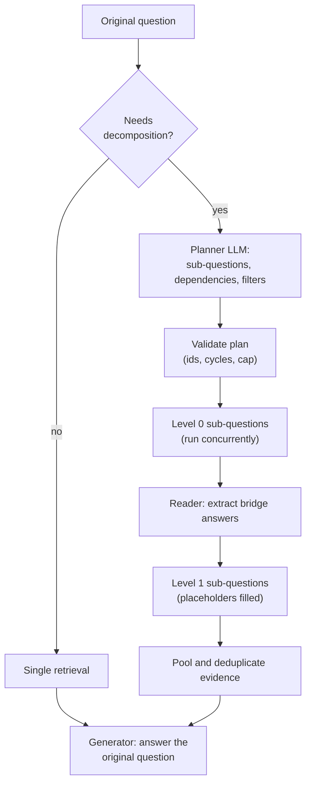

Some questions cannot be answered by any single chunk, and cannot be found by any single search. "What changed between the 2023 handbook and the current one for laptops, support hours and the home-office budget?" needs six facts from six places. "If I lose the device that gets replaced every three years, who do I tell and when are they open?" needs a chain: first work out which device is meant, then what to do when it is lost, then the opening hours of whoever you report it to. A single embedding of either question lands somewhere in the middle of its topics and retrieves whatever is nearest that middle.

**Query decomposition** breaks such a question into simpler **sub-questions**, retrieves evidence for each, and, where one sub-question depends on another's answer, runs them in order. This lesson covers both forms (parallel and sequential), how to represent a decomposition plan as data, how to allocate the retrieval budget across sub-questions, and how errors compound along a chain. [Multi-query retrieval](/learn/advanced-retrieval/multi-query-retrieval) is the close sibling: it writes several versions of the *same* question and merges their results, whereas decomposition writes *different* questions whose answers are combined. Open-ended loops in which a model keeps deciding what to search next belong to [Agentic RAG](/learn/agentic-rag/iterative-search).

## Learning objectives

- Distinguish questions that need parallel decomposition, sequential decomposition, or none.
- Represent a decomposition plan as validated data with sub-questions, dependencies and optional structured filters.
- Execute a plan that substitutes earlier answers into later sub-questions, and measure evidence coverage against a single-query baseline.
- Calculate how retrieval and reading errors compound along a chain of dependent steps.
- Estimate the latency of a plan from its dependency depth, and choose a sensible retrieval budget per sub-question.

## Prerequisites

- [Multi-query retrieval](/learn/advanced-retrieval/multi-query-retrieval): generating several queries with a language model and merging their results.
- [Metadata-aware retrieval](/learn/advanced-retrieval/metadata-aware-retrieval): attaching structured conditions such as a document edition to a search.
- [Semantic search](/learn/dense-retrieval/semantic-search): how a single query is matched.
- [Generation pipeline](/learn/rag-architecture-fundamentals/generation-pipeline): how retrieved evidence becomes an answer.

## Why this matters

A retriever returns the k chunks closest to one query vector. That design quietly assumes the answer lives in one region of the embedding space. Two common kinds of question break the assumption.

**Compound questions** ask about several things at once: comparisons ("2023 versus now"), lists ("laptops, support hours and the budget") and aggregations ("which of our three products support SAML?"). The embedding of the whole question is pulled towards whichever topic dominates the wording or the corpus. In Meridian's index there are many laptop chunks, so a question mentioning laptops among other things fills its top k with laptop material, and the support-hours chunks never arrive. The generator then answers two-thirds of the question and either omits the rest or invents it.

**Multi-hop questions** need an intermediate fact before the final evidence can be found. "The device that gets replaced every three years" must first be resolved to "laptop"; only then can "what to do if I lose my laptop" be searched; only then is it known that "the support desk" is the thing whose hours matter. The final chunk ("Support desk hours are 08:00 to 18:00") shares almost nothing with the original question. No phrasing of the original question will retrieve it reliably, because the word that connects them, the **bridge entity**, is not in the question at all.

Benchmarks such as HotpotQA (Yang and colleagues, 2018) were built around multi-hop questions precisely because single-step retrieval struggles with them. In enterprise RAG they arrive whenever users refer to things indirectly, which is often.

## The intuition

Ask a new colleague, "If I lose the device that gets replaced every three years, who do I tell and when are they open?" A sensible person does not search the intranet for that whole sentence. They think: *which device is that? The laptop. What do I do if I lose a laptop? Report it to the support desk. When is the support desk open? 08:00 to 18:00.* Three small lookups, each easy, each using the previous answer.

Ask them, "What changed between the 2023 handbook and the current one for laptops, support hours and the budget?" and they open both handbooks and look up three topics in each. Six small lookups, none depending on another, so they could hand them to six people at once.

Those are the two shapes of decomposition. The first is a **chain**; the second is a **fan-out**. Many real questions are a mixture.

## How it works

### Deciding whether to decompose

Decomposition costs an extra model call and several searches, and it can make simple questions worse by splitting them into fragments. So the first step is a gate. A question is a candidate when it:

- names several entities or topics joined by "and", "versus" or a list;
- asks for a comparison, a difference, or a change over time;
- refers to something indirectly ("the team that owns...", "the device that...");
- previously produced a weak first retrieval (low top similarity, or chunks from only one of the topics mentioned).

Simple, single-topic questions should bypass decomposition entirely. The gate can be a few rules, a small classifier, or part of the planning prompt itself ("if the question is simple, return it unchanged as a single sub-question").

### The plan as data

A language model, the **planner**, turns the question into a **plan**. Represent the plan as structured, validated data rather than free text, because the executor must act on it:

- **Sub-questions**, each a self-contained search query.
- **Dependencies**: which sub-questions need another's answer first.
- **Placeholders** in dependent sub-questions, such as "What should I do if I lose my {device}?", filled at run time.
- **Optional structured filters** per sub-question, such as `edition = 2023`. This is where decomposition and [metadata-aware retrieval](/learn/advanced-retrieval/metadata-aware-retrieval) meet: "2023 versus current" is far better expressed as two filtered searches than as the words "2023" and "current" inside a query, because chunk text often does not mention its own edition.

Validate the plan before running it: no unknown dependency ids, no cycles, a cap on the number of sub-questions (four to six is typical), and every placeholder referring to an earlier step.

### Executing a plan

1. **Order** the sub-questions so that every dependency comes before its dependants (a topological sort; a planner told to list them in order usually does this already).
2. **Group** them into **levels**: level 0 has no dependencies, level 1 depends only on level 0, and so on. Sub-questions within a level are independent and can run concurrently.
3. **For each sub-question**, fill placeholders from earlier answers, then retrieve with its own filter and its own budget of chunks.
4. **For each sub-question that others depend on**, run a **reader**: a short model call that extracts the specific answer (here "laptop", then "the support desk") from the retrieved chunks. If the reader cannot find an answer, stop the chain rather than searching with an empty placeholder.
5. **Pool the evidence** from every step, deduplicate it, and pass it to the generator together with the original question and, usefully, the plan itself, so the generator can organise its answer by sub-question.



Try the interactive visualiser to see a question split and its sub-questions retrieved separately:

```playground
query-decomposition
```

### Allocating the retrieval budget

The generator's context has room for a fixed number of chunks. A single query spends the whole budget on one region of the embedding space. Decomposition lets you **allocate** it: with six sub-questions and a budget of twelve chunks, two per sub-question. This allocation is a large part of why decomposition helps compound questions: it guarantees each topic a share of the context, whatever the corpus's topic sizes. One chunk per sub-question is efficient but brittle; two or three gives the reader and generator some redundancy when the top hit is not the best.

### Where the ideas come from

Several research lines underpin current practice. *Least-to-most prompting* (Zhou and colleagues, 2022) showed that having a model first decompose a problem into simpler sub-problems and then solve them in order improved performance on tasks requiring generalisation to harder problems. *Self-ask* (Press and colleagues, 2022) had the model pose explicit follow-up questions, optionally answered by a search engine, and named the "compositionality gap": models can often answer each sub-question yet fail the composed question. *IRCoT* (Trivedi and colleagues, 2022) interleaved retrieval with each step of chain-of-thought reasoning for multi-step questions. Frameworks package the parallel form: LlamaIndex's [sub-question query engine](/learn/llamaindex/sub-question-engines), for example, generates sub-questions per data source and synthesises their answers. The reported gains come from specific benchmarks and models; measure on your own questions.

## The mathematics

### Errors compound along a chain

**Intuition.** Each step of a chain must succeed for the final evidence to be right: the retriever must find the right chunk and the reader must extract the right bridge answer. One weak link breaks the chain.

$$
P(\text{chain correct}) = \prod_{i=1}^{n} p_i
$$

$n$ is the number of sequential steps and $p_i$ is the probability that step $i$ succeeds given that all earlier steps did.

**By hand.** With three steps each succeeding 90% of the time: $0.9 \times 0.9 \times 0.9 = 0.729$. With four steps: $0.9^4 = 0.6561$. A chain of four individually good steps fails about one time in three. Raising each step to 95% gives $0.95^3 \approx 0.857$ for three steps.

Two practical consequences follow. Keep chains short: a plan that uses three sequential steps where two would do is paying in reliability. And make each step robust: retrieve two or three chunks per step rather than one, so the reader has a chance when the top hit is wrong.

### Latency depends on depth, not size

If sub-questions at the same level run concurrently, the retrieval latency of a plan is roughly

$$
T \approx T_{\text{plan}} + \sum_{\ell=0}^{L-1} \big(T_{\text{search}} + T_{\text{read}}\big)
$$

where $L$ is the number of **levels** (the depth of the dependency graph), $T_{\text{plan}}$ the planner call, $T_{\text{search}}$ one search and $T_{\text{read}}$ one reader call (zero for the last level, which needs no bridge answer). The six-way comparison plan has one level; the three-step chain has three. Assume (for illustration only) 800 ms per model call and 40 ms per search: the comparison costs about $800 + 40 = 840$ ms, the chain about $800 + (40 + 800) + (40 + 800) + 40 = 2{,}520$ ms.

```python
for p in (0.95, 0.9, 0.8):
    print(f"step success {p}: " + "  ".join(f"{n} steps {p ** n:.3f}" for n in (1, 2, 3, 4)))

plan_ms, search_ms, read_ms = 800, 40, 800              # assumptions, for illustration
fan_out = plan_ms + search_ms                          # one level, searches concurrent
chain = plan_ms + 2 * (search_ms + read_ms) + search_ms  # three levels, last needs no reader
print(f"fan-out plan: {fan_out} ms   three-step chain: {chain} ms")
```

```output
step success 0.95: 1 steps 0.950  2 steps 0.902  3 steps 0.857  4 steps 0.815
step success 0.9: 1 steps 0.900  2 steps 0.810  3 steps 0.729  4 steps 0.656
step success 0.8: 1 steps 0.800  2 steps 0.640  3 steps 0.512  4 steps 0.410
fan-out plan: 840 ms   three-step chain: 2520 ms
```

## In code

**The problem.** Run the two Meridian questions above through a single search and through decomposition, with the same number of retrieved chunks, and measure how many of the needed chunks each approach retrieves (its **coverage**).

**Dependencies.** NumPy, Pydantic and Sentence Transformers; no API key. The planner's plans are written out by hand, and the reader is a stand-in, so that the run is reproducible and the retrieval behaviour is what you observe. The Claude planner that produces such plans follows the example.

```bash
pip install numpy pydantic sentence-transformers
```

```python
from typing import Optional
import numpy as np
from pydantic import BaseModel
from sentence_transformers import SentenceTransformer

CHUNKS = {   # chunk id: (handbook edition, text)
    "laptop-2023":  ("2023",    "Laptops are replaced every 4 years."),
    "laptop-now":   ("current", "Staff laptops follow a 3-year refresh cycle."),
    "support-2023": ("2023",    "The support desk is open 09:00 to 17:00 UK time."),
    "support-now":  ("current", "Support desk hours are 08:00 to 18:00 UK time."),
    "budget-2023":  ("2023",    "The home-office equipment budget is £250."),
    "budget-now":   ("current", "The home-office equipment budget is £400; contractors are not eligible."),
    "lost":         ("current", "Report a lost laptop to the support desk at once."),
    "encrypt":      ("current", "All laptops must use full-disk encryption."),
    "leaver":       ("current", "Return your laptop to IT on your last day at Meridian."),
    "order":        ("current", "New laptops are ordered through the IT portal."),
    "dock":         ("current", "Laptop docking stations are available in the London office."),
    "password":     ("current", "Passwords must be rotated every 90 days."),
    "vpn":          ("current", "VPN is required on public Wi-Fi."),
    "leave":        ("current", "Annual leave is 25 days; up to 5 unused days carry over and must be used by 31 March."),
    "remote":       ("current", "Staff may work remotely up to 3 days a week."),
}
IDS = list(CHUNKS)
model = SentenceTransformer("sentence-transformers/all-MiniLM-L6-v2")
D = model.encode([text for _, text in CHUNKS.values()], normalize_embeddings=True)

def search(query, k, edition=None):
    scores = D @ model.encode([query], normalize_embeddings=True)[0]
    ranked = [IDS[i] for i in np.argsort(-scores)]
    return [c for c in ranked if edition is None or CHUNKS[c][0] == edition][:k]

# --- A plan is data: sub-questions, optional filters, dependencies ----------
class SubQuestion(BaseModel):
    id: str
    text: str                        # may contain {other_id} placeholders
    edition: Optional[str] = None    # structured filter the planner may attach
    depends_on: list[str] = []

class Plan(BaseModel):
    sub_questions: list[SubQuestion]

def read(sub_question, chunk_ids):
    """Stand-in for an LLM reader that extracts the short answer a later step needs."""
    bridge = {"laptop-now": "laptop", "lost": "the support desk"}
    return next((bridge[c] for c in chunk_ids if c in bridge), None)

def execute(plan, k_per_step=1):
    answers, evidence = {}, []
    for sq in plan.sub_questions:                         # listed in dependency order
        text = sq.text.format(**answers)                  # fill in earlier answers
        hits = search(text, k_per_step, sq.edition)
        evidence += [h for h in hits if h not in evidence]
        if any(sq.id in other.depends_on for other in plan.sub_questions):
            answers[sq.id] = read(text, hits)
        print(f"    {sq.id:<16}{text:<44} -> {hits}" + (f"  answer: {answers[sq.id]}" if sq.id in answers else ""))
    return evidence

# --- Question 1: parallel (comparison) --------------------------------------
q1 = "What changed between the 2023 handbook and the current one for laptops, support hours and the home-office budget?"
need1 = {"laptop-2023", "laptop-now", "support-2023", "support-now", "budget-2023", "budget-now"}
plan1 = Plan(sub_questions=[
    SubQuestion(id=f"{topic}_{ed}", text=text, edition=ed)
    for topic, text in [("laptop", "How often are laptops replaced?"),
                        ("support", "When is the support desk open?"),
                        ("budget", "What is the home-office equipment budget?")]
    for ed in ("2023", "current")
])
# --- Question 2: sequential (multi-hop) -------------------------------------
q2 = "If I lose the device that gets replaced every three years, who do I tell and when are they open?"
need2 = {"laptop-now", "lost", "support-now"}
plan2 = Plan(sub_questions=[
    SubQuestion(id="device", text="Which device is replaced every three years?", edition="current"),
    SubQuestion(id="contact", text="What should I do if I lose my {device}?", edition="current", depends_on=["device"]),
    SubQuestion(id="hours", text="When is {contact} open?", edition="current", depends_on=["contact"]),
])

for q, need, plan in [(q1, need1, plan1), (q2, need2, plan2)]:
    budget = len(need)                                    # same number of chunks either way
    single = search(q, budget)
    print(f"\n{q}\n  single query, top {budget}: {single}")
    print(f"    coverage {len(need & set(single))}/{len(need)}")
    print("  decomposed:")
    evidence = execute(plan)
    print(f"    coverage {len(need & set(evidence))}/{len(need)}")
```

```output

What changed between the 2023 handbook and the current one for laptops, support hours and the home-office budget?
  single query, top 6: ['laptop-now', 'laptop-2023', 'budget-2023', 'order', 'budget-now', 'dock']
    coverage 4/6
  decomposed:
    laptop_2023     How often are laptops replaced?              -> ['laptop-2023']
    laptop_current  How often are laptops replaced?              -> ['laptop-now']
    support_2023    When is the support desk open?               -> ['support-2023']
    support_current When is the support desk open?               -> ['support-now']
    budget_2023     What is the home-office equipment budget?    -> ['budget-2023']
    budget_current  What is the home-office equipment budget?    -> ['budget-now']
    coverage 6/6

If I lose the device that gets replaced every three years, who do I tell and when are they open?
  single query, top 3: ['laptop-2023', 'laptop-now', 'lost']
    coverage 2/3
  decomposed:
    device          Which device is replaced every three years?  -> ['laptop-now']  answer: laptop
    contact         What should I do if I lose my laptop?        -> ['lost']  answer: the support desk
    hours           When is the support desk open?               -> ['support-now']
    coverage 3/3
```

**The important lines.**

- `class SubQuestion(BaseModel)` makes the plan something code can validate and act on: an id, the query text, an optional edition filter and a list of dependencies.
- `sq.text.format(**answers)` fills placeholders such as `{device}` with earlier answers. A missing answer raises a `KeyError`, which is the correct behaviour: a chain must not continue with a gap.
- `search(text, k_per_step, sq.edition)` gives each sub-question its own filter and its own budget, here one chunk.
- `read(text, hits)` runs only for steps that others depend on. In production it is a model call that extracts the bridge answer from the retrieved chunk text; the stand-in returns an answer only if the right chunk was retrieved, so a retrieval failure still shows up as a failed chain.
- `budget = len(need)` gives the single query exactly as many chunks as decomposition retrieves, so the comparison is fair.

**What the output means.**

- **The comparison question.** The single query spends its six slots on four laptop chunks (two of them, `order` and `dock`, irrelevant) and the two budget chunks, and finds neither support-hours chunk. Laptop material is abundant in the corpus, so it dominates the neighbourhood of a query that mentions laptops. Decomposition gives each of the six facts its own search and its own slot, and covers all six.
- **The edition filter does real work.** The 2023 and current chunks do not contain the words "2023" or "current"; the edition lives in metadata. Exercise 3 shows that writing the edition into the query text instead finds only three of the six chunks.
- **The multi-hop question.** The single query finds both laptop-refresh chunks (one of them the superseded edition) and the lost-laptop chunk, but not the support hours: nothing in the question says "support desk". The chain resolves "the device" to "laptop", then "lose my laptop" to "the support desk", and then searches for the support desk's hours directly.

**Errors people commonly hit.**

- Running dependent sub-questions concurrently, so that a placeholder is searched as the literal text "{device}".
- Letting the planner produce dozens of sub-questions for a simple question. Cap the count and include "return the question unchanged if it is simple" in the planner's instructions.
- Passing the generator pooled chunks without the plan, so it must rediscover the question's structure.

**Extending it.** Group sub-questions into levels and run each level concurrently with `asyncio.gather`; stop the chain with a partial answer when `read()` returns `None`.

### The planner with Claude

This replaces the hand-written plans. It was not executed for this lesson (it needs an API key), so no output is shown. It reuses the `Plan` model from above as the structured output format.

```python
import anthropic

client = anthropic.Anthropic()  # reads ANTHROPIC_API_KEY from the environment

PLANNER = """You plan searches over Meridian's internal documentation.
Break the user's question into the smallest set of self-contained sub-questions (at most 6)
whose answers together answer it. If a sub-question needs an earlier answer, write a
placeholder such as {device} using that sub-question's id, and list the id in depends_on.
List sub-questions so that dependencies come first. If the question asks about a handbook
edition, set edition to "2023" or "current" instead of writing it into the text.
If the question is simple, return it unchanged as a single sub-question."""

def plan_question(question: str) -> Plan:
    response = client.messages.parse(
        model="claude-opus-5-5",
        max_tokens=1024,
        system=PLANNER,
        messages=[{"role": "user", "content": question}],
        output_format=Plan,
    )
    plan = response.parsed_output
    ids = {sq.id for sq in plan.sub_questions}
    for sq in plan.sub_questions:                      # validate before executing
        if not set(sq.depends_on) <= ids:
            raise ValueError(f"{sq.id} depends on an unknown step")
    return plan
```

The reader is a second small call: give it the sub-question and the retrieved chunk texts, and ask for the short answer only, or a fixed token such as `NOT_FOUND`.

## A real-world example

Meridian's HR business partners use AskMeridian to prepare for policy questions from staff, and after the 2025 handbook was published they asked a lot of comparison questions: "What changed for remote work and equipment?", "How do the laptop and support rules differ from last year?". Kwame on the Platform team found these were the worst-scoring category in the evaluation set. Inspecting the traces, he saw the pattern from the code above: the retrieved chunks clustered on one topic, and the other topic's chunks, especially the superseded ones, were missing. The answers then claimed that some policies "had not changed", because the model saw only one edition.

He added a planner gated by a simple rule: decompose only if the question mentions two or more policy areas, or words such as "changed", "differ" or "compared". The planner was instructed to emit edition filters rather than putting years into the text. Comparison questions improved markedly in the team's evaluation, and the "has not changed" claims disappeared.

Two problems surfaced in the first week. Some plans had eight or nine sub-questions (every topic and edition combination), which slowed responses; a cap of six fixed it. And the gate fired on "What changed my VPN settings?", a support question. Kwame added the planner's "return unchanged if simple" instruction as a second defence and began logging every plan for weekly review.

## Common mistakes

- **Decomposing everything.** Simple questions become slower and sometimes worse, as fragments lose the context the whole question carried.
- **Unbounded plans.** Without a cap, planners enumerate every combination and multiply cost and latency.
- **Long chains.** Every sequential step multiplies the failure probability; a four-step chain of 90% steps succeeds about two times in three.
- **One chunk per step with no fallback.** A single wrong top hit breaks the chain; retrieving two or three gives the reader a chance.
- **Continuing a chain after a failed read.** Searching with an empty or wrong bridge answer produces confident nonsense; stop and report partial results instead.
- **Putting structured conditions into query text.** "2023 handbook" in a query is weak evidence for a dense retriever when the chunks do not mention their edition; use a filter.
- **Losing the original question.** The generator must answer what the user asked, not a list of sub-questions; pass both.

## Best practices

- Gate decomposition with simple rules or a classifier, and let the planner return simple questions unchanged.
- Represent plans as validated structured output with ids, dependencies, placeholders and optional filters; reject cycles and unknown ids.
- Cap the plan size (about six sub-questions) and keep chains as short as the question allows.
- Run independent sub-questions concurrently, level by level.
- Retrieve a small budget per sub-question (one to three chunks) so every part of the question is represented in the context.
- Give the generator the original question, the plan and the evidence grouped by sub-question.
- Log every plan and evaluate per question type: comparisons, lists and multi-hop questions behave differently.

## Performance considerations

- **Model calls.** One planner call per decomposed question, plus one reader call per bridge step. A three-step chain makes three model calls before generation even starts, which is why chains dominate latency (about 2.5 seconds in the illustrative arithmetic above, against 0.84 seconds for a one-level fan-out).
- **Searches.** One per sub-question. A six-way fan-out multiplies search load by six for the questions that are decomposed, so the gate's routing rate determines the overall effect. If 10% of traffic is decomposed into an average of four sub-questions, total search load rises by about $0.1 \times (4 - 1) = 30\%$.
- **Context size.** Pooled evidence from six sub-questions at two chunks each is twelve chunks; at roughly 200 tokens per chunk that is 2,400 tokens of context, comparable to a normal retrieval. Budget allocation keeps it bounded.
- **Caching.** Sub-questions recur across users far more often than whole questions, so caching per sub-question can have a much better hit rate.

## Security considerations

The planner turns untrusted user text into a program of searches. Two rules keep this safe. Sub-question filters produced by the planner are scope filters at most: they must be combined with, never replace, the security filter built from the user's session, as in [Filtered retrieval](/learn/advanced-retrieval/filtered-retrieval). And bridge answers extracted by the reader come from retrieved documents, which may contain injected instructions; a reader that returns a long string, or text that looks like instructions, should be treated as a failed step. Keep reader outputs short and validate their shape (for example, a single noun phrase) before substituting them into the next search.

## Summary

- Compound questions need evidence from several places, and multi-hop questions need an intermediate answer before the final evidence can be found; a single query embedding handles neither reliably.
- Decomposition splits a question into sub-questions, either in parallel (fan-out) or in sequence (a chain with placeholders filled from earlier answers).
- Represent the plan as validated data with dependencies and optional structured filters, and give each sub-question its own retrieval budget.
- Errors multiply along a chain and latency grows with its depth, so keep chains short and make each step robust.
- Gate the technique so simple questions bypass it, and give the generator the original question alongside the plan and evidence.

## Exercises

**1.** A plan has five sub-questions: A and B have no dependencies, C depends on A, D depends on A and B, and E depends on C and D. How many levels does it have, which sub-questions run concurrently at each level, and which steps need a reader?

<details><summary>Show solution</summary>

Level 0: A and B (concurrently). Level 1: C and D (both need only level-0 answers, so they run concurrently). Level 2: E. Three levels in all.

Readers are needed for every sub-question that another depends on: A, B, C and D. E is a leaf, so its retrieved chunks go straight into the evidence pool without a reader.

</details>

**2.** For each question, say whether it needs a fan-out, a chain, both, or no decomposition: (a) "What is the carry-over limit for annual leave?"; (b) "Do Meridian Sync, Relay and Reports all support SAML single sign-on?"; (c) "What are the support hours of the team I report a lost laptop to, and did they change from the 2023 handbook?".

<details><summary>Show solution</summary>

(a) **None.** One topic, one chunk. Decomposing it would only add latency.

(b) **Fan-out.** Three independent sub-questions, one per product, ideally each with a product filter. A single query would be dominated by whichever product has the most SAML-related text (here Meridian Reports).

(c) **Both.** A chain first ("Who do I report a lost laptop to?" gives "the support desk"), then a fan-out over editions ("When is {contact} open?" with `edition = current` and with `edition = 2023`).

</details>

**3.** In the code example, replace the edition filters in `plan1` with the edition written into the text, for example "How often are laptops replaced? (2023 handbook)", and no `edition` field. Run it and explain the result.

<details><summary>Show solution</summary>

```python
plan1_text = Plan(sub_questions=[
    SubQuestion(id=f"{topic}_{ed}", text=f"{text} ({ed} handbook)")
    for topic, text in [("laptop", "How often are laptops replaced?"),
                        ("support", "When is the support desk open?"),
                        ("budget", "What is the home-office equipment budget?")]
    for ed in ("2023", "current")
])
evidence = execute(plan1_text)
print(f"coverage {len(need1 & set(evidence))}/{len(need1)}")
```

```output
    laptop_2023     How often are laptops replaced? (2023 handbook) -> ['laptop-2023']
    laptop_current  How often are laptops replaced? (current handbook) -> ['laptop-2023']
    support_2023    When is the support desk open? (2023 handbook) -> ['support-2023']
    support_current When is the support desk open? (current handbook) -> ['support-2023']
    budget_2023     What is the home-office equipment budget? (2023 handbook) -> ['budget-2023']
    budget_current  What is the home-office equipment budget? (current handbook) -> ['budget-2023']
coverage 3/6
```

Every sub-question, whichever edition it names, retrieves the 2023 chunk, and coverage falls to 3 of 6. The chunks do not contain their edition, so "2023" and "current" in the query give the embedding model nothing to match; the 2023 chunks simply happen to be closer in wording. The sub-questions were right, but only a structured filter can act on information that lives in metadata. A generator given this evidence would wrongly conclude that nothing changed.

</details>

**4.** Design decision. Meridian's IT team wants AskMeridian to answer "Which of my open tickets are about the error codes listed in the Atlas catalogue for VPN failures?". Tickets live in a ticketing system with an API; the Atlas error-code catalogue is indexed in AskMeridian. Sketch a plan, say which steps are retrieval and which are not, and identify the step most likely to fail.

<details><summary>Show solution</summary>

A reasonable plan is a chain of two levels with a non-retrieval step:

1. *Retrieval:* "Which Atlas error codes relate to VPN failures?" over the catalogue, with a generous budget (the answer is a list, perhaps spread over several chunks). The reader extracts a list of codes, such as E-4021.
2. *Tool call, not retrieval:* query the ticketing API for the user's open tickets, authenticated as the user.
3. *Matching:* filter the tickets whose text mentions any extracted code. This is deterministic string matching, not semantic search; do it in code.

Step 1 is the most likely to fail: the reader must extract a complete list of codes, and a missing code silently drops matching tickets. Mitigate by retrieving more chunks for that step (or filtering the catalogue by category if it has one), asking the reader for codes only in a fixed format, and validating them against a pattern such as `E-\d{4}`. Calling an external system as a step is where decomposition shades into [tool-based retrieval](/learn/agentic-rag/tool-based-retrieval) and agentic designs.

</details>

## Check your understanding

```quiz
[
  {
    "q": "Why does a single query often fail on \"If I lose the device that gets replaced every three years, who do I tell and when are they open?\"",
    "options": [
      "The question is too long for the embedding model",
      "The final evidence (support desk hours) shares almost no words or meaning with the question, because the bridge entities are not in it",
      "Dense retrievers cannot handle questions with numbers",
      "The question needs a keyword index instead of a vector index"
    ],
    "answer": 1,
    "why": "Multi-hop questions need intermediate answers (laptop, then support desk) before the final chunk can be found. Those bridge entities do not appear in the original question."
  },
  {
    "q": "A chain has three sequential steps, each succeeding 80% of the time. What is the probability that the whole chain succeeds?",
    "options": [
      "0.80",
      "0.64",
      "0.512",
      "0.24"
    ],
    "answer": 2,
    "why": "Independent sequential successes multiply: 0.8 x 0.8 x 0.8 = 0.512."
  },
  {
    "q": "A comparison question asks about laptops and support hours. Single-query retrieval returns six chunks, all about laptops. What does decomposition change that most directly fixes this?",
    "options": [
      "It gives each topic its own search and its own share of the retrieval budget",
      "It uses a larger embedding model",
      "It reranks the six laptop chunks",
      "It removes laptop chunks from the index"
    ],
    "answer": 0,
    "why": "Allocating the budget across sub-questions guarantees each topic a place in the context, whatever the corpus's topic sizes."
  },
  {
    "q": "Which statement about multi-query retrieval and query decomposition is correct?",
    "options": [
      "They are the same technique under two names",
      "Decomposition always merges results with RRF",
      "Multi-query retrieval runs sub-questions in dependency order",
      "Multi-query writes alternative versions of the same question; decomposition writes different questions whose answers are combined"
    ],
    "answer": 3,
    "why": "Multi-query targets one information need from several angles; decomposition targets several needs, sometimes in sequence."
  },
  {
    "q": "A plan has a fan-out of six independent sub-questions. With 800 ms per model call and 40 ms per search, and searches run concurrently, roughly how long does retrieval take?",
    "options": [
      "About 840 ms: one planner call plus one concurrent level of searches",
      "About 5,040 ms: six model calls plus six searches",
      "About 1,040 ms: one planner call plus six sequential searches",
      "About 40 ms: only the searches count"
    ],
    "answer": 0,
    "why": "A one-level plan needs the planner call and one round of concurrent searches; no reader calls are needed because nothing depends on these answers."
  }
]
```

## Further reading

- Zhou et al. (2022), "Least-to-Most Prompting Enables Complex Reasoning in Large Language Models", [arXiv:2205.10625](https://arxiv.org/abs/2205.10625).
- Press et al. (2022), "Measuring and Narrowing the Compositionality Gap in Language Models" (self-ask), [arXiv:2210.03350](https://arxiv.org/abs/2210.03350).
- Trivedi et al. (2022), "Interleaving Retrieval with Chain-of-Thought Reasoning for Knowledge-Intensive Multi-Step Questions" (IRCoT), [arXiv:2212.10509](https://arxiv.org/abs/2212.10509).
- Yang et al. (2018), "HotpotQA: A Dataset for Diverse, Explainable Multi-hop Question Answering", [arXiv:1809.09600](https://arxiv.org/abs/1809.09600).
- LlamaIndex documentation, [docs.llamaindex.ai](https://docs.llamaindex.ai/): the sub-question query engine.
