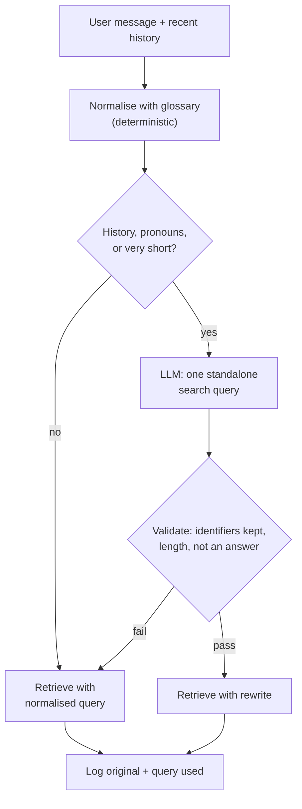

The text a user types is often a poor search query. It may lean on the conversation ("what about contractors?"), use private shorthand ("how much pto do i get"), be full of filler ("hi, quick one, does anyone know..."), or be phrased for a person rather than a search engine. **Query rewriting** replaces that text with a single better query before retrieval: standalone, in the vocabulary of the documents, and with every essential detail preserved. It is the most widely deployed query transformation in production RAG, largely because conversational assistants cannot work without it.

This lesson covers the kinds of rewriting (conversational, normalising and retriever-specific), how to build a rewriter with a glossary and a language model, and, just as important, how to stop a rewriter from making things worse. Its siblings transform the query in other ways: [Multi-query retrieval](/learn/advanced-retrieval/multi-query-retrieval) produces several queries instead of one, [Query decomposition](/learn/advanced-retrieval/query-decomposition) splits a question into sub-questions, [Step-back prompting](/learn/advanced-retrieval/step-back-prompting) asks a more general question, and [HyDE](/learn/advanced-retrieval/hyde) searches with a hypothetical answer.

## Learning objectives

- Identify the three main reasons to rewrite a query (conversational dependence, vocabulary mismatch, retriever fit) and the failure each one causes.
- Build a rewriting pipeline that combines deterministic glossary normalisation with a language-model rewrite.
- Write validation rules that reject rewrites which drop identifiers or drift, and fall back safely.
- Measure the effect of rewriting by the rank of the target chunk before and after, and recognise when rewriting hurts.
- Decide when to skip rewriting to save latency and cost.

## Prerequisites

- [Semantic search](/learn/dense-retrieval/semantic-search) and [Query embeddings](/learn/dense-retrieval/query-embeddings): how a query is turned into a vector and matched.
- [Query-document matching](/learn/rag-architecture-fundamentals/query-document-matching): the vocabulary-mismatch problem.
- [Query expansion](/learn/hybrid-search/query-expansion): adding terms to a keyword query, a technique rewriting overlaps with.
- Helpful: [Multi-query retrieval](/learn/advanced-retrieval/multi-query-retrieval), for the structured-output pattern used to call the model.

## Why this matters

Retrieval sees only the query string it is given. Everything the user meant but did not type is invisible to it. Three gaps account for most rewrite-worthy queries.

**Conversational dependence.** In a chat, users write follow-ups that only make sense alongside earlier turns. After "How much is the home-office equipment budget?", the follow-up "What about contractors?" is perfectly clear to a person and useless to a retriever: embedded alone, it lands near the chunk about contractors' accounts and badges, not the one that says contractors are not eligible for the budget. Pronouns ("they", "it"), ellipsis ("and at weekends?") and references ("the old one") all have the same effect. In any multi-turn assistant, this is the single largest source of rewrite-worthy queries.

**Vocabulary mismatch.** The user says "PTO"; the handbook says "annual leave". The user writes "wfh"; the handbook says "work remotely". Embedding models bridge common synonyms but often not company shorthand, abbreviations or misspellings, and keyword retrievers bridge none of them. [Query-document matching](/learn/rag-architecture-fundamentals/query-document-matching) introduced the problem; rewriting attacks it on the query side.

**Retriever fit.** A query written for a person contains greetings, hedges and context ("hi, sorry if this is a silly question, but..."). For a keyword retriever, filler words dilute the score; for a dense retriever, they shift the vector. A query shaped like the documents ("home-office equipment budget for contractors") retrieves better than one shaped like a chat message.

Each gap produces a wrong or missing chunk, which the generator then either refuses to use or, worse, uses.

## The intuition

Think of a good reference librarian taking a question at the desk. A visitor who has been chatting about the equipment budget says, "What about contractors?". The librarian does not search the catalogue for "contractors". She writes on her slip: *home-office equipment budget, eligibility of contractors*. A visitor says "PTO"; she writes *annual leave*, because that is what the handbook's index calls it. A visitor reads out an error code; she copies it onto the slip exactly, character for character, because she knows a paraphrase of an error code is a different error code.

Rewriting is that slip: a translation from how people ask to how documents are written, which resolves what was implied and preserves what was exact.

## How it works

### Three kinds of rewriting

| Kind | Input | Output | Typical tool |
| --- | --- | --- | --- |
| **Conversational** (context-dependent) | Follow-up plus chat history | A standalone question | Language model |
| **Normalising** | Shorthand, abbreviations, typos | The documents' vocabulary | Glossary, spelling correction, language model |
| **Retriever-specific** | A conversational question | A query shaped for the retriever (keywords for BM25, a clean question for dense) | Rules or language model |

The conversational kind has a research history of its own. The TREC Conversational Assistance Track (CAsT, from 2019) evaluated retrieval for conversational follow-ups, and the CANARD dataset (Elgohary and colleagues, 2019) collected human rewrites of in-context questions into standalone ones; both established the "rewrite, then retrieve with an ordinary retriever" approach that most RAG systems use today. *Rewrite-Retrieve-Read* (Ma and colleagues, 2023) framed rewriting as an explicit stage before retrieval in retrieval-augmented language models, and also trained a small rewriter with feedback from the downstream reader.

### A rewriting pipeline

A robust rewriter is layered, cheapest and most predictable first:

1. **Normalise deterministically.** Expand abbreviations and company jargon from a curated **glossary** ("pto" becomes "paid time off (annual leave)"). Fix casing and obvious typos. This is fast, free, testable, and never invents anything.
2. **Decide whether a model rewrite is needed.** If there is no conversation history and the query is already a clean, specific question, skip the model. Typical triggers for a model rewrite: history exists, the query contains pronouns or starts with "and"/"what about", or it is very short.
3. **Rewrite with a model.** Give the model the recent history (the last few turns, not the whole conversation) and the normalised question, and ask for one standalone search query. Instruct it to resolve references, keep identifiers verbatim, not answer the question, and not add facts.
4. **Validate the rewrite.** Check that every identifier in the original (error codes, runbook numbers, product names) appears in the rewrite, that the length is sensible, and that it is not an answer. If validation fails, fall back to the normalised original.
5. **Retrieve with the result, and log both.** Store the original and the rewrite together with the request, so that retrieval failures can be traced to the rewrite or ruled out.



### What the rewriter must preserve

A rewriter improves a query by changing it, and every change risks losing something. The failure modes are specific enough to check for:

- **Identifier loss.** "E-4021" becomes "a VPN error"; "NET-114" becomes "the network runbook". The rewrite is fluent and now matches the wrong chunk, or a generic one. This is the most damaging failure, because identifier queries are those where users know exactly what they want.
- **Over-specification.** The model fills a gap with an assumption: "What about contractors?" becomes "What is the contractor day rate?" when the conversation was about the equipment budget. Limiting the history window and asking the model to resolve only references that the history supports reduces this.
- **Negation and qualifier loss.** "Which expenses *don't* need a receipt?" becomes "expense receipt rules". The retrieved chunk may still be right, but the generator is now answering the rewrite, not the question, if you pass it the rewrite instead of the original.
- **Answering instead of rewriting.** The model replies "Contractors are not eligible." That is not a query; it is an unsupported answer, and searching with it is the [HyDE](/learn/advanced-retrieval/hyde) technique by accident.

Two structural rules contain most of the damage. **Validate** the rewrite against the original before using it, falling back when it fails. And **always give the generator the user's original message** (with history), using the rewrite for retrieval only. The rewrite is a search tool, not a restatement of the user's intent.

### Rewriting for the retriever you have

A dense retriever does best with a clear, complete question in the documents' vocabulary. A keyword retriever does best with the distinctive terms and no filler: "contractors eligible home-office equipment budget". In a [hybrid](/learn/hybrid-search/hybrid-retrieval-architecture) system you can produce both forms from one model call (a structured output with a `question` field and a `keywords` field) and send each to its retriever. Keep it simple at first; one standalone question serves both retrievers reasonably well.

## In code

**The problem.** Four AskMeridian messages that retrieve poorly as typed: two conversational follow-ups, one piece of shorthand, and one error-code report. Build the pipeline above (glossary, model rewrite, validation, fallback) and measure the rank of the correct chunk before and after.

**Dependencies.** NumPy and Sentence Transformers; no API key. The model rewrite is a stand-in that returns fixed rewrites, one of them deliberately bad, so that the validator's behaviour is reproducible. The Claude call that replaces it follows the example.

```bash
pip install numpy sentence-transformers
```

```python
import re
import numpy as np
from sentence_transformers import SentenceTransformer

CHUNKS = {
    "budget":   "The home-office equipment budget is £400; contractors are not eligible.",
    "remote":   "Staff may work remotely up to 3 days a week.",
    "leave":    "Annual leave is 25 days; up to 5 unused days carry over and must be used by 31 March.",
    "expenses": "Expenses must be submitted within 30 days; anything over £75 needs a receipt.",
    "vpn":      "VPN is required on public Wi-Fi.",
    "password": "Passwords must be rotated every 90 days.",
    "e4021":    "Error E-4021: the VPN client is out of date. Update it from the IT portal.",
    "e4012":    "Error E-4012: the VPN certificate has expired. Reinstall it from the IT portal.",
    "laptop":   "Staff laptops follow a 3-year refresh cycle.",
    "support":  "Support desk hours are 08:00 to 18:00 UK time.",
    "agency":   "Contractors receive a Meridian account and badge from their agency manager.",
}
IDS = list(CHUNKS)
model = SentenceTransformer("sentence-transformers/all-MiniLM-L6-v2")
D = model.encode(list(CHUNKS.values()), normalize_embeddings=True)

def rank_of(query, target):
    scores = D @ model.encode([query], normalize_embeddings=True)[0]
    ranked = [IDS[i] for i in np.argsort(-scores)]
    return ranked.index(target) + 1, ranked[0]

# --- Step 1: deterministic normalisation from a curated glossary -------------
GLOSSARY = {"pto": "paid time off (annual leave)", "wfh": "work from home (remote work)"}
def normalise(q):
    return re.sub(r"\b(\w+)\b", lambda m: GLOSSARY.get(m.group(1).lower(), m.group(1)), q)

# --- Step 2: LLM rewrite into a standalone search query (stand-in) ----------
def llm_rewrite(history, question):
    """Stand-in for the Claude call shown later; returns what such a model typically writes."""
    return {
        "What about contractors?": "Are contractors eligible for the home-office equipment budget?",
        "and when do they expire?": "When must carried-over annual leave days be used?",
        "how much paid time off (annual leave) do i get": "How many days of paid time off (annual leave) do I get?",
        "vpn keeps saying E-4021 after the update": "How do I fix a VPN connection error?",   # a bad rewrite
    }[question]

# --- Step 3: validate; fall back to the normalised original if it fails -----
IDENTIFIER = re.compile(r"\b[A-Z]{1,4}-\d{2,5}\b")      # error codes, runbook numbers
def validate(original, rewrite):
    missing = set(IDENTIFIER.findall(original)) - set(IDENTIFIER.findall(rewrite))
    if missing:
        return f"rejected: lost identifier {sorted(missing)}"
    if not 3 <= len(rewrite.split()) <= 30:
        return "rejected: length"
    return "accepted"

def rewrite_query(history, question):
    normalised = normalise(question)
    candidate = llm_rewrite(history, normalised)
    verdict = validate(normalised, candidate)
    return (candidate if verdict == "accepted" else normalised), verdict

cases = [
    (["How much is the home-office equipment budget?"], "What about contractors?", "budget"),
    (["How many days of annual leave do I get?", "Can I carry any over?"], "and when do they expire?", "leave"),
    ([], "how much pto do i get", "leave"),
    ([], "vpn keeps saying E-4021 after the update", "e4021"),
]
for history, question, target in cases:
    final, verdict = rewrite_query(history, question)
    print(f"{question!r} -> {verdict}")
    print(f"   searched {final!r}")
    for label, q in [("original", question), ("final", final)]:
        r, top = rank_of(q, target)
        print(f"   {label:<9} rank of '{target}' = {r}  (top: {top})")
    if verdict != "accepted":
        r, top = rank_of(llm_rewrite(history, normalise(question)), target)
        print(f"   had the rewrite been used: rank {r}  (top: {top})")
```

```output
'What about contractors?' -> accepted
   searched 'Are contractors eligible for the home-office equipment budget?'
   original  rank of 'budget' = 2  (top: agency)
   final     rank of 'budget' = 1  (top: budget)
'and when do they expire?' -> accepted
   searched 'When must carried-over annual leave days be used?'
   original  rank of 'leave' = 3  (top: password)
   final     rank of 'leave' = 1  (top: leave)
'how much pto do i get' -> accepted
   searched 'How many days of paid time off (annual leave) do I get?'
   original  rank of 'leave' = 5  (top: expenses)
   final     rank of 'leave' = 1  (top: leave)
'vpn keeps saying E-4021 after the update' -> rejected: lost identifier ['E-4021']
   searched 'vpn keeps saying E-4021 after the update'
   original  rank of 'e4021' = 1  (top: e4021)
   final     rank of 'e4021' = 1  (top: e4021)
   had the rewrite been used: rank 2  (top: e4012)
```

**The important lines.**

- `normalise()` replaces whole words found in `GLOSSARY`, keeping the original word's position. It is deterministic, so it can be unit-tested and reviewed by the people who own the vocabulary (HR for "PTO", IT for system names).
- `llm_rewrite(history, normalised)` receives the *normalised* question, so the model sees "paid time off (annual leave)" and is less likely to guess what "pto" means.
- `IDENTIFIER` matches codes such as `E-4021` and `NET-114`. Adapt the pattern to your organisation's identifiers; add product names from a list if they matter.
- `validate()` rejects any rewrite that has lost an identifier present in the original, and any rewrite of implausible length, which catches most "answered instead of rewrote" outputs.
- `rewrite_query()` falls back to the normalised original rather than failing the request. A rejected rewrite should be logged, not raised.

**What the output means.**

- **"What about contractors?"** Alone, it retrieves the agency-account chunk, which mentions contractors. The rewrite carries the topic over from the previous turn and the correct chunk moves from rank 2 to rank 1. In a top-1 or top-2 context with more competing chunks, that is the difference between the right answer and a wrong one.
- **"and when do they expire?"** Alone, "expire" pulls in the password-rotation chunk; "they" refers to nothing. The rewrite resolves "they" to carried-over leave days and finds the leave chunk.
- **"how much pto do i get"** The raw query ranks the leave chunk fifth: the embedding model does not reliably connect "pto" with "annual leave". Glossary expansion followed by the rewrite puts it first.
- **The E-4021 report.** The stand-in model produced a fluent, generic rewrite, "How do I fix a VPN connection error?", which dropped the error code. The validator rejected it, and the original query was searched instead, which ranks the right chunk first. The last line shows what the rejected rewrite would have done: the E-4012 chunk would have ranked first, and the user would have been told to reinstall a certificate when they needed to update their client.

**Errors people commonly hit.**

- Sending the entire conversation to the rewriter. Old turns about other topics leak into the rewrite. Send the last few turns.
- Passing the rewrite to the generator instead of the user's message. The answer then addresses the rewrite's interpretation, including any of its mistakes.
- Glossary entries that match inside other words. Matching whole words with `\b`, as above, avoids "pto" matching in "laptop".

**Extending it.** Make the rewriter return both a `question` and a `keywords` field, send the first to the dense retriever and the second to a BM25 index, and fuse the results. Then add a check that rejects rewrites whose embedding similarity to the original is below a floor, a cheap drift detector.

### The rewriter with Claude

This replaces the stand-in. It was not executed for this lesson (it needs an API key), so no output is shown.

```python
import anthropic
from pydantic import BaseModel

class SearchQuery(BaseModel):
    query: str

client = anthropic.Anthropic()  # reads ANTHROPIC_API_KEY from the environment

SYSTEM = (
    "You rewrite a user's latest message into one standalone search query for Meridian's "
    "internal documentation. Use the conversation only to resolve references such as "
    "'it', 'they' or 'what about'. Keep error codes, runbook numbers and product names "
    "exactly as written. Do not answer the question and do not add facts. "
    "If the message is already a clear standalone question, return it unchanged."
)

def llm_rewrite(history: list[str], question: str) -> str:
    recent = "\n".join(f"User: {turn}" for turn in history[-3:])     # last few turns only
    prompt = f"Conversation so far:\n{recent or '(none)'}\n\nLatest message: {question}"
    response = client.messages.parse(
        model="claude-opus-5-5",
        max_tokens=200,
        system=SYSTEM,
        messages=[{"role": "user", "content": prompt}],
        output_format=SearchQuery,
    )
    return response.parsed_output.query
```

In a real assistant the history would include the assistant's previous replies too, since they often contain the entity a follow-up refers to; here only user turns are shown for brevity. A small, fast model is usually sufficient for rewriting and keeps the added latency low.

## A real-world example

When AskMeridian moved from a single-question box to a chat interface, the Platform team kept the retrieval pipeline unchanged: each new message was embedded and searched as typed. The evaluation set, written before the change, contained only standalone questions, so nothing in the metrics moved. The feedback did. Staff reported that the assistant "forgot what we were talking about": follow-ups such as "and for contractors?" or "what about the old policy?" produced answers about something else entirely.

Sofia, who owned retrieval, added a model-based rewriter for every message that had history. Follow-ups improved immediately. Within a week, the IT support desk reported a new problem: questions quoting error codes were now answered with the wrong fix. The rewriter had been turning "getting E-4012 again on my laptop" into "How do I resolve VPN errors on a laptop?", which retrieved whichever VPN error chunk happened to be closest.

The fix had three parts. A validator, much like the one above, rejected any rewrite that lost an identifier present in the original. The rewriter was skipped altogether for messages with no history that already looked like questions, which removed both the risk and the latency for most first messages. And the team extended their evaluation set with conversational test cases (a short history plus a follow-up, with the target chunk labelled) and identifier cases, so that both kinds of regression would show up in metrics rather than in support tickets. HR also took ownership of a small glossary of HR shorthand ("PTO", "WFH", "L&D"), reviewed quarterly.

## Common mistakes

- **No rewriting in a chat interface.** Follow-ups are searched as typed, and pronouns and ellipses retrieve unrelated chunks.
- **Rewriting without validation.** Fluent rewrites drop error codes, product names and negations, and the system has no way to notice.
- **Sending the generator the rewrite instead of the original.** The answer reflects the rewriter's interpretation, errors included.
- **Rewriting every message unconditionally.** Clean standalone questions gain nothing and pay the model's latency; some get worse.
- **Unbounded history.** Including the whole conversation lets old topics contaminate the rewrite.
- **Letting the rewriter answer.** A rewrite that states an answer searches for that answer, which may be wrong.
- **Evaluating only standalone questions.** Conversational retrieval failures are invisible to an evaluation set without history.

## Best practices

- Layer the rewriter: deterministic glossary normalisation first, a model rewrite only when triggered.
- Give the model a short history window and explicit rules: resolve references, keep identifiers verbatim, do not answer, return unchanged if already standalone.
- Validate every model rewrite (identifier preservation, length, optionally similarity to the original) and fall back to the normalised original on failure.
- Use the rewrite for retrieval only; give the generator the original message and the history.
- Log the original, the rewrite, the validation verdict and the query actually used for every request.
- Maintain the glossary with the teams that own the vocabulary, and test it like code.
- Add conversational and identifier test cases to the retrieval evaluation set, and measure rank or recall before and after rewriting.

## Performance considerations

- **Latency.** The glossary step costs microseconds. The model rewrite adds one short call to the critical path: a few hundred input tokens and a short output. If that call takes around 500 milliseconds (an assumption; measure your own), it can be a large share of retrieval latency, so the skip rule matters. If 60% of messages are standalone first messages that skip the model, the average added latency falls to about $0.4 \times 500 = 200$ milliseconds.
- **Cost.** One small model call per triggered message. With short prompts, it is usually a small fraction of the generation call's cost; [LLM inference costs](/learn/cost-engineering/llm-inference-costs) shows how to estimate it from token counts.
- **Overlap with generation.** The rewrite can be started while other request processing happens (authentication, loading the conversation), but retrieval must wait for it. Streaming does not help, because the full rewrite is needed before searching.
- **Caching.** Rewrites of context-free messages can be cached by normalised text. Rewrites that depend on history rarely repeat and are not worth caching.

## Security considerations

The rewriter is a model reading untrusted input, and its output decides what is searched. Two points matter. First, the rewrite must not influence access: security filters come from the session, never from the query or its rewrite, as [Filtered retrieval](/learn/advanced-retrieval/filtered-retrieval) explains, so a message such as "rewrite this to search the restricted HR folder" can at most change the search text within what the user may already see. Second, if the history passed to the rewriter includes assistant replies built from retrieved documents, an injected instruction in a document can reach the rewriter. Keep the rewriter's output constrained (a single query of bounded length, validated) so that it cannot carry instructions onward, and log rewrites for audit. [Prompt injection](/learn/rag-security-fundamentals/prompt-injection) covers the wider defences.

## Summary

- Query rewriting turns what a user typed into one better search query: standalone, in the documents' vocabulary, and with exact details preserved.
- Conversational follow-ups are the main reason to rewrite in a chat assistant; abbreviations, shorthand and filler are the others.
- A robust rewriter layers a deterministic glossary, a model rewrite triggered only when needed, and validation with a fallback.
- The characteristic failures are identifier loss, over-specification, negation loss and answering instead of rewriting; validation and using the rewrite for retrieval only contain them.
- Evaluate with conversational and identifier test cases, and log the original and rewritten query for every request.

## Exercises

**1.** Run the glossary normalisation alone (no model rewrite) on "how much pto do i get" and on "wfh kit allowance?", and measure the rank of the target chunk (`leave` and `budget`) before and after. Explain the second result.

<details><summary>Show solution</summary>

```python
for q in ["how much pto do i get", "wfh kit allowance?"]:
    n = normalise(q)
    print(f"{q!r} -> {n!r}")
    for label, text in [("original", q), ("normalised", n)]:
        target = "leave" if "pto" in q else "budget"
        r, top = rank_of(text, target)
        print(f"   {label:<10} rank of '{target}' = {r}  (top: {top})")
```

```output
'how much pto do i get' -> 'how much paid time off (annual leave) do i get'
   original   rank of 'leave' = 5  (top: expenses)
   normalised rank of 'leave' = 1  (top: leave)
'wfh kit allowance?' -> 'work from home (remote work) kit allowance?'
   original   rank of 'budget' = 1  (top: budget)
   normalised rank of 'budget' = 2  (top: remote)
```

For "pto", expansion is the whole fix: the leave chunk moves from fifth to first. For "wfh kit allowance?", the raw query already worked, and expansion made it worse. The expanded text now spends most of its words on "work from home (remote work)", which shifts the embedding towards the remote-working chunk, while "kit allowance" (the actual subject) is a small part. Glossary expansion changes the emphasis of short queries, so measure it per entry; for some terms, appending the expansion with less weight, or using it only for the keyword retriever, works better.

</details>

**2.** Classify each failure and propose a validation rule that would catch it: (a) "Which expenses don't need a receipt?" rewritten as "expense receipt requirements"; (b) "How do I fix NET-114?" rewritten as "network troubleshooting runbook"; (c) "What about contractors?" rewritten as "Contractors are not eligible for the budget."

<details><summary>Show solution</summary>

(a) **Negation loss.** A rule: if the original contains a negation word ("not", "don't", "without", "never", "except"), require one in the rewrite, or fall back. Retrieval may still succeed, but the rule also prevents the rewrite reaching anything that interprets it.

(b) **Identifier loss.** The `IDENTIFIER` pattern in the code catches `NET-114` and rejects the rewrite.

(c) **Answering instead of rewriting.** Rules: require the rewrite to be a question or a noun phrase (ends with "?" or has no finite statement form), or reject rewrites that contain facts absent from the history and the original, such as numbers or "not eligible". A simple practical check is that the rewrite should not be a declarative sentence ending in a full stop.

</details>

**3.** Extend `validate()` with a drift check: embed the original and the rewrite with the same model and reject the rewrite if their cosine similarity is below 0.3. Apply it to the four cases. Does it catch the bad E-4021 rewrite? What does that tell you about similarity-based drift checks?

<details><summary>Show solution</summary>

```python
def validate(original, rewrite):
    missing = set(IDENTIFIER.findall(original)) - set(IDENTIFIER.findall(rewrite))
    if missing:
        return f"rejected: lost identifier {sorted(missing)}"
    if not 3 <= len(rewrite.split()) <= 30:
        return "rejected: length"
    a, b = model.encode([original, rewrite], normalize_embeddings=True)
    if float(a @ b) < 0.3:
        return f"rejected: drift (similarity {float(a @ b):.2f})"
    return "accepted"
```

Run on the four cases, the similarities between original and rewrite are 0.60 (the E-4021 case), 0.59 (contractors), 0.23 ("and when do they expire?") and 0.91 (PTO). The drift check does not catch the bad E-4021 rewrite, because both texts are about VPN errors; only the identifier rule does. Worse, it *rejects* the leave follow-up, one of the rewrites that helped most: "and when do they expire?" shares almost no meaning with "When must carried-over annual leave days be used?" until the history is taken into account. Similarity checks catch gross drift (a rewrite on a different topic) but cannot see the details that matter, and they penalise exactly the context resolution that conversational rewriting exists to do. Explicit rules for identifiers and negations are needed alongside them. If you keep a similarity check, compare the rewrite with the original *plus its history*, not the original alone.

</details>

**4.** Design decision. AskMeridian is adding Slack as a channel. Messages there are often short replies in threads ("same here", "+1, also on Relay?"). Decide what history the rewriter should receive, when it should run, and what should happen when the rewrite is rejected.

<details><summary>Show solution</summary>

**History.** The thread's root message and the last two or three messages in the thread, not the channel's recent messages, because Slack channels interleave unrelated conversations and the thread is the unit of context. Include who wrote each message only if the rewrite needs it.

**When to run.** Always run the rewriter for messages inside a thread (they are almost always context-dependent), and skip it for top-level messages that are already clear questions. Messages with no retrieval need ("same here", "+1" with nothing else) should be detected first and not trigger retrieval at all; the rewriter can be asked to return an empty query for those, which the pipeline treats as "no search".

**On rejection.** Fall back to searching with the root message plus the new message concatenated, rather than the bare reply, because a bare "also on Relay?" is useless as a query. Log the rejection. If the fallback retrieval is also weak (the best score is below the relevance floor), the assistant should ask a clarifying question in the thread rather than answer from weak evidence.

</details>

## Check your understanding

```quiz
[
  {
    "q": "In a chat, the user asks about the home-office equipment budget, then writes \"What about contractors?\". Why does searching with the second message as typed often fail?",
    "options": [
      "The embedding model cannot handle questions shorter than five words",
      "Keyword retrievers ignore the word \"contractors\"",
      "The message depends on the earlier turn; alone, it matches chunks about contractors in general rather than the budget",
      "Follow-up messages are never stored in the vector database"
    ],
    "answer": 2,
    "why": "The topic (the equipment budget) is only in the history. The standalone message pulls the search towards whatever chunk best matches \"contractors\"."
  },
  {
    "q": "A rewriter turns \"vpn keeps saying E-4021 after the update\" into \"How do I fix a VPN connection error?\". What is the most effective guard against this?",
    "options": [
      "Reject any rewrite that loses an identifier present in the original, and fall back to the original",
      "Increase the number of retrieved chunks",
      "Use a larger embedding model",
      "Rewrite the query twice and use the second rewrite"
    ],
    "answer": 0,
    "why": "Identifier loss is detectable with a simple pattern check, and the original query retrieves the right chunk."
  },
  {
    "q": "Which should the generator receive?",
    "options": [
      "Only the rewritten query, since it is clearer",
      "The user's original message and history, with the rewrite used only for retrieval",
      "Only the retrieved chunks",
      "The glossary-normalised query"
    ],
    "answer": 1,
    "why": "The rewrite is a search tool that may contain the rewriter's mistakes. The answer should address what the user actually asked."
  },
  {
    "q": "Which statement best describes deterministic glossary normalisation?",
    "options": [
      "It is always beneficial and should be applied to every term",
      "It requires a language model call per query",
      "It replaces the need for conversational rewriting",
      "It is cheap and predictable, but expanding a term can shift a short query's emphasis and make retrieval worse"
    ],
    "answer": 3,
    "why": "Expansions add words, which can dominate a short query's embedding. Each entry should be measured, as exercise 1 shows."
  },
  {
    "q": "60% of messages skip the model rewrite, and a rewrite takes about 500 ms. Roughly how much latency does rewriting add on average?",
    "options": [
      "About 500 ms",
      "About 300 ms",
      "About 200 ms",
      "About 60 ms"
    ],
    "answer": 2,
    "why": "Only 40% of messages pay the 500 ms, so the average is 0.4 x 500 = 200 ms."
  }
]
```

## Further reading

- Ma et al. (2023), "Query Rewriting for Retrieval-Augmented Large Language Models" (Rewrite-Retrieve-Read), [arXiv:2305.14283](https://arxiv.org/abs/2305.14283).
- Elgohary, Peskov and Boyd-Graber (2019), "Can You Unpack That? Learning to Rewrite Questions-in-Context", *Proceedings of EMNLP 2019* (the CANARD dataset).
- Dalton, Xiong and Callan (2020), "TREC CAsT 2019: The Conversational Assistance Track Overview", TREC 2019 proceedings.
- Manning, Raghavan and Schütze (2008), *Introduction to Information Retrieval*, chapter 9, "Relevance feedback and query expansion", and section 3.3 on spelling correction. Free online at [nlp.stanford.edu/IR-book](https://nlp.stanford.edu/IR-book/).
- Anthropic documentation, [docs.anthropic.com](https://docs.anthropic.com/): structured outputs with `messages.parse`, used for the rewriter.
