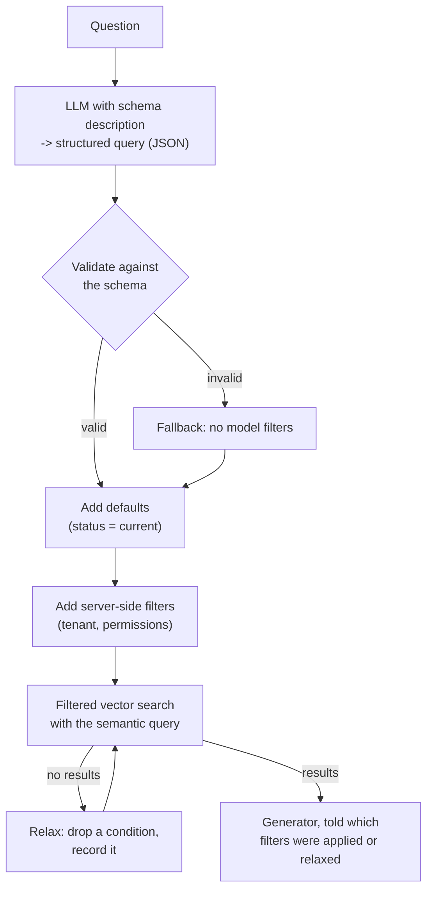

Many questions contain two different kinds of request at once. "What did the 2023 handbook say about replacing laptops?" asks for something *semantic* (text about laptop replacement) and something *structural* (only documents that are handbooks, from 2023). An embedding is good at the first and poor at the second: a vector cannot reliably express "from 2023 and not from 2025". [Metadata-aware retrieval](/learn/advanced-retrieval/metadata-aware-retrieval) and [filtered retrieval](/learn/advanced-retrieval/filtered-retrieval) showed how to attach metadata to chunks and restrict a search with filters. This lesson is about **self-query retrieval**: letting a language model read the user's question and write the filter itself, so that structured constraints stated in natural language become exact conditions on the search.

The idea is simple; making it safe and reliable is not. A model writing filters can invent fields, misspell values, add constraints the user never asked for, or produce a filter that matches nothing. You will build a self-query retriever that declares a schema, validates every condition the model produces, applies safe defaults, and relaxes over-strict filters, and you will see each of those safeguards fire on Meridian's documents.

## Learning objectives

- Explain how self-query retrieval splits a question into a semantic query and a structured filter, and why each part goes where it does.
- Describe a metadata schema to a model so that it can produce valid filters, and validate the result with Pydantic before it reaches the database.
- Compile a validated structured query into a vector-database filter and run it.
- Design defaults, fallbacks and relaxation for invalid and over-restrictive filters.
- Identify the security boundary: which filters a model may write and which must always come from the server.

## Prerequisites

- [Metadata-aware retrieval](/learn/advanced-retrieval/metadata-aware-retrieval) and [filtered retrieval](/learn/advanced-retrieval/filtered-retrieval): metadata on chunks and filters on searches.
- [Metadata filtering](/learn/advanced-vector-database-engineering/metadata-filtering): how vector databases evaluate filters, and why restrictive filters need care.
- [Dataclasses and Pydantic](/learn/python-for-rag-engineering/dataclasses-and-pydantic): validating data against a typed model.
- [Query rewriting](/learn/advanced-retrieval/query-rewriting): using a model to transform the query before retrieval.

## Why this matters

Meridian's corpus contains the current handbook and the superseded 2023 one, IT runbooks, and product documentation for Sync, Relay, Reports and Atlas. Users routinely state structural constraints in their questions: "in the 2023 handbook", "in the Relay runbook", "for Reports", "the current policy". A pure similarity search treats those words as more meaning to match. "2023" nudges the vector a little towards texts that mention years. It does not *exclude* the 2025 handbook, and the current page about laptops, which is semantically identical to the 2023 one, may well outrank it.

The result is two characteristic failures. **Version confusion**: asking what the old policy said returns the new policy, or the other way round, and the answer mixes them. **Scope leakage**: asking about Relay returns a near-identical troubleshooting page for Sync, because the two products' runbooks use the same words. Neither is fixable by a better embedding model, because both are about *which documents are eligible*, not about *how similar they are*. Eligibility is what filters express, exactly and cheaply. The remaining problem is getting from the user's sentence to the filter, and that is what self-query retrieval automates.

## The intuition

Think of a librarian at an enquiry desk. A visitor says, "I'm looking for what the 2023 staff handbook said about laptops." The librarian does two things without thinking. They write the structural part on a request slip that the archive understands (collection: staff handbooks; edition: 2023), and they keep the subject part in mind for when they are at the shelf (laptops, replacement). They would never write "laptops" in the edition box, and they would not go to the shelf and read every book that mentions 2023.

The librarian also knows the archive's slip format. They know there is an "edition" box and no "author's mood" box, and that "edition: 2024" will come back empty if no 2024 edition exists, in which case they will tell you so and offer the nearest one rather than hand you nothing. Self-query retrieval gives a model the same knowledge: the slip format (a schema), the rules for filling it in, and a procedure for when a request cannot be met.

## How it works

### The structured query

A self-query retriever asks a model to translate the question into a **structured query** with two parts:

- **The semantic query**: the part to be matched by meaning, with the structural words removed. "What did the 2023 handbook say about replacing laptops?" becomes "laptop replacement".
- **The filter**: a list of conditions on metadata fields. Here: `doc_type = handbook` and `year = 2023`.

Removing the structural words from the semantic query matters. Left in, they add noise to the embedding ("2023 handbook" pulls towards any text about handbooks), and the filter already enforces them exactly.

The pattern was popularised by LangChain's `SelfQueryRetriever`, which pairs a query-constructing model with translators for many vector stores (it now lives in the `langchain_classic` package). The approach in this lesson is the same idea built directly on structured output and Pydantic, which keeps every step visible and testable.

### The pipeline



1. **Describe the schema.** Tell the model which metadata fields exist, what each means, their types, and the allowed values for categorical fields. This description is part of the prompt, and its quality largely determines the quality of the filters.
2. **Generate the structured query.** Ask for structured output matching a fixed format: a semantic query string and a list of conditions, each a field, an operator and a value.
3. **Validate.** Check every condition: the field exists, the operator suits the field's type, the value is allowed. Reject or repair invalid conditions; never pass them to the database unchecked.
4. **Apply defaults.** Add conditions the user did not state but the system needs, such as "current documents only" unless the question explicitly asks about old versions.
5. **Add server-side filters.** Tenant, permission and access-control conditions come from the authenticated request, never from the model, and are ANDed with everything else.
6. **Search.** Embed the semantic query and run a filtered vector search.
7. **Relax if empty.** If the filter matches nothing, drop the least essential model-generated condition and retry, recording what was relaxed so the answer can say so. Server-side filters are never relaxed.

### Describing the schema

The model can only write filters for fields it knows. A good schema description gives, for each field:

- **Name and meaning**: `doc_type`: the kind of document. `area`: the department the content concerns. Meaning matters; a field called `year` could be a creation year, an effective year or a fiscal year.
- **Type and operators**: categorical fields support equality and membership; numeric and date fields also support ranges.
- **Allowed values** for categorical fields, listed exhaustively when the list is short. A model asked to filter on `product` without the list will write "Meridian Reports", "reports" or "Reporting" and match nothing.
- **When to use it**: "Only filter on `year` or `status` if the question explicitly refers to a time period or to old versions."

The last kind of instruction is what keeps the model from over-filtering, which is the most common failure: a question that mentions laptops gets `area = IT` added, which happens to be right here but excludes a laptop policy that the HR team filed under `area = HR`. Every condition the model adds is a chance to exclude the answer. Instruct the model to add a condition only when the question states it.

### Validating the output

Structured output from a model is constrained in shape, but not necessarily in meaning. A field restricted to a fixed set of names in the schema will usually be respected; a value outside an allowed list, a string where an integer belongs, or a range operator on a categorical field may still appear, especially when the allowed values change faster than the prompt. Validate with the same rigour you would apply to user input, because that is what it is: text derived from user input.

Pydantic does this naturally. A `Literal` type restricts field names and operators; a validator checks values against the allowed sets; a failed validation raises an error you can catch. The decision is then what to do with an invalid result:

- **Reject everything and fall back to no model filters.** Safe and simple; you lose any valid conditions in the same output.
- **Drop only the invalid conditions.** Keeps more of the user's intent, but a partially applied filter can be misleading ("Legal guidance on Sync" filtered by product but not by area).
- **Repair.** Map near-misses to allowed values ("reports" to "Reports") with a synonym table. Worth it for common variants; never fuzzy-match into a value that changes meaning.

### Defaults and relaxation

Two situations need policy rather than model output.

**Defaults.** Most users asking about laptops want the current policy, and do not say "current". If the model adds no time or status condition, add `status = current`. When the user does ask about history ("in 2023", "the old handbook"), the model's year or status condition replaces the default.

**Relaxation.** A filter can be valid and still match nothing: "the 2024 HR handbook" when no 2024 edition exists. Returning nothing gives the generator nothing to work with; silently dropping the filter makes it answer from a different edition as if it were the one asked for. The middle path is to relax in a defined order (the most specific or least certain condition first), retry, and pass a note to the generator: "No documents matched year = 2024; results are from the current handbook." The answer can then say so.

### What the model must never filter

Self-query gives a model write access to the `WHERE` clause of your search. Some conditions must therefore be outside its reach:

- **Tenant and permission filters.** These come from the authenticated user, are added on the server, and are ANDed with the model's conditions. The model's schema should not even mention them.
- **Fields whose values are sensitive**, such as an `employee_id` or `salary_band`, if filtering on them would let a user probe for information.

If the only thing standing between a user and restricted documents is the model choosing not to write a condition, the system is not secure.

## In code

**The problem.** Build a self-query retriever over twelve Meridian chunks with five metadata fields, validate the model's structured queries, compile them into Qdrant filters, apply a `status = current` default and relax filters that match nothing. Then run it on five questions, including one with an invalid value and one whose filter matches nothing.

**Dependencies.** Pydantic, qdrant-client (its in-memory mode needs no server) and sentence-transformers.

```bash
pip install pydantic qdrant-client sentence-transformers
```

The model's structured outputs are written into the script as JSON strings, exactly as the structured-output call shown afterwards would return them, so that the run is reproducible without an API key. Everything from parsing onwards is real.

```python
from typing import Literal, Union
from pydantic import BaseModel, ValidationError, model_validator
from qdrant_client import QdrantClient, models
from sentence_transformers import SentenceTransformer

# ---- 1. The corpus and its metadata schema ---------------------------------
DOCS = [
    ("The laptop refresh cycle is 3 years.",                        "handbook", "IT",       None,      "current",    2025),
    ("Laptops are replaced every 4 years.",                         "handbook", "IT",       None,      "superseded", 2023),
    ("The support desk is open 08:00 to 18:00 UK time.",           "handbook", "IT",       None,      "current",    2025),
    ("The support desk is open 09:00 to 17:00.",                   "handbook", "IT",       None,      "superseded", 2023),
    ("Staff may work remotely up to 3 days a week.",               "handbook", "HR",       None,      "current",    2025),
    ("Annual leave is 25 days per year.",                          "handbook", "HR",       None,      "current",    2025),
    ("Expenses must be submitted within 30 days.",                 "handbook", "Finance",  None,      "current",    2025),
    ("Atlas error E-4021: the client is out of date. Update it.",  "runbook",  "IT",       "Atlas",   "current",    2025),
    ("Relay error R-310: the sync queue is full. Restart the worker.", "runbook", "Platform", "Relay", "current",    2025),
    ("Reports can export any dashboard as PDF or CSV.",            "product",  "Platform", "Reports", "current",    2025),
    ("Reports supports SAML single sign-on on the Enterprise plan.", "product", "Platform", "Reports", "current",    2025),
    ("Sync resolves conflicting edits by keeping both versions.",  "product",  "Platform", "Sync",    "current",    2025),
]
FIELDS = ["doc_type", "area", "product", "status", "year"]
ALLOWED = {                                   # what the model may filter on
    "doc_type": {"handbook", "runbook", "product"},
    "area":     {"HR", "IT", "Finance", "Platform"},
    "product":  {"Atlas", "Relay", "Reports", "Sync"},
    "status":   {"current", "superseded"},
    "year":     None,                         # integer, any value
}

# ---- 2. The structured query the model must produce -------------------------
class Condition(BaseModel):
    field: Literal["doc_type", "area", "product", "status", "year"]
    op: Literal["eq", "in", "gte", "lte"]
    value: Union[int, str, list[str]]

    @model_validator(mode="after")
    def check_value(self):
        allowed = ALLOWED[self.field]
        if self.field == "year":
            if self.op == "in" or not isinstance(self.value, int):
                raise ValueError("year needs eq/gte/lte with an integer")
        else:
            values = self.value if isinstance(self.value, list) else [self.value]
            if self.op in ("gte", "lte") or not set(values) <= allowed:
                raise ValueError(f"{self.field} must be one of {sorted(allowed)}")
        return self

class StructuredQuery(BaseModel):
    query: str                     # the semantic part, to be embedded
    filters: list[Condition] = []  # the structured part, to become a filter

def to_qdrant(conditions):
    must = []
    for c in conditions:
        if c.op == "eq":
            must.append(models.FieldCondition(key=c.field, match=models.MatchValue(value=c.value)))
        elif c.op == "in":
            must.append(models.FieldCondition(key=c.field, match=models.MatchAny(any=c.value)))
        else:
            rng = models.Range(gte=c.value) if c.op == "gte" else models.Range(lte=c.value)
            must.append(models.FieldCondition(key=c.field, range=rng))
    return must

# ---- 3. Index ---------------------------------------------------------------
model = SentenceTransformer("sentence-transformers/all-MiniLM-L6-v2")
client = QdrantClient(":memory:")
client.create_collection("meridian", vectors_config=models.VectorParams(size=384, distance=models.Distance.COSINE))
vectors = model.encode([d[0] for d in DOCS], normalize_embeddings=True)
client.upsert("meridian", points=[
    models.PointStruct(id=i, vector=v.tolist(), payload={"text": d[0], **dict(zip(FIELDS, d[1:]))})
    for i, (d, v) in enumerate(zip(DOCS, vectors))
])

# ---- 4. Self-query retrieval with validation, defaults and relaxation ---------
def self_query_search(question, model_output, k=2):
    try:
        sq = StructuredQuery.model_validate_json(model_output)
    except ValidationError as e:
        print(f"   ! rejected model output: {e.errors()[0]['msg']}")
        sq = StructuredQuery(query=question)            # fall back: no filters
    conditions = list(sq.filters)
    print(f"   semantic query: {sq.query!r}")
    qvec = model.encode([sq.query], normalize_embeddings=True)[0].tolist()
    while True:
        active = conditions
        if not any(c.field in ("status", "year") for c in active):   # default: current only
            active = active + [Condition(field="status", op="eq", value="current")]
        print("   filter: " + " AND ".join(f"{c.field} {c.op} {c.value}" for c in active))
        hits = client.query_points("meridian", query=qvec, limit=k,
                                   query_filter=models.Filter(must=to_qdrant(active))).points
        if hits or not conditions:
            return hits
        dropped = conditions.pop()                      # relax: drop the last condition
        print(f"   no results; relaxing by dropping '{dropped.field}'")

# What a model would return for each question (stand-ins for structured output).
CASES = [
    ("What did the 2023 handbook say about replacing laptops?",
     '{"query": "laptop replacement", "filters": [{"field": "doc_type", "op": "eq", "value": "handbook"},'
     ' {"field": "year", "op": "eq", "value": 2023}]}'),
    ("Relay runbook: what does a full sync queue mean?",
     '{"query": "sync queue full", "filters": [{"field": "product", "op": "eq", "value": "Relay"},'
     ' {"field": "doc_type", "op": "eq", "value": "runbook"}]}'),
    ("When is the support desk open?",
     '{"query": "support desk opening hours", "filters": []}'),
    ("Legal guidance on how Sync handles data",
     '{"query": "Sync data handling", "filters": [{"field": "area", "op": "eq", "value": "Legal"}]}'),
    ("HR handbook 2024 rules on working from home",
     '{"query": "working from home rules", "filters": [{"field": "area", "op": "eq", "value": "HR"},'
     ' {"field": "year", "op": "eq", "value": 2024}]}'),
]
for question, output in CASES:
    print(f"Q: {question}")
    for h in self_query_search(question, output):
        print(f"   -> {h.score:.2f}  [{h.payload['status']} {h.payload['year']}] {h.payload['text']}")
```

```output
Q: What did the 2023 handbook say about replacing laptops?
   semantic query: 'laptop replacement'
   filter: doc_type eq handbook AND year eq 2023
   -> 0.65  [superseded 2023] Laptops are replaced every 4 years.
   -> 0.17  [superseded 2023] The support desk is open 09:00 to 17:00.
Q: Relay runbook: what does a full sync queue mean?
   semantic query: 'sync queue full'
   filter: product eq Relay AND doc_type eq runbook AND status eq current
   -> 0.59  [current 2025] Relay error R-310: the sync queue is full. Restart the worker.
Q: When is the support desk open?
   semantic query: 'support desk opening hours'
   filter: status eq current
   -> 0.81  [current 2025] The support desk is open 08:00 to 18:00 UK time.
   -> 0.44  [current 2025] Staff may work remotely up to 3 days a week.
Q: Legal guidance on how Sync handles data
   ! rejected model output: Value error, area must be one of ['Finance', 'HR', 'IT', 'Platform']
   semantic query: 'Legal guidance on how Sync handles data'
   filter: status eq current
   -> 0.41  [current 2025] Sync resolves conflicting edits by keeping both versions.
   -> 0.14  [current 2025] Relay error R-310: the sync queue is full. Restart the worker.
Q: HR handbook 2024 rules on working from home
   semantic query: 'working from home rules'
   filter: area eq HR AND year eq 2024
   no results; relaxing by dropping 'year'
   filter: area eq HR AND status eq current
   -> 0.36  [current 2025] Staff may work remotely up to 3 days a week.
   -> 0.14  [current 2025] Annual leave is 25 days per year.
```

**Important lines.**

- `Condition` uses `Literal` for the field names and operators, so an invented field such as `author` fails validation immediately. `check_value` enforces the allowed values and type rules per field, so `area = Legal` and `year in [...]` are rejected.
- `StructuredQuery.model_validate_json` parses and validates in one step; a `ValidationError` triggers the fallback.
- `to_qdrant` is the only place that knows the database's filter syntax. Equality becomes `MatchValue`, membership `MatchAny`, and ranges `Range`. Keeping this translation separate means the same validated query can target another store.
- The default is applied inside the loop, so it survives relaxation: when `year` is dropped, `status = current` comes back.
- Relaxation pops the *last* condition. That is a crude order; production systems rank conditions by how essential they are, as an exercise asks.

**Reading the output.**

- **The 2023 handbook question** gets exactly what it asked for. The filter admits only 2023 handbook pages, so the superseded 4-year laptop rule is returned with no competition from the current 3-year rule, which a pure similarity search would have ranked equally (the two sentences are near-paraphrases). Because the question set `year`, no `status` default was added.
- **The Relay question** shows the default at work: the model wrote two conditions, the system added `status = current`, and only one chunk passed all three. A filter can legitimately return fewer than $k$ results.
- **The support desk question** has no structural content; the model correctly wrote no filters, and the default alone excluded the superseded 09:00 to 17:00 page.
- **The Legal question** shows validation. There is no Legal area, so the output is rejected and the search falls back to no model filters, using the whole question as the semantic query. The top result is the right Sync page anyway. The answer should still tell the user that there is no Legal-specific documentation, which is a reason to pass the rejection to the generator rather than swallow it.
- **The 2024 HR handbook question** shows relaxation: no 2024 documents exist, so `year` is dropped, the default returns, and the current remote-work rule is found. The generator should be told that the 2024 condition was relaxed.

**Common errors.** Qdrant filters on a field that is absent from a point's payload simply do not match, which is why the product filter excluded handbook chunks (their `product` is `None`); decide deliberately whether "no product" should match a product filter. Filtering on a field that is not indexed works in in-memory mode but can be slow on a large collection; create [payload indexes](/learn/advanced-vector-database-engineering/payload-indexes) for every field the model may filter on. If you pass the original question rather than the semantic query to the embedder, structural words dilute the vector; the Legal fallback does this deliberately because there is nothing better.

### Generating the structured query with Claude

This block was not executed (it needs an API key). It reuses `StructuredQuery` and `ALLOWED` from the script above and asks for validated structured output.

```python
import anthropic

client = anthropic.Anthropic()  # reads ANTHROPIC_API_KEY from the environment

SCHEMA_DESCRIPTION = f"""You turn questions about Meridian's internal documents into a search
request with two parts: "query", the subject to search for by meaning, with any words that
only express a filter removed; and "filters", conditions on these metadata fields:

- doc_type: kind of document; one of {sorted(ALLOWED['doc_type'])}
- area: department the content concerns; one of {sorted(ALLOWED['area'])}
- product: the product a document is about; one of {sorted(ALLOWED['product'])}
- status: "current" or "superseded"
- year: integer year the document took effect; operators eq, gte, lte

Add a condition only when the question explicitly states it. Only use year or status if
the question refers to a time period or to old versions. Use only the listed values; if
the question names a value that is not listed, do not add that condition."""

def structured_query(question: str) -> StructuredQuery:
    try:
        response = client.messages.parse(
            model="claude-opus-5-5",
            max_tokens=400,
            system=SCHEMA_DESCRIPTION,
            messages=[{"role": "user", "content": question}],
            output_format=StructuredQuery,
        )
        return response.parsed_output
    except Exception:
        return StructuredQuery(query=question)   # any failure: search without model filters
```

The schema description is generated from `ALLOWED`, the same structure the validator uses, so the prompt and the validation can never drift apart. When a new product launches, adding it to `ALLOWED` updates both. The broad `except` is deliberate: whether the failure is a network error, a refusal or an output that fails validation, the safe behaviour is the same. Log the exception so that failures are visible.

**Extending it.** Report relaxed and rejected conditions to the generator. Rank conditions for relaxation. Add an `in` example ("Sync or Relay runbooks"). For large collections, create payload indexes for every filterable field.

## A real-world example

The Platform team added self-query retrieval to AskMeridian after a run of complaints about version confusion. HR staff answering questions about past entitlements ("what was the equipment budget in 2023, for a backdated claim?") kept receiving the current £400 figure, and some employees asking about the current rule received the old £250 one. The two handbook pages were near-identical sentences, and similarity alone could not separate them.

Their first version passed the model's JSON straight to Qdrant. Within a week the logs showed three problems. The model sometimes wrote `product = "Meridian Reports"` instead of `"Reports"`, which matched nothing and produced empty contexts. It added `area = IT` to most laptop questions, excluding an HR-owned laptop allowance page. And when asked about "the 2024 handbook", which did not exist, it produced a valid filter that returned nothing, and the generator replied that it had no information.

The second version looked like the code in this lesson. The schema description listed allowed values, generated from the same configuration the validator used. The instructions said to add conditions only when stated, which cut the spurious `area` filters. A synonym table repaired "Meridian Reports" to "Reports". A `status = current` default replaced the model's habit of guessing years. Relaxation, with a note to the generator, turned "the 2024 handbook" into "There is no 2024 handbook; the current handbook says...". Permission filters, which had briefly been part of the schema during prototyping, were removed from it entirely and applied on the server.

## Common mistakes

- **Passing model-generated filters to the database unvalidated.** Invented fields and misspelt values produce empty results or, in some stores, errors; both look like "no information" to the user.
- **Not listing allowed values.** The model guesses spellings and casing, and exact-match filters fail.
- **Letting the model add conditions the user did not state.** Every extra condition can exclude the answer; over-filtering is the most common self-query failure.
- **Leaving filter words in the semantic query.** "2023 handbook laptops" embeds the structural words as meaning and dilutes the match.
- **Relaxing silently.** Dropping a condition without telling the generator makes it present results from a different version or scope as if they were what was asked for.
- **Putting access control in the model's schema.** Permissions must be applied server-side on every query, regardless of what the model writes.

## Best practices

- Generate the schema description and the validator from one configuration, so that allowed values cannot drift apart.
- Validate every condition (field, operator, type, allowed value) and decide explicitly between rejecting, dropping and repairing.
- Apply system defaults (such as current documents only) after validation, and let explicit user constraints override them.
- Relax in a defined order, never relax server-side filters, and pass applied, rejected and relaxed conditions to the generator.
- Create payload indexes for every field the model may filter on.
- Build a test set of questions with expected structured queries, and measure exact-match accuracy of conditions alongside retrieval recall.

## Performance considerations

- **Latency.** The structured-query call sits before retrieval and cannot run in parallel with it, because the search needs its output. The output is short (a few dozen tokens), so a small fast model is usually adequate; assume a few hundred milliseconds (an assumption to measure). Retrieval with a selective, indexed filter is often *faster* than an unfiltered search, since fewer candidates are scored.
- **Tokens.** The schema description is the bulk of the input and is identical on every call, which makes it a good candidate for prompt caching. A schema with ten fields and a few dozen allowed values is a few hundred tokens.
- **Relaxation retries.** Each relaxation is another search. Cap the number of retries (two or three) and log how often relaxation happens; frequent relaxation means the model is over-filtering.
- **Filtered search at scale.** Very restrictive filters on approximate indexes can return fewer results than requested or miss matches; [metadata filtering](/learn/advanced-vector-database-engineering/metadata-filtering) explains how engines plan around this and why payload indexes matter.
- **Skipping the call.** If a cheap check finds no structural cue words (years, product names, document types, "old", "previous"), the model call can be skipped and only defaults applied.

## Security considerations

Self-query retrieval turns user text into database conditions through a model, which makes it a form of query construction from untrusted input. Treat it like any other: validate against an allow-list of fields, operators and values; never interpolate model output into a raw query string; and keep authorisation entirely outside the model's control. Tenant, group and document-permission filters are added server-side from the authenticated identity and ANDed with the model's conditions, and relaxation must never remove them. Be careful with fields whose values leak information through result counts or relaxation notes: if a user can filter on `employee_id` and observe whether anything matched, the filter becomes a way to probe for existence. Exclude such fields from the schema.

## Summary

- Self-query retrieval uses a model to split a question into a semantic query (embedded) and structured conditions (applied as an exact filter).
- Filters handle eligibility (version, product, document type) that similarity cannot express reliably, which fixes version confusion and scope leakage.
- The schema description, with meanings, types and allowed values, determines filter quality; generate it from the same configuration as the validator.
- Validate every condition, apply defaults such as "current only", and relax over-strict filters in a defined order while telling the generator what changed.
- Access-control filters never come from the model; they are added on the server and are never relaxed.

## Exercises

1. For each question, write the structured query (semantic query and conditions) using the lesson's schema: (a) "Does Reports support single sign-on?"; (b) "Show runbooks for Atlas or Relay about queues"; (c) "What was the support desk's opening time before the current handbook?"

<details><summary>Show solution</summary>

(a) query "single sign-on support"; filters: product eq Reports. (b) query "queues"; filters: doc_type eq runbook, product in ["Atlas", "Relay"]. (c) query "support desk opening hours"; filters: status eq superseded (the question refers to an older version without naming a year; `status` expresses that more robustly than guessing `year lte 2024`).

</details>

2. Change the validation so that an invalid condition is dropped while valid conditions in the same output are kept, and record the dropped ones. Test it on an output with one valid and one invalid condition.

<details><summary>Show solution</summary>

Parse the list of raw conditions yourself and validate each one separately:

```python
import json

def parse_lenient(model_output: str):
    raw = json.loads(model_output)
    kept, dropped = [], []
    for c in raw.get("filters", []):
        try:
            kept.append(Condition.model_validate(c))
        except ValidationError:
            dropped.append(c)
    return StructuredQuery(query=raw.get("query", ""), filters=kept), dropped

sq, dropped = parse_lenient('{"query": "Sync data handling", "filters": ['
    '{"field": "product", "op": "eq", "value": "Sync"}, {"field": "area", "op": "eq", "value": "Legal"}]}')
print([f"{c.field} {c.op} {c.value}" for c in sq.filters], dropped)
```

```output
['product eq Sync'] [{'field': 'area', 'op': 'eq', 'value': 'Legal'}]
```

Pass `dropped` to the generator ("there is no Legal area in the documentation") so that the answer does not imply the results are Legal guidance.

</details>

3. Relaxation in the lesson drops the last condition. Design a better order for Meridian's five fields and justify it, then say which conditions should never be relaxed.

<details><summary>Show solution</summary>

Relax the most specific and least reliably extracted conditions first: `year` (users and models often get years wrong, and a missing edition is the commonest cause of empty results), then `area` (often added spuriously, and departments overlap), then `doc_type`, then `product`, and `status` last among model conditions (relaxing it mixes versions, so the generator must be told). Never relax server-side conditions: tenant and permission filters. Also never relax a `status = superseded` condition into current documents without saying so explicitly, because the user asked for history.

</details>

## Check your understanding

```quiz
[
  {"q": "In self-query retrieval, what does the model produce from the user's question?", "options": ["A rewritten question only", "A ranked list of documents", "A semantic query to embed and a set of conditions on metadata fields", "An answer to the question"], "answer": 2, "why": "The model splits the question into a part matched by meaning and a part enforced exactly as a filter."},
  {"q": "Why remove words such as '2023 handbook' from the semantic query once they become filter conditions?", "options": ["They would be embedded as meaning, diluting the vector, while the filter already enforces them exactly", "Vector databases reject numbers in queries", "Embedding models cannot encode years", "It reduces token cost substantially"], "answer": 0, "why": "Structural words add noise to the embedding and add nothing that the filter does not already guarantee."},
  {"q": "The model returns the condition product = 'Meridian Reports', but the allowed value is 'Reports'. What should happen?", "options": ["Pass it to the database unchanged", "Return an error to the user", "Add the new value to the allowed list automatically", "Validation catches it; repair it with a synonym table or drop it, and never send it unchecked"], "answer": 3, "why": "Unchecked, it matches nothing and produces an empty context; a synonym table can map known variants safely."},
  {"q": "A valid filter for 'the 2024 HR handbook' matches no documents. What is the best behaviour?", "options": ["Return no context and let the generator say it has no information", "Relax the year condition, retry, and tell the generator that no 2024 edition exists", "Silently drop all filters", "Ask the model to generate a different year"], "answer": 1, "why": "Relaxation recovers useful results, and telling the generator lets the answer say the edition does not exist rather than presenting another edition as if it were 2024."},
  {"q": "Which condition must never be written by the model or relaxed?", "options": ["The user's tenant and permission filter", "The document type", "The product", "The year"], "answer": 0, "why": "Authorisation must come from the authenticated request on the server; if a model or relaxation could change it, users could reach documents they may not see."}
]
```

## Further reading

- LangChain documentation: self-querying retrievers (`SelfQueryRetriever`, now in `langchain_classic`), including structured-query translators for many vector stores.
- Qdrant documentation: [filtering](https://qdrant.tech/documentation/concepts/filtering/) and payload indexes.
- Pydantic documentation: [validators](https://docs.pydantic.dev/latest/concepts/validators/).
- Anthropic. *Structured outputs* in the Claude developer documentation: constraining model output to a JSON schema.
