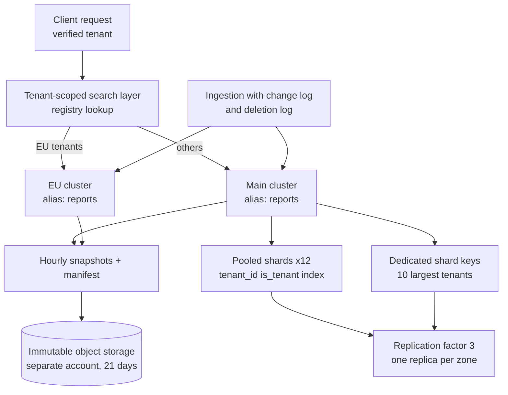

This assessment covers all ten lessons of **Advanced Vector Database Engineering**: collections, namespaces, payload indexes, metadata filtering, hybrid storage, multi-tenancy, replication, sharding, backup and recovery, and index updates. Answer the 18 multiple-choice questions first; the pass mark is 70% (13 of 18). Then work through the conceptual questions, the coding exercises, the design challenge and the troubleshooting scenarios, writing your own answer before opening each model answer. The written parts are not scored, but they test whether you can apply the ideas to a system you have not seen before.

```quiz
[
  {
    "q": "Which collection setting can NOT be changed after a Qdrant collection is created?",
    "options": [
      "The HNSW parameter m",
      "The quantisation configuration",
      "The vector dimension and distance metric",
      "The optimiser's deleted threshold"
    ],
    "answer": 2,
    "why": "Stored vectors and graph links depend on the dimension and metric, so they are fixed; index, quantisation and optimiser settings can change at the cost of background work."
  },
  {
    "q": "An application queries the alias `askmeridian`, which points at `askmeridian_minilm_v2`. A rebuilt `askmeridian_bge_v1` has been verified. What is the safe way to put it live?",
    "options": [
      "Rename `askmeridian_bge_v1` to `askmeridian_minilm_v2`",
      "Delete the old collection, then create the alias for the new one",
      "Copy the new collection's points into the old one",
      "Delete and recreate the alias in a single aliases request"
    ],
    "answer": 3,
    "why": "One update_collection_aliases call with a delete and a create is applied atomically, so no query sees a missing alias, and the old collection stays available for rollback."
  },
  {
    "q": "Why is a namespace safer than an optional metadata filter for separating corpora that are never searched together?",
    "options": [
      "Every write and query must name exactly one namespace, so it cannot be forgotten",
      "Namespaces use a different similarity metric",
      "Namespaces encrypt their data",
      "Namespaces are faster to create than collections"
    ],
    "answer": 0,
    "why": "A namespace is mandatory and exclusive: part of the address rather than an optional predicate."
  },
  {
    "q": "A keyword payload index maps each value of `source` to a posting list. What does the engine gain from it during a filtered search?",
    "options": [
      "A smaller vector for each point",
      "The matching set and its size without reading payloads, which lets the planner choose a strategy",
      "A guarantee that the HNSW graph is connected",
      "Automatic deletion of points with unknown values"
    ],
    "answer": 1,
    "why": "Payload indexes return and count matching points cheaply; the count (cardinality estimate) is what drives the choice between exact scoring and a filtered graph walk."
  },
  {
    "q": "A filter allows 2% of points. The application post-filters the top 100 unfiltered results. About how many results remain on average?",
    "options": [
      "2",
      "10",
      "20",
      "98"
    ],
    "answer": 0,
    "why": "Expected survivors are k' times s = 100 times 0.02 = 2, assuming allowed points are scattered at random."
  },
  {
    "q": "In a hybrid-storage layout, which data most needs to stay in RAM for fast HNSW search?",
    "options": [
      "The original source documents",
      "Full chunk text for every point",
      "Graph links and compressed (quantised) vectors read on every hop",
      "Backup archives"
    ],
    "answer": 2,
    "why": "Small, frequently read structures belong in memory; full-precision vectors for rescoring and chunk text can live on SSD, and archives in object storage."
  },
  {
    "q": "A pooled multi-tenant collection has 30,000 tenants, most with under 1,000 chunks. Which configuration matches Qdrant's documented approach?",
    "options": [
      "One collection per tenant",
      "A separate cluster for every hundred tenants",
      "No payload index, so that the planner always walks the global graph",
      "A keyword index on the tenant field with is_tenant=True, and per-tenant graph links (payload_m) rather than relying on post-filtering"
    ],
    "answer": 3,
    "why": "Thousands of collections multiply fixed overhead, and post-filtering fails for small tenants; tenant-aware indexing keeps each tenant's search connected and local."
  },
  {
    "q": "Where should the tenant ID in a search filter come from?",
    "options": [
      "A field in the request body",
      "A header the front end sets from a dropdown",
      "The tenant of the best-scoring result",
      "The verified identity established by authentication"
    ],
    "answer": 3,
    "why": "Anything in the request is attacker-controlled; only server-verified identity can scope a query."
  },
  {
    "q": "A shard has N = 3 replicas. Which (W, R) pair guarantees that a read sees the latest acknowledged write?",
    "options": [
      "(1, 1)",
      "(1, 2)",
      "(2, 2)",
      "(2, 1)"
    ],
    "answer": 2,
    "why": "W + R must exceed N for every read set to overlap every write set; only 2 + 2 = 4 > 3."
  },
  {
    "q": "What does this code print?\n```python\nfrom math import comb\nN, W, R = 4, 1, 2\nprint(comb(N - W, R) / comb(N, R))\n```",
    "options": [
      "0.25",
      "0.5",
      "0.75",
      "0.0"
    ],
    "answer": 1,
    "why": "comb(3, 2) / comb(4, 2) = 3 / 6 = 0.5: the worst-case probability that a read of 2 replicas misses the single replica holding the write."
  },
  {
    "q": "A Qdrant cluster has two nodes. One fails. Which operation is blocked even if every shard has a replica on the surviving node?",
    "options": [
      "Reading points from the surviving replicas",
      "Cluster metadata changes such as creating collections or moving shards, which need a Raft majority",
      "Computing cosine similarity",
      "Serving cached results"
    ],
    "answer": 1,
    "why": "Raft needs a majority of peers; one of two is not a majority, which is why three nodes is the usual minimum for high availability."
  },
  {
    "q": "A team's collection fits comfortably on one node, but query throughput is too low. What should they add?",
    "options": [
      "Replicas",
      "More shards",
      "A larger k per shard",
      "Custom shard keys"
    ],
    "answer": 0,
    "why": "Every query visits every shard, so sharding adds little throughput; replicas let different nodes serve different queries."
  },
  {
    "q": "What does this code print?\n```python\nS = 16\np = 0.01\nprint(round(1 - (1 - p) ** S, 3))\n```",
    "options": [
      "0.01",
      "0.16",
      "0.149",
      "0.851"
    ],
    "answer": 2,
    "why": "The probability that at least one of 16 shards exceeds its 1% tail is 1 - 0.99^16, about 0.149."
  },
  {
    "q": "Routing is `hash(id) % S`, and S changes from 6 to 7. Roughly what fraction of points must move?",
    "options": [
      "1/7",
      "1/6",
      "6/7",
      "All of them"
    ],
    "answer": 2,
    "why": "A point stays only if both moduli give the same remainder, about 1/(S+1) of the time; so about S/(S+1) = 6/7 move. Over-sharding avoids this by moving whole shards."
  },
  {
    "q": "A script deletes the wrong documents; the deletion reaches all three replicas. What is the right recovery?",
    "options": [
      "Wait for replication to repair the damage",
      "Raise read consistency to all",
      "Rebuild the HNSW graph",
      "Restore a backup into a new collection, verify it, re-apply later deletions, replay changes from its watermark, then switch the alias"
    ],
    "answer": 3,
    "why": "Replication copies mistakes. A backup restores the prior state; the deletion log and watermark bring it up to date safely."
  },
  {
    "q": "Backups run every 12 hours and take 1 hour. Changes cannot be replayed. What is the worst-case RPO?",
    "options": [
      "1 hour",
      "12 hours",
      "13 hours",
      "24 hours"
    ],
    "answer": 2,
    "why": "A failure just before a backup completes loses everything since the previous backup started: interval plus duration."
  },
  {
    "q": "A rebuild takes 6 hours, changes arrive at 400 per hour, and replay processes 1,600 per hour. How long does catch-up take after the build?",
    "options": [
      "2 hours",
      "1.5 hours",
      "6 hours",
      "24 minutes"
    ],
    "answer": 0,
    "why": "Backlog 400 x 6 = 2,400 changes, cleared at 1,600 - 400 = 1,200 per hour: 2 hours."
  },
  {
    "q": "A long-lived collection has 40% of its stored points deleted but not yet vacuumed. Which statement is correct?",
    "options": [
      "Deleted points are removed from the graph immediately, so nothing is lost",
      "Storage and scan work are inflated by about two thirds, and graph searches walk through dead nodes, reducing recall at a fixed search effort",
      "The deleted points are still returned in results",
      "Only payload indexes are affected"
    ],
    "answer": 1,
    "why": "Tombstones hide points but leave them in segments and graphs: 1/(1 - 0.4) - 1 is about 67% overhead, and searches spend effort on dead nodes until the optimiser rewrites segments."
  }
]
```

## Conceptual questions

**1.** Compare a collection, a namespace, a shard and a replica. For each, say what it separates or copies, who chooses it (the application or the database), and one decision it is the right tool for.

<details><summary>Show model answer</summary>

A **collection** separates vector contracts and lifecycles: one embedding model, dimension and metric, with its own configuration and overhead. The application chooses it; use it when vectors are not comparable (a different model) or the lifecycle differs (a rebuild behind an alias).

A **namespace** separates partitions of one contract: every write and query names exactly one. The application chooses the key; use it for hard partitions never searched together, such as tenants in a bridge design or corpora by language.

A **shard** separates data across machines for capacity and parallelism. The database chooses placement under hash routing; the application chooses it under custom routing. Use it when one node cannot hold or search the collection.

A **replica** copies a shard to another node for availability, durability against node loss, and read throughput. The operator sets the replication factor; the database places the copies. It does not protect against mistakes, which need backups.

</details>

**2.** Explain why post-filtering fails for small tenants in a pooled collection, and describe three ways a database or an engineer can make tenant-filtered search both correct and fast.

<details><summary>Show model answer</summary>

Post-filtering fetches $c$ candidates from the shared index and discards other tenants' points. With tenant share $s$, about $c\,s$ survive, so a tenant owning 0.1% of points keeps about 0.2 of 200 candidates: results come back short or empty, and the ones that do come back are not the tenant's best. Correlation between the tenant and regions of vector space can make it worse.

Remedies: (1) **exact pre-filtered search** for small tenants, using a payload index to list the tenant's points and scoring them all; a query planner does this automatically below a cardinality threshold. (2) **Filter-aware graph links**: Qdrant's `payload_m` builds connections among points sharing an indexed value, so a filtered walk stays connected; with `m=0` there is no global graph at all. (3) **Physical partitioning**: give large tenants their own shard key, namespace or collection, so the filter disappears from the search. Co-locating each tenant's points (`is_tenant=True`) further improves disk locality.

</details>

**3.** "We replicate every shard three times, so we do not need backups." Give three failures this misses and say what protects against each.

<details><summary>Show model answer</summary>

(1) **Operator error**: a delete with the wrong filter reaches every replica in milliseconds; a point-in-time backup is needed. (2) **Software bugs**: a pipeline release that writes wrong payloads or bad embeddings for a day is replicated faithfully; backups plus replay of correct changes recover it. (3) **Cluster, region or account loss**, including stolen credentials used to delete collections: replicas in the same cluster go together; an off-site, immutable backup in another account survives. A fourth: replicas in one availability zone fail together, which is a placement problem rather than a backup one.

</details>

**4.** A collection is being rebuilt with a new embedding model. Describe the full procedure from the start of the build to the retirement of the old collection, and justify each step.

<details><summary>Show model answer</summary>

1. **Record a watermark** in the change stream before reading the sources, so that every later change is captured.
2. **Create the new collection** with payload indexes first, then bulk-load from the sources as of the watermark, deferring indexing for very large loads.
3. **Capture changes** made during the build: replay from the watermark after the build, or dual-write from the start; replay is idempotent with deterministic IDs and whole-document replacement.
4. **Verify**: a parity check against the source of truth (missing, extra, stale), configuration, golden queries, and an offline evaluation of the new model.
5. **Switch the alias** atomically.
6. **Dual-write during the rollback window**, so the old collection remains a current fallback.
7. **Retire** the old collection after the window, and keep backups of both per the retention policy.

Each step closes a specific gap: missed changes, an unverified index, a visible missing alias, and a stale rollback target.

</details>

**5.** When should a RAG team shard a collection, and what should it try first? Include the effect of sharding on latency and total work.

<details><summary>Show model answer</summary>

Shard when the data (vectors, graph, payload indexes and headroom) no longer fits one node or index builds on one node are too slow. First try reducing bytes per vector (scalar quantisation with rescoring, smaller dimensions), putting full vectors and payloads on disk (hybrid storage), and a larger node; add replicas for throughput. Sharding runs smaller searches in parallel, which helps median latency on very large collections, but each query waits for the slowest shard, so the tail grows as $1 - (1-p)^S$; and $S$ searches over $n/S$ points cost more total CPU than one over $n$. Choose a shard count with growth in mind (over-shard moderately) because changing it later re-hashes or migrates data.

</details>

## Coding exercises

**1. Tenant filters, measured.** Build a pooled collection in NumPy with four tenants of very different sizes (60,000, 3,000, 300 and 40 points, 64 dimensions). Implement `post_filtered(q, t)`, which takes the top 200 candidates from the whole collection and keeps tenant `t`'s, and `pre_filtered(q, t)`, which scores only `t`'s points exactly. For 50 random queries per tenant, report how many results post-filtering returns and its recall@10 against the exact answer.

<details><summary>Show solution</summary>

```python
import numpy as np

rng = np.random.default_rng(3)
d, k, candidates = 64, 10, 200
sizes = {"big": 60_000, "mid": 3_000, "small": 300, "tiny": 40}
tenant = np.concatenate([[t] * n for t, n in sizes.items()])
X = rng.standard_normal((len(tenant), d)).astype(np.float32)
X /= np.linalg.norm(X, axis=1, keepdims=True)

def post_filtered(q, t):
    scores = X @ q
    top = np.argpartition(-scores, candidates)[:candidates]       # shared-index candidates
    top = top[np.argsort(-scores[top])]
    return [i for i in top if tenant[i] == t][:k]

def pre_filtered(q, t):
    rows = np.flatnonzero(tenant == t)                            # payload-index lookup
    scores = X[rows] @ q
    return list(rows[np.argsort(-scores)[:k]])

print(f"{'tenant':<6} {'share':>7} {'post-filter results':>20} {'recall vs exact':>16}")
for t, n in sizes.items():
    got, rec = [], []
    for _ in range(50):
        q = rng.standard_normal(d).astype(np.float32); q /= np.linalg.norm(q)
        post, exact = post_filtered(q, t), pre_filtered(q, t)
        got.append(len(post)); rec.append(len(set(post) & set(exact)) / k)
    print(f"{t:<6} {n / len(tenant):>7.2%} {np.mean(got):>20.1f} {np.mean(rec):>16.2f}")
```

```output
tenant   share  post-filter results  recall vs exact
big     94.73%                 10.0             1.00
mid      4.74%                  8.3             0.83
small    0.47%                  0.9             0.09
tiny     0.06%                  0.1             0.01
```

The expected survivors are $200 s$: about 9.5 for the mid tenant (8.3 observed, capped at 10), 0.9 for the small one and 0.1 for the tiny one, matching the binomial model. Exact pre-filtered search for the small tenants scores 300 or 40 vectors, which is trivial. This is the case for a planner that switches to exact search below a cardinality threshold, and for tenant-aware indexing.

</details>

**2. Parity and replay.** Write `parity(source, indexed)`, where both map `doc_id` to version, returning sorted lists of missing, extra and stale documents. Write `replay(indexed, change_log, watermark)` that applies `(seq, doc_id, version or None)` changes with `seq > watermark`, in sequence order, never moving a document to an older version. Show that replaying from a watermark taken one change too late leaves a stale document, while replaying from an earlier watermark is harmless.

<details><summary>Show solution</summary>

```python
def parity(source: dict, indexed: dict) -> dict:
    """source and indexed map doc_id -> version."""
    return {
        "missing": sorted(source.keys() - indexed.keys()),
        "extra": sorted(indexed.keys() - source.keys()),
        "stale": sorted(d for d in source.keys() & indexed.keys() if indexed[d] != source[d]),
    }

def replay(indexed: dict, change_log: list, watermark: int) -> dict:
    """Apply (seq, doc_id, version or None) changes with seq > watermark, in order."""
    out = dict(indexed)
    for seq, doc_id, version in sorted(change_log):
        if seq <= watermark:
            continue
        if version is None:
            out.pop(doc_id, None)
        elif out.get(doc_id, -1) < version:      # never go backwards
            out[doc_id] = version
    return out

source = {"hb-leave": 2, "hb-remote": 1, "it-laptop": 1, "it-password": 3}
built_at_w0 = {"hb-leave": 1, "hb-remote": 1, "it-vpn": 1, "it-password": 2}
log = [(11, "it-password", 2), (12, "hb-leave", 2), (13, "it-laptop", 1),
       (14, "it-vpn", None), (15, "it-password", 3)]

print("before replay:", parity(source, built_at_w0))
print("replay from 12:", parity(source, replay(built_at_w0, log, watermark=12)))
print("replay from 11:", parity(source, replay(built_at_w0, log, watermark=11)))
print("replay from 10:", parity(source, replay(built_at_w0, log, watermark=10)))
```

```output
before replay: {'missing': ['it-laptop'], 'extra': ['it-vpn'], 'stale': ['hb-leave', 'it-password']}
replay from 12: {'missing': [], 'extra': [], 'stale': ['hb-leave']}
replay from 11: {'missing': [], 'extra': [], 'stale': []}
replay from 10: {'missing': [], 'extra': [], 'stale': []}
```

The bulk build reflected changes up to sequence 11 (it has `it-password` version 2 but not `hb-leave` version 2). Replaying from 12 skips change 12, so `hb-leave` stays stale: the watermark was recorded too late. Replaying from 10 re-applies change 11, which the version guard makes harmless. The lesson: record the watermark *before* reading the sources, and make replay idempotent so erring early is safe.

</details>

## Architecture design challenge

Meridian's Reports assistant is growing. Plan the vector database for the next two years.

- 2,500 customer tenants; the largest ten hold about half of 80 million chunks; most hold under 5,000.
- Embeddings are 768-dimensional; nodes have 256 GB of RAM.
- Eight customers require their data to stay in the EU.
- Availability target: retrieval survives the loss of any one node or availability zone.
- RPO 1 hour, RTO 2 hours.
- A move to a new embedding model is planned within a year.
- Offboarded customers' data must be erased within 30 days.

Describe collections, tenancy, sharding, replication, storage tiers, backup and the model migration, with a diagram and the main trade-offs.

<details><summary>Show reference design</summary>

**Clusters and collections.** Two clusters: a main one and an EU one, each with three nodes per region spread over three availability zones. In each, one versioned collection behind an alias (`reports` pointing at `reports_e5_v1`, say). Data residency is enforced by cluster, which is the easiest thing to audit.

**Tenancy.** Pool the long tail in the main collection with a keyword index on `tenant_id` (`is_tenant=True`), created before loading, and per-tenant graph links; the planner uses exact search for small tenants. The ten largest tenants get dedicated custom shard keys so their load and growth are isolated. A tenant registry records each tenant's cluster, placement, size and quotas. All search goes through a tenant-scoped layer that takes the tenant from verified identity, ANDs caller filters, and checks results on the way out.

**Memory and sharding.** Raw float32 vectors: $80 \times 10^6 \times 3{,}072 \approx 246$ GB, too large for one node with headroom. Use int8 scalar quantisation in RAM (about 61 GB plus graph) with full vectors on local SSD for rescoring (hybrid storage). Over-shard the pooled part to 12 shards so that adding nodes moves shards rather than re-hashing points.

**Replication.** Replication factor 3, one replica per zone; `write_consistency_factor` 2 so acknowledged writes survive a node loss and writes continue with one zone down. Default reads use one replica; flows that need read-your-writes use a majority. Three nodes keep the Raft majority with one down.

**Backup.** Hourly snapshots from every node (discovered from the cluster API) to object storage in another account, immutable for 21 days, plus a manifest with configuration, model, pipeline version, counts and the ingestion watermark. With replay from the watermark, effective RPO is minutes. Monthly restore drills measure RTO. A deletion log of offboarded tenants is replayed after every restore, and 21-day retention keeps erasure within 30 days.

**Model migration.** Build `reports_newmodel_v1` per cluster from a recorded watermark, replay changes, run parity and evaluation (including per-tenant golden queries for the largest tenants), switch the alias, and dual-write for two weeks. Plan for roughly double memory and embedding capacity during the window.



**Trade-offs.** Two clusters double operational work but make residency simple to prove. Dedicated shard keys isolate the largest tenants without thousands of collections, at the price of placement decisions as tenants grow. Int8 in RAM saves about three quarters of vector memory at a small recall cost that must be measured; rescoring recovers most of it. Fan-out to 12 shards raises tail latency, which is bounded by keeping shards evenly loaded. Replication factor 3 triples memory and write work but meets the zone-loss requirement.

</details>

## Troubleshooting scenarios

**1.** After moving the Reports assistant from one collection per customer to a pooled collection, the largest customers are happy but small customers report that the assistant "knows nothing": many questions get no sources at all. The search code takes the top 100 results with HNSW and then keeps those whose `tenant_id` matches. Diagnose and fix.

<details><summary>Show diagnosis and fix</summary>

**Diagnosis.** Post-filtering. A small tenant's share of the pool is tiny, so among 100 shared candidates the expected number of its points is $100 s$, often below one. Large tenants are unaffected because their share is large. Confirm by logging, per query, the number of results before and after the tenant filter, grouped by tenant size.

**Fix.** Pass the tenant condition to the database as a filter so it is applied during search, create a keyword payload index on `tenant_id` (with `is_tenant=True` in Qdrant) so the planner can estimate cardinality and choose exact search for small tenants, and enable per-tenant graph links. Wrap the filter in the tenant-scoped search layer, and add a test that every tenant's own probe question returns its own documents.

</details>

**2.** A new collection built with a better chunker went live on Sunday. On Tuesday, HR reports that answers about the carry-over deadline cite last month's wording, although the handbook page was edited on Saturday. Other pages are fine. Diagnose and fix.

<details><summary>Show diagnosis and fix</summary>

**Diagnosis.** The rebuild did not capture changes made during the build. The bulk load read the sources before Saturday's edit, the edit reached only the old collection, and verification checked counts and golden queries that did not cover that page. A parity check by document and version against the source would have shown the page as stale.

**Fix.** Find the watermark from when the build began reading (or, if none was recorded, a time safely before it), replay all changes since then into the new collection, and run a parity check. Going forward: record the watermark before the bulk read, replay or dual-write, make parity a gate before the alias switch, and keep dual-writing during the rollback window.

</details>

**3.** A large tenant was offboarded with a delete-by-filter of 3 million points. A week later the cluster's memory and disk use have barely fallen, and p99 latency for other tenants is higher than before the deletion. Diagnose and fix.

<details><summary>Show diagnosis and fix</summary>

**Diagnosis.** Deletes are tombstones. The points are hidden, but their vectors, graph nodes and payloads remain in segments until the optimiser vacuums them. If many segments sit just below the deleted-share threshold, or optimisation is throttled, space is not reclaimed; meanwhile searches walk graphs full of dead nodes, which costs time and recall. Check collection status, segment count and the gap between stored and live points.

**Fix.** Let the optimiser run (check that it is not blocked or starved of threads), lower `deleted_threshold` temporarily so affected segments are rewritten, and schedule the work off-peak. If the tenant was a large share of the collection, rebuilding into a new collection behind the alias may be faster and gives a clean graph. For the future, put very large tenants on dedicated shard keys or collections so offboarding is a drop rather than millions of tombstones, and remember that backups containing the tenant expire on their own schedule.

</details>
