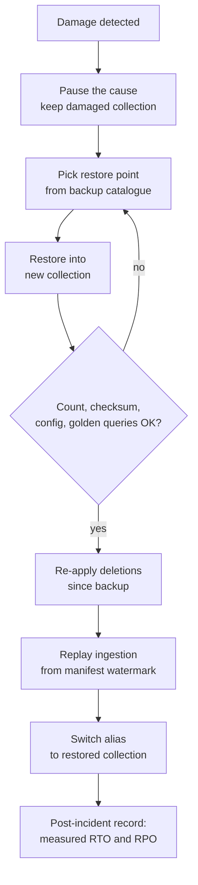

[Replication](/learn/advanced-vector-database-engineering/replication) protects a vector database against machines failing. It does nothing against the more common disaster: a person or a program doing the wrong thing, which replication copies to every node within milliseconds. A **backup** is a copy of the data taken at a point in time and kept somewhere the mistake cannot reach, and **recovery** is the procedure that turns that copy back into a working index. Neither is interesting until the day it is the only thing that matters.

Vector databases add a twist that ordinary databases do not have: the index is **derived data**. In principle you can always rebuild it from the source documents by re-running the pipeline. This lesson asks when that is a real recovery plan and when it is a dangerous illusion, explains physical snapshots and logical exports, defines the two numbers that every recovery plan is judged by, and builds a backup with a manifest and a restore that verifies itself before it goes live.

## Learning objectives

- Distinguish the failures that replication handles from those that need backups, and name the backup strategy that addresses each.
- Define recovery point objective (RPO) and recovery time objective (RTO), and calculate both for snapshot restore and for rebuild from source.
- Describe Qdrant collection snapshots and how they are created, stored and restored, including the limits in distributed clusters.
- Build a logical backup with a manifest and a restore that checks integrity, configuration and retrieval quality before switching traffic.
- Reconcile a restored index with the ingestion pipeline and with deletions made after the backup was taken.

## Prerequisites

- [Replication](/learn/advanced-vector-database-engineering/replication): why copies on other nodes are not backups.
- [Persistence](/learn/vector-database-fundamentals/persistence): write-ahead logs and what survives a restart.
- [Incremental ingestion](/learn/understanding-document-ingestion/incremental-ingestion): watermarks, cursors and reconciliation, which a restore must line up with.
- [Collections](/learn/advanced-vector-database-engineering/collections): collection configuration, which a backup must capture.

## Why this matters

Here is a list of ways AskMeridian's index can be lost or damaged, and what protects against each.

| Failure | Example | Protection |
| --- | --- | --- |
| Node or disk loss | A VM's disk fails | Replication |
| Operator error | A clean-up script deletes every IT runbook chunk instead of one | Backup |
| Software bug | A pipeline release writes payloads with the wrong `doc_id` for a day | Backup, plus the ability to replay changes |
| Bad bulk change | A re-index with a mis-configured chunker replaces good chunks with bad ones | Backup, or blue-green re-indexing |
| Whole-cluster or region loss | A cloud region outage, a deleted cluster | Backup stored in another location |
| Compromise | Stolen credentials used to drop collections | Backup in a separate account that the database's credentials cannot delete |

Only the first row is solved by replication. The rest have the same shape: the database faithfully did what it was told, and what it was told was wrong. Without a backup, every one of them ends with "rebuild everything from source", and as you will see, that can take far longer than anyone has budgeted, or be impossible.

## The intuition

A teacher spends an hour building a diagram on a whiteboard from her lecture notes. A cleaner wipes it.

She has three ways to get it back. If she photographed the board, she can redraw it from the photo in minutes: that is a **snapshot**. If she kept a list of every element and where it went, she can rebuild it reliably, even on a different board: that is a **logical export**. Or she can redo the hour's work from her notes: that is **rebuild from source**. The last always seems free because the notes still exist. But it takes the full hour, and if she has since revised her notes, she will not get the same diagram back. A photo taken this morning plus "what changed since" is usually the fastest route to exactly what was there.

## How it works

### Two numbers that define a recovery plan

- **Recovery point objective (RPO)**: the maximum amount of recent change you are prepared to lose, measured in time. Nightly backups give an RPO of up to 24 hours, unless you can replay the changes since.
- **Recovery time objective (RTO)**: the maximum time from disaster to service restored.

They are business decisions, not technical ones. For AskMeridian, the Platform team agrees with the support desk that losing up to a day of index changes is acceptable because the pipeline can replay them, but that the assistant must be answering again within one hour during support-desk hours. That sentence is the whole specification for what follows.

### Three ways to back up a vector index

**1. Physical snapshots.** The database writes its own files (segments, index structures, payload storage, collection configuration) into an archive. In Qdrant, a **collection snapshot** is created through the API, stored in the node's snapshot directory or in S3-compatible object storage if configured, and can be downloaded or used directly for recovery. Restoring a snapshot is fast because nothing is recomputed: the HNSW graph comes back as it was. The limits:

- In a distributed Qdrant cluster a collection snapshot is taken on a node and covers the shards on that node; a full backup of a sharded collection needs a snapshot from every node holding shards (Qdrant also offers per-shard snapshots). Check the documentation for your version.
- Snapshots are tied to the database product and, to a degree, its version. Restoring into a much newer or older version is not guaranteed; Qdrant documents its compatibility rules, and you should test cross-version restores rather than assume them.
- Some systems offer **full-storage snapshots** covering all collections and aliases at once; Qdrant has them, with restrictions in distributed mode that you should check for your version.

Other products have equivalents: Elasticsearch and OpenSearch snapshot to a registered repository (incrementally, reusing unchanged segment files); Weaviate has backup modules for filesystem and cloud object stores; Milvus has a separate backup tool; PostgreSQL with pgvector uses `pg_dump` or physical base backups with write-ahead-log archiving for point-in-time recovery. Note one pgvector detail: a logical `pg_dump` stores the index *definition*, not the built index, so restoring it rebuilds every HNSW index, which can take a long time on a large table.

**2. Logical exports.** Read every point (ID, vector, payload) through the ordinary API and write it to files in a neutral format, with a **manifest** describing the collection. Logical exports are slower to take and to restore (the index must be rebuilt on load), but they are portable across versions and products, easy to inspect, easy to verify with a checksum, and easy to filter (for example to drop a deleted tenant's points before restoring).

**3. Rebuild from source.** Re-run ingestion: load documents, parse, chunk, embed and index. It needs no backup of the vector database at all, and it is the right *last* line of defence. As a primary plan it has three problems:

- **Time and cost.** Embedding is the expensive step. The mathematics section shows a rebuild taking hours where a restore takes minutes.
- **Reproducibility.** You get back what the sources say *now*, chunked by the pipeline *now*, embedded by the model available *now*. If the source system has changed, the chunker has been updated, or the embedding model version you used has been retired by its provider, the rebuilt index differs from the lost one, sometimes in ways your evaluation has never seen.
- **Dependencies.** Sources must be reachable and fast enough to re-read in bulk. A wiki with an API rate limit can make a full re-crawl take days.

Most production systems combine them: regular snapshots or exports for fast recovery, with the pipeline able to replay changes since the backup, and full rebuild as the final fallback.

### What a complete backup contains

A backup that holds only vectors and payloads is not enough to recover from. The **manifest** should record:

1. Collection configuration: vector size, distance, named vectors, HNSW and quantisation settings, payload index definitions, sharding and replication settings.
2. Aliases that point at the collection.
3. The embedding model's exact identifier and version, and the chunking configuration and pipeline version that produced the points.
4. A count and a checksum of the data.
5. The **ingestion watermark**: the position in the source change stream (a timestamp, cursor or change-feed token, as in [Incremental ingestion](/learn/understanding-document-ingestion/incremental-ingestion)) up to which this backup is complete.

The last item is the one most often forgotten, and it causes a nasty bug. Suppose the backup was taken at 02:00 and the index is restored at 11:00. The ingestion pipeline's own cursor still says "processed up to 10:55". It carries on from 10:55, and every document that changed between 02:00 and 10:55 is now permanently stale in the index. Nothing errors. The fix is to restore the pipeline's position along with the data: after a restore, rewind ingestion to the backup's watermark and replay forward, then run a reconciliation pass.

### Deletions and retention

Backups preserve data that has since been deleted on purpose: a document withdrawn for legal reasons, a tenant that left, a person who exercised a right to erasure. Two rules follow.

- **Retention must be bounded and known.** If backups are kept for 35 days, deleted data persists in backups for up to 35 days, and your privacy notices and data-processing agreements must say so. [Secure deletion](/learn/enterprise-rag-governance/secure-deletion) covers the compliance detail.
- **Deletions must be re-applied after a restore.** Keep a **deletion log** (which documents and tenants were deleted, and when) outside the database, and replay deletions made after the backup's timestamp as part of every restore. Otherwise restoring last night's backup quietly resurrects a document you deleted this morning.

### Storage and the 3-2-1 rule

A long-standing rule of thumb for backups is **3-2-1**: three copies of the data, on two different kinds of storage, with one copy off-site. For a cloud vector database this usually means: the live cluster, snapshots in object storage in the same region, and a copy in another region or account. Make the off-site copy **immutable** for its retention period (object-lock or write-once features in your object store), so that credentials stolen from the application cannot delete backups too.

### A restore, step by step

A restore is an operation that can go wrong, so it follows a procedure rather than an improvisation.

1. **Stop the bleeding.** Pause whatever caused the damage (the bad pipeline, the script). Keep the damaged collection for forensics; do not overwrite it.
2. **Choose the restore point** from before the damage began, using pipeline logs and the backup catalogue.
3. **Restore into a new collection name**, never over the live one.
4. **Verify**: point count against the manifest, checksum, configuration (vector size, distance, payload indexes), and a small set of **golden queries** whose correct top result is known.
5. **Re-apply deletions** made after the backup timestamp, from the deletion log.
6. **Replay changes**: rewind ingestion to the manifest's watermark and process changes up to now; then reconcile.
7. **Switch traffic** by pointing the alias at the restored collection, an atomic operation in Qdrant.
8. **Record the incident**, including how long each step took, so the next RTO estimate is real.



### Restore drills

A backup that has never been restored is a hypothesis. Schedule **restore drills**: restore the latest backup into a scratch environment on a regular schedule, run the verification step, and measure the time. Drills catch the classic failures early: backups that silently stopped months ago, snapshots from only one of three nodes, a manifest missing the payload indexes, credentials for the backup bucket that nobody can find.

## The mathematics

### Recovery point

With backups every $I$ hours, each taking $B$ hours to complete, and no replay of changes, the worst-case data loss is

$$
\text{RPO}_{\text{worst}} \approx I + B
$$

because a failure just before a backup completes loses everything since the previous one began. **By hand**: nightly backups ($I = 24$) that take $B = 0.5$ hours give a worst case of 24.5 hours. With a replayable change stream whose history reaches back further than $I + B$, the effective RPO drops to minutes, which is why the watermark in the manifest matters so much.

### Recovery time: restore versus rebuild

**Restore** time is roughly the archive size divided by the transfer rate, plus loading:

$$
T_{\text{restore}} \approx \frac{\text{size}}{\text{bandwidth}} + T_{\text{load}}
$$

**Rebuild** time is dominated by embedding:

$$
T_{\text{rebuild}} \approx \frac{n_{\text{chunks}}}{\text{throughput}_{\text{embed}}} + T_{\text{index}} + T_{\text{fetch}}
$$

$n_{\text{chunks}}$ is the number of chunks, $\text{throughput}_{\text{embed}}$ is chunks embedded per second, and $T_{\text{index}}$ and $T_{\text{fetch}}$ are the times to build the index and to re-read the sources.

**By hand.** Take 2 million chunks at 384 dimensions. Assume (these are planning assumptions, to be replaced by your own measurements) about 2 KB of storage per point including payload and graph, so a snapshot of about 4 GB; restore bandwidth of 200 MB/s; embedding throughput of 500 chunks per second.

- Restore: $4{,}000 / 200 = 20$ seconds of transfer, plus load time; minutes in total.
- Rebuild, embedding alone: $2{,}000{,}000 / 500 = 4{,}000$ seconds, about 67 minutes, before re-fetching sources and building the index.

With an API embedding model the rebuild also has a direct cost: if chunks average 300 tokens, that is $2 \times 10^6 \times 300 = 6 \times 10^8$ tokens, multiplied by the provider's per-token price, which you should look up rather than assume. For AskMeridian's one-hour RTO, rebuild alone fails the objective even before counting the source fetch; restore meets it with room to spare.

### Backup storage

Keeping $d$ daily and $w$ weekly full backups of size $s$ costs $(d + w)\,s$ of storage. With $s = 4$ GB, $d = 14$ and $w = 8$: $22 \times 4 = 88$ GB, small next to the cost of losing the index. Incremental snapshots (as Elasticsearch takes) store only changed segment files and cost less; size them from your observed change rate.

## In code

**The problem.** Take a logical backup of a small AskMeridian collection with a manifest, simulate a bad clean-up script, restore into a new collection, verify the restore (count, checksum, golden queries) and only then switch the alias.

**Dependencies.** Qdrant's client in local mode and a local embedding model. No server or API key.

```bash
pip install qdrant-client sentence-transformers
```

```python
import gzip
import hashlib
import json
import uuid
from datetime import datetime, timezone
from pathlib import Path

from qdrant_client import QdrantClient, models
from sentence_transformers import SentenceTransformer

MODEL = "sentence-transformers/all-MiniLM-L6-v2"
model = SentenceTransformer(MODEL)
client = QdrantClient(":memory:")
NS = uuid.UUID("9a3e7c21-55b0-4d1e-8f2a-0c6b4d7e1f93")

def embed(texts):
    return model.encode(texts, normalize_embeddings=True)

chunks = [
    ("hb-leave", "Annual leave is 25 days; up to 5 unused days carry over until 31 March."),
    ("hb-remote", "Staff may work remotely up to 3 days a week."),
    ("hb-equipment", "The home-office equipment budget is £400; contractors are not eligible."),
    ("hb-expenses", "Expenses must be submitted within 30 days; anything over £75 needs a receipt."),
    ("it-password", "Passwords must be rotated every 90 days."),
    ("it-vpn", "VPN is required on public Wi-Fi."),
    ("it-laptop", "Laptops are refreshed every 3 years; report a lost laptop to the support desk at once."),
    ("it-support", "The support desk is open 08:00 to 18:00 UK time."),
]

def build(name):
    client.create_collection(name, vectors_config=models.VectorParams(
        size=384, distance=models.Distance.COSINE))

build("askmeridian_v1")
client.update_collection_aliases([models.CreateAliasOperation(create_alias=models.CreateAlias(
    collection_name="askmeridian_v1", alias_name="askmeridian"))])
client.upsert("askmeridian", points=[
    models.PointStruct(id=str(uuid.uuid5(NS, doc)), vector=v.tolist(),
                       payload={"doc_id": doc, "text": t, "source": doc.split("-")[0]})
    for (doc, t), v in zip(chunks, embed([t for _, t in chunks]))])

GOLDEN = {  # question -> doc_id that must come first
    "How many days of holiday do I get?": "hb-leave",
    "When is the IT help desk open?": "it-support",
    "I lost my laptop, what do I do?": "it-laptop",
}

def golden_check(collection):
    passed = 0
    for q, expected in GOLDEN.items():
        top = client.query_points(collection, query=embed([q])[0].tolist(), limit=1).points
        passed += bool(top) and top[0].payload["doc_id"] == expected
    return passed

def backup(collection, out_dir: Path, watermark: str) -> Path:
    """Logical backup: every point (id, vector, payload) plus a manifest."""
    out_dir.mkdir(parents=True, exist_ok=True)
    data_path = out_dir / "points.jsonl.gz"
    digest, count, offset = hashlib.sha256(), 0, None
    with gzip.open(data_path, "wt", encoding="utf-8") as f:
        while True:
            records, offset = client.scroll(collection, limit=256, offset=offset,
                                            with_vectors=True, with_payload=True)
            for r in records:
                line = json.dumps({"id": r.id, "vector": r.vector, "payload": r.payload},
                                  sort_keys=True)
                f.write(line + "\n")
                digest.update(line.encode())
                count += 1
            if offset is None:
                break
    info = client.get_collection(collection)
    manifest = {
        "collection": collection,
        "created_at": datetime.now(timezone.utc).isoformat(timespec="seconds"),
        "points": count,
        "sha256": digest.hexdigest(),
        "vector_size": info.config.params.vectors.size,
        "distance": info.config.params.vectors.distance.value,
        "embedding_model": MODEL,
        "ingestion_watermark": watermark,      # where to resume incremental ingestion
    }
    (out_dir / "manifest.json").write_text(json.dumps(manifest, indent=2))
    return out_dir

def restore(backup_dir: Path, new_collection: str) -> dict:
    manifest = json.loads((backup_dir / "manifest.json").read_text())
    if manifest["embedding_model"] != MODEL:
        raise RuntimeError("backup was made with a different embedding model")
    client.create_collection(new_collection, vectors_config=models.VectorParams(
        size=manifest["vector_size"], distance=models.Distance(manifest["distance"])))
    digest, batch, count = hashlib.sha256(), [], 0
    with gzip.open(backup_dir / "points.jsonl.gz", "rt", encoding="utf-8") as f:
        for line in f:
            digest.update(line.rstrip("\n").encode())
            p = json.loads(line)
            batch.append(models.PointStruct(id=p["id"], vector=p["vector"], payload=p["payload"]))
            count += 1
    if digest.hexdigest() != manifest["sha256"]:
        raise RuntimeError("backup file is corrupt: checksum mismatch")
    client.upsert(new_collection, points=batch)
    stored = client.count(new_collection).count
    return {"points_in_file": count, "points_stored": stored,
            "expected": manifest["points"], "golden_passed": golden_check(new_collection),
            "resume_ingestion_from": manifest["ingestion_watermark"]}

print("before incident: golden", golden_check("askmeridian"), "/", len(GOLDEN),
      "| points", client.count("askmeridian").count)
bdir = backup("askmeridian", Path("backups/askmeridian-nightly"), watermark="2026-11-13T02:00:00Z")
print("backup written:", sorted(p.name for p in bdir.iterdir()))

# The incident: a clean-up script meant to delete one runbook deletes every IT chunk.
client.delete("askmeridian", points_selector=models.FilterSelector(filter=models.Filter(
    must=[models.FieldCondition(key="source", match=models.MatchValue(value="it"))])))
print("after incident:  golden", golden_check("askmeridian"), "/", len(GOLDEN),
      "| points", client.count("askmeridian").count)

report = restore(bdir, "askmeridian_restored_20261113")
print("restore report:", report)
if report["points_stored"] == report["expected"] and report["golden_passed"] == len(GOLDEN):
    client.update_collection_aliases([
        models.DeleteAliasOperation(delete_alias=models.DeleteAlias(alias_name="askmeridian")),
        models.CreateAliasOperation(create_alias=models.CreateAlias(
            collection_name="askmeridian_restored_20261113", alias_name="askmeridian")),
    ])
print("alias now points to:", [a.collection_name for a in client.get_aliases().aliases
                               if a.alias_name == "askmeridian"])
print("after restore:   golden", golden_check("askmeridian"), "/", len(GOLDEN))
```

```output
before incident: golden 3 / 3 | points 8
backup written: ['manifest.json', 'points.jsonl.gz']
after incident:  golden 1 / 3 | points 4
restore report: {'points_in_file': 8, 'points_stored': 8, 'expected': 8, 'golden_passed': 3, 'resume_ingestion_from': '2026-11-13T02:00:00Z'}
alias now points to: ['askmeridian_restored_20261113']
after restore:   golden 3 / 3
```

**What the output means.** Before the incident all three golden questions return the right document first. The clean-up script removes the four IT chunks, and two golden questions now fail: the assistant would answer "when is the help desk open?" from whatever handbook chunk happens to be nearest. The restore reads 8 points, the checksum matches the manifest, all 8 are stored, and the golden queries pass on the *new* collection before any traffic reaches it. Only then does the alias move. The report also hands the operator the watermark from which to replay ingestion.

**The important lines.**

- `client.scroll(..., with_vectors=True)` pages through every point; `offset` is `None` when the scroll is finished. Without `with_vectors=True` you back up only payloads, a mistake that is invisible until restore day.
- Each line is serialised with `sort_keys=True` so the checksum is deterministic, and the restore recomputes it over exactly the same bytes.
- The manifest stores the embedding model. Restoring vectors from one model into a system that embeds queries with another produces no error and meaningless results, so `restore` refuses.
- The alias swap is one `update_collection_aliases` call containing a delete and a create, which Qdrant applies atomically; readers never see a missing alias.
- The damaged `askmeridian_v1` collection is left in place for investigation.

**Common errors.** Point IDs come back from `scroll` as strings for UUIDs and integers for integer IDs; keep them as they are. Large collections need streaming upserts in batches rather than one list, and the restore should use `wait=True` (the default) so the count is accurate when checked.

**Extending it.** Store the payload index definitions and named-vector configuration in the manifest and recreate them on restore. Add a deletion-log step that removes any `doc_id` deleted after `created_at`. Write the backup to object storage instead of a local folder.

### Snapshots on a Qdrant server

The following needs a running Qdrant server and was **not executed** for this lesson. It uses the client's snapshot methods; the HTTP API has matching endpoints.

```python
import os
from qdrant_client import QdrantClient, models

client = QdrantClient(url=os.environ["QDRANT_URL"], api_key=os.environ.get("QDRANT_API_KEY"))

snap = client.create_snapshot("askmeridian_v1", wait=True)        # on the node you call
print(snap.name, snap.size)
print([s.name for s in client.list_snapshots("askmeridian_v1")])

# Restore into a new collection from a snapshot URL (or a file:// path on the node).
client.recover_snapshot(
    "askmeridian_restored",
    location=f"{os.environ['SNAPSHOT_BASE_URL']}/{snap.name}",
    priority=models.SnapshotPriority.SNAPSHOT,    # the snapshot's data wins over any replica
    wait=True,
)
```

In a cluster, call `create_snapshot` against each node that holds shards of the collection (or use shard snapshots) and keep the set together with the cluster topology in the manifest.

## A real-world example

On a Tuesday morning an engineer on the Platform team runs a script to remove one retired runbook from AskMeridian. The filter is written against the wrong field, and every IT runbook chunk is deleted from all replicas at once. The support desk notices within twenty minutes: the assistant now answers VPN questions from handbook text.

The team follows its runbook. It stops the script's scheduled job, leaves the damaged collection untouched, and restores the 02:00 snapshot into `askmeridian_restored_tue`. The golden-query check fails on one question. Investigation shows why: the snapshot was taken from only two of the cluster's three nodes, because a node added last month was never added to the backup job, and one shard was missing. The team restores that shard from the previous night's snapshot of the new node, re-runs verification, re-applies two deletions logged since 02:00, rewinds the ingestion cursor to the manifest's watermark and replays the morning's changes. The alias moves 52 minutes after detection, inside the one-hour objective, but with little margin.

The follow-up actions are the useful part: the backup job now discovers nodes from the cluster API rather than a static list; a weekly restore drill runs the full procedure in staging and records the time; clean-up scripts must run a `count` with their filter and print it before deleting.

## Common mistakes

- **Treating replicas as backups.** Deletions and bad writes replicate instantly.
- **Relying on rebuild from source as the only plan.** It is slow, costly, and may not reproduce the lost index if sources, chunker or model have changed.
- **Backing up vectors without configuration.** A restore with the wrong distance metric or missing payload indexes "works" and performs badly.
- **Exporting payloads without vectors.** A scroll without `with_vectors=True` looks like a backup and is not.
- **Restoring over the live collection.** If the backup is bad, you now have no index at all.
- **Forgetting the ingestion watermark.** Documents changed between the backup and the restore stay stale forever.
- **Resurrecting deleted data.** Restores that do not replay a deletion log bring withdrawn documents back.
- **Never testing restores.** Backups that cannot be restored are discovered during the incident.

## Best practices

- Set RPO and RTO with the people who depend on the system, then design to them and measure them in drills.
- Combine fast restore (snapshots or exports) with replay of changes since the backup, and keep rebuild from source as the last resort.
- Write a manifest with configuration, model and pipeline versions, counts, checksums and the ingestion watermark.
- Store backups in another location and account, immutable for their retention period.
- Restore into a new collection, verify with counts, checksums and golden queries, then switch an alias.
- Keep a deletion log outside the database and replay it after every restore.
- Automate backup discovery so new nodes, shards and collections are included without anyone remembering.

## Performance considerations

- **Snapshot cost on the live cluster.** Creating a snapshot reads every segment and writes an archive, using disk bandwidth and space on the node (often temporarily close to the collection's size). Schedule it away from peak load and monitor free disk.
- **Logical export throughput.** Scrolling with vectors moves every vector over the network: 2 million 384-dimension float32 vectors are about 3 GB before payloads and JSON overhead, which grows text-encoded floats by several times. Compressing helps; binary formats such as NumPy arrays or Parquet help more.
- **Index rebuild on restore.** Logical restores and `pg_dump`-style restores rebuild HNSW graphs. Index build time grows faster than linearly with collection size, so measure it in drills.
- **Incremental backups** reduce storage and time when the change rate is low; they make restore depend on a chain of backups, so verify the chain.

## Security considerations

A backup is a complete copy of every document chunk in the index, often including text from HR policies, customer documents or personal data, so protect it at least as well as the live database. Encrypt backups at rest and in transit. Keep backup credentials separate from application credentials so that a compromised application cannot read or delete them. Bound retention to what your obligations allow and document it. In multi-tenant systems, record which tenants a backup contains, so that offboarding and erasure requests can account for backups (by expiry or by filtered re-export), and never restore a backup into an environment with weaker access controls than production.

## Summary

- Replication protects against hardware failure; backups protect against mistakes, bugs, compromise and loss of a whole cluster or region.
- The three strategies are physical snapshots (fast, product-specific), logical exports (portable, verifiable, slower) and rebuild from source (always available in principle, slow, costly and not always reproducible).
- RPO and RTO are business requirements; worst-case RPO is about the backup interval plus duration unless changes can be replayed, and rebuild time is dominated by embedding.
- A useful backup has a manifest: configuration, model and pipeline versions, counts, checksums and the ingestion watermark.
- Restore into a new collection, verify, re-apply deletions, replay changes from the watermark, then switch an alias, and practise the whole procedure regularly.

## Exercises

**1.** Backups run every 6 hours and take 30 minutes. What is the worst-case RPO without replay? If the change stream can be replayed for the last 72 hours, what becomes the effective RPO, and what new requirement does that create?

<details><summary>Show solution</summary>

Without replay, about $6 + 0.5 = 6.5$ hours. With 72 hours of replayable changes, the effective RPO falls to however far behind the change stream is (typically minutes), provided the backup's watermark is known and is within the 72-hour window. New requirement: the manifest must record the watermark accurately, and backups must never be older than the replay window, otherwise there is a gap that only a full reconciliation or rebuild can close.

</details>

**2.** A collection has 10 million chunks. Assume snapshots of 20 GB restored at 250 MB/s with 10 minutes of loading, and embedding at 800 chunks per second. Compute restore and rebuild times (embedding only) and say which meets a 2-hour RTO.

<details><summary>Show solution</summary>

Restore: $20{,}000 / 250 = 80$ s of transfer plus 10 minutes, about 11 to 12 minutes. Rebuild: $10^7 / 800 = 12{,}500$ s, about 3.5 hours, for embedding alone. Only the restore meets the 2-hour RTO.

</details>

**3.** Extend the lesson's `restore` function with a deletion log: a list of `(doc_id, deleted_at)` pairs. After loading, delete every point whose `doc_id` was deleted after the manifest's `created_at`, and include the number removed in the report.

<details><summary>Show solution</summary>

```python
def apply_deletion_log(collection, manifest, deletion_log):
    removed = 0
    for doc_id, deleted_at in deletion_log:
        if deleted_at > manifest["created_at"]:           # ISO 8601 UTC strings sort correctly
            flt = models.Filter(must=[models.FieldCondition(
                key="doc_id", match=models.MatchValue(value=doc_id))])
            removed += client.count(collection, count_filter=flt).count
            client.delete(collection, points_selector=models.FilterSelector(filter=flt))
    return removed
```

Call it in `restore` after the upsert and before the golden check, and add `"deletions_reapplied": removed` to the report. The comparison works because both timestamps are ISO 8601 strings in UTC with the same format; in production, parse them to `datetime` objects to be safe.

</details>

**4.** Design decision. A multi-tenant RAG product promises customers that their data is erased within 30 days of offboarding, and must restore service within 1 hour after any incident. Design the backup schedule, retention and restore procedure so that both promises hold.

<details><summary>Show solution</summary>

Take snapshots (or exports) at least daily, with replay of changes from the manifest watermark to keep RPO low, and test that a restore fits well inside 1 hour. Keep backups for at most about 30 days minus the time between offboarding and the last backup that contains the tenant; simplest is a retention of under 30 days (for example 21), so every backup containing an offboarded tenant expires within 30 days of offboarding. Keep a deletion log of offboarded tenants; every restore replays it, so a restored backup never resurrects a departed tenant. If longer retention is required for other reasons, use logical exports partitioned by tenant so that a tenant's files can be deleted from older backups. Record each backup's tenant list in its manifest, and run monthly drills that verify both the time and that offboarded tenants are absent after restore.

</details>

## Check your understanding

```quiz
[
  {
    "q": "An engineer's script deletes the wrong documents, and the deletion reaches all three replicas. What recovers the data fastest and most faithfully?",
    "options": [
      "Restoring a recent backup into a new collection, verifying it and replaying changes since",
      "Waiting for replication to repair the replicas",
      "Raising the read consistency to all",
      "Re-embedding every source document from scratch"
    ],
    "answer": 0,
    "why": "Replication copied the mistake. A backup restores the exact prior state quickly; replaying changes closes the gap. Rebuild is slower and may not reproduce the same index."
  },
  {
    "q": "Which item in a backup manifest prevents documents changed between the backup and the restore from staying stale?",
    "options": [
      "The vector size",
      "The SHA-256 checksum",
      "The ingestion watermark",
      "The snapshot file name"
    ],
    "answer": 2,
    "why": "Rewinding ingestion to the backup's watermark and replaying forward re-applies every change after the backup point."
  },
  {
    "q": "Why is 'we can always rebuild from source' a weak primary recovery plan?",
    "options": [
      "Rebuilt indexes cannot use HNSW",
      "Vector databases do not allow re-inserting deleted IDs",
      "Source documents are always deleted after ingestion",
      "Re-embedding is slow and costly, and changed sources, chunkers or retired model versions can produce a different index"
    ],
    "answer": 3,
    "why": "Rebuild time is dominated by embedding, and the rebuilt index reflects today's sources, pipeline and model, not the lost index."
  },
  {
    "q": "With nightly backups that take 1 hour and no change replay, what is the worst-case RPO?",
    "options": ["1 hour", "About 25 hours", "24 hours exactly", "12 hours"],
    "answer": 1,
    "why": "A failure just before a backup completes loses everything since the previous backup started: the interval plus the duration."
  },
  {
    "q": "In the lesson's restore, why is the alias switched only after verification, and in a single call?",
    "options": [
      "Because Qdrant cannot search a collection that has no alias",
      "Because aliases make restores faster",
      "So that traffic only reaches a verified collection, and the swap is atomic so readers never see a missing alias",
      "Because the checksum is stored in the alias"
    ],
    "answer": 2,
    "why": "Restoring into a new name keeps the live (or damaged) collection intact until the restore is proven good; one aliases call applies the delete and create together."
  }
]
```

## Further reading

- Qdrant documentation, [Snapshots](https://qdrant.tech/documentation/concepts/snapshots/): creating, listing, downloading and recovering collection and full-storage snapshots, snapshot storage and recovery priorities.
- Qdrant documentation, [Collections](https://qdrant.tech/documentation/concepts/collections/): collection aliases and atomic alias switching.
- PostgreSQL documentation, [Backup and Restore](https://www.postgresql.org/docs/current/backup.html): SQL dumps, file-system backups and continuous archiving with point-in-time recovery.
- Elasticsearch documentation, "Snapshot and restore": repositories and incremental snapshots.
- Beyer, Jones, Petoff and Murphy (eds.) (2016), *Site Reliability Engineering*, O'Reilly, chapter 26 "Data Integrity: What You Read Is What You Wrote": why restores, not backups, are what matter.
