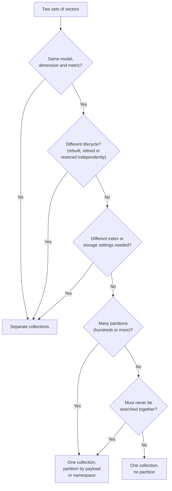
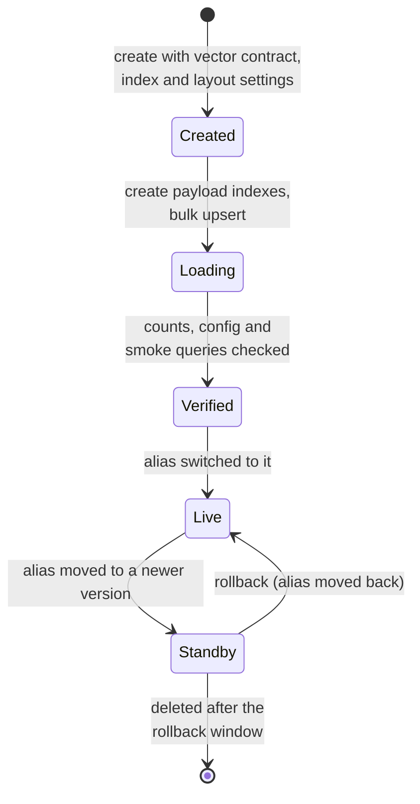

In [What is a vector database?](/learn/vector-database-fundamentals/what-is-a-vector-database) a collection was defined in one line: a named set of points that share a vector size and a similarity measure. That definition is correct, and it hides most of what matters in production. A collection is also the unit at which you choose an index and its parameters, decide where the bytes live, set how many shards and replicas exist, take snapshots, grant access and, eventually, throw everything away and start again with a new embedding model.

This lesson treats the collection as an engineering object. You will learn what a collection's configuration actually fixes, which settings can change after creation and which cannot, how to decide between one collection and several, how named vectors let one collection hold more than one embedding of the same chunk, and how aliases let you replace a collection underneath a running application without anyone noticing. The examples use Qdrant, because AskMeridian runs on it, with the equivalents in other products alongside.

## Learning objectives

- Describe the four things a collection's configuration fixes: the vector contract, the index, the physical layout and the lifecycle.
- Classify collection settings as immutable or changeable after creation, and predict which changes force a rebuild.
- Decide, with reasons, whether two sets of vectors belong in one collection, in one collection with named vectors, or in separate collections.
- Use versioned collection names and an alias to switch a live application to a rebuilt collection atomically, and roll it back.
- Estimate the fixed overhead that many small collections add, and explain why "one collection per customer" scales badly.

## Prerequisites

- [What is a vector database?](/learn/vector-database-fundamentals/what-is-a-vector-database): points, vectors, payloads and the write and query paths.
- [Vector storage](/learn/vector-database-fundamentals/vector-storage): segments, memory-mapped files and quantised copies.
- [Similarity search](/learn/vector-database-fundamentals/similarity-search): why the collection's metric must match the embedding model.
- [Qdrant](/learn/vector-database-ecosystem/qdrant): the product used for the examples.

## Why this matters

Almost every expensive mistake with a vector database is made at collection-creation time and discovered months later. A team creates a collection with the wrong metric for its model, and recall is quietly worse than it should be. A team hardcodes the collection name in four services, and the first model upgrade becomes a coordinated redeploy. A team creates one collection per customer, and at a few thousand customers the cluster spends more memory and file handles on per-collection bookkeeping than on vectors. A team adds a second model for an experiment and finds the vector configuration cannot change, so it must re-ingest everything.

None of these shows up in a tutorial. They show up when the collection has to change while people depend on it. The collection is the boundary of what can be changed cheaply, so knowing exactly where that boundary sits is what lets you design for change from the start.

## The intuition

Think of a collection as a purpose-built warehouse rather than a storage room.

When Meridian builds a warehouse, it fixes some things in concrete: the size of the loading bays (every pallet must be exactly that size) and the layout of the aisles (which determines how fast a picker can find anything). Other things can be rearranged on a weekend: the signage, the shelving labels, how many staff work each shift. And some things are about the building's life rather than its contents: insurance, the spare key, the plan for moving to a bigger site.

A vector collection is the same. The **vector size and metric** are the loading bays: every point must fit them, and they cannot be changed once the building exists. The **index parameters** are the aisle layout: they can be changed, but changing them means re-shelving everything, which takes time. **Payload fields** are the signage: you can add new ones whenever you like. And the **alias** is the street address on the company's letterhead. When Meridian moves to a new warehouse, it does not reprint every letter; it points the address at the new building. Applications that query an alias never need to know a move happened.

## How it works

### What a collection fixes

A collection bundles four kinds of decision. It helps to keep them separate, because each changes on a different timescale.

1. **The vector contract.** For each vector space in the collection: its name, its dimension, its similarity metric and its element type (float32, float16 or uint8 in Qdrant). Every point written must satisfy it. This is the part tied to the embedding model, and it is fixed for the collection's life.
2. **The index.** The type of index built over each vector space and its parameters: for an [HNSW](/learn/vector-indexing-algorithms/hnsw) graph, the number of links per node (`m`) and the effort spent building it (`ef_construct`); whether a quantised copy is kept and how. These can usually be changed, at the price of rebuilding the index in the background.
3. **The physical layout.** How many shards the collection is split into, how many replicas of each exist, and which parts sit in RAM or on disk. Shards and replicas are the subject of [Sharding](/learn/advanced-vector-database-engineering/sharding) and [Replication](/learn/advanced-vector-database-engineering/replication); storage placement is the subject of [Hybrid storage](/learn/advanced-vector-database-engineering/hybrid-storage).
4. **The lifecycle.** A collection is created, loaded, served, snapshotted and deleted as a unit. Snapshots are per collection (see [Backup and recovery](/learn/advanced-vector-database-engineering/backup-and-recovery)), and in products with access control, permissions are commonly granted per collection.

What a collection does *not* fix is the payload schema. Qdrant, like most vector databases, accepts any JSON payload on any point. Structure in the payload is a convention your ingestion code enforces, plus the [payload indexes](/learn/advanced-vector-database-engineering/payload-indexes) you choose to build on particular fields.

### Mutable and immutable settings

The table summarises what can change after creation in Qdrant. Other products differ in detail, but the pattern (the vector contract is fixed, the index is tunable, the layout is partly fixed) is close to universal, because it follows from how the data is stored.

| Setting | Changeable after creation? | What a change costs |
| --- | --- | --- |
| Vector dimension | No | New collection, re-embed or re-copy every point |
| Similarity metric | No | New collection |
| Vector space names | Adding or removing spaces needs a new collection in older versions; recent versions add operations for it, so check yours | Re-ingestion if you must recreate |
| HNSW `m`, `ef_construct` | Yes | Background index rebuild; search slower or exhaustive until done |
| Quantisation | Yes | Background rebuild of the quantised copy |
| Payload indexes | Yes, any time | Index build over existing points |
| Shard count | Fixed at creation in the open-source server; resharding exists in some managed offerings | Otherwise a new collection |
| Replication factor | Yes | Copying shards to new nodes |

Why are dimension and metric immutable? Because everything already built depends on them. The stored vectors are rows of exactly $d$ numbers laid out back to back, so a different $d$ is a different file format. The HNSW graph's links were chosen by distances under the original metric, so a new metric invalidates every link. Changing either means rebuilding everything, and at that point a new collection is simpler and safer, since the old one keeps serving while the new one is built.

> [!KEY]
> Treat a collection's vector contract as part of the embedding model's identity. A new model, a new dimension or a new metric means a new collection, never an in-place change.

### Named vectors: several embeddings, one point

Sometimes you want more than one vector per chunk: an embedding of the chunk text and a separate embedding of its title, or the current model's embedding alongside a candidate model's during an evaluation, or a dense vector beside a [sparse](/learn/sparse-retrieval/sparse-representations) one for [hybrid search](/learn/hybrid-search). Qdrant supports this with **named vectors**: the collection declares several vector spaces, each with its own name, dimension and metric, and each point carries a vector for some or all of them. A query names the space it searches with `using`.

The alternative is one collection per vector space. The trade-off:

- **Named vectors** keep one point identifier, one payload and one upsert per chunk. All representations of a chunk are written together, so they cannot drift apart, and payload filters apply identically to every space. The cost is coupling: all spaces share the collection's shards, replicas and lifecycle, and deleting the experiment's vectors later means an update to every point.
- **Separate collections** decouple everything. Each can be rebuilt, resized or deleted alone. The cost is that your application must keep two collections consistent, and every payload is stored twice.

The rule of thumb that falls out: use named vectors for representations that belong together permanently (title and body, dense and sparse), and separate collections for representations with different lifecycles (the old model and its replacement).

### One collection or many

Each collection carries a fixed cost on top of its points. It has its own segments, its own optimiser work, its own files and memory-mapped regions, its own HNSW graphs per segment, and, in a cluster, its own entries in the cluster's shared metadata. Qdrant's documentation recommends against very large numbers of collections for this reason, and points to payload-based partitioning instead; managed products such as Pinecone cap the number of indexes per project.

So the question is when a separation is worth that cost. The flowchart captures the usual reasoning.



Notice where the many-partitions branch leads. A separate collection per customer, per department or per document set is tempting because it feels isolated, but it multiplies the fixed cost by the number of partitions and makes every cluster-wide operation (a configuration change, an upgrade, a backup) loop over thousands of objects. Partitioning inside a collection is the subject of [Namespaces](/learn/advanced-vector-database-engineering/namespaces), and doing it safely for customers is the subject of [Multi-tenancy](/learn/advanced-vector-database-engineering/multi-tenancy).

### Naming, versioning and aliases

Because a model change forces a new collection, every long-lived RAG system will have several generations of its collection. Two conventions make that painless.

**Versioned physical names.** Name each collection after what it contains and how it was built: `askmeridian_minilm_v1`, `askmeridian_minilm_v2`, `askmeridian_bge_v1`. The name records the corpus, the model and a schema version that you increment whenever the payload layout or chunking changes. A collection's name then tells an operator what is inside it without opening it.

**An alias for the application.** An **alias** is a second name that points at a collection. Applications query `askmeridian`, never `askmeridian_minilm_v2`. To move to a new collection, you change what the alias points at. In Qdrant, `update_collection_aliases` takes a list of operations (delete the old alias, create the new one) and applies them together, so no query ever sees a missing alias. Elasticsearch and OpenSearch have the same concept under the same name; Milvus has aliases too. Where a product lacks aliases, a configuration value read at runtime, rather than a constant compiled into code, gives you the same indirection.

The sequence of a collection's life then looks like this:



1. **Create** the collection with its vector contract and initial index settings.
2. **Create payload indexes** for the fields you will filter on, before loading data, so that the index build happens once and filter-aware structures are built with the graph (see [Payload indexes](/learn/advanced-vector-database-engineering/payload-indexes)).
3. **Load** the points in batches. For very large bulk loads, Qdrant's documentation has recommended deferring HNSW construction until loading finishes, by adjusting the optimiser's indexing threshold; check the current documentation for your version.
4. **Verify**: the point count matches the source, the configuration is what you intended, and a fixed set of smoke-test queries returns sensible results.
5. **Switch the alias** in one atomic operation.
6. **Keep the previous collection** for a rollback window, then delete it.

The full re-indexing workflow, including keeping a collection current while it is rebuilt, belongs to [Index updates](/learn/advanced-vector-database-engineering/index-updates) and, at the deployment level, [Blue-green deployments](/learn/ci-cd-and-mlops/blue-green-deployments).

### Across products

| Product | Its "collection" | Notes |
| --- | --- | --- |
| Qdrant | Collection | Named vectors, aliases, per-collection snapshots |
| Pinecone | Index | Dimension and metric fixed at creation; partitioned into namespaces |
| Weaviate | Collection (formerly "class") | Has a property schema; named vectors supported |
| Milvus | Collection | Explicit field schema; can hold several vector fields; aliases |
| pgvector | Table | A `vector(n)` column fixes the dimension; the metric is chosen per index and per query operator |
| Elasticsearch, OpenSearch | Index | `dense_vector` or `knn_vector` mapping fixes dimension; aliases are standard practice |

In pgvector the metric is not part of the table: an index is built for one operator class (`vector_cosine_ops`, for example) and is used only by queries with the matching operator, so the contract is spread across column, index and queries. [PostgreSQL with pgvector](/learn/vector-database-ecosystem/postgresql-with-pgvector) covers this.

## In code

**The problem.** Create a versioned collection with an explicit vector contract, show that the database enforces it, put an alias in front of it, then build a second version alongside and switch the alias without the querying code changing.

**Dependencies.** `qdrant-client` and `sentence-transformers`. Qdrant's embedded `:memory:` mode runs inside the Python process, so no server is needed. The embedding model, `all-MiniLM-L6-v2`, is downloaded on first use.

```bash
pip install qdrant-client sentence-transformers
```

```python
from qdrant_client import QdrantClient, models
from sentence_transformers import SentenceTransformer

chunks = [
    ("handbook", "Annual leave is 25 days; up to 5 unused days carry over and must be used by 31 March."),
    ("handbook", "Staff may work remotely up to 3 days a week. The home-office equipment budget is £400."),
    ("handbook", "Expenses must be submitted within 30 days; anything over £75 needs a receipt."),
    ("runbooks", "Passwords must be rotated every 90 days. VPN is required on public Wi-Fi."),
    ("runbooks", "Laptops are refreshed every 3 years. Report a lost laptop to the support desk at once."),
    ("runbooks", "The support desk is open 08:00 to 18:00 UK time."),
]
model = SentenceTransformer("sentence-transformers/all-MiniLM-L6-v2")
vectors = model.encode([text for _, text in chunks], normalize_embeddings=True)
dim = vectors.shape[1]                      # 384 for this model

client = QdrantClient(":memory:")          # embedded mode: no server needed

# 1. A versioned collection. Its name records the model and the schema version.
client.create_collection(
    collection_name="askmeridian_minilm_v1",
    vectors_config={"minilm": models.VectorParams(size=dim, distance=models.Distance.COSINE)},
)
client.upsert(
    collection_name="askmeridian_minilm_v1",
    points=[
        models.PointStruct(id=i, vector={"minilm": v.tolist()},
                           payload={"source": src, "text": text, "schema": 1})
        for i, ((src, text), v) in enumerate(zip(chunks, vectors))
    ],
)
info = client.get_collection("askmeridian_minilm_v1")
params = info.config.params.vectors["minilm"]
print("points:", info.points_count, "| vector:", params.size, params.distance)

# 2. The collection enforces its contract: a wrong-sized vector is rejected.
try:
    client.upsert("askmeridian_minilm_v1",
                  points=[models.PointStruct(id=99, vector={"minilm": [0.1] * 768}, payload={})])
except Exception as exc:
    print("rejected:", type(exc).__name__, str(exc)[:63])

# 3. Applications query an alias, never a physical collection name.
client.update_collection_aliases(change_aliases_operations=[
    models.CreateAliasOperation(create_alias=models.CreateAlias(
        collection_name="askmeridian_minilm_v1", alias_name="askmeridian"))
])

def ask(question):
    q = model.encode(question, normalize_embeddings=True).tolist()
    hits = client.query_points("askmeridian", query=q, using="minilm", limit=1, with_payload=True).points
    return f"{hits[0].score:.3f}  {hits[0].payload['text'][:55]}  (schema {hits[0].payload['schema']})"

print("before:", ask("How many days of holiday do I get?"))

# 4. Build v2 beside v1 (here: the same vectors with an extra payload field), then swap.
client.create_collection(
    collection_name="askmeridian_minilm_v2",
    vectors_config={"minilm": models.VectorParams(size=dim, distance=models.Distance.COSINE)},
)
client.upsert(
    collection_name="askmeridian_minilm_v2",
    points=[
        models.PointStruct(id=i, vector={"minilm": v.tolist()},
                           payload={"source": src, "text": text, "schema": 2, "owner": "HR" if src == "handbook" else "IT"})
        for i, ((src, text), v) in enumerate(zip(chunks, vectors))
    ],
)
assert client.count("askmeridian_minilm_v2").count == client.count("askmeridian_minilm_v1").count
client.update_collection_aliases(change_aliases_operations=[
    models.DeleteAliasOperation(delete_alias=models.DeleteAlias(alias_name="askmeridian")),
    models.CreateAliasOperation(create_alias=models.CreateAlias(
        collection_name="askmeridian_minilm_v2", alias_name="askmeridian")),
])
print("after: ", ask("How many days of holiday do I get?"))
print("aliases:", [(a.alias_name, a.collection_name) for a in client.get_aliases().aliases])
print("collections:", sorted(c.name for c in client.get_collections().collections))
```

```output
points: 6 | vector: 384 Cosine
rejected: ValueError Wrong input: Vector dimension error: expected dim: 384, got 768
before: 0.435  Annual leave is 25 days; up to 5 unused days carry over  (schema 1)
after:  0.435  Annual leave is 25 days; up to 5 unused days carry over  (schema 2)
aliases: [('askmeridian', 'askmeridian_minilm_v2')]
collections: ['askmeridian_minilm_v1', 'askmeridian_minilm_v2']
```

**The important lines.**

- `vectors_config={"minilm": models.VectorParams(...)}` declares a *named* vector space even though there is only one. Starting with a name costs nothing and means a second space (a title embedding, a sparse vector) can be added later without changing every query from "the vector" to "a named vector".
- `dim = vectors.shape[1]` takes the dimension from the model's real output rather than from a constant typed by hand. A mismatch between a typed constant and the model is a classic source of the rejection shown in step 2.
- `"schema": 1` records the payload layout version, so mixed-version data from an interrupted migration can be detected.
- `query_points("askmeridian", ...)` queries the alias. The function `ask` never mentions a physical collection, which is why it works unchanged after the switch.
- The second `update_collection_aliases` call passes two operations, delete and create, in one request. Qdrant applies the list together, so there is no instant at which `askmeridian` points nowhere.
- `assert ... count ...` is the minimal verification gate. A production gate would also compare configurations and run smoke queries with expected answers.

**What the output means.** The first line confirms the contract: 384 dimensions, cosine. The second shows the database enforcing it; a 768-dimension vector (for example, from a different model) is refused at write time with a clear error rather than being stored and producing meaningless scores. The "before" and "after" lines return the same chunk with the same score, because v2 holds the same vectors, but the `schema` field shows that the query was served by a different collection. The last two lines show the state after the switch: the alias points at v2, and v1 still exists, ready for a rollback that is a single alias operation.

**Errors people commonly hit.**

- `Not found: Collection ... doesn't exist` after an alias switch, from code that cached the physical name at startup (for example by calling `get_aliases` once and storing the result). Resolve through the alias on every request; the database does this for you.
- Creating an unnamed vector space and querying with `using="minilm"`, or the reverse; this raises an error about the vector name.
- Re-running `create_collection` for a collection that exists. Check with `collection_exists` first, and avoid "recreate" helpers in production: they delete everything first.

**Extending it.** Turn step 4 into a `promote(new, alias)` function that refuses to switch unless the new collection's vector configuration equals the old one's (or the change is intended), the counts are within a tolerance, and five smoke queries each return their expected chunk in the top 3. Then add `rollback(alias)`, which points the alias back at the previous version recorded in a small metadata table.

## A real-world example

Meridian's Platform team started AskMeridian with a single collection called `handbook`, created from a tutorial: unnamed vector, cosine metric, 384 dimensions for `all-MiniLM-L6-v2`. Three services referenced it by name: the chat backend, a nightly ingestion job and an evaluation script.

Eight months later, Tomasz, who leads retrieval quality, found in an evaluation that a 1,024-dimension model answered more staff test questions correctly. His first attempt at the migration was to upsert the new vectors into `handbook` under the same identifiers. Every write failed with a dimension error, which was the database doing its job: had it accepted them, the collection would have held a mixture of two incompatible spaces. His second idea was to create `handbook_new`, load it, and change the name in all three services. That meant three coordinated deployments, and the evaluation script, which nobody remembered, kept querying the old collection for two weeks and reporting misleading scores.

For the next migration they changed the process. Collections are named `askmeridian_<model>_v<n>`. Every service reads the alias `askmeridian` from configuration. A promotion script verifies a new collection (configuration, count against the source documents, a set of smoke queries with known answers) and then switches the alias in one atomic call, recording the previous target so that rollback is one command. The old collection is deleted only after a week with no rollback. The next model change was a non-event: no service was redeployed.

## Common mistakes

- **Hardcoding a physical collection name in application code.** Every rebuild then becomes a multi-service deployment, and forgotten consumers keep reading stale data.
- **Choosing the metric without reading the model card.** A collection set to Euclidean distance for a model trained for cosine similarity, with unnormalised vectors, ranks differently from what the model intends, and nothing reports an error.
- **One collection per customer, document set or user.** The fixed per-collection overhead multiplies, cluster operations slow down, and the database's own guidance is to partition inside a collection instead.
- **Mixing embedding models in one vector space.** Two 384-dimension models produce vectors the database will happily accept and compare, and the scores are meaningless. The dimension check only catches mismatched sizes.
- **Changing index parameters on a busy collection without expecting the rebuild.** Search may slow down or fall back to exhaustive scanning until the new index is built.
- **Deleting the old collection immediately after switching.** Without a rollback window, a problem found an hour later means a full rebuild under pressure.

## Best practices

- Record the embedding model's name and version, the chunking configuration and the schema version in the collection name or in a metadata record beside it.
- Declare named vector spaces from the start, even if you have only one.
- Put every application behind an alias or a runtime configuration value, and make promotion and rollback scripted, single-step operations.
- Create payload indexes before bulk loading, and verify counts, configuration and smoke queries before promoting a collection.
- Keep the number of collections proportional to the number of distinct vector contracts and lifecycles, not to the number of customers or documents.
- Restrict who can create, delete and re-alias collections; in production these are change-managed operations, not application calls.

## Performance considerations

**Fixed overhead per collection.** Suppose each collection costs an assumed 10 MB of fixed memory (segment structures, optimiser state, buffers) and a few dozen open files, independent of how many points it holds. The real figure depends on the product, version and settings, so measure yours by creating empty collections and watching the process. At 20 collections that is 200 MB, invisible. At 5,000 collections, one per customer, it is 50 GB of memory before a single vector is stored, and every configuration change or snapshot loops 5,000 times. The same 5,000 customers as payload-partitioned points in one collection pay that overhead once.

**Rebuild time scales with points, not with the change.** Changing HNSW `m` from 16 to 32 on a collection of 10 million vectors means rebuilding 10 million graph insertions, even though the configuration change was one number. If your build rate is an assumed 5,000 inserts per second per core and you give the optimiser 4 cores, that is $10^7 / (5{,}000 \times 4) = 500$ seconds of indexing; at a tenth of that rate, nearly an hour and a half. Plan index changes like deployments.

**Side-by-side rebuilds double resources temporarily.** Building v2 beside v1 means both exist at once, so the cluster needs memory and disk for two copies during the transition. For a collection that uses 60% of a node's memory, an in-cluster side-by-side build does not fit; you either add capacity for the migration or build v2 on a separate cluster and switch at the application's configuration level.

## Security considerations

Collection-level operations are among the most destructive in the system: deleting a collection, or re-pointing an alias at the wrong one, takes the whole assistant down or makes it answer from the wrong data. Use separate credentials for applications (read, upsert) and for operators (create, delete, alias changes). Qdrant supports API keys and, in recent versions, JWT-based access tokens that can be limited per collection; other products have their own role models. Check the documentation for your version.

Because collections are the unit of snapshots, a snapshot contains every payload in the collection, including chunk text that may be confidential. Store snapshots with the same access controls as the live data. A collection boundary is also *not* a sufficient access-control mechanism on its own when one credential can read every collection; tenant isolation is treated properly in [Multi-tenancy](/learn/advanced-vector-database-engineering/multi-tenancy) and [Tenant isolation](/learn/access-control-and-privacy/tenant-isolation).

## Summary

- A collection fixes a vector contract (names, dimensions, metrics, element types), an index configuration, a physical layout and a lifecycle; the payload schema is a convention, not part of the contract.
- Dimension and metric are immutable, because stored rows and graph links depend on them. Index and quantisation settings can change at the cost of a background rebuild.
- Named vectors hold several representations of the same point; use them for representations that live together, and separate collections for those with different lifecycles.
- Collections have fixed overhead; partition inside a collection when the number of partitions is large.
- Version physical collection names, put applications behind an alias, verify before promoting, and keep the previous version for rollback.

## Exercises

**1.** For each change to AskMeridian's live collection, say whether it can be made in place or needs a new collection: (a) raise HNSW `m` from 16 to 32; (b) switch from cosine to dot product; (c) add a `department` payload field to new points; (d) move from a 384-dimension model to a 384-dimension model from a different vendor.

<details><summary>Show solution</summary>

(a) **In place**, with a background index rebuild; plan for slower or exhaustive search until it finishes.

(b) **New collection.** The metric is immutable. (If the vectors are unit length, cosine and dot product rank identically, so the change would be pointless; if they are not, the graph links were chosen under the wrong measure.)

(c) **In place.** Payloads are schema-free. Back-fill old points with `set_payload` if filters must work on them, and create a payload index if you will filter on it.

(d) **New collection.** The dimensions match, so the database would accept the vectors, but the two models' spaces are unrelated. This is the dangerous case precisely because nothing will reject it.

</details>

**2.** Meridian runs staging and production Qdrant clusters. Propose a naming and alias scheme that lets the same application code run in both, lets staging test a new collection version before production, and makes the production rollback one operation.

<details><summary>Show solution</summary>

Use the same physical naming in both clusters (`askmeridian_<model>_v<n>`) and the same alias (`askmeridian`), with the cluster URL as the only environment-specific configuration. A new version is built first in staging, the staging alias is switched, and the evaluation suite runs against staging. The same build is then run in production and the production alias switched by the same promotion script. Each promotion writes a record (alias, previous target, new target, time, operator) so that rollback is "point the alias at the previous target". Separate clusters, rather than `staging_` prefixes in one cluster, keep a staging experiment from consuming production memory.

</details>

**3.** Write `promote(client, alias, new_collection, smoke)` where `smoke` is a list of `(question_vector, expected_point_id)` pairs. It must refuse to switch if the alias's current collection and the new one have different vector configurations, if the new collection is empty, or if any smoke query fails to return its expected id in the top 3. It returns the previous collection name.

<details><summary>Show solution</summary>

```python
from qdrant_client import models

def promote(client, alias, new_collection, smoke, using="minilm"):
    current = {a.alias_name: a.collection_name for a in client.get_aliases().aliases}.get(alias)
    new_cfg = client.get_collection(new_collection).config.params.vectors
    if current is not None:
        old_cfg = client.get_collection(current).config.params.vectors
        if old_cfg != new_cfg:
            raise ValueError(f"vector config differs: {old_cfg} vs {new_cfg}")
    if client.count(new_collection).count == 0:
        raise ValueError("new collection is empty")
    for vec, expected in smoke:
        ids = [p.id for p in client.query_points(new_collection, query=vec, using=using, limit=3).points]
        if expected not in ids:
            raise ValueError(f"smoke query failed: expected {expected}, got {ids}")
    ops = [models.CreateAliasOperation(create_alias=models.CreateAlias(
        collection_name=new_collection, alias_name=alias))]
    if current is not None:
        ops.insert(0, models.DeleteAliasOperation(delete_alias=models.DeleteAlias(alias_name=alias)))
    client.update_collection_aliases(change_aliases_operations=ops)
    return current
```

A deliberate model change makes the configuration check fail, which is correct: such a promotion should require an explicit override flag and a fuller evaluation, not the routine path.

</details>

**4.** Design decision. Meridian wants to compare its current model with a candidate model on live traffic for two weeks: half of the queries use each. Should the candidate's vectors go into the live collection as a second named vector, or into a separate collection? Argue both sides and choose.

<details><summary>Show solution</summary>

**Named vector:** one upsert writes both embeddings, so they always cover the same chunks with identical payloads, and queries only change `using`. Against: the live collection must be modified, grows by a second vector space and graph on every replica, and removing the experiment touches every point.

**Separate collection:** the live collection is untouched, the candidate can be built, rebuilt and deleted freely, and if it wins, it simply becomes the next version behind the alias. Against: ingestion must write to both for two weeks, and any drift (a document updated in one but not the other) contaminates the comparison; you need a reconciliation check on counts and content hashes.

For a time-limited experiment whose winner will replace the current model, a **separate collection** fits better, because its lifecycle differs from the live one. Named vectors suit representations meant to coexist permanently.

</details>

## Check your understanding

```quiz
[
  {
    "q": "Which change to an existing Qdrant collection can be made without creating a new collection?",
    "options": [
      "Changing the vector dimension from 384 to 1,024",
      "Changing the metric from cosine to Euclidean",
      "Changing the HNSW parameter m",
      "Replacing the embedding model with one of the same dimension"
    ],
    "answer": 2,
    "why": "Index parameters are tunable and trigger a background rebuild. Dimension and metric are immutable, and a different model, even of the same size, is an unrelated vector space."
  },
  {
    "q": "Why does a production application query an alias rather than a collection name?",
    "options": [
      "Aliases are faster to search",
      "The alias can be re-pointed atomically at a rebuilt collection without changing or redeploying the application",
      "Aliases compress the vectors",
      "Collections cannot be queried directly in Qdrant"
    ],
    "answer": 1,
    "why": "The alias is indirection: rebuilds, model upgrades and rollbacks become one alias operation instead of code changes."
  },
  {
    "q": "A team stores two embeddings of every chunk, one of the title and one of the body, and always writes them together. What is the most suitable design?",
    "options": [
      "One collection with two named vectors",
      "Two collections with duplicated payloads",
      "Concatenate both vectors into one 768-dimension vector",
      "One collection per document"
    ],
    "answer": 0,
    "why": "Representations that share a lifecycle belong in one point as named vectors: one id, one payload, one upsert, and no drift between them."
  },
  {
    "q": "A SaaS product plans one collection per customer and expects 8,000 customers. What is the main problem?",
    "options": [
      "Vectors from different collections cannot use the same metric",
      "Qdrant limits each collection to 1,000 points",
      "Aliases cannot point at more than one collection",
      "Each collection carries fixed overhead, so memory and operational cost grow with the number of customers rather than the amount of data"
    ],
    "answer": 3,
    "why": "Per-collection structures, files and cluster metadata are paid per collection. Partitioning many tenants inside one collection pays that cost once."
  },
  {
    "q": "During a migration, new 384-dimension vectors from a different model are written into the old 384-dimension collection by mistake. What happens?",
    "options": [
      "The database rejects them with a dimension error",
      "The database accepts them, and searches return meaningless scores for the affected points",
      "The database converts them to the old model's space automatically",
      "The writes succeed but the points are hidden from search"
    ],
    "answer": 1,
    "why": "The database can only check the dimension. Two models of the same size produce vectors it cannot tell apart, which is why model identity must be recorded and enforced by your own process."
  }
]
```

## Further reading

- Qdrant documentation, [Collections](https://qdrant.tech/documentation/concepts/collections/): configuration, named vectors, aliases and update operations.
- Pinecone documentation, [docs.pinecone.io](https://docs.pinecone.io/): indexes, their fixed dimension and metric, and per-project limits.
- Milvus documentation, [milvus.io/docs](https://milvus.io/docs): collection schemas, multiple vector fields and aliases.
- Elasticsearch documentation on index aliases, the long-established pattern for zero-downtime re-indexing, at [elastic.co/guide](https://www.elastic.co/guide/index.html).
- Malkov and Yashunin (2018), "Efficient and robust approximate nearest neighbor search using Hierarchical Navigable Small World graphs", [arXiv:1603.09320](https://arxiv.org/abs/1603.09320): why graph links depend on the metric.
