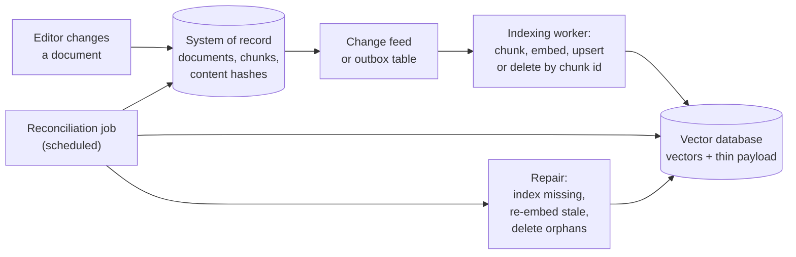

A RAG corpus is not one kind of data. It is compressed vectors read thousands of times per query, full-precision vectors read a few hundred times, graph links followed on every hop, filter fields consulted constantly, chunk text read only for the handful of winners, and source documents read rarely, if ever, by the retrieval path. Putting all of it in the most expensive storage wastes money; putting all of it in the cheapest makes search unusably slow. **Hybrid storage** is the deliberate placement of each kind of data on the storage tier, and in the system, that matches how it is read.

[Vector storage](/learn/vector-database-fundamentals/vector-storage) introduced the single-node building blocks: RAM, memory-mapped files, and a quantised copy in memory with full-precision rescoring from disk. This lesson takes the system view. It inventories a collection's data by access pattern, adds disk-resident indexes and object storage to the picture, tiers data by how often it is used, and, most importantly for RAG, splits responsibility between the vector database and a **system of record** that owns the text, and shows how to keep the two consistent. (This is unrelated to [hybrid search](/learn/hybrid-search), which combines dense and sparse retrieval.)

## Learning objectives

- Classify each component of a vector collection by its access pattern and assign it a storage tier, with reasons.
- Estimate the memory and disk a collection needs under an all-in-RAM and a tiered layout, and the I/O cost per query of each tier.
- Explain how disk-resident graph indexes and object-storage-backed engines work, and what they trade for lower cost.
- Choose between fat and thin payloads, and design the split between a vector database and a system of record.
- Implement a reconciliation check that detects missing, orphaned and stale vectors, and explain why orphans are a security problem.

## Prerequisites

- [Vector storage](/learn/vector-database-fundamentals/vector-storage): RAM, memory-mapped files, quantised copies and rescoring on one node.
- [Persistence](/learn/vector-database-fundamentals/persistence) and [CRUD operations](/learn/vector-database-fundamentals/crud-operations): durability and updates.
- [Scalar quantisation](/learn/vector-indexing-algorithms/scalar-quantisation) and [HNSW](/learn/vector-indexing-algorithms/hnsw).
- [Payload indexes](/learn/advanced-vector-database-engineering/payload-indexes) and [Collections](/learn/advanced-vector-database-engineering/collections).

## Why this matters

Memory is usually the largest line in a vector database's bill, and it grows linearly with the corpus. A team that sizes for "everything in RAM" at launch must, when the corpus grows tenfold, either buy ten times the memory on every replica or redesign under pressure.

The second reason is correctness. In most RAG systems the documents live in a content management system, wiki, file store or relational database, and the vector index is **derived** from them. Every derived copy can drift from its source. A document is edited and the index still holds the old chunk; a document is deleted and its chunks are still retrievable; a new runbook is published and never indexed. These failures do not raise errors. They produce answers from outdated or deleted text, which for an HR policy, a security procedure or data someone asked to have erased is a serious problem.

Hybrid storage forces both questions into the open: *where does each byte live?* and *which copy is the truth?*

## The intuition

Think of a restaurant kitchen during service. Chopped ingredients sit on the counter within arm's reach: small, constantly used, expensive in counter space. Stock is in the walk-in fridge a few steps away, fetched occasionally. Bulk supplies are in a warehouse across town. And the recipe book in the office is the truth: if the chef changes a recipe, the counter must be refilled to match, or every plate goes out wrong.

The counter is RAM, the walk-in fridge is local SSD, the warehouse is object storage, and the recipe book is the system of record. A good kitchen is not the one with the biggest counter, but one where each item sits as close as its use demands, with a routine for noticing when the counter no longer matches the book.

## How it works

### Inventory by access pattern

Start by listing what a collection actually holds and how each part is read during a query.

| Component | Size per point (768-d example) | Read during a query | Natural tier |
| --- | --- | --- | --- |
| Quantised vectors (int8) | 768 bytes | Thousands of points per query, scattered | RAM |
| Graph links (HNSW bottom layer, M = 16) | about 128 bytes | Every hop of the walk | RAM, or SSD for disk-resident indexes |
| Full-precision vectors (float32) | 3,072 bytes | A few hundred, for rescoring | Local SSD (memory-mapped) |
| Payload index entries | a few bytes per field | Planning and filter checks | RAM (or SSD if large) |
| Payload filter fields | tens of bytes | Rarely, if indexed | SSD |
| Chunk text | 1 to 2 KB typical | Top $k$ only | SSD or system of record |
| Parent documents, attachments | KB to MB | After retrieval, if at all | System of record or object storage |
| Snapshots and backups | whole collection | Never on the query path | Object storage |

The parts read **many times per query** are small per point; the parts read **a few times per query** are large. Hybrid storage exploits that asymmetry.

### The tiers

The numbers below are rough orders of magnitude for random reads, not measurements; they vary widely with hardware and configuration, so measure your own.

| Tier | Random read latency (order of magnitude) | Relative cost per GB | Notes |
| --- | --- | --- | --- |
| RAM | about 100 nanoseconds | Highest | Lost on restart; must be reloaded |
| Local NVMe SSD | tens to about a hundred microseconds | Much lower | Fast with many reads in parallel |
| Network block storage | hundreds of microseconds to milliseconds | Similar to SSD | Higher latency per read; check provisioned IOPS |
| Object storage (S3 and similar) | tens of milliseconds per request | Lowest | Durable and cheap; designed for large sequential reads |

From RAM to object storage, each read gets roughly five orders of magnitude slower. A query that makes 2,000 random reads is fine in RAM (0.2 ms), feasible on SSD if most reads run in parallel, and impossible on object storage without a cache.

### Disk-resident indexes

The design in [Vector storage](/learn/vector-database-fundamentals/vector-storage) kept the graph and a quantised copy in RAM and only the full vectors on disk. Disk-resident indexes go one step further and put the graph itself on SSD.

**DiskANN** (Subramanya and colleagues, 2019) is the best-known design. It stores the graph and the full-precision vectors together on SSD, so one read fetches a node's vector and its neighbour list, and keeps only product-quantised vectors in RAM to decide which neighbours look promising. Its graph construction (the Vamana algorithm) aims for few hops between any two points, because every hop is now an SSD read. Milvus offers a DiskANN index type; Qdrant can store its HNSW graph on disk with `hnsw_config.on_disk`, combined with on-disk vectors and quantised copies kept in RAM.

The trade-off: RAM per point falls to roughly the compressed vector, and each query pays tens of SSD reads, adding low milliseconds on local NVMe and much more on high-latency network storage.

### Object storage as the durable tier

Some engines separate durable storage from query serving altogether. Milvus persists its data and index files in object storage (MinIO or a cloud equivalent) and has query nodes load the segments they serve into memory or onto local disk. Several newer services describe architectures in which the authoritative copy of each index lives in object storage and compute nodes cache the hot parts on SSD and in RAM; Pinecone describes its serverless offering as separating storage from compute in this way.

The appeal is cost and elasticity: object storage is cheap and effectively unlimited, and compute scales independently. The price is **cold reads**: a query touching uncached data pays tens of milliseconds per request, so a rarely queried namespace may be slow on its next query. Designs mitigate this by caching small, hot data and sizing caches for the working set.

### Tiering by temperature

Not all points are equally popular. In AskMeridian, the current handbook and runbooks receive almost all queries; superseded policies and archived product documentation are queried rarely. Many systems therefore tier by **data temperature** as well as by component:

- **Hot data**: current documents, active tenants. Quantised vectors and graph in RAM, full vectors on local SSD.
- **Warm data**: older or less used. Everything memory-mapped, so the page cache keeps whatever is actually read.
- **Cold data**: archives, inactive tenants. Not loaded at all; stored in object storage or as a snapshot and loaded on demand.

The unit of tiering is usually a collection, shard or tenant, because engines configure storage at that level. Weaviate lets inactive tenants be deactivated and, in recent versions, offloaded to cloud storage; in Qdrant, a separate archive collection with fully on-disk settings gives a similar split. Either way the application must know at query time whether it needs cold data (see [Namespaces](/learn/advanced-vector-database-engineering/namespaces)).

### The vector database and the system of record

The second axis of hybrid storage is across systems. The **system of record** is the store that owns the truth about documents and chunks: their text, versions, owners and permissions. The vector database holds a **derived index** over it. The question is how much of the record to copy into the index's payloads.

- **Fat payloads** copy the chunk text, and often titles, URLs and full metadata, into each point. One round trip returns everything the generator needs. Payloads grow large, and every edit must be written to both places.
- **Thin payloads** hold only the chunk identifier, the fields needed for filtering, and a content hash. After search, the application fetches the text for the top $k$ ids from the system of record. The index is small and the text is always current, at the cost of a second round trip and a dependency on the second system at query time.
- **The common middle** keeps chunk text in the payload (it is needed on every query and is modest in size) and leaves parent documents, attachments and full metadata in the system of record.

Whatever the split, treat the vector database as **rebuildable** from the system of record and the embedding model, which rules out storing anything *only* in payloads.

### Keeping the two consistent



1. **Write the system of record first.** It is the truth; the index follows it.
2. **Record each change durably** in the same transaction as the write, for example in an **outbox table** that an indexing worker reads, or via the database's change feed. This avoids "saved the document, crashed before telling the indexer".
3. **Make indexing idempotent.** Derive point ids deterministically from chunk ids, so replaying a change produces the same point rather than a duplicate.
4. **Store a content hash** of each chunk's text in its payload. It lets anyone detect staleness without re-embedding.
5. **Run reconciliation on a schedule.** Compare the set of chunk ids and hashes in the system of record with those in the index, and repair three kinds of drift: **missing** (in the record, not indexed), **stale** (hashes differ) and **orphaned** (indexed, no longer in the record).
6. **Delete orphans promptly.** An orphan is deleted content that is still retrievable.

Full and incremental re-indexing strategies are the subject of [Index updates](/learn/advanced-vector-database-engineering/index-updates); data retention obligations are covered in [Data retention](/learn/access-control-and-privacy/data-retention).

## The mathematics

### Memory per tier

**Intuition.** Each component's size is the number of points times bytes per point; the tiered layout keeps only the small, frequently read components in RAM.

$$
B_{\text{RAM}} = N \left( d \, b_q + 2 M \, b_{\text{id}} + \sum_f b_f \right), \qquad
B_{\text{SSD}} = N \left( d \, b_{\text{full}} + \bar{t} \right)
$$

$N$ is the number of points, $d$ the dimension, $b_q$ the bytes per quantised component (1 for int8), $M$ the HNSW links parameter (the bottom layer stores up to $2M$ neighbours), $b_{\text{id}}$ the bytes per neighbour id (4), $b_f$ the index bytes per point for filtered field $f$, $b_{\text{full}}$ the bytes per full-precision component (4 for float32), and $\bar{t}$ the average stored text per point. Upper HNSW layers, segment overhead and payload index dictionaries add to these; treat the results as lower bounds.

**By hand.** $N = 50$ million, $d = 768$, $M = 16$, two indexed keyword fields at 4 bytes each, and an assumed 1,500 bytes of text per chunk.

- int8 vectors: $5 \times 10^7 \times 768 = 38.4$ GB.
- Links: $5 \times 10^7 \times 32 \times 4 = 6.4$ GB.
- Keyword indexes: $5 \times 10^7 \times 8 = 0.4$ GB.
- RAM total: about 45.2 GB, per replica.
- SSD: float32 vectors $5 \times 10^7 \times 3{,}072 = 153.6$ GB plus text $75$ GB, about 228.6 GB.

Keeping float32 vectors, links, indexes and text all in RAM would need about 235 GB per replica instead of 45.

### I/O per query

Rescoring $r$ candidates reads $r$ full vectors. With per-read latency $t$ and $p$ reads in flight at once, the time is about

$$
T_{\text{rescore}} \approx \frac{r}{p} \, t
$$

With $r = 200$, $p = 32$ and an assumed $t = 100\,\mu\text{s}$ for local NVMe: $6.25 \times 0.1 = 0.625$ ms. With an assumed $t = 20$ ms per object-storage request: 125 ms, which is why object-storage tiers need a cache in front of them for anything on the query path.

```python
N, d, M = 50_000_000, 768, 16          # chunks, dimensions, HNSW links parameter
GB = 1e9
parts = {
    "float32 vectors":        N * d * 4,
    "int8 quantised copy":    N * d * 1,
    "HNSW bottom layer links": N * 2 * M * 4,        # 2M neighbours x 4-byte ids
    "chunk text (1.5 KB avg)": N * 1_500,
    "keyword index (2 fields)": N * 2 * 4,
}
for name, b in parts.items():
    print(f"{name:<26}{b / GB:8.1f} GB")

all_ram = sum(parts.values()) - parts["int8 quantised copy"]     # no quantised copy needed
tiered_ram = parts["int8 quantised copy"] + parts["HNSW bottom layer links"] + parts["keyword index (2 fields)"]
on_ssd = parts["float32 vectors"] + parts["chunk text (1.5 KB avg)"]
print(f"all in RAM, unquantised   {all_ram / GB:8.1f} GB")
print(f"tiered: RAM part          {tiered_ram / GB:8.1f} GB  (+ {on_ssd / GB:.1f} GB on SSD)")

# Rescoring reads per query: r candidates, each a random read of d * 4 bytes
r = 200
for tier, t_read, parallel in [("local NVMe SSD", 100e-6, 32), ("object storage", 20e-3, 32)]:
    t = (r / parallel) * t_read                       # waves of parallel reads
    print(f"rescore {r} from {tier:<15}: {r * d * 4 / 1e3:6.0f} KB, about {t * 1e3:7.1f} ms")
```

```output
float32 vectors              153.6 GB
int8 quantised copy           38.4 GB
HNSW bottom layer links        6.4 GB
chunk text (1.5 KB avg)       75.0 GB
keyword index (2 fields)       0.4 GB
all in RAM, unquantised      235.4 GB
tiered: RAM part              45.2 GB  (+ 228.6 GB on SSD)
rescore 200 from local NVMe SSD :    614 KB, about     0.6 ms
rescore 200 from object storage :    614 KB, about   125.0 ms
```

## In code

**The problem.** Build the system-of-record split for real: SQLite owns the chunk text, Qdrant holds vectors with a thin payload (chunk id, source, content hash), retrieval joins the two by id, and a reconciliation job finds and repairs the three kinds of drift after the record changes behind the index's back.

**Dependencies.** `qdrant-client` and `sentence-transformers`; SQLite comes with Python. Everything runs in memory.

```bash
pip install qdrant-client sentence-transformers
```

```python
import hashlib
import sqlite3
import uuid
from qdrant_client import QdrantClient, models
from sentence_transformers import SentenceTransformer

model = SentenceTransformer("sentence-transformers/all-MiniLM-L6-v2")
sha = lambda text: hashlib.sha256(text.encode()).hexdigest()[:12]
point_id = lambda chunk_id: str(uuid.uuid5(uuid.NAMESPACE_URL, chunk_id))

# ---- System of record: SQLite holds the text and the truth ---------------
db = sqlite3.connect(":memory:")
db.execute("CREATE TABLE chunks (chunk_id TEXT PRIMARY KEY, source TEXT, text TEXT)")
db.executemany("INSERT INTO chunks VALUES (?, ?, ?)", [
    ("handbook/leave#0",   "handbook", "Annual leave is 25 days; up to 5 unused days carry over and must be used by 31 March."),
    ("handbook/remote#0",  "handbook", "Staff may work remotely up to 3 days a week; the home-office budget is £400."),
    ("handbook/expenses#0","handbook", "Expenses must be submitted within 30 days; anything over £75 needs a receipt."),
    ("runbooks/password#0","runbooks", "Passwords must be rotated every 90 days. VPN is required on public Wi-Fi."),
    ("runbooks/desk#0",    "runbooks", "The support desk is open 09:00 to 17:00 UK time."),          # the 2023 wording
])

# ---- Vector index: Qdrant holds vectors plus a thin payload ---------------
qd = QdrantClient(":memory:")
qd.create_collection("askmeridian", vectors_config=models.VectorParams(size=384, distance=models.Distance.COSINE))

def index_chunks(rows):
    if not rows:
        return
    vecs = model.encode([text for _, _, text in rows], normalize_embeddings=True)
    qd.upsert("askmeridian", points=[
        models.PointStruct(id=point_id(cid), vector=v.tolist(),
                           payload={"chunk_id": cid, "source": src, "hash": sha(text)})   # no text
        for (cid, src, text), v in zip(rows, vecs)])

index_chunks(db.execute("SELECT chunk_id, source, text FROM chunks").fetchall())

def retrieve(question, k=2):
    q = model.encode(question, normalize_embeddings=True).tolist()
    hits = qd.query_points("askmeridian", query=q, limit=k).points
    ids = [h.payload["chunk_id"] for h in hits]
    rows = dict(db.execute(f"SELECT chunk_id, text FROM chunks WHERE chunk_id IN ({','.join('?' * len(ids))})", ids))
    # Join by id; a hit whose row has vanished from the system of record is dropped, not shown.
    return [(round(h.score, 3), cid, rows[cid][:48]) for h, cid in zip(hits, ids) if cid in rows]

print("query:", retrieve("When is the IT support desk open?"))

# ---- Drift: three changes reach the system of record but not the index ----
db.execute("UPDATE chunks SET text = 'The support desk is open 08:00 to 18:00 UK time.' WHERE chunk_id = 'runbooks/desk#0'")
db.execute("DELETE FROM chunks WHERE chunk_id = 'handbook/remote#0'")
db.execute("INSERT INTO chunks VALUES ('runbooks/laptop#0', 'runbooks', 'Laptops are refreshed every 3 years.')")

print("drift:", retrieve("When is the IT support desk open?"))

def reconcile(repair=False):
    truth = {cid: (src, text) for cid, src, text in db.execute("SELECT chunk_id, source, text FROM chunks")}
    indexed, offset = {}, None
    while True:                                   # page through every point's payload
        page, offset = qd.scroll("askmeridian", limit=256, offset=offset, with_payload=True)
        indexed.update({p.payload["chunk_id"]: p.payload["hash"] for p in page})
        if offset is None:
            break
    missing = sorted(set(truth) - set(indexed))
    orphans = sorted(set(indexed) - set(truth))
    stale = sorted(c for c in set(truth) & set(indexed) if sha(truth[c][1]) != indexed[c])
    print(f"missing={missing}\norphans={orphans}\nstale={stale}")
    if repair:
        index_chunks([(c, *truth[c]) for c in missing + stale])
        qd.delete("askmeridian", points_selector=models.PointIdsList(points=[point_id(c) for c in orphans]))
    return len(missing) + len(orphans) + len(stale)

print("before repair:"); reconcile(repair=True)
print("after repair:");  problems = reconcile()
print("problems left:", problems, "| points:", qd.count("askmeridian").count, "| rows:",
      db.execute("SELECT COUNT(*) FROM chunks").fetchone()[0])
print("query:", retrieve("When is the IT support desk open?"))
```

```output
query: [(0.8, 'runbooks/desk#0', 'The support desk is open 09:00 to 17:00 UK time.'), (0.214, 'handbook/remote#0', 'Staff may work remotely up to 3 days a week; the')]
drift: [(0.8, 'runbooks/desk#0', 'The support desk is open 08:00 to 18:00 UK time.')]
before repair:
missing=['runbooks/laptop#0']
orphans=['handbook/remote#0']
stale=['runbooks/desk#0']
after repair:
missing=[]
orphans=[]
stale=[]
problems left: 0 | points: 5 | rows: 5
query: [(0.786, 'runbooks/desk#0', 'The support desk is open 08:00 to 18:00 UK time.'), (0.221, 'runbooks/laptop#0', 'Laptops are refreshed every 3 years.')]
```

**The important lines.**

- `payload={"chunk_id": cid, "source": src, "hash": sha(text)}` is the thin payload: an id to join on, a field to filter on, and a 12-character content hash. No text is stored in the vector database.
- `point_id(cid)` derives the Qdrant point id deterministically from the chunk id, so re-indexing a chunk overwrites its point, which makes repairs idempotent.
- `retrieve` fetches the winners' text from SQLite with one `IN (...)` query and drops any hit whose row no longer exists: never show text the record no longer contains.
- `reconcile` pages through the index with `scroll` (never assume one call returns everything), builds the two sets, and computes the three differences with set arithmetic. Stale chunks are those whose stored hash no longer matches the hash of the current text.

**What the output means.**

- **Before any drift**, the first query returns the support-desk chunk with the superseded 2023 hours, which is what the record says at that point.
- **During drift**, two subtle things happen. The desk chunk shows the *new* text, because thin payloads always read text from the record, but its score of 0.8 comes from the *old* vector, which was embedded from different text. And the second result has disappeared: the orphaned remote-work point was still the second-nearest neighbour, the join dropped it, and the caller received one result instead of two. Thin payloads hide stale text, not stale vectors.
- **Reconciliation** finds one problem of each kind and repairs them; a second pass finds none.
- **After repair**, the desk chunk's score changes (0.786) because it was re-embedded from the current text, and the newly indexed laptop chunk fills the second slot.

**Errors people commonly hit.**

- Hashing text with a different normalisation from the one used at indexing, which marks everything stale.
- Calling `scroll` once and treating the first page as the whole collection.

**Extending it.** Add an `outbox` table written in the same SQLite transaction as each change, and a worker that drains it and applies upserts and deletes, so that reconciliation becomes a safety net rather than the main mechanism. Then store the embedding model's name in the payload and make reconciliation flag points embedded with an outdated model.

## A real-world example

At launch, AskMeridian's ingestion job stored everything in in-memory Qdrant payloads: chunk text, the parent page's full text, its HTML and all metadata. At 200,000 chunks it did not matter. As the product documentation arrived and the collection grew towards 4 million chunks, Hamid, sizing the cluster, found that payloads, not vectors, were the largest consumer of memory: a 30-chunk page was stored 30 times.

The team moved to the middle design. Chunk text stayed in the payload, now stored on disk. Parent pages and HTML moved to the documentation database they came from, fetched by id only when the generator needed wider context. Full-precision vectors moved to memory-mapped storage with an int8 copy in RAM, as in [Vector storage](/learn/vector-database-fundamentals/vector-storage).

A month later, a support engineer noticed AskMeridian quoting the old 09:00 to 17:00 support-desk hours. The 2023 handbook page had been deleted at the source, but the pipeline handled only creations and edits, so its chunks were still in Qdrant. The team added content hashes to every payload and a nightly reconciliation job like the one above; its first run found several hundred orphans. Deletions now go through the same outbox as edits, and the job alerts if it finds more than a handful of problems, which would indicate a broken pipeline rather than normal lag.

## Common mistakes

- **Storing parent documents in every chunk's payload.** Storage multiplies by chunks per document.
- **Treating the vector database as the only copy of anything.** If it cannot be rebuilt from a system of record, a lost collection is lost data.
- **Pipelines that ignore deletions.** Deleted content stays retrievable.
- **Reconciling by counts alone.** Missing and orphaned chunks can cancel out.
- **Disk-resident or memory-mapped storage on high-latency network disks.** Every random read becomes a network round trip.
- **Object storage on the query path without a cache.** Tens of milliseconds per read.

## Best practices

- Inventory your collection's components by access pattern and place each deliberately; write the layout down with the arithmetic.
- Keep the vector database rebuildable from a system of record and the recorded embedding configuration.
- Store a content hash and the embedding model's identifier in every payload.
- Propagate creates, edits *and deletes* through a durable outbox or change feed, with idempotent upserts keyed by chunk id.
- Run reconciliation on a schedule, alert on unexpected drift, and delete orphans promptly.
- Tier by temperature at the level the engine supports (collection, shard or tenant), and warm caches before routing traffic to a restarted node.

## Performance considerations

**The RAM saving is large and the latency cost is bounded.** In the worked example, tiering cuts RAM per replica from about 235 GB to about 45 GB. With three replicas, that is roughly 570 GB of memory saved. The added cost per query is the rescoring reads (about 0.6 ms on local NVMe under the stated assumptions) and payload reads for the top $k$.

**Disk-resident graphs cost hops.** If a query takes an assumed 40 hops and each is one SSD read of an assumed 100 µs, done sequentially because each hop depends on the last, that is about 4 ms, compared with tens of microseconds in RAM. Beam-search variants issue several reads per step in parallel to cut this.

**Thin payloads add a round trip**, typically a millisecond or two on a local network for 10 rows by primary key; batch it into one query, as the code does.

**Reconciliation cost scales with the corpus.** Scrolling 4 million payloads at perhaps 100 bytes each reads about 400 MB: cheap nightly, not every minute. Use the outbox for timeliness and reconciliation for correctness.

## Security considerations

Orphaned vectors are a data-protection issue, not just a quality one. If a document is deleted because it was wrong, confidential or subject to an erasure request, any chunk left in the index can still be retrieved and quoted. Deletion must propagate to the index, reconciliation must verify that it did, and backups and snapshots of the vector database, typically kept in object storage, must follow the same retention rules as the source data (see [Backup and recovery](/learn/advanced-vector-database-engineering/backup-and-recovery)). Every tier holding chunk text, including caches and object-storage buckets, needs the system of record's encryption and access controls. With thin payloads, the join should also apply the record's current permissions, so access narrowed after indexing takes effect at once.

## Summary

- Hybrid storage places each component on the tier that suits its access pattern: small, frequently read data (quantised vectors, graph links, payload indexes) in RAM; large, rarely read data (full vectors, text) on SSD; durable copies and archives in object storage.
- Disk-resident indexes such as DiskANN and object-storage-backed engines cut memory further, paying in SSD hops or cold reads.
- Tiering by temperature keeps hot partitions in fast storage and loads cold ones on demand.
- The vector database is a derived, rebuildable index over a system of record; fat, thin and middle payload designs trade round trips against duplication and drift.
- Consistency needs ordered writes, idempotent upserts, content hashes and scheduled reconciliation of missing, stale and orphaned chunks; orphans are deleted content that is still retrievable.

## Exercises

**1.** A collection has 20 million chunks at 1,024 dimensions, HNSW with $M = 16$, and an average of 1,200 bytes of text per chunk. Compute the RAM for (a) float32 vectors, links and text in RAM and (b) int8 vectors and links in RAM, with float32 vectors and text on SSD.

<details><summary>Show solution</summary>

float32: $2 \times 10^7 \times 4{,}096 = 81.92$ GB. int8: $2 \times 10^7 \times 1{,}024 = 20.48$ GB. Links: $2 \times 10^7 \times 32 \times 4 = 2.56$ GB. Text: $2 \times 10^7 \times 1{,}200 = 24$ GB.

(a) $81.92 + 2.56 + 24 = 108.48$ GB. (b) $20.48 + 2.56 = 23.04$ GB in RAM, with $81.92 + 24 = 105.92$ GB on SSD. Both are lower bounds per replica.

</details>

**2.** For each item, choose fat payload, thin payload or system of record only, and justify: (a) chunk text; (b) the parent page's full HTML; (c) the access-control groups; (d) the document's revision history.

<details><summary>Show solution</summary>

(a) Usually in the payload: needed on every query, modest in size; thin if it changes often. (b) System of record only: large, rarely needed, duplicated per chunk if copied. (c) In the payload, indexed, because the database must filter on it during search; the system of record stays the truth, and reconciliation covers it. (d) System of record only; retrieval never needs it.

</details>

**3.** Extend the code with an outbox: a table `outbox(seq INTEGER PRIMARY KEY, op TEXT, chunk_id TEXT)` written in the same transaction as each change, and a `drain()` function that applies the operations in order. Repeat the three drift changes through it and show that reconciliation then finds no problems.

<details><summary>Show solution</summary>

```python
db.execute("CREATE TABLE outbox (seq INTEGER PRIMARY KEY, op TEXT, chunk_id TEXT)")

def change(sql, params, op, chunk_id):
    with db:                                          # one transaction: data and outbox together
        db.execute(sql, params)
        db.execute("INSERT INTO outbox (op, chunk_id) VALUES (?, ?)", (op, chunk_id))

def drain():
    for seq, op, cid in db.execute("SELECT seq, op, chunk_id FROM outbox ORDER BY seq").fetchall():
        if op == "upsert":
            index_chunks(db.execute("SELECT chunk_id, source, text FROM chunks WHERE chunk_id = ?",
                                    (cid,)).fetchall())
        else:
            qd.delete("askmeridian", points_selector=models.PointIdsList(points=[point_id(cid)]))
        db.execute("DELETE FROM outbox WHERE seq = ?", (seq,))
    db.commit()

change("UPDATE chunks SET text = ? WHERE chunk_id = ?",
       ("The support desk is open 08:00 to 18:00 UK time.", "runbooks/desk#0"), "upsert", "runbooks/desk#0")
change("DELETE FROM chunks WHERE chunk_id = ?", ("handbook/remote#0",), "delete", "handbook/remote#0")
change("INSERT INTO chunks VALUES (?, ?, ?)",
       ("runbooks/laptop#0", "runbooks", "Laptops are refreshed every 3 years."), "upsert", "runbooks/laptop#0")
drain()
reconcile()          # prints empty missing, orphans and stale lists
```

If the worker crashes mid-drain, unprocessed rows stay in the outbox and are applied on the next run; idempotent point ids make reprocessing a row harmless.

</details>

**4.** Design decision. Meridian wants to keep seven years of archived product documentation searchable, though it receives under 1% of queries, alongside the current docs. Propose a storage layout and the query path, and state what latency archive queries should expect.

<details><summary>Show solution</summary>

Keep current documentation in the hot collection (int8 vectors and graph in RAM, full vectors memory-mapped on local SSD). Put the archive in a separate collection, or a cold tenant or shard, configured fully on disk, possibly on cheaper nodes. The application queries the archive only when the user asks for historical material or a date filter reaches back before the current documents, so cold reads never slow ordinary queries. Archive queries should expect tens of milliseconds or more when cold, falling as caches warm. Snapshots of both follow the documentation's retention policy, and reconciliation covers both.

</details>

## Check your understanding

```quiz
[
  {
    "q": "Which component of a vector collection most benefits from being in RAM?",
    "options": [
      "Parent documents",
      "Snapshots",
      "Quantised vectors and graph links, read many times per query",
      "Chunk text, read for the top k only"
    ],
    "answer": 2,
    "why": "They are small per point and read thousands of times per query. Large components read only for the winners can live on SSD."
  },
  {
    "q": "In a thin-payload design, a chunk's text is edited in the system of record but not re-indexed. What does retrieval show?",
    "options": [
      "The new text, ranked by a vector embedded from the old text",
      "The old text with the old vector",
      "An error from the vector database",
      "Nothing, because the point is deleted automatically"
    ],
    "answer": 0,
    "why": "Text is fetched fresh from the system of record, but the vector is stale. Thin payloads hide stale text, not stale vectors."
  },
  {
    "q": "Why are orphaned vectors a security concern?",
    "options": [
      "They slow down filtering",
      "They change the similarity metric",
      "They break HNSW connectivity",
      "Deleted, possibly confidential, content remains retrievable"
    ],
    "answer": 3,
    "why": "If deletion does not reach the index, content removed for being wrong, confidential or subject to erasure can still be quoted."
  },
  {
    "q": "Rescoring reads 200 full vectors per query. Under the lesson's assumptions, why is this fine from local SSD but not from object storage?",
    "options": [
      "Object storage cannot store float32",
      "Per-read latency is tens of milliseconds instead of about 100 microseconds, so the same reads take over 100 ms",
      "SSD stores fewer bytes per vector",
      "Object storage forbids parallel reads"
    ],
    "answer": 1,
    "why": "The read count is the same; the latency per read differs by orders of magnitude, so object-storage tiers need caches on the query path."
  },
  {
    "q": "Reconciliation finds equal counts in the system of record and the index. What can you conclude?",
    "options": [
      "The two are consistent",
      "Only that missing and orphaned chunks, if any, are equal in number; ids and hashes must be compared",
      "No chunk is stale",
      "The outbox is empty"
    ],
    "answer": 1,
    "why": "One missing and one orphaned chunk leave the counts equal. Set comparison of ids, and of hashes for staleness, is required."
  }
]
```

## Further reading

- Subramanya, Devvrit, Kadekodi, Krishnaswamy and Simhadri (2019), "DiskANN: Fast Accurate Billion-point Nearest Neighbor Search on a Single Node", NeurIPS 2019.
- Qdrant documentation, [Storage](https://qdrant.tech/documentation/concepts/storage/): in-memory and memory-mapped storage, on-disk payloads and on-disk HNSW.
- Milvus documentation, [milvus.io/docs](https://milvus.io/docs): architecture with object storage, and the DiskANN index type.
- Kleppmann (2017), *Designing Data-Intensive Applications*, O'Reilly, chapters 11 and 12: derived data, change data capture and keeping systems in sync.
- Richardson, "Pattern: Transactional outbox", [microservices.io](https://microservices.io/patterns/data/transactional-outbox.html).
