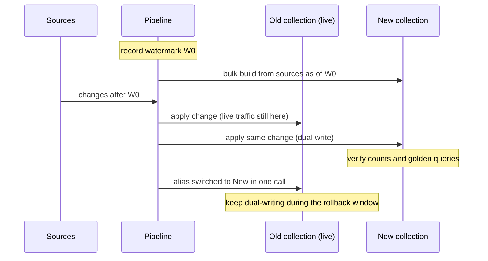

A RAG index is never finished. Policies are revised, runbooks gain steps, permissions change, documents are withdrawn, and every so often the whole thing must be rebuilt with a better embedding model. Each of these is an **index update**, and each can go wrong in a way that produces confident, wrong answers: a superseded chunk that survives because nobody deleted it, a document that vanishes for a few seconds mid-update, an old event that arrives late and overwrites a newer version, or a rebuild that silently misses every change made while it ran.

Earlier lessons covered the pieces that act on one document: how a pipeline detects change ([Incremental ingestion](/learn/understanding-document-ingestion/incremental-ingestion)), how chunk identifiers are chosen ([Document identifiers](/learn/document-engineering/document-identifiers)), and how to replace a document's chunks without orphans or gaps, serialise writes per document and guard against late events ([CRUD operations](/learn/vector-database-fundamentals/crud-operations)). This lesson works at the level of the whole index: classifying changes by the path they need, what a stream of updates does to an index over time, how to rebuild a collection while edits keep arriving and still go live with none of them missing, and how to tell when an index needs attention.

## Learning objectives

- Classify a change as payload-only, content or structural, and choose the matching update path (payload update, document replacement or full rebuild).
- Explain what a stream of upserts and deletes does inside a segment-based vector database, and estimate the query cost of unindexed points and tombstones.
- Plan a full rebuild that records a watermark, replays or dual-writes the changes made during the build, verifies parity and switches an alias, and calculate its catch-up time.
- Implement a parity check that compares an index with its source of truth.
- Decide from monitoring signals whether to let the optimiser work, tune it, or rebuild.

## Prerequisites

- [CRUD operations](/learn/vector-database-fundamentals/crud-operations): replacing one document safely, visibility, and one writer per document.
- [Collections](/learn/advanced-vector-database-engineering/collections): versioned collection names and atomic alias switching.
- [Vector storage](/learn/vector-database-fundamentals/vector-storage): segments, tombstones and the optimiser.
- [Incremental ingestion](/learn/understanding-document-ingestion/incremental-ingestion): detecting which documents changed.

## Why this matters

Meridian replaced its 2023 handbook. The old laptop page said laptops are refreshed every 4 years, the support desk opens 09:00 to 17:00 and the home-office budget is £250; the new one says 3 years, 08:00 to 18:00 UK time and £400. Applying one such change correctly is the subject of [CRUD operations](/learn/vector-database-fundamentals/crud-operations). Running an index for years raises problems that no single write shows:

- **The wrong path.** An access-control change on 10,000 documents treated as a content change re-embeds them all, for hours, for nothing. A model change treated as a series of upserts into the existing collection mixes two embedding spaces in one index, and similarities become meaningless with no error.
- **Lost changes during a rebuild.** When the team re-embeds everything with a new model or chunker, the build takes hours. Edits made during those hours reach only the old collection, and the new one goes live without them: the new handbook's corrections silently vanish.
- **A rollback to the past.** If the old collection stops receiving changes at the switch, rolling back a week later restores a week-old index.
- **Slow decay.** An index that absorbs thousands of small updates a day accumulates deleted points, unindexed segments and a graph that is no longer as good as a fresh build; queries slow down and recall drifts, and nobody knows why.

None of these raises an error. Each produces plausible answers from the wrong text, or slower ones.

## The intuition

A reference library keeps binders of policy pages and decides to move to a new building with a better catalogue. Re-shelving everything takes a week, and the old library stays open meanwhile, so pages keep being replaced there.

A careless move opens the new building with the binders as they were on the day packing started: every page changed during the week is out of date. The careful librarian writes the date on the first box packed, keeps a list of every page changed in the old building after that date, and applies the list in the new building before the doors open. Then she checks a sample of binders against the master copies. And for the first weeks she keeps updating the old building too, in case the new one has to be closed and everyone sent back.

She also knows that a binder with half its pages crossed out still works but is slow to read, and that the cure is to rewrite it cleanly, not to keep crossing out.

## How it works

### Three kinds of change

| Change | Example | Path | Re-embed? |
| --- | --- | --- | --- |
| **Payload-only** | Access-control groups change; a document is re-titled; a "reviewed" date is set | Set or overwrite payload fields in place | No |
| **Content** | A policy page is edited, added or deleted | Re-chunk the document, embed new or changed chunks, replace the document's points | Changed chunks only |
| **Structural** | New embedding model, new chunker, different vector size or metric, new named vector | Build a new collection and switch an alias | Everything |

Some configuration changes sit in between. In Qdrant, HNSW parameters, quantisation and optimiser settings can be changed on a live collection with `update_collection`, which triggers background re-optimisation; vector size and distance cannot be changed at all. [Collections](/learn/advanced-vector-database-engineering/collections) lists which settings are mutable.

### What a stream of updates does to an index

[Vector storage](/learn/vector-database-fundamentals/vector-storage) described the segment design one write at a time. Summed over months of updates, its consequences are what you operate:

1. Every write is appended to the write-ahead log and acknowledged according to `wait` and the collection's write consistency (see [Replication](/learn/advanced-vector-database-engineering/replication)).
2. An **upsert** of a new ID appends the point to an appendable segment. An upsert of an existing ID tombstones the old copy and appends the new one; vectors are never edited in place inside an HNSW graph.
3. A **delete** sets a tombstone. The point leaves the results immediately, but its vector stays in the segment and its node stays in the graph, where searches still walk through it.
4. A **payload update** changes stored payload and payload indexes only, which is why it is cheap.
5. The **optimiser** later builds an HNSW index for appendable segments that have grown past the indexing threshold, and rewrites (vacuums) segments whose share of deleted points has crossed a threshold, which reclaims space and repairs the graph. In Qdrant these are the `indexing_threshold`, `deleted_threshold` and `vacuum_min_vector_number` optimiser settings.

Until the optimiser catches up, newly written points sit in segments without an HNSW index and are searched by exact scan. That is correct (new points are immediately findable) but not free, and it is why a sustained stream of updates shows up as higher query latency. Qdrant's collection info reports `points_count`, `indexed_vectors_count`, `segments_count` and a status that is green when optimisation is idle and yellow while it runs; the gap between points and indexed vectors is the unindexed backlog.

Hosted, eventually consistent services add one more step: after acknowledgement there is a short, unspecified delay before a write is searchable, as [Pinecone](/learn/vector-database-ecosystem/pinecone) describes for its serverless indexes. Code that updates and then immediately verifies must poll rather than assume.

### Document-level updates, briefly

Content changes go through the document replacement procedure in [CRUD operations](/learn/vector-database-fundamentals/crud-operations): write the new version, then delete every point of that document whose version is not the new one; serialise changes per document; guard overwrites with a version condition where the database supports it. Two additions matter at the index level:

- **Hide the overlap at query time.** Between the write and the clean-up both versions are searchable, and if a clean-up fails the overlap persists until the next run. A few lines in the retrieval layer make this harmless: when results contain chunks of the same `doc_id` with different versions, keep only the highest version.
- **Prioritise by kind.** Permission changes and deletions should overtake content edits in the pipeline's queue, because until they land, someone can retrieve text they should not see. Use a separate, small, fast queue for them.

### Rebuilding a collection while the world keeps changing

A structural change means building a new collection from the sources: for example `askmeridian_bge_v1` to replace `askmeridian_minilm_v2`. [Collections](/learn/advanced-vector-database-engineering/collections) gives the build-verify-switch life cycle. The part left open there is how the new collection stays current, because the build takes hours and edits do not stop.



1. **Record a watermark** $W_0$ in the change stream before the bulk build starts.
2. **Bulk-build** the new collection from the sources as they were at $W_0$, with payload indexes created first and, for very large loads, indexing deferred until the load ends.
3. **Capture changes after $W_0$** in one of two ways. **Dual writing**: from $W_0$ on, the pipeline applies every change to both collections (embedding twice, once per model). **Replay**: after the bulk build, replay the change stream from $W_0$ into the new collection until it is caught up, then dual-write the short remainder.
4. **Verify**: a **parity check** that compares every document and version in the new collection with the source of truth (nothing missing, nothing extra, nothing stale), the configuration, golden queries, and an offline evaluation run on the new model.
5. **Switch the alias** in one atomic call.
6. **Keep dual-writing** for the rollback window. A rollback to an old collection that stopped receiving changes at the switch is a rollback to stale data.
7. **Retire** the old collection after the window.

Deployment-level concerns, such as tying the switch to an application release or running both versions behind a traffic split, belong to [Blue-green deployments](/learn/ci-cd-and-mlops/blue-green-deployments) and [Reindexing](/learn/ci-cd-and-mlops/reindexing).

### Index health under churn

Even without a structural change, an index that absorbs heavy churn degrades. Tombstones accumulate in segments that sit just below the vacuum threshold; segments fragment into many small ones; and an HNSW graph whose nodes have been deleted is a worse graph for the survivors, because searches spend their candidate budget walking through dead nodes. You can see the last effect directly. The following script (FAISS and NumPy, executed for this lesson) builds one HNSW graph over 50,000 vectors, "deletes" a growing fraction by excluding them at search time, as a tombstone does, and compares recall with a graph built fresh over the survivors at the same search effort.

```python
import faiss, numpy as np

rng = np.random.default_rng(0)
n, d, k = 50_000, 32, 10
X = rng.standard_normal((n, d)).astype("float32"); X /= np.linalg.norm(X, axis=1, keepdims=True)
Q = rng.standard_normal((500, d)).astype("float32"); Q /= np.linalg.norm(Q, axis=1, keepdims=True)
old = faiss.IndexHNSWFlat(d, 16, faiss.METRIC_INNER_PRODUCT); old.add(X)
for frac in [0.0, 0.3, 0.6, 0.9]:
    alive = rng.random(n) >= frac
    ids_alive = np.flatnonzero(alive)
    flat = faiss.IndexFlatIP(d); flat.add(X[ids_alive])
    _, gt = flat.search(Q, k); gt = ids_alive[gt]                       # exact answer
    sel = faiss.IDSelectorBatch(ids_alive.astype("int64"))              # tombstones = not selected
    _, I_old = old.search(Q, k, params=faiss.SearchParametersHNSW(sel=sel, efSearch=128))
    fresh = faiss.IndexHNSWFlat(d, 16, faiss.METRIC_INNER_PRODUCT); fresh.add(X[ids_alive])
    fresh.hnsw.efSearch = 128
    _, I_new = fresh.search(Q, k); I_new = ids_alive[I_new]
    r = lambda I: np.mean([len(set(a) & set(b)) / k for a, b in zip(I, gt)])
    print(f"deleted {frac:.0%}: recall tombstoned graph {r(I_old):.3f}  rebuilt graph {r(I_new):.3f}")
```

```output
deleted 0%: recall tombstoned graph 0.960  rebuilt graph 0.960
deleted 30%: recall tombstoned graph 0.954  rebuilt graph 0.977
deleted 60%: recall tombstoned graph 0.930  rebuilt graph 0.982
deleted 90%: recall tombstoned graph 0.854  rebuilt graph 0.998
```

At 30% deleted the difference is small; at 90% the tombstoned graph has lost about a tenth of its recall while a fresh graph over the same survivors does better than the original (it is ten times smaller). Real engines vacuum long before 90%, which is exactly why: the vacuum is a partial rebuild. The numbers are for random vectors and one setting of `efSearch`; the direction, not the magnitude, is the lesson.

The signals to watch are rising latency at constant load, a persistent and growing gap between `points_count` and `indexed_vectors_count`, a high segment count, and recall on a fixed evaluation set drifting down. Remedies, cheapest first: let the optimiser finish (check the collection status), lower the vacuum threshold, schedule bulk updates off-peak, or rebuild into a new collection and switch the alias, which also gives you a clean baseline.

## The mathematics

### The cost of unindexed points

**Intuition.** Points the optimiser has not indexed yet are scanned exactly, so each query pays a linear cost for the backlog on top of the logarithmic-ish cost of the graph.

$$
C_{\text{query}} \approx C_{\text{HNSW}} + u \cdot n \cdot d
$$

$n$ is the number of points, $u$ the unindexed fraction, $d$ the dimension, and $u\,n\,d$ the multiply-adds of the exact scan.

**By hand.** $n = 2{,}000{,}000$, $d = 384$. With $u = 0.5\%$: $10{,}000$ points, $3.84$ million multiply-adds, around a millisecond or less on one core. After a bulk update with indexing deferred, $u = 20\%$: $400{,}000$ points, about 154 million multiply-adds, now tens of milliseconds per query and far more than the graph search itself. The backlog, not the graph, then sets the latency.

### The cost of tombstones

If a fraction $f$ of the points stored in segments are deleted, storage and much of the scan work are spent on dead points. The live share is $1 - f$, so the overhead relative to a clean index is

$$
\text{overhead} = \frac{1}{1 - f} - 1
$$

At $f = 0.2$ (a typical vacuum threshold default, which you should check for your version) the overhead is $1/0.8 - 1 = 25\%$; at $f = 0.5$ it is 100%.

### Catching up after a rebuild

**Intuition.** Changes pile up while the bulk build runs; replay must clear the pile faster than new changes arrive.

With a bulk build taking $T_b$ hours, changes arriving at rate $r$ per hour, and replay processing $\rho$ per hour ($\rho > r$), the backlog at the end of the build is $r\,T_b$, and it shrinks at $\rho - r$ per hour:

$$
T_{\text{catch-up}} = \frac{r\,T_b}{\rho - r}
$$

**By hand.** $T_b = 3$ h, $r = 600$ changes/h, $\rho = 6{,}000$/h. Backlog $1{,}800$; catch-up $1{,}800 / 5{,}400 = 1/3$ h, 20 minutes. If replay is only slightly faster than arrival, say $\rho = 700$, catch-up takes $1{,}800/100 = 18$ hours, and if $\rho \le r$ it never finishes. Replay throughput is limited by embedding speed for the new model, so measure it before planning a rebuild's go-live time.

## In code

**The problem.** Rebuild AskMeridian's collection with a changed pipeline (pipeline v2 prefixes each chunk with its document title before embedding, a structural change that requires re-embedding everything) while edits keep arriving; show the changes a naive rebuild misses, replay them from the watermark, verify parity, switch the alias, and keep the old collection current for rollback.

**Dependencies.** Qdrant's client in local mode and a local embedding model. No server or API key.

```bash
pip install qdrant-client sentence-transformers
```

```python
import uuid

from qdrant_client import QdrantClient, models
from sentence_transformers import SentenceTransformer

model = SentenceTransformer("sentence-transformers/all-MiniLM-L6-v2")
client = QdrantClient(":memory:")
NS = uuid.UUID("5e0b9c47-2f6a-4d83-b1e9-7a4c3d2f8e15")

# The system of record, and an append-only change log with sequence numbers.
source = {
    "hb-leave":  (1, "Leave", "Annual leave is 25 days per year."),
    "hb-remote": (1, "Remote work", "Staff may work remotely up to 3 days a week."),
    "it-vpn":    (1, "VPN", "VPN is required on public Wi-Fi."),
}
change_log = []                                   # (seq, doc_id, record or None)

def change(doc_id, record):
    """Apply a change to the source and append it to the change log."""
    if record is None:
        source.pop(doc_id, None)
    else:
        source[doc_id] = record
    change_log.append((len(change_log) + 1, doc_id, record))

# Pipeline v1 embeds the body; pipeline v2 prefixes the title (a structural change).
PIPELINES = {"v1": lambda title, body: body, "v2": lambda title, body: f"{title}: {body}"}

def apply(collection, pipeline, doc_id, record):
    """Replace one document's point (one chunk per document keeps the demo small)."""
    pid = str(uuid.uuid5(NS, doc_id))
    if record is None:
        client.delete(collection, points_selector=models.PointIdsList(points=[pid]))
        return
    version, title, body = record
    vec = model.encode(PIPELINES[pipeline](title, body), normalize_embeddings=True)
    client.upsert(collection, [models.PointStruct(id=pid, vector=vec.tolist(), payload={
        "doc_id": doc_id, "version": version, "text": body, "pipeline": pipeline})])

def create(collection):
    client.create_collection(collection, vectors_config=models.VectorParams(
        size=384, distance=models.Distance.COSINE))

def parity(collection):
    """Compare {doc_id: version} in the collection with the source of truth."""
    records, _ = client.scroll(collection, limit=10_000, with_payload=["doc_id", "version"])
    indexed = {r.payload["doc_id"]: r.payload["version"] for r in records}
    expected = {d: rec[0] for d, rec in source.items()}
    missing = sorted(set(expected) - set(indexed))
    extra = sorted(set(indexed) - set(expected))
    stale = sorted(d for d in expected.keys() & indexed.keys() if indexed[d] != expected[d])
    return {"missing": missing, "extra": extra, "stale": stale}

# Live system: v1 collection behind the alias.
create("askmeridian_v1")
for d, rec in source.items():
    apply("askmeridian_v1", "v1", d, rec)
client.update_collection_aliases([models.CreateAliasOperation(create_alias=models.CreateAlias(
    collection_name="askmeridian_v1", alias_name="askmeridian"))])

# 1. Record the watermark, then bulk-build v2 from the source as of the watermark.
watermark = len(change_log)
snapshot_of_source = dict(source)
create("askmeridian_v2")

# 2. While the build runs, edits keep arriving and reach only the live collection.
for doc_id, record in [
    ("hb-leave", (2, "Leave", "Annual leave is 25 days; 5 unused days carry over to 31 March.")),
    ("it-laptop", (1, "Laptops", "Laptops are refreshed every 3 years.")),
    ("it-vpn", None),
]:
    change(doc_id, record)
    apply("askmeridian", "v1", doc_id, record)

for d, rec in snapshot_of_source.items():          # the (slow) bulk build finishes
    apply("askmeridian_v2", "v2", d, rec)
print("after bulk build   v1:", parity("askmeridian_v1"))
print("                   v2:", parity("askmeridian_v2"))

# 3. Replay every change after the watermark into v2.
for seq, doc_id, record in change_log[watermark:]:
    apply("askmeridian_v2", "v2", doc_id, record)
print("after replay       v2:", parity("askmeridian_v2"))

# 4. Verify, switch the alias atomically, and keep dual-writing for rollback.
if parity("askmeridian_v2") == {"missing": [], "extra": [], "stale": []}:
    client.update_collection_aliases([
        models.DeleteAliasOperation(delete_alias=models.DeleteAlias(alias_name="askmeridian")),
        models.CreateAliasOperation(create_alias=models.CreateAlias(
            collection_name="askmeridian_v2", alias_name="askmeridian"))])
change("hb-remote", (2, "Remote work", "Staff may work remotely up to 3 days a week; budget £400."))
for collection, pipeline in [("askmeridian_v2", "v2"), ("askmeridian_v1", "v1")]:
    apply(collection, pipeline, "hb-remote", source["hb-remote"])
print("after switch       v1:", parity("askmeridian_v1"), "(rollback target still current)")
alias = client.get_aliases().aliases[0]
top = client.query_points("askmeridian", query=model.encode(
    "How many days of holiday carry over?", normalize_embeddings=True).tolist(), limit=1).points[0]
print(f"alias -> {alias.collection_name}; top hit: v{top.payload['version']} "
      f"[{top.payload['pipeline']}] {top.payload['text']}")
```

```output
after bulk build   v1: {'missing': [], 'extra': [], 'stale': []}
                   v2: {'missing': ['it-laptop'], 'extra': ['it-vpn'], 'stale': ['hb-leave']}
after replay       v2: {'missing': [], 'extra': [], 'stale': []}
after switch       v1: {'missing': [], 'extra': [], 'stale': []} (rollback target still current)
alias -> askmeridian_v2; top hit: v2 [v2] Annual leave is 25 days; 5 unused days carry over to 31 March.
```

**What the output means.** After the bulk build, the live v1 collection matches the source, because the three edits made during the build were applied to it. The new v2 collection, built from the source as it was at the watermark, is wrong in all three possible ways: the new laptop page is **missing**, the deleted VPN page is still there (**extra**), and the leave page is the old version (**stale**). Had the alias been switched now, the carry-over rule added during the build would have disappeared from AskMeridian's answers and a withdrawn page would have come back. Replaying the change log from the watermark fixes all three, the parity check passes, and only then does the alias move. The change made after the switch is written to both collections, so v1 is still a correct rollback target, and the top hit for the carry-over question comes from the v2 pipeline with the version-2 text.

**The important lines.**

- `watermark = len(change_log)` is taken *before* the bulk build reads the source. Taking it after would skip changes that happened during the read.
- `change_log[watermark:]` is the replay. Because `apply` uses deterministic point IDs and replaces whole documents, replaying a change that the bulk build had already picked up is harmless, so it is safe to start the watermark a little early.
- `parity` compares the index with the source of truth by document and version, which catches all three failure types. Counting points alone would not: in this run v2 had the right *number* of documents (three) while being wrong about which.
- The alias switch is one call with a delete and a create, so readers never see a missing alias.
- After the switch, `apply` runs against both collections: the dual write that keeps rollback honest.

**Common errors.** Taking the watermark from the wall clock while the change log uses source timestamps from another clock; replaying with the old pipeline's embedding function into the new collection; and running the parity check with a scroll `limit` smaller than the collection, which silently compares a sample. On a server, scroll with pagination as in the backup lesson.

**Extending it.** Make the bulk build slow (embed in a loop with a sleep) and run edits from a second thread, so that replay and dual writing overlap for real. Add a per-chunk content hash to the payload and to the parity check, so that a change in text without a change in version is also caught.

### Watching index health on a server

This block needs a Qdrant server and was **not executed** for this lesson.

```python
import os
from qdrant_client import QdrantClient, models

client = QdrantClient(url=os.environ["QDRANT_URL"], api_key=os.environ.get("QDRANT_API_KEY"))

info = client.get_collection("askmeridian")
unindexed = (info.points_count or 0) - (info.indexed_vectors_count or 0)
print(info.status, info.optimizer_status, info.segments_count, unindexed)

# Vacuum segments sooner on a collection with heavy churn.
client.update_collection(
    "askmeridian",
    optimizers_config=models.OptimizersConfigDiff(deleted_threshold=0.1),
)
```

`indexed_vectors_count` is approximate and can legitimately be lower than `points_count` for small segments that are below the indexing threshold and are always scanned; alert on a gap that keeps growing, not on any gap.

## A real-world example

The Platform team plans AskMeridian's move from `all-MiniLM-L6-v2` to a larger embedding model. Its first plan is simple: on Saturday, rebuild `askmeridian_bge_v1` from the sources, verify, switch the alias. The bulk build is estimated at five hours.

A review spots two problems. First, the IT team edits runbooks at weekends during incident follow-ups; those edits would reach only the old collection, and the new one would go live without them. Second, if the new model disappoints in the first week, rolling back would return to a collection frozen at Saturday.

The revised plan records the change-stream watermark before the build, replays changes from it after the build, runs a parity check against the source inventory before the switch, and dual-writes until a week after it. The team measures replay throughput for the new model at about ten times the weekend change rate, so by the catch-up formula a five-hour build at the observed rate catches up in about half an hour. The rebuild goes live on Sunday afternoon; on Wednesday a runbook edit lands in both collections, and the rollback option stays real until the old collection is retired the following weekend.

## Common mistakes

- **Re-embedding for payload-only changes.** Costly and slow for no gain; use payload updates.
- **Writing a new model's vectors into the old collection.** Two embedding spaces in one index; similarities become meaningless.
- **Taking the rebuild watermark after the bulk read starts.** Changes made during the read are in neither the build nor the replay.
- **Verifying a rebuild by point count alone.** Missing, extra and stale documents can cancel out; compare documents and versions.
- **Ignoring tombstones and unindexed backlog.** Latency rises and recall drifts while every write still succeeds.
- **Rebuilding without catching up.** The new collection goes live missing every change made during the build.
- **Retiring dual writes at the switch.** The rollback target goes stale immediately.

## Best practices

- Classify every change: payload-only, content or structural, and use the cheapest correct path.
- Replace documents with the write-new-then-delete-stale procedure, and keep only the highest version per document at query time.
- Give permission changes and deletions their own fast queue.
- For rebuilds, record a watermark first, replay or dual-write, run a parity check against the source, switch the alias, and dual-write through the rollback window.
- Monitor collection status, unindexed backlog, segment count, deleted share and fixed-set recall.
- Batch updates (hundreds of points per request) rather than writing one point at a time.

## Performance considerations

- **Batching.** Each request carries fixed overhead (round trip, WAL append, replica acknowledgements); batches of a few hundred points amortise it.
- **`wait=True` versus `wait=False`.** Waiting makes each write slower but gives back-pressure and read-your-writes; fire-and-forget is faster for bulk loads followed by an explicit check.
- **Optimiser contention.** Index builds and vacuums use CPU and disk bandwidth that queries also need. Large updates are best scheduled off-peak, and optimiser thread limits are configurable.
- **Re-embedding is the dominant cost** of content and structural changes. Payload-only paths and content-addressed chunk IDs (from the identifiers lesson) avoid it where possible.
- **Rebuilds double resources temporarily.** Two collections, two models and dual writes mean roughly twice the memory and embedding work for the rebuild window; budget for it.

## Security considerations

Updates are how access control changes reach the index, so their latency is a security property: when a document's permissions are narrowed, the payload update must land before users who lost access can still retrieve it. Prioritise permission and deletion changes over content changes in the pipeline's queue, and verify them (read the payload back or count by filter). Deletions for legal or privacy reasons must reach every collection that holds the document, including a rebuild in progress and a rollback candidate, which is another reason dual writes must include deletes. Finally, the update endpoint is powerful: restrict which services may write, and log every bulk delete with its filter.

## Summary

- Changes are payload-only (update in place, no embedding), content (replace the document's chunks) or structural (new collection, alias switch).
- Inside the database, upserts append and tombstone, deletes tombstone, and the optimiser indexes and vacuums later; unindexed backlog costs a linear scan per query, and tombstones cost space and graph quality.
- A graph full of deleted nodes searches worse than a fresh graph over the survivors, which is why vacuuming and occasional rebuilds matter.
- A parity check (missing, extra, stale against the source of truth) is the verification that matters before any switch.
- Rebuilds must catch up with changes made during the build (watermark plus replay or dual writes), and keep the old collection current through the rollback window; catch-up time is $r\,T_b / (\rho - r)$.

## Exercises

**1.** Classify each change and give its update path: (a) the HR team marks five handbook pages as "managers only"; (b) the expenses policy changes its receipt threshold; (c) the team switches from cosine to dot-product similarity with a new model; (d) a runbook is deleted.

<details><summary>Show solution</summary>

(a) Payload-only: update the access-control field on those documents' points. (b) Content: re-chunk the page, embed changed chunks, replace the document (write new version, delete others). (c) Structural: new collection with the new metric and model, rebuild with catch-up, alias switch. (d) Content (deletion): delete all points with that `doc_id`, and verify by count.

</details>

**2.** A collection of 5 million 768-dimension points has 8% unindexed after a bulk update. Estimate the extra multiply-adds per query from the exact scan, and the tombstone overhead if 30% of stored points are deleted.

<details><summary>Show solution</summary>

Unindexed: $0.08 \times 5 \times 10^6 = 400{,}000$ points; $400{,}000 \times 768 \approx 3.07 \times 10^8$ multiply-adds per query, likely tens of milliseconds or more. Tombstones: $1/(1 - 0.3) - 1 \approx 43\%$ overhead. Both argue for letting the optimiser finish (or forcing a vacuum) before peak hours.

</details>

**3.** Implement the query-time rule from the lesson: given a list of hits with payloads containing `doc_id` and `version`, return them in their original order with every chunk whose version is lower than the highest version seen for its `doc_id` removed. Test it on a collection that holds both the 2023 laptop page (three chunks, version 2023) and the 2026 page (two chunks, version 2026) under version-specific point IDs, as happens between the write and the clean-up of a document replacement.

<details><summary>Show solution</summary>

```python
def latest_versions_only(hits):
    newest = {}
    for h in hits:
        d, v = h.payload["doc_id"], h.payload["version"]
        newest[d] = max(newest.get(d, v), v)
    return [h for h in hits if h.payload["version"] == newest[h.payload["doc_id"]]]
```

Run against that overlap state with MiniLM embeddings, a top-5 search for "How often are laptops replaced?" returned, by `(doc_id, version)`, `hb-laptop 2023`, `hb-laptop 2026`, `hb-laptop 2023`, `hb-remote 2026`, `hb-laptop 2023`; after the rule, `hb-laptop 2026` and `hb-remote 2026` remain. Fetch a few more than you need (for example 10 for a final 5), since the rule can remove results.

</details>

**4.** Design decision. A rebuild takes 8 hours. Changes arrive at 2,000 per hour on weekdays and 200 per hour at weekends; replay with the new model processes 3,000 per hour. When should the rebuild start, and how long will catch-up take in each case? What changes if replay could run at 20,000 per hour by adding embedding workers?

<details><summary>Show solution</summary>

Weekday: backlog $2{,}000 \times 8 = 16{,}000$; catch-up $16{,}000 / (3{,}000 - 2{,}000) = 16$ hours, during which changes keep arriving. Weekend: backlog $1{,}600$; catch-up $1{,}600 / 2{,}800 \approx 0.57$ h, about 34 minutes. Start the build at a weekend. With $\rho = 20{,}000$: weekday catch-up $16{,}000 / 18{,}000 \approx 0.9$ h, so weekday rebuilds become practical too. Replay throughput, mostly embedding capacity, is the lever.

</details>

## Check your understanding

```quiz
[
  {
    "q": "A new collection is bulk-built from the sources over six hours, verified by point count, and the alias is switched. What is the most likely defect?",
    "options": [
      "The alias switch leaves a moment with no collection",
      "Changes made during the six hours are missing, and the count check cannot detect missing, extra and stale documents that cancel out",
      "The HNSW graph is built twice",
      "Payload indexes are lost when an alias moves"
    ],
    "answer": 1,
    "why": "Without a watermark and replay (or dual writes), edits during the build never reach the new collection, and a count can match while the set of documents and versions is wrong."
  },
  {
    "q": "Why should the old collection keep receiving changes for a while after the alias is switched to the new one?",
    "options": [
      "So that a rollback returns to a current index rather than one frozen at the switch",
      "Because Qdrant refuses to delete a collection that was recently behind an alias",
      "To keep the optimiser busy",
      "Because queries are still split between the two collections"
    ],
    "answer": 0,
    "why": "A rollback target that stopped receiving updates at the switch is stale by the time you need it; dual writes keep it usable."
  },
  {
    "q": "What happens inside a segment-based vector database when a point is deleted?",
    "options": [
      "Its vector is removed from the HNSW graph immediately and the graph is rebuilt",
      "The segment file is rewritten at once",
      "It is marked with a tombstone and hidden from results; space and graph quality are recovered later by the optimiser",
      "Nothing until the next backup"
    ],
    "answer": 2,
    "why": "Deletes are tombstones; vacuuming segments with many deleted points is background optimiser work."
  },
  {
    "q": "A rebuild takes 4 hours, changes arrive at 500 per hour and replay handles 1,500 per hour. How long does catch-up take after the build?",
    "options": ["4 hours", "1.33 hours", "30 minutes", "2 hours"],
    "answer": 3,
    "why": "Backlog is 500 x 4 = 2,000 changes, cleared at 1,500 - 500 = 1,000 per hour: 2 hours."
  },
  {
    "q": "Access-control groups change for 20,000 documents. What is the right update path?",
    "options": [
      "Re-chunk and re-embed all 20,000 documents",
      "Rebuild the collection and switch the alias",
      "Delete and re-insert every affected point",
      "Update the payload field on the affected points, without re-embedding"
    ],
    "answer": 3,
    "why": "Permissions live in payload; the vectors do not change, so a payload update is correct, fast and cheap."
  }
]
```

## Further reading

- Qdrant documentation, [Points](https://qdrant.tech/documentation/concepts/points/): upsert, delete, payload updates, batch updates and write acknowledgement with `wait`.
- Qdrant documentation, [Optimizer](https://qdrant.tech/documentation/concepts/optimizer/): the vacuum, merge and indexing optimisers and their thresholds.
- Qdrant documentation, [Collections](https://qdrant.tech/documentation/concepts/collections/): collection info, updating collection parameters and aliases.
- Malkov and Yashunin (2018), "Efficient and robust approximate nearest neighbor search using Hierarchical Navigable Small World graphs", [arXiv:1603.09320](https://arxiv.org/abs/1603.09320). The HNSW paper; it describes insertion, which is why updates append rather than edit in place.
- Kleppmann (2017), *Designing Data-Intensive Applications*, O'Reilly, chapter 11 "Stream Processing": change data capture, ordering and idempotence.
