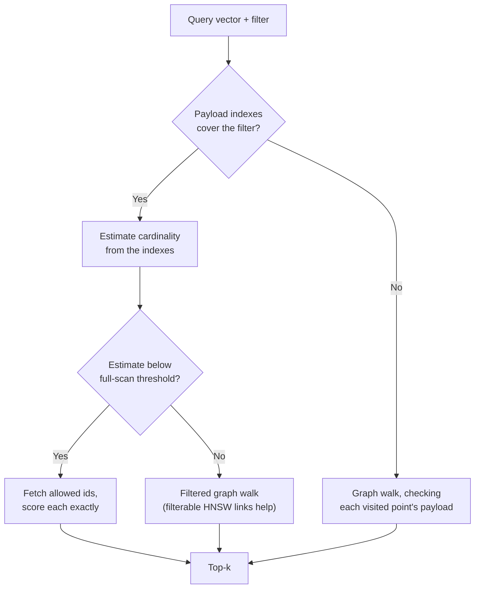

A filtered vector query asks two things at once: *which points are most similar to this vector?* and *which points satisfy these conditions?* [Filtering](/learn/vector-database-fundamentals/filtering) introduced the idea and the two naive ways to combine the answers, filtering before the search or after it. This lesson is about what happens when you run filtered search for real, on an approximate index, at scale: how filter expressions are evaluated, why the obvious strategies lose results as filters become restrictive, how engines plan around that with the help of [payload indexes](/learn/advanced-vector-database-engineering/payload-indexes), and how to test that your filtered queries return what they should.

The central fact is uncomfortable. On an approximate index, a filtered query can return fewer than $k$ results, or the wrong $k$, with no error and no warning, and whether it does depends on how restrictive the filter is and on how the allowed points are spread through the vector space. By the end of the lesson you will have measured this yourself and know what to do about it.

## Learning objectives

- Write filter expressions with AND, OR and NOT clauses and predict their results on points with list-valued and missing fields.
- Compute how many candidates post-filtering must fetch to return $k$ results with a given probability, for a given selectivity.
- Explain why filtered traversal of an HNSW graph degrades under restrictive filters, and why correlated filters are worse than random ones.
- Describe how a query planner chooses between exact scoring of the allowed set and a filtered graph walk, and what payload indexes contribute.
- Design a test that measures filtered recall across a range of filter selectivities.

## Prerequisites

- [Filtering](/learn/vector-database-fundamentals/filtering): what filtered search means, and pre-filtering versus post-filtering.
- [Payload indexes](/learn/advanced-vector-database-engineering/payload-indexes): posting lists, selectivity and cardinality estimates.
- [HNSW](/learn/vector-indexing-algorithms/hnsw): graph layers, the parameter M and the search width ef.
- [Recall@K](/learn/retrieval-fundamentals/recall-k): the metric used to measure what a filter costs.

## Why this matters

Filters are everywhere in production RAG. AskMeridian filters by source when staff choose "IT help", by date when they ask for recent changes, by language, and, most importantly, by access-control groups on every single query. Each of these filters reduces the set of eligible points, sometimes to a tiny fraction of the collection.

If filtered search is executed badly, three things go wrong, and none of them raises an error.

1. **Missing results.** The search finds 10 nearest neighbours, the filter removes 9, and the model is given one chunk instead of ten. Or none, and AskMeridian says "I don't know" about a policy that is in the index.
2. **Wrong results.** The search returns $k$ allowed points, but not the *best* $k$ allowed points, because the true best were never reached. The answers look plausible and are worse.
3. **Latency cliffs.** A query whose filter matches 40% of points takes 5 ms; the same query with a filter matching 0.1% takes 300 ms, because the engine visits a huge number of points looking for allowed ones.

Restrictive filters are not an edge case: in a multi-tenant product a small customer's filter may allow one point in ten thousand, and narrow access-control filters are just as restrictive.

## The intuition

Imagine looking for the ten books in a large library that are closest in subject to a book you are holding, but only among books published by one small press.

**Strategy one:** take the hundred books nearest your subject, then keep the ones from that press. If the press publishes a third of all books, this works. If it publishes one in a thousand, you probably go home with nothing, although it may have three books on your subject a little further along.

**Strategy two:** ask the catalogue desk for the list of every book that press published, perhaps forty, and compare each with yours. That is perfect, and fast, *because* the list is short. For a press with 200,000 books, it would take all day.

**Strategy three:** walk the shelves as usual, picking up only that press's books. If they are scattered evenly, you meet enough. If they are all in one wing on another subject, you meet none.

A good librarian checks the catalogue first to see how many books the press has, then chooses: under a few hundred, use the list; otherwise, walk the shelves. That is a **query planner**.

## How it works

### Filter expressions and their semantics

Engines express filters as boolean combinations of conditions on payload fields. In Qdrant, a `Filter` has three clause lists, which can be nested:

- `must`: every condition must hold (AND);
- `should`: at least one condition must hold (OR);
- `must_not`: no condition may hold (NOT of an OR).

Conditions include exact matches (`MatchValue`), membership (`MatchAny`, `MatchExcept`), numeric and datetime ranges (`Range`, `DatetimeRange`), checks for missing or empty fields (`IsEmptyCondition`, `IsNullCondition`), the number of values in a list (`ValuesCount`), point identifiers (`HasIdCondition`), and `NestedFilter` for arrays of objects. Other products have equivalent languages: Pinecone uses MongoDB-style operators (`$eq`, `$in`, `$gte`, `$and`, `$or`), Milvus uses boolean expression strings such as `source == "runbooks" and year >= 2025`, Weaviate has a `where` filter, and pgvector uses SQL `WHERE`.

Three semantic details cause most filter bugs:

1. **List fields match if any element matches.** `acl = "hr"` matches a point whose `acl` is `["staff", "hr"]`. That is what you want for access groups, but it means "match value" on a list is really "contains".
2. **Missing fields pass negations.** A point with no `status` field is not "archived", so `must_not: status = archived` lets it through. If missing values should be excluded, say so with an explicit condition.
3. **Conditions on arrays of objects are evaluated per field, not per object,** unless you use a nested condition. With `authors: [{"name": "Lena", "team": "HR"}, {"name": "Tomasz", "team": "IT"}]`, the filter `authors.name = Lena AND authors.team = IT` matches, because some author is Lena and some author is in IT, even though no single author is both. A nested filter evaluates the conditions against each object separately.

### Strategies for filtered search

There are five ways to combine a filter with an approximate vector index. The first two you met in the fundamentals lesson; the rest are what serious engines add.

1. **Post-filtering.** Search the index for $k'$ candidates ($k' \ge k$), discard those that fail the filter, keep the best $k$. Simple and fast; loses results when the filter is restrictive (quantified below).
2. **Pre-filtering with exact scoring.** Use payload indexes to compute the allowed set, then compute the similarity to every allowed point and keep the top $k$. Perfect recall; cost proportional to the number of allowed points, so excellent for restrictive filters and terrible for permissive ones.
3. **Filtered graph traversal.** Walk the HNSW graph as usual, but only admit allowed points to the result list (and, in some implementations, only expand allowed nodes). Efficient for permissive filters; degrades as filters become restrictive.
4. **Filter-aware index construction.** Change the graph so that filtered walks keep working. Qdrant's filterable HNSW adds links among points sharing an indexed payload value. Research systems go further: Filtered-DiskANN (Gollapudi and colleagues, 2023) builds graphs that account for labels, and ACORN (Patel and colleagues, 2024) builds denser graphs and expands neighbours-of-neighbours during filtered search so the allowed subgraph stays navigable for arbitrary predicates. These are active research areas; production support varies by product.
5. **Physical partitioning.** If one filter dominates (the tenant), give each value its own partition, as in [Namespaces](/learn/advanced-vector-database-engineering/namespaces). The filter disappears from the search entirely.

### Why graph traversal fails under restrictive filters

HNSW search keeps a bounded list of the best $ef$ candidates found so far and stops when no unexplored candidate can improve it. Two things go wrong when most visited nodes are disallowed.

**The walk stops before it has found enough allowed points.** The candidate list fills with good but disallowed points, the stopping rule fires, and the result list holds only the few allowed points met along the way.

**The allowed subgraph falls apart.** If the walk may only step through allowed nodes, it can only reach allowed nodes linked to other allowed nodes. Each node on HNSW's bottom layer has up to $2M$ links. With a fraction $s$ of points allowed, an allowed node has on average about $2Ms$ allowed neighbours. When that drops below about 1, the allowed points form small disconnected islands, and a walk starting in one island cannot reach the others. (This is a heuristic borrowed from random-graph theory, not an exact model of HNSW; Qdrant's documentation uses the same percolation argument to explain its filterable index.)

**Correlation makes both worse.** The arithmetic above assumes allowed points are scattered at random. Real filters are often correlated with content: "source = products" selects points that sit together in one region of the space. If the query lands in a different region, the walk explores its own neighbourhood thoroughly and meets no allowed points at all, at any selectivity.

### The query planner

Because no single strategy wins everywhere, engines choose per query. Qdrant documents its approach (and makes the choice separately for each segment):



1. **Parse the filter** into conditions on fields.
2. **Estimate cardinality** of the whole filter from the payload indexes: exact for a single condition, combined estimates for AND and OR.
3. **If the estimate is small** (below a threshold that Qdrant's HNSW configuration exposes as `full_scan_threshold`, expressed in kilobytes of vector data), fetch the allowed ids and score them exactly.
4. **Otherwise**, walk the graph with the filter applied, relying on the extra links built for indexed fields to keep the walk connected for moderately restrictive values.
5. **If no index covers a field**, the engine can still filter, by reading payloads, but cannot estimate, so it cannot choose well.

The important consequence is that the planner is only as good as its estimates and its indexes. A missing payload index, or a filter combining fields whose correlation fools the estimate, can send a restrictive query down the graph-walk path where it loses results.

### Hard filters and soft preferences

Not every condition should be a filter. A filter is a **hard constraint**: points that fail it are invisible. Access control, tenant and "current version only" are hard. "Prefer recent documents" or "probably about the runbooks" are **preferences**, better expressed as a score adjustment or a reranking signal, so that a highly relevant older document can still win. Filters extracted automatically from the user's question (see [Self-query retrieval](/learn/advanced-retrieval/self-query-retrieval) and [Metadata-aware retrieval](/learn/advanced-retrieval/metadata-aware-retrieval)) deserve particular caution: a misread date range turns into missing results.

## The mathematics

### How much must post-filtering fetch?

**Intuition.** If a fraction $s$ of points is allowed and allowed points are scattered at random, then among $k'$ fetched candidates the number that survive is like counting heads in $k'$ coin flips with a coin that lands heads with probability $s$.

$$
A \sim \text{Binomial}(k', s), \qquad \mathbb{E}[A] = k' s, \qquad P(A \ge k) = \sum_{j=k}^{k'} \binom{k'}{j} s^j (1 - s)^{k' - j}
$$

$A$ is the number of allowed points among the $k'$ fetched, $s$ the selectivity, $k$ the number of results wanted. To expect $k$ survivors you need $k' \approx k / s$; to be fairly sure of $k$, somewhat more.

**By hand.** $k = 10$, $s = 0.1$. Fetching $k' = 100$ gives $\mathbb{E}[A] = 100 \times 0.1 = 10$: on average exactly enough, which means short about half the time. Fetching $k' = 200$ gives $\mathbb{E}[A] = 20$, comfortably above 10. At $s = 0.01$, you need about $k / s = 1{,}000$ candidates just to *expect* 10, and the graph search for 1,000 neighbours is itself expensive and approximate. If the filter is correlated with the query's region, the binomial model is optimistic, and no fetch size is safe.

### When does the allowed subgraph fragment?

With $2M$ links per node on the bottom layer and selectivity $s$, the expected number of allowed neighbours of an allowed node is

$$
\bar{d}_{\text{allowed}} \approx 2 M s
$$

With $M = 16$: $s = 0.1$ gives $3.2$; $s = 0.03$ gives $0.96$; $s = 0.01$ gives $0.32$. Below roughly 1, the allowed points are mostly isolated from each other.

```python
from scipy.stats import binom

k = 10
for s in [0.5, 0.1, 0.01]:
    for fetch in [10 * k, int(2 * k / s)]:
        p_enough = binom.sf(k - 1, fetch, s)         # P(at least k allowed among `fetch`)
        print(f"s={s:<5} fetch={fetch:>5}  expected allowed={fetch * s:6.1f}  P(>= {k}) = {p_enough:.3f}")
    need = next(n for n in range(k, 100_000) if binom.sf(k - 1, n, s) >= 0.99)
    print(f"         fetch needed for a 99% chance of {k}: {need}")

M0 = 32                                               # links per node on HNSW's bottom layer (2 x M)
for s in [0.5, 0.1, 0.03, 0.01]:
    print(f"s={s:<5} expected allowed neighbours per allowed node: {M0 * s:5.2f}")
```

```output
s=0.5   fetch=  100  expected allowed=  50.0  P(>= 10) = 1.000
s=0.5   fetch=   40  expected allowed=  20.0  P(>= 10) = 1.000
         fetch needed for a 99% chance of 10: 33
s=0.1   fetch=  100  expected allowed=  10.0  P(>= 10) = 0.549
s=0.1   fetch=  200  expected allowed=  20.0  P(>= 10) = 0.996
         fetch needed for a 99% chance of 10: 183
s=0.01  fetch=  100  expected allowed=   1.0  P(>= 10) = 0.000
s=0.01  fetch= 2000  expected allowed=  20.0  P(>= 10) = 0.995
         fetch needed for a 99% chance of 10: 1874
s=0.5   expected allowed neighbours per allowed node: 16.00
s=0.1   expected allowed neighbours per allowed node:  3.20
s=0.03  expected allowed neighbours per allowed node:  0.96
s=0.01  expected allowed neighbours per allowed node:  0.32
```

`binom.sf(k - 1, n, s)` is the survival function, $P(A > k - 1) = P(A \ge k)$. Fetching ten times $k$ is plenty at $s = 0.5$ and a coin toss at $s = 0.1$; at $s = 0.01$ a 99% guarantee needs almost 1,900 candidates, nearly 190 times $k$.

## In code

**The problem.** Measure filtered recall on a real HNSW index for three strategies (post-filtering with a tenfold over-fetch, filtered graph traversal, and a simple planner) across filters from permissive to very restrictive, plus one filter correlated with the data's clusters.

**Dependencies.** NumPy and FAISS (the CPU build). FAISS's HNSW index accepts an `IDSelector` in its search parameters, which restricts which ids may be returned (see [FAISS](/learn/vector-database-ecosystem/faiss)). The data is synthetic: 50,000 unit vectors in 64 dimensions around 100 topic centres, which imitates the clustering of real embeddings and keeps the run to a few seconds.

```bash
pip install numpy faiss-cpu
```

```python
import time
import numpy as np
import faiss

rng = np.random.default_rng(0)
N, d, k, n_q = 50_000, 64, 10, 200

# Clustered unit vectors standing in for chunk embeddings (100 topics).
centres = rng.normal(size=(100, d)).astype(np.float32)
topic = rng.integers(0, 100, N)
X = centres[topic] + 0.5 * rng.normal(size=(N, d)).astype(np.float32)
X /= np.linalg.norm(X, axis=1, keepdims=True)
Q = centres[rng.integers(0, 100, n_q)] + 0.5 * rng.normal(size=(n_q, d)).astype(np.float32)
Q /= np.linalg.norm(Q, axis=1, keepdims=True)

faiss.omp_set_num_threads(1)
index = faiss.IndexHNSWFlat(d, 16, faiss.METRIC_INNER_PRODUCT)   # M = 16 links per node
index.add(X)

def exact_filtered(q, allowed_ids):                # pre-filter: score every allowed point
    scores = X[allowed_ids] @ q
    top = np.argsort(-scores)[:k]
    return set(allowed_ids[top].tolist())

def post_filter(q, allowed_mask, fetch):           # ANN first, filter afterwards
    _, I = index.search(q[None, :], fetch, params=faiss.SearchParametersHNSW(efSearch=2 * fetch))
    return {int(i) for i in I[0] if i >= 0 and allowed_mask[i]}

def in_graph(q, selector, ef):                     # filter applied during the graph walk
    params = faiss.SearchParametersHNSW(sel=selector, efSearch=ef)
    _, I = index.search(q[None, :], k, params=params)
    return {int(i) for i in I[0] if i >= 0}

def planned(q, allowed_ids, selector, threshold=2_000):
    # A planner: exact scoring when few points are allowed, graph walk otherwise.
    if len(allowed_ids) <= threshold:          # the count comes from the payload index
        return exact_filtered(q, allowed_ids)
    return in_graph(q, selector, ef=64)

print(f"{'filter':<14}{'s':>6} |{'post x10':>9}{'hits':>6} |{'in-graph':>9} |{'planner':>8}{'ms/q':>7}")
for label, s, correlated in [("random", 0.5, False), ("random", 0.1, False), ("random", 0.01, False),
                             ("random", 0.002, False), ("topic-aligned", 0.01, True)]:
    if correlated:      # allowed points are exactly one topic: a filter that follows the clusters
        allowed_mask = topic == 3
    else:
        allowed_mask = rng.random(N) < s
    allowed_ids = np.flatnonzero(allowed_mask)
    selector = faiss.IDSelectorBatch(allowed_ids.astype(np.int64))
    r_post, r_graph, r_plan, hits, t_plan = [], [], [], [], 0.0
    for q in Q:
        truth = exact_filtered(q, allowed_ids)
        got = post_filter(q, allowed_mask, fetch=10 * k)
        got = set(sorted(got, key=lambda i: -float(X[i] @ q))[:k])   # best k of the survivors
        r_post.append(len(got & truth) / k)
        hits.append(len(got))
        r_graph.append(len(in_graph(q, selector, ef=64) & truth) / k)
        t0 = time.perf_counter()
        plan = planned(q, allowed_ids, selector)
        t_plan += time.perf_counter() - t0
        r_plan.append(len(plan & truth) / k)
    print(f"{label:<14}{allowed_mask.mean():>6.3f} |{np.mean(r_post):>9.2f}{np.mean(hits):>6.1f} |"
          f"{np.mean(r_graph):>9.2f} |{np.mean(r_plan):>8.2f}{t_plan / n_q * 1e3:>7.3f}")
```

```output
filter             s | post x10  hits | in-graph | planner   ms/q
random         0.503 |     1.00  10.0 |     0.99 |    0.99  0.039
random         0.103 |     0.90   9.1 |     0.98 |    0.98  0.032
random         0.010 |     0.10   1.0 |     0.41 |    1.00  0.034
random         0.002 |     0.02   0.2 |     0.09 |    1.00  0.011
topic-aligned  0.010 |     0.01   0.1 |     0.01 |    1.00  0.029
```

The recall figures are deterministic for this seed; the milliseconds are from one laptop and will differ on yours.

**The important lines.**

- `exact_filtered` is pre-filtering: score only the allowed points, exactly. It is the ground truth for every comparison, since "the best $k$ allowed points" is by definition what a filtered query should return.
- `post_filter` asks the index for `fetch = 10 * k` = 100 neighbours with a generous `efSearch`, so that the unfiltered search itself is accurate, and then discards disallowed ids. Its losses are due to filtering alone.
- `faiss.SearchParametersHNSW(sel=selector, efSearch=ef)` is filtered traversal: the selector decides which ids may be returned during the walk.
- `planned` is a two-branch planner. In a database, `len(allowed_ids)` would come from payload-index cardinality, as in the [previous lesson](/learn/advanced-vector-database-engineering/payload-indexes). The threshold of 2,000 points is arbitrary but sensible here: scoring 2,000 vectors of 64 dimensions exactly is cheap.
- The `topic-aligned` filter allows exactly the points of topic 3, about 1% of the collection, so its selectivity matches the third row but its allowed points are clustered in one region.

**What the output means.**

- **Post-filtering collapses with selectivity, as the binomial predicts.** At $s \approx 0.5$ it is perfect. At $s \approx 0.1$ it returns 9.1 results on average instead of 10, and recall is 0.90. At $s = 0.01$ it returns about one result per query. Notice what the user sees in that case: not an error, one chunk.
- **Filtered traversal holds up longer, then fails.** It is excellent at 0.5 and 0.1, and drops to 0.41 at $s = 0.01$ and 0.09 at 0.002, consistent with the fragmentation estimate ($2Ms$ falls below 1 between $s = 0.03$ and $s = 0.01$).
- **Correlation is the worst case.** The topic-aligned filter has the same selectivity as the third row, but both approximate strategies score about 0.01. The queries mostly come from other topics, so the walk explores the wrong region and never meets an allowed point.
- **The planner gets perfect recall where the others fail, and is fast.** Below 2,000 allowed points it scores them exactly, which costs less than a graph walk because there are few of them. This is why engines plan, and why they need payload indexes to do it.

**Errors people commonly hit.**

- Measuring recall with unfiltered queries only. A system can score 0.98 on an unfiltered benchmark and 0.1 on the filters real users send.
- Fixing missing results by raising $k'$ until a test passes. The required fetch grows as $1/s$, and no fetch is safe for correlated filters.

**Extending it.** Add a third branch to the planner: for $s$ between 0.01 and 0.1, run the graph walk with a larger `efSearch` (try 256), and measure the recall and time it buys. Then replace the fixed threshold with one expressed in bytes of vectors to scan, as Qdrant's `full_scan_threshold` is.

### Filter semantics, verified

The second snippet checks the three semantic rules from "How it works" against Qdrant's filter implementation, in embedded mode.

```python
from qdrant_client import QdrantClient, models

client = QdrantClient(":memory:")
client.create_collection("demo", vectors_config=models.VectorParams(size=2, distance=models.Distance.COSINE))
client.upsert("demo", points=[
    models.PointStruct(id=1, vector=[1, 0], payload={"source": "handbook", "acl": ["staff"], "status": "current"}),
    models.PointStruct(id=2, vector=[1, 0], payload={"source": "handbook", "acl": ["staff", "hr"], "status": "archived"}),
    models.PointStruct(id=3, vector=[1, 0], payload={"source": "runbooks", "acl": ["it"]}),          # no status
    models.PointStruct(id=4, vector=[1, 0], payload={"source": "runbooks", "acl": [], "status": "current"}),
])

def ids(f):
    return sorted(p.id for p in client.scroll("demo", scroll_filter=f, limit=10)[0])

C = models.FieldCondition
print("acl contains hr          :", ids(models.Filter(must=[C(key="acl", match=models.MatchValue(value="hr"))])))
print("acl any of [hr, it]      :", ids(models.Filter(must=[C(key="acl", match=models.MatchAny(any=["hr", "it"]))])))
print("status = current         :", ids(models.Filter(must=[C(key="status", match=models.MatchValue(value="current"))])))
print("NOT status = archived    :", ids(models.Filter(must_not=[C(key="status", match=models.MatchValue(value="archived"))])))
print("status is empty          :", ids(models.Filter(must=[models.IsEmptyCondition(is_empty=models.PayloadField(key="status"))])))
print("acl is empty             :", ids(models.Filter(must=[models.IsEmptyCondition(is_empty=models.PayloadField(key="acl"))])))
print("handbook OR acl has it   :", ids(models.Filter(should=[C(key="source", match=models.MatchValue(value="handbook")),
                                                               C(key="acl", match=models.MatchValue(value="it"))])))
```

```output
acl contains hr          : [2]
acl any of [hr, it]      : [2, 3]
status = current         : [1, 4]
NOT status = archived    : [1, 3, 4]
status is empty          : [3]
acl is empty             : [4]
handbook OR acl has it   : [1, 2, 3]
```

Point 3 has no `status` field, so it passes `NOT status = archived`: if the intent was "current documents only", the correct filter is `status = current`, which excludes it. Point 4's empty `acl` list counts as empty, so a separate rule is needed for documents nobody has been granted. Test filters against points with missing and empty fields, not only against tidy ones.

## A real-world example

Meridian's Platform team added access control to AskMeridian: each chunk's payload received an `acl_groups` list, and every query carried a filter `acl_groups` matches any of the user's groups. In testing, with the test accounts in broad groups such as `staff`, everything worked.

After launch, members of the small Legal team reported that AskMeridian could not find documents they knew were there: the legal-hold procedure, which only the `legal` group may read, came back as "I don't know" about half the time. Dmitri, investigating, reproduced the problem by measuring recall for each group separately against exact filtered search, exactly as in the code above. Broad groups had recall near 1.0. The `legal` group, whose documents were about 0.05% of the collection and clustered tightly on a few topics, had recall around 0.5 on the questions in the test set.

Two causes combined. The application, written before payload indexes were added, applied ACL filtering as a post-filter on 50 candidates. And when the team moved filtering into Qdrant, the `acl_groups` keyword index had been created after the collection was loaded, so the graph lacked the extra links for that field. The fix was to send the filter to Qdrant rather than post-filter in the application, to rebuild the collection with the index created first, and to add a permanent test: for every access group, run the evaluation questions that group can answer and compare against exact filtered search. The test now runs on every collection promotion, and it caught a regression months later when someone added a new group-specific corpus.

## Common mistakes

- **Post-filtering in the application.** Fetching $k'$ results and filtering in Python loses results as soon as filters become restrictive, and nothing reports it.
- **Benchmarking only unfiltered recall.** The filters users actually send, especially access-control and tenant filters, are where recall breaks.
- **Treating "fewer than k results" as normal.** A filtered query returning fewer results than exist in the allowed set is a correctness bug.
- **Using `must_not` where a positive condition was meant.** Points missing the field pass negations.
- **Flattening arrays of objects without nested conditions.** Conditions match across different objects in the array.
- **Encoding preferences as filters.** "Recent" as a hard date filter hides the one older document that answers the question.

## Best practices

- Push filters into the database; never post-filter vector results in the application for anything that matters.
- Create payload indexes for every filtered field before loading, so the planner can estimate and, in Qdrant, the graph includes filter-aware links.
- Build a filtered-recall test: for a range of real filters (broad, narrow, correlated), compare the engine's results with exact filtered search on the same data.
- Partition by the one filter that applies to every query (usually the tenant) rather than filtering on it.
- Express preferences as score adjustments or reranking features, and keep hard filters for genuine constraints.
- Log the number of results returned per query; alert when filtered queries routinely return fewer than $k$.

## Performance considerations

**Exact scoring of the allowed set costs $|M| \times d$ multiply-adds.** For 2,000 allowed points at 384 dimensions that is about 768,000, well under a millisecond on one core. For 200,000 allowed points it is 77 million, tens of milliseconds, which is why the planner switches to the graph above a threshold.

**Filtered graph walks cost more than unfiltered ones.** With selectivity $s$, roughly $1/s$ points must be visited per allowed point found, so walks at moderate selectivity visit more nodes, and filter checks are added per visit. Payload indexes make each check a memory lookup rather than a payload read.

**Latency depends on the filter value.** The same query shape can take very different paths for different tenants or groups. Track latency percentiles per filter class, not only overall.

## Security considerations

Access-control filters are the most important filters in a RAG system, and two properties of filtered search interact with them. First, a filter that silently loses results fails *closed* (users miss documents they may see), which is safe but erodes trust and pushes people to ask for broader permissions. Second, and much worse, any path that applies the filter *after* retrieval in a place that can be skipped (a debug flag, a different client, a cached result shared between users) fails *open*. Always apply authorisation filters inside the database query, derived from the authenticated identity on the server, and never cache filtered results under a key that omits the user's groups. Designing the permission model itself is covered in [Document-level permissions](/learn/access-control-and-privacy/document-level-permissions).

## Summary

- Filter expressions combine AND, OR and NOT clauses; list fields match on any element, missing fields pass negations, and arrays of objects need nested conditions.
- Post-filtering needs about $k/s$ candidates to return $k$ results and fails badly for restrictive or correlated filters.
- Filtered graph traversal works for permissive filters and degrades when the allowed subgraph fragments, roughly when $2Ms$ falls below 1; correlated filters fail even earlier.
- Engines plan per query: exact scoring of the allowed set when the payload-index estimate is small, a filtered graph walk otherwise; filter-aware graph construction extends the range where walks work.
- Measure filtered recall per filter class against exact filtered search, and keep authorisation filters inside the database.

## Exercises

**1.** A filter allows 2% of a collection. Using the binomial model, roughly how many candidates must a post-filter fetch to *expect* 10 results? Why is the true requirement larger if the allowed points are concentrated in one topic?

<details><summary>Show solution</summary>

$k' \approx k / s = 10 / 0.02 = 500$ just to expect 10, and more to make 10 likely. If the allowed points sit in one region and the query in another, the nearest candidates are almost all disallowed; the number of allowed points among the first $k'$ is far below $k' s$, and may be zero for any practical $k'$. The binomial model assumes allowed points are scattered independently of the query.

</details>

**2.** Predict the result of each filter on the four points in the semantics snippet: (a) `must_not: acl = "it"`; (b) `must: source = "runbooks"` and `must_not: status = "current"`.

<details><summary>Show solution</summary>

(a) Points 1, 2 and 4: point 3's `acl` contains `"it"`; point 4's empty list contains nothing, so it passes the negation. (b) Point 3 only: the runbooks points are 3 and 4, and point 4 is current, while point 3 has no status and passes the negation. Run the snippet with these filters to check.

</details>

**3.** Extend the experiment with a three-branch planner: exact scoring below 2,000 allowed points; graph walk with `efSearch=256` between 2,000 and 10,000; graph walk with `efSearch=64` above. Report recall and time for each filter, and explain the trade-off you see.

<details><summary>Show solution</summary>

```python
def planned3(q, allowed_ids, selector):
    n = len(allowed_ids)
    if n <= 2_000:
        return exact_filtered(q, allowed_ids)
    return in_graph(q, selector, ef=256 if n <= 10_000 else 64)
```

Substitute `planned3` in the timed call. The 10% filter (about 5,000 allowed points) now takes the `ef=256` branch: in our run its recall rose from 0.98 to 1.00 and its time per query roughly quadrupled (0.03 ms to 0.12 ms). The other rows are unchanged because they take the same branches as before. Wider walks buy recall in the middle band where exact scoring would be too costly and a narrow walk is starting to fragment.

</details>

**4.** Design decision. AskMeridian will add a filter "documents valid on a given date" (`valid_from <= d < valid_until`), used on roughly a third of queries and usually allowing 70% to 95% of points, but for historical dates sometimes under 1%. Describe how you would index, plan and test it.

<details><summary>Show solution</summary>

Index both fields with datetime range indexes created before loading, so the planner can estimate the combined cardinality. For typical queries (70% to 95% allowed) the filtered graph walk is the right path and costs little extra. For historical dates the allowed set may be small and correlated with content (old policies cluster by topic), which is precisely the case where walks fail; the planner must see a small estimate and switch to exact scoring, so verify that the estimate for the AND of two ranges is reasonable (correlated ranges can mislead an independence estimate). Test with a set of historical questions whose answers are known, comparing against exact filtered search, and log results-per-query for date-filtered traffic. If the validity window is really a version, consider a boolean `is_current` field for the common case, which is a cheap and very permissive filter.

</details>

## Check your understanding

```quiz
[
  {
    "q": "A post-filter fetches 100 candidates for k = 10, and the filter allows 1% of points scattered at random. About how many results come back?",
    "options": [
      "10",
      "About 1",
      "About 50",
      "Exactly 0"
    ],
    "answer": 1,
    "why": "The expected number of allowed points among 100 is 100 x 0.01 = 1."
  },
  {
    "q": "Why can a filtered HNSW walk fail to find allowed points that exist?",
    "options": [
      "HNSW cannot store payloads",
      "Filters change the similarity metric",
      "With few allowed neighbours per node, the walk stops or cannot reach other allowed regions",
      "The graph is rebuilt on every query"
    ],
    "answer": 2,
    "why": "The bounded candidate list fills with disallowed points, and when about 2Ms falls below 1 the allowed subgraph is fragmented."
  },
  {
    "q": "Two filters each allow 1% of a collection. One selects points at random; the other selects all points on one topic. For a query about a different topic, which is harder for approximate filtered search?",
    "options": [
      "The random filter",
      "Both are equally hard",
      "Neither, because 1% is permissive",
      "The topic filter, because its allowed points lie far from the region the walk explores"
    ],
    "answer": 3,
    "why": "Correlated filters concentrate allowed points away from the query's neighbourhood, so a walk there meets none of them."
  },
  {
    "q": "What does a query planner use payload indexes for when choosing a strategy?",
    "options": [
      "To estimate how many points the filter allows",
      "To compress the vectors",
      "To choose the embedding model",
      "To reorder the HNSW layers"
    ],
    "answer": 0,
    "why": "Posting-list lengths and range positions give a cheap cardinality estimate; small estimates lead to exact scoring of the allowed set."
  },
  {
    "q": "A point has no `status` field. Which Qdrant filter does it pass?",
    "options": [
      "must: status = current",
      "must_not: status = archived",
      "must: status = archived",
      "None of them"
    ],
    "answer": 1,
    "why": "A missing field is not equal to \"archived\", so the negation passes it. Use positive conditions when missing values should be excluded."
  }
]
```

## Further reading

- Qdrant documentation, [Filtering](https://qdrant.tech/documentation/concepts/filtering/) and [Indexing](https://qdrant.tech/documentation/concepts/indexing/): filter clauses and conditions, the query planner and filterable HNSW.
- Gollapudi et al. (2023), "Filtered-DiskANN: Graph Algorithms for Approximate Nearest Neighbor Search with Filters", Proceedings of the ACM Web Conference 2023.
- Patel et al. (2024), "ACORN: Performant and Predicate-Agnostic Search Over Vector Embeddings and Structured Data", Proceedings of the ACM on Management of Data (SIGMOD 2024).
- Malkov and Yashunin (2018), "Efficient and robust approximate nearest neighbor search using Hierarchical Navigable Small World graphs", [arXiv:1603.09320](https://arxiv.org/abs/1603.09320).
- FAISS wiki, [github.com/facebookresearch/faiss/wiki](https://github.com/facebookresearch/faiss/wiki): search parameters and ID selectors.
