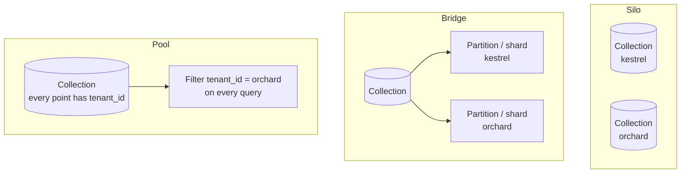

A **tenant** is a customer of a shared system whose data must stay separate from every other customer's: a company using your SaaS product, a team inside a large organisation, sometimes a single user. **Multi-tenancy** is the art of serving many tenants from one deployment, so that each sees only its own documents, none can slow the others down, and you can add or remove a tenant without a project. For a RAG system the stakes are unusually high, because a retrieval mistake does not show a wrong row on a screen; it quietly puts another customer's text in front of a language model, which will summarise it fluently.

This lesson treats multi-tenancy as a design decision with three classic answers (a collection per tenant, a partition per tenant, and a shared collection with a tenant field), explains why the shared answer is harder for an approximate index than it looks, shows how vector databases make it work, and builds a search layer that cannot forget the tenant filter. The broader security model (authentication, authorisation, encryption) belongs to [Tenant isolation](/learn/access-control-and-privacy/tenant-isolation) in Phase 15, and the service-level architecture to [Multi-tenant RAG](/learn/production-architecture/multi-tenant-rag); here the subject is the vector database.

## Learning objectives

- Compare the three tenancy models (silo, bridge, pool) on isolation, cost, operational load and per-tenant flexibility.
- Explain, with a calculation, why a selective tenant filter breaks post-filtered approximate search, and describe how databases avoid it.
- Configure a shared Qdrant collection for many tenants with a tenant payload index and per-tenant graph links.
- Implement a search layer that takes the tenant from verified identity, enforces it on every query, and checks results on the way out.
- Plan the tenant lifecycle: onboarding, offboarding with verified deletion, and promoting a large tenant to dedicated resources.

## Prerequisites

- [Namespaces](/learn/advanced-vector-database-engineering/namespaces): hard partitions inside a collection or index.
- [Payload indexes](/learn/advanced-vector-database-engineering/payload-indexes) and [Metadata filtering](/learn/advanced-vector-database-engineering/metadata-filtering): how a database narrows a search by field values.
- [HNSW](/learn/vector-indexing-algorithms/hnsw): the graph index whose behaviour under filters drives much of this lesson.

## Why this matters

Meridian sells Meridian Reports to other companies. Its product team wants to add an assistant that answers each customer's questions from documents that customer uploads: their retention rules, export procedures, internal guides. Three customers will do for now: Kestrel Health, Orchard Foods and Brightwater Logistics. Each has a page called something like "How long are exported reports kept?", and each page gives a different answer.

Get tenancy wrong and four things go wrong, in rising order of cost.

1. **Leaks.** One missing filter and Orchard's question retrieves Kestrel's retention policy. The model answers "7 years" with a citation to a document Orchard should never have seen. This is a data breach, delivered in a confident, well-formatted answer.
2. **Wrong answers without a leak.** Even if the leaked text is never shown, a neighbouring tenant's chunk that outranks the right one pushes the right one out of the top $k$.
3. **Noisy neighbours.** A tenant that uploads two million pages, or runs a nightly batch of fifty thousand queries, makes everyone else slow if they share hardware with no limits.
4. **Lifecycle debt.** A customer leaves and asks for its data to be deleted. If its points are mixed with everyone else's and nobody built a reliable way to find them all, the deletion is a hunt, not an operation.

A design that handles 3 tenants well can fail at 3,000, and the choice is expensive to change once data is loaded.

## The intuition

Think of three ways to house a company's departments.

**Separate buildings.** Each department has its own building and front door. Nobody wanders into the wrong office, and you can demolish one building without touching the others. But every building needs its own heating, reception and guard, so a department of three is absurdly expensive to house.

**Floors of one building.** One building, one reception, but each department has its own floor behind a locked door. Cheaper per department, still well separated, though there is a limit to how many floors a building can have.

**One open-plan office with name badges.** Everyone shares the space, the desks are assigned, and every document carries the owner's name. Cheapest by far, and easy to fit thousands of people. But the separation is now a rule people must follow ("only read papers with your badge name on them"), not a wall. One careless person, and papers mix.

Vector databases offer the same three designs, and the open-plan office has a second, subtler problem: the fastest way to find a document (walking the corridors of the HNSW graph) crosses everyone's desks.

## How it works

### Three tenancy models

The SaaS literature (AWS's SaaS guidance, for example) names the three models **silo**, **bridge** and **pool**.

| Model | Vector database form | Isolation | Cost per tenant | Good for |
| --- | --- | --- | --- | --- |
| **Silo** | A collection (or a whole cluster) per tenant | Physical: a query cannot reach another tenant's data | High fixed overhead per tenant | Few large tenants, contractual isolation, per-tenant configuration |
| **Bridge** | A partition, shard or namespace per tenant inside one collection | Structural: the database confines each query to one partition | Moderate | Hundreds to thousands of tenants of mixed size |
| **Pool** | One collection, a `tenant_id` field on every point, a filter on every query | Logical: correct only if every query carries the filter | Lowest | Many small tenants |



**The silo** is the simplest to reason about. Each collection has its own segments, write-ahead log, optimiser, index and configuration. Deleting a tenant is dropping a collection. You can give one tenant a different embedding model, a larger HNSW `m` or a separate region. The cost is per-collection overhead: memory for each collection's structures, background threads, file handles, and an operator who must now migrate, back up and monitor thousands of objects. Qdrant's documentation, for instance, recommends against a collection per user in most cases for this reason. Silos are right when tenants are few and large, or when a contract says the data must be physically separate.

**The bridge** keeps one schema but makes the partition part of the storage layout: Pinecone namespaces, Weaviate's native multi-tenancy (each tenant its own shard, with idle tenants able to be deactivated or offloaded to cold storage so they do not occupy memory), Milvus partition keys, and Qdrant shard keys under custom sharding. [Namespaces](/learn/advanced-vector-database-engineering/namespaces) explains how each works; what matters here is that the database, not your code, confines the query.

**The pool** puts every tenant's points in one collection with a `tenant_id` payload field, and adds `tenant_id = X` to every query. It scales to very large tenant counts at almost no per-tenant cost. It has two problems. The isolation is only as good as your code, which the rest of this lesson addresses. And the filter is a problem for the index, which is the next section.

### Why a tenant filter is hard for an approximate index

An HNSW graph links each point to its nearest neighbours regardless of tenant, so a small tenant's points are scattered across a graph that mostly belongs to other people. [Metadata filtering](/learn/advanced-vector-database-engineering/metadata-filtering) explains in general why restrictive filters break both post-filtering and filtered graph walks. A tenant filter is the extreme case: it is on every query, and most tenants are small, so most queries are highly restrictive.

Production databases combine three remedies.

1. **Exact search for small tenants.** If the payload index says the tenant owns 2,000 points, scoring all 2,000 exactly is cheaper than any graph walk and has perfect recall. A query planner that knows each filter's cardinality (from the [payload index](/learn/advanced-vector-database-engineering/payload-indexes)) switches to this automatically below a threshold. In Qdrant this is governed by `full_scan_threshold`.
2. **Per-tenant graph links.** Build extra HNSW links among the points of each tenant, so that a filtered walk stays connected inside the tenant's subgraph. Qdrant does this for any payload field with an index when the collection's `payload_m` is set; for a pure pool where queries always carry a tenant filter, its multi-tenancy guide suggests `m=0` (no global graph at all) and `payload_m=16` (a graph per tenant).
3. **Co-location on disk.** Marking the tenant field as a tenant key (`is_tenant=True` on a Qdrant keyword index) tells the storage layer to keep each tenant's points together, so a tenant's search reads a few contiguous regions rather than pages scattered across the collection. This matters most when vectors are on disk.

> [!WARNING]
> With `m=0` there is no global graph. A query *without* a tenant filter falls back to a full scan of the whole collection. That is acceptable, and even a useful alarm, if unfiltered queries should never happen; it is a performance disaster if some admin feature relies on them.

### Enforcing the filter

In the pool model, the database will happily answer a query without a tenant filter. Isolation therefore lives in your code, and the design rules are the same as for any security boundary:

1. **The tenant comes from verified identity, never from the request.** The authentication layer decodes a signed token and produces `tenant_id`. A `tenant_id` field in the JSON body is attacker-controlled input.
2. **One choke point.** Application code never holds a raw database client. It holds a tenant-scoped search object that adds the filter itself, so forgetting it is impossible rather than unlikely.
3. **Caller filters are combined with AND, never substituted.** A feature that lets users filter by document type must add its condition to the tenant condition, not replace the filter object.
4. **Check on the way out.** Verify that every returned point carries the caller's tenant. It costs a loop over $k$ results and turns a silent leak into a loud error.
5. **Test the boundary.** A test suite that queries as tenant A for text only tenant B owns, and fails if anything comes back.

Database-side controls add a second wall: Qdrant can validate JWTs that restrict a token to particular collections, and PostgreSQL's row-level security can enforce `tenant_id = current_setting('app.tenant_id')` inside the database.

### Noisy neighbours and fairness

In a pool or bridge, tenants share CPU, memory, disk bandwidth and the optimiser. One tenant's bulk upload triggers segment merges and index builds that slow everyone's queries. Controls, from cheapest to most expensive:

- **Per-tenant rate limits and quotas** at the API layer (queries per second, points stored, upload size).
- **Separate write paths**: queue bulk uploads and apply them in batches during quiet periods.
- **Promote big tenants**: move a tenant that grows past a threshold to a dedicated shard (Qdrant custom shard key, recent versions of which also support routing small tenants to a shared fallback shard) or to its own collection or cluster.

This mixed design, a pooled long tail plus dedicated homes for the few largest tenants, is a common end state, because tenant sizes are usually very uneven.

### The tenant lifecycle

1. **Onboard**: create nothing (pool), a partition or shard key (bridge), or a collection (silo). Record which model the tenant is on in your own tenant registry.
2. **Operate**: enforce quotas, and track per-tenant point counts and query volume so that promotion decisions are based on data.
3. **Promote**: copy the tenant's points to its new home (scroll with a tenant filter, upsert elsewhere), switch routing in the registry, verify counts, then delete the old copies.
4. **Offboard**: delete by tenant (drop the collection, delete the shard key, or delete by filter), then **verify** with a count that returns zero. Remember that backups and snapshots still contain the tenant's data until they expire; [Backup and recovery](/learn/advanced-vector-database-engineering/backup-and-recovery) discusses retention, and [Secure deletion](/learn/enterprise-rag-governance/secure-deletion) the compliance side.

### Choosing

| Situation | Model |
| --- | --- |
| 5 tenants, each with millions of chunks, contractual isolation | Silo |
| 300 tenants, sizes from 1,000 to 500,000 chunks | Bridge, or pool with dedicated shards for the largest |
| 50,000 tenants (individual users), mostly under 1,000 chunks | Pool with per-tenant graph links or exact search |
| Tenants need different embedding models | Silo (vector sizes and spaces differ) |
| Some queries must span all tenants (internal analytics) | Pool, with those queries isolated to a separate, privileged path |

## The mathematics

### Post-filter yield

**Intuition.** [Metadata filtering](/learn/advanced-vector-database-engineering/metadata-filtering) derives the binomial model of post-filtering. Applied to tenants, it turns a tenant's *size* directly into the quality of its search results.

Let $N$ be the number of points in the collection, $n_t$ the number tenant $t$ owns, and $s = n_t / N$ the filter's **selectivity**. Assume, as a simplification, that the tenant's points are spread through the candidate lists in proportion to their share. Then each of the $c$ candidates belongs to $t$ with probability $s$, and the number of survivors $X$ is binomial:

$$
X \sim \text{Binomial}(c, s), \qquad \mathbb{E}[X] = c\,s, \qquad c_{\text{needed}} \approx \frac{k}{s}
$$

$c$ is the candidate count (the HNSW `ef` in practice), $k$ the results you want, and $c_{\text{needed}}$ the candidate count at which you would get $k$ survivors on average.

**By hand.** $N = 10{,}000{,}000$, $c = 200$, $k = 10$.

- A tenant with 100,000 points: $s = 0.01$, expected survivors $200 \times 0.01 = 2$. To expect 10 survivors you need $c = 10 / 0.01 = 1{,}000$.
- A tenant with 2,000 points: $s = 0.0002$, expected survivors $0.04$. You would need $c = 50{,}000$ candidates, 25 times the tenant's entire size, to get 10 results on average.

Meanwhile an exact scan of that small tenant scores 2,000 vectors: at 384 dimensions that is $2{,}000 \times 384 = 768{,}000$ multiply-adds, well under a millisecond on one core. The arithmetic says plainly that a small tenant should be searched exactly or through its own subgraph, never by post-filtering a shared graph.

**In Python** (SciPy gives the probability of getting all $k$):

```python
from scipy.stats import binom

N = 10_000_000          # points in the shared collection
k, ef = 10, 200         # results wanted; candidates the index returns before filtering
for n_t in [2_000_000, 100_000, 2_000]:
    s = n_t / N                                   # selectivity of the tenant filter
    expected = ef * s                             # survivors of a post-filter
    p_full = binom.sf(k - 1, ef, s)               # P(at least k survivors)
    print(f"tenant {n_t:>9,} points  s={s:.4f}  expected survivors={expected:6.2f}  "
          f"P(>= {k})={p_full:.3f}  ef needed for k on average={k / s:,.0f}")
```

```output
tenant 2,000,000 points  s=0.2000  expected survivors= 40.00  P(>= 10)=1.000  ef needed for k on average=50
tenant   100,000 points  s=0.0100  expected survivors=  2.00  P(>= 10)=0.000  ef needed for k on average=1,000
tenant     2,000 points  s=0.0002  expected survivors=  0.04  P(>= 10)=0.000  ef needed for k on average=50,000
```

The large tenant is fine with post-filtering; the two smaller ones essentially never get a full result list. Real data is not uniformly mixed (a tenant's documents cluster in vector space, which can help or hurt), but the scale of the problem is right.

## In code

**The problem.** Build a pooled collection for three Meridian Reports customers, show that an unscoped query leaks, wrap search so that it cannot leak, and offboard one tenant with verified deletion.

**Dependencies.** Qdrant's Python client in local in-memory mode (no server) and a local embedding model.

```bash
pip install qdrant-client sentence-transformers
```

```python
import uuid
from dataclasses import dataclass

from qdrant_client import QdrantClient, models
from sentence_transformers import SentenceTransformer

model = SentenceTransformer("sentence-transformers/all-MiniLM-L6-v2")
client = QdrantClient(":memory:")          # local mode; a server behaves the same here

client.create_collection(
    "reports_assistant",
    vectors_config=models.VectorParams(size=384, distance=models.Distance.COSINE),
)

# Each customer (tenant) of Meridian Reports uploads its own documents.
docs = [
    ("kestrel",  "Exported reports are kept for 7 years to meet our audit rules."),
    ("kestrel",  "Reports that contain patient identifiers may only be exported as PDF."),
    ("orchard",  "Exported reports are deleted after 90 days unless finance asks to keep them."),
    ("orchard",  "Store managers can schedule a weekly CSV export of sales reports."),
    ("brightwater", "Exported reports are retained for 12 months in the shared drive."),
    ("brightwater", "Depot leads sign in with SAML single sign-on before exporting."),
]
NS = uuid.UUID("2b6f0c1e-8d4a-4c3b-9a71-5e2f7d9c1a10")
vectors = model.encode([text for _, text in docs], normalize_embeddings=True)
client.upsert(
    "reports_assistant",
    points=[
        models.PointStruct(
            id=str(uuid.uuid5(NS, f"{tenant}:{i}")),
            vector=vec.tolist(),
            payload={"tenant_id": tenant, "text": text},
        )
        for i, ((tenant, text), vec) in enumerate(zip(docs, vectors))
    ],
)

@dataclass(frozen=True)
class AuthContext:
    """What the authentication layer has verified about the caller."""
    user: str
    tenant_id: str

class TenantScopedSearch:
    """The only object application code may use to search. It cannot be asked
    to search without a tenant, and the tenant comes from the verified context,
    never from the request body."""

    def __init__(self, client, collection):
        self._client, self._collection = client, collection

    def search(self, ctx: AuthContext, query: str, k: int = 2, extra: list | None = None):
        must = [models.FieldCondition(key="tenant_id",
                                      match=models.MatchValue(value=ctx.tenant_id))]
        must += extra or []                         # caller filters are ANDed, never replace
        hits = self._client.query_points(
            self._collection,
            query=model.encode(query, normalize_embeddings=True).tolist(),
            query_filter=models.Filter(must=must),
            limit=k,
        ).points
        leaked = [h for h in hits if h.payload["tenant_id"] != ctx.tenant_id]
        if leaked:                                  # defence in depth: check on the way out
            raise RuntimeError(f"cross-tenant result blocked: {len(leaked)} point(s)")
        return hits

question = "How long are exported reports kept?"

print("Unscoped search (the bug):")
for h in client.query_points("reports_assistant",
        query=model.encode(question, normalize_embeddings=True).tolist(), limit=3).points:
    print(f"  {h.score:.3f}  [{h.payload['tenant_id']}] {h.payload['text']}")

search = TenantScopedSearch(client, "reports_assistant")
for ctx in [AuthContext("amira@orchard", "orchard"), AuthContext("li@kestrel", "kestrel")]:
    print(f"\nScoped search as {ctx.user}:")
    for h in search.search(ctx, question):
        print(f"  {h.score:.3f}  [{h.payload['tenant_id']}] {h.payload['text']}")

# Offboarding: Orchard leaves; delete everything it owns, then prove it is gone.
tenant_filter = models.Filter(must=[models.FieldCondition(
    key="tenant_id", match=models.MatchValue(value="orchard"))])
before = client.count("reports_assistant", count_filter=tenant_filter).count
client.delete("reports_assistant", points_selector=models.FilterSelector(filter=tenant_filter))
after = client.count("reports_assistant", count_filter=tenant_filter).count
total = client.count("reports_assistant").count
print(f"\nOffboarding orchard: {before} points before, {after} after; {total} points remain overall")
```

```output
Unscoped search (the bug):
  0.858  [brightwater] Exported reports are retained for 12 months in the shared drive.
  0.822  [kestrel] Exported reports are kept for 7 years to meet our audit rules.
  0.821  [orchard] Exported reports are deleted after 90 days unless finance asks to keep them.

Scoped search as amira@orchard:
  0.821  [orchard] Exported reports are deleted after 90 days unless finance asks to keep them.
  0.630  [orchard] Store managers can schedule a weekly CSV export of sales reports.

Scoped search as li@kestrel:
  0.822  [kestrel] Exported reports are kept for 7 years to meet our audit rules.
  0.410  [kestrel] Reports that contain patient identifiers may only be exported as PDF.

Offboarding orchard: 2 points before, 0 after; 4 points remain overall
```

**What the output means.** The unscoped query is the failure in its purest form. Orchard's own answer (90 days) is in third place, behind two other customers' policies, because all three documents are phrased almost identically and the embedding has no idea who is asking. A RAG answer built from the top result would tell Orchard "12 months" and cite Brightwater's document. The scoped searches return only the caller's documents; Orchard's second result is weaker (0.630) but correct to show, because it is Orchard's. The offboarding count drops from 2 to 0 while the other tenants' 4 points remain.

**The important lines.**

- `AuthContext` is frozen and built by the authentication layer. `search` takes no `tenant_id` argument at all, so a caller cannot pass the wrong one.
- `must += extra or []` combines caller conditions with the tenant condition. Replacing `must` would be the classic bug.
- The `leaked` check is redundant when everything works. That is the point: it exists for the day someone changes the filter code.
- Deletion uses a `FilterSelector`, and the result is checked with `count`, not assumed.

**Common errors.** Qdrant rejects point IDs that are neither unsigned integers nor UUIDs, hence `uuid5`. Local mode scans everything and ignores payload indexes; a server does not.

**Extending it.** Add a `doc_type` filter through `extra` and check it narrows results within the tenant; exercise 3 adds a cross-tenant test.

### Configuring a server for a pool

On a Qdrant server, the collection above would be configured for many tenants like this. This block needs a running server and was **not executed** here; it follows Qdrant's multi-tenancy guide.

```python
import os
from qdrant_client import QdrantClient, models

client = QdrantClient(url=os.environ["QDRANT_URL"], api_key=os.environ.get("QDRANT_API_KEY"))

client.create_collection(
    "reports_assistant",
    vectors_config=models.VectorParams(size=384, distance=models.Distance.COSINE),
    # No global graph; build a graph per value of each indexed payload field instead.
    hnsw_config=models.HnswConfigDiff(m=0, payload_m=16),
)
client.create_payload_index(
    "reports_assistant",
    field_name="tenant_id",
    field_schema=models.KeywordIndexParams(
        type=models.KeywordIndexType.KEYWORD,
        is_tenant=True,          # co-locate each tenant's points in storage
    ),
)
```

Create the payload index before loading data, so that per-tenant graphs are built as segments are indexed rather than requiring a rebuild.

## A real-world example

Meridian's product team launches the Reports assistant on a single pooled collection. Two incidents shape the design over the first year.

The first is in testing. A developer adds a "search only PDFs" option and writes `query_filter=models.Filter(must=[doc_type_condition])`, replacing the tenant filter rather than adding to it. The cross-tenant test suite, which queries as Kestrel for a phrase only Orchard's documents contain, fails at once. The fix is the `TenantScopedSearch` pattern above, and a code-review rule that nothing outside that class imports the database client.

The second is in production. Brightwater uploads four years of depot manuals, about 1.5 million chunks, while most tenants own a few thousand. Kestrel's queries slow down during Brightwater's upload because both share the same segments and optimiser. The team does not move everyone to silos. It moves Brightwater alone to a dedicated shard key, keeps the long tail pooled, adds per-tenant upload quotas, and adds a tenant-size dashboard so the next promotion is a planned event rather than an incident.

## Common mistakes

- **Taking the tenant from the request body.** Any user can then read any tenant's data by changing one field.
- **Replacing the tenant filter when adding a feature filter.** The query still works and returns more results; nobody notices until a leak report.
- **Post-filtering a shared ANN index.** Small tenants get empty or short result lists, which looks like "the assistant does not know anything".
- **A collection per tenant at tens of thousands of tenants.** Memory and operational overhead grow with tenant count, not data volume.
- **Using a tenant field without an index.** Every filtered query scans the payloads of the whole collection.
- **Offboarding without verification and without considering backups.** The tenant's data survives in a forgotten shard key, a cache or snapshots.
- **Caching answers by question text alone.** Two tenants asking the same question get each other's answers; the cache key must include the tenant.

## Best practices

- Decide the tenancy model from the tenant-size distribution, and plan for a mixed model from the start.
- Derive the tenant from verified identity and enforce it at one choke point; make raw clients unavailable to application code.
- Index the tenant field as a tenant key, and use per-tenant graph links or exact search for small tenants.
- Check results on the way out and run a cross-tenant test suite in CI.
- Keep a tenant registry recording each tenant's model, location, size and quotas.
- Include the tenant in every cache key, log line and metric label you use for debugging.

## Performance considerations

- **Small tenants are cheap to search exactly.** A tenant of 10,000 chunks at 384 dimensions in float32 is about 15 MB of vectors; a scan reads them in a few milliseconds. The planner's switch to exact search below a cardinality threshold is a performance feature, not a fallback.
- **Per-tenant graphs cost memory.** `payload_m` links are stored in addition to any global graph; with `m=0` they replace it. Graph memory is roughly $N \times m \times$ (bytes per link) either way, so the pool with per-tenant graphs costs about what one global graph would.
- **Silos multiply fixed costs.** If each collection costs a fixed overhead $o$, silos pay $T \times o$ for $T$ tenants. With an assumed 10 MB per collection, 50,000 tenants cost 500 GB before a vector is stored. Measure $o$ on your product by creating a few hundred empty collections.
- **Bridge models can concentrate load.** A hash-partitioned design puts several tenants on each partition; one hot tenant heats its neighbours. [Sharding](/learn/advanced-vector-database-engineering/sharding) discusses hot spots.
- **Cold tenants.** Offloading idle tenants (Weaviate's inactive and offloaded states, or Pinecone's serverless storage) saves memory but makes the first query after a quiet period slower; test it.

## Security considerations

The pool model's isolation is logical, so its failure modes are software bugs: a missing filter, a replaced filter, a cache keyed without the tenant, an admin endpoint that searches everything, a log that prints other tenants' chunks. Treat the tenant filter as an access-control check and review it like one. Prefer defence in depth: scoped database credentials or database-side policies where available, the application choke point, and the outbound check. Tenants who require it contractually should get a silo, and possibly their own encryption keys, which only physical separation makes straightforward. Phase 15's [Tenant isolation](/learn/access-control-and-privacy/tenant-isolation) and [Document-level permissions](/learn/access-control-and-privacy/document-level-permissions) take this further, including permissions within a tenant.

## Summary

- Multi-tenancy serves many customers from one system; the three models are silo (collection per tenant), bridge (partition per tenant) and pool (shared collection with a tenant field).
- Silos give physical isolation and per-tenant configuration at a high fixed cost per tenant; pools scale to huge tenant counts but isolation depends on your code.
- A selective tenant filter defeats post-filtered ANN search: the expected survivors are $c\,s$, which is far below $k$ for small tenants. Databases answer with exact search for small tenants, per-tenant graph links and co-located storage.
- Enforce the tenant from verified identity at a single choke point, combine filters with AND, check results on the way out, and test cross-tenant isolation.
- Real systems end up mixed: a pooled long tail with dedicated shards or collections for the largest tenants, and a lifecycle that verifies deletion.

## Exercises

**1.** A pooled collection holds 4 million points. A tenant owns 8,000 of them. An HNSW search with post-filtering fetches 400 candidates. How many survivors do you expect, and how many candidates would you need to expect 10?

<details><summary>Show solution</summary>

$s = 8{,}000 / 4{,}000{,}000 = 0.002$. Expected survivors $= 400 \times 0.002 = 0.8$. Candidates for 10 on average: $10 / 0.002 = 5{,}000$. Exact search over the tenant's 8,000 points is the better plan.

</details>

**2.** Find the bug in this method and explain its consequence.

```python
def search(self, ctx, query, k=5, doc_type=None):
    flt = models.Filter(must=[models.FieldCondition(
        key="tenant_id", match=models.MatchValue(value=ctx.tenant_id))])
    if doc_type:
        flt = models.Filter(must=[models.FieldCondition(
            key="doc_type", match=models.MatchValue(value=doc_type))])
    return self._client.query_points(self._collection, query=embed(query),
                                     query_filter=flt, limit=k).points
```

<details><summary>Show solution</summary>

When `doc_type` is given, the tenant filter is replaced, not extended, so the query searches every tenant's documents of that type. It leaks only when the optional filter is used, which is exactly the path tests tend to miss. Append the condition to the existing `must` list instead, and keep the outbound tenant check.

</details>

**3.** Extend the lesson's code with a function `assert_isolated(search, contexts, probes)` where `probes` maps each tenant to a phrase found only in its documents. For every pair of different tenants, search as one for the other's probe and assert that every result belongs to the caller.

<details><summary>Show solution</summary>

```python
def assert_isolated(search, contexts, probes):
    for ctx in contexts:
        for owner, phrase in probes.items():
            if owner == ctx.tenant_id:
                continue
            hits = search.search(ctx, phrase, k=5)
            assert all(h.payload["tenant_id"] == ctx.tenant_id for h in hits), (ctx, owner)

assert_isolated(
    search,
    [AuthContext("a", "kestrel"), AuthContext("b", "brightwater")],
    {"kestrel": "patient identifiers", "brightwater": "depot leads"},
)
print("isolation holds")
```

Note that results are still returned (the caller's own nearest documents); the assertion is about whose they are, not whether there are any. Run it after the offboarding step and Orchard has no context to test, which is correct.

</details>

**4.** Design decision. A legal-tech product has 40 law-firm tenants. Six firms hold 70% of all documents and two of them contractually require that their data is stored separately and can be encrypted with their own keys. The rest are small. Propose a tenancy design and the promotion rule for the future.

<details><summary>Show solution</summary>

Silo the two firms with contractual requirements: their own collections (or clusters) with their own keys, backups and retention. Put the other four large firms on dedicated shards or partitions in a shared collection, which isolates their load without per-collection overhead, and pool the remaining 34 small firms in one collection with an indexed tenant key and per-tenant graph links. Record each firm's placement in a tenant registry. Promotion rule: when a pooled tenant exceeds an agreed size (for example a fraction of a shard's comfortable capacity) or a query-volume threshold, copy it to a dedicated shard, switch routing, verify counts and delete the pooled copy. Any new contractual isolation requirement means a silo regardless of size.

</details>

## Check your understanding

```quiz
[
  {
    "q": "In the pool model, what actually stops tenant A from retrieving tenant B's chunks?",
    "options": [
      "The database stores each tenant in a separate file",
      "A filter on the tenant field that application code adds to every query",
      "The embedding model places each tenant's documents in a different region of the space",
      "HNSW refuses to link points from different tenants"
    ],
    "answer": 1,
    "why": "Pooled tenants share one collection and one index; separation is logical and exists only if every query carries the tenant filter."
  },
  {
    "q": "A tenant owns 0.1% of a pooled collection. A post-filtered search fetches 500 candidates. About how many of the tenant's points survive?",
    "options": ["0.5", "5", "50", "500"],
    "answer": 0,
    "why": "Expected survivors are c times s = 500 times 0.001 = 0.5, far short of a typical k of 10."
  },
  {
    "q": "Why might a Qdrant pool collection be configured with `m=0` and `payload_m=16`?",
    "options": [
      "To disable all indexing and force exact search everywhere",
      "To compress vectors to 16 bits",
      "To skip the global graph and build connected graphs within each tenant, since every query is tenant-filtered",
      "To limit each tenant to 16 points per segment"
    ],
    "answer": 2,
    "why": "m=0 removes the global HNSW graph; payload_m builds links among points sharing an indexed payload value, so filtered searches stay connected inside the tenant."
  },
  {
    "q": "Where should the tenant identifier used in a search filter come from?",
    "options": [
      "A field in the request's JSON body",
      "The most frequent tenant among the top results",
      "A query parameter the front end sets",
      "The verified identity produced by the authentication layer"
    ],
    "answer": 3,
    "why": "Anything in the request is attacker-controlled. Only an identity the server has verified, such as a signed token's claims, is trustworthy."
  },
  {
    "q": "A product has 30,000 tenants, almost all with fewer than 1,000 chunks. Which design fits best?",
    "options": [
      "A pooled collection with an indexed tenant key, using exact or per-tenant graph search",
      "One collection per tenant",
      "One cluster per tenant",
      "A pooled collection with post-filtered HNSW search"
    ],
    "answer": 0,
    "why": "Thousands of tiny collections multiply fixed overhead, and post-filtering fails for tiny tenants. A pool with tenant-aware indexing or exact search handles both problems."
  }
]
```

## Further reading

- Qdrant documentation, [Multitenancy](https://qdrant.tech/documentation/guides/multiple-partitions/): payload-based partitioning, `is_tenant`, `payload_m` and custom sharding for large tenants.
- Weaviate documentation, "Multi-tenancy" ([weaviate.io/developers/weaviate](https://weaviate.io/developers/weaviate)): tenants as shards and tenant activity states.
- Pinecone documentation, "Implement multitenancy" ([docs.pinecone.io](https://docs.pinecone.io)): namespaces as the tenant boundary.
- PostgreSQL documentation, [Row Security Policies](https://www.postgresql.org/docs/current/ddl-rowsecurity.html): database-enforced tenant filters for pgvector tables.
- AWS Well-Architected, SaaS Lens: the silo, bridge and pool models (search for "SaaS Lens silo pool bridge" on the AWS documentation site).
