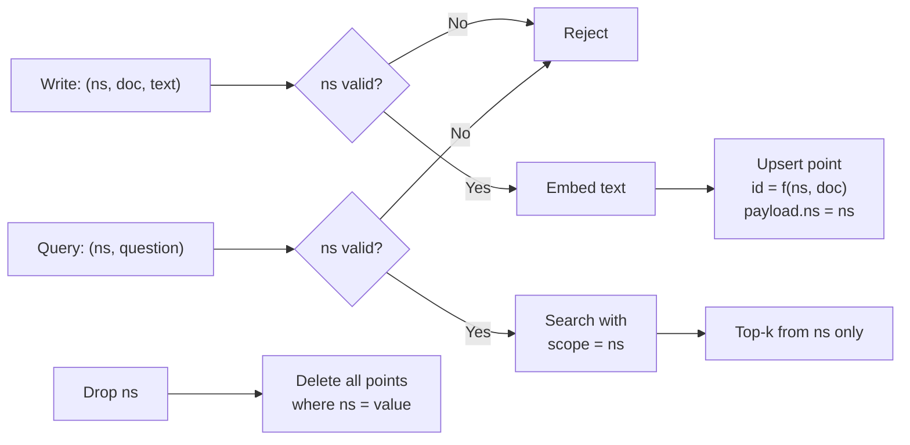

A [collection](/learn/advanced-vector-database-engineering/collections) is expensive to create and holds one vector contract. Most RAG systems, though, need finer divisions than that: the HR handbook versus the IT runbooks, English documents versus German ones, this customer's data versus that one's. A **namespace** is a named partition inside a collection. Every write puts a point into exactly one namespace, and every query searches exactly one, so a namespace behaves like a small collection of its own while sharing the parent's configuration and overhead.

This lesson explains what a namespace is, how different products implement it (as a real physical partition, or as a mandatory filter on a shared index), how to choose the key you partition by, how to search across several namespaces correctly, and what a namespace does and does not guarantee. Using namespaces to separate customers, with all the isolation and fairness questions that raises, is the subject of [Multi-tenancy](/learn/advanced-vector-database-engineering/multi-tenancy); this lesson is about the partitioning primitive itself.

## Learning objectives

- Define a namespace and distinguish it from a separate collection and from an ordinary metadata filter.
- Compare physical and logical implementations of namespaces and predict how each behaves for query cost, deletion and small partitions.
- Choose a namespace key for a given corpus and justify it against the criteria of query-time availability, stability and granularity.
- Implement a fan-out query across several namespaces and prove that merging per-namespace top-k lists gives the exact global top-k.
- Explain why a namespace is not, by itself, an access-control boundary.

## Prerequisites

- [Collections](/learn/advanced-vector-database-engineering/collections): the vector contract, fixed per-collection overhead, and aliases.
- [Metadata](/learn/vector-database-fundamentals/metadata) and [Filtering](/learn/vector-database-fundamentals/filtering): payload fields and filtered search.
- [Similarity search](/learn/vector-database-fundamentals/similarity-search): top-k selection and score scales.
- [Pinecone](/learn/vector-database-ecosystem/pinecone) and [Qdrant](/learn/vector-database-ecosystem/qdrant), whose approaches this lesson contrasts.

## Why this matters

Without partitions, a collection is one undivided pool, and every query competes against every point. That causes three kinds of trouble.

**Wrong-scope answers.** A question about the expense policy retrieves a product-documentation chunk that happens to mention "expenses" in a feature description. Nothing is technically broken; the right scope was simply never expressed. If the application knows the question is about HR policy, it should be able to say "search only the handbook" in a way that cannot be forgotten.

**Expensive bulk operations.** The product documentation team re-publishes its whole corpus every night. Without a partition, "delete everything from the product docs" is a filtered delete scanning the whole collection, and "how many product-docs chunks do we have?" is a filtered count. With a partition, both are operations on one named thing.

**Collection sprawl.** The obvious alternative, a collection per corpus or per customer, works for five partitions and fails at five thousand, because every collection carries fixed overhead (see [Collections](/learn/advanced-vector-database-engineering/collections)). Namespaces give most of the separation at a fraction of the cost.

The reverse failures matter too. Partition too finely and cross-partition questions need dozens of queries; treat a namespace as a security boundary while taking it from user input and you have no boundary at all.

## The intuition

Picture the filing room at Meridian. One way to organise it is a single enormous drawer in which every folder has a coloured sticker: blue for HR, green for IT, orange for product. To find an HR folder, you leaf through the drawer and skip anything without a blue sticker. That is a **filter**: correct if you remember to look at the stickers, and slow if the drawer is huge and the blue folders are few.

Another way is a cabinet with labelled drawers: HR, IT, Product. To find an HR folder, you open the HR drawer and never see anything else. Emptying the product drawer is one action. That is a **namespace**. The cabinet itself (its size, its lock, its location) is shared, which is what distinguishes a drawer from a separate cabinet, a **collection**.

A folder can be in only one drawer; moving it means taking it out and filing it elsewhere. And for "everything about laptops, whichever drawer", you open each drawer, pick the best few from each, and compare those piles.

## How it works

### Three levels of separation

| | Collection | Namespace | Metadata filter |
| --- | --- | --- | --- |
| Separates | Vector contracts, configurations, lifecycles | Partitions of one contract | Any subset, chosen per query |
| Specified | At creation | On every write and every query | Optionally, per query |
| Point can be in | One | Exactly one | Any number of matching subsets |
| Can be forgotten in a query? | No (the query names it) | No (the query must name it) | Yes |
| Typical count | Few | Up to many thousands, depending on product | Unlimited |
| Bulk delete | Drop collection | Drop namespace | Delete by filter |

The defining property is the middle row of the middle column: a namespace is **mandatory and exclusive**. A filter is an optional predicate; a namespace is part of the address.

### Physical and logical namespaces

Products implement namespaces in two quite different ways, and the difference shows up in cost and behaviour.

**Physical namespaces** store each partition in separate data structures: its own segments and its own index. A query touches only that namespace's data. Pinecone's namespaces are of this kind: every upsert, query and delete takes a `namespace` argument, a query cannot span namespaces, and Pinecone's documentation describes namespaces as the way to make queries cheaper and faster by limiting the records scanned. Weaviate's multi-tenancy, where each tenant is its own shard, and Milvus's partitions, which are physically separate sets of segments within a collection, are physical as well.

**Logical namespaces** store all points in one shared index and attach the namespace as a payload field that every query must filter on. Qdrant has no separate namespace object; its documented approach to partitioning many groups is exactly this, with a keyword payload index on the partition field. Since version 1.11, marking that index with `is_tenant=True` tells Qdrant to organise storage so that each partition's points sit together, which recovers much of the locality a physical partition gives. Qdrant also offers **custom sharding**, where a shard key routes points to dedicated shards, which is physical partitioning at the shard level and is covered in [Sharding](/learn/advanced-vector-database-engineering/sharding). In pgvector, a logical namespace is a column in the `WHERE` clause; PostgreSQL's table partitioning can make it physical.

The consequences:

| Behaviour | Physical | Logical |
| --- | --- | --- |
| Query cost | Proportional to the namespace's size | Depends on how well the engine executes a selective filter |
| Small namespaces | Tiny index; an exact scan is cheap and perfect | One small group inside a large shared graph |
| Dropping a namespace | Drop its files | Delete by filter: tombstones, then cleanup by the optimiser |
| Per-namespace overhead | Grows with the number of namespaces | Close to zero |
| Cross-namespace query | Must fan out | Possible as one filtered query (`ns IN [...]`) |
| Forgetting the namespace | Impossible at the API | Possible unless your code enforces it |

The last row is the reason for the code later in this lesson. With a logical implementation, the "mandatory" property of a namespace exists only if your data-access layer makes it so.

How a logical namespace is executed when the filter is very selective, a small namespace inside a large collection, is a filtered-search problem; [Metadata filtering](/learn/advanced-vector-database-engineering/metadata-filtering) explains how engines plan it and why naive approaches lose recall.

### The write, query and delete paths



1. **Validate the namespace on every operation.** It must be present, a single value and one your system recognises. An empty namespace must be an error, not "search everything".
2. **Make the identifier namespace-aware.** If two namespaces can contain a document with the same identifier (both the handbook and the runbooks have a page called `overview`), derive the point id from both, for example a UUID computed from `ns/doc`. Otherwise an upsert in one namespace silently overwrites a point in another.
3. **Write the namespace into the point** (logical) or route the write to the partition (physical).
4. **Scope every query** to one namespace.
5. **Drop a namespace** as one operation; for logical namespaces, expect disk space to be reclaimed only when the optimiser merges segments (see [Vector storage](/learn/vector-database-fundamentals/vector-storage)).

### Choosing the namespace key

A namespace key is the field you partition by. Three tests decide whether a candidate is a good one.

- **It is known at query time.** The application must know which namespace to search before it searches. "Tenant" passes, because it comes from the authenticated session. "Topic" usually fails, because the topic is what you are trying to find out; partitioning by it forces a classifier in front of retrieval, and a misclassified question searches the wrong drawer and finds nothing.
- **It is stable.** A point cannot be in two namespaces, and moving it is a delete plus an insert. Keys that change (a document's review status, its owner after a reorganisation) belong in payload fields, not in namespaces.
- **It has the right granularity.** Too coarse and it does not narrow anything; too fine and most questions need a fan-out across many partitions. Per user is usually too fine when documents are shared: the same handbook would be copied into 400 namespaces.

Good keys in RAG systems are typically the **tenant** (for multi-customer products), the **corpus or source system** (handbook, runbooks, product docs) when queries are routed by an explicit choice in the interface, the **language**, and the **corpus version** during a rebuild. Bad keys are anything derived from content, anything that changes often, and anything a user can choose freely.

### Searching several namespaces

Some questions legitimately span partitions: "what do I do if my laptop is stolen?" might be answered partly by the handbook and partly by the runbooks. With physical namespaces the only way is a **fan-out**: query each namespace for its top $k$, then merge. With logical namespaces you can also run one query with a filter matching several values.

A fan-out is correct only if the scores being merged are comparable. Within one collection they are: the same model produced every vector and the same metric computed every score. Across collections with different models, merging by raw score is wrong and you need rank-based fusion such as [Reciprocal Rank Fusion](/learn/hybrid-search/reciprocal-rank-fusion). With approximate indexes, per-namespace results carry each namespace's own approximation error, so the merged list is as good as the per-namespace searches, no better.

### Namespaces as versions

Namespaces have no aliases. That matters when a namespace is rebuilt wholesale, for example when the product-docs corpus is re-published. "Drop, then reload" leaves a window in which the namespace is empty and every product question gets no context. The fix is the same indirection as for collections, one level down: load the new data into a **versioned namespace** (`products@2026-11-14`), keep a small mapping from logical name to current version in your application's configuration or database, switch the mapping once loading is verified, and drop the old version afterwards. The full pattern for incremental and wholesale rebuilds is in [Index updates](/learn/advanced-vector-database-engineering/index-updates).

## The mathematics

### Merging per-namespace results is exact

**Intuition.** If a point is among the best $k$ overall, it must be among the best $k$ of its own namespace, because its namespace is a subset of everything. So the union of each namespace's top $k$ cannot miss any of the global top $k$.

Let the collection's points be split into disjoint namespaces $P_1, \dots, P_m$. Let $T$ be the global top $k$ for a query and $T_j$ the top $k$ within $P_j$. The claim is

$$
T \subseteq \bigcup_{j=1}^{m} T_j
$$

Suppose a point $x \in T$ lies in namespace $P_j$ but is not in $T_j$. Then $P_j$ contains $k$ points scoring higher than $x$ (ties aside). Those $k$ points are also in the whole collection, so $x$ would have at least $k$ points above it globally and could not be in $T$. Contradiction. Hence sorting the union of the $T_j$ and keeping the first $k$ gives exactly $T$, for exact search.

The union has at most $m k$ candidates, and you need the full $k$ from **each** namespace. Asking each of three namespaces for $k/3$ results is wrong, because the global top $k$ may all come from one namespace.

**By hand.** Three namespaces, $k = 2$. Handbook top 2: scores 0.25 and 0.18. Runbooks: 0.50 and 0.45. Products: 0.12 and 0.10. The union has six candidates; sorted, the first two are 0.50 and 0.45, both from the runbooks. Asking each namespace for only one result would have returned 0.50 and 0.25, losing the second-best chunk overall.

### What scoping saves

For an exact scan, the work per query is proportional to the number of points examined. A collection of $N$ points split into namespaces of sizes $n_1, \dots, n_m$ costs $N$ comparisons unscoped and $n_j$ scoped to a physical namespace $j$. A fan-out over a set $S$ of namespaces costs $\sum_{j \in S} n_j$, plus $|S|$ fixed per-request overheads, which is why fan-outs over hundreds of small namespaces are dominated by overhead rather than by vector arithmetic.

```python
# The merge argument and the cost of scoping, in numbers
per_ns = {"handbook": [0.25, 0.18], "runbooks": [0.50, 0.45], "products": [0.12, 0.10]}
k = 2
union = sorted(((s, ns) for ns, scores in per_ns.items() for s in scores[:k]), reverse=True)
print("full-k merge :", union[:k])
one_each = sorted(((scores[0], ns) for ns, scores in per_ns.items()), reverse=True)
print("1 per ns     :", one_each[:k])

N, sizes = 1_000_000, {"handbook": 40_000, "runbooks": 160_000, "products": 800_000}
for ns, n in sizes.items():
    print(f"scoped to {ns:<9} examines {n / N:6.1%} of the collection")
```

```output
full-k merge : [(0.5, 'runbooks'), (0.45, 'runbooks')]
1 per ns     : [(0.5, 'runbooks'), (0.25, 'handbook')]
scoped to handbook  examines   4.0% of the collection
scoped to runbooks  examines  16.0% of the collection
scoped to products  examines  80.0% of the collection
```

## In code

**The problem.** Qdrant has no namespace object, so build one: a thin data-access class over a single collection in which every operation must name exactly one namespace, identifiers cannot collide across namespaces, fan-out queries merge correctly, and a namespace can be counted and dropped as a unit.

**Dependencies.** `qdrant-client` and `sentence-transformers`. It runs in Qdrant's embedded `:memory:` mode.

```bash
pip install qdrant-client sentence-transformers
```

```python
import uuid
from qdrant_client import QdrantClient, models
from sentence_transformers import SentenceTransformer

model = SentenceTransformer("sentence-transformers/all-MiniLM-L6-v2")
embed = lambda texts: model.encode(texts, normalize_embeddings=True).tolist()

class NamespacedCollection:
    """One Qdrant collection, partitioned by a mandatory `ns` payload field."""

    def __init__(self, client, name, dim):
        self.client, self.name = client, name
        client.create_collection(name, vectors_config=models.VectorParams(
            size=dim, distance=models.Distance.COSINE))
        # On a server, is_tenant=True tells Qdrant to co-locate each namespace's
        # points; embedded mode accepts the call but does not build indexes.
        client.create_payload_index(name, field_name="ns", field_schema=models.KeywordIndexParams(
            type=models.KeywordIndexType.KEYWORD, is_tenant=True))

    @staticmethod
    def _scope(ns):
        if not ns or not isinstance(ns, str):
            raise ValueError("every operation needs exactly one namespace")
        return models.Filter(must=[models.FieldCondition(key="ns", match=models.MatchValue(value=ns))])

    def upsert(self, ns, doc_ids, texts):
        self._scope(ns)                                   # validate before writing
        points = [models.PointStruct(
                      id=str(uuid.uuid5(uuid.NAMESPACE_URL, f"{ns}/{d}")),  # id unique per namespace
                      vector=v, payload={"ns": ns, "doc": d, "text": t})
                  for d, t, v in zip(doc_ids, texts, embed(texts))]
        self.client.upsert(self.name, points=points)

    def query(self, ns, question, k=2):
        hits = self.client.query_points(self.name, query=embed([question])[0],
                                        query_filter=self._scope(ns), limit=k).points
        return [(h.payload["ns"], h.payload["doc"], round(h.score, 3)) for h in hits]

    def query_many(self, namespaces, question, k=2):
        merged = [hit for ns in namespaces for hit in self.query(ns, question, k)]
        return sorted(merged, key=lambda h: -h[2])[:k]     # same model, so scores are comparable

    def count(self, ns):
        return self.client.count(self.name, count_filter=self._scope(ns), exact=True).count

    def drop(self, ns):
        self.client.delete(self.name, points_selector=models.FilterSelector(filter=self._scope(ns)))

store = NamespacedCollection(QdrantClient(":memory:"), "askmeridian_minilm_v2", dim=384)
store.upsert("handbook", ["leave", "remote", "expenses"], [
    "Annual leave is 25 days; up to 5 unused days carry over and must be used by 31 March.",
    "Staff may work remotely up to 3 days a week; the home-office budget is £400.",
    "Expenses must be submitted within 30 days; anything over £75 needs a receipt."])
store.upsert("runbooks", ["password", "laptop", "desk"], [
    "Passwords must be rotated every 90 days. VPN is required on public Wi-Fi.",
    "Laptops are refreshed every 3 years. Report a lost laptop to the support desk at once.",
    "The support desk is open 08:00 to 18:00 UK time."])
store.upsert("products", ["reports-export", "reports-sso"], [
    "Meridian Reports can export any report as PDF or CSV.",
    "Meridian Reports supports SAML single sign-on on the Enterprise plan."])

q = "How often do I have to change my password?"
print("handbook only :", store.query("handbook", q))
print("runbooks only :", store.query("runbooks", q))
print("fan-out (all) :", store.query_many(["handbook", "runbooks", "products"], q))
print("counts        :", {ns: store.count(ns) for ns in ["handbook", "runbooks", "products"]})

store.drop("products")
print("after drop    :", {ns: store.count(ns) for ns in ["handbook", "runbooks", "products"]})
try:
    store.query("", q)
except ValueError as exc:
    print("refused       :", exc)
```

```output
handbook only : [('handbook', 'leave', 0.251), ('handbook', 'remote', 0.177)]
runbooks only : [('runbooks', 'password', 0.495), ('runbooks', 'laptop', 0.217)]
fan-out (all) : [('runbooks', 'password', 0.495), ('handbook', 'leave', 0.251)]
counts        : {'handbook': 3, 'runbooks': 3, 'products': 2}
after drop    : {'handbook': 3, 'runbooks': 3, 'products': 0}
refused       : every operation needs exactly one namespace
```

Running it also prints a `UserWarning` from qdrant-client: payload indexes have no effect in embedded mode. That is expected; the `create_payload_index` call is there because on a Qdrant server it is what makes a logical namespace efficient.

**The important lines.**

- `_scope(ns)` is the single place that turns a namespace into a filter, and it refuses empty or non-string values. Every read, count and delete goes through it, so "forgot the namespace" cannot happen through this class. That is the whole point of the wrapper: a logical namespace is only mandatory if the access layer makes it so.
- `uuid.uuid5(uuid.NAMESPACE_URL, f"{ns}/{d}")` derives a deterministic point id from the namespace and the document id. Re-upserting the same document in the same namespace replaces it; the same document id in another namespace gets a different point. (`uuid.NAMESPACE_URL` is just a fixed seed for UUID version 5; it has nothing to do with our namespaces.)
- `query_many` asks every namespace for the full `k` and merges by score, exactly as the proof above requires. It is valid because all namespaces share one collection, so one model and one metric.
- `drop` deletes by a filter selector. On a server, the points become tombstones and disk space returns when segments are merged.

**What the output means.** The handbook-scoped query cannot find the password policy, because it is not in the handbook; it returns the best handbook chunks, with low scores (0.251 and 0.177). That is the namespace doing its job and also showing its risk: scope a question to the wrong namespace and you get a confident-looking but irrelevant answer. The runbooks scope finds the right chunk at 0.495. The fan-out merges six candidates and returns the global best two. The counts confirm that each namespace is separately addressable, and the drop removes exactly the two product chunks and nothing else. Finally, an empty namespace is refused rather than treated as "everything".

**Errors people commonly hit.**

- Using the document id directly as the point id. Two namespaces with a document called `overview` then overwrite each other, and the loss is silent.
- Fanning out with `k // m` per namespace to "keep the total at k". The merge then misses results whenever the best ones cluster in one namespace.
- Building the scope filter from a request parameter in a multi-customer system. The namespace must come from the authenticated identity on the server.

**Extending it.** Add versioned namespaces: `upsert` writes to `products@v2`, a dictionary maps `products` to its current version, `query` resolves through it, and a `promote("products", "v2")` method switches the mapping and then drops the old version. Then compare a fan-out with a single query using `models.MatchAny(any=[...])` on the `ns` field and confirm that they return the same results.

For contrast, Pinecone's namespaces are native. The following uses the Pinecone Python SDK's documented calls; it needs an API key and an existing index, and was not executed for this lesson.

```python
import os
from pinecone import Pinecone

pc = Pinecone(api_key=os.environ["PINECONE_API_KEY"])
index = pc.Index("askmeridian")          # an existing 384-dimension cosine index

index.upsert(namespace="runbooks", vectors=[
    {"id": "password", "values": password_vector, "metadata": {"text": password_text}},
])
result = index.query(namespace="runbooks", vector=query_vector, top_k=2, include_metadata=True)
print(index.describe_index_stats())      # includes a per-namespace record count
index.delete(namespace="products", delete_all=True)   # drop one namespace
```

## A real-world example

When the Platform team added the product documentation for Meridian Sync, Meridian Relay and Meridian Reports to AskMeridian, they partitioned the collection into three logical namespaces: `handbook` (owned by HR), `runbooks` (IT) and `products` (the documentation team). The interface let staff pick "HR & policies", "IT help" or "Products", and the choice mapped directly to a namespace. That passed all three key tests: known at query time, stable, and coarse enough to avoid copying documents.

Two problems surfaced in the first month. The first was the nightly re-publication of product docs: the ingestion job dropped `products` and reloaded it, which took about twenty minutes, and support engineers working late saw "I don't know" for every product question during that window. Lena, the engineer who owned ingestion, switched to versioned namespaces (`products@2026-10-03`) with the current version recorded in the application's configuration table; the job now loads the new version beside the old one, runs smoke queries, flips the pointer and drops the previous version.

The second was a question that spanned partitions. "My laptop was stolen with Meridian Sync logged in, what do I do?" needs the runbook on lost laptops and the Sync documentation on revoking sessions, but staff had chosen "IT help". The team added an "all sources" option that fans out to the three namespaces with the full $k$ each and merges by score, which the proof above shows is safe within one collection. They kept the scoped options as the default, because most questions do belong to one source and scoping keeps unrelated chunks out of the context.

## Common mistakes

- **Partitioning by a key that is not known at query time.** A classifier must then guess the namespace, and every wrong guess searches a partition that cannot contain the answer.
- **Letting an empty or missing namespace mean "all".** One code path that forgets the namespace silently searches everything, which in a multi-customer system is a data leak.
- **Point ids that ignore the namespace.** Same-named documents in different namespaces overwrite one another.
- **Fan-outs with a reduced k per namespace.** Results concentrated in one namespace are lost.
- **Merging scores across collections with different models.** Fan-out by raw score is only valid when one model and metric produced every score.
- **Drop-then-reload rebuilds.** The namespace is empty, or half full, while the reload runs.
- **Copying shared documents into many namespaces.** Per-user partitions duplicate the handbook hundreds of times.

## Best practices

- Enforce the namespace in one data-access layer that every read, write and delete goes through, and reject empty values.
- Derive point ids from namespace and document id together.
- On Qdrant, index the namespace field as a keyword index with `is_tenant=True`, created before loading data.
- Version namespaces that are rebuilt wholesale, and switch with a pointer rather than drop-then-reload.
- Fan out with the full $k$ per namespace, cap the number of namespaces a single query may touch, and use rank fusion if the namespaces' scores are not comparable.
- Monitor per-namespace counts; a namespace whose count drops sharply after ingestion is the first sign of a failed load.

## Performance considerations

**Scoping is a large saving with physical partitions and a variable one with logical ones.** In the arithmetic above, scoping to a 40,000-point handbook namespace in a million-point collection examines 4% of the data with physical partitions. With a logical namespace in a shared graph index, the cost depends on how the engine executes a filter that admits 4% of points; [Metadata filtering](/learn/advanced-vector-database-engineering/metadata-filtering) shows why highly selective filters are the hard case and how engines handle them.

**Fan-out cost is per-request overhead times the number of namespaces.** If each query has an assumed fixed overhead of 2 ms (network, parsing, scheduling) and a scoped search over a small namespace takes an assumed 1 ms, a fan-out over 3 namespaces costs about 9 ms sequentially and closer to 3 ms if sent in parallel. Over 300 namespaces, even in parallel, you are bound by connection limits and the slowest of 300 responses. If queries routinely span most namespaces, your partition key is too fine.

**Skew changes the picture.** Real partitions follow a skewed distribution: a few namespaces hold most points. A physical design gives the giant namespace its own large index, which is fine, and gives thousands of tiny ones tiny indexes whose overhead dominates. A logical design handles the long tail cheaply but leans on filtered search for the small namespaces. Many systems end up hybrid: a logical partition for the long tail and dedicated physical partitions (or shards) for the few largest, which is a [Multi-tenancy](/learn/advanced-vector-database-engineering/multi-tenancy) design question.

**Logical drops are not free.** Dropping a 200,000-point logical namespace writes 200,000 tombstones and leaves segments to rewrite; schedule it off-peak.

## Security considerations

A namespace scopes a query; it does not authenticate anyone. If the namespace value comes from a request parameter, any user can ask for any namespace. In any system where namespaces separate data that different people may not all read, the namespace must be derived on the server from the authenticated identity, and the data-access layer must make unscoped queries impossible, as the class above does. Logical namespaces add one more risk: the separation exists only in your code, so a single query path that bypasses the access layer (an admin script, a debugging endpoint, a framework integration that calls the client directly) sees every partition. Restrict raw database credentials to the access layer and to operators. Isolation between customers, including noisy-neighbour effects and per-tenant encryption, is treated in [Multi-tenancy](/learn/advanced-vector-database-engineering/multi-tenancy) and [Tenant isolation](/learn/access-control-and-privacy/tenant-isolation).

## Summary

- A namespace is a mandatory, exclusive partition inside a collection: every write and query names exactly one, and the partitions share the collection's contract and overhead.
- Physical namespaces (Pinecone, Milvus partitions, Weaviate tenants) store partitions separately; logical namespaces (Qdrant's payload-based partitioning) share one index and rely on a mandatory filter.
- A good key is known at query time, stable and coarse enough; tenant, source system, language and corpus version are typical.
- Merging each namespace's full top $k$ by score gives the exact global top $k$ when one model and metric produced all scores.
- Version namespaces that are rebuilt wholesale, and never treat a namespace as an access-control boundary unless it is derived from the authenticated identity.

## Exercises

**1.** For each candidate namespace key in AskMeridian, say whether it passes the three tests and why: (a) document language; (b) "topic", predicted by a classifier from the question; (c) the employee's id; (d) source system.

<details><summary>Show solution</summary>

(a) **Passes** if the interface or the user's profile determines the language at query time; stable; coarse. (b) **Fails** "known at query time": it depends on a prediction, and a wrong prediction searches a partition without the answer. Use a payload filter or a boost instead. (c) **Fails** granularity: handbook chunks would be copied into 400 namespaces. Per-user permissions belong in filters on access-control fields. (d) **Passes** when the interface lets users pick a source, which is AskMeridian's design.

</details>

**2.** Three namespaces return these top-3 scores for a query: A = [0.81, 0.79, 0.77], B = [0.64, 0.60, 0.41], C = [0.83, 0.52, 0.50]. Give the global top 3, and the result a buggy fan-out that takes one per namespace would return.

<details><summary>Show solution</summary>

The union sorted: 0.83 (C), 0.81 (A), 0.79 (A), 0.77 (A), 0.64 (B), and so on. Global top 3: **0.83 C, 0.81 A, 0.79 A**. One per namespace gives 0.83 C, 0.81 A and 0.64 B, replacing the third-best result (0.79) with one that ranks fifth.

</details>

**3.** Extend `NamespacedCollection` with versioned namespaces: `load(logical, version, doc_ids, texts)`, `promote(logical, version)` and `query` that resolves a logical name to its current version. The previous version must be dropped only after the promotion.

<details><summary>Show solution</summary>

```python
class VersionedNamespaces(NamespacedCollection):
    def __init__(self, client, name, dim):
        super().__init__(client, name, dim)
        self.current = {}                       # logical name -> physical namespace

    def load(self, logical, version, doc_ids, texts):
        self.upsert(f"{logical}@{version}", doc_ids, texts)

    def promote(self, logical, version):
        new = f"{logical}@{version}"
        if self.count(new) == 0:
            raise ValueError(f"{new} is empty; refusing to promote")
        old = self.current.get(logical)
        self.current[logical] = new             # queries switch here
        if old and old != new:
            self.drop(old)

    def query(self, ns, question, k=2):
        return super().query(self.current.get(ns, ns), question, k)
```

In production, `current` lives in a database table read on each request (or cached briefly), not in process memory, so every application instance switches together. Results from `query` report the physical namespace (`products@v2`), which is useful in logs.

</details>

**4.** Design decision. A Meridian customer-facing product will index each customer's support tickets. There will be about 3,000 customers; the largest 10 hold 60% of all tickets, and most others hold a few hundred. Propose a partitioning design and justify it.

<details><summary>Show solution</summary>

One collection (one model, one contract), partitioned by customer. Use a logical namespace, a keyword field indexed as a tenant key, for the long tail of small customers: thousands of physical partitions would mostly be overhead, and a small customer's few hundred points are cheap to search exactly once the engine narrows to them. Give the ten largest customers dedicated physical placement (a shard key in Qdrant's custom sharding, or dedicated partitions in other products), so their large indexes do not dominate shared segments and can be scaled independently. The customer id comes from the authenticated session only, and one access layer enforces it. [Multi-tenancy](/learn/advanced-vector-database-engineering/multi-tenancy) and [Sharding](/learn/advanced-vector-database-engineering/sharding) develop both halves.

</details>

## Check your understanding

```quiz
[
  {
    "q": "What most distinguishes a namespace from an ordinary metadata filter?",
    "options": [
      "A namespace can hold more points",
      "A namespace uses a different similarity metric",
      "Every write and every query must name exactly one namespace, and a point belongs to only one",
      "Filters only work on numeric fields"
    ],
    "answer": 2,
    "why": "A namespace is part of a point's address: mandatory and exclusive. A filter is an optional predicate that any query can omit."
  },
  {
    "q": "A fan-out query over 4 namespaces needs the global top 8. How many results should it request from each namespace?",
    "options": [
      "2, so that the total is 8",
      "8 from each, then merge and keep the best 8",
      "1 from each, then repeat",
      "32 from the largest namespace only"
    ],
    "answer": 1,
    "why": "Any of the global top 8 is in its own namespace's top 8, so the union of each namespace's full top 8 contains the answer. Fewer per namespace can miss results concentrated in one namespace."
  },
  {
    "q": "A team rebuilds a namespace nightly by deleting it and reloading it. What is the main problem?",
    "options": [
      "Queries during the reload see an empty or partial namespace",
      "Deleting a namespace changes the collection's metric",
      "Namespaces cannot be deleted in any product",
      "The reload doubles the vector dimension"
    ],
    "answer": 0,
    "why": "Drop-then-reload creates a window with no data. Loading a versioned namespace beside the old one and switching a pointer avoids it."
  },
  {
    "q": "Two namespaces both contain a document with id `overview`, and the point id is set to the document id. What happens?",
    "options": [
      "The database rejects the second write",
      "Both points coexist because namespaces are separate",
      "The database merges the two payloads",
      "In a logical design, the second upsert overwrites the first point silently"
    ],
    "answer": 3,
    "why": "Point ids are unique per collection. A logical namespace is just a payload field, so the same id means the same point. Derive ids from namespace and document id together."
  },
  {
    "q": "Which namespace key is the worst choice for an internal assistant?",
    "options": [
      "The source system chosen in the interface",
      "A topic predicted from the question by a classifier",
      "The document language",
      "The corpus version during a rebuild"
    ],
    "answer": 1,
    "why": "The key must be known before searching. A predicted topic can be wrong, and a wrong namespace cannot contain the answer."
  }
]
```

## Further reading

- Pinecone documentation, [docs.pinecone.io](https://docs.pinecone.io/): namespaces, and their role in scoping queries and deletes.
- Qdrant documentation, [Multitenancy](https://qdrant.tech/documentation/guides/multiple-partitions/): payload-based partitioning, the `is_tenant` index option and custom sharding.
- Milvus documentation, [milvus.io/docs](https://milvus.io/docs): partitions and the partition key.
- Weaviate documentation, [docs.weaviate.io](https://docs.weaviate.io/): multi-tenancy, with one shard per tenant.
- PostgreSQL documentation, [Table partitioning](https://www.postgresql.org/docs/current/ddl-partitioning.html): how a logical key becomes a physical partition in a relational database.
