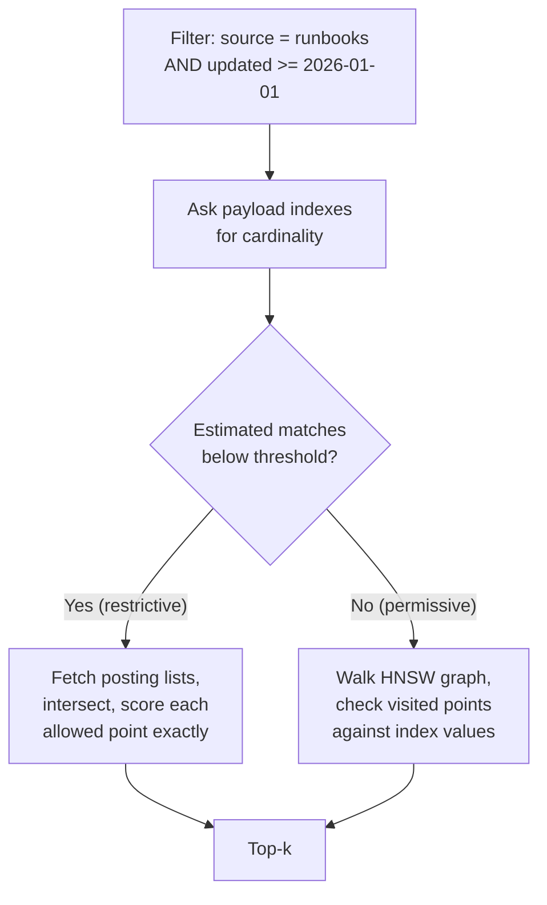

A vector index answers one question: which stored vectors are close to this one? Real RAG queries almost always add a second: *and which of them satisfy these conditions?* Only runbooks, only English, only documents updated this year, only what this user may read. A **payload index** is the data structure that answers the second question quickly. It is a secondary index over a payload field, the same idea as an index on a column in a relational database, built beside the vector index and consulted whenever a filter mentions that field.

[Metadata](/learn/vector-database-fundamentals/metadata) covered what to put in a payload and [Filtering](/learn/vector-database-fundamentals/filtering) covered what a filtered query means. This lesson goes inside the engine: what structures a payload index is made of, which index type suits which field, what an index costs in memory and build time, how indexes give the query planner the numbers it needs, and why in Qdrant you should create them before you load your data. How the planner uses those numbers to execute a filtered vector search is the subject of the next lesson, [Metadata filtering](/learn/advanced-vector-database-engineering/metadata-filtering).

## Learning objectives

- Explain how inverted (keyword), sorted (range), full-text and geo indexes find the points matching a condition, and what each costs.
- Choose an index type, or no index, for a given payload field from its type, cardinality and how it is queried.
- Compute the memory of a keyword index stored as sorted id lists and as bitmaps, and find the selectivity at which one beats the other.
- Explain the three ways a vector database uses payload indexes during a filtered search, including cardinality estimation.
- Create payload indexes in Qdrant with the right schema and options, at the right point in a collection's life.

## Prerequisites

- [Metadata](/learn/vector-database-fundamentals/metadata) and [Filtering](/learn/vector-database-fundamentals/filtering): payload design and the meaning of filtered search.
- [Vector storage](/learn/vector-database-fundamentals/vector-storage): internal offsets, segments and payload storage beside vector storage.
- [HNSW](/learn/vector-indexing-algorithms/hnsw): the graph index that filters must cooperate with.
- [Collections](/learn/advanced-vector-database-engineering/collections) and [Namespaces](/learn/advanced-vector-database-engineering/namespaces).

## Why this matters

Without a payload index, the database has only two ways to apply a filter, and both are bad at scale.

It can **check each candidate as it goes**: during the vector search, every point the search visits has its payload read and tested. That is cheap for permissive filters, but payloads are often on disk (see [Vector storage](/learn/vector-database-fundamentals/vector-storage)), so each check may be a disk read, and a restrictive filter makes the search visit many points to find a few that pass.

Or it can **scan every payload** to build the set of matching points first. That is a full table scan on every query: a million payloads read to answer "documents from the runbooks".

Worse, without an index the engine cannot cheaply *estimate* how many points a filter matches, so it cannot choose between strategies. It is planning blind. In practice the symptoms are filtered queries that are much slower than unfiltered ones, latency that varies wildly with the filter value, and, in engines that fall back to approximate strategies, filtered queries that silently return fewer or worse results. A missing payload index is one of the most common causes of "vector search is slow" reports that turn out to have nothing to do with vectors.

## The intuition

A payload index is the index at the back of a book. To find every page that mentions "carry-over", you do not read the book; you look up "carry-over" in the index and get a list of page numbers. Looking up the word takes seconds however long the book is, and the length of the list tells you at once whether the topic is mentioned twice or two hundred times.

Two refinements carry over directly. A book index works for words; for questions like "all pages between 120 and 150" you need the pages to be in order, which they are. That is the difference between a **keyword index** (look up a value, get a list) and a **range index** (values kept in sorted order, so a range is two lookups). And an index is extra pages: it costs paper, and the publisher must update it whenever the text changes. Nobody indexes every word, only the ones readers will look up.

## How it works

### Internal ids and posting lists

Inside each segment, points are numbered with dense **internal offsets** 0, 1, 2, and so on, as [Vector storage](/learn/vector-database-fundamentals/vector-storage) described. Payload indexes work entirely in these offsets. A set of matching points is represented in one of two ways:

- a **sorted list of offsets**, for example `[3, 17, 42, 1050]`, costing 4 bytes per matching point with 32-bit offsets; or
- a **bitmap**: one bit per point in the segment, set to 1 if the point matches, costing $N/8$ bytes regardless of how many match.

Sorted lists suit rare values; bitmaps suit common ones. **Roaring bitmaps**, used by many search and database engines (Weaviate's filter index among them), choose per block of 65,536 ids: a block with at most 4,096 members is stored as a sorted array of 16-bit values, and a denser block as a 8 KB bitmap, so each region of the id space gets the cheaper representation. Intersection (AND) and union (OR) of two sets are then fast merges of sorted lists or word-by-word bitwise operations.

### Index types

**Keyword (inverted) index.** A map from each distinct value to the set of points holding it. `source = "runbooks"` is one map lookup that returns the posting list. A field holding a list of values (`tags: ["vpn", "security"]`) puts the point in several posting lists, which is how "match any element" semantics are implemented. The number of entries in a posting list is the exact count of matching points, available without touching a single payload. Suitable for categorical fields: source, department, language, document id, tenant, access group.

**Numeric and datetime (range) indexes.** Values are kept sorted, together with the point id of each. A range condition `updated >= t1 AND updated < t2` is two binary searches to find the boundaries, and every entry between them matches. The count is the difference of the two positions. Qdrant's integer index has two independent capabilities, `lookup` (exact-value matching, like a keyword index) and `range`; you can disable whichever you do not use to save memory. Floats and datetimes get range indexes.

**Full-text index.** The field is tokenised (split into words, lower-cased, possibly with stemming or stop-word removal depending on the configuration), and each token gets a posting list. A text condition matches points that contain the query's tokens. This is filtering, not ranking: it answers "does this chunk contain the word *SAML*?", not "how relevant is it?". Ranked keyword search is the business of [BM25](/learn/sparse-retrieval/bm25) and sparse vectors.

**Geo index.** Locations are mapped to cells of a hierarchical grid (Qdrant uses geohashes), and each cell has a posting list. A radius or bounding-box condition is converted into a set of covering cells; points in those cells are then checked exactly.

**Boolean and UUID indexes.** Specialised keyword indexes: a boolean index is two posting lists; a UUID index stores 16-byte identifiers more compactly than their 36-character string form.

| Qdrant schema | Supports | Typical RAG field |
| --- | --- | --- |
| `keyword` | exact match, match any, match except | `source`, `doc_id`, `tenant`, `acl_groups` |
| `integer` | exact match (`lookup`), ranges (`range`) | `version`, `page`, `year` |
| `float` | ranges | `quality_score` |
| `datetime` | ranges over timestamps | `updated_at`, `valid_until` |
| `bool` | exact match | `is_current`, `is_public` |
| `text` | token match | `title` |
| `geo` | radius, bounding box, polygon | `office_location` |
| `uuid` | exact match | `doc_uuid` |

Other products have the same families under different names. Weaviate builds a filterable inverted index (roaring bitmaps) per property by default and has separate settings for range filters and for searchable text; Milvus offers scalar index types such as `INVERTED`, `BITMAP` and `STL_SORT`; in pgvector you use ordinary PostgreSQL indexes (B-tree on columns, GIN on `jsonb`); Elasticsearch and OpenSearch index every mapped field by default. Pinecone manages metadata indexing for you.

### How the engine uses a payload index

During a filtered vector search, a payload index plays up to four roles.

1. **Producing the matching set.** For a restrictive filter, the engine fetches the posting lists, intersects them, and gets the exact set of allowed points. If that set is small, it can simply compute the similarity to each allowed point exactly, which is fast and has perfect recall.
2. **Estimating cardinality.** Before choosing a strategy, the planner asks the index "about how many points does this filter match?". For one condition this is exact and nearly free (the posting-list length, or the distance between two binary-search positions). For a combination, it is estimated from the parts.
3. **Checking a candidate.** When the engine instead walks the HNSW graph and tests each visited point against the filter, the test reads the field's value from the index's in-memory structures rather than parsing the payload from storage.
4. **Shaping the graph.** Qdrant's **filterable HNSW** builds extra graph links among points that share a value of an indexed keyword field (and for some numeric ranges), so that the subgraph of, say, `source = "runbooks"` stays connected even when it is a small part of the collection. These links are created when the HNSW graph is built, which is why Qdrant's documentation advises creating payload indexes *before* uploading data: an index created afterwards supports filtering immediately but does not add those links until the graph is rebuilt. The HNSW parameter `payload_m` controls how many such links are made.

How the planner chooses among these, and why graph traversal breaks down under restrictive filters, is covered in [Metadata filtering](/learn/advanced-vector-database-engineering/metadata-filtering).



### Two Qdrant options worth knowing

**`is_tenant`** (keyword and UUID indexes) tells Qdrant that the field partitions the data, as in [Namespaces](/learn/advanced-vector-database-engineering/namespaces). Qdrant then arranges storage so that each value's points are stored together, which makes reading one partition's vectors closer to sequential access.

**`is_principal`** (integer, float and datetime indexes) marks the field most queries filter on, typically a timestamp, so that storage is organised around it. Use at most one.

Both are documented as storage-layout optimisations for specific access patterns; they do not change which points a filter matches.

### The index lifecycle

1. **Decide the schema per field** before loading: which fields will be filtered, with what kind of condition.
2. **Create the indexes on the empty collection**, so that they are built incrementally with the data and, in Qdrant, the filterable graph links are built with the graph.
3. **Write payloads with consistent types.** An index declared as `integer` indexes integer values. A point whose `year` is the string `"2026"` is not in the index, so it never matches `year >= 2026`, and nothing reports an error.
4. **Add indexes later when needed.** Creating an index on a populated collection triggers a build over existing points; it is safe but costs time and, for the graph links, a rebuild.
5. **Remove indexes nobody uses.** Every index costs memory and slows writes.

## The mathematics

### Selectivity and the cost of finding matches

**Intuition.** The fraction of points a filter keeps decides almost everything about how it should be executed and stored.

$$
s = \frac{|M|}{N}
$$

$N$ is the number of points in the segment and $|M|$ the number matching the filter; $s$ is the filter's **selectivity**, between 0 and 1. (Some texts call a filter "highly selective" when $s$ is small; this lesson says **restrictive** to avoid ambiguity.)

Finding $M$ by scanning costs $N$ payload checks. With a keyword index it costs one lookup plus reading $|M|$ ids; with a range index, two binary searches of about $\log_2 N$ steps each plus $|M|$ ids. For a conjunction of conditions with posting lists $L_1, \dots, L_c$, merging sorted lists costs about $\sum_i |L_i|$, so the cost depends on the sizes of the individual lists, not only on the size of the final answer.

Combined cardinality is often estimated by assuming the conditions are **independent**:

$$
\widehat{|M|} = N \prod_{i=1}^{c} s_i
$$

where $s_i$ is the selectivity of condition $i$ alone. It is cheap and often roughly right, and it can be badly wrong when fields are correlated (German documents might be concentrated in one source).

### Sorted lists or bitmaps

**Intuition.** A sorted list pays per *matching* point; a bitmap pays per point in the segment. The list wins when few points match.

Memory for one value's posting set:

$$
B_{\text{list}} = 4\,|M| = 4\,s\,N \text{ bytes}, \qquad B_{\text{bitmap}} = \frac{N}{8} \text{ bytes}
$$

The two are equal when $4 s N = N / 8$, that is at $s = 1/32 \approx 3.1\%$. Below that selectivity a list is smaller; above it, a bitmap is. (Roaring bitmaps apply the same rule per block: $4{,}096 / 65{,}536 = 1/16$, because their arrays store 2-byte values.)

**By hand.** One million points.

- `source = "runbooks"` matches 250,000 ($s = 0.25$): list $4 \times 250{,}000 = 1{,}000{,}000$ bytes; bitmap $10^6 / 8 = 125{,}000$ bytes. The bitmap is 8 times smaller.
- `doc_id = "handbook-2026"` matches 120 points ($s = 0.00012$): list $480$ bytes; bitmap still 125,000 bytes, 260 times larger.

A low-cardinality field (a few values, each common) is bitmap territory; a high-cardinality field (many values, each rare) is list territory. The code below measures the first case.

## In code

**The problem.** Build a keyword index and a range index from scratch over 200,000 payloads, use them to answer a three-condition filter, and compare against a full scan: the matching set, the time, the cardinality estimates the index gives for free, and the memory of lists versus bitmaps.

**Dependencies.** NumPy only.

```bash
pip install numpy
```

```python
import time
import numpy as np

rng = np.random.default_rng(7)
N = 200_000
sources = np.array(["handbook", "runbooks", "products"])
langs = np.array(["en", "de", "fr"])

# Payloads as a database stores them: one small record per point.
payloads = [
    {"source": str(s), "lang": str(l), "updated": int(u)}
    for s, l, u in zip(
        rng.choice(sources, N, p=[0.10, 0.25, 0.65]),
        rng.choice(langs, N, p=[0.90, 0.07, 0.03]),
        rng.integers(20_200, 20_770, N),          # day numbers, roughly 2025 to mid-2026
    )
]

# ---- Build the indexes once (what create_payload_index does) -------------
def keyword_index(field):
    postings = {}
    for pid, p in enumerate(payloads):
        postings.setdefault(p[field], []).append(pid)
    return {v: np.array(ids, dtype=np.int32) for v, ids in postings.items()}   # sorted by construction

def range_index(field):
    values = np.array([p[field] for p in payloads], dtype=np.int32)
    order = np.argsort(values, kind="stable").astype(np.int32)
    return values[order], order                   # sorted values, and the point id of each

t0 = time.perf_counter()
idx_source, idx_lang = keyword_index("source"), keyword_index("lang")
upd_values, upd_ids = range_index("updated")
print(f"built 3 indexes in {time.perf_counter() - t0:.2f} s")

def lookup_range(lo, hi):
    a, b = np.searchsorted(upd_values, [lo, hi], side="left")   # two binary searches
    return np.sort(upd_ids[a:b])

# ---- Filter: source = runbooks AND lang = de AND updated in [20_700, 20_770) --
def by_scan():
    return [pid for pid, p in enumerate(payloads)
            if p["source"] == "runbooks" and p["lang"] == "de" and 20_700 <= p["updated"] < 20_770]

def by_index():
    parts = [idx_source["runbooks"], idx_lang["de"], lookup_range(20_700, 20_770)]
    parts.sort(key=len)                           # intersect the smallest lists first
    result = parts[0]
    for other in parts[1:]:
        result = np.intersect1d(result, other, assume_unique=True)
    return result.tolist()

for name, fn in [("full scan", by_scan), ("index", by_index)]:
    t0 = time.perf_counter()
    for _ in range(5):
        ids = fn()
    print(f"{name:<10} {len(ids):>5} matches  {(time.perf_counter() - t0) / 5 * 1000:8.2f} ms per filter")
assert by_scan() == by_index()

# ---- Cardinality estimates come free with the index -----------------------
est = {"source=runbooks": len(idx_source["runbooks"]), "lang=de": len(idx_lang["de"]),
       "updated>=20700": len(lookup_range(20_700, 20_770))}
for cond, n in est.items():
    print(f"  {cond:<16} {n:>7} points  selectivity {n / N:6.2%}")
indep = N * np.prod([n / N for n in est.values()])
print(f"  independence estimate for the AND: {indep:.0f} (true: {len(by_index())})")
print(f"  ids touched by the index plan: {sum(est.values()):,} versus {N:,} payloads read by the scan")

# ---- Memory: sorted id lists versus one bitmap per value ------------------
for field, index in [("source", idx_source), ("lang", idx_lang)]:
    lists = sum(arr.nbytes for arr in index.values())
    bitmaps = len(index) * N // 8
    print(f"{field:<7} {len(index)} values: id lists {lists / 1e3:7.1f} KB, bitmaps {bitmaps / 1e3:6.1f} KB")
```

```output
built 3 indexes in 0.08 s
full scan    410 matches     10.67 ms per filter
index        410 matches      1.71 ms per filter
  source=runbooks    50196 points  selectivity 25.10%
  lang=de            13828 points  selectivity  6.91%
  updated>=20700     24730 points  selectivity 12.37%
  independence estimate for the AND: 429 (true: 410)
  ids touched by the index plan: 88,754 versus 200,000 payloads read by the scan
source  3 values: id lists   800.0 KB, bitmaps   75.0 KB
lang    3 values: id lists   800.0 KB, bitmaps   75.0 KB
```

The timings are from one run on one laptop and will differ on your machine; the counts and sizes will not, because the seed is fixed.

**The important lines.**

- `keyword_index` walks the payloads once and appends each point id to its value's list. Because ids are visited in increasing order, every posting list comes out sorted, which is what makes merging cheap. This is the build cost an engine pays when you call `create_payload_index`.
- `range_index` sorts all values once and keeps, beside them, the id each value belongs to. `lookup_range` then needs only `np.searchsorted` (two binary searches) to find where the range starts and ends.
- `parts.sort(key=len)` intersects the smallest lists first, so intermediate results shrink as early as possible. Real engines do the same from their cardinality estimates.
- `np.intersect1d(..., assume_unique=True)` merges two sorted id arrays. Engines with bitmaps would do a bitwise AND instead.
- `len(idx_source["runbooks"])` is the exact number of points matching that condition, obtained without reading any payload. That is the cardinality estimate a planner uses.

**What the output means.**

- **Same answer, less work.** Both methods find the same 410 points (the `assert` checks it). The scan read all 200,000 payloads; the index plan touched 88,754 ids in three arrays and never read a payload. On this machine that was about six times faster with the payloads in RAM as Python dictionaries, the most favourable case for scanning. With payloads on disk the gap grows enormously, because every scanned payload is a read.
- **Cardinality for free.** Each single-condition count is exact. The independence estimate for the AND, 429, is close to the true 410 because the synthetic fields were generated independently. With correlated real fields the estimate can be off by a large factor in either direction.
- **Bitmaps win for common values.** Every point appears in exactly one `source` list and one `lang` list, so each field's lists total $200{,}000 \times 4 = 800$ KB, while three bitmaps cost $3 \times 200{,}000 / 8 = 75$ KB. Every value here except `lang = "fr"` (about 3%) is above the 1/32 crossover.

**Errors people commonly hit.**

- Assuming an index was used. In a real database, check the documentation's tools for inspecting a collection's payload schema (in Qdrant, `get_collection(...).payload_schema`) and confirm the field and its type are listed.
- Indexing a field with one type and writing another. A string `"2026"` in an integer-indexed field is invisible to range filters.
- Forgetting that list fields multiply the index size: a point with five tags appears in five posting lists.

**Extending it.** Replace the posting lists for `source` with Python integers used as bitmaps (`bit = 1 << pid`) or with NumPy boolean arrays, and implement the AND as a bitwise operation. Then add a `doc_id` field with 20,000 distinct values and confirm that lists beat bitmaps for it, as the crossover predicts.

### The same thing in Qdrant

In Qdrant, the indexes are declared per field. The calls below are written against qdrant-client's current models for a Qdrant server. In the embedded `:memory:` mode they are accepted with a warning that payload indexes have no effect, so they were not exercised for this lesson.

```python
from qdrant_client import QdrantClient, models

client = QdrantClient(url="http://localhost:6333")
name = "askmeridian_minilm_v2"

client.create_payload_index(name, field_name="source",
    field_schema=models.KeywordIndexParams(type=models.KeywordIndexType.KEYWORD))
client.create_payload_index(name, field_name="tenant",
    field_schema=models.KeywordIndexParams(type=models.KeywordIndexType.KEYWORD, is_tenant=True))
client.create_payload_index(name, field_name="updated_at",
    field_schema=models.DatetimeIndexParams(type=models.DatetimeIndexType.DATETIME, is_principal=True))
client.create_payload_index(name, field_name="version",
    field_schema=models.IntegerIndexParams(type=models.IntegerIndexType.INTEGER, lookup=True, range=False))

print(client.get_collection(name).payload_schema)   # confirm what is indexed, and as which type
```

The `version` index keeps exact-match lookup and drops range support, because the application only ever asks for `version = 3`. `updated_at` is the principal field because almost every query restricts it.

## A real-world example

After AskMeridian added the product documentation, the Platform team noticed that queries with the interface's "updated in the last 90 days" toggle took several times longer than the same queries without it, and the slowdown was worst for the smallest sources. Unfiltered and source-only queries were fine.

Aisha, on call that week, compared the collection's payload schema with the filters the application sent. `source` and `tenant` had keyword indexes. `updated_at` had none: it had been added to the payload in a later ingestion release, and nobody had added an index for it. Every date-filtered query therefore had to check the date against payloads as it went, and for small sources (few matching points) the search visited many points to find enough that passed. She also found a second problem: the older ingestion path wrote `updated_at` as a date string while the newer one wrote an RFC 3339 timestamp, so a datetime index would have silently excluded part of the corpus.

The fix took three steps. The team normalised every `updated_at` to one timestamp format with a back-fill using `set_payload`, created a datetime index marked as principal, and, because the collection had been built before the index existed, scheduled a rebuild of the next collection version with all payload indexes created before loading, so that the filterable graph links existed from the start. They also added a check to the promotion script from [Collections](/learn/advanced-vector-database-engineering/collections): every field the application filters on must appear in `payload_schema` with the expected type.

## Common mistakes

- **Filtering on unindexed fields.** Queries work, so nobody notices until data grows and filtered latency becomes erratic.
- **Indexing everything.** Each index costs memory and slows every write; indexing the chunk text as a keyword field is pure waste.
- **Creating indexes after a large load in Qdrant and expecting full filtered-search quality.** Filtering works, but the extra graph links for indexed values are only built with the graph.
- **Inconsistent value types.** Strings in a numeric field, mixed date formats, or `"HR"` versus `"hr"` split one logical value across index entries or exclude points entirely.
- **Using a full-text index where ranking is needed.** A text filter answers yes or no; it does not rank by relevance.
- **Trusting combined estimates on correlated fields.** Plans built on independence assumptions can be poor for correlated filters; test the filters your users actually send.

## Best practices

- Maintain a written payload schema: each field, its type, whether it is indexed and with which options, and which query uses it.
- Create payload indexes on the empty collection, before bulk loading.
- Normalise values at ingestion: one case convention for keywords, one timestamp format, integers as integers.
- Mark the partition field `is_tenant` and the main time field `is_principal` where the engine supports such options.
- Disable index capabilities you do not use (for example `range=False` on an integer used only for equality).
- Verify, as part of every promotion, that the indexed fields and types match what the application filters on.

## Performance considerations

**Memory.** A keyword index stores at least one id per point per value, plus a dictionary of distinct values. For 10 million points, a single-valued keyword field stored as 32-bit id lists costs about $10^7 \times 4 = 40$ MB; as bitmaps, $10^7 / 8 = 1.25$ MB per distinct value. A field with 5 common values is cheaper as bitmaps (6.25 MB); a `doc_id` field with 200,000 values is far cheaper as lists. A range index stores each value and its id, about 8 bytes per point for 32-bit values: 80 MB at 10 million points. These are lower bounds; real engines add structure. Where indexes do not fit in memory, Qdrant can keep many index types on disk (`on_disk=True`), at the cost of slower lookups.

**Write cost.** Every upsert updates one posting list per indexed field and value. For bulk ingestion this is usually small next to embedding and HNSW insertion, but a dozen indexes on a write-heavy collection is noticeable.

**Build cost.** Creating an index on a populated collection reads every payload once. At an assumed 1 million payloads per second, 50 million points take under a minute per field to index; if payloads are on slow disk, much longer. The graph links of filterable HNSW require a graph rebuild, which is far more expensive.

**Query cost.** Merging posting lists costs roughly the sum of their lengths. A conjunction of two permissive conditions that yields a small result can therefore be costlier to compute than its answer suggests. Engines mitigate this with estimates (intersect the smallest first) and bitmaps.

## Security considerations

Access-control filters, such as a field listing the groups allowed to read a chunk, depend on payload indexes for speed but must never depend on them for correctness. If the field's index is missing, the filter is slow; if the field's *values* are wrong (a typo in a group name, a type mismatch that hides points from the index), the filter is wrong, and in the direction of either over-restricting or leaking. Validate access-control fields at ingestion with the same rigour as authentication code, test filters with users who should and should not see each document, and do not let user input name the fields that are filtered on. Permission models themselves are the subject of [Document-level permissions](/learn/access-control-and-privacy/document-level-permissions).

## Summary

- A payload index is a secondary index on a payload field that returns, and counts, the points matching a condition without reading payloads.
- Keyword indexes map values to posting lists; range indexes keep values sorted for binary search; text, geo, boolean and UUID indexes specialise the same ideas.
- Posting sets are stored as sorted id lists or bitmaps; lists are smaller below a selectivity of about 1/32, bitmaps above it.
- Engines use payload indexes to produce the matching set, estimate cardinality for planning, check candidates quickly and, in Qdrant, to build filter-aware graph links, which is why indexes should exist before data is loaded.
- Index only filtered fields, keep value types consistent, and verify the payload schema whenever a collection is promoted.

## Exercises

**1.** A segment has 2,000,000 points. Compute the memory of a posting set as a sorted 32-bit list and as a bitmap for (a) `lang = "en"` matching 1,700,000 points and (b) `doc_id = "runbook-net-114"` matching 35 points. Which representation would you choose for each?

<details><summary>Show solution</summary>

Bitmap: $2{,}000{,}000 / 8 = 250{,}000$ bytes in both cases. (a) List: $4 \times 1{,}700{,}000 = 6{,}800{,}000$ bytes; the bitmap is 27 times smaller. (b) List: $4 \times 35 = 140$ bytes; the list is about 1,800 times smaller. Choose a bitmap for (a) and a list for (b), as the 1/32 crossover predicts ($s = 0.85$ and $s \approx 0.0000175$).

</details>

**2.** For each AskMeridian field, choose a Qdrant index type and options, or no index: `source`, `text`, `updated_at`, `acl_groups` (a list), `page_number` (never filtered), `tenant`.

<details><summary>Show solution</summary>

`source`: keyword. `text`: no keyword index; add a `text` index only if you need token filters, and use sparse vectors for ranked keyword search. `updated_at`: datetime, `is_principal=True` if most queries restrict it. `acl_groups`: keyword (each group a posting list; "match any" implements "user belongs to one of these groups"). `page_number`: no index; it is only displayed. `tenant`: keyword with `is_tenant=True`.

</details>

**3.** In the code, the independence estimate was close to the truth. Modify the data so that German documents occur only in the `products` source, and print the estimate and true count for `source = "runbooks" AND lang = "de"`. Explain what a planner relying on the estimate would do wrong.

<details><summary>Show solution</summary>

Generate `lang` after `source`, assigning `"de"` with some probability only when the source is `products`, for example `lang = "de" if s == "products" and rng.random() < 0.1 else "en"`. With seed 7, `source = "runbooks"` has 50,196 points and `lang = "de"` 13,081, so the independence estimate is $200{,}000 \times 0.251 \times 0.0654 \approx 3{,}283$, while the true count is 0. A planner believing in thousands of matches might choose a graph walk with filter checks, which then visits a huge number of points looking for matches that do not exist. Exact intersection of the posting lists (which costs about 63,000 id reads here) would have found the empty answer immediately. Correlated fields are where estimates fail.

</details>

**4.** Design decision. Meridian's Qdrant collection already holds 3 million points with an HNSW graph, and a new filter on `department` must ship next week. Option A: create the keyword index now on the live collection. Option B: build the next collection version with the index created before loading, and switch the alias. What does each give, and when would you choose each?

<details><summary>Show solution</summary>

**A** gives working, fast filtering on `department` as soon as the index build over existing payloads finishes, with no data movement, but the graph lacks the extra links for `department` values, so restrictive department filters may fall back to slower strategies or lose some quality until a rebuild. **B** gives the full benefit, including filter-aware links, at the cost of a complete rebuild and temporary double capacity. Choose A when department filters are permissive (most departments are large) or when time is short, and plan B for the next scheduled rebuild. Choose B first if the new filter will often be restrictive and quality under that filter matters at launch.

</details>

## Check your understanding

```quiz
[
  {
    "q": "What does a keyword payload index store?",
    "options": [
      "A copy of every payload, sorted by id",
      "A map from each distinct value to the set of points that hold it",
      "The vectors of points grouped by value",
      "A hash of each payload for change detection"
    ],
    "answer": 1,
    "why": "It is an inverted index: value to posting list. Its length is the exact count of matching points."
  },
  {
    "q": "In a segment of 1,000,000 points, a value matches 400,000. Which representation of its posting set is smaller?",
    "options": [
      "A sorted list of 32-bit ids",
      "They are the same size",
      "A bitmap",
      "It depends on the vector dimension"
    ],
    "answer": 2,
    "why": "The list needs 1,600,000 bytes; the bitmap needs 125,000. Above a selectivity of about 1/32, bitmaps are smaller."
  },
  {
    "q": "Why does Qdrant recommend creating payload indexes before uploading data?",
    "options": [
      "Filters on fields indexed later return errors",
      "Payload indexes cannot be created on non-empty collections",
      "Indexes created first make vectors smaller",
      "Filter-aware HNSW links for indexed values are built when the graph is built"
    ],
    "answer": 3,
    "why": "Filtering works with an index created later, but the extra graph links that keep filtered subgraphs connected only exist if the index existed when the graph was built."
  },
  {
    "q": "An integer-indexed field `year` was written as the string \"2026\" for some points. What happens to `year >= 2026` filters?",
    "options": [
      "Those points are silently excluded, because their value is not in the integer index",
      "The database converts the strings automatically",
      "The query fails with a type error",
      "Those points always match"
    ],
    "answer": 0,
    "why": "The index holds values of its declared type. Mistyped values are not indexed, so the points never match, and nothing reports it."
  },
  {
    "q": "Which is a payload index's role in query planning?",
    "options": [
      "Choosing the embedding model",
      "Estimating how many points a filter matches, so the engine can pick a strategy",
      "Compressing the vectors",
      "Deciding the HNSW parameter m"
    ],
    "answer": 1,
    "why": "Posting-list lengths and range boundaries give near-free cardinality estimates, which the planner uses to choose between exact scoring of allowed points and a filtered graph walk."
  }
]
```

## Further reading

- Qdrant documentation, [Indexing](https://qdrant.tech/documentation/concepts/indexing/): payload index types, `is_tenant`, `is_principal`, on-disk indexes and filterable HNSW.
- Manning, Raghavan and Schütze (2008), *Introduction to Information Retrieval*, chapters 1 and 5 (inverted indexes, posting-list intersection and index compression). Free online at [nlp.stanford.edu/IR-book](https://nlp.stanford.edu/IR-book/).
- Chambi, Lemire, Kaser and Godin (2016), "Better bitmap performance with Roaring bitmaps", *Software: Practice and Experience* 46(5). [arXiv:1402.6407](https://arxiv.org/abs/1402.6407).
- Weaviate documentation, [docs.weaviate.io](https://docs.weaviate.io/): inverted index settings for filtering and range filters.
- Milvus documentation, [milvus.io/docs](https://milvus.io/docs): scalar index types.
