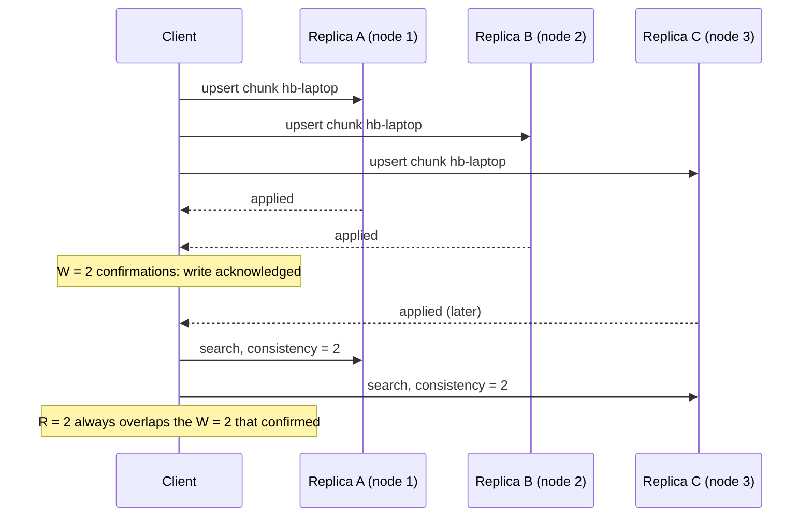
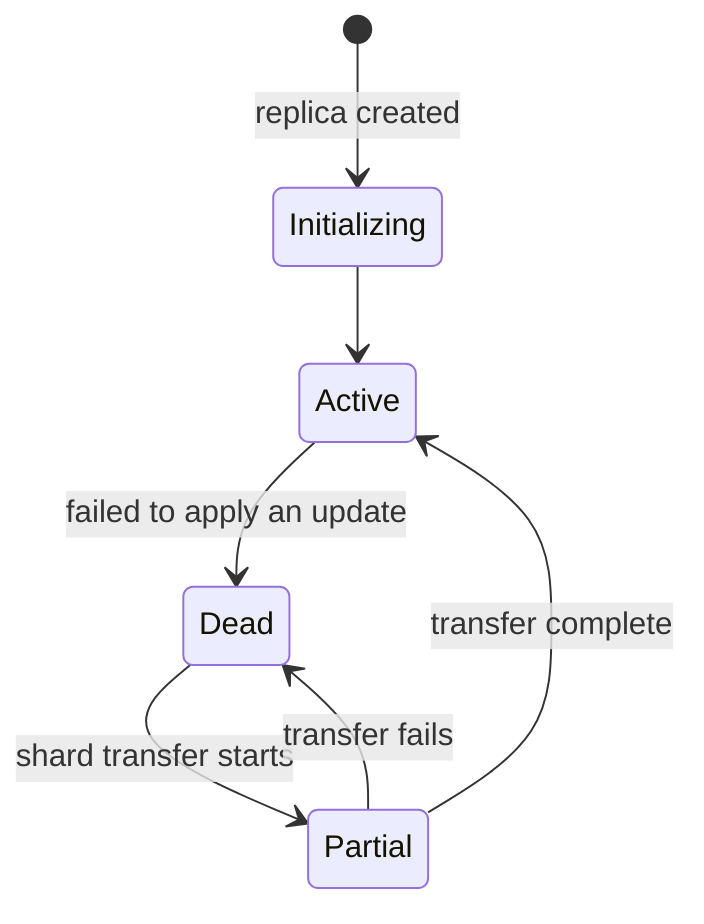

A vector database on one machine has one machine's fate. When the node reboots for a kernel patch, runs out of memory during an index build or loses its disk, retrieval stops, and with it every answer the RAG system gives. **Replication** keeps more than one copy of the data on different machines, so that losing a machine loses nothing and stops nothing, and so that reads can be spread over several copies.

Copies bring a new problem: they can disagree. A write reaches one copy before another, a node misses an update while it is down, and a read that lands on the wrong copy returns yesterday's chunk. This lesson explains how vector databases replicate, what the knobs for write and read consistency actually guarantee, how a failed copy is repaired, and how to choose a replication factor with arithmetic rather than habit. Splitting data *across* machines is the next lesson, [Sharding](/learn/advanced-vector-database-engineering/sharding); protecting it against mistakes, which replication cannot do, is [Backup and recovery](/learn/advanced-vector-database-engineering/backup-and-recovery).

## Learning objectives

- Define replica, replication factor, write consistency and read consistency, and explain the difference between leader-based, leaderless and consensus-based replication.
- Use the quorum rule $W + R > N$ to predict whether a configuration can return stale reads, and calculate the probability of a stale read when it can.
- Configure replication and consistency for a Qdrant collection, and describe what happens to a replica that misses writes.
- Choose a replication factor and node count for a given availability, failure-domain and read-throughput requirement.

## Prerequisites

- [Collections](/learn/advanced-vector-database-engineering/collections): the unit of configuration that replication settings belong to.
- [Persistence](/learn/vector-database-fundamentals/persistence): the write-ahead log and how one node survives a restart.
- [Vector storage](/learn/vector-database-fundamentals/vector-storage): segments and memory, because every replica holds a full copy of them.

## Why this matters

AskMeridian runs on a Qdrant cluster owned by the Platform team. Staff use it all day, and the support desk (08:00 to 18:00 UK time) uses it to answer IT questions while a caller waits. Consider what a single copy of the index means.

- **Planned maintenance becomes downtime.** Every upgrade, operating-system patch or node resize stops retrieval for its duration.
- **Unplanned failure becomes a long outage.** If the disk is lost, the index must be restored from backup or rebuilt by re-embedding every chunk, which for a large corpus takes hours (the [Backup and recovery](/learn/advanced-vector-database-engineering/backup-and-recovery) lesson does that arithmetic).
- **Read capacity is capped.** One node can serve only so many searches per second. When a company-wide announcement sends four hundred people to the assistant at once, queries queue.

Replication answers all three. It also introduces failure modes that do not exist with one copy: an update that is visible on one node but not another, a "deleted" document that a lagging replica still returns, a cluster that refuses writes because too few copies are reachable. These are the subject of this lesson.

## The intuition

Meridian keeps the official handbook in three offices: London, Leeds and Bristol. When HR changes a policy, it posts the new page to all three. The posts do not arrive at the same moment.

Suppose HR waits until **two** offices confirm they have filed the new page before telling everyone "the policy has changed". And suppose that whenever someone wants to check a policy, they phone **two** offices and trust whichever copy is newer. Then the person checking is guaranteed to reach at least one office that has the new page: two offices confirmed, two were asked, and with only three offices the two pairs must share at least one office.

If instead HR announces after one confirmation and readers phone one office, a reader will often reach an office whose post has not arrived. Nothing is lost, as the page will arrive, but for a while the answer is out of date. That is the whole trade: wait for more confirmations (slower writes) or ask more offices (slower reads), or accept occasional stale answers.

## How it works

### Vocabulary

- A **replica** is one complete copy of a shard (a collection on a single-shard deployment is one shard). Each replica lives on a different node.
- The **replication factor** $N$ is the number of replicas of each shard. $N = 1$ means no redundancy.
- **Write consistency** $W$ is how many replicas must confirm a write before the client is told it succeeded.
- **Read consistency** $R$ is how many replicas a read consults before answering.
- A **stale read** returns data older than a write that has already been acknowledged.

Replication also differs in *how* writes reach replicas.

- **Synchronous** replication waits for replicas before acknowledging; **asynchronous** acknowledges first and copies afterwards. Asynchronous is faster but has a window in which an acknowledged write exists on one machine only.
- **Leader-based** systems send all writes for a shard through one replica (the primary or leader), which orders them and forwards them to the followers. Elasticsearch primary and replica shards, and PostgreSQL streaming replication behind pgvector, work this way.
- **Leaderless** systems let a client or coordinator send a write to all replicas directly and use the counts $W$ and $R$ to reason about consistency. This design was popularised by Amazon's Dynamo; Weaviate's replication, with its tunable consistency levels (`ONE`, `QUORUM`, `ALL`), is in this family.
- **Consensus** protocols such as Raft make a group of nodes agree on a single ordered log, so that every member applies the same operations in the same order, at the cost of a round of messages per decision.

### How Qdrant combines them

Qdrant is a useful concrete case because AskMeridian runs on it, and because it uses two mechanisms for two kinds of data.

**Cluster metadata uses Raft.** Which collections exist, their configuration, how many shards each has and which node holds which replica are agreed through Raft consensus among the peers. A Raft cluster can make decisions only while a majority of peers is reachable. A three-node cluster tolerates one node down; a two-node cluster tolerates none for metadata changes, which is why three nodes is the usual minimum for a highly available deployment.

**Point operations do not go through consensus.** Upserts and deletes are sent to every replica of the target shard, and the collection's `write_consistency_factor` says how many must succeed before the request returns. An optional `ordering` parameter on each write chooses how strictly concurrent writes are ordered: `weak` (the default, no ordering guarantee), `medium` (through a dynamically chosen leader replica) or `strong` (through a fixed leader, consistent but unavailable while that leader is down).

**Reads choose their own consistency.** By default a search is answered by one replica. The `consistency` parameter on a query raises that: an integer number of replicas, or one of `majority`, `quorum` and `all`, which consult more replicas and keep only results the consulted replicas agree on. Stronger read consistency costs latency, since the answer waits for the slowest replica consulted.



### The write path, step by step

1. The client sends an upsert to any node. That node knows from the cluster metadata which shard the point belongs to and which nodes hold its replicas.
2. The operation is forwarded to every replica. Each replica appends it to its own write-ahead log and applies it to its segments.
3. When $W$ replicas have confirmed, the request returns success. With `wait=true` this means the change is applied and searchable on those replicas; with `wait=false` only that it was accepted.
4. A replica that fails to apply the operation (it is down, unreachable or out of disk) is marked **dead** in the cluster metadata. A dead replica receives no reads, because it may be missing data.
5. If fewer than $W$ replicas are available, the write fails. This is the price of $W > 1$: availability for writes drops as you demand more confirmations.

### Repairing a replica

A dead replica does not quietly catch up by itself in the middle of serving reads. It is brought back by a **shard transfer**: a healthy replica streams its data to the recovering one, which is in a **partial** state until the transfer completes and then becomes **active** again. Qdrant offers several transfer methods, including streaming records, shipping a snapshot, and sending only the write-ahead-log entries the replica missed (`wal_delta`), which is fastest when the outage was short and the log still holds the gap. You can watch replica states with the cluster-info API for a collection.



Two operational consequences follow. A node that returns after a long absence is not instantly useful; it must receive a transfer, which competes with normal traffic for disk and network. And while it is recovering, the shard has one fewer usable replica, so a second failure in that window can make the shard unavailable. Recovery time is part of your availability budget.

### Replication is not backup

A replica copies everything, including mistakes. A script that deletes the wrong `doc_id` deletes it on every replica within milliseconds, a bad re-embedding job overwrites every copy, and a corrupted payload is faithfully replicated. Replication protects against machines failing; [Backup and recovery](/learn/advanced-vector-database-engineering/backup-and-recovery) protects against people and software failing. You need both.

### Replication in other products

| Product | Mechanism (in outline) |
| --- | --- |
| Qdrant | `replication_factor` per collection; `write_consistency_factor`; per-request read `consistency`; Raft for metadata |
| Weaviate | Replication factor per collection; leaderless with consistency levels `ONE`, `QUORUM`, `ALL` per request |
| Elasticsearch, OpenSearch | Primary shard plus `number_of_replicas` copies; writes go through the primary; replica count can be changed on a live index |
| Milvus | In-memory replicas of a loaded collection across query nodes, chosen when the collection is loaded, mainly for read throughput and availability |
| pgvector | PostgreSQL streaming replication to standby servers; reads can be sent to hot standbys, which may lag the primary |
| Pinecone serverless | Managed by the service; you do not configure replicas |

The vocabulary differs; the questions do not. How many copies? Where do they live? How many must confirm a write? How many does a read consult? What happens to a copy that falls behind?

## The mathematics

### The quorum rule

**Intuition.** If the set of replicas that confirmed a write and the set a read consults must share a member, the read sees the write.

$$
W + R > N \quad\Longrightarrow\quad \text{every read set intersects every write set}
$$

$N$ is the replication factor, $W$ the confirmations required for a write, $R$ the replicas consulted by a read. The argument is counting: if two subsets of an $N$-element set have sizes $W$ and $R$ and $W + R > N$, they cannot be disjoint, because disjoint sets would need $W + R \le N$ elements.

When $W + R \le N$, a read can miss the write. If the read picks its $R$ replicas uniformly at random at the instant of acknowledgement, when exactly $W$ replicas hold the write, the probability that it misses all of them is

$$
P(\text{stale}) = \frac{\binom{N - W}{R}}{\binom{N}{R}}
$$

**By hand**, for $N = 3$:

- $W = 1, R = 1$: $\binom{2}{1} / \binom{3}{1} = 2/3 \approx 66.7\%$.
- $W = 1, R = 2$: $\binom{2}{2} / \binom{3}{2} = 1/3 \approx 33.3\%$.
- $W = 2, R = 1$: $\binom{1}{1} / \binom{3}{1} = 1/3$.
- $W = 2, R = 2$: $\binom{1}{2} = 0$, so $0$, as the rule says.

These are worst cases: a read issued at the very moment of acknowledgement. In practice the remaining replicas apply the write a few milliseconds later and the stale window closes, which is why many RAG systems accept $R = 1$. Whether that is acceptable depends on whether anyone writes and then immediately reads; the real-world example below is such a case.

### The cost of waiting for $W$

If replica apply times are independent and exponentially distributed with mean $\mu$, the time until the $W$-th of $N$ replicas confirms is the $W$-th order statistic, whose mean is

$$
\mathbb{E}[T_{(W)}] = \mu \sum_{i=0}^{W-1} \frac{1}{N - i}
$$

For $N = 3$ and an assumed $\mu = 5$ ms: $W = 1$ gives $5/3 \approx 1.7$ ms, $W = 2$ gives $5(1/3 + 1/2) \approx 4.2$ ms, and $W = 3$ gives $5(1/3 + 1/2 + 1) \approx 9.2$ ms. Waiting for *all* replicas means waiting for the slowest, which is where tail latency lives. The exponential model is a simplification chosen because its order statistics have this clean form; the shape of the conclusion holds generally.

### Availability under independent failures

If each node is unavailable with probability $p$ at a given moment, independently, a shard with $N$ replicas is unreadable only if all $N$ are down: probability $p^N$. Writes with consistency $W$ fail if fewer than $W$ replicas are up:

$$
P(\text{write unavailable}) = \sum_{j=0}^{W-1} \binom{N}{j} (1-p)^j p^{N-j}
$$

With $p = 0.01$ and $N = 3$: reads are unavailable with probability $10^{-6}$; writes with $W = 3$ fail whenever any node is down, $1 - 0.99^3 \approx 3\%$; with $W = 2$, about $3 \times 0.99 \times 0.01^2 + 0.01^3 \approx 0.0003$. The independence assumption is the weak point: replicas in the same rack or availability zone, or running the same bad release, fail together, and then $p^N$ is wildly optimistic. Placement across failure domains is what makes the formula approximately true.

The simulation in the next section checks the stale-read formula and the waiting times.

## In code

**The problem.** Measure, rather than assert, how $W$ and $R$ trade write latency against stale reads on a three-replica shard.

**Dependencies.** NumPy only. This is a simulation of the replication protocol, not a database, so it runs anywhere and its numbers can be checked against the formulas above.

```bash
pip install numpy
```

```python
import numpy as np

rng = np.random.default_rng(7)
N = 3                    # replicas of the shard
TRIALS = 20_000
MEAN_APPLY_MS = 5.0      # assumed average time for a replica to apply a write

def stale_read_rate(W, R, trials=TRIALS):
    """Write a new version, wait for W acknowledgements, then immediately read
    from R randomly chosen replicas. A read is stale if none of them has the
    new version yet."""
    stale = 0
    for _ in range(trials):
        apply_ms = rng.exponential(MEAN_APPLY_MS, size=N)   # when each replica applies it
        ack_ms = np.sort(apply_ms)[W - 1]                     # client returns after W have
        has_new = apply_ms <= ack_ms                          # who has it at that moment
        asked = rng.choice(N, size=R, replace=False)          # replicas this read consults
        if not has_new[asked].any():
            stale += 1
    return stale / trials

def mean_ack_ms(W, trials=TRIALS):
    return np.mean([np.sort(rng.exponential(MEAN_APPLY_MS, size=N))[W - 1]
                    for _ in range(trials)])

print(f"N={N} replicas")
print(" W  R  W+R>N  stale reads  mean write wait")
for W, R in [(1, 1), (1, 2), (2, 1), (2, 2), (1, 3), (3, 1)]:
    print(f" {W}  {R}  {str(W + R > N):5}  {stale_read_rate(W, R):10.1%}  {mean_ack_ms(W):8.1f} ms")
```

```output
N=3 replicas
 W  R  W+R>N  stale reads  mean write wait
 1  1  False       66.8%       1.7 ms
 1  2  False       33.7%       1.7 ms
 2  1  False       33.2%       4.2 ms
 2  2  True         0.0%       4.2 ms
 1  3  True         0.0%       1.7 ms
 3  1  True         0.0%       9.2 ms
```

**What the output means.** The simulated stale-read rates match the formula: 66.8% against 66.7%, 33.7% and 33.2% against 33.3%, and zero whenever $W + R > N$. The write waits match the order-statistic means: 1.7, 4.2 and 9.2 ms. Three configurations are consistent, and they spend the cost in different places:

- $W = 2, R = 2$: balanced. Writes wait for two of three, reads consult two of three, and one node can be down for both.
- $W = 1, R = 3$: fast writes (the 1.7 ms column), slow reads that wait for the slowest replica, and no read can succeed if any node is down.
- $W = 3, R = 1$: fast reads, slow writes, and no write can succeed if any node is down.

For a RAG system, where reads vastly outnumber writes, the usual choice is either $W = 2, R = 2$ when read-your-writes matters, or $W = 2, R = 1$ accepting a short stale window, with $W > 1$ chosen mainly so that an acknowledged write survives the loss of one node.

**The important lines.** `np.sort(apply_ms)[W - 1]` is the moment the client hears success. `has_new` is the state of the world at that moment. `rng.choice(..., replace=False)` picks distinct replicas, as a real read would.

**Extending it.** Mark one replica as down (its apply time infinite) and count how often writes with each $W$ can complete. Then add a correlated failure, two replicas in the same zone failing together, and watch the availability formula's independence assumption break.

### Configuring it in Qdrant

The following runs against a three-node Qdrant cluster and was **not executed** for this lesson; it uses parameters from the Qdrant client's documented API.

```python
import os
from qdrant_client import QdrantClient, models

client = QdrantClient(url=os.environ["QDRANT_URL"], api_key=os.environ.get("QDRANT_API_KEY"))

client.create_collection(
    "askmeridian_chunks",
    vectors_config=models.VectorParams(size=384, distance=models.Distance.COSINE),
    shard_number=2,                 # the next lesson covers this
    replication_factor=3,           # N: each shard has three copies on different nodes
    write_consistency_factor=2,     # W: two replicas must confirm each write
)

# A write that must be searchable on two replicas before returning.
client.upsert("askmeridian_chunks", points=[...], wait=True)

# A read that consults a majority of replicas (here two of three).
hits = client.query_points(
    "askmeridian_chunks",
    query=query_vector,
    limit=5,
    consistency=models.ReadConsistencyType.MAJORITY,
).points

# Replica states for each shard (Active, Dead, Partial, ...).
print(client.collection_cluster_info("askmeridian_chunks"))
```

Changing `replication_factor` later is possible with `update_collection(collection_params=models.CollectionParamsDiff(replication_factor=...))`, but on a self-hosted cluster new replicas are created by shard-replication operations rather than appearing automatically; check the distributed-deployment documentation for your version before relying on either behaviour.

## A real-world example

The Platform team runs AskMeridian on three Qdrant nodes, one per availability zone, with replication factor 2 and the default read consistency. The setup survives node failures well. Then the IT team builds a "fix a runbook" button: an engineer edits a runbook in the admin page, the page re-indexes it and immediately runs a test query to show the engineer what the assistant will now say.

Often, by the engineers' count a third or more of the time, the test query shows the old text. Engineers report that "the update did not work", edit again, and sometimes create duplicate edits. The cause is in this lesson: with $N = 2$, $W = 1$ (the default write consistency factor) and $R = 1$, a read immediately after a write reaches the replica without the write with probability $\binom{1}{1}/\binom{2}{1} = 1/2$ at the instant of acknowledgement, a little less a few milliseconds later.

The team considers raising everything to the strictest settings and rejects it, because ordinary staff queries do not need read-your-writes and would pay the latency. Instead, it sets `write_consistency_factor=2` for the collection (so an acknowledged write is on both replicas, which also improves durability), and the admin page's verification query uses `wait=True` on the write. With $W = N = 2$ every replica has the write when the client is told it succeeded, so any $R$ works. The trade-off it accepts: when one node is down, writes to its shards fail until the replica recovers, so the ingestion pipeline gets a retry queue. Later, when the cluster grows to replication factor 3, the team moves to $W = 2$ and uses $R = 2$ only for the admin page's queries.

## Common mistakes

- **Treating replicas as backups.** A deletion or a bad re-index propagates to every copy at once.
- **Placing replicas in one failure domain.** Two replicas on the same host, rack or zone fail together; the $p^N$ arithmetic no longer applies.
- **Running a two-node cluster for high availability.** Raft-based metadata needs a majority; losing either node blocks collection changes and shard moves.
- **Demanding $W = N$ without a retry path.** Any single node outage then blocks all writes to its shards.
- **Assuming read-your-writes with default settings.** With $R = 1$ and $W < N$ a read straight after a write can be stale.
- **Ignoring recovery time.** A returning node must receive a shard transfer; a second failure during that window can take a shard offline.
- **Scaling reads by adding nodes without adding replicas.** Extra nodes with no replica of a hot shard serve none of its reads.

## Best practices

- Use at least three nodes, spread across failure domains, when you need availability, with a replication factor of at least 2.
- Pick $W$ and $R$ from what the application needs: durability of acknowledged writes, read-your-writes for specific flows, latency for everything else. Apply strict read consistency per request, not globally.
- Make writes idempotent (deterministic IDs, upserts) so that client retries after a failed write are safe.
- Monitor replica states and alert on any replica that is not active for longer than a short threshold.
- Test failure: stop a node in a staging cluster during load and measure what fails and for how long.
- Keep backups regardless of replication.

## Performance considerations

- **Memory and disk scale with $N$.** Every replica is a full copy. A collection needing 30 GB of RAM needs 90 GB across the cluster at $N = 3$.
- **Read throughput scales with $N$** for $R = 1$ queries, because each replica can serve different queries. With $R = r$, each query uses $r$ replicas' worth of work, so throughput scales roughly with $N / r$.
- **Write cost scales with $N$** regardless of $W$: every replica must apply every write and build indexes for it. $W$ changes latency, not total work.
- **Tail latency grows with $R$ and $W$** because each waits for the slowest of a group. Measure p99, not just the mean.
- **Recovery traffic** competes with live traffic. A full transfer of a 30 GB shard over an assumed 1 Gbit/s link takes about $30 \times 8 = 240$ seconds at best; WAL-delta recovery after a short outage is far smaller.

## Security considerations

Replication traffic carries the full contents of the index, including chunk text, between nodes, and often between data centres. Encrypt it in transit (Qdrant and most databases support TLS between peers), restrict which hosts may join the cluster, and remember that every replica is a place where a tenant's data lives: deletion requests must reach every replica, which they do automatically while replicas are active, but a dead replica that is later restored from an old disk image can bring deleted data back.

## Summary

- Replication keeps $N$ copies of each shard on different nodes, for availability, durability and read throughput.
- Writes wait for $W$ confirmations and reads consult $R$ replicas; $W + R > N$ guarantees a read sees the latest acknowledged write, and otherwise the stale probability is $\binom{N-W}{R} / \binom{N}{R}$ at the instant of acknowledgement.
- Qdrant uses Raft for cluster metadata and direct replication with `write_consistency_factor` and per-request read `consistency` for points; a replica that misses a write is marked dead and repaired by a shard transfer.
- Larger $W$ or $R$ means higher latency and lower availability for that operation; independent-failure arithmetic holds only if replicas span failure domains.
- Replication is not backup: mistakes replicate too.

## Exercises

**1.** A collection has $N = 5$. Which of these configurations guarantee that reads see acknowledged writes: $(W, R) = (3, 3)$, $(2, 3)$, $(1, 5)$, $(4, 1)$? For any that do not, compute the worst-case stale probability.

<details><summary>Show solution</summary>

$(3,3)$: $6 > 5$, guaranteed. $(1,5)$: $6 > 5$, guaranteed. $(2,3)$: $5 \not> 5$, not guaranteed; $P = \binom{3}{3}/\binom{5}{3} = 1/10$. $(4,1)$: $5 \not> 5$; $P = \binom{1}{1}/\binom{5}{1} = 1/5$.

</details>

**2.** Nodes are independently unavailable 0.5% of the time. For $N = 3$, compute the probability that a shard cannot serve reads, and that writes with $W = 2$ fail. Then explain why placing all three nodes in one availability zone invalidates your answer.

<details><summary>Show solution</summary>

Reads: $0.005^3 = 1.25 \times 10^{-7}$. Writes fail if 0 or 1 replicas are up: $0.005^3 + 3 \times 0.995 \times 0.005^2 \approx 1.25 \times 10^{-7} + 7.46 \times 10^{-5} \approx 7.5 \times 10^{-5}$. In one zone, a zone outage takes all three down together; failures are no longer independent, and the probability of losing the shard is roughly the zone's outage probability, which is far larger than either figure.

</details>

**3.** Modify the simulation so that one replica is down (it never applies writes). For $N = 3$, report the fraction of writes that can complete for $W = 1, 2, 3$, and the stale-read rate for $W = 2, R = 2$ when the down replica can still be chosen by reads.

<details><summary>Show solution</summary>

Set the down replica's apply time to infinity: `apply_ms[0] = np.inf`. Writes complete when the $W$-th smallest apply time is finite: always for $W \le 2$, never for $W = 3$. For reads, a real system would not send reads to a dead replica; if your simulation does, a read that picks the dead replica plus one other still sees the write whenever the other has it, and with $W = 2$ both live replicas have it at acknowledgement, so stale reads stay at 0%. The lesson: the quorum rule holds as long as the write actually reached $W$ replicas, and a down replica reduces availability, not correctness.

```python
def write_completes(W, trials=2000):
    ok = 0
    for _ in range(trials):
        apply_ms = rng.exponential(MEAN_APPLY_MS, size=N)
        apply_ms[0] = np.inf
        ok += np.isfinite(np.sort(apply_ms)[W - 1])
    return ok / trials

print([float(write_completes(W)) for W in (1, 2, 3)])   # [1.0, 1.0, 0.0]
```

</details>

**4.** Design decision. A RAG service must survive the loss of a whole availability zone with no interruption to reads, accept writes during that loss, and support read-your-writes for an admin tool. The region has three zones. Propose $N$, $W$, node placement and the read consistency for staff queries and for the admin tool.

<details><summary>Show solution</summary>

Place nodes in all three zones with $N = 3$, one replica per zone. With one zone lost, two replicas remain. Choose $W = 2$ so writes still succeed with two live replicas and every acknowledged write survives a further single loss. Staff queries use $R = 1$ for speed (short stale windows are acceptable). The admin tool uses $R = 2$, so $W + R = 4 > 3$ and it always sees its own writes; with one zone down, $R = 2$ is still satisfiable. The Raft metadata majority (two of three) also survives one zone. Cost: three full copies of the data.

</details>

## Check your understanding

```quiz
[
  {
    "q": "A shard has 3 replicas, writes wait for 2 confirmations and reads consult 2 replicas. What is guaranteed?",
    "options": [
      "Nothing; stale reads are always possible with replication",
      "A read always sees the latest acknowledged write, because any 2 replicas overlap the 2 that confirmed",
      "Writes succeed even if two nodes are down",
      "Reads are as fast as with a single replica"
    ],
    "answer": 1,
    "why": "W + R = 4 > N = 3, so the read set and the write set must share at least one replica."
  },
  {
    "q": "In Qdrant, which kind of data is agreed through Raft consensus?",
    "options": [
      "Every point upsert and delete",
      "Search results",
      "Cluster metadata such as collections, shard placement and replica states",
      "Nothing; Qdrant does not use consensus"
    ],
    "answer": 2,
    "why": "Qdrant uses Raft for cluster topology and collection structure; point operations are replicated directly with a configurable write consistency factor."
  },
  {
    "q": "An engineer deletes the wrong document with a script. Three replicas exist. What does replication do?",
    "options": [
      "Copies the deletion to every replica, so replication cannot undo it",
      "Keeps the document on two replicas, since only one received the delete",
      "Rejects the delete because replicas disagree",
      "Restores the document automatically after the optimiser runs"
    ],
    "answer": 0,
    "why": "Replication faithfully copies every operation, mistakes included. Undoing a mistake needs a backup."
  },
  {
    "q": "With N = 3 and nodes in three zones, why is W = 3 usually a poor choice for an ingestion pipeline?",
    "options": [
      "It makes reads stale",
      "It disables the write-ahead log",
      "It uses more disk than W = 2",
      "Any single node or zone outage blocks every write to the affected shards"
    ],
    "answer": 3,
    "why": "W = N requires every replica to confirm; with one replica unavailable no write can complete. Total disk use depends on N, not W."
  },
  {
    "q": "A replica was offline for an hour and has just been restarted. What normally happens before it serves reads again?",
    "options": [
      "It serves reads immediately and catches up in the background",
      "It receives a shard transfer (for example the missing WAL entries or a full copy) and becomes active when complete",
      "The cluster deletes it and lowers the replication factor",
      "It replays its own WAL, which contains the writes it missed"
    ],
    "answer": 1,
    "why": "A replica that missed writes may be missing data, so it is repaired from a healthy replica before being marked active. Its own WAL cannot contain writes it never received."
  }
]
```

## Further reading

- Qdrant documentation, [Distributed deployment](https://qdrant.tech/documentation/guides/distributed_deployment/): replication factor, write consistency factor, read consistency, write ordering, replica states and shard transfer methods.
- DeCandia et al. (2007), "Dynamo: Amazon's Highly Available Key-value Store", SOSP 2007. The origin of the $N$, $W$, $R$ quorum vocabulary.
- Ongaro and Ousterhout (2014), "In Search of an Understandable Consensus Algorithm", USENIX ATC 2014. The Raft paper; see also [raft.github.io](https://raft.github.io).
- Kleppmann (2017), *Designing Data-Intensive Applications*, O'Reilly, chapter 5 "Replication": leaders, followers, quorums and replication lag.
- Elasticsearch documentation, "Reading and writing documents" in the data replication section: the primary-backup model for shards.
