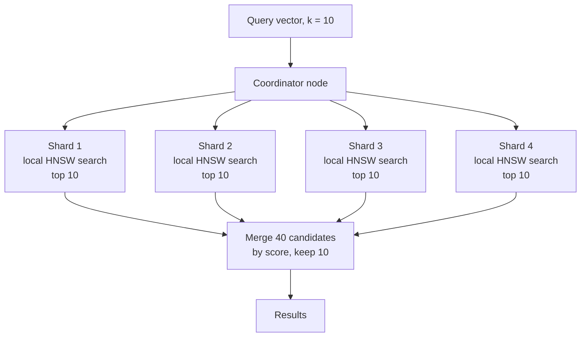

[Replication](/learn/advanced-vector-database-engineering/replication) puts the *same* data on several machines. **Sharding** puts *different* data on several machines: it splits one collection into pieces called **shards**, each holding a subset of the points, so that a collection too large or too busy for one node can be spread over many. Every search then becomes a small distributed computation: send the query to the shards, let each find its local best, and merge.

This lesson explains how points are assigned to shards, why the merged result of a sharded search equals the unsharded one (and when it does not), what fan-out does to tail latency, how to choose a shard count, and why changing it later is expensive. It also makes a point that is easy to miss: many RAG systems never need sharding, and adding it costs work on every query.

## Learning objectives

- Distinguish sharding from replication and calculate the total number of shard replicas a configuration creates.
- Compare hash-based and key-based (custom) shard routing, and predict when each causes hot spots or unnecessary fan-out.
- Explain scatter-gather top-$k$ search, prove that it is exact for exact per-shard search, and state what each shard must return for the merge to be correct.
- Compute the shard count needed for a memory budget, the probability that fan-out makes a query slow, and the fraction of points moved by re-hashing.
- Decide whether a given RAG workload needs sharding at all.

## Prerequisites

- [Replication](/learn/advanced-vector-database-engineering/replication): copies of a shard, write and read consistency.
- [Multi-tenancy](/learn/advanced-vector-database-engineering/multi-tenancy): tenants as a natural shard key.
- [Vector storage](/learn/vector-database-fundamentals/vector-storage): how much memory a collection needs.
- [HNSW](/learn/vector-indexing-algorithms/hnsw): the per-shard index whose cost grows slowly with size.

## Why this matters

AskMeridian itself does not need sharding. Its handbook, runbooks and product documentation come to tens of thousands of chunks, which fit comfortably in one node's memory. The Meridian Reports assistant from the multi-tenancy lesson is different. Suppose, as a planning assumption, that it grows to 60 million chunks embedded at 768 dimensions in float32. The raw vectors alone are

$$
60 \times 10^6 \times 768 \times 4 \text{ bytes} \approx 184 \text{ GB},
$$

before the HNSW graph, payloads and headroom for index builds. If nodes have 128 GB of RAM, no single node can hold it in memory. Quantisation and on-disk storage push the limit out, and should be tried first, but at some size one machine is not enough.

Without a sharding plan, three things go wrong. The collection outgrows its node and either swaps to disk (latency collapses) or stops accepting writes. Index builds on a single huge segment set take hours and compete with queries. And when you finally do shard, you discover the shard count was fixed when the collection was created, so the fix is a full migration. Getting the plan right early is cheap; getting it right late is a project.

## The intuition

A city library has outgrown its building. It opens four branches and divides the books among them. There are two ways to divide.

**By a coin toss for each book** (more precisely, by a fixed rule that looks random, such as the last digit of its catalogue number). Every branch gets about a quarter of the books and a quarter of the visitors. But a reader looking for "the best books about sailing" must ask all four branches for their best sailing books and compare the four lists. Each branch only needs to send its own top ten, because the overall top ten must be among them.

**By subject**: fiction in one branch, science in another. A reader looking for a novel goes to one branch only. But if half the town reads fiction, the fiction branch is overwhelmed while the science branch is quiet.

Vector databases offer both. The coin toss is **hash sharding**; the subject rule is **key-based** or **custom sharding**.

## How it works

### Shards and replicas

A **shard** is an independent sub-collection: its own segments, its own HNSW graph, its own write-ahead log. A collection with shard number $S$ and replication factor $N$ has $S$ shards, each with $N$ replicas, so $S \times N$ shard replicas spread over the cluster's nodes. Sharding divides data; replication duplicates each division. They are configured independently and solve different problems:

| Problem | Sharding helps | Replication helps |
| --- | --- | --- |
| Data does not fit on one node | Yes | No (each replica is a full copy) |
| Query latency on a very large collection | Yes, shards search in parallel | No |
| Query throughput | Somewhat | Yes, replicas serve different queries |
| Node failure | No, alone it makes things worse | Yes |

The last row matters: with $S$ shards and no replication, losing any one of $S$ nodes loses part of every query's answer. Sharding without replication multiplies the chance that something is broken.

### Routing: which shard does a point live on?

1. **Hash routing (automatic).** Compute a hash of the point's ID and map it to a shard. Points spread almost perfectly evenly and nobody has to think about placement. Every search must visit every shard, because any shard could hold a relevant point. Qdrant's default (`sharding_method=auto`) distributes points this way, and Elasticsearch routes each document by a hash of its routing value, which is the document ID unless you supply another.
2. **Key routing (custom).** You choose the shard explicitly from a field, such as a tenant or a region. In Qdrant, a collection created with `sharding_method=custom` has named **shard keys**; each write says which key it belongs to, and a query can name the keys it needs. Queries that name a key touch only that shard, which cuts fan-out to one. The risk is **skew**: one big tenant makes one shard huge and hot.
3. **Content routing.** Assign points to shards by where they sit in vector space (cluster the vectors, give each cluster a shard), then send each query only to the shards whose clusters are nearest. This is IVF applied across machines. It reduces fan-out but trades recall for it, because the true neighbours may sit in a shard the router skipped, and it needs rebalancing as content drifts. It appears in research systems and some large-scale deployments; general-purpose vector databases default to hash routing.



### Scatter-gather search

A search on a hash-sharded collection runs in five steps:

1. A client sends the query to any node, which acts as **coordinator**.
2. The coordinator sends the query, with the same filter and the same $k$, to one replica of every shard (or, with custom routing, to the shards named in the request).
3. Each shard searches its own index and returns its local top $k$ with scores.
4. The coordinator merges the $S$ lists by score and keeps the best $k$.
5. Payloads are fetched for the winners (some systems fetch them in step 3, some in a second round trip) and returned.

**Why the merge is exact.** Take any point $p$ in the true global top $k$. It lives on some shard. Within that shard, every point that outscores $p$ also outscores it globally, and fewer than $k$ points outscore it globally, so fewer than $k$ points outscore it locally. Therefore $p$ is in its shard's local top $k$, so it reaches the coordinator, which then ranks it correctly. If each shard searches exactly, scatter-gather returns exactly the unsharded answer.

Two conditions hide in that argument. **Each shard must return $k$, not $k/S$**: if a shard returns fewer, a shard that happens to hold several of the global winners drops some. And **scores must be comparable across shards**. For dense vectors they are, because every shard uses the same model and metric. For lexical scores they may not be: BM25 uses document frequencies, and an engine that computes them per shard gives the same term slightly different weights on different shards. Elasticsearch does this by default and offers a `dfs_query_then_fetch` search type that first gathers global term statistics; the difference is usually small on large, evenly hashed shards and noticeable on small or skewed ones.

**With approximate search**, each shard's local result is approximate, and the merged recall is roughly the per-shard recall. Sharding does not make ANN worse in principle, but it does mean $S$ graph searches instead of one, each paying the logarithmic-ish HNSW cost on a smaller graph.

**Pagination** multiplies the work. To return results 91 to 100, each shard must return its top 100, not its top 10, so deep pages cost $S \times (\text{offset} + k)$ candidates. RAG rarely pages deeply, but admin and export tools do; use scroll APIs for bulk export instead.

### Choosing the shard count

The shard count is the most consequential sharding decision, because in many systems it is fixed at creation. In Qdrant `shard_number` is set when the collection is created (its default depends on the cluster's size at that moment), and resharding a live collection is available only in some deployments and versions; check the documentation for yours. Elasticsearch fixes the number of primary shards at index creation and offers split, shrink and reindex operations to change it. Re-hashing is expensive because, with modulo routing, changing $S$ moves almost every point (see the mathematics).

The established way around this is **over-sharding**: create more shards than you have nodes, for example 12 shards on 3 nodes, four per node. Adding a fourth node then means *moving whole shards* (three of them) to it, a file-level transfer that moves a quarter of the data, rather than re-hashing every point. The cost of over-sharding is per-shard overhead and more fan-out per query, so do not take it to extremes; a small multiple of the node count you expect to reach is a common rule of thumb.

### Hot spots and skew

Hash routing spreads *data* evenly, but not necessarily *load*: if one tenant generates half the queries, every shard still does equal work under hash routing (fine), whereas under key routing that tenant's shard does half the work of the cluster (not fine). Custom routing therefore needs a plan for large keys: give a big tenant several shards (Qdrant's `create_shard_key` accepts a shard count per key), or keep big tenants on dedicated keys and pool small ones, as [Multi-tenancy](/learn/advanced-vector-database-engineering/multi-tenancy) recommended.

### When not to shard

Sharding is the right answer to "the data does not fit" and "one search over everything is too slow". It is the wrong answer to "we need more queries per second": every query still visits every shard, so total work per query goes up slightly, not down. Throughput comes from replicas. A useful order of escalation for a growing RAG collection:

1. Reduce memory per vector: [scalar quantisation](/learn/vector-indexing-algorithms/scalar-quantisation), smaller embedding dimensions, payloads on disk.
2. Use a bigger node, or memory-mapped storage with fast local disks.
3. Add replicas for throughput and availability.
4. Shard when the data or index build no longer fits one node, with over-sharding for growth.

## The mathematics

### Shards needed for a memory budget

**Intuition.** Divide what you need by what one node can safely give.

$$
S \ge \left\lceil \frac{n \times b \times (1 + g)}{M_{\text{node}} \times u} \right\rceil
$$

$n$ is the number of vectors, $b$ the bytes per vector ($4d$ for float32), $g$ the overhead factor for the graph and payloads as a fraction of vector memory, $M_{\text{node}}$ the node's RAM and $u$ the fraction you are willing to fill (headroom for index builds and the operating system).

**By hand.** $n = 60 \times 10^6$, $d = 768$ so $b = 3{,}072$ bytes, assume $g = 0.2$, $M_{\text{node}} = 128$ GB, $u = 0.6$. Need: $60 \times 10^6 \times 3{,}072 \times 1.2 \approx 221$ GB. Budget per node: $128 \times 0.6 = 76.8$ GB. $S \ge \lceil 221 / 76.8 \rceil = \lceil 2.88 \rceil = 3$ shards, and with replication factor 2 that is 6 shard replicas, so at least 6 nodes' worth of memory in a balanced placement. With over-sharding for growth, 6 or 12 shards on those nodes is reasonable. With int8 scalar quantisation in RAM and originals on disk, $b$ falls to 768 bytes and a single large node might hold it, which is why step 1 of the escalation comes first.

### Fan-out and tail latency

**Intuition.** A scatter-gather query is as slow as its slowest shard. Visiting more shards means more chances that one of them is having a bad moment.

If each shard independently exceeds a latency threshold with probability $p$, a query that waits for $S$ shards exceeds it with probability

$$
P(\text{slow}) = 1 - (1 - p)^S
$$

**By hand.** Let the threshold be one shard's 99th percentile, so $p = 0.01$. $S = 8$: $1 - 0.99^8 = 1 - 0.9227 = 0.0773$, about 7.7%. $S = 32$: $1 - 0.99^{32} \approx 1 - 0.7250 = 0.275$, so more than a quarter of queries are slower than a single shard's p99. This is the effect Dean and Barroso described in "The Tail at Scale": fan-out turns rare per-component slowness into common system slowness. Mitigations include hedged requests (send a duplicate request to another replica if the first is slow), keeping $S$ modest, and keeping shards evenly loaded.

### Re-hashing cost

With routing $\text{shard} = h \bmod S$, changing $S$ to $S + 1$ keeps a point in place only if $h \bmod S = h \bmod (S+1)$, which for a uniform hash happens for a fraction of about $1/(S+1)$ of points. So about

$$
\text{moved} \approx \frac{S}{S + 1}
$$

of all points change shard. From 4 to 5 shards: $4/5 = 80\%$. By contrast, moving whole shards to a new node (over-sharding) or using consistent hashing moves about $1/(S+1)$ of the data, here 20%. The code below confirms both the 80% figure and the tail-latency formula.

## In code

**The problem.** Build a four-shard collection in miniature, check that scatter-gather returns the same top 10 as one unsharded search, see what happens when shards return fewer than $k$, and measure the re-hashing and fan-out effects from the mathematics section.

**Dependencies.** NumPy only; the shards are arrays and the search is exact, so the result can be compared with ground truth.

```bash
pip install numpy
```

```python
import hashlib
import numpy as np

rng = np.random.default_rng(42)
n, d, k, S = 100_000, 64, 10, 4
X = rng.standard_normal((n, d)).astype(np.float32)
X /= np.linalg.norm(X, axis=1, keepdims=True)
ids = np.array([f"chunk-{i}" for i in range(n)])
Q = rng.standard_normal((200, d)).astype(np.float32)
Q /= np.linalg.norm(Q, axis=1, keepdims=True)

def shard_of(point_id: str, num_shards: int) -> int:
    """Stable hash routing: the same ID always goes to the same shard."""
    h = int.from_bytes(hashlib.sha256(point_id.encode()).digest()[:8], "big")
    return h % num_shards

assignment = np.array([shard_of(i, S) for i in ids])
shards = [np.flatnonzero(assignment == s) for s in range(S)]
print("points per shard:", [len(s) for s in shards])

def top_k(scores, k):
    idx = np.argpartition(-scores, k - 1, axis=1)[:, :k]
    order = np.argsort(-np.take_along_axis(scores, idx, axis=1), axis=1)
    return np.take_along_axis(idx, order, axis=1)

def scatter_gather(Q, k, per_shard_k):
    """Each shard returns its local top per_shard_k; the coordinator merges."""
    cand_ids, cand_scores = [], []
    for rows in shards:
        local = Q @ X[rows].T                         # exact search inside the shard
        best = top_k(local, per_shard_k)
        cand_ids.append(rows[best])                   # map back to global row numbers
        cand_scores.append(np.take_along_axis(local, best, axis=1))
    ids_all = np.concatenate(cand_ids, axis=1)
    scores_all = np.concatenate(cand_scores, axis=1)
    return np.take_along_axis(ids_all, top_k(scores_all, k), axis=1)

truth = top_k(Q @ X.T, k)                             # one big unsharded search
for per_shard_k in [10, 5, 3]:
    merged = scatter_gather(Q, k, per_shard_k)
    recall = np.mean([len(set(a) & set(b)) / k for a, b in zip(merged, truth)])
    print(f"each shard returns {per_shard_k:>2}: recall@{k} vs unsharded = {recall:.3f}")

# Re-sharding: how many points change shard when going from 4 to 5 shards?
moved = np.mean([shard_of(i, 4) != shard_of(i, 5) for i in ids])
print(f"\nhash % 4 -> hash % 5 moves {moved:.1%} of points (formula 4/5 = 80.0%)")

# Fan-out and tail latency: each shard is 'slow' (over budget) 1% of the time.
lat = rng.lognormal(mean=np.log(20), sigma=0.5, size=(100_000, 32))   # ms, per shard
budget = 20 * np.exp(0.5 * 2.326348)          # exact p99 of this lognormal (z = 2.326)
for fan_out in [1, 4, 8, 32]:
    slow = np.mean(lat[:, :fan_out].max(axis=1) > budget)
    print(f"fan-out {fan_out:>2}: queries over one shard's p99 = {slow:.1%}  "
          f"(formula {1 - 0.99 ** fan_out:.1%})")
```

```output
points per shard: [25162, 25041, 24961, 24836]
each shard returns 10: recall@10 vs unsharded = 1.000
each shard returns  5: recall@10 vs unsharded = 0.995
each shard returns  3: recall@10 vs unsharded = 0.877

hash % 4 -> hash % 5 moves 80.3% of points (formula 4/5 = 80.0%)
fan-out  1: queries over one shard's p99 = 1.1%  (formula 1.0%)
fan-out  4: queries over one shard's p99 = 3.9%  (formula 3.9%)
fan-out  8: queries over one shard's p99 = 7.7%  (formula 7.7%)
fan-out 32: queries over one shard's p99 = 27.5%  (formula 27.5%)
```

**What the output means.**

- **Balance.** Hashing puts within about 1% of 25,000 points on each shard, with no coordination.
- **Exactness.** With each shard returning $k = 10$, the merged result equals the unsharded top 10 for all 200 queries (recall 1.000), as the proof promised.
- **The per-shard $k$ trap.** Returning 5 per shard loses little here (0.995) because, with random data spread by a hash, a query's top 10 rarely has more than 5 on one shard. Returning 3 loses one result in eight. Real embeddings cluster, and a document's chunks are often near each other, so do not rely on the lucky case: shards return $k$.
- **Re-hashing.** 80.3% of points would move when going from 4 to 5 shards, matching $S/(S+1)$.
- **Fan-out.** Per-shard latencies are drawn from a lognormal distribution (a common, assumed shape for service latency) and the threshold is that distribution's exact 99th percentile. The simulated tail matches the formula to within sampling noise: at 32 shards, more than a quarter of queries miss a single shard's p99.

**The important lines.** `shard_of` uses SHA-256 rather than Python's built-in `hash`, which is randomised per process for strings and would route the same ID differently after a restart. `rows[best]` maps shard-local positions back to global identifiers; forgetting this mapping is the classic bug in hand-written scatter-gather. `per_shard_k` is the parameter real systems get right for you, and that hand-rolled federations over several databases often get wrong.

**Extending it.** Replace the exact per-shard search with a FAISS HNSW index per shard and compare merged recall with a single HNSW index over all points at the same `efSearch`. Then route by a "tenant" key with a skewed size distribution and print the largest shard's share.

### Custom sharding in Qdrant

This block needs a Qdrant cluster and was **not executed** for this lesson. It creates a collection with one shard key per region, so that EU customers' data can live on EU nodes and EU queries touch only EU shards.

```python
import os
from qdrant_client import QdrantClient, models

client = QdrantClient(url=os.environ["QDRANT_URL"], api_key=os.environ.get("QDRANT_API_KEY"))

client.create_collection(
    "reports_assistant",
    vectors_config=models.VectorParams(size=768, distance=models.Distance.COSINE),
    sharding_method=models.ShardingMethod.CUSTOM,
    shard_number=2,              # shards created per shard key
    replication_factor=2,
)
client.create_shard_key("reports_assistant", shard_key="eu")
client.create_shard_key("reports_assistant", shard_key="us")

client.upsert("reports_assistant", points=eu_points, shard_key_selector="eu")

hits = client.query_points(
    "reports_assistant",
    query=query_vector,
    query_filter=tenant_filter,          # still filter by tenant inside the region
    shard_key_selector="eu",             # fan out to EU shards only
    limit=10,
).points
```

`create_shard_key` also accepts a `placement` list of peer IDs, which is how a key is pinned to particular nodes. A query that omits `shard_key_selector` searches every shard key.

## A real-world example

The Reports assistant team at Meridian starts on one large node. As customers arrive, memory use passes 70% and index builds after bulk uploads start to slow queries. A first proposal is "shard by tenant with custom keys", which would make most queries touch one shard.

A capacity review rejects it as stated. Tenant sizes are very uneven: the largest five customers hold about half the chunks. One key per tenant would create a few huge, hot shards and thousands of tiny ones; one key per *group* of tenants means hand-balancing groups forever. The team instead chooses hash sharding with over-sharding, 12 shards across 3 nodes with replication factor 2, and keeps the tenant filter and tenant index from the multi-tenancy design. Every query fans out to 12 shards, so the team watches p99 latency closely; the fan-out formula told it to expect noticeably more slow queries than on one node, and it does see them, which it addresses with per-shard capacity headroom rather than with fewer shards.

Separately, two customers in the EU require their data to stay on EU infrastructure. For them the team creates a second collection in an EU cluster rather than mixing custom shard keys into the main one, because the requirement is about *where* data lives, which is easiest to audit at the cluster level. When a fourth node joins the main cluster six months later, three whole shards move to it and no point is re-hashed.

## Common mistakes

- **Sharding to increase throughput.** Each query visits every shard; add replicas for throughput.
- **Sharding without replication.** Any node loss now breaks every query's completeness.
- **Choosing the shard count for today.** A fixed shard count chosen for current data forces a full migration later; over-shard moderately.
- **Asking shards for $k/S$ results.** The merge silently loses results when winners cluster on one shard.
- **Using a process-randomised hash for routing** in hand-written sharding (Python's `hash` on strings), so routing changes after a restart.
- **Custom sharding by a skewed key** without a plan for the biggest keys.
- **Comparing lexical scores across shards** without global statistics, then wondering why rankings differ from the unsharded index.

## Best practices

- Exhaust vertical options first: quantisation, on-disk vectors, a bigger node.
- When you shard, over-shard to a small multiple of the expected node count so growth is shard movement, not re-hashing.
- Prefer hash routing by default; use custom routing for data placement requirements (region) or for very large tenants that deserve isolation.
- Replicate every shard and spread replicas across failure domains.
- Monitor per-shard point counts, query latency and memory, and alert on skew.
- Load test at the target fan-out and watch p99, not the mean.

## Performance considerations

- **Latency.** Parallel shard searches on smaller graphs are faster than one search on a huge graph, but the query waits for the slowest shard plus a merge and a network round trip. Expect the median to improve and the tail to worsen as $S$ grows.
- **Total work.** HNSW search cost grows slowly with collection size, so $S$ searches over $n/S$ points cost more total CPU than one search over $n$ points. Sharding spends CPU to buy capacity and parallelism.
- **Memory.** Each shard has fixed overheads (segments, graph entry structures, WAL). Thousands of shards add up.
- **Network.** Each shard returns $k$ candidates (IDs and scores, sometimes payloads). Fetching payloads only for the final $k$ keeps this small.
- **Index builds.** Smaller shards rebuild faster and in parallel, which is often the most noticeable operational gain.

## Summary

- Sharding splits a collection into independent sub-collections on different nodes; replication copies each shard. A collection has $S \times N$ shard replicas.
- Hash routing balances data automatically but fans every query out to all shards; key routing cuts fan-out and enables placement but risks skew.
- Scatter-gather is exact when each shard searches exactly and returns $k$; scores must be comparable across shards.
- Fan-out raises tail latency, $1 - (1-p)^S$; modulo re-hashing moves about $S/(S+1)$ of points, which is why shard counts are chosen with growth in mind and over-sharding is common.
- Many RAG collections do not need sharding; reduce bytes per vector and add replicas first.

## Exercises

**1.** A collection has 6 shards and replication factor 3 on 9 nodes. How many shard replicas exist, how many per node in a balanced layout, and how many nodes can fail before some shard has no live replica (in the worst case)?

<details><summary>Show solution</summary>

$6 \times 3 = 18$ shard replicas, 2 per node. In the worst case, the 3 nodes holding all replicas of one shard fail together, so 3 failures can make a shard unavailable; any 2 failures leave every shard with at least one replica. Placement across failure domains makes the worst case less likely, not impossible.

</details>

**2.** With 20 shards and a per-shard probability of 0.5% of exceeding 100 ms, what fraction of queries exceed 100 ms? How many shards keep that fraction under 5%?

<details><summary>Show solution</summary>

$1 - 0.995^{20} \approx 1 - 0.9046 = 0.095$, about 9.5%. For under 5%: $0.995^S > 0.95$, so $S < \ln 0.95 / \ln 0.995 \approx 0.0513 / 0.00501 \approx 10.2$; at most 10 shards.

</details>

**3.** A developer federates search across three separate vector databases (one per business unit) and merges their results. Each database is asked for `limit = k // 3`. Explain what goes wrong, and write a merge function that is correct given each source returns `(id, score)` lists of length `k`, assuming all three use the same embedding model and metric.

<details><summary>Show solution</summary>

If one business unit holds most of the relevant chunks, its best results beyond the first $k/3$ are never requested, so the merge drops them; recall falls exactly when one source dominates. Ask each source for $k$.

```python
import heapq

def merge(results_per_source, k):
    """results_per_source: list of lists of (id, score), each sorted or not."""
    all_hits = [hit for source in results_per_source for hit in source]
    return heapq.nlargest(k, all_hits, key=lambda hit: hit[1])

print(merge([[("a", 0.91), ("b", 0.88)], [("c", 0.95)], [("d", 0.40)]], 3))
# [('c', 0.95), ('a', 0.91), ('b', 0.88)]
```

The same-model assumption matters: if the sources use different models or metrics, their scores are not comparable and score-based merging is wrong; use rank-based fusion instead.

</details>

**4.** Design decision. A service stores 400 million 384-dimension vectors. Nodes have 256 GB of RAM, and you may fill 60%. Graph and payload overhead is 25% of raw vector memory. Compute the minimum shards for float32 and for int8 vectors in RAM, and propose a shard count for growth to twice the size over two years.

<details><summary>Show solution</summary>

Float32: $400 \times 10^6 \times 1{,}536 \times 1.25 \approx 768$ GB; budget per node $153.6$ GB; $S \ge 5$. Int8: $400 \times 10^6 \times 384 \times 1.25 = 192$ GB; $S \ge 2$ (with float32 originals on disk for rescoring). For doubling, int8 needs at least 3 shards' worth of memory, float32 at least 10. Choose int8 with, say, 8 or 12 shards on 3 to 4 nodes initially (plus replicas), so growth means moving shards to new nodes rather than re-hashing. Validate recall with int8 on your own data before committing.

</details>

## Check your understanding

```quiz
[
  {
    "q": "A team's vector search is too slow under load, but the collection fits easily in one node's memory. What should they add first?",
    "options": [
      "More shards, so each query searches less data",
      "Replicas, so more nodes can serve different queries",
      "A larger k per shard",
      "Custom sharding by document type"
    ],
    "answer": 1,
    "why": "Every query still visits every shard, so sharding does not raise throughput much; replicas let separate nodes answer separate queries."
  },
  {
    "q": "Why is scatter-gather with exact per-shard search guaranteed to return the global top k, provided each shard returns k results?",
    "options": [
      "Because hash routing puts similar vectors on the same shard",
      "Because the coordinator re-scores every point in the collection",
      "Because shards share one HNSW graph",
      "Because any global top-k point is outscored by fewer than k points within its own shard, so it is in that shard's top k"
    ],
    "answer": 3,
    "why": "Points that beat p locally also beat it globally, and fewer than k beat it globally, so p survives its shard's local top k."
  },
  {
    "q": "Routing is `hash(id) % S`. Roughly what fraction of points move if S changes from 9 to 10?",
    "options": ["90%", "10%", "50%", "1%"],
    "answer": 0,
    "why": "A point stays only if its hash gives the same remainder for both moduli, about 1/(S+1) of points; so about S/(S+1) = 9/10 move."
  },
  {
    "q": "What is the main risk of custom sharding with one shard key per tenant?",
    "options": [
      "Queries must always fan out to every shard",
      "Points cannot be filtered by payload",
      "Skew: a few large tenants create huge, hot shards while most are tiny",
      "Replication is no longer possible"
    ],
    "answer": 2,
    "why": "Key routing places data by key; uneven key sizes become uneven shards and uneven load."
  },
  {
    "q": "A query fans out to 16 shards, each of which exceeds its p99 latency 1% of the time. About what share of queries exceeds that latency?",
    "options": ["1%", "15%", "16%", "50%"],
    "answer": 1,
    "why": "1 - 0.99^16 is about 0.149, roughly 15%."
  }
]
```

## Further reading

- Qdrant documentation, [Distributed deployment](https://qdrant.tech/documentation/guides/distributed_deployment/): sharding, `shard_number`, custom sharding with shard keys, moving shards and resharding.
- Elasticsearch documentation, "Size your shards" and the `_routing` field reference: fixed primary shard counts, routing, and the `dfs_query_then_fetch` search type.
- Dean and Barroso (2013), "The Tail at Scale", *Communications of the ACM* 56(2). Why fan-out makes tail latency a system problem, and hedged requests.
- Karger et al. (1997), "Consistent Hashing and Random Trees", STOC 1997. The original consistent-hashing paper.
- Kleppmann (2017), *Designing Data-Intensive Applications*, O'Reilly, chapter 6 "Partitioning": key and hash partitioning, rebalancing, and request routing.
