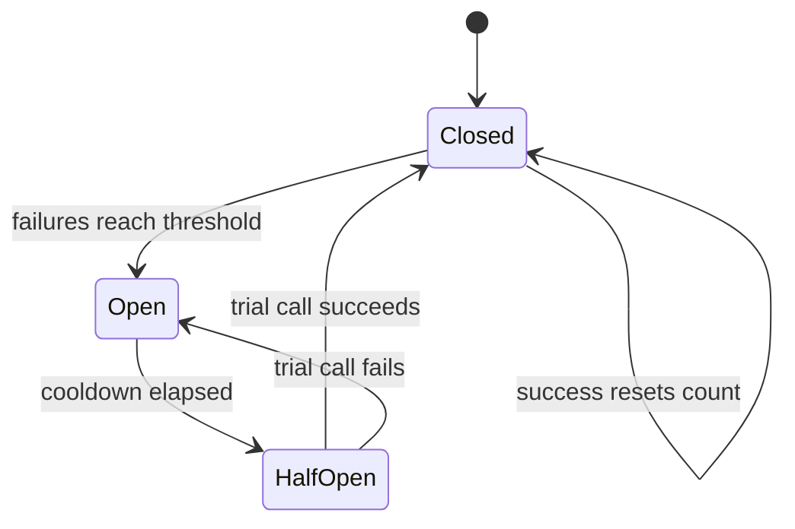

A fixed RAG pipeline has a handful of places to fail: the embedding call, the vector search, the generation call. A retrieval agent multiplies them. Each run makes several model calls and several tool calls, any of which can time out, be rate-limited, return nothing, or receive arguments the model invented, and the model itself can loop, stop early, refuse, or run out of output tokens. With six tool calls per run, a 2% failure rate per call becomes roughly an 11% chance that a run meets at least one failure. Failure is not an edge case for agents; it is a normal part of every day's traffic.

This lesson covers how to handle it: classifying failures before reacting to them, retries with backoff and jitter, circuit breakers, returning errors to the model as observations, validating model-generated arguments, detecting loops, and degrading gracefully when the agent cannot finish. The aim throughout is an agent that either answers correctly or says plainly what it could not do, and never presents a failure as an answer.

## Learning objectives

- Classify agent failures as transient, permanent or behavioural, and choose the right handling for each.
- Implement bounded retries with exponential backoff and full jitter, and calculate their worst-case latency and their effect on run success.
- Explain the closed, open and half-open states of a circuit breaker and why an agent needs one in front of each backend.
- Validate model-generated tool arguments and return actionable `is_error` results instead of raising.
- Design a degradation ladder that ends in an honest partial answer rather than a silent failure.

## Prerequisites

- [Retrieval agents](/learn/agentic-rag/retrieval-agents): the controller loop, `tool_result` blocks with `is_error`, and stop reasons.
- [Iterative search](/learn/agentic-rag/iterative-search): novelty and budgets as stopping rules.
- [Agent evaluation](/learn/agentic-rag/agent-evaluation): stop-reason distributions and trajectory logs.

## Why this matters

Without deliberate handling, a ten-second 503 from the vector store either escapes as a generic error page, or is retried immediately from every concurrent request (multiplying the load on a struggling service), or is caught and turned into an empty result list, so the model reads "no documents found" and answers "Meridian has no policy on this", which is false. The last is the most damaging, and common. **An infrastructure failure must never be presented to the model, or to the user, as an absence of evidence.** "The search failed" and "the search found nothing" are different observations and lead to different correct behaviour.

Behavioural failures cost as much: a model repeating one search in different words spends its budget on the same chunks; one that sends `k=50` fills its own context; one whose final turn stops at `max_tokens` produces half an answer that looks complete. Each needs a specific, mechanical response in the controller.

## The intuition

Think of a courier with a day's deliveries. Different problems call for different reactions:

- **The road is briefly closed** (transient): wait a little and try again, but do not wait forever, and do not have every courier in the depot try the same road at the same second.
- **The address does not exist** (permanent): trying again will not help. Ring the customer for a correct address.
- **The road has been closed all morning** (sustained outage): the depot stops sending couriers down it at all for a while, then sends one to check whether it has reopened.
- **The courier keeps going round the same roundabout** (a loop): someone has to notice and say "you've been here three times; take a different exit or come back".
- **The shift is ending** (budget): deliver what you can, and report which parcels were not delivered, rather than pretend they were.

Failure handling writes these reactions into the controller, so the right one happens without depending on the model to notice.

## How it works

### A taxonomy of failures

| Where | Failure | Class | Correct first response |
| --- | --- | --- | --- |
| Tool backend | Timeout, 429 rate limit, 503 unavailable | Transient | Retry with backoff; respect any retry-after hint |
| Tool backend | Sustained outage | Transient, persistent | Circuit breaker; fail fast; degrade |
| Tool backend | 400 bad request, 404 unknown document | Permanent | Do not retry; return an error the model can act on |
| Tool call | Unknown tool name, invalid or out-of-range arguments | Behavioural | Validate; return `is_error` with the specific problem |
| Tool result | Empty or only weak results | Not a failure | Return "nothing relevant found" clearly; let the model rephrase or stop |
| Model call | 429, 5xx or overloaded errors from the model API | Transient | Retry with backoff (the SDK does some of this already) |
| Model output | `stop_reason` of `max_tokens` | Behavioural | Retry the turn with more room or a request for brevity; never show as complete |
| Model output | `stop_reason` of `refusal` | Behavioural | Do not retry blindly; return a safe fallback response |
| Trajectory | Repeated near-identical queries | Behavioural | Detect; return an error suggesting a different approach |
| Trajectory | Budget or deadline exhausted | Resource | Force a final answer from the evidence so far, with caveats |
| Context | History approaching the context limit | Resource | Trim or summarise old observations; keep the evidence ledger intact |

The first step in handling any failure is placing it in this table, because the classes need opposite responses. Retrying a permanent error wastes time and money; failing to retry a transient one throws away a run that would have succeeded a second later.

### Retries done properly

A **retry** re-issues a failed call. Five rules make retries help rather than harm:

1. **Retry only transient errors.** Timeouts, rate limits and 5xx responses; never validation errors or "not found".
2. **Bound them.** A small fixed number (two to four) per call, and an overall deadline per run.
3. **Wait between attempts, exponentially longer each time.** **Exponential backoff** waits $b \cdot 2^a$ seconds before retry $a$ (with $a$ counting from 0), up to a cap. This gives a briefly overloaded service room to recover.
4. **Add jitter.** If a hundred agent runs all fail at the same moment and all wait exactly 0.2, 0.4 and 0.8 seconds, they retry in synchronised waves. **Full jitter**, waiting a random time between zero and the backoff value, spreads them out. Brooker's analysis for AWS (2015) showed full jitter markedly reducing total work and completion time for competing clients compared with un-jittered backoff.
5. **Retry in one layer only.** The Anthropic Python SDK already retries certain errors itself (configurable through its `max_retries` setting), as do many HTTP and database clients. Wrapping a retrying client in your own retry loop multiplies the attempts, which the mathematics section quantifies.

Searches are reads, so retrying them is safe. A tool with side effects must be **idempotent** before it is retried, typically via a client-generated request ID the service uses to ignore duplicates.

### Circuit breakers

Retries handle brief blips. During a sustained outage they make things worse: every request spends its full retry budget, latency balloons, and the failing service is kept under load. A **circuit breaker**, a pattern popularised by Michael Nygard's *Release It!*, sits in front of each backend and tracks recent failures:



- **Closed**: calls pass through normally; consecutive failures are counted.
- **Open**: after the threshold, calls fail immediately without touching the backend, for a cooldown period.
- **Half-open**: after the cooldown, one trial call is allowed. Success closes the breaker; failure reopens it.

For an agent, "fail immediately" means an `is_error` result telling the model to answer from the evidence it has, so it wraps up instead of spending its budget on calls that cannot succeed. Breakers are per backend and shared across requests, since one request's failures should protect the next.

### Errors as observations, and validating arguments

[Tool-based retrieval](/learn/agentic-rag/tool-based-retrieval) showed how to validate every model-generated argument against a Pydantic model and return specific `is_error` results ("k: must be at most 5") that let the model correct itself. Failure handling builds on that in three ways. First, the same channel carries *infrastructure* failures, and it must say which kind of failure occurred: "search is temporarily unavailable" and "no results" lead the model to different, correct behaviour. Second, error text must be safe: no stack traces, hostnames or query plans, which waste tokens and which the model may repeat to the user. Third, the controller counts consecutive errors per run; after three in a row the model is unlikely to recover on the fourth, so move to the next rung of degradation.

### Loops and stalls

A **loop** is an agent repeating an action that has already failed to help. The cheapest detector normalises each query (lower-case, word set sorted) and refuses a search whose normalised form has already succeeded in this run. That catches "E-4021 VPN error" followed by "VPN error E-4021". Semantic duplicates ("VPN client outdated" after "VPN client out of date") need an embedding similarity threshold, which is more expensive and needs tuning. The **novelty** measure from [iterative search](/learn/agentic-rag/iterative-search) catches the other form of stall: queries that differ but keep returning chunks already in the evidence ledger. Two or three zero-novelty searches in a row is a strong signal to force an answer.

### Degrading gracefully

When the agent cannot complete normally, the controller should step down a **degradation ladder**, stopping at the first rung that works:

1. **Retry** the failed call (transient errors only, bounded).
2. **Switch route**: a different tool or source (for example, keyword search if the vector store is down, if one exists).
3. **Answer from partial evidence**, with the gap stated: "I couldn't check the runbooks just now, so I can't confirm the fix for E-4021."
4. **Fall back to a simpler pipeline**: a single-shot retrieval and generation without the agent loop, if its dependencies are healthy.
5. **Decline honestly and hand off**: "I couldn't complete this search. The support desk (08:00 to 18:00 UK time) can help."

Every rung below the first must be **visible** in the response and in the logs. The run's stop reason, the rung reached and the failed calls belong in the trace, so that [agent evaluation](/learn/agentic-rag/agent-evaluation) and monitoring can count them.

## The mathematics

### Retries and run success

**Intuition.** If attempts fail independently with probability $p$, then every one of $r+1$ attempts failing has probability $p^{r+1}$, which falls very fast. Across a run of $n$ tool calls, all must succeed.

$$
P(\text{call fails}) = p^{\,r+1}, \qquad P(\text{run succeeds}) = \left(1 - p^{\,r+1}\right)^{n}
$$

$p$ is the per-attempt failure probability, $r$ the number of retries (so $r+1$ attempts) and $n$ the tool calls per run.

**By hand.** With $p = 0.02$, $n = 6$:

- No retries: $0.98^6 = 0.8858$. About 11% of runs meet a failure.
- Three retries: one call fails with probability $0.02^4 = 1.6 \times 10^{-7}$, and the run succeeds with probability $(1 - 1.6 \times 10^{-7})^6 \approx 0.999999$.

The independence assumption is what makes this so favourable, and it is exactly what fails during an outage: if the service is down, every attempt fails, $p$ is effectively 1, and retries only add latency. That is the case the circuit breaker exists for.

### Latency of backoff, and retry amplification

**Intuition.** Retries buy reliability with time. The worst case is every attempt timing out plus every backoff wait at its maximum.

$$
T_{\max} = (r+1)\,\tau + \sum_{a=0}^{r-1} \min\!\left(c,\; b \cdot 2^{a}\right)
$$

$\tau$ is the per-attempt timeout, $b$ the base backoff, $c$ the cap. With full jitter each wait is uniform between zero and its maximum, so the expected total wait is half the sum.

**By hand.** $b = 0.2$ s, $c = 2$ s, $r = 3$, $\tau = 2$ s: maximum waits $0.2 + 0.4 + 0.8 = 1.4$ s (mean $0.7$ s with jitter), so $T_{\max} = 4 \times 2 + 1.4 = 9.4$ s for one tool call. With a 30-second run deadline, three such worst-case calls use almost all of it.

**Amplification.** Retries in nested layers multiply. If the client library makes up to $1 + r_1$ attempts and your wrapper makes up to $1 + r_2$ calls to it, the backend can receive up to $(1 + r_1)(1 + r_2)$ attempts per logical call: $3 \times 4 = 12$ for $r_1 = 2$, $r_2 = 3$. Across hundreds of concurrent runs during an outage, that multiplier is what turns a degraded service into a collapsed one.

```python
p, r, calls = 0.02, 3, 6                # per-attempt failure rate, retries, tool calls per run
print(f"one call fails after {r} retries: {p ** (r + 1):.8f}")
print(f"run with {calls} calls, no retries, all succeed: {(1 - p) ** calls:.4f}")
print(f"run with {calls} calls, {r} retries each:  {(1 - p ** (r + 1)) ** calls:.6f}")

base, cap, timeout = 0.2, 2.0, 2.0
waits = [min(cap, base * 2 ** a) for a in range(r)]
print(f"maximum backoff waits {waits} -> {sum(waits):.1f}s; mean with full jitter {sum(waits) / 2:.1f}s")
print(f"worst case for one call: {(r + 1) * timeout + sum(waits):.1f}s")
print(f"attempts if the SDK retries 2x inside a wrapper that retries {r}x: {(2 + 1) * (r + 1)}")
```

```output
one call fails after 3 retries: 0.00000016
run with 6 calls, no retries, all succeed: 0.8858
run with 6 calls, 3 retries each:  0.999999
maximum backoff waits [0.2, 0.4, 0.8] -> 1.4s; mean with full jitter 0.7s
worst case for one call: 9.4s
attempts if the SDK retries 2x inside a wrapper that retries 3x: 12
```

## In code

**The problem.** Wrap an agent's search tool so that invalid arguments, repeated queries, transient failures and a sustained outage are each handled correctly, and run it against a scripted sequence of tool calls during a simulated outage.

**Dependencies.** Pydantic (version 2) and the standard library.

```bash
pip install pydantic
```

Three things are simulated so the run is fast and repeatable: a `Clock` whose `sleep` advances a counter instead of waiting; `FlakySearch`, a backend with an outage from 0.1 s to 6 s (this is **fault injection**: deliberately making a dependency fail to test the handling); and the list of `calls`, which stands in for the tool calls a model would request. The executor itself is what you would put between a real controller and real tools; its return values are the `content` and `is_error` fields of a `tool_result` block.

```python
import random, re
from typing import Literal
from pydantic import BaseModel, Field, ValidationError

class TransientError(Exception):   # timeouts, 429, 503: worth retrying
    pass

class SearchArgs(BaseModel):
    model_config = {"extra": "forbid"}
    query: str = Field(min_length=2, max_length=200)
    source: Literal["handbook", "runbooks", "any"] = "any"
    k: int = Field(default=3, ge=1, le=5)

class Clock:                        # simulated time, so the demo runs instantly
    def __init__(self):
        self.t = 0.0
    def sleep(self, seconds):
        self.t += seconds

class FlakySearch:
    """A search backend with an outage from t=0.1s to t=6s (fault injection)."""
    def __init__(self, clock):
        self.clock = clock
    def __call__(self, query, source, k):
        self.clock.sleep(0.05)
        if 0.1 <= self.clock.t < 6.0:
            raise TransientError("503 from vector store")
        return f"{k} chunks from {source} for '{query}'"

class CircuitBreaker:
    def __init__(self, clock, threshold=2, cooldown=15.0):
        self.clock, self.threshold, self.cooldown = clock, threshold, cooldown
        self.failures, self.opened_at = 0, None
    def allow(self):
        if self.opened_at is None:
            return True
        return self.clock.t - self.opened_at >= self.cooldown   # half-open: allow one trial
    def record(self, ok):
        if ok:
            self.failures, self.opened_at = 0, None
        else:
            self.failures += 1
            if self.failures >= self.threshold:
                self.opened_at = self.clock.t

class SafeExecutor:
    def __init__(self, backend, clock, rng, max_retries=3, base=0.2, cap=2.0):
        self.backend, self.clock, self.rng = backend, clock, rng
        self.max_retries, self.base, self.cap = max_retries, base, cap
        self.breaker = CircuitBreaker(clock)
        self.seen = set()                           # normalised queries that succeeded

    def _retry(self, args):
        for attempt in range(self.max_retries + 1):
            try:
                return self.backend(args.query, args.source, args.k)
            except TransientError as exc:
                if attempt == self.max_retries:
                    raise
                delay = self.rng.uniform(0, min(self.cap, self.base * 2 ** attempt))  # full jitter
                print(f"    t={self.clock.t:5.2f}s attempt {attempt + 1} failed ({exc}); retry in {delay:.2f}s")
                self.clock.sleep(delay)

    def execute(self, raw_args):
        try:
            args = SearchArgs(**raw_args)
        except ValidationError as exc:
            problems = "; ".join(f"{e['loc'][0]}: {e['msg']}" for e in exc.errors())
            return {"is_error": True, "content": f"Invalid arguments ({problems}). Fix them and retry."}
        key = " ".join(sorted(re.findall(r"\w+", args.query.lower())))
        if key in self.seen:
            return {"is_error": True, "content": "You already ran this search. Use a different "
                    "query or answer from the evidence you have."}
        if not self.breaker.allow():
            return {"is_error": True, "content": "Search is temporarily unavailable. Answer from "
                    "the evidence you have and say what could not be checked."}
        try:
            hits = self._retry(args)
        except TransientError:
            self.breaker.record(ok=False)
            return {"is_error": True, "content": "Search failed after retries."}
        self.breaker.record(ok=True)
        self.seen.add(key)
        return {"is_error": False, "content": hits}

clock = Clock()
executor = SafeExecutor(FlakySearch(clock), clock, random.Random(42))
calls = [                                           # what a model might request, in order
    {"query": "E-4021 VPN error", "source": "runbooks"},
    {"query": "E-4021 VPN error", "source": "runbooks", "k": 50},
    {"query": "VPN error E-4021", "source": "runbooks"},
    {"query": "VPN on public Wi-Fi", "source": "handbook"},
    {"query": "support desk hours", "source": "runbooks"},
    {"query": "IT portal update steps", "source": "runbooks"},
    {"query": "VPN client update steps", "source": "runbooks"},
]
for i, raw in enumerate(calls, 1):
    if i == 7:
        clock.sleep(20)                             # time passes; the outage is over
    print(f"call {i} at t={clock.t:5.2f}s: {raw}")
    result = executor.execute(raw)
    status = "ERROR" if result["is_error"] else "ok"
    print(f"  -> {status}: {result['content']}  [breaker {'open' if executor.breaker.opened_at is not None else 'closed'}]")
```

```output
call 1 at t= 0.00s: {'query': 'E-4021 VPN error', 'source': 'runbooks'}
  -> ok: 3 chunks from runbooks for 'E-4021 VPN error'  [breaker closed]
call 2 at t= 0.05s: {'query': 'E-4021 VPN error', 'source': 'runbooks', 'k': 50}
  -> ERROR: Invalid arguments (k: Input should be less than or equal to 5). Fix them and retry.  [breaker closed]
call 3 at t= 0.05s: {'query': 'VPN error E-4021', 'source': 'runbooks'}
  -> ERROR: You already ran this search. Use a different query or answer from the evidence you have.  [breaker closed]
call 4 at t= 0.05s: {'query': 'VPN on public Wi-Fi', 'source': 'handbook'}
    t= 0.10s attempt 1 failed (503 from vector store); retry in 0.13s
    t= 0.28s attempt 2 failed (503 from vector store); retry in 0.01s
    t= 0.34s attempt 3 failed (503 from vector store); retry in 0.22s
  -> ERROR: Search failed after retries.  [breaker closed]
call 5 at t= 0.61s: {'query': 'support desk hours', 'source': 'runbooks'}
    t= 0.66s attempt 1 failed (503 from vector store); retry in 0.04s
    t= 0.75s attempt 2 failed (503 from vector store); retry in 0.29s
    t= 1.10s attempt 3 failed (503 from vector store); retry in 0.54s
  -> ERROR: Search failed after retries.  [breaker open]
call 6 at t= 1.69s: {'query': 'IT portal update steps', 'source': 'runbooks'}
  -> ERROR: Search is temporarily unavailable. Answer from the evidence you have and say what could not be checked.  [breaker open]
call 7 at t=21.69s: {'query': 'VPN client update steps', 'source': 'runbooks'}
  -> ok: 3 chunks from runbooks for 'VPN client update steps'  [breaker closed]
```

**The important lines.**

- `SearchArgs` with `extra="forbid"` and `Field` bounds rejects unknown fields and out-of-range values. The error message is built from Pydantic's own error list, so it names the field and the rule.
- The duplicate check normalises the query to a sorted set of lower-case words and refuses queries that already **succeeded** in this run. Recording only successes matters: a query that failed during an outage must be allowed again later.
- `self.breaker.allow()` is checked before any backend call. When it says no, the executor returns at once with an error that tells the model what to do next.
- `_retry` catches only `TransientError`. Anything else propagates immediately, because retrying it would not help.
- `delay = self.rng.uniform(0, min(self.cap, self.base * 2 ** attempt))` is exponential backoff with full jitter.
- `self.breaker.record(...)` is called once per logical call, after retries, so one call that needed three retries counts as one failure, not four.

**What the output means.**

- **Call 1** succeeds normally.
- **Call 2** asks for `k=50`. Validation rejects it before the backend is touched, with a message naming the field and limit.
- **Call 3** is call 1 with the words reordered. The loop detector refuses it and suggests a different query or an answer.
- **Calls 4 and 5** hit the outage. Each makes four attempts with jittered waits (0.13 s, 0.01 s, 0.22 s, then 0.04 s, 0.29 s, 0.54 s; the randomness is visible) and then reports failure. After the second failed call the breaker opens.
- **Call 6** fails in no time at all: the breaker is open, so the backend is not called, and the model is told to answer from what it has. Without the breaker, this call would have spent another four attempts and about a second.
- **Call 7** arrives after the cooldown. The breaker is half-open, the trial call succeeds, and the breaker closes.

**Errors people commonly hit.**

- *Recording failed queries as seen*, which blocks a legitimate retry of the same search after the outage ends. An early version of this code did exactly that.
- *Returning an empty list on failure*, which the model reads as "no evidence exists".
- *A per-request breaker*, which never sees enough failures to open.

**Extending it.** Add a per-run deadline that the executor checks before each attempt; add a fallback backend (for example, a keyword index) that the executor tries when the breaker is open; and emit one structured log record per attempt for [failure analysis](/learn/rag-observability/failure-analysis).

## A real-world example

During a scheduled upgrade of the Qdrant cluster, nodes restarted one at a time and AskMeridian's searches failed intermittently for about four minutes.

The agent's search tool used a client library that retried failed requests twice, and the tool wrapper the team had written retried three times on top, so each logical search could make twelve attempts. Every in-flight agent run did this simultaneously, without jitter. The cluster's remaining nodes received several times their normal load, the blips became a sustained outage, and agent runs hit their 60-second deadline in large numbers. Worse, the wrapper returned an empty list when its retries were exhausted, so the model concluded that the documents did not exist. A handful of users were told that Meridian had "no documented policy" on VPN use on public Wi-Fi.

Amara, who led the post-incident review, listed four fixes, all from this lesson: retries in one layer only, with full jitter; a shared circuit breaker per backend; a distinct "search unavailable" error so the model would never mistake failure for absence; and a degradation message template that named what could not be checked and pointed to the support desk. A new fault-injection test in the evaluation suite now takes the backend down mid-run and checks that every answer either cites evidence or states what was unavailable.

## Common mistakes

- **Returning an empty result when a tool fails.** The model reads it as absence of evidence and may answer confidently and wrongly.
- **Retrying everything.** Validation errors and "not found" never succeed on retry; retrying them wastes the budget.
- **Retrying without jitter, or in several layers.** Synchronised and multiplied retries turn a brief overload into an outage.
- **No circuit breaker.** During a sustained outage, every run spends its full retry budget, latency soars, and the failing service gets no relief.
- **Showing a `max_tokens` or `refusal` stop as an answer.** The first is truncated, the second is not an answer at all.
- **Silent degradation.** An answer built from partial evidence without saying so is indistinguishable from a complete one.

## Best practices

- Classify every failure (transient, permanent, behavioural, resource) and handle each class in one place in the controller.
- Retry only transient errors, in one layer, with a small bound, exponential backoff and full jitter; make side-effecting tools idempotent first.
- Put a shared circuit breaker in front of each backend, and turn "open" into an actionable error for the model.
- Validate every tool argument in code and return specific `is_error` messages; cap consecutive errors per run.
- Detect duplicate queries and zero-novelty streaks, and force an answer when they repeat.
- Make degradation explicit in the response and in the trace, and test it with fault injection in your evaluation suite.

## Performance considerations

Failure handling spends latency to buy reliability, so it must be budgeted. With the figures from the mathematics section, a single tool call can take up to 9.4 s in the worst case; an agent with a 30 s deadline cannot afford more than about three such calls. Shorter per-attempt timeouts help most: a vector search that normally answers in 50 ms does not need a 2 s timeout, and 500 ms would cut the worst case to $4 \times 0.5 + 1.4 = 3.4$ s. Set timeouts from the observed latency distribution (a few times the 99th percentile), not from library defaults.

Circuit breakers improve latency during outages: open-breaker calls fail in microseconds, and a model told "search unavailable" tends to finish in one more turn.

Retried model calls cost money too: each resends the whole history, though prompt caching softens this because the prefix is identical.

## Security considerations

Failure paths are attack surface. A document containing injected instructions can try to make the agent call tools repeatedly or with expensive arguments; validation bounds, duplicate detection and budgets limit the damage. Error messages returned to the model must not include stack traces, internal hostnames, credentials or query plans, both because they waste tokens and because a model can repeat them to the user. Degraded paths must keep every security control of the normal path: a fallback keyword search must apply the same permission filters as the vector search it replaces, or an outage becomes a data leak. See [Output validation](/learn/rag-security-fundamentals/output-validation) for checking what finally reaches the user.

## Summary

- Agents meet failures routinely: many calls per run turn small per-call failure rates into frequent run-level failures.
- Classify first: retry transient errors, never permanent ones, and handle behavioural failures (bad arguments, loops, truncation) mechanically in the controller.
- Retries need bounds, exponential backoff, full jitter and a single layer; their reliability gain assumes independent failures, which outages break.
- A shared circuit breaker per backend turns a sustained outage into fast, actionable errors.
- Return failures to the model as specific `is_error` observations, never as empty results.
- Degrade along an explicit ladder and say what could not be done; an honest partial answer beats a confident wrong one.

## Exercises

**1.** A search backend fails 5% of attempts independently. An agent makes 8 searches per run. Compute the probability that a run sees no failed search with no retries and with two retries per search.

<details><summary>Show solution</summary>

No retries: $0.95^8 \approx 0.6634$, so about a third of runs meet a failure.

Two retries: a search fails only if all three attempts fail, $0.05^3 = 0.000125$. The run succeeds with probability $(1 - 0.000125)^8 \approx 0.9990$.

This assumes independent failures; during an outage both figures are near zero.

</details>

**2.** Extend `SafeExecutor` with a per-run deadline: the constructor takes `deadline` (seconds from the start of the run), and the executor returns an `is_error` result saying the time budget is spent if `clock.t` has passed it before a call or would pass it before a retry. Run the scripted calls with `deadline=1.0`. Which calls change?

<details><summary>Show solution</summary>

Store `self.deadline = deadline`. At the start of `execute`, after validation:

```python
        if self.clock.t >= self.deadline:
            return {"is_error": True, "content": "Time budget spent. Answer now from the "
                    "evidence you have and say what could not be checked."}
```

and in `_retry`, before sleeping, `if self.clock.t + delay >= self.deadline: raise` so that the failure is reported instead of waiting past the deadline.

With `deadline=1.0` (and the deadline check placed after the jitter draw, so the random sequence is unchanged): calls 1 to 4 are unchanged. Call 5's second attempt fails at 0.75 s and its next wait of 0.29 s would cross 1.0 s, so it gives up after two attempts instead of four; that is still its second failed call, so the breaker opens. Call 6, at 0.75 s, gets the breaker error. Call 7, at 20.75 s, gets the time-budget error even though the backend has recovered: the run's time is spent.

</details>

**3.** Design decision. AskMeridian's agent has two backends: the Qdrant vector store and an OpenSearch keyword index over the same chunks. Design the degradation ladder for a question such as "What does E-4021 mean?" when Qdrant's breaker is open, and say what the user sees at each rung.

<details><summary>Show solution</summary>

1. **Switch route.** With Qdrant's breaker open, the search tool queries OpenSearch only, applying the same permission filter. For an error-code question this is a good substitute: keyword search is strong on exact identifiers. The user sees a normal, cited answer; the trace records the fallback.
2. **Partial evidence.** If OpenSearch is also unavailable but earlier turns retrieved relevant chunks, answer from those and state what could not be checked: "I couldn't search the runbooks just now, so this is based on what I found earlier."
3. **Simpler pipeline.** If the agent's model calls are failing but retrieval is healthy, run single-shot retrieval and a single generation call.
4. **Honest decline with handoff.** If nothing works: "I can't search Meridian's documents at the moment. The support desk is open 08:00 to 18:00 UK time and can help with VPN errors."

At every rung, never let the model answer from general knowledge as if it had searched; log the rung reached; and alert when rungs 2 to 4 exceed a small share of traffic.

</details>

## Check your understanding

```quiz
[
  {
    "q": "A search tool's retries are exhausted during an outage. What should it return to the model?",
    "options": [
      "An empty list of results",
      "The last successful result from another user's run",
      "An is_error result saying search is unavailable and the model should answer from existing evidence and say what could not be checked",
      "Nothing; omit the tool_result block"
    ],
    "answer": 2,
    "why": "An empty list reads as 'no evidence exists'. A specific error lets the model degrade honestly, and every tool_use needs a matching tool_result."
  },
  {
    "q": "Which error should not be retried?",
    "options": [
      "A 503 from the vector store",
      "A validation error because k was 50 and the maximum is 5",
      "A timeout",
      "A 429 rate-limit response"
    ],
    "answer": 1,
    "why": "Validation errors are permanent for the same arguments; the fix is to tell the model what to change."
  },
  {
    "q": "A client library retries 2 times internally, and your wrapper retries it 4 times. How many attempts can one logical call make against the backend?",
    "options": [
      "6",
      "8",
      "7",
      "15"
    ],
    "answer": 3,
    "why": "Attempts multiply across layers: (2 + 1) x (4 + 1) = 15."
  },
  {
    "q": "What does a circuit breaker do in the half-open state?",
    "options": [
      "Allows one trial call; success closes the breaker and failure reopens it",
      "Rejects all calls permanently",
      "Allows all calls but disables retries",
      "Retries every failed call immediately"
    ],
    "answer": 0,
    "why": "After the cooldown the breaker tests the backend with a single call before letting normal traffic through again."
  },
  {
    "q": "Why does adding full jitter to exponential backoff help when many agent runs fail at once?",
    "options": [
      "It makes each retry more likely to succeed on its own",
      "It spreads retries out in time so that they do not arrive at the recovering service in synchronised waves",
      "It reduces the number of retries",
      "It removes the need for a timeout"
    ],
    "answer": 1,
    "why": "Without jitter, clients that failed together retry together; random waits desynchronise them and reduce peak load."
  }
]
```

## Further reading

- Brooker, M. (2015), "Exponential Backoff And Jitter", AWS Architecture Blog.
- Nygard, M. T. (2018), *Release It! Design and Deploy Production-Ready Software*, 2nd edition, Pragmatic Bookshelf (stability patterns, including circuit breakers and timeouts).
- Beyer, Jones, Petoff and Murphy (eds.) (2016), *Site Reliability Engineering*, O'Reilly, chapter "Addressing Cascading Failures", free online at [sre.google/sre-book](https://sre.google/sre-book/table-of-contents/).
- Anthropic documentation, [Tool use overview](https://platform.claude.com/docs/en/agents-and-tools/tool-use/overview), on returning tool errors with `is_error`.
- Pydantic documentation, [docs.pydantic.dev](https://docs.pydantic.dev/), on models, field constraints and validation errors.
