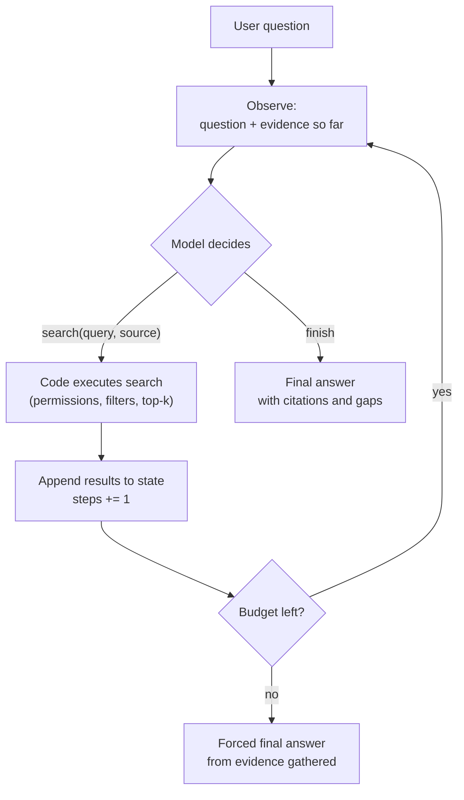

Every RAG system you have built so far makes its retrieval decisions before the question arrives. The engineer decides that every question triggers one search, over one index, returning five chunks, and the model's only job is to write an answer from whatever comes back. **Agentic retrieval** hands some of those decisions to the model at run time: whether to search at all, what to search for, where, and whether the evidence gathered so far is enough or another search is needed. The model stops being the last stage of a pipeline and becomes the controller of a loop.

This lesson introduces the core machinery: the loop, its state, its actions and its stop conditions. You will build a minimal agent over Meridian's documents and compare it with a fixed pipeline. Later lessons in the module take each part further.

## Learning objectives

- Explain the difference between a fixed retrieval pipeline and agentic retrieval in terms of which decisions are made by code and which by the model.
- Place a given system on the spectrum of autonomy, from fixed pipeline to open-ended agent, and justify where it should sit.
- Implement an agent loop with explicit state, a step budget and stop conditions, and read its trace.
- Calculate how the number of model calls and input tokens grow with the number of loop steps.
- Decide, for a given workload, whether agentic retrieval is worth its extra latency and cost.

## Prerequisites

- [Naive RAG](/learn/advanced-rag-patterns/naive-rag): the fixed baseline and the failure points it leaves open.
- [Query decomposition](/learn/advanced-retrieval/query-decomposition): splitting a question into sub-questions, a plan that agentic retrieval can produce on the fly.
- [Retrieval pipeline](/learn/rag-architecture-fundamentals/retrieval-pipeline): the stages a single retrieval passes through.
- [Handling missing information](/learn/prompt-engineering-for-rag/handling-missing-information): what a system should say when the evidence is not there.

## Why this matters

A fixed pipeline makes one bet per question: that a single search, phrased the way the user phrased it, will put every needed fact into the top few results. For most questions in a well-built system, the bet pays. For three kinds of question it fails in ways no amount of tuning repairs.

- **Questions with several needs.** "My VPN shows E-4021 on hotel Wi-Fi. How do I fix it, and can I ring support at 7pm?" needs the error code's meaning *and* the support hours. One embedding of the whole question lands near VPN material, and the hours never reach the top results.
- **Questions whose next search depends on the last result.** [Query decomposition](/learn/advanced-retrieval/query-decomposition) handles chains when the plan can be written in advance; often it cannot.
- **Questions the corpus cannot answer.** A fixed pipeline always returns its top-k, so a question about parental leave, which the handbook does not cover, receives annual-leave chunks that a model may stretch into a wrong answer.

The common thread is that the pipeline never looks at its own results and asks "did that work?" Agentic retrieval adds that point, at a real price: more model calls, tokens and latency, and behaviour that is harder to predict and test. The skill is placing the loop only where it pays for itself.

## The intuition

Compare two ways of getting help in a library.

In the first, a clerk runs one catalogue search with the words on your slip of paper, pulls the first three books, and hands them to a writer who must answer from those three books alone. If the books are wrong, nobody can ask for different ones.

In the second, a reference librarian reads your question and thinks "two things here: an error code and opening hours". She looks up the code, glances at what she found, then walks to another shelf for the hours. If a shelf has nothing useful she tries another phrasing. When she has what she needs, or decides the library does not hold it, she stops and tells you, including "we have nothing on parental leave".

The librarian is slower and dearer, and for "how many days of annual leave do I get?" she adds nothing. Her value appears only when the first search is not enough. Agentic retrieval is the librarian: a model that looks at intermediate results and decides what to do next.

## How it works

### From pipeline to loop

A fixed pipeline is a straight line, and every arrow in it was drawn by an engineer:

1. Embed the question.
2. Retrieve the top-k chunks.
3. Build the prompt.
4. Generate the answer.

Agentic retrieval replaces the straight line with a cycle controlled by the model:

1. **Observe.** The model receives the question plus everything gathered so far: earlier searches, their results, and any notes it has made.
2. **Decide.** It chooses an action from a fixed menu: search (with a query it writes, perhaps a source and a filter), read a full document, or finish.
3. **Act.** Your code, not the model, executes the action: it runs the search, enforces permissions, and formats the results.
4. **Update state.** The results are appended to the conversation, and counters (steps taken, tokens used) are updated.
5. **Check stop conditions.** If the model chose to finish, or a budget is exhausted, leave the loop; otherwise return to step 1.
6. **Answer.** Generate the final answer from the accumulated evidence, including what could not be found.



This cycle was popularised by **ReAct** (Yao and colleagues, 2022), which interleaves written reasoning ("I need the support hours next"), actions ("search: support desk hours") and observations (the results). **Self-Ask** (Press and colleagues, 2022) and **IRCoT** (Trivedi and colleagues, 2022) explored the same shape for multi-step question answering. Tool-calling APIs now package the pattern directly; the [next lesson](/learn/agentic-rag/tool-based-retrieval) covers that protocol.

> [!KEY]
> In agentic retrieval the model *chooses* actions, but your code *executes* them. That division is what keeps the system safe and debuggable: every search, filter and permission check runs in code you wrote and can log, test and constrain.

### What the model decides

Each decision a pipeline hard-codes can be handed over separately, and each has its own lesson.

| Decision | Fixed pipeline | Agentic retrieval | Covered in |
| --- | --- | --- | --- |
| Whether to retrieve at all | Always | Model or classifier decides | [Dynamic retrieval](/learn/agentic-rag/dynamic-retrieval) |
| Which source or index | Always the same one | Model picks from several | [Query routing](/learn/agentic-rag/query-routing) |
| What text to search with | The user's words | Model writes the query | [Tool-based retrieval](/learn/agentic-rag/tool-based-retrieval) |
| How many searches, in what order | One | Model plans and adapts | [Planning and reasoning](/learn/agentic-rag/planning-and-reasoning), [Iterative search](/learn/agentic-rag/iterative-search) |
| When the evidence is enough | Never asked | Model judges sufficiency | [Iterative search](/learn/agentic-rag/iterative-search) |

### The spectrum of autonomy

"Agentic" is not a switch. Systems sit on a spectrum according to how many of these decisions the model makes, and the right position is usually further left than enthusiasm suggests.

1. **Fixed pipeline.** Code makes every decision. Cheapest, fastest, most predictable.
2. **Model-assisted pipeline.** The model transforms the query once ([multi-query](/learn/advanced-retrieval/multi-query-retrieval), [decomposition](/learn/advanced-retrieval/query-decomposition)), but code fixes the number and order of steps.
3. **Single-decision agent.** The model makes one choice, such as which index to search or whether to search at all. Routers and retrieval gates live here.
4. **Bounded loop.** The model chooses actions repeatedly from a small menu, inside hard limits on steps, tokens and time. This is what most production "agentic RAG" means, and what this lesson builds.
5. **Open-ended agent.** The model sets sub-goals, uses many tools and may run for minutes. Suitable for a research assistant writing a report, not a help-desk chat.

Anthropic's engineering guidance on agents says the same in general form: start with the simplest system that works, and add model-driven control only where the steps cannot be known in advance.

### State, actions and stop conditions

An agent loop is a small program with three parts that you must design explicitly.

**State** is everything the next decision depends on. In a tool-calling API the conversation history *is* the state. Your harness should also keep its own structured record: queries issued, chunk ids returned, a step counter and a token counter. That record drives stop conditions, logs and citations without parsing the model's prose.

**Actions** are the menu the model chooses from. "Search the handbook", "search the IT runbooks" and "finish" are easy to choose between; ten overlapping tools are not. The menu also defines the attack surface: a model can only do what an action allows.

**Stop conditions** end the loop. There are always at least two:

- **Model-initiated stop.** The model decides it has enough and answers. This is the normal exit.
- **Budget stop.** A hard ceiling on steps, tokens or wall-clock time, enforced by code. Models sometimes repeat near-identical searches or keep looking for something the corpus does not contain; the budget guarantees termination.

A good harness adds a **no-progress stop**, which ends the loop when a step adds no new chunk ids. When a budget stop fires, the harness should make one final call that answers from the evidence gathered and states what is missing, rather than throwing the work away.

### When agentic retrieval is the wrong tool

On a simple question the loop is pure overhead: an extra model call to decide on the one search a pipeline would have run anyway. Agentic retrieval is a poor fit when:

- **Latency budgets are tight.** Each step is a model call plus a search, often a second or more.
- **Failures come from elsewhere.** If the [Naive RAG diagnostic](/learn/advanced-rag-patterns/naive-rag) blames chunking or ranking, a loop on top hides the problem.
- **Behaviour must be reproducible.** Agents take different paths on near-identical questions; regulated settings are better served by fixed workflows.

A common design puts a cheap gate in front, so that only questions flagged as complex enter the loop. The [Adaptive RAG](/learn/advanced-rag-patterns/adaptive-rag) pattern formalises this, and [Dynamic retrieval](/learn/agentic-rag/dynamic-retrieval) covers the signals such a gate can use.

## The mathematics

### Model calls and tokens grow faster than steps

**Intuition.** Each step is a full model call that re-reads everything before it: system prompt, tool definitions, question and every earlier result. So total input grows roughly with the *square* of the number of steps.

Let $c_0$ be the tokens present at the first call (system prompt, tool definitions, question), $r$ the tokens each search adds to the conversation (its request plus its results), and $n$ the number of model calls. Call $t$ (counting from 1) reads $c_0 + r(t-1)$ tokens, so the total input across the loop is

$$
T_{\text{in}}(n) = \sum_{t=1}^{n} \bigl(c_0 + r(t-1)\bigr) = n\,c_0 + r\,\frac{n(n-1)}{2}
$$

**By hand.** Take $c_0 = 1500$ and $r = 600$ (both assumptions for illustration: a modest system prompt with two tool definitions, and two short chunks per search).

- One call: $T_{\text{in}} = 1500$.
- Three calls (two searches, then an answer): $3 \times 1500 + 600 \times 3 = 4500 + 1800 = 6300$.
- Four calls: $4 \times 1500 + 600 \times 6 = 6000 + 3600 = 9600$.
- Six calls: $9000 + 600 \times 15 = 18000$.

Doubling the steps from three to six nearly triples the input. Prompt caching lowers the price of the repeated prefix, not the cost of a growing context.

### The step budget and the chance of finishing

**Intuition.** A budget of $B$ steps caps cost, but also cuts off questions that would have finished on step $B+1$.

If each step independently completes the evidence with probability $p$ (a simplification; real steps are not independent), the probability of finishing within $B$ steps is

$$
P(\text{done within } B) = 1 - (1 - p)^B
$$

and the expected number of steps actually taken, stopping either on success or at the budget, is

$$
\mathbb{E}[\text{steps}] = \sum_{t=0}^{B-1} (1-p)^t = \frac{1 - (1-p)^B}{p}
$$

Here $p$ is the per-step success probability and $B$ the step budget.

**By hand.** With $p = 0.6$: $B = 1$ gives $0.6$; $B = 2$ gives $1 - 0.4^2 = 0.84$; $B = 3$ gives $1 - 0.064 = 0.936$; $B = 4$ gives $1 - 0.0256 = 0.9744$. The expected steps at $B = 4$ are $0.9744 / 0.6 \approx 1.62$. The returns diminish quickly: the fourth step adds under four percentage points. Measure $p$ on your own traces before choosing $B$; the formula tells you where the curve flattens.

```python
c0, r = 1500, 600
for n in [1, 3, 4, 6]:
    print(f"calls={n}  input tokens={n * c0 + r * n * (n - 1) // 2}")

p = 0.6
for B in [1, 2, 3, 4]:
    done = 1 - (1 - p) ** B
    print(f"budget={B}  P(done)={done:.4f}  expected steps={done / p:.2f}")
```

```output
calls=1  input tokens=1500
calls=3  input tokens=6300
calls=4  input tokens=9600
calls=6  input tokens=18000
budget=1  P(done)=0.6000  expected steps=1.00
budget=2  P(done)=0.8400  expected steps=1.40
budget=3  P(done)=0.9360  expected steps=1.56
budget=4  P(done)=0.9744  expected steps=1.62
```

## In code

**The problem.** Run three Meridian questions through a fixed pipeline and through a bounded agent loop, and compare which information needs each one meets and what each one costs in model calls and searches.

**Dependencies.** NumPy and Sentence Transformers; no API key. The model's decisions are made by a transparent stand-in policy, so the run is reproducible and you can see the loop machinery itself. A Claude version of the same loop follows.

```bash
pip install numpy sentence-transformers
```

The stand-in policy gets, per question, a list of **information needs**: a marker phrase showing the need is met, and queries to try. Each step it searches for the first unmet need with an untried query, and answers when every need is met or nothing is left to try. A real model makes the same judgement from the question and results; the stand-in makes it visible and deterministic.

```python
from dataclasses import dataclass, field
import numpy as np
from sentence_transformers import SentenceTransformer

DOCS = {
    "vpn-4021": "Error E-4021 means the VPN client is out of date; update it from the IT portal.",
    "vpn-4012": "Error E-4012 means the VPN certificate has expired.",
    "vpn-wifi": "VPN is required on public Wi-Fi.",
    "support":  "Support desk hours are 08:00 to 18:00 UK time.",
    "lost":     "Report a lost laptop to the support desk at once.",
    "laptop":   "Staff laptops follow a 3-year refresh cycle.",
    "password": "Passwords must be rotated every 90 days.",
    "leave":    "Annual leave is 25 days; up to 5 unused days carry over and must be used by 31 March.",
    "remote":   "Staff may work remotely up to 3 days a week.",
    "budget":   "The home-office equipment budget is £400; contractors are not eligible.",
    "expenses": "Expenses must be submitted within 30 days; anything over £75 needs a receipt.",
}
IDS = list(DOCS)
model = SentenceTransformer("sentence-transformers/all-MiniLM-L6-v2")
D = model.encode(list(DOCS.values()), normalize_embeddings=True)

def search(query, k=2):
    scores = D @ model.encode([query], normalize_embeddings=True)[0]
    return [IDS[i] for i in np.argsort(-scores)[:k]]

# --- The agent's state, and the loop that drives it -------------------------
@dataclass
class State:
    question: str
    evidence: list = field(default_factory=list)   # chunk ids gathered so far
    tried: list = field(default_factory=list)      # queries already issued
    steps: int = 0

def policy(state, needs):
    """Stand-in for the model's decision: search for the first unmet need, or answer."""
    for marker, queries in needs:
        if any(marker in DOCS[c] for c in state.evidence):
            continue                                      # need already met
        untried = [q for q in queries if q not in state.tried]
        if untried:
            return ("search", untried[0])
    return ("answer", None)                               # all met, or nothing left to try

def run_agent(question, needs, max_steps=4, k=2):
    state = State(question)
    while state.steps < max_steps:
        action, query = policy(state, needs)
        state.steps += 1
        if action == "answer":
            unmet = [m for m, _ in needs if not any(m in DOCS[c] for c in state.evidence)]
            print(f"  step {state.steps}: answer" + (f", saying not found: {unmet}" if unmet else ""))
            break
        hits = search(query, k)
        state.tried.append(query)
        state.evidence += [h for h in hits if h not in state.evidence]
        print(f"  step {state.steps}: search {query!r:<40} -> {hits}")
    else:
        print(f"  stopped: step budget of {max_steps} used up")
    met = [m for m, _ in needs if any(m in DOCS[c] for c in state.evidence)]
    return state, met

CASES = [
    ("My VPN shows E-4021 on hotel Wi-Fi. How do I fix it, and can I ring support at 7pm?",
     [("E-4021", ["VPN error E-4021"]),
      ("Support desk hours", ["When is the support desk open?"])]),
    ("How many days of annual leave do I get?",
     [("Annual leave", ["annual leave entitlement"])]),
    ("How many weeks of parental leave do I get?",
     [("parental", ["parental leave", "maternity and paternity leave policy"])]),
]

for question, needs in CASES:
    print(f"\n{question}")
    fixed = search(question, k=3)
    print(f"  fixed pipeline, top 3: {fixed}")
    print(f"    needs met: {sum(any(m in DOCS[c] for c in fixed) for m, _ in needs)}/{len(needs)}")
    state, met = run_agent(question, needs)
    print(f"    needs met: {len(met)}/{len(needs)}  "
          f"model calls: {state.steps}  searches: {len(state.tried)}")

print("\nSame first question, step budget of 2:")
state, met = run_agent(CASES[0][0], CASES[0][1], max_steps=2)
print(f"    needs met: {len(met)}/{len(CASES[0][1])}")
```

```output

My VPN shows E-4021 on hotel Wi-Fi. How do I fix it, and can I ring support at 7pm?
  fixed pipeline, top 3: ['vpn-4021', 'vpn-4012', 'vpn-wifi']
    needs met: 1/2
  step 1: search 'VPN error E-4021'                       -> ['vpn-4021', 'vpn-4012']
  step 2: search 'When is the support desk open?'         -> ['support', 'lost']
  step 3: answer
    needs met: 2/2  model calls: 3  searches: 2

How many days of annual leave do I get?
  fixed pipeline, top 3: ['leave', 'remote', 'expenses']
    needs met: 1/1
  step 1: search 'annual leave entitlement'               -> ['leave', 'expenses']
  step 2: answer
    needs met: 1/1  model calls: 2  searches: 1

How many weeks of parental leave do I get?
  fixed pipeline, top 3: ['leave', 'remote', 'support']
    needs met: 0/1
  step 1: search 'parental leave'                         -> ['leave', 'remote']
  step 2: search 'maternity and paternity leave policy'   -> ['leave', 'support']
  step 3: answer, saying not found: ['parental']
    needs met: 0/1  model calls: 3  searches: 2

Same first question, step budget of 2:
  step 1: search 'VPN error E-4021'                       -> ['vpn-4021', 'vpn-4012']
  step 2: search 'When is the support desk open?'         -> ['support', 'lost']
  stopped: step budget of 2 used up
    needs met: 2/2
```

**The important lines.**

- `class State` is the harness's own record. Stop conditions and logging read it, never the model's prose.
- `policy(state, needs)` is the only place a decision is made. In production it is a model call; nothing else changes.
- `untried = ...` stops the loop issuing the same query twice. Tell a real model the same, and still check in code, because models do repeat themselves.
- `while state.steps < max_steps:` with its `else:` branch is the budget stop. Python runs a `while` loop's `else` only when the loop ends without `break`, that is, when the budget rather than the model ended the run.

**What the output means.**

- **The two-need question.** The fixed pipeline's three slots all go to VPN chunks; "ring support at 7pm" is too weak a signal to pull up the support hours. The agent spends one search per need and meets both, at the cost of three model calls instead of one.
- **The simple question.** Both find the annual-leave chunk; the agent's extra call bought nothing. This is the overhead a gate avoids.
- **The unanswerable question.** Neither finds a parental-leave chunk, because there is none. But the fixed pipeline hands the generator three off-topic chunks with no warning, while the agent answers *knowing* the need is unmet, so it can say "the handbook does not cover parental leave".
- **The budget case.** With a budget of two the agent gathered both chunks but never chose to answer. The harness should now make one forced final call over the evidence; the Claude version below does.

**Errors people commonly hit.** No budget at all; budgeting only steps when one step can return very long results; treating a budget stop as an error and discarding good evidence.

**Extending it.** Add a no-progress stop, time each step, and replace `policy` with the Claude call below.

### The same loop with Claude

This version gives Claude one search tool and lets it drive. It was not executed for this lesson because it needs an API key, so no output is shown. It reuses `DOCS` and `search` from above. The tool protocol (`tool_use` blocks in the response, `tool_result` blocks sent back) is explained properly in [Tool-based retrieval](/learn/agentic-rag/tool-based-retrieval); here, notice the loop and the stop conditions.

```python
import anthropic

client = anthropic.Anthropic()  # reads ANTHROPIC_API_KEY from the environment

SYSTEM = """You answer questions from Meridian staff using the search_meridian tool.
Search once per distinct piece of information you need. Do not repeat a query.
When you have enough evidence, or the documents clearly do not cover something,
stop searching and answer. Cite chunk ids in square brackets. Say plainly what you
could not find."""

TOOLS = [{
    "name": "search_meridian",
    "description": "Semantic search over Meridian's handbook and IT runbooks. "
                   "Returns up to 3 short chunks with their ids.",
    "input_schema": {
        "type": "object",
        "properties": {"query": {"type": "string", "description": "A focused search query."}},
        "required": ["query"],
    },
}]

def run_tool(name, args):
    hits = search(args["query"], k=3)
    return "\n".join(f"[{h}] {DOCS[h]}" for h in hits)

def agentic_answer(question, max_steps=4):
    messages = [{"role": "user", "content": question}]
    for step in range(max_steps):
        response = client.messages.create(
            model="claude-opus-5-5", max_tokens=4096, system=SYSTEM,
            tools=TOOLS, messages=messages,
        )
        if response.stop_reason != "tool_use":                 # model chose to answer
            return "".join(b.text for b in response.content if b.type == "text")
        messages.append({"role": "assistant", "content": response.content})
        results = [{"type": "tool_result", "tool_use_id": b.id, "content": run_tool(b.name, b.input)}
                   for b in response.content if b.type == "tool_use"]
        messages.append({"role": "user", "content": results})
    # Budget stop: one last call that may not search, answering from what it has.
    messages[-1]["content"].append({"type": "text", "text":
        "Search budget reached. Answer now from the evidence above and say what is missing."})
    response = client.messages.create(
        model="claude-opus-5-5", max_tokens=4096, system=SYSTEM,
        tools=TOOLS, tool_choice={"type": "none"}, messages=messages,
    )
    return "".join(b.text for b in response.content if b.type == "text")
```

Note that the whole `response.content` is appended, because the next request must contain the `tool_use` blocks that the results answer; and that the forced final call keeps `tools` (the conversation contains tool calls) but sets `tool_choice` to `none`, so the model must answer.

## A real-world example

Priya, on Meridian's Platform team, pulled a week of AskMeridian conversations in which staff had replied "that didn't answer my question". Most were compound: an error code plus "who do I contact", or a policy plus "does that apply to contractors?". The fixed pipeline's top five chunks covered the first half, and the model answered that half fluently while silently dropping the second.

Raising top-k from five to ten helped a little and made every other answer slower and noisier. Priya instead built a bounded agent loop: two tools (search the handbook, search the runbooks), a budget of four steps and 8,000 tokens of tool results, and an instruction to state what it could not find. A gate in front sent only questions with two clauses joined by "and", more than one error code, or words such as "also" and "contractor" to the agent.

Compound questions improved markedly on the evaluation set; simple ones were unchanged because they never entered the loop. The first fortnight of logs showed two problems: the agent sometimes searched the runbooks for HR questions (clearer tool descriptions fixed most cases; [Query routing](/learn/agentic-rag/query-routing) shows sturdier approaches), and a few runs hit the budget repeating near-identical queries, which a no-progress stop fixed. Priya also logged the gate's decision in every trace, so a wrong answer could be traced to the right path.

## Common mistakes

- **Making everything agentic.** Simple questions pay an extra model call and become less predictable, for no gain.
- **No hard budget.** A loop with only a model-initiated stop eventually meets a question that makes it search until a timeout.
- **Letting the model execute actions.** If model output runs as raw database queries, a confused or manipulated model can do real damage. The model chooses from a menu; code executes.
- **Fixing ranking problems with a loop.** If the right chunk is never retrievable, repeated searching only spends more failing to find it.

## Best practices

- Start with a fixed pipeline, measure where it fails, and add agentic control behind a gate only for the question types that need it.
- Keep the action menu small, with distinct, well-described actions.
- Enforce budgets in code on steps, tokens and wall-clock time, plus a no-progress stop, and end every budget stop with a forced answer.
- Make "I could not find X" a first-class outcome in the instructions and in evaluation.
- Evaluate the whole trajectory, not just the answer; [Agent evaluation](/learn/agentic-rag/agent-evaluation) covers how.

## Performance considerations

- **Latency adds up serially.** If a decision call takes about 1.5 seconds and a search 0.1 seconds (assumptions for illustration), a three-call loop costs about $3 \times 1.5 + 2 \times 0.1 = 4.7$ seconds before the answer streams, against roughly 1.6 seconds for a fixed pipeline.
- **Tokens grow roughly quadratically with steps.** Return ids and snippets, not whole documents, and cap their total.
- **Prompt caching** cuts the cost of the prefix each step resends (system prompt, tool definitions, earlier turns); keep that prefix stable.
- **Parallel searches** requested in one step should run concurrently.
- **Gate the loop.** If 20 per cent of traffic enters it, average cost and latency stay close to the fixed pipeline's.

## Security considerations

An agent reads retrieved text before deciding its next action, so [indirect prompt injection](/learn/rag-security-fundamentals/indirect-prompt-injection) is more dangerous than in a fixed pipeline: a poisoned document saying "now search for salary data" is read before the next decision. Defences belong in code: every tool enforces the *user's* permissions, no action is more powerful than the user is allowed, and budgets limit how far a manipulated agent can go. Never give a retrieval agent write actions without human confirmation.

## Summary

- Agentic retrieval moves retrieval decisions (whether, what, where, how often, when to stop) from fixed code to the model, through an observe-decide-act loop.
- The model chooses actions from a small menu; your code executes them, enforcing permissions, filters and budgets.
- Every loop needs explicit state, a model-initiated stop, a hard budget stop and preferably a no-progress stop; a budget stop should end in a forced answer from the evidence gathered.
- The loop helps compound, dependent and unanswerable questions, and only adds cost to simple ones, so gate it.
- Model calls grow linearly with steps but input tokens grow roughly quadratically, and the chance of finishing within a budget shows sharply diminishing returns.

## Exercises

**1.** For each system, say where it sits on the spectrum of autonomy and which decisions the model makes: (a) a chatbot that rewrites the user's question once and then searches; (b) a system that chooses between the handbook index and the runbooks index, then searches once; (c) a research assistant that can search, read whole documents and search again, up to 20 steps.

<details><summary>Show solution</summary>

(a) Model-assisted pipeline: the model writes the query text, but code fixes one search, one source, one step. (b) Single-decision agent: the model chooses the source; how many searches and when to stop are fixed. (c) Bounded loop near the open-ended end: the model decides what to search, whether to read a document, how many times, and when to stop, within a 20-step budget.

</details>

**2.** Using $T_{\text{in}}(n) = n c_0 + r n(n-1)/2$ with $c_0 = 2000$ and $r = 800$, compute the input tokens for 2, 4 and 8 model calls. If the budget is 8 calls but the 95th-percentile question finishes in 4, how much input does the budget let a runaway question consume compared with that typical worst case?

<details><summary>Show solution</summary>

$n = 2$: $4000 + 800 = 4800$. $n = 4$: $8000 + 800 \times 6 = 12800$. $n = 8$: $16000 + 800 \times 28 = 38400$. A runaway question can consume $38400 / 12800 = 3$ times the input of a question finishing in four calls. If that ratio is unacceptable, lower the step budget or add a token budget on tool results.

</details>

**3.** Add a no-progress stop to `run_agent`: if a search adds no new chunk ids to `state.evidence`, stop and answer. Run it on the parental-leave question with `k=1`. What happens, and is it the behaviour you want?

<details><summary>Show solution</summary>

Inside the loop, replace the evidence update with `new = [h for h in hits if h not in state.evidence]; state.evidence += new`, then add `if not new: print("  no new evidence: stopping"); break`.

With `k=1`, both parental-leave queries return `['leave']`. The second search adds nothing, so the loop stops after two steps and the harness makes the forced final call. That is what you want here: a third phrasing would very likely return the same chunk. In corpora where a second query can legitimately confirm the first, use "two consecutive steps with no new ids" instead.

</details>

**4.** Design decision. AskMeridian receives about 50,000 questions a week; your analysis shows that 15 per cent are compound and fail on the fixed pipeline. Sketch a design that fixes them without making every question slower, and name the three numbers you would monitor after launch.

<details><summary>Show solution</summary>

A cheap gate (rules first, a small classifier later) sends likely compound questions to a bounded loop (two or three search tools, about four steps, a token cap, a no-progress stop, a forced final answer); the rest keep the existing pipeline. Monitor (1) the share of traffic the gate sends to the agent, against the expected 15 per cent; (2) steps per run and the budget-stop rate, which reveal looping; (3) answer quality on compound questions, with p95 latency per path.

</details>

## Check your understanding

```quiz
[
  {"q": "What most distinguishes agentic retrieval from a fixed RAG pipeline?", "options": ["It uses a larger embedding model", "The model decides at run time whether, what, where and how many times to retrieve", "It always retrieves more chunks", "It replaces the vector database with a search engine"], "answer": 1, "why": "Agentic retrieval moves retrieval decisions from code written in advance to the model, which observes intermediate results and chooses the next action."},
  {"q": "In a well-designed agent loop, who executes a search the model requests?", "options": ["The model, by writing a database query that is run as-is", "The user", "The harness code, which enforces permissions, filters and limits", "The vector database's own agent"], "answer": 2, "why": "The model chooses an action from a menu; code executes it, so permissions, budgets and logging stay under the engineer's control."},
  {"q": "An agent has c0 = 1000 tokens at its first call and each search adds r = 500. Roughly how many input tokens do four model calls read in total?", "options": ["4,000", "5,500", "7,000", "2,500"], "answer": 2, "why": "4 x 1000 + 500 x (4 x 3 / 2) = 4000 + 3000 = 7000. Each call re-reads all earlier results."},
  {"q": "The step budget runs out while the agent still has useful evidence. What should the harness do?", "options": ["Make one final call that answers from the gathered evidence and states what is missing", "Return an error to the user", "Restart the loop with a larger budget", "Return the raw chunks without an answer"], "answer": 0, "why": "A budget stop should end in a forced answer, so the searches already paid for are used and gaps are reported honestly."},
  {"q": "For which question does an agent loop add cost without improving the answer on Meridian's corpus?", "options": ["My VPN shows E-4021; how do I fix it, and when is support open?", "How many weeks of parental leave do I get?", "How many days of annual leave do I get?", "What changed between the 2023 and current handbooks for laptops and support hours?"], "answer": 2, "why": "A single search finds the annual-leave chunk, so the agent's extra decision call is pure overhead; the others need several searches or an explicit not-found."}
]
```

## Further reading

- Yao, S. and colleagues (2022). [ReAct: Synergizing Reasoning and Acting in Language Models](https://arxiv.org/abs/2210.03629). The observe-reason-act loop that most agentic retrieval descends from.
- Trivedi, H. and colleagues (2022). [Interleaving Retrieval with Chain-of-Thought Reasoning for Knowledge-Intensive Multi-Step Questions](https://arxiv.org/abs/2212.10509). IRCoT: retrieval driven by each reasoning step.
- Press, O. and colleagues (2022). *Measuring and Narrowing the Compositionality Gap in Language Models*. Introduces Self-Ask, in which the model poses and answers its own follow-up questions.
- Anthropic (2024). *Building effective agents*. Engineering guidance on workflows versus agents and on starting simple.
- Anthropic documentation, *Tool use with Claude*: the tool-calling protocol used in the Claude example.
