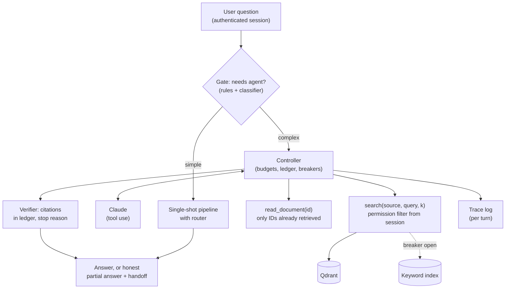

This assessment covers all nine lessons of **Agentic RAG**: agentic retrieval, tool-based retrieval, planning and reasoning, query routing, dynamic retrieval, iterative search, retrieval agents, agent evaluation and agent failure handling. Answer the 18 multiple-choice questions first; the pass mark is 70% (13 of 18). Then work through the conceptual questions, the coding exercises, the design challenge and the troubleshooting scenarios, writing your own answer before opening the model answer. The written parts are not scored, but they test whether you can build, measure and operate an agent rather than recognise its parts in a list. Any latencies, token counts or prices are assumptions for arithmetic practice.

```quiz
[
  {"q": "What distinguishes agentic retrieval from a fixed RAG pipeline?", "options": ["It uses a larger embedding model", "Decisions such as whether, what, where and how often to search move from fixed code to the model at run time", "It always retrieves more chunks", "It removes the need for a vector database"], "answer": 1, "why": "The defining change is who makes retrieval decisions: the model, inside a loop, rather than code written before the question arrived."},
  {"q": "Each model call in an agent loop re-reads the whole conversation. How does total input grow with the number of calls?", "options": ["Roughly with the square of the number of calls", "Linearly", "Logarithmically", "It stays constant thanks to the API"], "answer": 0, "why": "Call t reads everything from calls 1 to t-1 plus its own new content, so the sum grows quadratically."},
  {"q": "Which tool argument must never be supplied by the model?", "options": ["The search query", "The number of results k, within a bounded range", "The user's tenant or permission groups", "The source to search, from an enumeration"], "answer": 2, "why": "Identity and permissions come from the authenticated session; letting the model set them lets an injected instruction widen access."},
  {"q": "A search tool finds nothing relevant. What should it return?", "options": ["An empty string", "The five closest chunks, however weak", "An is_error result", "An explicit 'No results' message the model can act on"], "answer": 3, "why": "An explicit empty result is informative; weak matches mislead, and an error flag would wrongly suggest a failure."},
  {"q": "Compared with interleaved (ReAct-style) agents, what is the main weakness of plan-and-execute?", "options": ["It cannot react to what the searches return", "It makes more model calls", "It cannot use tools", "It cannot cite sources"], "answer": 0, "why": "The whole plan is written before any search, so surprising or failed results do not change it unless replanning is added."},
  {"q": "A router sends queries to one of three collections. Which measure bounds end-to-end answer quality when the router may search several routes?", "options": ["Top-1 router accuracy", "Route recall: the share of queries whose correct route is among those searched", "Average router confidence", "Number of routes"], "answer": 1, "why": "A route that is never searched cannot contribute evidence, so whether the correct route was searched sets the ceiling."},
  {"q": "A retrieval costs 1 unit and a wrong answer costs 200. Above what probability that a message needs documents should the system retrieve?", "options": ["0.5", "0.2", "0.005", "0.05"], "answer": 2, "why": "Retrieve when p > C/L = 1/200 = 0.005: when wrong answers are expensive, almost every message should trigger retrieval."},
  {"q": "What triggers a new retrieval in FLARE?", "options": ["A fixed interval of 100 tokens", "The user pressing a button", "A router classifying the query as complex", "The upcoming draft sentence containing low-probability tokens"], "answer": 3, "why": "FLARE looks ahead, and retrieves when the model's draft of the next sentence contains tokens it is unsure about."},
  {"q": "What does this code print?\n```python\nseen = {\"a\", \"b\"}\nhits = [\"b\", \"c\", \"d\", \"a\"]\nnew = [h for h in hits if h not in seen]\nprint(len(new) / len(hits))\n```", "options": ["0.5", "0.25", "2", "0.75"], "answer": 0, "why": "Two of the four hits (c and d) are new, so novelty is 2/4 = 0.5."},
  {"q": "\"AskMeridian search is broken; where do I report it?\" needs a chunk saying the Qdrant cluster is run by the Platform team. Why does raising top-k from 5 to 20 rarely retrieve it?", "options": ["Qdrant cannot return 20 results", "The chunk resembles a fact revealed by the first hop (the bridge entity), not the question itself", "Larger k lowers every similarity score", "The chunk is too long to embed"], "answer": 1, "why": "Multi-hop links share little with the question; they become findable once a query names the bridge entity discovered in earlier evidence."},
  {"q": "Which method uses each newly generated reasoning sentence as the next retrieval query?", "options": ["Iter-RetGen", "Self-Ask", "IRCoT", "Multi-query retrieval"], "answer": 2, "why": "IRCoT interleaves retrieval with chain-of-thought, querying with each new reasoning step."},
  {"q": "A model returns three tool_use blocks in one response. How should the controller reply?", "options": ["One user message containing three tool_result blocks with matching tool_use_id values", "Three separate user messages", "One text message summarising the results", "Only the results that succeeded"], "answer": 0, "why": "All results for a turn go back together, each matched by id; failed calls still get a result marked is_error."},
  {"q": "An agent's final answer cites [rb-desk]. The chunk exists and the fact is true, but no tool returned it in this run. What should happen?", "options": ["Show the answer; the fact is correct", "Show the answer; the chunk exists", "Treat the citation as unsupported and revise, caveat or remove the sentence", "Delete the chunk from the index"], "answer": 2, "why": "Grounding means evidence retrieved in this run. Only the evidence ledger can confirm that, and an unsupported citation must be handled before display."},
  {"q": "What does this code print?\n```python\nfrom math import comb\nn, c, k = 5, 3, 2\nprint(comb(c, k) / comb(n, k))\n```", "options": ["0.6", "0.9", "0.1", "0.3"], "answer": 3, "why": "This is pass^2 for 3 successes in 5 runs: C(3,2)/C(5,2) = 3/10 = 0.3."},
  {"q": "When comparing two agent versions run five times on each of 40 tasks, what should the bootstrap resample?", "options": ["Individual runs, all 200 of them", "Tasks, using each task's per-version difference", "Tokens within each answer", "Nothing; compare the two pooled rates directly"], "answer": 1, "why": "Runs of the same task are correlated. Resampling tasks treats each task as one unit of evidence and keeps the comparison paired."},
  {"q": "What does this code print?\n```python\nwaits = [min(1.0, 0.25 * 2 ** a) for a in range(4)]\nprint(sum(waits))\n```", "options": ["3.75", "2.75", "1.75", "4.0"], "answer": 1, "why": "The maximum backoff waits are 0.25, 0.5, 1.0 and then the cap 1.0, which sum to 2.75 seconds."},
  {"q": "During a vector-store outage, the search wrapper returns an empty list after its retries fail, and the agent answers 'Meridian has no policy on this'. What is the root mistake?", "options": ["Too few retries", "The model is too small", "The breaker cooldown is too long", "An infrastructure failure was presented to the model as an absence of evidence"], "answer": 3, "why": "'Search failed' and 'nothing found' must be different observations; the fix is a distinct is_error result and an honest degraded answer."},
  {"q": "A client library retries twice internally and your wrapper retries it three times. How many backend attempts can one logical call make?", "options": ["12", "5", "6", "9"], "answer": 0, "why": "Retries multiply across layers: (2 + 1) x (3 + 1) = 12. Retry in one layer only."}
]
```

## Conceptual questions

**1.** Explain the difference between query decomposition, iterative search and a retrieval agent, using one Meridian question that suits each. When would you choose the simplest of the three?

<details><summary>Show model answer</summary>

**Query decomposition** plans sub-questions from the question alone, before any search: "Compare the 2023 and current handbook on laptop cycle, equipment budget and support hours" splits into six known lookups. **Iterative search** forms each next query from what the previous evidence revealed, because the later queries cannot be written in advance: "AskMeridian search is broken; where do I report it?" needs the bridge entities "Qdrant cluster" and then "Platform team", which only appear in retrieved chunks. A **retrieval agent** puts a model in a loop over several tools and lets it choose tools, arguments and when to stop; iterative search is one of its behaviours. It suits mixed traffic: "I'm in a café and my VPN shows E-4021; do I need the VPN here and how do I fix it?" needs one handbook and one runbook search, while "how many days of leave do I get?" needs one.

Choose the simplest design that covers the traffic. If nearly all questions need one search of one source, a pipeline with a router is cheaper, faster and easier to test. Use decomposition when the parts can be named from the question, iterative search when they cannot, and an agent when the number and kind of searches vary per question.

</details>

**2.** List the stopping rules an agent loop needs, and for each say which failure it prevents. Which one must never be omitted, and why?

<details><summary>Show model answer</summary>

- **Model-initiated stop (sufficiency)**: the model judges the evidence enough and answers. Prevents wasted steps after the answer is found, but is the least reliable: models stop early on plausible partial evidence.
- **No-progress (novelty) stop**: a step adds no new chunk. Prevents circling on the same chunks.
- **Lead exhaustion**: no new entity or gap to search for. Prevents aimless queries.
- **Budget stop**: turns, tool calls, tokens or time exhausted. Prevents runaway cost and latency.

The budget must never be omitted, because it is the only rule that does not depend on the model or the corpus behaving well. On unanswerable questions it is usually the rule that fires. When it fires, the controller should force a final answer from the evidence gathered (with tools disabled) and state what is missing.

</details>

**3.** Why should an agent's trajectory usually be graded with constraints and evidence recall rather than against a reference sequence of tool calls? Give one case where order genuinely matters.

<details><summary>Show model answer</summary>

Many paths are equally good. For a question needing a handbook policy and a runbook procedure, searching either first, or both in parallel, gathers the same evidence; an exact-path grader fails all but one of these and rewards matching the evaluator's habits. Constraints ("retrieves `rb-4021` at some point", "never calls `read_document` on an ID not returned by search", "at most six tool calls", "ends with `end_turn`") accept every good path and reject bad ones, and evidence recall over the whole run separates "never found the evidence" from "found it and answered wrongly".

Order matters when one call depends on another's output: a `read_document` call needs an ID that only an earlier search can return, or a lookup needs a document version that a previous step must establish. There a "must happen after" constraint is appropriate, still without fixing the rest of the path.

</details>

**4.** A teammate argues that because the Anthropic API can enforce a tool's JSON schema, the controller no longer needs to validate tool arguments. Respond.

<details><summary>Show model answer</summary>

Schema enforcement reduces malformed calls but does not replace validation in code, for three reasons. First, a JSON schema cannot express every rule: whether a document ID was returned earlier in this run, whether this user may read it, whether a date range makes sense. Second, enforcement is a feature of a particular API mode and model, with its own supported subset of schema keywords; code that assumes it holds everywhere breaks when the deployment changes. Third, validation in code is where you produce the specific, actionable `is_error` message that lets the model correct itself, and where you count consecutive errors to decide when to degrade. Keep one typed model per tool as the single source of both the schema and the validation, and treat enforcement as a helpful extra layer.

</details>

## Coding exercises

### Exercise 1: audit a trajectory

Write `audit(trace)` for a logged agent run. It should print the novelty of each step, and return findings for: duplicate queries (same words in any order), an abnormal stop reason, and any citation in the answer that no step retrieved. Run it on this trace.

```python
trace = {
    "question": "Who do I contact about AskMeridian being down, and when?",
    "steps": [
        {"query": "AskMeridian outage contact", "hits": ["ask-01", "sup-04"]},
        {"query": "Qdrant cluster owner", "hits": ["qdr-02", "ask-01"]},
        {"query": "owner Qdrant cluster", "hits": ["qdr-02", "ask-01"]},
        {"query": "Platform team incidents", "hits": ["plt-03", "qdr-02"]},
    ],
    "stop_reason": "end_turn",
    "answer": "Report it in #platform-incidents [plt-03]; the Platform team runs the Qdrant "
              "cluster behind AskMeridian [qdr-02][ask-01], and is on call around the clock [plt-oncall].",
}
```

<details><summary>Show solution</summary>

```python
import re

trace = {
    "question": "Who do I contact about AskMeridian being down, and when?",
    "steps": [
        {"query": "AskMeridian outage contact", "hits": ["ask-01", "sup-04"]},
        {"query": "Qdrant cluster owner", "hits": ["qdr-02", "ask-01"]},
        {"query": "owner Qdrant cluster", "hits": ["qdr-02", "ask-01"]},
        {"query": "Platform team incidents", "hits": ["plt-03", "qdr-02"]},
    ],
    "stop_reason": "end_turn",
    "answer": "Report it in #platform-incidents [plt-03]; the Platform team runs the Qdrant "
              "cluster behind AskMeridian [qdr-02][ask-01], and is on call around the clock [plt-oncall].",
}

def audit(trace):
    evidence, seen_queries, findings = set(), set(), []
    for i, step in enumerate(trace["steps"], 1):
        key = " ".join(sorted(re.findall(r"\w+", step["query"].lower())))
        if key in seen_queries:
            findings.append(f"step {i}: duplicate query {step['query']!r}")
        seen_queries.add(key)
        new = [h for h in step["hits"] if h not in evidence]
        evidence.update(step["hits"])
        print(f"step {i}: novelty {len(new) / len(step['hits']):.2f}  new={new}")
    if trace["stop_reason"] != "end_turn":
        findings.append(f"abnormal stop: {trace['stop_reason']}")
    cited = set(re.findall(r"\[([a-z0-9-]+)\]", trace["answer"]))
    for cid in sorted(cited - evidence):
        findings.append(f"unsupported citation [{cid}]")
    return findings

for finding in audit(trace):
    print("FINDING:", finding)
```

```output
step 1: novelty 1.00  new=['ask-01', 'sup-04']
step 2: novelty 0.50  new=['qdr-02']
step 3: novelty 0.00  new=[]
step 4: novelty 0.50  new=['plt-03']
FINDING: step 3: duplicate query 'owner Qdrant cluster'
FINDING: unsupported citation [plt-oncall]
```

Step 3 repeated step 2's query with the words reordered, and its novelty of 0.00 confirms it added nothing. The answer's final clause cites `[plt-oncall]`, which no step retrieved; the claim happens to match `plt-03`'s text, so the right fix is to re-cite it, but the verifier cannot know that and correctly flags it. Note that the duplicate check normalises to a sorted word list: "Qdrant cluster owner" and "owner Qdrant cluster" collide, while a paraphrase such as "who runs Qdrant" would not, which is the limit of this cheap detector.

</details>

### Exercise 2: is the new agent better?

Two agent versions were each run five times on six tasks (1 = success). Compute pass@1 and pass^3 for each version, and a 95% bootstrap interval for the per-task difference in success rate. Then say whether you would ship the new version.

```python
runs = {
    "leave":      ([1, 1, 1, 1, 1], [1, 1, 1, 1, 1]),
    "vpn-4021":   ([1, 0, 1, 1, 0], [1, 1, 1, 1, 1]),
    "askm-owner": ([0, 0, 1, 0, 0], [1, 0, 1, 1, 0]),
    "expenses":   ([1, 1, 1, 1, 1], [1, 1, 0, 1, 1]),
    "no-answer":  ([1, 1, 1, 1, 0], [0, 1, 0, 0, 1]),
    "relay-sso":  ([1, 1, 0, 1, 1], [1, 1, 1, 1, 1]),
}
```

<details><summary>Show solution</summary>

```python
from math import comb
import numpy as np

# 1 = success. Five runs per task for the current agent (old) and a candidate (new).
runs = {
    "leave":      ([1, 1, 1, 1, 1], [1, 1, 1, 1, 1]),
    "vpn-4021":   ([1, 0, 1, 1, 0], [1, 1, 1, 1, 1]),
    "askm-owner": ([0, 0, 1, 0, 0], [1, 0, 1, 1, 0]),
    "expenses":   ([1, 1, 1, 1, 1], [1, 1, 0, 1, 1]),
    "no-answer":  ([1, 1, 1, 1, 0], [0, 1, 0, 0, 1]),
    "relay-sso":  ([1, 1, 0, 1, 1], [1, 1, 1, 1, 1]),
}

def pass_hat(results, k):
    n, c = len(results), sum(results)
    return comb(c, k) / comb(n, k)

for name, idx in (("old", 0), ("new", 1)):
    p1 = np.mean([np.mean(r[idx]) for r in runs.values()])
    p3 = np.mean([pass_hat(r[idx], 3) for r in runs.values()])
    print(f"{name}: pass@1 {p1:.3f}  pass^3 {p3:.3f}")

diffs = np.array([np.mean(new) - np.mean(old) for old, new in runs.values()])
rng = np.random.default_rng(0)
boot = [rng.choice(diffs, len(diffs)).mean() for _ in range(10_000)]
print(f"new - old: {diffs.mean():+.3f}  95% CI [{np.percentile(boot, 2.5):+.3f}, {np.percentile(boot, 97.5):+.3f}]")
print("per task:", {t: round(float(d), 1) for t, d in zip(runs, diffs)})
```

```output
old: pass@1 0.733  pass^3 0.483
new: pass@1 0.800  pass^3 0.583
new - old: +0.067  95% CI [-0.167, +0.300]
per task: {'leave': 0.0, 'vpn-4021': 0.4, 'askm-owner': 0.4, 'expenses': -0.2, 'no-answer': -0.4, 'relay-sso': 0.2}
```

The new version is better on pass@1 (0.800 against 0.733) and on pass^3 (0.583 against 0.483), but the bootstrap interval for the difference, from about $-0.17$ to $+0.30$, comfortably includes zero: six tasks cannot distinguish a real gain from noise. The per-task view matters more. The new version gains on the multi-hop task (`askm-owner`) and the error-code task, and loses badly on `no-answer`, where it now answers a question the corpus cannot answer on three runs of five. Do not ship on this evidence. Add tasks, especially unanswerable ones, investigate why refusals fell (often a prompt that pushes the model to be helpful), and re-run.

</details>

## Architecture design challenge

Meridian wants to extend AskMeridian with an agent mode for engineering staff. Questions span the IT runbooks, the employee handbook and the product documentation for Meridian Sync, Meridian Relay and Meridian Reports; some need one search, some need two or three sources, and ownership questions need multi-hop search. Requirements: answers must cite chunks retrieved in the same run; each user may only retrieve documents their groups allow; the 95th-percentile latency target is 8 seconds; the system must keep answering, honestly, when the Qdrant cluster is degraded; and the Platform team must be able to show, before each release, that a change has not made the agent worse. Design the system: components, tools, control flow, budgets, failure handling and evaluation.

<details><summary>Show reference design</summary>



**Gate first.** Most questions are single-source and single-hop. A rule layer (error-code patterns, "who owns", "which team") plus a small classifier sends only complex questions to the agent; the rest use the existing pipeline with a [query router](/learn/agentic-rag/query-routing). This protects the latency target for the majority.

**Tools.** One `search` tool with a `source` enumeration (`handbook`, `runbooks`, `products`, `any`), a bounded `k` (1 to 5) and an optional `product` filter for the product docs; and `read_document(id)`, which accepts only IDs already in the run's ledger. The permission filter is applied inside both tools from the authenticated session; no identity or group arguments are exposed. Results carry stable chunk IDs, short snippets, and an explicit "no results".

**Controller.** The Messages API tool-use loop: parallel tool calls executed concurrently, all results returned in one message, every stop reason other than `end_turn` treated as abnormal. Budgets: at most 4 model turns, 6 tool calls and 7 seconds of wall-clock time, set from traces and checked before each call; on exhaustion, a final call with `tool_choice` set to `none` and a note to state what is missing. Duplicate-query and zero-novelty detection return `is_error` results suggesting a different query or an answer.

**Grounding.** An evidence ledger maps chunk IDs to retrieved text. The verifier extracts citations; unsupported ones trigger one revision request with the allowed IDs, then removal plus a caveat. A sampled faithfulness judge checks that cited chunks support their sentences.

**Failure handling.** Retries only for transient errors, in one layer, with full jitter and a 500 ms per-attempt timeout for search. A shared circuit breaker per backend; when Qdrant's is open, search falls back to the keyword index with the same permission filter. The degradation ladder ends in an honest partial answer and a pointer to the support desk (08:00 to 18:00 UK time). Failures are never returned as empty results.

**Evaluation.** A task set of a few hundred real questions with gold evidence IDs and slice labels (single-hop, multi-hop, multi-source, unanswerable, adversarial with injected instructions, restricted-permission users). Each task runs five times per version. Report pass@1 with intervals, pass^3, evidence recall, citation validity, correct refusals, tool calls and latency percentiles per slice, and compare versions with a task-level bootstrap. A 50-task subset runs on every change; the full set before release; a fault-injection run takes the vector store down mid-run.

**Trade-offs.** The gate risks sending a complex question down the simple path; log gate decisions and review answers flagged unhelpful. Tight budgets protect latency but cut off rare four-hop questions; the forced, caveated answer is the mitigation. The keyword fallback is weaker on paraphrased questions, accepted because it is used only during outages. Five runs per task make evaluation several times more expensive than single runs, which is the price of decisions that are not made on noise.

</details>

## Troubleshooting scenarios

### Scenario 1: the agent never searches the runbooks

After a prompt change, AskMeridian's agent answers VPN error questions from the handbook's general IT policy. Traces show it calls `search_handbook` once and answers, never calling `search_runbooks`. Offline success on error-code tasks fell, but the overall success rate barely moved.

<details><summary>Show diagnosis and fix</summary>

**Diagnosis.** A tool-choice failure hidden by pooled metrics. The model chooses tools from their names and descriptions, so the likeliest cause is that the prompt change, or a description edit made with it, blurred which tool covers error codes; the handbook chunk on VPN use is a plausible-looking answer, so the model stops after one search (premature sufficiency). The overall rate hid it because error-code tasks are a small slice.

**Fix.** Rewrite the tool descriptions to state what each source contains and when to use it ("runbooks: IT procedures, error codes such as E-4021, troubleshooting steps"). Add a trajectory constraint to error-code tasks ("must search runbooks") and report that slice separately. Optionally route identifier-shaped queries to the runbooks with a rule before the agent sees them. Re-run the evaluation with several trials per task and compare per slice.

</details>

### Scenario 2: latency spikes and empty answers during maintenance

During a Qdrant rolling upgrade, agent latency at the 95th percentile jumped from 6 to over 40 seconds, the cluster's load rose sharply, and several users were told that Meridian "has no documented policy" on topics that are well documented.

<details><summary>Show diagnosis and fix</summary>

**Diagnosis.** Three compounding faults. Retries were layered (the client library's own retries inside a wrapper's retries), multiplying attempts per logical call and loading the recovering cluster. Retries had no jitter, so concurrent runs retried in waves. And when retries were exhausted the wrapper returned an empty list, which the model read as "no documents exist".

**Fix.** Retry in one layer only, with a small bound, exponential backoff and full jitter, and a per-attempt timeout set from observed search latency. Add a shared circuit breaker per backend so that a sustained outage produces fast failures. Return a distinct `is_error` result ("search is temporarily unavailable; answer from the evidence you have and say what could not be checked") and fall back to the keyword index where available. Add a fault-injection case to the evaluation suite that checks every answer either cites evidence or states what was unavailable.

</details>

### Scenario 3: the new version looks better, then users complain

A new agent prompt scored 36 of 40 on the offline set against the old prompt's 33, with one run per task, and was shipped. Within a week, staff reported confident answers to questions Meridian's documents do not cover, such as gym discounts, each citing an unrelated handbook chunk.

<details><summary>Show diagnosis and fix</summary>

**Diagnosis.** An evaluation design failure. One run per task made a three-task difference indistinguishable from noise, and the pooled score hid a regression on the unanswerable slice: the new prompt made the model more eager to answer, so it answered from general knowledge and attached a citation from its ledger. Citation membership checks pass in this case (the cited chunk *was* retrieved), so only a faithfulness check catches it.

**Fix.** Run each task several times, compare versions per task with a bootstrap over tasks, and report the unanswerable slice separately with its correct-refusal rate. Add a faithfulness judge on cited sentences, validated against a hand-labelled sample. In the prompt, require an explicit "not found in Meridian's documents" answer when no retrieved chunk addresses the question, and add more unanswerable tasks to the set before re-evaluating.

</details>
