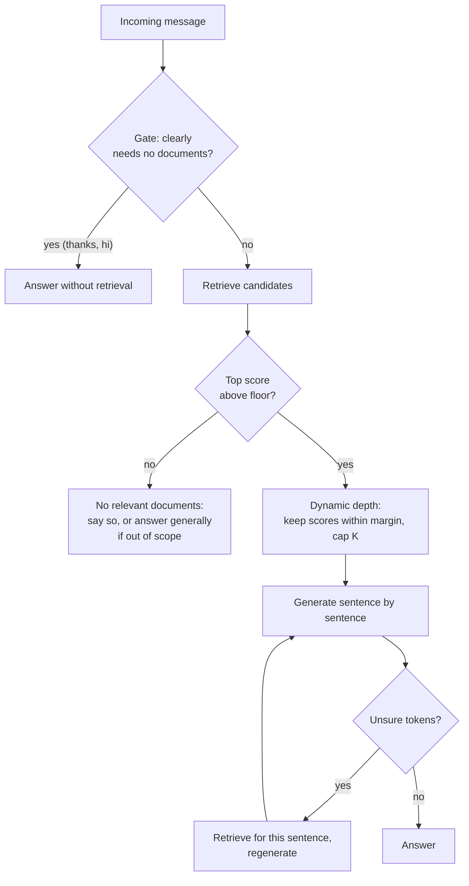

A fixed pipeline retrieves the same way for every message: one search, top five, every time. That is wasteful for "thanks, that's all!", too little for a question with three parts, and badly timed for a long answer whose fourth sentence needs a fact the first search never fetched. **Dynamic retrieval** makes three decisions at run time instead of at design time: *whether* to retrieve for this message, *how much* evidence to keep, and *when* during generation to retrieve again.

This lesson covers the signals those decisions can be based on (the query itself, the retrieval scores, and the model's own uncertainty), the research methods built on them (FLARE, Self-RAG and adaptive retrieval by popularity), and a decision rule that tells you how cautious a retrieval gate should be. You will build a gate with dynamic depth over Meridian's handbook, watch where it works and where scores alone mislead it, and simulate retrieval triggered by low-confidence tokens during generation.

## Learning objectives

- Distinguish the three dynamic-retrieval decisions (whether, how much, when) and the signals each can use.
- Implement a retrieval gate and a dynamic-depth rule based on score floors and margins, and identify the cases they get wrong.
- Explain how FLARE triggers retrieval from low-probability tokens during generation, and what that requires from the model API.
- Derive the retrieve-or-skip threshold from the cost of retrieving and the cost of a wrong answer.
- Decide how aggressively an enterprise assistant should skip retrieval.

## Prerequisites

- [Agentic retrieval](/learn/agentic-rag/agentic-retrieval): model-driven control of retrieval and the spectrum of autonomy.
- [Query routing](/learn/agentic-rag/query-routing): deciding where to retrieve from, the decision that sits next to this one.
- [Score calibration](/learn/advanced-retrieval-optimisation/score-calibration): why raw similarity scores are not probabilities.
- [Top-K retrieval](/learn/retrieval-fundamentals/top-k-retrieval): the fixed-depth baseline that dynamic depth replaces.

## Why this matters

Fixed retrieval makes the same choice for very different messages, and each mismatch has a cost:

- **Retrieving when nothing is needed.** "Thanks, that's all!" triggers a search whose results the model must then politely ignore. It costs a search, a few hundred context tokens and some latency, and occasionally the model tries to use the irrelevant chunks.
- **Too much evidence.** A fixed top-5 for "How many days of annual leave do I get?" adds four chunks that do not help. The [lost-in-the-middle](/learn/context-engineering/lost-in-the-middle-problem) effect and plain distraction mean irrelevant context can make answers worse, not just slower.
- **Too little evidence.** A fixed top-1 or a strict cut-off drops the second fact of a compound question.
- **Retrieving at the wrong time.** A long answer drafted from one up-front search can drift into facts that were never retrieved, and the model fills them from its own memory, which for Meridian-specific facts means invention.

Dynamic retrieval adjusts to each message. But its decisions are made from imperfect signals, and its most dangerous mistake, skipping retrieval when the answer depended on company documents, produces confident, wrong answers. Much of the engineering is deciding how cautious to be.

## The intuition

Consider an experienced HR adviser answering staff by email. "Thanks!" gets "You're welcome" with no lookup. "How much annual leave do I get?" she knows is in the handbook, so she checks the one paragraph, quotes it and stops; she does not attach the whole leave chapter. "Can I carry over leave and claim my home desk?" makes her check two sections. And when, halfway through writing a reply, she types "carried-over days must be used by..." and realises she is not sure of the date, she stops and looks it up before finishing the sentence.

Three different judgements: whether to look anything up, how much to quote, and when uncertainty mid-answer calls for another look. Each is driven by a signal she can feel: the message is small talk; the first paragraph clearly answers it; she is unsure of a specific detail. Dynamic retrieval tries to give a system the same signals.

## How it works

### Three decisions and their signals

| Decision | Question it answers | Signals available |
| --- | --- | --- |
| Whether | Should this message trigger retrieval at all? | Query features (small talk, general knowledge); a classifier; the model's own choice; retrieval scores after a cheap search |
| How much | How many retrieved chunks are worth keeping? | Score distribution: absolute floor, gap from the top score, a hard cap |
| When | During generation, is more evidence needed now? | Token probabilities of the draft; the model requesting a search mid-answer |

The signals come from three places:

1. **The query.** Cheap, available before any search, and good for obvious cases: greetings, thanks, "what does VPN stand for?". Rules or a small classifier read them.
2. **The retrieval.** After a cheap search, the score distribution says something about the match: a very low top score suggests nothing relevant exists; a steep drop after the first result suggests one chunk is enough. Scores are relative, not probabilities, so thresholds must be set on your own data, as [Score calibration](/learn/advanced-retrieval-optimisation/score-calibration) and [Retrieval thresholding](/learn/advanced-retrieval-optimisation/retrieval-thresholding) explain.
3. **The model.** A model can be asked whether it needs to look something up; in an agent with search tools, deciding whether to call a tool is exactly this decision. Some models also expose **token probabilities**, a direct measure of how sure the model was of each word it generated.

### Whether: the retrieval gate

A **retrieval gate** sits in front of retrieval and decides whether to search. The research literature offers several designs:

- **Popularity-based.** Mallen and colleagues (2023) found that language models answer questions about popular entities well from memory but are unreliable on less popular ones, where retrieval helps most, and proposed retrieving only for questions about less popular entities. The insight transfers: for an enterprise assistant, almost every substantive question concerns "unpopular" knowledge (Meridian's own policies) that no model saw in training.
- **Learned gates.** **Self-RAG** (Asai and colleagues, 2023) trains a model to emit special reflection tokens, including one that signals whether retrieval is needed at a given point, and others that judge whether retrieved passages are relevant and whether the output is supported by them. This requires a specially trained model.
- **Complexity classifiers.** [Adaptive RAG](/learn/advanced-rag-patterns/adaptive-rag) classifies questions as needing no retrieval, a single search, or multi-step retrieval, and routes them accordingly.
- **Model choice.** In a tool-using agent, the model decides whether to call the search tool at all. This is the simplest gate to build and the hardest to control, because the model may answer from memory when it should have searched; instructions such as "always search before answering questions about Meridian" are needed.

For an enterprise assistant the safe pattern is a **conservative gate**: skip retrieval only for messages that clearly need none (greetings, thanks, requests to rephrase the previous answer), and otherwise retrieve. The mathematics below shows why.

### How much: dynamic depth

Once retrieval has run, **dynamic depth** keeps a variable number of chunks instead of a fixed $k$. A simple, robust rule combines three limits:

1. An **absolute floor** $f$: drop any chunk scoring below it. If even the top chunk is below the floor, treat the retrieval as having found nothing relevant.
2. A **relative margin** $m$: drop any chunk scoring more than $m$ below the top chunk. A clear winner then travels alone; several similar scores are kept together.
3. A **hard cap** $K$: never keep more than $K$ chunks, whatever the scores.

So chunk $i$, with score $s_i$ and the top score $s_1$, is kept if

$$
s_i \ge \max(f,\; s_1 - m) \quad\text{and}\quad i \le K
$$

The floor guards against off-topic retrieval, the margin trims weak tails, and the cap bounds cost. The weakness of the margin, as the code will show, is compound questions: their second topic naturally scores lower than the first, and a margin designed to trim noise trims it too.

### When: retrieval during generation

The third decision applies to long answers. Instead of retrieving once before generating, the system retrieves again whenever the model is about to state something it is unsure of. **FLARE** (Forward-Looking Active REtrieval, Jiang and colleagues, 2023) does this as follows:

1. Generate a tentative next sentence.
2. If every token in it has probability above a threshold $\theta$, accept it and continue.
3. Otherwise, form a search query from the sentence, either by masking the low-probability tokens or by generating a question about them, and retrieve.
4. Regenerate the sentence with the new evidence, accept it, and continue from step 1.

The idea is that low token probability marks exactly the details the model is guessing, such as a date or an amount, and that the confident part of the sentence is a good query for the missing detail. Later work, such as **DRAGIN** (Su and colleagues, 2024), refines when to trigger and how to form the query using the model's attention as well as its uncertainty.

FLARE-style methods need access to token probabilities at generation time. Not every hosted model API exposes them, so check yours before designing around them. Where they are not available, the same "retrieve when needed mid-answer" behaviour is obtained agentically: the model has a search tool, and the instructions tell it to search before stating any specific figure, date or rule it has not seen in the retrieved evidence. That is less fine-grained than token-level triggering but works with any tool-calling model.



### What dynamic retrieval cannot tell from scores

A low top score is good evidence that the corpus has nothing on the topic. A *moderate* top score is not evidence that it has the answer. A question about parental leave scores well against the annual-leave chunk, because the two are about the same subject; the score cannot tell "related topic" from "answers the question". Score-based gates therefore catch off-topic messages reliably and near-miss absences poorly. The near misses must be caught later, by the generator's instruction to answer only from the context and to say when the context does not contain the answer, as [Handling missing information](/learn/prompt-engineering-for-rag/handling-missing-information) covers.

## The mathematics

### When skipping retrieval is worth it

**Intuition.** Skipping retrieval saves a known, small cost. It risks an unknown, possibly large one: a wrong answer, if the message did need documents. Retrieve whenever the expected loss from skipping exceeds the cost of retrieving.

Let $p$ be the probability that a message needs documents to be answered correctly, $C$ the cost of retrieving (latency, tokens and compute, in some common unit), and $L$ the loss when a message that needed documents is answered without them. Skipping has expected loss $pL$; retrieving costs $C$ (and, assuming retrieval does no harm when unneeded, nothing else). So retrieve when

$$
pL > C \quad\Longleftrightarrow\quad p > \frac{C}{L}
$$

The threshold $p^* = C/L$ is small whenever wrong answers are much more expensive than searches.

**By hand.** Suppose a retrieval costs $C = 1$ unit and a wrong policy answer costs $L = 50$ units (illustrative: a misinformed employee, a support ticket, lost trust). Then $p^* = 1/50 = 0.02$: retrieve unless you are more than 98 per cent sure the message needs no documents.

- At $p = 0.01$ (a plain "thanks"): skipping risks $0.01 \times 50 = 0.5 < 1$, so skip.
- At $p = 0.05$: skipping risks $2.5 > 1$, so retrieve.
- At $p = 0.5$: skipping risks $25$; retrieve without question.

This is why an enterprise assistant's gate should skip only obvious non-questions. A consumer chatbot answering general-knowledge questions, where wrong answers are cheaper and fewer messages need documents, can afford a more aggressive gate.

```python
C, L = 1.0, 50.0
print(f"retrieve when P(needs documents) > C/L = {C / L:.3f}")
for p in [0.01, 0.05, 0.5]:
    skip, retrieve = p * L, C
    decision = "retrieve" if skip > retrieve else "skip"
    print(f"p={p:.2f}  expected loss if skipped={skip:5.2f}  cost if retrieved={retrieve:.2f}  -> {decision}")
```

```output
retrieve when P(needs documents) > C/L = 0.020
p=0.01  expected loss if skipped= 0.50  cost if retrieved=1.00  -> skip
p=0.05  expected loss if skipped= 2.50  cost if retrieved=1.00  -> retrieve
p=0.50  expected loss if skipped=25.00  cost if retrieved=1.00  -> retrieve
```

The model assumes that retrieving when it was not needed costs only $C$. If irrelevant chunks sometimes mislead the generator, add that risk to the retrieval side; it raises $p^*$ a little, but rarely enough to change the conclusion for company-specific assistants.

## In code

**The problem.** Build a conservative gate with dynamic depth for AskMeridian and run it on seven messages, then simulate FLARE-style retrieval on a three-sentence draft answer.

**Dependencies.** NumPy and Sentence Transformers; no API key. The gate and depth rule are real and run on real embeddings. The token probabilities in the second part are **illustrative numbers written by hand**, standing in for what a model that exposes token probabilities would return; the retrieval they trigger is real.

```bash
pip install numpy sentence-transformers
```

```python
import re
import numpy as np
from sentence_transformers import SentenceTransformer

DOCS = {
    "leave":     "Annual leave is 25 days a year.",
    "carryover": "Up to 5 unused leave days carry over and must be used by 31 March.",
    "remote":    "Staff may work remotely up to 3 days a week.",
    "budget":    "The home-office equipment budget is £400; contractors are not eligible.",
    "expenses":  "Expenses must be submitted within 30 days; anything over £75 needs a receipt.",
    "vpn":       "VPN is required on public Wi-Fi.",
    "password":  "Passwords must be rotated every 90 days.",
    "support":   "Support desk hours are 08:00 to 18:00 UK time.",
}
IDS = list(DOCS)
model = SentenceTransformer("sentence-transformers/all-MiniLM-L6-v2")
EMB = model.encode(list(DOCS.values()), normalize_embeddings=True)

SMALL_TALK = re.compile(r"^(hi|hello|hey|thanks|thank you|cheers|ok|okay|great)\b[\s\w,!.']*$", re.I)
FLOOR, MARGIN, K_MAX = 0.35, 0.15, 4     # absolute floor, relative margin, hard cap

def decide(query):
    """Return (decision, kept chunks with scores)."""
    if SMALL_TALK.match(query.strip()):
        return "skip: conversational", []
    scores = EMB @ model.encode([query], normalize_embeddings=True)[0]
    order = np.argsort(-scores)
    top = scores[order[0]]
    if top < FLOOR:
        return f"retrieved, nothing relevant (top {top:.2f}): no documents to use", []
    cutoff = max(FLOOR, top - MARGIN)                 # dynamic depth
    kept = [(IDS[i], round(float(scores[i]), 2)) for i in order[:K_MAX] if scores[i] >= cutoff]
    return f"use {len(kept)} chunk(s), cutoff {cutoff:.2f}", kept

QUERIES = [
    "Thanks, that's all!",
    "How many days of annual leave do I get?",
    "What happens to leave I don't use this year?",
    "Can I claim a £90 taxi without a receipt?",
    "What's our parental leave policy?",
    "When can I call the support desk, and do I need the VPN in a café?",
    "Who won the football last night?",
]
for q in QUERIES:
    decision, kept = decide(q)
    print(f"{q}\n    {decision}  {kept}")

# --- Retrieval during generation, FLARE-style ---------------------------------
# A draft answer with per-token probabilities. These numbers are illustrative,
# standing in for what a model that exposes token probabilities would return.
DRAFT = [
    [("You", .98), ("get", .95), ("25", .41), ("days", .97), ("of", .99), ("annual", .96), ("leave", .99), (".", .99)],
    [("Unused", .93), ("days", .97), ("can", .92), ("carry", .90), ("over", .98), (".", .99)],
    [("They", .95), ("must", .91), ("be", .99), ("used", .97), ("by", .96), ("30", .22), ("June", .35), (".", .99)],
]
THETA = 0.6
print()
for sentence in DRAFT:
    text = " ".join(t for t, _ in sentence).replace(" .", ".")
    low = [t for t, p in sentence if p < THETA]
    if not low:
        print(f"keep      {text}")
        continue
    query = " ".join(t for t, p in sentence if p >= THETA and t != ".")   # drop unsure tokens
    scores = EMB @ model.encode([query], normalize_embeddings=True)[0]
    best = IDS[int(np.argmax(scores))]
    print(f"RETRIEVE  {text}\n          unsure: {low}  query: {query!r}  -> [{best}] {DOCS[best]}")
```

```output
Thanks, that's all!
    skip: conversational  []
How many days of annual leave do I get?
    use 1 chunk(s), cutoff 0.71  [('leave', 0.86)]
What happens to leave I don't use this year?
    use 2 chunk(s), cutoff 0.36  [('carryover', 0.51), ('leave', 0.49)]
Can I claim a £90 taxi without a receipt?
    use 1 chunk(s), cutoff 0.42  [('expenses', 0.57)]
What's our parental leave policy?
    use 2 chunk(s), cutoff 0.35  [('leave', 0.47), ('carryover', 0.37)]
When can I call the support desk, and do I need the VPN in a café?
    use 1 chunk(s), cutoff 0.50  [('vpn', 0.65)]
Who won the football last night?
    retrieved, nothing relevant (top 0.07): no documents to use  []

RETRIEVE  You get 25 days of annual leave.
          unsure: ['25']  query: 'You get days of annual leave'  -> [leave] Annual leave is 25 days a year.
keep      Unused days can carry over.
RETRIEVE  They must be used by 30 June.
          unsure: ['30', 'June']  query: 'They must be used by'  -> [carryover] Up to 5 unused leave days carry over and must be used by 31 March.
```

**The important lines.**

- `SMALL_TALK` is the whole "skip" side of the gate: an anchored pattern for messages that are only a greeting or thanks. Everything else is retrieved, as the mathematics recommends.
- `FLOOR, MARGIN, K_MAX = 0.35, 0.15, 4` are the three limits of dynamic depth. They were set by inspecting this corpus's scores with MiniLM; they mean nothing for another model or corpus.
- `cutoff = max(FLOOR, top - MARGIN)` is the dynamic-depth rule from the formula: a chunk must beat both the floor and the top score minus the margin.
- In the FLARE part, `low = [t for t, p in sentence if p < THETA]` finds the tokens the model was unsure of, and `query = ...` keeps only the confident tokens, so the search looks for the context of the uncertain detail rather than for the guess itself.

**What the output means.**

- **"Thanks, that's all!"** is skipped: no search, no context.
- **The annual-leave question** keeps one chunk. The top score, 0.86, is far above the next, so the margin cuts everything else: a clear winner travels alone.
- **"What happens to leave I don't use this year?"** keeps two chunks with close scores (0.51 and 0.49), and both are useful: the carry-over rule and the base entitlement.
- **The taxi question** keeps only the expenses chunk, which contains the £75 receipt rule the answer needs.
- **Parental leave** is the cautionary case. The handbook has no parental-leave policy, but the gate keeps the annual-leave and carry-over chunks at 0.47 and 0.37, comfortably above the floor. Scores measure topical similarity, not whether the answer is present; the generator must notice that neither chunk mentions parental leave and say so.
- **The compound question** shows the margin's weakness. The VPN chunk scores 0.65; the support-hours chunk, which the first half of the question needs, scores 0.37 (not shown), below the cutoff of 0.50, and is dropped. A margin that trims noise on single-topic questions trims real evidence on compound ones. Compound questions need per-part retrieval, as in [Agentic retrieval](/learn/agentic-rag/agentic-retrieval) and [Query decomposition](/learn/advanced-retrieval/query-decomposition), or a wider margin.
- **The football question** has a top score of 0.07, under the floor: nothing relevant, so no chunks reach the generator, which should say the question is outside what AskMeridian covers.
- **FLARE.** The first draft sentence guesses the entitlement (probability 0.41 on "25"); retrieval with the confident tokens finds the leave chunk, which confirms the figure. The second sentence is confident and kept. The third guesses "30 June" with low probability; retrieval finds the carry-over chunk, which says 31 March, so regenerating the sentence with this evidence corrects a hallucination before the user sees it.

**Errors people commonly hit.**

- An aggressive gate that skips "obvious" questions, which for a company assistant turns into confident answers from the model's general knowledge.
- Copying thresholds from a tutorial; floors and margins depend on the embedding model and corpus.
- Forming FLARE queries from the whole sentence, including the guessed token, which steers retrieval towards the guess. Real implementations also include the user's question or earlier text in the query; the bare "They must be used by" worked here only because the corpus is tiny.

**Extending it.** Label 50 messages as "needs documents" or not and measure the gate's false-skip rate; replace the margin with a minimum of two chunks for questions containing "and"; tune `THETA` and count how many sentences trigger retrieval.

### Dynamic retrieval with Claude

Claude's Messages API is used here agentically: the model decides whether and when to search, through a tool, and the instructions bias it towards searching. Not executed for this lesson (it needs an API key), so no output is shown. It reuses `decide` from above as the tool's implementation, so dynamic depth applies to every search the model makes.

```python
import anthropic

client = anthropic.Anthropic()  # reads ANTHROPIC_API_KEY from the environment

SYSTEM = """You are AskMeridian. For greetings and thanks, reply briefly without searching.
For anything about Meridian's policies, systems or products, call search_handbook before
answering, and search again before stating any figure, date or rule that is not already
in the retrieved text. If the retrieved text does not answer the question, say so."""

TOOLS = [{
    "name": "search_handbook",
    "description": "Search Meridian's handbook. Returns only chunks that pass a relevance check; "
                   "an empty result means nothing relevant was found.",
    "input_schema": {"type": "object", "properties": {"query": {"type": "string"}},
                     "required": ["query"]},
}]

def run_search(query):
    decision, kept = decide(query)
    return "\n".join(f"[{cid}] {DOCS[cid]}" for cid, _ in kept) or "No relevant chunks."

def ask(message, max_steps=4):
    messages = [{"role": "user", "content": message}]
    for _ in range(max_steps):
        response = client.messages.create(
            model="claude-opus-5-5", max_tokens=2048, system=SYSTEM,
            tools=TOOLS, messages=messages,
        )
        if response.stop_reason != "tool_use":
            return "".join(b.text for b in response.content if b.type == "text")
        messages.append({"role": "assistant", "content": response.content})
        messages.append({"role": "user", "content": [
            {"type": "tool_result", "tool_use_id": b.id, "content": run_search(b.input["query"])}
            for b in response.content if b.type == "tool_use"]})
    return "I could not finish within the step limit."
```

Log whether each request searched. A rising share of substantive questions answered without a search is the first sign that the model is skipping retrieval it needed.

## A real-world example

The Platform team noticed that AskMeridian's search volume was much higher than its question volume. Sipho traced it: every message in a conversation triggered retrieval, including "thanks", "ok" and "can you say that more briefly?", and a fixed top-5 meant the generator always received five chunks, even for one-fact questions.

His first change was an aggressive gate: a model call that classified each message as "needs documents" or not. Search volume fell sharply, but the HR team soon found answers such as "you get 28 days of annual leave", a plausible figure from general knowledge, not Meridian's 25. The classifier had decided that "How much holiday do UK employees get?" was a general question. Sipho replaced it with the conservative pattern from this lesson: skip only greetings, thanks and rephrasing requests (which reuse the previous turn's evidence), retrieve everything else. He added dynamic depth with a floor, a margin and a cap of five, with thresholds set on 200 labelled queries.

The result kept most of the savings, because a large share of skipped messages had been small talk and rephrasing, and the context for one-fact questions shrank from five chunks to one or two. The evaluation showed one regression: compound questions lost their second topic to the margin, exactly as in the code above. Those questions were already being routed to the agent loop from [Agentic retrieval](/learn/agentic-rag/agentic-retrieval), so Sipho disabled the margin on that path and kept it for the single-search path.

## Common mistakes

- **An aggressive gate in a company assistant.** Skipping retrieval for "general-sounding" questions produces confident answers from general knowledge instead of company policy.
- **Treating a moderate score as proof the answer exists.** Related topics score well; the generator must still check the evidence answers the question.
- **One margin for every question type.** A margin tuned for single-topic questions drops the second topic of compound ones.
- **Thresholds borrowed from elsewhere.** Floors and margins are specific to an embedding model and corpus.
- **Designing around token probabilities your API does not return.** Check before building FLARE-style triggering; use tool-based retrieval otherwise.
- **Not logging the decisions.** Without recording when retrieval was skipped or depth was cut, you cannot connect a wrong answer to its cause.

## Best practices

- Skip retrieval only for messages that clearly need no documents; retrieve everything else in a company-specific assistant.
- Combine an absolute floor, a relative margin and a hard cap for dynamic depth, and set them on labelled data.
- Use per-part retrieval for compound questions rather than widening depth for everything.
- Instruct the generator to answer only from the context and to state when it does not contain the answer, because the gate will pass near misses.
- Where token probabilities are available and answers are long, consider FLARE-style triggering; otherwise instruct a tool-using model to search before stating any specific figure.
- Log every gate decision, depth and mid-generation retrieval, and monitor the false-skip rate.

## Performance considerations

- **Savings from the gate** are proportional to the share of messages skipped. If 20 per cent of messages are small talk or rephrasing, a conservative gate removes about 20 per cent of searches and their context tokens.
- **Savings from dynamic depth** come from context size: cutting from five chunks of about 120 tokens to an average of two saves roughly 360 input tokens per answer (an estimate), and reduces distraction.
- **Score-based decisions are nearly free**: the search has already run, so applying a floor and margin costs microseconds.
- **Model-based gates** add a model call to every message, which can cost more than the retrieval they avoid; use them only when retrieval itself is expensive.
- **FLARE-style generation** is slower: each triggered sentence costs a search and a regeneration, so a long answer with several uncertain sentences can take several times longer than single-pass generation.

## Summary

- Dynamic retrieval decides at run time whether to retrieve, how much evidence to keep and when to retrieve again during generation.
- Signals come from the query, the retrieval scores and the model's own uncertainty; none of them is reliable alone.
- The retrieve-or-skip threshold is $C/L$, which is tiny when wrong answers cost far more than searches, so company assistants should skip retrieval only for obvious non-questions.
- Dynamic depth with a floor, a margin and a cap fits context to the question, but margins hurt compound questions, and scores cannot tell a related topic from an answer.
- FLARE retrieves when the draft contains low-probability tokens; without token probabilities, a tool-using model instructed to search before stating specifics achieves a coarser version.

## Exercises

**1.** For each message to AskMeridian, say whether a conservative gate should retrieve, and why: (a) "Cheers!"; (b) "What does VPN stand for?"; (c) "Could you put that in bullet points?"; (d) "Is the VPN needed at home?"

<details><summary>Show solution</summary>

(a) Skip: pure thanks. (b) Retrieve: it sounds like general knowledge, but the cost of retrieving is small, and the handbook's VPN rules may be what the user actually wants next; at worst the chunks are unused. (c) Skip new retrieval: it is a request to reformat the previous answer, which should reuse the previous turn's evidence. (d) Retrieve: it is about Meridian's VPN policy, and the general-knowledge answer could differ from the handbook.

</details>

**2.** Using $p^* = C/L$: a consumer trivia chatbot estimates a wrong answer costs 3 units and a retrieval 1 unit. A legal-advice assistant estimates 500 and 1. Compute each threshold and describe what each implies for the gate.

<details><summary>Show solution</summary>

Trivia: $p^* = 1/3 \approx 0.33$, so skip whenever the message is less than one-third likely to need documents; an aggressive gate is justified. Legal: $p^* = 1/500 = 0.002$, so retrieve unless more than 99.8 per cent sure no documents are needed; in practice, retrieve for everything except obvious small talk.

</details>

**3.** Modify `decide` so that a query containing " and " keeps at least two chunks above the floor, regardless of the margin. Run the compound question. Which chunks are kept now, and what risk does the change introduce?

<details><summary>Show solution</summary>

```python
    kept = [(IDS[i], round(float(scores[i]), 2)) for i in order[:K_MAX] if scores[i] >= cutoff]
    if " and " in query.lower() and len(kept) < 2:
        kept = [(IDS[i], round(float(scores[i]), 2)) for i in order[:2] if scores[i] >= FLOOR]
```

The compound question now keeps `vpn` (0.65) and `support` (0.37), both above the 0.35 floor, so both halves have evidence. The risk is that " and " is a crude signal: "terms and conditions" or "salt and pepper" would also keep a second chunk, which is only a small cost, and compound questions phrased without "and" ("support hours? also, VPN in a café?") are still trimmed. A better fix is per-part retrieval.

</details>

**4.** Design decision. AskMeridian's answers are usually one or two sentences. Would you implement FLARE-style retrieval during generation? Justify your answer and propose an alternative for the problem FLARE solves.

<details><summary>Show solution</summary>

Probably not. FLARE pays off for long answers, where later sentences drift beyond the evidence retrieved up front; one- or two-sentence answers are usually fully covered by the initial retrieval, and FLARE would add latency and require token probabilities the deployed API may not expose. The underlying problem, stating unretrieved specifics, is better addressed by instructing the model to state only figures and rules present in the retrieved text, by allowing it a search tool for anything missing, and by checking answers against their cited evidence in evaluation.

</details>

## Check your understanding

```quiz
[
  {"q": "Which three decisions does dynamic retrieval make at run time?", "options": ["Whether to retrieve, how much evidence to keep, and when to retrieve again during generation", "Which index, which embedding model, and which reranker", "Chunk size, overlap and tokeniser", "Which user, which tenant and which permission"], "answer": 0, "why": "Whether, how much and when; where to retrieve from is query routing."},
  {"q": "A retrieval costs 1 unit and a wrong answer costs 100. Above what probability that a message needs documents should the system retrieve?", "options": ["0.5", "0.1", "0.01", "1.0"], "answer": 2, "why": "Retrieve when p > C/L = 1/100 = 0.01."},
  {"q": "Why did the parental-leave question pass the gate even though the handbook has no parental-leave policy?", "options": ["The floor was set to zero", "The annual-leave chunk is topically similar and scores well; scores measure similarity, not whether the answer is present", "The cap was too high", "The query matched the small-talk pattern"], "answer": 1, "why": "Related topics produce moderate scores, so score-based gates catch off-topic messages but not near-miss absences."},
  {"q": "How does FLARE decide when to retrieve during generation?", "options": ["After every sentence, always", "When the user asks a follow-up", "When the answer exceeds a token limit", "When a tentative sentence contains tokens whose probability is below a threshold"], "answer": 3, "why": "Low-probability tokens mark details the model is guessing; FLARE retrieves for that sentence and regenerates it."},
  {"q": "Dynamic depth kept only the VPN chunk for a question about both the VPN and support hours. What caused this?", "options": ["The relative margin dropped the second topic's chunk, which scored well below the top chunk", "The absolute floor was too high", "The small-talk pattern matched", "The hard cap was 1"], "answer": 0, "why": "The support chunk scored 0.37, above the floor but below top minus margin (0.50); margins trim the second topic of compound questions."}
]
```

## Further reading

- Jiang, Z. and colleagues (2023). [Active Retrieval Augmented Generation](https://arxiv.org/abs/2305.06983). FLARE: retrieval triggered by low-confidence tokens during generation.
- Asai, A. and colleagues (2023). [Self-RAG: Learning to Retrieve, Generate, and Critique through Self-Reflection](https://arxiv.org/abs/2310.11511).
- Mallen, A. and colleagues (2023). *When Not to Trust Language Models: Investigating Effectiveness of Parametric and Non-Parametric Memories*. Adaptive retrieval by entity popularity.
- Su, W. and colleagues (2024). *DRAGIN: Dynamic Retrieval Augmented Generation based on the Real-time Information Needs of Large Language Models*.
- Jeong, S. and colleagues (2024). *Adaptive-RAG: Learning to Adapt Retrieval-Augmented Large Language Models through Question Complexity*.
