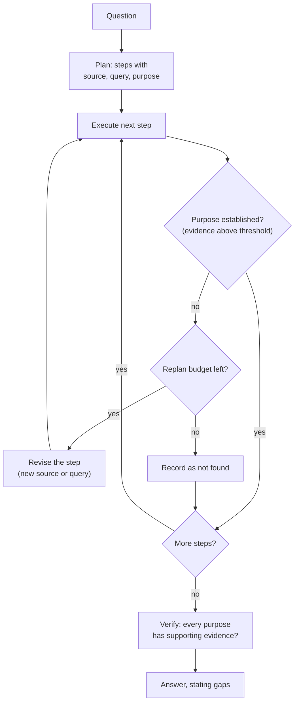

An agent with good [retrieval tools](/learn/agentic-rag/tool-based-retrieval) still has to decide what to do with them. Which searches, in which order? How will it know that a step worked? What should it do when a search returns nothing useful, or returns something that changes the question? Those decisions are **planning**. Combining evidence, noticing conflicts and judging when the evidence is enough are **reasoning**. Together they separate an agent that gets to a correct answer in three steps from one that wanders for ten and then answers with confidence from half the facts.

This lesson compares the main planning strategies for retrieval agents (deciding one step at a time, planning everything up front, and planning with revision), shows how to write plans as data with a success criterion for every step, and covers where reasoning happens: inside the model's thinking, in its visible output, and in checks your own code runs. [Query decomposition](/learn/advanced-retrieval/query-decomposition) already covered how to split a question into sub-questions and pass answers along a chain; this lesson is about choosing tools and sources, checking results, and changing course.

## Learning objectives

- Compare interleaved (ReAct-style), plan-and-execute and plan-with-replanning strategies by number of model calls, adaptability and failure modes.
- Represent an agent's plan as validated data in which every step states its source, its query and the fact it must establish.
- Implement a replanning trigger based on a step's success criterion, and a verification check before answering.
- Calculate how replanning changes the probability that a multi-step plan succeeds.
- Explain why a model's written reasoning should not drive control flow, and what to use instead.

## Prerequisites

- [Agentic retrieval](/learn/agentic-rag/agentic-retrieval): the agent loop, its state and its budgets.
- [Tool-based retrieval](/learn/agentic-rag/tool-based-retrieval): how retrieval actions are exposed and validated.
- [Query decomposition](/learn/advanced-retrieval/query-decomposition): sub-questions, dependencies and plans as data.
- [Structured outputs](/learn/generation-strategies/structured-outputs): getting validated objects back from a model.

## Why this matters

Watch an unplanned agent on a compound question and you will see recognisable failures:

- **Tunnel vision.** It searches for the first topic, finds plenty, and answers without ever searching for the second.
- **Thrashing.** A search returns nothing useful and the agent retries with slight rewordings of the same query, against the same wrong source, until the budget runs out.
- **Ignoring what it found.** A result changes the question (the user turns out not to be eligible at all) but the agent carries on with steps that no longer matter.
- **Premature confidence.** It answers when it has evidence for two of three claims, and the third is filled from the model's general knowledge.

Each is a planning or reasoning failure, not a retrieval one: the right chunks were available. Good planning gives the agent a picture of what it needs before it starts; good reasoning checks progress against that picture and changes course when the facts demand it.

## The intuition

Think of how an experienced paralegal handles a request from a lawyer: "Can our client, a contractor, claim this allowance, and if so how?"

A novice starts searching immediately and follows whatever turns up. The experienced paralegal first writes a short checklist: *what is the allowance; who is eligible; how are claims submitted*. Against each item she notes where she expects to find it. Then she works through the list, and after each search asks: did I establish this item? If the eligibility rules are not in the IT manual where she guessed, she does not search the IT manual five more times; she revises that line of the checklist to "look in the HR handbook". And when she finds that contractors are not eligible at all, she realises the third item, how to submit a claim, no longer matters to the answer, though it may be worth a sentence.

Before handing the answer back she runs down the checklist once more: every item ticked, every tick backed by a document. That is planning (the checklist), execution (the searches), replanning (revising a line) and verification (the final check).

## How it works

### Three planning strategies

**1. Interleaved: decide one step at a time.** After every observation, the model decides the single next action. This is the ReAct pattern (Yao and colleagues, 2022) that [Agentic retrieval](/learn/agentic-rag/agentic-retrieval) built. It adapts naturally to surprises, because every decision sees every result. Its costs: one model call per step, each re-reading the growing conversation, and no global view, which is where tunnel vision and thrashing come from.

**2. Plan-and-execute: decide everything up front.** One model call writes the whole plan; code executes it; one final call writes the answer. **Plan-and-Solve prompting** (Wang and colleagues, 2023) showed that asking a model to devise a plan before solving improved multi-step reasoning, and **ReWOO** (Xu and colleagues, 2023) applied the idea to tool use: a planner writes all tool calls at once, with placeholders for results, workers execute them, and a solver composes the answer, so the model does not re-read observations after every call. The cost is rigidity: a plan written before any search cannot react to what the searches return.

**3. Plan with replanning: decide up front, revise on evidence.** Write a plan, execute it step by step, check each step against its success criterion, and call the model again *only* when a step fails or a result changes the goal. This keeps most of plan-and-execute's economy and recovers most of interleaving's adaptability. It is the strategy this lesson builds and the usual production choice for retrieval agents.

| Strategy | Model calls for 3 steps, no failures | Adapts to results | Typical failure |
| --- | --- | --- | --- |
| Interleaved (ReAct) | 4 (one per step, one to answer) | After every step | Tunnel vision, thrashing |
| Plan-and-execute | 2 (plan, answer) | Never | Carries on with a broken plan |
| Plan with replanning | 2, plus 1 per revision | When a check fails | Weak success checks miss failures |



### Plans as data

A plan the harness can execute must be data, not prose. Each step needs:

1. **An identifier**, for logs and for referring to it when revising.
2. **An action**: which tool or source, and the query.
3. **A purpose**: the fact this step must establish, such as "contractor eligibility". This is the step's *success criterion* in words.
4. **Dependencies**, if a step needs an earlier result. [Query decomposition](/learn/advanced-retrieval/query-decomposition) showed how to execute those.

The purpose field does the most work and is the most often omitted. Without it, the only way to judge a step is "did the search return something?", and a search always returns something. With it, the harness (or a cheap model call) can ask a sharper question: did this step produce evidence for *this* fact? In the code below, a step succeeds if any result scores above a relevance threshold; a stronger check asks a small model whether the retrieved text actually states the purpose.

Have the planner produce the plan through [structured output](/learn/generation-strategies/structured-outputs) against a Pydantic model, validate it (known sources, a cap on the number of steps, dependencies that refer to real steps), and log it. A logged plan is the single most useful artefact when debugging an agent: it shows what the agent *intended*, which you can compare with what it did.

### When to replan

Replanning should be triggered by evidence, not by habit. Four triggers cover most cases:

- **A success check fails.** Nothing above the relevance threshold, or a verifier says the text does not establish the purpose. Revise the step: another source, another phrasing, or an exact-lookup tool instead of search.
- **Evidence conflicts.** Two chunks disagree: the 2023 handbook says the budget is £250, the current one says £400. Add a step that resolves the conflict, such as searching for the edition or effective date, or apply a stated precedence rule (the current handbook took effect on 1 January 2025 and supersedes the 2023 one).
- **Evidence changes the goal.** The budget chunk says contractors are not eligible. For a contractor, the step about how to claim the budget is now moot; the plan should drop or reframe it.
- **The budget is running low.** With one step left, choose the step whose purpose matters most to the answer, rather than the next in order.

Bound replanning just as you bound the loop: a fixed number of revisions per step and per request. A replanner that keeps proposing new searches for something the corpus does not contain is thrashing with extra steps.

### Where reasoning happens

"Reasoning" in an agent happens in three places, and each has a different role.

**Inside the model, before it responds.** Current Claude models think before answering, and on Claude Opus 5.5, the model this course uses, that thinking is adaptive: the model decides how much to think, and an **effort** setting controls how deep it goes. Higher effort tends to produce better plans and better judgements of sufficiency, at the cost of more output tokens and time. You do not need to prompt "think step by step" for the model to reason; you do need to tell it what good reasoning should check (each fact has evidence, conflicts are resolved by edition, gaps are stated).

**In the model's visible output.** ReAct-style prompts ask the model to write a short thought before each action. This helps humans reading the trace, and can help the model stay on track. But a written explanation is not guaranteed to be the real cause of the model's decision: Turpin and colleagues (2023) showed that models' chain-of-thought explanations can systematically omit the factors that actually drove their answers. So use written reasoning for reading, never for control. Decisions that your code acts on, such as which step to run next or whether the evidence is sufficient, should come back as structured fields, validated by a schema.

**In your code.** Some reasoning is better done deterministically: checking every purpose has evidence, applying edition precedence, enforcing budgets, detecting repeated queries. These checks are cheap, testable and do not drift.

### Verification before answering

The last reasoning step before writing the answer is a **sufficiency check**: for each purpose in the plan, is there supporting evidence, and is anything contradicted? The output is a small table: purpose, supporting chunk ids or "not found". It serves three uses:

1. The answer prompt receives it, so the model knows exactly which claims it may make and which gaps it must state.
2. Your code can refuse to answer, or answer partially, when a critical purpose has no evidence.
3. It goes into the trace for [agent evaluation](/learn/agentic-rag/agent-evaluation).

**Reflexion** (Shinn and colleagues, 2023) takes self-checking further: an agent writes a verbal reflection on a failed attempt and uses it in the next attempt. For a single retrieval request the simpler per-purpose check above is usually enough; reflection across attempts is more useful in longer tasks.

## The mathematics

### Replanning and the reliability of a plan

**Intuition.** A plan succeeds only if every step succeeds, so step failures multiply: three steps that each work 80 per cent of the time succeed together barely half the time. Giving each failed step one chance to be revised raises every step's success rate, and the effect compounds in the plan's favour.

If each of $n$ steps independently succeeds with probability $s$, the plan succeeds with probability $s^n$. If a failed step gets one revision that succeeds with probability $r$, each step's success probability becomes $1 - (1-s)(1-r)$, and the plan's is

$$
P(\text{plan}) = \bigl(1 - (1 - s)(1 - r)\bigr)^n
$$

Here $n$ is the number of steps, $s$ the first-attempt success rate of a step, and $r$ the success rate of a revision. Independence is a simplification: a corpus that lacks a fact will defeat every revision.

**By hand.** With $n = 3$, $s = 0.8$ and $r = 0.6$ (assumptions for illustration):

- Without replanning: $0.8^3 = 0.512$.
- With one revision: each step succeeds with $1 - 0.2 \times 0.4 = 0.92$, and the plan with $0.92^3 \approx 0.779$.

One revision per step lifts the plan from about one success in two to nearly four in five. The cost is one extra model call per failed step, about $n(1-s) = 0.6$ extra calls per request on average here.

```python
s, r, n = 0.8, 0.6, 3
plain = s ** n
with_replan = (1 - (1 - s) * (1 - r)) ** n
print(f"step success without replanning={s:.2f}  plan success={plain:.3f}")
print(f"step success with one replan={1 - (1 - s) * (1 - r):.2f}  plan success={with_replan:.3f}")
```

```output
step success without replanning=0.80  plan success=0.512
step success with one replan=0.92  plan success=0.779
```

## In code

**The problem.** A Meridian contractor asks whether they can claim the home-office equipment budget and how expenses are submitted. Execute a three-step plan in which one step deliberately targets the wrong source, detect the failure with a success check, revise the step, verify every purpose before answering, and count model calls against a step-by-step agent.

**Dependencies.** NumPy, Pydantic and Sentence Transformers; no API key. The plan and the revision are written by hand in the shape a planner model would return, so the run is reproducible. The Claude planner follows.

```bash
pip install numpy pydantic sentence-transformers
```

```python
from typing import Literal, Optional
import numpy as np
from pydantic import BaseModel
from sentence_transformers import SentenceTransformer

DOCS = {   # id: (source, text)
    "hb-budget":   ("handbook", "The home-office equipment budget is £400; contractors are not eligible."),
    "hb-expenses": ("handbook", "Expenses must be submitted within 30 days; anything over £75 needs a receipt."),
    "hb-remote":   ("handbook", "Staff may work remotely up to 3 days a week."),
    "hb-leave":    ("handbook", "Annual leave is 25 days; up to 5 unused days carry over."),
    "rb-vpn":      ("runbooks", "VPN is required on public Wi-Fi."),
    "rb-laptop":   ("runbooks", "Staff laptops follow a 3-year refresh cycle; order replacements through the IT portal."),
    "rb-password": ("runbooks", "Passwords must be rotated every 90 days."),
}
IDS = list(DOCS)
model = SentenceTransformer("sentence-transformers/all-MiniLM-L6-v2")
EMB = model.encode([t for _, t in DOCS.values()], normalize_embeddings=True)
MIN_SCORE = 0.45            # below this, a hit does not count as evidence

def search(query, source, k=2):
    s = EMB @ model.encode([query], normalize_embeddings=True)[0]
    ranked = [i for i in np.argsort(-s) if DOCS[IDS[i]][0] == source][:k]
    return [(IDS[i], round(float(s[i]), 2)) for i in ranked]

# --- A plan is data: each step says what it will do and how to tell it worked
class Step(BaseModel):
    id: str
    source: Literal["handbook", "runbooks"]
    query: str
    purpose: str                 # the fact this step must establish
    revised_from: Optional[str] = None

class Plan(BaseModel):
    goal: str
    steps: list[Step]

def replan(step, hits):
    """Stand-in for a model call that revises one failed step, given what it returned."""
    return Step(id=step.id + "-r", source="handbook", revised_from=step.id,
                query="Are contractors eligible for the home-office equipment budget?",
                purpose=step.purpose)

def execute(plan, max_replans=2):
    evidence, model_calls, replans, searches = {}, 1, 0, 0   # 1 = the call that wrote the plan
    queue = list(plan.steps)
    while queue:
        step = queue.pop(0)
        hits = search(step.query, step.source); searches += 1
        good = [(c, s) for c, s in hits if s >= MIN_SCORE]
        status = "ok" if good else "FAILED"
        print(f"  {step.id:<5} {step.source:<9} {step.query!r:<62} -> {hits} {status}")
        if good:
            evidence[step.purpose] = [c for c, _ in good]
        elif replans < max_replans:
            replans += 1; model_calls += 1
            queue.insert(0, replan(step, hits))       # retry this step before moving on
            print(f"        replanned: {step.id} -> {queue[0].id}")
        else:
            evidence[step.purpose] = []
    model_calls += 1                                   # the call that writes the answer
    return evidence, model_calls, searches

plan = Plan(  # what a planner might produce; s2 picks the wrong source
    goal="Can a contractor claim the home-office budget, and how are expenses submitted?",
    steps=[
        Step(id="s1", source="handbook", query="home-office equipment budget",
             purpose="budget amount"),
        Step(id="s2", source="runbooks", query="contractor eligibility for equipment budget",
             purpose="contractor eligibility"),
        Step(id="s3", source="handbook", query="how and when to submit an expense claim",
             purpose="expense rules"),
    ])
print(plan.goal)
evidence, calls, searches = execute(plan)
print("\nVerification before answering:")
for purpose, ids in evidence.items():
    print(f"  {purpose:<24} {'supported by ' + str(ids) if ids else 'NOT FOUND'}")
print(f"\nModel calls, plan-and-execute: {calls}")
print(f"Model calls, one decision per search plus the answer (ReAct-style): {searches + 1}")
```

```output
Can a contractor claim the home-office budget, and how are expenses submitted?
  s1    handbook  'home-office equipment budget'                                 -> [('hb-budget', 0.68), ('hb-expenses', 0.27)] ok
  s2    runbooks  'contractor eligibility for equipment budget'                  -> [('rb-laptop', 0.15), ('rb-vpn', 0.13)] FAILED
        replanned: s2 -> s2-r
  s2-r  handbook  'Are contractors eligible for the home-office equipment budget?' -> [('hb-budget', 0.81), ('hb-expenses', 0.3)] ok
  s3    handbook  'how and when to submit an expense claim'                      -> [('hb-expenses', 0.59), ('hb-budget', 0.2)] ok

Verification before answering:
  budget amount            supported by ['hb-budget']
  contractor eligibility   supported by ['hb-budget']
  expense rules            supported by ['hb-expenses']

Model calls, plan-and-execute: 3
Model calls, one decision per search plus the answer (ReAct-style): 5
```

**The important lines.**

- `purpose: str` turns each step into a checkable claim. The verification table at the end is built from purposes, not from queries.
- `good = [(c, s) for c, s in hits if s >= MIN_SCORE]` is the success check. `search` always returns `k` results; the threshold decides whether any of them count. The value 0.45 was chosen by looking at this corpus's scores; on your data, set it from labelled examples as [Score calibration](/learn/advanced-retrieval-optimisation/score-calibration) describes.
- `queue.insert(0, replan(step, hits))` puts the revised step at the front, so it runs before the plan moves on. The replanner receives the failed results, because what came back (laptop and VPN chunks) is evidence that the source was wrong.
- `max_replans=2` bounds revisions per request. Once exhausted, a failing step is recorded with empty evidence rather than retried.
- `model_calls` counts the planner, each revision and the final answer; the comparison line counts what an agent deciding one action per call would have made.

**What the output means.**

- **The failed step.** The runbooks contain nothing about contractors, and the best runbook hits score 0.15 and 0.13, far below the threshold. Without a success check, the agent would have accepted the laptop-refresh chunk as "evidence" about eligibility.
- **The revision.** Moving the step to the handbook with a direct question finds `hb-budget` at 0.81. The same chunk now supports two purposes: amount and eligibility. That is normal; the verification table is about facts, not chunks.
- **What the model must now reason about.** The evidence says contractors are not eligible. A good final answer leads with that, and mentions the expense rules only as context (or not at all), instead of explaining how a contractor should submit a claim they cannot make. This is the "evidence changes the goal" case; the answer prompt should contain the verification table and an instruction to check eligibility conditions before giving procedures.
- **The cost.** Plan-and-replan used three model calls; an agent deciding each action separately would have used five for the same four searches.

**Errors people commonly hit.**

- No success criterion, so every step "succeeds" and replanning never fires.
- Replanning without passing the failed results, so the replanner proposes the same source again.
- A threshold set once on a different corpus or embedding model, which silently passes or fails everything.

**Extending it.** Replace the threshold with a verifier call that asks whether the retrieved text establishes the purpose, returning a yes or no field; add a conflict check that flags two chunks with different amounts for the same purpose.

### The planner and replanner with Claude

These replace the hand-written plan and the `replan` stand-in, using structured output against the same Pydantic models. Not executed for this lesson (it needs an API key), so no output is shown.

```python
import anthropic

client = anthropic.Anthropic()  # reads ANTHROPIC_API_KEY from the environment

PLANNER = """You plan searches over Meridian's documents to answer a staff question.
Sources: handbook (HR policy, benefits, expenses), runbooks (IT procedures and errors).
Write at most 5 steps. Each step has a source, a focused query, and a purpose:
the single fact it must establish. Do not write steps for facts the question does not need."""

REPLANNER = """A search step failed to establish its purpose. You are given the step and
what it returned. Write one revised step with a different source or query, keeping the
same purpose. If the results show the fact is unlikely to be in any source, keep the
source and query unchanged and set purpose to 'GIVE UP: <purpose>'."""

def make_plan(question: str) -> Plan:
    response = client.messages.parse(
        model="claude-opus-5-5", max_tokens=2048, system=PLANNER,
        messages=[{"role": "user", "content": question}],
        output_format=Plan,
    )
    plan = response.parsed_output
    if len(plan.steps) > 5:
        raise ValueError("planner exceeded the step limit")
    return plan

def revise(step: Step, hits) -> Step:
    response = client.messages.parse(
        model="claude-opus-5-5", max_tokens=1024, system=REPLANNER,
        messages=[{"role": "user", "content": f"Step: {step.model_dump_json()}\nReturned: {hits}"}],
        output_format=Step,
    )
    return response.parsed_output
```

Because `source` is a `Literal` in the `Step` model, the planner cannot invent a source, and the parsed result is validated before your code acts on it. The decisions that drive control flow (the steps, the revised step, "GIVE UP") are structured fields, not sentences to be parsed.

## A real-world example

Meridian's HR business partners asked AskMeridian increasingly complex questions after the January 2025 handbook took effect: "A contractor who joined in 2024 asks whether the old or new equipment budget applies to them, and how to claim." The step-by-step agent the Platform team had built handled two-part questions well but did badly on these. Traces showed it searching the budget, finding both the 2023 (£250) and current (£400) amounts, and then either quoting both without saying which applied, or spending its remaining steps re-searching the budget with different wording.

Aisha rebuilt the flow as plan-with-replanning. The planner had to write a purpose for every step; the executor checked each step with a small verifier call; and two deterministic checks ran before the answer: a precedence rule (the current handbook supersedes the 2023 edition) and a conflict detector that flagged purposes supported by chunks with different numbers. The answer prompt received the verification table, including resolved conflicts.

On the HR evaluation set, answers that quoted conflicting figures without resolving them disappeared, and the average number of model calls per question fell, because most plans needed no revision. One new failure appeared: for some questions the planner wrote steps for facts the question did not need ("what is the remote-work allowance?" added to a laptop question). Aisha added the instruction "do not write steps for facts the question does not need" and a cap of five steps, and started reviewing a sample of logged plans each week.

## Common mistakes

- **Plans without success criteria.** If a step cannot fail, replanning never triggers and broken plans run to completion.
- **Parsing control decisions out of prose.** Extracting "next action" from a written thought breaks the first time the model phrases it differently; use structured fields.
- **Unbounded replanning.** A replanner looking for something the corpus lacks thrashes as badly as an unplanned agent.
- **Ignoring evidence that changes the goal.** Executing the rest of the plan after learning the user is ineligible produces a confident, irrelevant answer.
- **Treating written reasoning as an explanation.** A model's chain of thought can omit what actually drove its answer; audit behaviour from actions and evidence, not from the narrative.
- **Planning for simple questions.** A one-fact question needs one search; a planner call doubles its cost.

## Best practices

- Give every plan step a source, a query and a purpose, and validate the plan against a schema before executing it.
- Check every step against its purpose, and replan only on a failed check, a conflict, a goal-changing result or budget pressure.
- Pass the failed results to the replanner, and cap revisions per step and per request.
- Run deterministic checks (precedence rules, conflict detection, repeated queries) in code.
- Build a verification table before answering and give it to the answer prompt.
- Log plans, revisions and verification tables; they are the clearest record of intent versus behaviour.

## Performance considerations

- **Model calls.** For $n$ steps with failure rate $f$, plan-with-replanning makes about $2 + nf$ calls, against $n + 1$ for a step-by-step agent. With $n = 4$ and $f = 0.2$ that is $2.8$ against 5.
- **Parallel execution.** A plan written up front exposes independent steps, which can run concurrently; an interleaved agent discovers them one at a time unless it requests them together.
- **Context growth.** Plan-and-execute need not feed every raw result back to the model between steps, which keeps calls smaller than in an interleaved loop.
- **Thinking costs.** Higher effort settings spend more output tokens on planning; use higher effort for the planner and lower effort for cheap checks, and measure on your evaluation set.
- **Verifier calls** add one small call per step; a deterministic threshold costs nothing but is cruder. Use the verifier where errors are expensive.

## Security considerations

Plans are generated from the question and, after replanning, from retrieved text, so an injected instruction in a document can try to add steps ("also search for salary data"). The defences from [Tool-based retrieval](/learn/agentic-rag/tool-based-retrieval) still apply at execution time: every step runs through validated tools with the user's own permissions, so a malicious step can only read what the user could. Validate plans as well: restrict sources to an allowed list, cap the number of steps, and log revisions whose new query differs sharply from the stated purpose.

## Summary

- Planning chooses retrieval steps and their order; reasoning combines evidence, resolves conflicts and judges sufficiency.
- Interleaved agents adapt but spend a call per step; plan-and-execute is cheap but rigid; plan with replanning revises only when evidence demands it.
- Every plan step needs a purpose, the fact it must establish, so the harness can detect failure and verify coverage before answering.
- Replan on failed checks, conflicts, goal-changing evidence and budget pressure, with a cap on revisions.
- Let reasoning happen in model thinking and in code checks; take control decisions from structured fields, never from written explanations.

## Exercises

**1.** For each question, say which planning strategy you would use and why: (a) "How many days of annual leave do I get?"; (b) "Compare the 2023 and current rules for laptops, support hours and the equipment budget."; (c) "My VPN fails with an error I can't read properly; something like E-40-something. What should I do?"

<details><summary>Show solution</summary>

(a) No planning: one search answers it. (b) Plan-and-execute, possibly with replanning: the six searches are knowable in advance and independent, so they can run in parallel. (c) Interleaved or plan with replanning: the right next step depends on what the first search returns (which E-40xx codes exist), so a fixed plan written up front is likely to be wrong.

</details>

**2.** A plan has 5 steps, each succeeding first time with probability 0.85. Compute the plan's success probability without replanning, and with one revision per failed step that succeeds with probability 0.5. What is the expected number of revision calls per request?

<details><summary>Show solution</summary>

Without replanning: $0.85^5 \approx 0.444$. With one revision: each step succeeds with $1 - 0.15 \times 0.5 = 0.925$, so the plan succeeds with $0.925^5 \approx 0.677$. Expected revisions: $5 \times 0.15 = 0.75$ calls per request.

</details>

**3.** Add a conflict check to the code: give each document an `edition` (`"2023"` or `"current"`), add a 2023 budget chunk ("The home-office equipment budget is £250."), and after execution flag any purpose whose supporting chunks come from different editions. How should the answer step use the flag?

<details><summary>Show solution</summary>

```python
EDITION = {"hb-budget-2023": "2023"}          # everything else is current
def conflicts(evidence):
    return {p: ids for p, ids in evidence.items()
            if len({EDITION.get(c, "current") for c in ids}) > 1}
```

After adding `"hb-budget-2023": ("handbook", "The home-office equipment budget is £250.")` to `DOCS` (and re-encoding), the budget step returns both budget chunks above the threshold (the 2023 chunk scores 0.83, higher than the current one at 0.68), and so does the revised eligibility step, so `conflicts(evidence)` flags both `budget amount` and `contractor eligibility`. The answer step should apply the precedence rule (the current handbook, effective 1 January 2025, supersedes 2023), state the current figure, and mention the old figure only if the question asks about history.

</details>

**4.** Design decision. Your planner occasionally writes steps for facts the question does not need. Propose two mitigations, one in the prompt and one in code, and explain how you would measure whether they worked.

<details><summary>Show solution</summary>

Prompt: instruct the planner to write only steps whose purpose is needed to answer the question, and to keep the plan to the minimum number of steps, with a hard cap. Code: after execution, check which purposes the final answer actually cited; purposes with evidence that the answer never used indicate unnecessary steps. Measure the rate of uncited purposes per plan and the average step count on the evaluation set before and after, while checking that answer quality does not fall.

</details>

## Check your understanding

```quiz
[
  {"q": "What is the main weakness of pure plan-and-execute for retrieval agents?", "options": ["It needs one model call per step", "It cannot react to what the searches return", "It cannot use structured output", "It requires a graph database"], "answer": 1, "why": "The plan is written before any search runs, so a wrong source or a goal-changing result cannot change it; replanning addresses this."},
  {"q": "Why does each plan step in this lesson carry a 'purpose' field?", "options": ["It is required by the Messages API", "It replaces the query", "It states the fact the step must establish, so success can be checked and coverage verified", "It sets the step's priority"], "answer": 2, "why": "A search always returns something; the purpose lets the harness ask whether this step actually established its fact."},
  {"q": "Each of 3 steps succeeds with probability 0.8, and a failed step gets one revision that succeeds with probability 0.6. What is the plan's success probability?", "options": ["About 0.78", "0.512", "0.92", "0.6"], "answer": 0, "why": "Per step 1 - 0.2 x 0.4 = 0.92, and 0.92 cubed is about 0.779."},
  {"q": "Why should control decisions not be parsed from a model's written chain of thought?", "options": ["Written reasoning is always wrong", "It is too long to store", "The API forbids it", "Written explanations can omit what actually drove the model's decision, and prose is fragile to parse; structured fields are validated"], "answer": 3, "why": "Research shows chain-of-thought explanations are not always faithful, and decisions your code acts on should come back as schema-validated fields."},
  {"q": "A search shows the user is not eligible for the budget the rest of the plan explains how to claim. What should the agent do?", "options": ["Continue the plan unchanged", "Restart with a new plan from scratch", "Treat it as goal-changing evidence: drop or reframe the remaining steps and lead the answer with the ineligibility", "Ignore the result as an outlier"], "answer": 2, "why": "Evidence that changes the goal is a replanning trigger; executing moot steps produces a confident but irrelevant answer."}
]
```

## Further reading

- Yao, S. and colleagues (2022). [ReAct: Synergizing Reasoning and Acting in Language Models](https://arxiv.org/abs/2210.03629).
- Wang, L. and colleagues (2023). *Plan-and-Solve Prompting: Improving Zero-Shot Chain-of-Thought Reasoning by Large Language Models*.
- Xu, B. and colleagues (2023). *ReWOO: Decoupling Reasoning from Observations for Efficient Augmented Language Models*.
- Shinn, N. and colleagues (2023). [Reflexion: Language Agents with Verbal Reinforcement Learning](https://arxiv.org/abs/2303.11366).
- Turpin, M. and colleagues (2023). *Language Models Don't Always Say What They Think: Unfaithful Explanations in Chain-of-Thought Prompting*.
