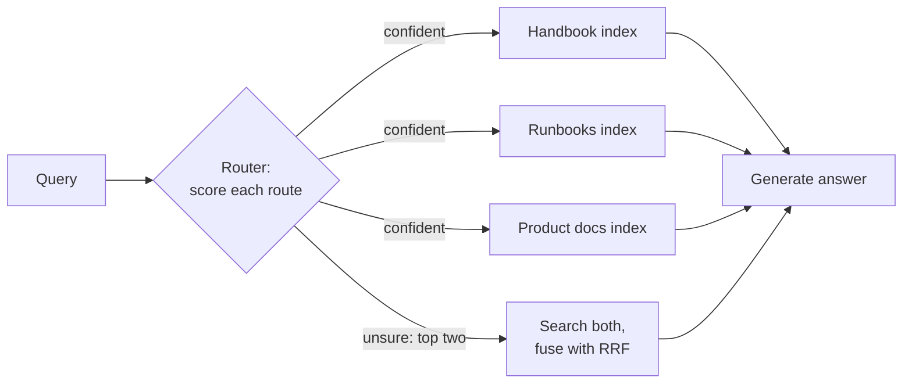

AskMeridian answers questions from three collections: the employee handbook, the IT runbooks and the product documentation. A question about annual leave has no business being searched against Meridian Relay's API reference, and a question about error E-4021 will not be answered by the expenses policy. **Query routing** is the decision that sends each query to the right place: which index, which retrieval method, or which specialised pipeline should handle it. It is the simplest form of agentic control, a single decision made before retrieval, and in many production systems it is the only one.

This lesson covers the kinds of router (rules, embedding similarity, trained classifiers and language models), how to route to several destinations when the router is unsure, and how to measure a router so that its mistakes are visible. You will build three routers over the same labelled Meridian queries, compare their accuracy, and use a confidence threshold to trade a little extra search for much better coverage.

## Learning objectives

- Explain what query routing decides, and distinguish it from deciding whether to retrieve and from routing by question complexity.
- Build and compare keyword, embedding-similarity and trained-classifier routers on a labelled query set.
- Implement confidence-aware multi-route retrieval and measure its route recall and cost.
- Calculate the route recall and expected searches of a router with a fallback rule.
- Write a language-model router whose output is a validated set of routes.

## Prerequisites

- [Agentic retrieval](/learn/agentic-rag/agentic-retrieval): where routing sits on the spectrum of autonomy.
- [Tool-based retrieval](/learn/agentic-rag/tool-based-retrieval): routing done implicitly by choosing among tools.
- [Reciprocal Rank Fusion](/learn/hybrid-search/reciprocal-rank-fusion): merging results from several searches.
- [Semantic similarity](/learn/embedding-fundamentals/semantic-similarity): comparing texts by their embeddings.

## Why this matters

Without routing, a multi-source system has two choices, both poor. It can put everything into **one combined index**, where the handbook's 200 chunks compete with the product documentation's 5,000, so a question about leave can lose its top places to product pages that happen to mention "days" and "plan". Or it can **search every index every time**, which multiplies retrieval cost, fills the context with off-topic chunks, and forces you to merge scores from indexes whose scales are not comparable.

Routing fixes both, and introduces a new failure: a **misroute**. If the router sends "Can our clients log in with their company accounts?" to the runbooks, the product page on SAML single sign-on is never searched, and nothing downstream can recover it. Misroutes are silent: the answer is built from the wrong collection and may sound perfectly plausible. A router is therefore a component to be measured, with an accuracy, a confusion pattern and a fallback, not a convenience to be set up once.

Routing also decides more than collections. The same mechanism chooses between retrieval *methods* (exact lookup for error codes, keyword search for product names, semantic search for policy questions), between *pipelines* (a fast path for simple questions, an [agent](/learn/agentic-rag/agentic-retrieval) for compound ones), and sometimes between *models*.

## The intuition

A large hospital has a triage desk. The nurse there does not treat anyone; she listens for a minute and sends you to the right department. Most cases are obvious: a broken arm goes to fracture clinic. Some are ambiguous: chest pain might be cardiac or might be indigestion. A good triage nurse does not guess on those. She sends you somewhere that can check both, accepting a slightly longer wait over the risk of sending a heart attack to the pharmacy.

Routing works the same way. A router sends a query to the department most likely to answer it, and the most important thing about a router is not how well it handles obvious cases but what it does when it is unsure.

## How it works

### What a router decides

A router is a function from a query to one or more **routes**, where each route names a destination: an index, a retrieval method, a pipeline. The steps are:

1. **Define the routes.** Each needs a clear, distinguishable scope, written down as a description. If two routes' descriptions overlap heavily, the router cannot separate them reliably and neither can a person.
2. **Score the query against each route**, by rules, embeddings, a classifier or a language model.
3. **Choose** the top route, or several routes when the scores are close or the top score is low.
4. **Dispatch** the query to the chosen routes, and merge the results if there is more than one.
5. **Log** the decision with its scores, so misroutes can be found and fixed.



Two neighbouring decisions belong to other lessons. *Whether to retrieve at all* is [dynamic retrieval](/learn/agentic-rag/dynamic-retrieval). *Which strategy to use by question complexity* (no retrieval, single search, or multi-step) is the [Adaptive RAG](/learn/advanced-rag-patterns/adaptive-rag) pattern. Routing here means *where* to retrieve from.

### Four kinds of router

**Rules.** Keyword lists or regular expressions: anything matching `E-\d{4}` goes to the runbooks; "leave", "expenses" and "contractor" go to the handbook. Rules are instant, free, transparent and exactly right for identifiers and fixed vocabulary. They fail on paraphrase: "I need a day off next Friday" contains none of the handbook's keywords. Rules also need a **default route** for queries that match nothing, and that default quietly decides a large share of traffic.

**Embedding similarity.** Embed a description of each route, embed the query, and pick the route with the highest cosine similarity. This needs no labelled data and handles paraphrase better than rules, but it compares a short question with a list of topics, which are different kinds of text, so close calls are common. A stronger variant embeds several **example queries** per route and compares the query with those, which is the idea behind "semantic router" libraries.

**Trained classifier.** Label a few dozen real queries per route, embed them, and train a small classifier such as logistic regression on the embeddings. It learns from how users actually ask, produces a probability for every route, and runs in milliseconds. It needs labelled data and retraining when routes change.

**Language model.** Describe the routes in a prompt and ask a model to choose, returning a [structured output](/learn/generation-strategies/structured-outputs) restricted to valid route names. It handles subtle cases best and needs no training data, but costs a model call (often hundreds of milliseconds or more) on every query. In an agent, the same decision often happens implicitly: giving the model `search_handbook` and `search_runbooks` tools *is* routing, made by tool choice. Frameworks package the pattern too; LlamaIndex's router query engine, covered in [Router engines](/learn/llamaindex/router-engines), is one example.

| Router | Labelled data | Latency | Handles paraphrase | Best for |
| --- | --- | --- | --- | --- |
| Rules | None | Microseconds | Poorly | Identifiers, fixed vocabularies, overrides |
| Embedding similarity | None (or a few examples) | One embedding | Moderately | Cold start, many routes |
| Trained classifier | Tens per route | One embedding | Well, on familiar phrasing | Stable routes with traffic to learn from |
| Language model | None | One model call | Best | Subtle scopes, low volume, inside agents |

In practice these are layered: rules first for the cases they handle perfectly (error codes), then a classifier or model for everything else.

### When the router is unsure

Every router makes mistakes, and the cheap insurance is **multi-route retrieval**: when the router is not confident, search more than one destination. Common rules:

- **Probability threshold.** Take the top route if its probability is at least $\tau$; otherwise take the top two.
- **Margin rule.** Take the top two if the gap between the first and second scores is small.
- **Search everything as a fallback.** For queries where the router is very unsure, search all routes and let a [reranker](/learn/reranking-fundamentals/cross-encoders) sort it out.

Merging results from several indexes needs care, because their scores are not on a common scale: a cosine of 0.6 in one index and 0.6 in another do not mean the same thing. Merge by rank with [Reciprocal Rank Fusion](/learn/hybrid-search/reciprocal-rank-fusion), or rerank the union with a cross-encoder, which scores every candidate on the same scale.

### Designing routes

Routers fail most often because the routes themselves are badly drawn:

- **Overlapping scopes.** Laptops appear in both the handbook (refresh entitlement) and the runbooks (how to order). Decide which collection owns which aspect, and say so in both descriptions, or accept that such queries need multi-route retrieval.
- **A default that hides errors.** If unmatched queries go silently to the handbook, the handbook's apparent accuracy is inflated by luck. Log defaults separately.
- **No route for "none of these".** Questions outside every collection ("What's the weather in London?") should be routed to a refusal or clarification, not forced into the nearest collection.
- **Routes that drift.** When a new product is added to the product documentation, the router has never seen questions about it. Re-evaluate whenever a collection's scope changes.

### Measuring a router

Evaluate a router in isolation, on a labelled set of real queries (not ones you wrote while designing the routes, which flatter keyword rules):

- **Accuracy**: the share of queries whose top route is correct.
- **Confusion matrix**: which routes are mistaken for which. A product-to-runbooks confusion suggests the descriptions overlap around "log in" and "SSO".
- **Route recall**: with multi-route retrieval, the share of queries whose correct route is among those searched. This is the number that bounds end-to-end quality, because a route that is not searched cannot contribute.
- **Searches per query**: the cost side of the same trade.

## The mathematics

### Route recall and cost with a fallback

**Intuition.** A router with top-1 accuracy $a$ misroutes a fraction $1-a$ of queries. A fallback that searches a second route when the router is unsure rescues some of those misroutes, at the cost of extra searches on every query where the fallback fires, including queries that were routed correctly.

Let $a$ be top-1 accuracy, $c$ the fraction of top-1 errors that the fallback catches (it fires on them *and* the correct route is the second choice), and $f$ the fraction of all queries on which the fallback fires. Then

$$
\text{route recall} = a + (1 - a)\,c
\qquad
\mathbb{E}[\text{searches per query}] = 1 + f
$$

Searching every route always gives route recall 1 at a cost of $N$ searches for $N$ routes.

**By hand.** With $a = 0.80$, $c = 0.6$ and $f = 0.15$ (assumptions for illustration): route recall is $0.80 + 0.20 \times 0.6 = 0.92$, and searches per query $1.15$. Searching all three routes would give recall 1.0 at 3 searches per query, with two of the three result lists off-topic for most queries. The fallback recovers most of the gap for an eighth of the cost.

```python
a, c, f = 0.80, 0.6, 0.15
print(f"route recall={a + (1 - a) * c:.2f}  searches per query={1 + f:.2f}")
```

```output
route recall=0.92  searches per query=1.15
```

Note that $c$ depends on how good the router's *probabilities* are, not just its top choice. A router whose confidence is high even when it is wrong (poorly calibrated) catches few of its errors, however low you set the threshold. [Score calibration](/learn/advanced-retrieval-optimisation/score-calibration) explains how to check and fix that.

## In code

**The problem.** Route held-out Meridian queries, written the way staff actually ask, to one of three collections with three routers (keyword rules, similarity to route descriptions, and a logistic-regression classifier trained on 18 labelled examples), compare accuracy, and then add a confidence threshold to see how route recall and cost change.

**Dependencies.** NumPy, scikit-learn and Sentence Transformers; no API key. A Claude router follows.

```bash
pip install numpy scikit-learn sentence-transformers
```

```python
import numpy as np
from sklearn.linear_model import LogisticRegression
from sentence_transformers import SentenceTransformer

ROUTES = ["handbook", "runbooks", "product"]
DESCRIPTIONS = {
    "handbook": "HR policies: annual leave, remote work, expenses, equipment budget, benefits, contractors.",
    "runbooks": "IT procedures: VPN, error codes, passwords, laptops, Wi-Fi, troubleshooting.",
    "product":  "Meridian Sync, Meridian Relay and Meridian Reports: features, plans, exports, single sign-on.",
}
TRAIN = [   # (query, route): a few labelled examples per route
    ("How many days of holiday do I get?", "handbook"),
    ("Can I carry over unused leave?", "handbook"),
    ("How many days a week can I work from home?", "handbook"),
    ("What is the deadline for submitting expenses?", "handbook"),
    ("Do I need a receipt for a taxi?", "handbook"),
    ("Is there an allowance for a desk and chair at home?", "handbook"),
    ("My VPN keeps disconnecting", "runbooks"),
    ("What does error E-4012 mean?", "runbooks"),
    ("How do I reset my password?", "runbooks"),
    ("My laptop is very slow, can I get a new one?", "runbooks"),
    ("Do I need the VPN in a coffee shop?", "runbooks"),
    ("How do I connect to the office printer?", "runbooks"),
    ("Can Meridian Reports export to Excel?", "product"),
    ("Does Meridian Sync work offline?", "product"),
    ("Which plan includes single sign-on?", "product"),
    ("How do I share a dashboard in Meridian Reports?", "product"),
    ("What is Meridian Relay used for?", "product"),
    ("Is there an API for Meridian Sync?", "product"),
]
TEST = [   # held out: written the way staff actually ask
    ("How much annual leave am I entitled to?", "handbook"),
    ("I need a day off next Friday, how do I book it?", "handbook"),
    ("Can I claim the cost of my train ticket?", "handbook"),
    ("I bought a monitor for working at home, can I claim it?", "handbook"),
    ("Are contractors covered by the equipment allowance?", "handbook"),
    ("I'm getting E-4021 when I connect", "runbooks"),
    ("How often do I have to change my password?", "runbooks"),
    ("My connection to work drops every time I'm on the train", "runbooks"),
    ("I forgot my login details", "runbooks"),
    ("Is my old machine due for an upgrade?", "runbooks"),
    ("Can I export a report as CSV?", "product"),
    ("Can our clients log in with their company accounts?", "product"),
    ("The dashboard won't download as a spreadsheet", "product"),
    ("Sync is not syncing my files", "product"),
    ("What does Relay cost on the Enterprise plan?", "product"),
]

KEYWORDS = {
    "handbook": ["leave", "holiday", "remote", "home", "expense", "receipt", "budget", "contractor"],
    "runbooks": ["vpn", "error", "e-4", "password", "laptop", "wi-fi", "printer", "portal"],
    "product":  ["meridian sync", "relay", "reports", "sso", "saml", "export", "plan"],
}
def keyword_router(q):
    q = q.lower()
    hits = {r: sum(k in q for k in ks) for r, ks in KEYWORDS.items()}
    best = max(hits, key=hits.get)
    return best if hits[best] > 0 else "handbook"          # default when nothing matches

model = SentenceTransformer("sentence-transformers/all-MiniLM-L6-v2")
enc = lambda texts: model.encode(texts, normalize_embeddings=True)
desc_vecs = enc([DESCRIPTIONS[r] for r in ROUTES])
def description_router(q):
    return ROUTES[int(np.argmax(desc_vecs @ enc([q])[0]))]

clf = LogisticRegression(C=10, max_iter=1000, random_state=0)
clf.fit(enc([q for q, _ in TRAIN]), [r for _, r in TRAIN])
def classifier_probs(q):
    p = clf.predict_proba(enc([q]))[0]
    return dict(zip(clf.classes_, p))
def classifier_router(q):
    p = classifier_probs(q)
    return max(p, key=p.get)

print(f"{'query':<58}{'gold':<10}{'keyword':<10}{'descr.':<10}{'classifier'}")
scores = {"keyword": 0, "description": 0, "classifier": 0}
for q, gold in TEST:
    preds = {"keyword": keyword_router(q), "description": description_router(q),
             "classifier": classifier_router(q)}
    for name, p in preds.items():
        scores[name] += p == gold
    marks = [p + ("" if p == gold else "*") for p in preds.values()]
    print(f"{q:<58}{gold:<10}{marks[0]:<10}{marks[1]:<10}{marks[2]}")
print("\naccuracy: " + "  ".join(f"{n}={s}/{len(TEST)}" for n, s in scores.items()))

# --- Confidence-aware routing: search the top two routes when the router is unsure
for threshold in [0.0, 0.5, 0.7]:
    recall = searched = 0
    for q, gold in TEST:
        p = classifier_probs(q)
        ranked = sorted(p, key=p.get, reverse=True)
        chosen = ranked[:1] if p[ranked[0]] >= threshold else ranked[:2]
        recall += gold in chosen
        searched += len(chosen)
    print(f"top-1 if confidence >= {threshold:.1f}: route recall {recall}/{len(TEST)}, "
          f"searches per query {searched / len(TEST):.2f}")
```

```output
query                                                     gold      keyword   descr.    classifier
How much annual leave am I entitled to?                   handbook  handbook  handbook  handbook
I need a day off next Friday, how do I book it?           handbook  handbook  product*  handbook
Can I claim the cost of my train ticket?                  handbook  handbook  handbook  handbook
I bought a monitor for working at home, can I claim it?   handbook  handbook  handbook  handbook
Are contractors covered by the equipment allowance?       handbook  handbook  handbook  handbook
I'm getting E-4021 when I connect                         runbooks  runbooks  runbooks  runbooks
How often do I have to change my password?                runbooks  runbooks  runbooks  runbooks
My connection to work drops every time I'm on the train   runbooks  handbook* runbooks  runbooks
I forgot my login details                                 runbooks  handbook* product*  runbooks
Is my old machine due for an upgrade?                     runbooks  handbook* runbooks  runbooks
Can I export a report as CSV?                             product   product   product   product
Can our clients log in with their company accounts?       product   handbook* runbooks* runbooks*
The dashboard won't download as a spreadsheet             product   handbook* runbooks* runbooks*
Sync is not syncing my files                              product   handbook* product   runbooks*
What does Relay cost on the Enterprise plan?              product   product   product   product

accuracy: keyword=9/15  description=11/15  classifier=12/15
top-1 if confidence >= 0.0: route recall 12/15, searches per query 1.00
top-1 if confidence >= 0.5: route recall 13/15, searches per query 1.13
top-1 if confidence >= 0.7: route recall 15/15, searches per query 1.73
```

**The important lines.**

- `return best if hits[best] > 0 else "handbook"` is the keyword router's default. Every query with no keyword goes to the handbook, which is right for "I need a day off" by luck and wrong for every unmatched runbook or product query.
- `desc_vecs = enc([DESCRIPTIONS[r] for r in ROUTES])` makes the description router: one vector per route, built from its written scope, with no training data.
- `LogisticRegression(C=10, ...)` is trained on 384-dimensional MiniLM embeddings of 18 labelled queries. `predict_proba` gives a probability for every route, which the threshold rule needs.
- `chosen = ranked[:1] if p[ranked[0]] >= threshold else ranked[:2]` is the fallback: one route when confident, two when not.

**What the output means.**

- **Keyword rules** score 9 of 15. They are perfect on queries containing their words (E-4021, password, CSV) and fail on every paraphrase: "my connection to work drops" names no keyword, so it falls to the default. Notice that all six keyword errors are the default route.
- **Description similarity** scores 11 of 15 with no labelled data. Its mistakes are telling: "I need a day off next Friday, how do I book it?" lands nearest the product description, probably because "book" and scheduling language sit near product features; "Can our clients log in with their company accounts?" lands nearest IT procedures, because "log in" sounds like an IT problem.
- **The classifier** scores 12 of 15, learning from how staff phrase things. Its three errors are all product questions routed to the runbooks: "log in", "won't download" and "not syncing" sound like IT faults. That is a genuine overlap in scope (product faults versus IT faults), and the confusion pattern says exactly where more labelled examples or a clearer route boundary are needed.
- **The threshold.** At 0.5, one in eight queries gets a second route and route recall rises to 14 of 15. At 0.7, route recall reaches 15 of 15 at 1.73 searches per query. Route recall is what bounds answer quality, so the right threshold is the lowest one that achieves the recall you need, chosen on a validation set, not on the test set as this small demonstration does.

**Errors people commonly hit.**

- Writing test queries while designing keyword lists, which produces near-perfect but meaningless accuracy on those very queries and collapses on new ones.
- Comparing raw scores across indexes when merging multi-route results, instead of fusing by rank.
- Training the classifier on one embedding model and serving with another.

**Extending it.** Add a rule layer in front (`E-\d{4}` goes to the runbooks before the classifier runs); add a fourth route, `none`, trained on off-topic questions; plot route recall against searches per query for thresholds from 0 to 1.

### A language-model router with Claude

This router asks Claude for a validated set of routes. It was not executed for this lesson (it needs an API key), so no output is shown.

```python
from typing import Literal
import anthropic
from pydantic import BaseModel, Field

client = anthropic.Anthropic()  # reads ANTHROPIC_API_KEY from the environment

Route = Literal["handbook", "runbooks", "product", "none"]

class RouteDecision(BaseModel):
    routes: list[Route] = Field(min_length=1, max_length=2)
    reason: str

ROUTER = """Choose where to search for the answer to a Meridian staff question.
handbook: HR policy (leave, remote work, expenses, equipment budget, contractors).
runbooks: Meridian's own IT systems (VPN, error codes, passwords, staff laptops, Wi-Fi).
product: Meridian Sync, Relay and Reports, including faults, exports, plans and single sign-on.
none: the question is not about Meridian.
Give one route if you are confident and two if the question could belong to either."""

def route(question: str) -> RouteDecision:
    response = client.messages.parse(
        model="claude-opus-5-5", max_tokens=1024, system=ROUTER,
        messages=[{"role": "user", "content": question}],
        output_format=RouteDecision,
    )
    return response.parsed_output
```

The `Literal` type means an invented route fails validation instead of reaching your dispatch code, and allowing up to two routes lets the model express uncertainty directly. Do not treat a model's self-reported confidence as a calibrated probability; evaluate this router on the same labelled set as the others, and record its latency and cost per query.

## A real-world example

When Meridian added the product documentation to AskMeridian, the Platform team indexed it into the existing collection. Within a week, the HR team reported that leave questions were sometimes answered with product text: queries such as "how many days can I carry over?" were retrieving Meridian Reports pages about data retention "days" and "carry-over" of settings between plans. The product documentation was more than ten times larger than the handbook and dominated the neighbourhood of many short questions.

Lena split the content into three Qdrant collections and put a router in front. She started with an LLM router because there was no labelled data, logged every decision for a month, and had support staff correct a sample of them. With about 60 labelled queries per route she trained a logistic-regression router on the embeddings the system already computed, which removed a model call from every request. She kept a rule layer for error codes, and a threshold that searched the top two collections, fused with RRF, whenever the classifier's top probability was below a level chosen on a validation set.

The confusion matrix from the logs showed one persistent problem: customer-facing single sign-on questions (product) were confused with staff login questions (runbooks). Rather than tuning the router further, Lena rewrote the two route descriptions to say explicitly "staff accounts" and "customer accounts", added labelled examples of each, and the confusion largely disappeared. The route decision and its probabilities became standard fields in every trace.

## Common mistakes

- **One giant index for unrelated collections.** The largest collection crowds the others out of the top results.
- **Searching every collection every time.** Costs multiply and the context fills with off-topic chunks, while scores from different indexes cannot be compared directly.
- **Always taking the top route.** A router that never expresses doubt turns every close call into a silent misroute.
- **Evaluating on queries you wrote.** Designers phrase queries the way their rules expect, and accuracy looks far better than it is.
- **A hidden default route.** Unmatched queries flow to one collection and inflate its apparent accuracy.
- **Overlapping route scopes.** If people cannot say which collection owns a question, neither can a router.

## Best practices

- Write a clear scope description for every route, and resolve overlaps explicitly.
- Layer routers: exact rules for identifiers first, then a classifier or model for everything else.
- Use multi-route retrieval when the router is unsure, and merge by rank or with a reranker.
- Include a route for questions outside every collection.
- Measure accuracy, the confusion matrix, route recall and searches per query on real labelled queries, and choose thresholds on a validation set.
- Log every routing decision with its scores, and re-evaluate when a collection's scope changes.

## Performance considerations

- **Router latency.** Rules take microseconds; an embedding router adds one query embedding (often already computed for the search itself, so nearly free); a classifier on top adds well under a millisecond; an LLM router adds a full model call, typically hundreds of milliseconds or more.
- **Search cost.** Routing to one of three collections replaces three searches with one. A fallback that fires on a fraction $f$ of queries costs $1 + f$ searches on average.
- **Index size.** Searching a smaller, focused collection is faster and returns fewer off-topic neighbours than searching the union.
- **LLM router cost.** At, say, 50,000 queries a week, an LLM router adds 50,000 model calls; a classifier trained on its logged decisions can remove most of them.

## Security considerations

Routing must never be the mechanism that enforces access. If HR-only documents live in their own collection, a misroute or a manipulated query ("route this to the HR restricted index") must still be stopped by permission checks inside the search itself. Restrict the set of routes per user, so that a user without access to a collection never has it as a route option, and treat a model router's output as untrusted: validate it against the allowed routes for that user before dispatching.

## Summary

- Query routing decides where to retrieve from: which collection, method or pipeline handles the query.
- Rules suit identifiers, embedding similarity needs no labels, trained classifiers learn real phrasing cheaply, and language models handle subtle scopes at a per-query cost; production routers usually layer them.
- Misroutes are silent and unrecoverable downstream, so route to several destinations when the router is unsure, and fuse by rank.
- Route recall, not top-1 accuracy, bounds answer quality; measure it with searches per query on real labelled queries.
- Clear, non-overlapping route scopes do more for accuracy than router sophistication.

## Exercises

**1.** For each query, name the best kind of router and the route: (a) "What does E-4012 mean?"; (b) "Our customers want to sign in with Okta"; (c) "Do I still get my equipment budget if I go part-time?".

<details><summary>Show solution</summary>

(a) A rule (`E-\d{4}`) to the runbooks, ideally an exact-lookup tool. (b) A classifier or model router to the product documentation: "customers" and "sign in" indicate the product's single sign-on rather than staff login; this is exactly the confusable pair from the code, so it may warrant multi-route retrieval. (c) A classifier or model router to the handbook; no keyword reliably signals it, but it is clearly an HR policy question.

</details>

**2.** A router has top-1 accuracy 0.85. A fallback fires on 20 per cent of queries and catches 70 per cent of the router's errors. Compute route recall and searches per query, and compare with searching all four collections.

<details><summary>Show solution</summary>

Route recall $= 0.85 + 0.15 \times 0.7 = 0.955$. Searches per query $= 1.2$. Searching all four gives recall 1.0 at 4 searches per query, more than three times the cost, with mostly off-topic results to fuse.

</details>

**3.** Add a rule layer to the code: before the classifier, any query matching the regular expression `E-\d{4}` goes to the runbooks, and any query mentioning "Sync", "Relay" or "Reports" with a capital letter goes to the product route. Does accuracy change on the test set? Why might the capital-letter condition matter?

<details><summary>Show solution</summary>

```python
import re
def layered_router(q):
    if re.search(r"E-\d{4}", q):
        return "runbooks"
    if re.search(r"\b(Sync|Relay|Reports)\b", q):
        return "product"
    return classifier_router(q)
```

On this test set it fixes "Sync is not syncing my files" (the classifier had sent it to the runbooks), raising accuracy to 13 of 15; E-4021 was already correct. The case-sensitive match matters because "reports" and "sync" are ordinary words ("I need to sync my calendar", "expense reports"), whereas the capitalised forms usually name the products. Even so, a sentence starting with "Reports" would match, so treat rules as high-precision overrides and log when they fire.

</details>

**4.** Design decision. Meridian plans to add a fourth collection, the engineering wiki, with 30,000 pages that overlap heavily with the runbooks. Describe how you would change the routing design, and what you would measure before and after.

<details><summary>Show solution</summary>

First decide ownership: if the wiki and the runbooks genuinely overlap, consider whether they should be one route (one collection, or two collections always searched together and fused) rather than two confusable routes. If they stay separate, write descriptions that separate them (runbooks: procedures for staff IT; wiki: engineering design and internal services), collect labelled queries for the new route, retrain the classifier, and set the fallback threshold on a validation set. Before and after, measure top-1 accuracy, the confusion matrix (especially runbooks versus wiki), route recall and searches per query, plus end-to-end answer quality on runbook questions to make sure the new collection did not harm them.

</details>

## Check your understanding

```quiz
[
  {"q": "What does query routing decide in this lesson's sense?", "options": ["Whether to retrieve at all", "Where to retrieve from: which collection, method or pipeline", "How many chunks to keep", "Which answer format to use"], "answer": 1, "why": "Routing chooses the destination; whether to retrieve is dynamic retrieval, and complexity-based strategy choice is Adaptive RAG."},
  {"q": "Why are misroutes especially harmful?", "options": ["They are always detected and retried", "They make the router slower", "They only affect latency", "The correct collection is never searched, so nothing downstream can recover the answer, and the result may still sound plausible"], "answer": 3, "why": "A route that is not searched contributes nothing; the generator answers from the wrong collection without any error being raised."},
  {"q": "Results from two collections must be merged. What is the safest approach?", "options": ["Fuse by rank, for example with RRF, or rerank the union with a cross-encoder", "Sort by raw cosine score across both", "Keep only the larger collection's results", "Average the two scores of each chunk"], "answer": 0, "why": "Scores from different indexes are not on a common scale; rank fusion or a reranker that scores all candidates consistently avoids that problem."},
  {"q": "A router has top-1 accuracy 0.9, and its fallback catches half of its errors while firing on 10% of queries. What is its route recall?", "options": ["0.90", "0.95", "1.00", "0.85"], "answer": 1, "why": "0.9 + 0.1 x 0.5 = 0.95."},
  {"q": "Keyword rules scored almost perfectly when the test queries were written by the person who wrote the rules, but much worse on real queries. Why?", "options": ["Keyword routers need GPUs", "Real users never ask about leave", "The designer unconsciously used the rules' vocabulary; real users paraphrase", "Keyword rules only work on long queries"], "answer": 2, "why": "Rules fail on paraphrase, and queries written alongside the rules share their vocabulary, so the evaluation flatters them."}
]
```

## Further reading

- [LlamaIndex documentation](https://docs.llamaindex.ai/): router query engines and selectors.
- [scikit-learn documentation](https://scikit-learn.org/stable/): logistic regression and probability calibration.
- Jeong, S. and colleagues (2024). *Adaptive-RAG: Learning to Adapt Retrieval-Augmented Large Language Models through Question Complexity*. Routing by question complexity, a close relative of source routing.
- Cormack, G. V., Clarke, C. L. A. and Büttcher, S. (2009). *Reciprocal Rank Fusion outperforms Condorcet and individual Rank Learning Methods*. The fusion method used when several routes are searched.
- Anthropic documentation, *Structured outputs*: constraining a model router's output to a schema.
