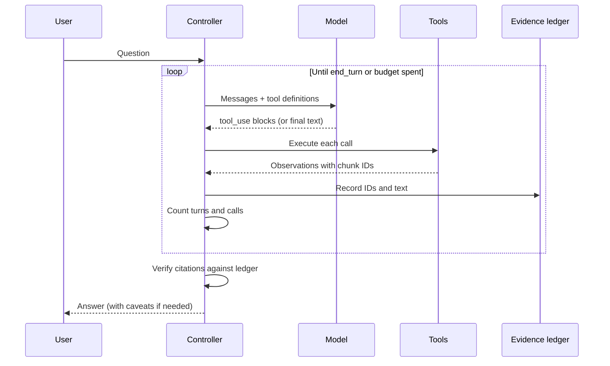

A **retrieval agent** is a language model running in a loop with retrieval tools, deciding at each turn whether to search, where, with what query, and when to stop and answer. Earlier lessons in this module took the pieces one at a time: [agentic retrieval](/learn/agentic-rag/agentic-retrieval) introduced the idea, [tool-based retrieval](/learn/agentic-rag/tool-based-retrieval) showed how to expose a search as a tool, [planning and reasoning](/learn/agentic-rag/planning-and-reasoning) covered how a model plans its steps, and [iterative search](/learn/agentic-rag/iterative-search) covered the retrieve-read-requery loop. This lesson assembles them into a working system and concentrates on the parts that are easy to get wrong when you build one: the control loop, the state the agent keeps outside the model, what tools return, how the loop ends, and how the final answer is checked against the evidence the agent actually gathered.

The code runs the full loop locally against real dense retrieval, with a scripted stand-in for the model, and the identical loop runs against Claude by swapping one object.

## Learning objectives

- Name the five components of a retrieval agent (model, tools, state, controller, answer verifier) and the responsibility of each.
- Implement a tool-use loop with the Anthropic Messages API that handles parallel tool calls, tool errors and every stop reason.
- Design tool observations that are compact, carry stable chunk IDs and fit a token budget.
- Enforce hard budgets in the controller and force a final answer when they run out.
- Verify that an agent's citations refer only to chunks it actually retrieved, and explain why that check belongs in code rather than in the prompt.

## Prerequisites

- [Tool-based retrieval](/learn/agentic-rag/tool-based-retrieval): defining a search function as a tool with a JSON schema.
- [Planning and reasoning](/learn/agentic-rag/planning-and-reasoning): how a model decides its next step.
- [Iterative search](/learn/agentic-rag/iterative-search): evidence sets, novelty and stopping rules.
- [Citation instructions](/learn/prompt-engineering-for-rag/citation-instructions): asking a model to cite its sources.

## Why this matters

A fixed RAG pipeline makes the same moves for every question: embed, retrieve top-k from one index, generate. Real traffic is not that uniform. At Meridian, "how many days of annual leave do I get?" needs one handbook chunk. "I'm in a café and my VPN shows E-4021; do I need the VPN here and how do I fix it?" needs a handbook policy *and* a runbook procedure. "What's the weather in Leeds?" needs no retrieval at all. A pipeline either searches everything for every question, paying for irrelevant context, or misses the second source.

A retrieval agent lets the model choose per question. That flexibility has a price, and the reason to study agents as *systems* rather than as prompts is that the price is paid in engineering properties:

- **Cost and latency become variable.** One question takes one search; another takes six. Without hard limits in code, a confused agent can loop until a timeout.
- **Behaviour becomes harder to reproduce.** The same question can take different paths on different runs, so debugging needs per-step logs.
- **Grounding becomes harder to guarantee.** An agent that has seen many tool results across several turns can cite a chunk it never retrieved, or state a fact from its training data with a citation attached.

Each is solved by code around the model, which is what this lesson builds.

> [!TIP]
> Before building an agent, check that a simpler design will not do. If 95% of questions need one search of one index, a pipeline with a [query router](/learn/agentic-rag/query-routing) in front is cheaper, faster and easier to test. Agents earn their cost when the number and kind of searches genuinely vary per question.

## The intuition

Picture a reference librarian handling a question at the desk. They have a few catalogues they can search (the tools), a notepad where they jot down each source they have found with its shelf mark (the evidence ledger), and a manager's rule that no enquiry gets more than ten minutes (the budget). They decide which catalogue to try, read what comes back, maybe try another, and then write an answer that cites shelf marks from the notepad.

Two features carry over. The notepad is a written record anyone can audit: when the librarian cites a shelf mark, the manager can check it is there. And the ten-minute rule is enforced by the manager, because a librarian deep in a hard question is the person least likely to notice the time.

## How it works

### The five components

1. **The model** (often called the policy) reads the conversation so far and produces either tool calls or a final answer. It makes decisions; it does not execute anything.
2. **The tools** are ordinary functions: search an index, fetch a document by ID, list sources. They execute deterministically and return observations.
3. **The state** is everything the agent has accumulated: the message history the model sees, plus structured records the model does not have to remember, above all an **evidence ledger** mapping chunk IDs to the text that was retrieved.
4. **The controller** is your loop. It sends the state to the model, executes the tool calls, appends results, counts turns and tool calls, enforces budgets, and decides when the run is over.
5. **The answer verifier** checks the final answer against the state: are the cited IDs in the ledger, did the run end normally, does the answer need a caveat?

Only the first component is a language model. The other four are code you write, test and own.



### The control loop with the Messages API

With the Anthropic Messages API, tool definitions go in the `tools` parameter and the model signals a tool call by returning content blocks of type `tool_use` with `stop_reason` set to `"tool_use"`. One iteration of the controller is:

1. Call `client.messages.create` with the system prompt, the tool definitions and the full message history. The API is stateless, so the history is resent every time.
2. Append the assistant's `response.content` to the history unchanged. It contains the `tool_use` blocks, whose IDs the results must reference.
3. Inspect `response.stop_reason`. If it is `"tool_use"`, continue. Anything else ends the loop: `"end_turn"` is a normal finish; `"max_tokens"` means the answer was cut off; `"refusal"` means the model declined. Treat the last two as failures, not answers.
4. Execute every `tool_use` block. The model may request several in one response (parallel tool use): independent searches it wants at once.
5. Build one `tool_result` block per call, each carrying the matching `tool_use_id`, and send **all** of them back in a **single** user message. If a tool failed, still send a result for it, with `is_error` set to true and a short description of the failure, so the model can adapt.
6. Update counters and check budgets, then loop.

### Observations: what tools return

What a tool returns is what the model reads, so observation design is prompt design. [Tool-based retrieval](/learn/agentic-rag/tool-based-retrieval) covers the formatting rules (stable IDs, short snippets, an explicit "no results", actionable errors). At the level of the whole agent, two consequences matter. Every observation stays in the history and is re-read on every later turn, so a tool that returns twenty chunks per call fills the context after three turns and buries the useful ones; return two to five and offer a separate tool to fetch a whole document by ID. And every observation must carry the IDs the ledger and the verifier depend on.

### State outside the model

[Agentic retrieval](/learn/agentic-rag/agentic-retrieval) introduced the harness's own structured record alongside the conversation. In a full agent its most important part is the evidence ledger, because the message history is a poor system of record: it mixes reasoning, calls and results in free text, and context-management features that summarise or clear old tool results may remove the very results you need to check a citation. The controller keeps:

- the **evidence ledger**: chunk ID to retrieved text, plus which tool call returned it;
- **counters**: turns, tool calls, tokens used;
- the **stop reason** for the run.

The ledger is the source of truth for grounding. When the model writes "[rb-4021]", the controller can confirm that `rb-4021` was returned by a tool in this run, and retrieve the exact text to show the user.

### Budgets and termination

An agent run ends in one of three ways:

- **Normal finish.** The model returns a final answer (`stop_reason` of `"end_turn"`).
- **Budget exhaustion.** The controller's limits on turns, tool calls, tokens or wall-clock time are reached. The controller then tells the model the budget is spent, asks for an answer from the evidence so far, and sets `tool_choice` to `{"type": "none"}` on that final call so the model cannot request another tool.
- **Abnormal stop.** `max_tokens`, `refusal`, an exception from the API, or a tool that keeps failing. These are covered in depth in [Agent failure handling](/learn/agentic-rag/agent-failure-handling).

Budgets must be enforced in the controller. A sentence in the system prompt such as "use at most three searches" is guidance the model usually follows, which is not the same as a limit. Set limits from measurement: log how many tool calls successful runs use, and put the hard limit somewhat above the high percentiles of that distribution, so it fires on runaway runs rather than on hard questions.

### Verifying the answer

Telling the model to cite chunk IDs does not ensure that it cites only chunks it retrieved. Models can produce IDs that follow the naming pattern of real ones, or cite a chunk from memory of an earlier conversation turn that was in fact a different search. The verifier extracts every cited ID from the answer and splits them into **verified** (in the ledger) and **unsupported** (not in the ledger). What to do with unsupported citations is a product decision: strip the sentence, add a caveat, or re-ask the model to revise with only the evidence. What you must not do is show the answer unchanged.

Citation membership is a necessary check, not a sufficient one. A sentence can cite a real, retrieved chunk that does not support it. Checking support is the job of [faithfulness](/learn/generation-evaluation/faithfulness) evaluation, which [Agent evaluation](/learn/agentic-rag/agent-evaluation) applies to agents.

### One agent or several

The design above is a single agent. A common extension is an **orchestrator-worker** arrangement: a lead agent splits a broad research question and hands parts to worker agents, each with its own context and tools, then combines their findings. It helps when independent strands would crowd one context window, but it multiplies token use roughly by the number of workers and makes failures harder to trace. For internal question answering, a single agent with good tools is usually enough; treat multi-agent designs as an active engineering area rather than settled practice.

## In code

**The problem.** Build a complete retrieval agent over a small Meridian corpus with two sources, run it on a question that needs both, and verify its citations.

**Dependencies.** `sentence-transformers` (with the cached `all-MiniLM-L6-v2` model) and NumPy for the runnable version; `anthropic` for the version that calls Claude.

```bash
pip install sentence-transformers numpy anthropic
```

The model is replaced by `ScriptedClient`, a small object with the same `client.messages.create(...)` call shape that returns pre-written responses shaped like the API's (objects with `stop_reason` and `content` blocks that have `type`, `id`, `name`, `input` and `text`). The script is the kind of decision Claude makes for this question: two searches in parallel, then an answer. Everything else (the tool, the retrieval, the controller, the ledger and the verifier) is real and runs. The scripted answer deliberately contains one citation the agent never retrieved, to show the verifier working.

```python
import json, re
from dataclasses import dataclass, field
from types import SimpleNamespace as NS
import numpy as np
from sentence_transformers import SentenceTransformer

# ---- The corpus and a filtered search tool --------------------------------
CHUNKS = [
    ("hb-pw",     "handbook", "Passwords must be rotated every 90 days. VPN is required on public Wi-Fi."),
    ("hb-remote", "handbook", "Staff may work remotely up to 3 days a week. The home-office equipment budget is £400."),
    ("hb-leave",  "handbook", "Annual leave is 25 days; up to 5 unused days carry over and must be used by 31 March."),
    ("rb-4021",   "runbooks", "Error E-4021 means the VPN client is out of date; update it from the IT portal."),
    ("rb-4012",   "runbooks", "Error E-4012 means the VPN certificate has expired; reinstall it from the IT portal."),
    ("rb-desk",   "runbooks", "The support desk is open 08:00 to 18:00 UK time for laptop, password and VPN problems."),
]
model = SentenceTransformer("sentence-transformers/all-MiniLM-L6-v2")
VECS = model.encode([text for _, _, text in CHUNKS], normalize_embeddings=True)

def search_docs(query: str, source: str = "any", k: int = 2):
    q = model.encode([query], normalize_embeddings=True)[0]
    scores = VECS @ q
    hits = [i for i in np.argsort(-scores) if source in ("any", CHUNKS[i][1])]
    return [{"id": CHUNKS[i][0], "score": round(float(scores[i]), 3), "text": CHUNKS[i][2]}
            for i in hits[:min(k, 5)]]

TOOLS = [{
    "name": "search_docs",
    "description": ("Search Meridian's internal documents. Use source='handbook' for HR policy "
                    "and source='runbooks' for IT procedures and error codes. Returns chunks with IDs; "
                    "cite them as [id] in the final answer."),
    "input_schema": {
        "type": "object",
        "properties": {
            "query": {"type": "string", "description": "A focused search query."},
            "source": {"type": "string", "enum": ["handbook", "runbooks", "any"]},
            "k": {"type": "integer", "minimum": 1, "maximum": 5},
        },
        "required": ["query"],
    },
}]
TOOL_FUNCS = {"search_docs": search_docs}

# ---- Agent state and the control loop --------------------------------------
@dataclass
class AgentState:
    question: str
    messages: list = field(default_factory=list)
    evidence: dict = field(default_factory=dict)      # chunk id -> text
    tool_calls: int = 0
    turns: int = 0
    stop: str = ""

SYSTEM = ("You answer questions for Meridian staff using the search_docs tool. Search before answering. "
          "Cite every claim with the chunk id in square brackets, e.g. [hb-pw]. "
          "If the documents do not contain the answer, say so.")

def run_agent(client, question, max_turns=6, max_tool_calls=8):
    state = AgentState(question, messages=[{"role": "user", "content": question}])
    force_answer = False
    while True:
        state.turns += 1
        extra = {"tool_choice": {"type": "none"}} if force_answer else {}
        response = client.messages.create(model="claude-opus-5-5", max_tokens=4096, system=SYSTEM,
                                          tools=TOOLS, messages=state.messages, **extra)
        state.messages.append({"role": "assistant", "content": response.content})
        if response.stop_reason != "tool_use":          # end_turn, max_tokens, refusal ...
            state.stop = response.stop_reason
            answer = "".join(b.text for b in response.content if b.type == "text")
            return state, answer
        results = []
        for block in (b for b in response.content if b.type == "tool_use"):
            state.tool_calls += 1
            try:
                hits = TOOL_FUNCS[block.name](**block.input)
            except (KeyError, TypeError) as exc:            # unknown tool or bad arguments
                results.append({"type": "tool_result", "tool_use_id": block.id,
                                "content": f"Tool error: {exc!r}", "is_error": True})
                continue
            state.evidence.update({h["id"]: h["text"] for h in hits})
            print(f"  turn {state.turns}: {block.name}({json.dumps(block.input)}) -> {[h['id'] for h in hits]}")
            results.append({"type": "tool_result", "tool_use_id": block.id,
                            "content": json.dumps(hits)})
        if state.turns >= max_turns or state.tool_calls >= max_tool_calls:
            force_answer = True
            results.append({"type": "text", "text": "Search budget reached. Answer now from the "
                            "evidence gathered, and say what is missing."})
        state.messages.append({"role": "user", "content": results})   # all results in ONE message

def verify_citations(answer, state):
    cited = set(re.findall(r"\[([a-z0-9-]+)\]", answer))
    return sorted(cited & state.evidence.keys()), sorted(cited - state.evidence.keys())

# ---- A scripted stand-in for the model, so the loop runs without an API key --
class ScriptedClient:
    """Returns pre-written responses shaped like Anthropic Messages API responses."""
    def __init__(self, script):
        self.script = iter(script)
        self.messages = self
    def create(self, **kwargs):
        return next(self.script)

def tool_use(id_, **inp):
    return NS(type="tool_use", id=id_, name="search_docs", input=inp)

def text(t):
    return NS(type="text", text=t)

script = [
    NS(stop_reason="tool_use", content=[
        text("I'll check the policy and the error code."),
        tool_use("tu_1", query="VPN requirement on public Wi-Fi", source="handbook"),
        tool_use("tu_2", query="E-4021", source="runbooks"),
    ]),
    NS(stop_reason="end_turn", content=[text(
        "Yes: VPN is required on public Wi-Fi such as a café's [hb-pw]. E-4021 means your VPN "
        "client is out of date; update it from the IT portal [rb-4021]. "
        "If the update fails, the support desk is open 08:00 to 18:00 UK time [rb-desk].")]),
]

question = "I'm working from a café and my VPN shows E-4021. Do I need the VPN here, and how do I fix it?"
state, answer = run_agent(ScriptedClient(script), question)
print(f"\nstop={state.stop}  turns={state.turns}  tool_calls={state.tool_calls}")
print("evidence:", list(state.evidence))
print("answer:", answer)
ok, unsupported = verify_citations(answer, state)
print("verified citations:", ok)
print("citations not in evidence:", unsupported)
```

```output
  turn 1: search_docs({"query": "VPN requirement on public Wi-Fi", "source": "handbook"}) -> ['hb-pw', 'hb-remote']
  turn 1: search_docs({"query": "E-4021", "source": "runbooks"}) -> ['rb-4021', 'rb-4012']

stop=end_turn  turns=2  tool_calls=2
evidence: ['hb-pw', 'hb-remote', 'rb-4021', 'rb-4012']
answer: Yes: VPN is required on public Wi-Fi such as a café's [hb-pw]. E-4021 means your VPN client is out of date; update it from the IT portal [rb-4021]. If the update fails, the support desk is open 08:00 to 18:00 UK time [rb-desk].
verified citations: ['hb-pw', 'rb-4021']
citations not in evidence: ['rb-desk']
```

**The important lines.**

- `TOOLS` is the definition the model sees. The `description` tells the model which `source` to use for what, and how to cite; the `enum` and integer bounds constrain the arguments. `search_docs` enforces the same limit (`min(k, 5)`), because a schema is a request to the model, not a guarantee.
- `state.messages.append({"role": "assistant", "content": response.content})` stores the model's turn exactly as returned, including its `tool_use` blocks. Each `tool_result` must reference one of those blocks by `tool_use_id`.
- `if response.stop_reason != "tool_use"` ends the loop for any other stop reason, and the reason is recorded. A caller must treat `"max_tokens"` or `"refusal"` differently from `"end_turn"`.
- The `try`/`except` turns an unknown tool name or bad argument into a `tool_result` with `"is_error": True` rather than a crash, so the model sees the error and can correct itself.
- `state.evidence.update(...)` fills the ledger as a side effect of executing tools. The model never writes to it.
- All results go back in **one** user message. When the budget is hit, a text block asking for an answer is added after the results, and the next call carries `tool_choice={"type": "none"}`.
- `verify_citations` compares cited IDs with the ledger's keys.

**What the output means.**

- **Turn 1 issued two searches in parallel**, each restricted to the right source. The handbook search returned the password-and-VPN chunk first; the runbook search returned `rb-4021` first, with the neighbouring `rb-4012` second.
- **The run ended normally** after two turns and two tool calls (`stop=end_turn`), well within the budgets of six turns and eight calls.
- **The ledger holds four chunks**: every chunk any tool returned, including `hb-remote` and `rb-4012`, which the answer does not use.
- **The verifier caught `[rb-desk]`.** The support-desk hours in that sentence are true, and the chunk exists in the corpus, but no search in this run returned it. The sentence is therefore not grounded in this run's evidence. Exactly this happens with real models: a plausible ID, a true fact, and no retrieval behind it.

**Running it with Claude.** Replace the scripted client with the real one; the loop is unchanged. This was not executed here (it needs an API key), so its path will vary; a typical run makes the same two searches.

```python
import anthropic

client = anthropic.Anthropic()  # reads ANTHROPIC_API_KEY from the environment
state, answer = run_agent(client, question)
if state.stop != "end_turn":
    raise RuntimeError(f"agent stopped abnormally: {state.stop}")
ok, unsupported = verify_citations(answer, state)
```

**Errors people commonly hit.**

- *Sending tool results without the assistant turn before them.* The API rejects a `tool_result` whose `tool_use_id` does not match a `tool_use` block in the preceding assistant message.
- *Sending parallel results in separate user messages.* Return them together, or the model learns from the history to stop making parallel calls.
- *Dropping a failed call's result.* Every `tool_use` needs a `tool_result`, even if it is an error.
- *Reading `response.content[0].text` blindly.* The first block may be a `tool_use` block, or there may be thinking blocks; filter by `type`.

**Extending it.** Add a `read_document(doc_id)` tool that returns the full parent document for a chunk ID (the agent version of [small-to-big retrieval](/learn/chunking-optimisation/small-to-big-retrieval)); add a token counter from `response.usage.input_tokens` and `response.usage.output_tokens` to the state and a token budget to the controller; and log one structured record per turn for [tracing](/learn/rag-observability/tracing).

## A real-world example

The Platform team gave AskMeridian an agent mode for IT questions, with two tools: `search_handbook` and `search_runbooks`. Within a fortnight the support desk forwarded two complaints.

The first was that answers about VPN errors sometimes quoted the handbook's general IT policy instead of the runbook fix. Ines, the engineer on the agent, read the traces: for questions such as "VPN broken at the airport", the agent called `search_handbook` first and, finding a plausible chunk about VPN use on public Wi-Fi, answered without ever searching the runbooks. The tool descriptions were the cause. Both said "search Meridian documentation". She rewrote them to say what each source contains and when to use it ("runbooks: IT procedures, error codes such as E-4021, troubleshooting steps"), and the agent began searching runbooks first for error questions. Tool descriptions were, in effect, the routing logic.

The second complaint was subtler: an answer cited "[rb-vpn-reset]", which did not exist. The model had invented an ID in the style of the real ones. The team added the ledger and citation check from this lesson. Unsupported citations now trigger one revision request ("revise using only these IDs: ...") and, if that fails, the sentence is removed and the answer carries a note that part of it could not be verified. They also added the budget: eight tool calls and 45 seconds, set from the 99th percentile of tool calls in a week of traces.

## Common mistakes

- **Enforcing budgets only in the prompt.** "Use at most three searches" is usually followed; runaway runs are exactly the cases where it is not.
- **Treating every non-tool stop as an answer.** A `max_tokens` stop is a truncated answer, and a `refusal` is not an answer at all.
- **Vague, overlapping tool descriptions.** The model cannot choose between two tools described the same way, so it picks one and stays with it.
- **Returning too much per tool call.** Large observations fill the context, raise cost on every later turn, and push the useful chunk into the middle where it is easily overlooked.
- **Trusting citations without a ledger.** Models produce plausible IDs; only a record of what tools returned can confirm them.
- **Letting the model supply security-relevant arguments.** A tool that takes `user_groups` from the model lets a prompt-injected document widen access.

## Best practices

- Keep the tool set small and distinct; describe in each tool's description what it contains, when to use it and what it returns.
- Return two to five trimmed chunks per call with stable IDs, and a clear message when nothing relevant is found.
- Keep an evidence ledger in the controller and verify every citation against it before showing the answer.
- Enforce turn, tool-call, token and time budgets in code; on exhaustion, force a final answer with tools disabled.
- Record the stop reason, every tool call and its result IDs for every run.
- Test the loop with a scripted client: it makes the controller's behaviour (budgets, errors, citation checks) testable without paying for model calls.

## Performance considerations

Every turn resends the full history, so input tokens grow roughly with the square of the number of turns, as [Agentic retrieval](/learn/agentic-rag/agentic-retrieval) derived. Two levers are specific to a full agent: keep observations small (each one is re-read on every later turn), and use prompt caching, which is effective here because each turn's prompt begins with the previous turn's; check the current caching documentation for prices and minimum cacheable lengths.

Latency is dominated by model turns, not retrieval. If a model turn takes 2 s and a search 50 ms (assumed figures), three turns cost about 6 s. Parallel tool calls save turns: the two searches in the example ran in one turn instead of two. Execute parallel calls concurrently in the controller (with a thread pool or `asyncio`), or their latencies add up. Streaming the final turn to the user hides part of the wait.

## Security considerations

A retrieval agent reads untrusted text (retrieved documents) and acts on it by choosing tool calls, which is the setting in which [indirect prompt injection](/learn/rag-security-fundamentals/indirect-prompt-injection) does the most damage. Four rules contain it:

- **Read-only tools by default.** An agent that can only search and read cannot be tricked into sending email or changing records. Any tool with side effects needs a confirmation step outside the model.
- **Permissions come from the session, not the model.** The search tool applies the authenticated user's access filter itself. Never expose `user_id`, `groups` or `tenant` as tool arguments.
- **Retrieved text is data.** Present observations in a structured format the system prompt identifies as data, and do not follow instructions found inside them.
- **Log every tool call with its arguments**, so that a steered search is visible after the fact.

## Summary

- A retrieval agent is a model choosing tool calls in a loop; the model decides, while the tools, state, controller and verifier are deterministic code you own.
- The Messages API loop: send history and tools, append `response.content`, execute every `tool_use`, return all `tool_result` blocks in one user message, and stop on any `stop_reason` other than `"tool_use"`, treating `max_tokens` and `refusal` as failures.
- Observations should be small, consistently formatted, carry stable IDs and say clearly when nothing was found.
- Keep an evidence ledger outside the model, enforce budgets in the controller, and force a final answer with `tool_choice` set to `none` when they run out.
- Verify citations against the ledger before showing an answer; membership is necessary but does not prove the chunk supports the claim.

## Exercises

**1.** A run ends with `stop_reason` of `"max_tokens"` after three tool calls. The text so far reads like a reasonable answer. List what the controller should do, in order.

<details><summary>Show solution</summary>

1. Record the stop reason and do not treat the run as successful.
2. Do not show the text as a complete answer: it was cut off and may stop mid-sentence or before a caveat.
3. Retry the final turn with a larger `max_tokens` (the evidence is already in the history, so no new searches are needed), or ask the model to answer more concisely.
4. If the retry also fails, return a degraded response, for example the verified evidence with a short note, and log the run for review. A frequent `max_tokens` stop usually means `max_tokens` is set too low for the answer format.

</details>

**2.** Extend the code with a second tool, `read_document(doc_id)`, that returns the full text of a chunk's parent document (for this exercise, make each chunk its own document). What must you change in the controller so that the ledger and citation check still work? Should `read_document` accept IDs not already in the ledger?

<details><summary>Show solution</summary>

Add a definition to `TOOLS` with a required string `doc_id`, add the function to `TOOL_FUNCS`, and make it return the same shape as search results, for example `[{"id": doc_id, "text": ...}]`, so that `state.evidence.update(...)` records it unchanged. If its return shape differs, generalise the ledger update with a small per-tool adapter.

Whether to accept IDs not in the ledger is a design decision. Accepting any ID lets the model fetch documents it guessed, which bypasses retrieval and, if IDs are predictable, can be used to probe for documents. Requiring that the ID was returned by an earlier search in this run (`if doc_id not in state.evidence: return an is_error result`) keeps the agent grounded in what search found. In either case, apply the user's permission check inside `read_document`.

</details>

**3.** Design decision. Meridian wants AskMeridian to answer questions that span the handbook, the runbooks and the product documentation for Meridian Sync, Meridian Relay and Meridian Reports. Option A gives one agent three search tools, one per source. Option B gives one agent a single `search` tool with a `source` argument. Option C uses an orchestrator with one worker agent per source. Recommend one and say what evidence would change your mind.

<details><summary>Show solution</summary>

Option B or A, not C. Three sources is a small, well-defined space; one agent can choose among them, and a single context holds the evidence for typical questions. Option B (one tool with a `source` enum, as in the code) keeps the tool list short and lets the description explain each source in one place; it also allows `"any"` when the model is unsure. Option A gives each source its own description and argument schema, which is better if the sources need different filters (product and version for the product docs, say). Choose A if the sources' arguments differ and B if they do not.

Option C triples the model calls for most questions and adds coordination failures, for little benefit when each strand is one or two searches. Evidence that would justify it: traces showing that cross-source questions regularly need many searches per source and the single agent's context fills up, or that answer quality drops on such questions because evidence from one source crowds out another. Measure this with the evaluation approach in the next lesson before changing the architecture.

</details>

## Check your understanding

```quiz
[
  {
    "q": "In the Messages API tool-use loop, how should results for three parallel tool calls be returned?",
    "options": [
      "In three separate user messages, one per result",
      "In one user message containing three tool_result blocks, each with the matching tool_use_id",
      "As plain text appended to the system prompt",
      "Only the successful results; failed calls are omitted"
    ],
    "answer": 1,
    "why": "All results for one assistant turn go back together in a single user message, each referencing its tool_use block. Failed calls still get a result, marked as an error."
  },
  {
    "q": "A run ends with stop_reason \"refusal\". What should the controller do?",
    "options": [
      "Record it as an abnormal stop and not present the output as an answer",
      "Show the text, since the model finished its turn",
      "Retry the identical request in a loop until it succeeds",
      "Treat it like tool_use and execute the next tool"
    ],
    "answer": 0,
    "why": "Only end_turn is a normal finish. A refusal means the model declined; the controller should handle it as a failure path."
  },
  {
    "q": "Why does the controller keep an evidence ledger instead of relying on the message history?",
    "options": [
      "The API does not return tool results to the model",
      "The ledger makes the model's answers shorter",
      "It is a structured, auditable record of exactly which chunks tools returned, used to verify citations",
      "Message histories cannot contain JSON"
    ],
    "answer": 2,
    "why": "The history mixes free text and may be trimmed; the ledger records chunk IDs and text as tools returned them, which is what a citation check needs."
  },
  {
    "q": "The agent's answer cites [rb-desk]. The chunk exists in the corpus and the stated fact is true, but no tool returned it during the run. How should the verifier classify the citation?",
    "options": [
      "Verified, because the chunk exists",
      "Verified, because the fact is correct",
      "Irrelevant, because only the first citation matters",
      "Unsupported, because it is not in this run's evidence ledger"
    ],
    "answer": 3,
    "why": "Grounding means the claim rests on evidence retrieved in this run. A true fact cited from outside the ledger is not grounded and must be handled before display."
  },
  {
    "q": "Which tool argument should never be controlled by the model?",
    "options": [
      "The search query",
      "The user's permission groups",
      "The number of results k",
      "The document source, such as handbook or runbooks"
    ],
    "answer": 1,
    "why": "Access control must come from the authenticated session. If the model sets permission groups, a prompt injection in a retrieved document could widen access."
  }
]
```

## Further reading

- Yao et al. (2022), "ReAct: Synergizing Reasoning and Acting in Language Models", [arXiv:2210.03629](https://arxiv.org/abs/2210.03629).
- Anthropic documentation, [Tool use overview](https://platform.claude.com/docs/en/agents-and-tools/tool-use/overview), including parallel tool use and handling tool results.
- Schick et al. (2023), "Toolformer: Language Models Can Teach Themselves to Use Tools", [arXiv:2302.04761](https://arxiv.org/abs/2302.04761).
- Anthropic (2024), "Building effective agents", an engineering essay on when to use workflows versus agents.
