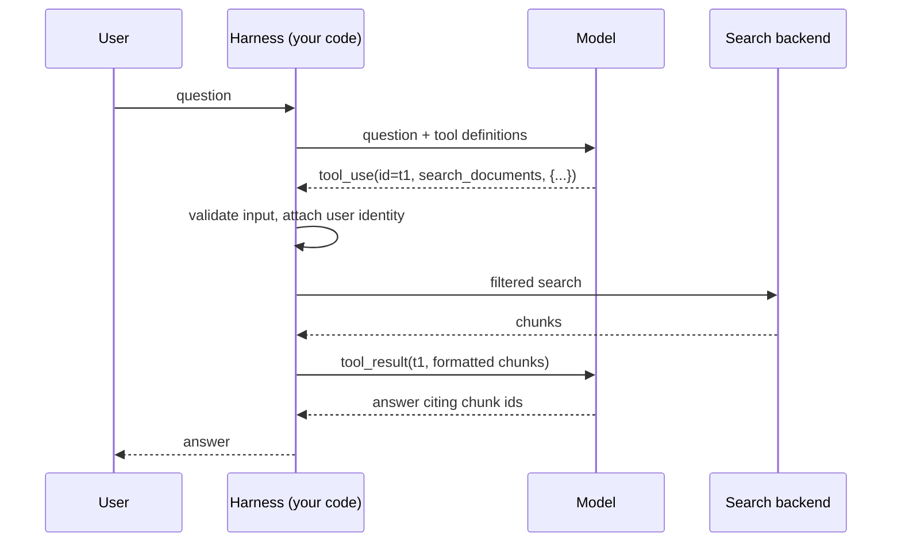

In [Agentic retrieval](/learn/agentic-rag/agentic-retrieval) the model chose actions from a menu and your code carried them out. This lesson is about that menu. In modern systems retrieval is offered to the model as one or more **tools**: named functions with a description and a typed list of arguments, which the model can ask to call and whose results come back into the conversation. How you define those tools decides what the model *can* search, how reliably it searches well, and what it cannot do even if it is confused or manipulated.

You will define three Meridian retrieval tools from Pydantic models, so that one class gives both the schema the model sees and the validation your code applies, then execute a batch of realistic tool calls, valid and invalid, and look at exactly what goes back to the model in each case.

## Learning objectives

- Describe the tool-calling protocol: tool definitions, `tool_use` requests, and `tool_result` replies matched by id.
- Design a retrieval tool surface by choosing tool granularity, parameters, limits, names and descriptions.
- Generate tool schemas from Pydantic models and validate every argument before executing a call.
- Format tool results and errors so that the model can cite, recover and stop.
- Identify which arguments must never come from the model, and enforce access control inside the tool.

## Prerequisites

- [Agentic retrieval](/learn/agentic-rag/agentic-retrieval): the agent loop that calls these tools.
- [Dataclasses and Pydantic](/learn/python-for-rag-engineering/dataclasses-and-pydantic): typed models and validation.
- [Self-query retrieval](/learn/advanced-retrieval/self-query-retrieval): a model writing structured filters, and the safeguards that requires.
- [Structured outputs](/learn/generation-strategies/structured-outputs): getting schema-shaped JSON from a model.

## Why this matters

A retrieval tool is a prompt and an API at once. The model reads its name and description to decide *whether* to call it, reads its parameter schema to decide *how*, and reads its result to decide what to do next. Each of those surfaces fails in a characteristic way:

- **Vague descriptions** make the model choose the wrong tool or none. If "search" and "lookup" sound interchangeable, the model will search the handbook for error codes that an exact lookup would have found instantly.
- **Loose parameters** let the model ask for 50 results, invent a source called "wiki", or pass a filter on a field that does not exist. Without validation, that becomes an exception, an empty result, or an expensive query.
- **Poor results** strand the model. A bare list of text with no ids cannot be cited; a Python traceback teaches it nothing; an empty string looks like a bug rather than "nothing matched".
- **Trusting arguments** is a security hole. If the model supplies the user id or tenant for a search, any injected instruction that changes that argument reads someone else's data.

Well-designed tools turn all four into ordinary, recoverable situations.

## The intuition

Think of a hospital pharmacy hatch. A doctor cannot walk into the store room; she fills in a printed request form. The form has fixed boxes: drug name from an approved list, dose within a permitted range, patient number. The pharmacist checks the form, refuses anything outside the rules with a specific reason ("dose exceeds maximum, please confirm"), and hands back exactly what was asked for, labelled.

The model is the doctor, the schema is the form, your validation is the pharmacist, and the labelled package is the tool result. The form limits what can be requested, however confused the requester; and the pharmacy checks who is entitled to what against its own records, not against whatever is written on the form.

## How it works

### The protocol

Tool calling follows the same shape in every major model API. With the Anthropic Messages API it works like this:

1. **Declare.** Each request includes `tools`: a list of definitions, each with a `name`, a `description` and an `input_schema` (a JSON Schema object describing the arguments).
2. **Request.** If the model wants to call a tool, its response has `stop_reason` equal to `"tool_use"` and contains one or more `tool_use` content blocks, each with an `id`, the tool `name` and an `input` object.
3. **Execute.** Your code validates each `input`, runs the tool and produces text.
4. **Reply.** You append the model's whole response as an assistant message, then send a user message containing one `tool_result` block per call, each carrying the matching `tool_use_id`, the `content`, and `is_error: true` if the call failed.
5. **Repeat.** The model reads the results and either calls more tools or answers, ending with `stop_reason` equal to `"end_turn"`.



The model never touches the search backend: it produces a structured *request*, and everything between request and result is your code.

### Choosing the tool surface

The first design decision is **granularity**: how many tools, and how much each one does.

- **One generic tool with parameters**, such as `search_documents(query, source, k)`. Fewer tools to choose between and one implementation, but the model must pick the right parameter values, and the description must explain each source.
- **One tool per source**, such as `search_handbook(query)` and `search_runbooks(query)`. Each description can be specific, and choosing a tool is choosing a source. The list grows with every source, and choosing between many similar tools becomes harder.
- **Specialised tools for distinct access patterns.** Not every retrieval is semantic search. An **exact lookup** (`lookup_error_code("E-4021")`) beats embeddings for identifiers, as [Query-document matching](/learn/rag-architecture-fundamentals/query-document-matching) showed. A **fetch** tool (`get_document(doc_id)`) lets the model read a whole document after a search has found a snippet of it. A **structured query** tool can answer "how many" questions from a table that search would answer badly.

A good default is a handful of tools whose purposes do not overlap: one search tool per genuinely different corpus or access pattern, plus exact lookups for identifiers and a fetch tool if documents are long. If you find yourself writing "use this unless..." in two descriptions, the tools overlap.

### Parameters: what the model may choose

Every parameter is a decision you are delegating. Delegate only what the model can judge from the question, and bound it:

- **`query`**: free text, with a length limit. The model writes better queries than users do for compound questions, because it can strip conversational filler and split topics.
- **Enumerations** (`source` must be one of three values) instead of free strings. The model cannot invent a source, and the schema itself documents the options.
- **Numeric ranges** (`k` from 1 to 5). Without a ceiling, a model unsure of itself asks for many results and floods its own context.
- **Filters** on metadata fields, such as a document edition or a product name, declared as typed, optional fields. [Self-query retrieval](/learn/advanced-retrieval/self-query-retrieval) covers how to validate and relax them.

And some arguments must never be parameters at all: the user's identity, their tenant, their permission groups, and any setting that widens access. Your harness attaches those from the authenticated session when it executes the call.

### Names and descriptions are prompts

The model chooses tools mostly from their names and descriptions, so write them as you would write instructions to a capable colleague who has never seen your system:

- Say **what the tool searches** and **when to use it**: "Exact lookup of a Meridian error code (E- followed by four digits). Prefer this to search for codes."
- Say **what comes back**: ids, scores, truncated text.
- Describe each **parameter**, especially enumerations: "handbook: HR policy. runbooks: IT how-to and troubleshooting."
- Use a consistent naming scheme (`verb_noun`), so the list reads as a coherent set.

When traces show the wrong tool being chosen, fix the description before adding logic.

### Validating arguments

Treat every `input` as untrusted data. It is generated text, and it can be wrong (a model writes `"4021"` instead of `"E-4021"`), out of range, or deliberately manipulated by an injected instruction. Validate it against the same schema you declared, and refuse anything invalid with a message that says what was wrong and how to fix it.

Defining each tool's arguments as a Pydantic model gives you one source of truth: `model_json_schema()` produces the `input_schema` the model sees, and `model_validate()` checks the input your code receives. Setting `extra="forbid"` adds `"additionalProperties": false` to the schema and rejects unknown fields.

The Anthropic API also offers **strict tool use**: setting `"strict": true` on a tool definition makes the API guarantee that the model's `input` matches the schema. It requires `additionalProperties: false` and supports only a subset of JSON Schema keywords, so check the current documentation before relying on constraints such as length or range limits. Strict mode reduces malformed calls; it does not replace validation in your code, which also enforces rules no schema can express, such as whether this user may read this document.

### Formatting results

A tool result is the model's only view of what happened. Design it for a reader that will cite, judge and decide:

1. **Give every item an id**, so the answer can cite `[hb-support]` and your code can check those citations.
2. **Keep it short.** Return snippets, not whole documents, and cap the total size; truncate with a visible marker. Results accumulate across every later step of the loop.
3. **Say "No results." explicitly** when nothing matches, rather than returning an empty string.
4. **Return errors as results**, with `is_error: true` and a message that names the problem and the fix: "k: Input should be less than or equal to 5", or "not a known error code; try search_documents with source='runbooks'". The model reads it and usually corrects itself on the next call.
5. **Include a relevance signal** where it helps the model judge sufficiency, such as a score, but remember from [Score calibration](/learn/advanced-retrieval-optimisation/score-calibration) that raw scores are not probabilities.

### Parallel calls and tool choice

A model may request several tools in one response, for example an error-code lookup and a search for support hours. Run independent calls concurrently and return **all** their `tool_result` blocks together in one user message; splitting them across messages breaks the request-reply pairing and discourages the model from making parallel calls.

The `tool_choice` parameter controls whether the model may call tools. `{"type": "auto"}`, the default, lets it decide; `{"type": "none"}` forbids calls, which is how [Agentic retrieval](/learn/agentic-rag/agentic-retrieval) forced a final answer. Forcing a particular tool (`{"type": "any"}` or `{"type": "tool", ...}`) is supported by some models but rejected by some current Claude models, including the one used in this course; steer with instructions instead, and check the documentation for the model you deploy.

### Where the idea comes from

Research predates the APIs: **Toolformer** (Schick and colleagues, 2023) trained a model to insert API calls, including search, into its own text, and **Gorilla** (Patil and colleagues, 2023) studied models writing correct calls against large API collections. Today the **Model Context Protocol** (MCP) standardises packaging tools as servers that many applications can use. MCP changes how tools are distributed, not how they should be designed.

## The mathematics

### What an actionable error message is worth

**Intuition.** Invalid calls cost a full loop step each: a model call, a validation failure and a resend of the whole context. A specific error message raises the chance that the retry is valid; a vague one lets the model flail. You can put a number on the difference.

Let $v$ be the probability that the model's first call is valid, and $a$ the probability that a retry after an error is valid. Assuming retries are independent (a simplification), the number of extra attempts after a first failure is geometric with mean $1/a$, so the expected number of attempts per successful call is

$$
\mathbb{E}[\text{attempts}] = 1 + \frac{1 - v}{a}
$$

and with at most $m$ retries the probability of eventually succeeding is

$$
P(\text{success}) = 1 - (1 - v)(1 - a)^m
$$

Here $v$ is the first-attempt validity rate, $a$ the retry validity rate, and $m$ the retry limit.

**By hand.** Suppose (an assumption for illustration) $v = 0.9$, and compare an actionable error message ($a = 0.9$) with a bare "invalid input" ($a = 0.4$), with $m = 2$.

- Actionable: $\mathbb{E} = 1 + 0.1/0.9 \approx 1.11$; $P = 1 - 0.1 \times 0.1^2 = 0.999$.
- Vague: $\mathbb{E} = 1 + 0.1/0.4 = 1.25$; $P = 1 - 0.1 \times 0.6^2 = 0.964$.

With the vague message, 3.6 per cent of tool calls that started invalid never succeed within the limit, against 0.1 per cent. Measure $v$ and $a$ from your own traces; the formula shows why error text is worth writing carefully.

```python
v, m = 0.9, 2
for label, a in [("actionable", 0.9), ("vague", 0.4)]:
    attempts = 1 + (1 - v) / a
    success = 1 - (1 - v) * (1 - a) ** m
    print(f"{label:<10} expected attempts={attempts:.2f}  P(success within {m} retries)={success:.3f}")
```

```output
actionable expected attempts=1.11  P(success within 2 retries)=0.999
vague      expected attempts=1.25  P(success within 2 retries)=0.964
```

## In code

**The problem.** Define three retrieval tools for AskMeridian (a semantic search over one source, a document fetch, and an exact error-code lookup), generate their schemas, and build an executor that validates arguments, enforces permissions, formats results and turns every failure into a useful `tool_result`.

**Dependencies.** NumPy, Pydantic 2 and Sentence Transformers; no API key. The "model's" tool calls are written out by hand, including the kinds of mistakes models make, so every branch of the executor runs. A Claude loop using these tools follows.

```bash
pip install numpy pydantic sentence-transformers
```

```python
import json
from typing import Literal
import numpy as np
from pydantic import BaseModel, ConfigDict, Field, ValidationError
from sentence_transformers import SentenceTransformer

# --- The corpus, with the metadata the tools need ---------------------------
DOCS = {   # id: (source, audience, text)
    "hb-leave":    ("handbook", "all", "Annual leave is 25 days; up to 5 unused days carry over and must be used by 31 March."),
    "hb-remote":   ("handbook", "all", "Staff may work remotely up to 3 days a week; the home-office equipment budget is £400."),
    "hb-support":  ("handbook", "all", "Support desk hours are 08:00 to 18:00 UK time."),
    "hb-salaries": ("handbook", "hr",  "Salary bands for each grade are reviewed every April."),
    "rb-vpn":      ("runbooks", "all", "VPN is required on public Wi-Fi. Reinstall the VPN certificate from the IT portal if it expires."),
    "rb-password": ("runbooks", "all", "Passwords must be rotated every 90 days."),
    "pd-reports":  ("product",  "all", "Meridian Reports exports to PDF and CSV; SAML single sign-on is available on the Enterprise plan."),
}
ERROR_CODES = {
    "E-4021": "The VPN client is out of date; update it from the IT portal.",
    "E-4012": "The VPN certificate has expired.",
}
IDS = list(DOCS)
model = SentenceTransformer("sentence-transformers/all-MiniLM-L6-v2")
EMB = model.encode([d[2] for d in DOCS.values()], normalize_embeddings=True)

# --- Tool arguments as Pydantic models: one source of truth for schema and validation
class SearchArgs(BaseModel):
    model_config = ConfigDict(extra="forbid")
    query: str = Field(min_length=3, max_length=200, description="A focused search query in plain English.")
    source: Literal["handbook", "runbooks", "product"] = Field(
        description="handbook: HR policy. runbooks: IT how-to and troubleshooting. product: Meridian product docs.")
    k: int = Field(default=3, ge=1, le=5, description="Number of results, 1 to 5.")

class GetDocumentArgs(BaseModel):
    model_config = ConfigDict(extra="forbid")
    doc_id: str = Field(description="An id returned by search_documents, such as hb-leave.")

class ErrorCodeArgs(BaseModel):
    model_config = ConfigDict(extra="forbid")
    code: str = Field(pattern=r"^E-\d{4}$", description="A Meridian error code such as E-4021.")

# --- Implementations: they receive validated arguments and the user's identity
def allowed(doc_id, user):
    return DOCS[doc_id][1] == "all" or user["role"] == "hr"

def search_documents(args: SearchArgs, user):
    scores = EMB @ model.encode([args.query], normalize_embeddings=True)[0]
    hits = [IDS[i] for i in np.argsort(-scores)
            if DOCS[IDS[i]][0] == args.source and allowed(IDS[i], user)][: args.k]
    return "\n".join(f"[{h}] score={scores[IDS.index(h)]:.2f} {DOCS[h][2]}" for h in hits) or "No results."

def get_document(args: GetDocumentArgs, user):
    if args.doc_id not in DOCS or not allowed(args.doc_id, user):
        raise LookupError(f"No document with id {args.doc_id!r}.")   # same message either way
    return f"[{args.doc_id}] {DOCS[args.doc_id][2]}"

def lookup_error_code(args: ErrorCodeArgs, user):
    if args.code not in ERROR_CODES:
        raise LookupError(f"{args.code} is not a known error code. Try search_documents with source='runbooks'.")
    return f"{args.code}: {ERROR_CODES[args.code]}"

TOOLS = {   # name: (argument model, implementation, description for the model)
    "search_documents": (SearchArgs, search_documents,
        "Semantic search over one Meridian document source. Use for policy and how-to questions. "
        "Returns ids, scores and text. Call once per source you need."),
    "get_document": (GetDocumentArgs, get_document,
        "Fetch one document's full text by id, after search_documents has returned it."),
    "lookup_error_code": (ErrorCodeArgs, lookup_error_code,
        "Exact lookup of a Meridian error code (E- followed by four digits). Prefer this to search for codes."),
}

def tool_definitions():
    """The list passed as `tools=` to the Messages API."""
    return [{"name": name, "description": desc, "input_schema": args.model_json_schema()}
            for name, (args, _, desc) in TOOLS.items()]

MAX_RESULT_CHARS = 600

def execute(name, raw_input, user):
    """Run one tool call and return the content of its tool_result block."""
    if name not in TOOLS:
        return {"content": f"Unknown tool {name!r}. Available: {', '.join(TOOLS)}.", "is_error": True}
    args_model, fn, _ = TOOLS[name]
    try:
        args = args_model.model_validate(raw_input)
    except ValidationError as e:
        problems = "; ".join(f"{'.'.join(map(str, err['loc']))}: {err['msg']}" for err in e.errors())
        return {"content": f"Invalid arguments for {name}: {problems}", "is_error": True}
    try:
        text = fn(args, user)
    except LookupError as e:
        return {"content": str(e), "is_error": True}
    if len(text) > MAX_RESULT_CHARS:
        text = text[:MAX_RESULT_CHARS] + " [truncated]"
    return {"content": text, "is_error": False}

print(json.dumps(tool_definitions()[0]["input_schema"], indent=1))

staff = {"id": "u17", "role": "staff"}
CALLS = [   # what a model might request, valid and invalid
    ("lookup_error_code", {"code": "E-4021"}),
    ("lookup_error_code", {"code": "4021"}),
    ("search_documents",  {"query": "when is the support desk open", "source": "handbook", "k": 2}),
    ("search_documents",  {"query": "salary bands", "source": "handbook", "k": 50}),
    ("search_documents",  {"query": "VPN certificate", "source": "wiki"}),
    ("get_document",      {"doc_id": "hb-salaries"}),
    ("search_web",        {"query": "Meridian salaries"}),
]
for name, raw in CALLS:
    result = execute(name, raw, staff)
    flag = "ERROR" if result["is_error"] else "ok   "
    print(f"\n{flag} {name}({json.dumps(raw)})\n      {result['content']}")
```

```output
{
 "additionalProperties": false,
 "properties": {
  "query": {
   "description": "A focused search query in plain English.",
   "maxLength": 200,
   "minLength": 3,
   "title": "Query",
   "type": "string"
  },
  "source": {
   "description": "handbook: HR policy. runbooks: IT how-to and troubleshooting. product: Meridian product docs.",
   "enum": [
    "handbook",
    "runbooks",
    "product"
   ],
   "title": "Source",
   "type": "string"
  },
  "k": {
   "default": 3,
   "description": "Number of results, 1 to 5.",
   "maximum": 5,
   "minimum": 1,
   "title": "K",
   "type": "integer"
  }
 },
 "required": [
  "query",
  "source"
 ],
 "title": "SearchArgs",
 "type": "object"
}

ok    lookup_error_code({"code": "E-4021"})
      E-4021: The VPN client is out of date; update it from the IT portal.

ERROR lookup_error_code({"code": "4021"})
      Invalid arguments for lookup_error_code: code: String should match pattern '^E-\d{4}$'

ok    search_documents({"query": "when is the support desk open", "source": "handbook", "k": 2})
      [hb-support] score=0.64 Support desk hours are 08:00 to 18:00 UK time.
[hb-remote] score=0.19 Staff may work remotely up to 3 days a week; the home-office equipment budget is £400.

ERROR search_documents({"query": "salary bands", "source": "handbook", "k": 50})
      Invalid arguments for search_documents: k: Input should be less than or equal to 5

ERROR search_documents({"query": "VPN certificate", "source": "wiki"})
      Invalid arguments for search_documents: source: Input should be 'handbook', 'runbooks' or 'product'

ERROR get_document({"doc_id": "hb-salaries"})
      No document with id 'hb-salaries'.

ERROR search_web({"query": "Meridian salaries"})
      Unknown tool 'search_web'. Available: search_documents, get_document, lookup_error_code.
```

**The important lines.**

- `model_config = ConfigDict(extra="forbid")` makes the schema say `"additionalProperties": false` and makes validation reject unknown fields, so a model cannot slip in `"user_id"` or `"include_restricted"`.
- `Literal["handbook", "runbooks", "product"]` becomes a JSON Schema `enum`. The descriptions on each `Field` become the per-parameter descriptions the model reads.
- `def search_documents(args: SearchArgs, user)`: the implementation receives the user from the harness, never from the model. `allowed()` filters results *inside* the tool. In production the permission filter belongs in the vector-database query itself, as [Document-level permissions](/learn/access-control-and-privacy/document-level-permissions) explains; filtering after ranking, as this toy does, can return fewer than `k` results.
- `get_document` raises the same "No document" error whether the id does not exist or the user may not read it, so the tool cannot be used to discover that a restricted document exists.
- `execute` never raises. Every outcome, including an unknown tool name, becomes a `{"content", "is_error"}` pair that maps directly onto a `tool_result` block.
- `MAX_RESULT_CHARS` caps what any one call adds to the conversation, with a visible `[truncated]` marker.

**What the output means.**

- The schema is exactly what the model sees: types, the three allowed sources, the range of `k` and every description. `query` and `source` are required; `k` has a default.
- The valid lookup returns the canonical meaning of E-4021 with no embedding involved. The search for support hours returns two handbook chunks with ids and scores; the second scores 0.19 and is irrelevant, and the score lets the model see that.
- Each invalid call produces a specific, actionable message: the pattern a code must match, the maximum `k`, the allowed sources, the available tools. Pydantic's messages are good enough to pass through as they are.
- The salary document exists, but a staff user receives the same "No document" message as for a made-up id.

**Errors people commonly hit.**

- Passing `raw_input` straight into a database query because "the model follows the schema". It usually does; validation is for when it does not.
- Returning Python exceptions to the model (`KeyError: 'k'`). The model cannot act on a traceback.

**Extending it.** Add an optional `edition: Literal["2023", "current"]` filter to `SearchArgs`; add a token-based cap with tiktoken instead of characters; run independent calls from one response concurrently with a thread pool.

### Wiring the tools to Claude

The loop from [Agentic retrieval](/learn/agentic-rag/agentic-retrieval), now with the three tools, the executor and parallel calls. It was not executed for this lesson (it needs an API key), so no output is shown.

```python
import anthropic
from concurrent.futures import ThreadPoolExecutor

client = anthropic.Anthropic()  # reads ANTHROPIC_API_KEY from the environment

SYSTEM = """You answer Meridian staff questions using the tools provided.
Use lookup_error_code for error codes. Search each source you need once; do not repeat a query.
If a tool returns an error, read it and correct your call. Cite ids in square brackets.
If the documents do not contain the answer, say so."""

def answer(question, user, max_steps=5):
    messages = [{"role": "user", "content": question}]
    for _ in range(max_steps):
        response = client.messages.create(
            model="claude-opus-5-5", max_tokens=4096, system=SYSTEM,
            tools=tool_definitions(), messages=messages,
        )
        if response.stop_reason != "tool_use":
            return "".join(b.text for b in response.content if b.type == "text")
        messages.append({"role": "assistant", "content": response.content})
        calls = [b for b in response.content if b.type == "tool_use"]
        with ThreadPoolExecutor() as pool:          # independent calls run concurrently
            outcomes = list(pool.map(lambda b: execute(b.name, b.input, user), calls))
        messages.append({"role": "user", "content": [
            {"type": "tool_result", "tool_use_id": b.id, **outcome}   # content and is_error
            for b, outcome in zip(calls, outcomes)
        ]})
    return "I could not finish within the step limit."
```

`user` comes from your authentication layer and is passed to `execute`, never shown to the model as something it can change. All results for one response go back in a single user message, in the same order as the calls, each tied to its call by `tool_use_id`.

## A real-world example

AskMeridian's first agentic version had a single tool, `search(query)`, over one combined index of the handbook, runbooks and product documentation. Tomás, on the Platform team, reviewed traces for questions about error codes and found a pattern: the model searched "E-4021", got back chunks about E-4012 and general VPN advice (embeddings blur digits), and answered confidently about the wrong error.

He split the surface into three tools: `lookup_error_code` for exact codes, backed by a dictionary exported nightly from the runbooks; `search_documents` with a `source` enumeration; and `get_document` for long runbooks whose snippets were cut mid-procedure. Wrong-code answers disappeared from the evaluation set, because the model now called the lookup for anything matching the code pattern.

Two follow-ups came from the logs. First, the model sometimes called `lookup_error_code` with codes from other vendors' software ("0x80070005"), which failed validation. Tomás changed the error text from "invalid code" to "not a Meridian code; try search_documents with source='runbooks'", and the next call nearly always followed the hint. Second, a security review asked what stopped the model from requesting HR-only documents. The answer was already in the design: the user's groups were attached by the harness and applied as a filter inside the vector query, and `get_document` reported restricted ids as non-existent.

## Common mistakes

- **Overlapping tools.** Two search tools whose descriptions both fit a question make the choice a coin toss; merge them or sharpen the descriptions.
- **Letting the model supply identity or scope.** A `user_id` or `tenant` parameter turns any injected instruction into cross-user data access.
- **No limits on parameters.** An unbounded `k` or query length lets one call flood the context or the backend.
- **Unhelpful errors.** Tracebacks and "invalid input" give the model nothing to correct, so it repeats or gives up.
- **Results without ids.** The answer cannot cite, and your code cannot verify citations.
- **Returning whole documents from search.** Each search then costs thousands of tokens for every remaining step of the loop.

## Best practices

- Define each tool's arguments once, as a typed model, and derive both schema and validation from it.
- Prefer enumerations and bounded numbers to free-form strings and open ranges.
- Write descriptions that say what is searched, when to use the tool, and what comes back.
- Attach identity, tenant and permissions in the harness, and enforce them inside the search query.
- Make every outcome a well-formed `tool_result`, with `is_error` and an actionable message on failure.
- Log every call with its validated arguments, result size and latency; these logs drive [agent evaluation](/learn/agentic-rag/agent-evaluation).

## Performance considerations

- **Tool definitions cost tokens on every call.** Three short definitions add a few hundred tokens to each request; thirty detailed ones can add several thousand, resent on every loop step. Keep the set small, and keep it stable so prompt caching can reuse it.
- **Result size dominates.** With $k = 3$ snippets of about 100 tokens each plus ids and scores, a search adds roughly 350 tokens (an estimate); returning whole 2,000-token documents would multiply that by about 15 for every later step.
- **Exact lookups are cheap.** A dictionary or SQL lookup takes microseconds to milliseconds and needs no embedding call; route identifiers to them.
- **Parallel calls** cut wall-clock time: two independent searches of 100 ms each take about 100 ms concurrently instead of 200 ms.

## Security considerations

Tools are where an agent touches real systems, so they are where security is enforced. Treat tool inputs as untrusted (they may be steered by [indirect prompt injection](/learn/rag-security-fundamentals/indirect-prompt-injection) in earlier results), validate them, and keep identity and permissions out of the model's reach. Make retrieval tools read-only. Avoid error messages that confirm the existence of restricted documents. And remember that tool *results* are untrusted too: text retrieved from a document can contain instructions, so mark results clearly as data in the system prompt and never let a result widen what later calls may do.

## Summary

- Retrieval tools are typed functions the model requests by name; your code validates, executes and returns `tool_result` blocks matched by id.
- Design a small, non-overlapping tool surface: search per distinct source or access pattern, exact lookups for identifiers, a fetch tool for long documents.
- Bound every parameter with enumerations and ranges, and never let the model supply identity, tenant or permissions.
- Return short, id-bearing results, explicit "No results", and actionable errors with `is_error`, because the model's next decision depends on them.
- One typed model per tool gives both the schema the model sees and the validation your code applies; strict mode helps but does not replace validation.

## Exercises

**1.** A team exposes `search(query, index_name, top_k, user_id)` to its agent. List what is wrong with this signature and propose a better one.

<details><summary>Show solution</summary>

`index_name` is a free string, so the model can invent indexes; replace it with an enumeration of allowed sources, or one tool per source. `top_k` has no stated bound; give it a range such as 1 to 5. `user_id` must not be a parameter at all: the harness attaches identity from the session, otherwise an injected instruction can query as another user. A better signature: `search_documents(query: str[3..200], source: Literal["handbook", "runbooks", "product"], k: int[1..5] = 3)`, with the user supplied by code.

</details>

**2.** Using $\mathbb{E}[\text{attempts}] = 1 + (1-v)/a$, suppose traces show $v = 0.8$ for `lookup_error_code`. How much does improving the error message from $a = 0.5$ to $a = 0.95$ reduce the expected attempts? Over 10,000 calls a day, how many model calls does that save?

<details><summary>Show solution</summary>

$a = 0.5$: $1 + 0.2/0.5 = 1.4$. $a = 0.95$: $1 + 0.2/0.95 \approx 1.21$. The saving is about $0.19$ attempts per call, so roughly 1,900 fewer model calls a day over 10,000 tool calls, each of which would have resent the whole conversation.

</details>

**3.** Add an optional `edition` filter to `SearchArgs` (`Literal["2023", "current"] | None`, default `None`), store an edition with each document, and make `search_documents` apply it. Then run `execute("search_documents", {"query": "laptop refresh", "source": "handbook", "edition": "2019"}, staff)`. What does the model receive?

<details><summary>Show solution</summary>

```python
class SearchArgs(BaseModel):
    model_config = ConfigDict(extra="forbid")
    query: str = Field(min_length=3, max_length=200)
    source: Literal["handbook", "runbooks", "product"]
    k: int = Field(default=3, ge=1, le=5)
    edition: Literal["2023", "current"] | None = Field(
        default=None, description="Handbook edition; omit for the current one.")
```

In `search_documents`, add `and (args.edition is None or EDITION[IDS[i]] == args.edition)` to the filter. The call with `"2019"` fails validation, and the model receives an error result listing the allowed values, `'2023' or 'current'`, so it can correct itself or tell the user that no 2019 edition is indexed.

</details>

**4.** Design decision. AskMeridian must add search over 40,000 support tickets, which contain customer names. Would you add `ticket` to the `source` enumeration of `search_documents`, or create a separate tool? Justify your choice, including access control.

<details><summary>Show solution</summary>

A separate tool, `search_tickets`, is the better choice. Tickets have different access rules (only support staff should search them, and personal data needs care), different useful filters (product, status, date range), and a different result format (ticket id, status, date). A separate tool can be *omitted from the tool list entirely* for users without access, which is stronger than filtering inside a shared tool: the model cannot even attempt a call. Its implementation should still enforce permissions and could redact customer names from snippets.

</details>

## Check your understanding

```quiz
[
  {"q": "In the Messages API, how does a tool_result block identify which call it answers?", "options": ["By the tool name", "By the tool_use_id, matching the id of the tool_use block", "By its position in the conversation only", "By a hash of the input"], "answer": 1, "why": "Each tool_use block has an id, and the tool_result must carry the same value in tool_use_id; this is what lets several parallel calls be answered together."},
  {"q": "Why should the user's identity never be a tool parameter?", "options": ["It makes the schema too long", "Models cannot write identifiers", "Strict mode rejects it", "An injected or mistaken instruction could change it and read another user's data"], "answer": 3, "why": "Identity and permissions must come from the authenticated session, attached by the harness, so nothing the model writes can widen access."},
  {"q": "The model calls lookup_error_code with code '4021'. What is the best response?", "options": ["Return a tool_result with is_error true explaining the required pattern E- plus four digits", "Raise an exception and end the request", "Silently search for '4021' instead", "Return an empty string"], "answer": 0, "why": "An actionable error as a tool_result lets the model correct its next call; exceptions end the run and silent substitutions hide the problem."},
  {"q": "What does setting extra='forbid' on a Pydantic argument model do?", "options": ["Makes all fields required", "Adds additionalProperties false to the schema and rejects unknown fields during validation", "Removes descriptions from the schema", "Enables strict mode on the API"], "answer": 1, "why": "It forbids extra fields both in the generated JSON Schema and in validation, so the model cannot add arguments you did not declare."},
  {"q": "A model's single response contains two tool_use blocks. How should the results be returned?", "options": ["In two separate user messages, one per result", "Only the first result; the model will ask again", "All tool_result blocks together in one user message", "Merged into one text block without ids"], "answer": 2, "why": "All results for one response go back in a single user message, each tied to its call by tool_use_id."}
]
```

## Further reading

- Anthropic documentation, *Tool use with Claude*: the tool-calling protocol, `tool_choice`, parallel calls and strict tool use.
- [Pydantic documentation](https://docs.pydantic.dev/): models, field constraints and JSON Schema generation.
- Schick, T. and colleagues (2023). [Toolformer: Language Models Can Teach Themselves to Use Tools](https://arxiv.org/abs/2302.04761).
- Patil, S. G. and colleagues (2023). *Gorilla: Large Language Model Connected with Massive APIs*.
- [Model Context Protocol](https://modelcontextprotocol.io/): the open standard for packaging tools as servers.
