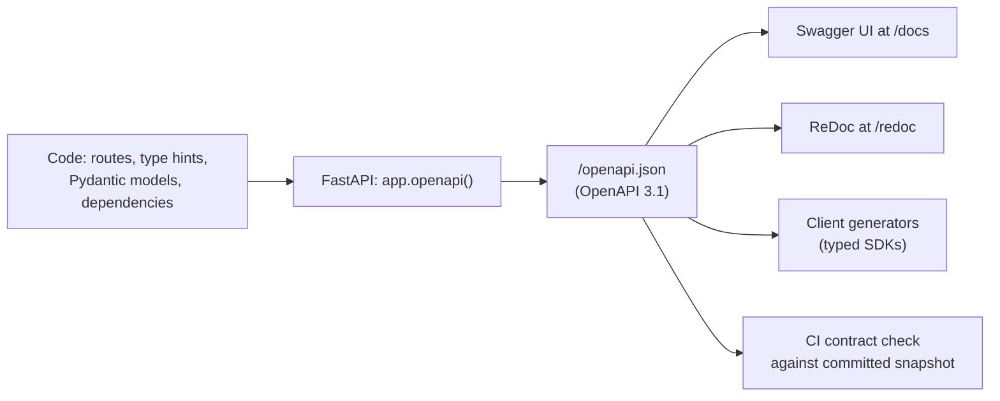

An API that nobody can use correctly is not finished. The teams building AskMeridian's Slack bot, intranet search page and nightly sync each need to know, without reading your source code, what every endpoint accepts, what it returns, what each error means, how to authenticate and how to read a stream. **API documentation** is how you tell them, and in a FastAPI service most of it is generated from the code you have already written: every type annotation, constraint, response model and security dependency from this module ends up in a machine-readable **OpenAPI** document, rendered as interactive pages at `/docs` and `/redoc`.

This lesson explains what that document contains and how FastAPI builds it, how to enrich it until it genuinely answers a client developer's questions (descriptions, examples, documented errors, stable operation IDs, deprecation), and how to treat it as a **contract**: a file checked into the repository and compared in CI, so that a breaking change is caught in review instead of in production. It closes the module by pulling the earlier lessons' decisions (validation limits, authentication schemes, error formats, streaming events) into one place a client can read.

## Learning objectives

- Describe the structure of an OpenAPI 3.1 document and explain how FastAPI generates each part from code.
- Enrich generated documentation with summaries, descriptions, field documentation, examples, tags and documented error responses.
- Set stable operation IDs and explain why client generators depend on them.
- Detect breaking changes by comparing a committed OpenAPI snapshot with the current application in CI.
- Decide what documentation to expose publicly, and what to write by hand beyond the generated reference.

## Prerequisites

- [FastAPI](/learn/backend-engineering/fastapi): path operations, response models and routers.
- [REST APIs](/learn/backend-engineering/rest-apis): versioning and which changes are breaking.
- [Request validation](/learn/backend-engineering/request-validation) and [Error handling](/learn/backend-engineering/error-handling): the constraints and error format being documented.

## Why this matters

Documentation failures in an internal RAG API are rarely dramatic; they are slow and expensive. Client teams guess at fields and get `422` responses they do not understand. They do not know `top_k` is capped at 20, so they send 50 and file a bug. They branch on the human-readable error title, which you later reword. They do not know the streaming endpoint ends with a `done` event, so they treat a dropped connection as a complete answer. Every question becomes a message to the Platform team, and every answer lives in a chat thread nobody can find later.

The bigger failure is drift. Hand-written documentation goes stale the first time someone changes the code without changing the wiki. A response field is renamed, the wiki still shows the old name, and clients break. Generated documentation cannot drift from the code in that way, because it *is* the code, read differently. And because it is machine-readable, it can be checked: a CI job can say "this pull request removes a field that version 1 promised", which no wiki can.

## The intuition

Think of an appliance and its manual. A good manual is not written from memory after the appliance ships. It is derived from the design drawings: every button shown is a button that exists, every setting listed is a setting the machine accepts, and the safe ranges are the ones the engineers actually built in. If the drawings change, the manual is regenerated.

FastAPI's documentation works like that. Your type annotations and models are the drawings; OpenAPI is the manual derived from them. What you add by hand is what drawings cannot capture: why a setting exists, an example of normal use, what the warning lights mean. And because the manual is regenerated with every change, you can compare this year's edition with last year's and see exactly which buttons were removed.

## How it works

### OpenAPI in brief

**OpenAPI** is a vendor-neutral specification, maintained by the OpenAPI Initiative, for describing HTTP APIs as a JSON or YAML document. FastAPI generates OpenAPI 3.1, the version that aligned its schema language with **JSON Schema**, so the schemas Pydantic produces are used directly. The main parts of the document:

- **`info`**: title, version, summary, description, contact and licence.
- **`paths`**: one entry per URL path, containing one **operation** per HTTP method. Each operation has an `operationId`, `summary`, `description`, `tags`, `parameters` (path, query, header), a `requestBody`, `responses` keyed by status code, and optionally `deprecated` and `security`.
- **`components`**: reusable definitions, chiefly `schemas` (one per Pydantic model) and `securitySchemes` (how clients authenticate).
- **`tags`**: named groups of operations with their own descriptions, used to organise the rendered documentation.

### How FastAPI builds it

FastAPI builds the document lazily, the first time `app.openapi()` is called (for example by a request to `/openapi.json`), and caches it. For each route it:

1. Takes the method, path and path-parameter names from the decorator.
2. Turns each query, path and header parameter into a `parameter` entry, with type and constraints from its annotation and `Query`/`Path`/`Header` arguments.
3. Turns the body model into a `requestBody` that references a schema in `components`, generated by Pydantic's JSON Schema support. Field constraints (`min_length`, `le`, `Literal` values) become JSON Schema keywords (`minLength`, `maximum`, `enum`); `extra="forbid"` becomes `additionalProperties: false`.
4. Takes the response model (return annotation or `response_model`) for the success response, and adds a `422` response for validation errors automatically.
5. Takes the summary from `summary=` (or the function name), and the description from `description=` or the function's docstring.
6. Adds `securitySchemes` and per-operation `security` from security dependencies such as `HTTPBearer` and `APIKeyHeader`, which is what puts the "Authorize" button in Swagger UI.

Two pages render the document: **Swagger UI** at `/docs`, which lets you try requests from the browser, and **ReDoc** at `/redoc`, a three-panel reference layout. Their URLs are set by `docs_url`, `redoc_url` and `openapi_url` on `FastAPI(...)`, and setting them to `None` disables them.



### Enriching the generated reference

Generation gives you an accurate skeleton; you add the meaning. The tools, roughly in order of value:

- **Field descriptions** with `Field(description=...)`. Say what a field means, its units and its edge cases: "Retrieval score. Comparable only within one response."
- **Constraints**, which you already have from validation, now visible to clients: a documented `maximum: 20` stops the "I sent 50" bug report.
- **Summaries and docstrings** for each operation, including behaviour that types cannot express: "If the passages do not contain the answer, `answer` says so; this is a successful response."
- **Examples**: `openapi_examples` on a `Body(...)` parameter gives named examples that Swagger UI offers in a drop-down; `Field(examples=[...])` documents single fields.
- **Documented errors**: the `responses=` argument on a route, router or app adds status codes with a model and description, for example `{503: {"model": Problem, "description": "..."}}`. Without it, clients see only `200` and `422`, and learn about `401`, `404` and `503` in production.
- **Tags** to group operations, with `openapi_tags` giving each group a description.
- **`deprecated=True`** on operations being retired, with the replacement and the removal date in the description.
- **`include_in_schema=False`** for internal endpoints (metrics, admin hooks) that clients should not see or depend on.

One caution about documented errors: the document describes what you *declare*, not what the code does. If you declare a Problem Details model for `422` but never install the custom validation handler from [Error handling](/learn/backend-engineering/error-handling), the documentation is wrong. Test that documented responses are the real ones.

### Operation IDs and generated clients

Every operation has an `operationId`. Client generators, such as OpenAPI Generator and openapi-python-client, use it to name methods: `operationId: ask` becomes `client.ask(...)`. FastAPI's default IDs combine the function name, path and method (something like `ask_v1_ask_post`), which are unique but ugly, and they change if the path changes, renaming every generated method. Pass `generate_unique_id_function=` to `FastAPI(...)` to produce short, stable IDs, such as the function name, and keep function names unique across the app.

### Documenting what OpenAPI describes poorly

Some parts of a RAG API need prose as well as schema:

- **Streaming endpoints.** FastAPI documents an `EventSourceResponse` route as returning `text/event-stream`, but the *event protocol* (which event names occur, in which order, what `done` and `error` carry) needs a written description in the operation's docstring or a guide. The protocol from [Streaming APIs](/learn/backend-engineering/streaming-apis) belongs here.
- **Authentication.** Security schemes say *how* to send credentials; a guide must say how to *obtain* them: which identity provider, which audience, which scopes. See [Authentication](/learn/backend-engineering/authentication).
- **Errors.** Each Problem Details `type` URI should resolve to a page explaining that error and what to do about it. Clients should branch on `code`, and the documentation should say so.
- **Limits and behaviour.** Rate limits, maximum body size, timeouts, and RAG-specific behaviour such as "answers are grounded only in documents you may read" and "an empty result is not an error".
- **Change policy.** What counts as a breaking change, how deprecations are announced, how long old versions live: the rules from [REST APIs](/learn/backend-engineering/rest-apis), written down.

### The document as a contract

Because the OpenAPI document is generated deterministically from the code, it can be committed to the repository as a **snapshot** and compared on every pull request:

1. Generate `app.openapi()` and write it, with sorted keys, to `openapi.snapshot.json` in the repository.
2. In CI, generate the document from the pull request's code and compare it with the committed snapshot.
3. If they differ, classify the differences. Additive changes (new endpoints, new optional fields) are fine but must be acknowledged by updating the snapshot in the same pull request, which makes them visible in review. Breaking changes (removed operations or fields, changed types, newly required request fields) fail the build unless the change targets a new major version.
4. Publish the approved snapshot as the documentation clients use, and let client teams generate SDKs from it.

Dedicated tools, such as oasdiff, perform this comparison thoroughly, including the direction of each change (a field becoming required in a *request* breaks clients; in a *response* it does not). The example below implements a deliberately small version to show the mechanism.

## In code

The example documents AskMeridian's `/v1` answer endpoints: a constrained, described request model; a Problem Details model for documented errors; examples; a streaming endpoint; a deprecated endpoint; an internal endpoint hidden from the schema; and stable operation IDs. A second script uses the generated document as a contract and catches a breaking change.

```bash
pip install fastapi
```

Save as `docs_app.py`:

```python
from collections.abc import AsyncIterator
from typing import Annotated, Literal

from fastapi import APIRouter, Body, FastAPI
from fastapi.routing import APIRoute
from fastapi.sse import EventSourceResponse, ServerSentEvent
from pydantic import BaseModel, ConfigDict, Field


class Problem(BaseModel):
    """An RFC 9457 Problem Details error body."""
    type: str
    title: str
    status: int
    detail: str
    code: str = Field(description="Stable, machine-readable error code. Branch on this, not on `title`.")
    request_id: str


class AskRequest(BaseModel):
    model_config = ConfigDict(extra="forbid")

    question: Annotated[str, Field(min_length=1, max_length=1000,
                                   description="The user's question, in natural language.")]
    top_k: Annotated[int, Field(ge=1, le=20, description="How many passages to retrieve.")] = 5
    source: Literal["handbook", "it-runbooks", "product-docs"] | None = Field(
        default=None, description="Restrict retrieval to one source. Omit to search all sources you may read.")


class Source(BaseModel):
    id: str
    title: str
    score: float = Field(description="Retrieval score. Comparable only within one response.")


class AskResponse(BaseModel):
    answer: str
    sources: list[Source]


ERRORS = {422: {"model": Problem, "description": "The request failed validation."},
          503: {"model": Problem, "description": "A dependency is unavailable. Retry after `Retry-After` seconds."}}


def operation_id(route: APIRoute) -> str:
    return route.name  # stable, readable names for generated client SDKs


tags = [{"name": "answers", "description": "Ask questions and receive grounded answers with sources."}]
app = FastAPI(
    title="AskMeridian API",
    version="1.4.0",
    summary="Answers to staff questions from Meridian's handbook, IT runbooks and product documentation.",
    openapi_tags=tags,
    generate_unique_id_function=operation_id,
)
router = APIRouter(prefix="/v1", tags=["answers"], responses=ERRORS)


@router.post("/ask", summary="Ask a question")
def ask(body: Annotated[AskRequest, Body(openapi_examples={
        "leave": {"summary": "A policy question",
                  "value": {"question": "How many days of annual leave do I get?", "source": "handbook"}}})]
        ) -> AskResponse:
    """Retrieves passages the caller may read and generates an answer grounded in them.

    If the passages do not contain the answer, `answer` says so; this is a successful response, not an error.
    """
    return AskResponse(answer="Annual leave is 25 days.",
                       sources=[Source(id="leave", title="Annual leave policy", score=0.82)])


@router.post("/ask/stream", summary="Ask a question and stream the answer",
             response_class=EventSourceResponse)
async def ask_stream(body: AskRequest) -> AsyncIterator[ServerSentEvent]:
    """Streams Server-Sent Events: one `sources` event, then `delta` events, then `done` or `error`."""
    yield ServerSentEvent(event="done", data={})


@router.post("/search", summary="Search without generating", deprecated=True)
def search(body: AskRequest) -> list[Source]:
    """Deprecated: use `/v2/search`, which supports pagination. Removal date: 2026-06-30."""
    return []


@app.get("/internal/metrics", include_in_schema=False)
def metrics() -> dict:
    return {}


app.include_router(router)
```

A short script, `show.py`, prints the parts of the generated document worth inspecting:

```python
import json

from docs_app import app

spec = app.openapi()
print("openapi:", spec["openapi"], "| info:", spec["info"]["title"], spec["info"]["version"])
for path, ops in spec["paths"].items():
    for method, op in ops.items():
        flags = " (deprecated)" if op.get("deprecated") else ""
        print(f"{method.upper():<5}{path:<16} id={op['operationId']:<11} responses={sorted(op['responses'])}{flags}")

ask = spec["paths"]["/v1/ask"]["post"]
print("\ndescription:", ask["description"].splitlines()[0])
print("example:", json.dumps(ask["requestBody"]["content"]["application/json"]["examples"]["leave"]["value"]))
print("\nAskRequest schema:")
print(json.dumps(spec["components"]["schemas"]["AskRequest"], indent=1)[:900])
print("\nstream content types:", list(spec["paths"]["/v1/ask/stream"]["post"]["responses"]["200"]["content"]))
```

```output
openapi: 3.1.0 | info: AskMeridian API 1.4.0
POST /v1/ask          id=ask         responses=['200', '422', '503']
POST /v1/ask/stream   id=ask_stream  responses=['200', '422', '503']
POST /v1/search       id=search      responses=['200', '422', '503'] (deprecated)

description: Retrieves passages the caller may read and generates an answer grounded in them.
example: {"question": "How many days of annual leave do I get?", "source": "handbook"}

AskRequest schema:
{
 "properties": {
  "question": {
   "type": "string",
   "maxLength": 1000,
   "minLength": 1,
   "title": "Question",
   "description": "The user's question, in natural language."
  },
  "top_k": {
   "type": "integer",
   "maximum": 20.0,
   "minimum": 1.0,
   "title": "Top K",
   "description": "How many passages to retrieve.",
   "default": 5
  },
  "source": {
   "anyOf": [
    {
     "type": "string",
     "enum": [
      "handbook",
      "it-runbooks",
      "product-docs"
     ]
    },
    {
     "type": "null"
    }
   ],
   "title": "Source",
   "description": "Restrict retrieval to one source. Omit to search all sources you may read."
  }
 },
 "additionalProperties": false,
 "type": "object",
 "required": [
  "question"
 ],
 "title": "AskRequest"
}

stream content types: ['text/event-stream']
```

### Reading the generated document

- **Paths**: three operations, each with the short operation ID from `operation_id`, and each documenting `422` and `503` with the Problem model, inherited from the router's `responses=`. `/internal/metrics` is absent because of `include_in_schema=False`. `/v1/search` is flagged as deprecated, which Swagger UI shows struck through.
- **Description and example**: the docstring's first line became the description, and the named example is attached to the request body, ready to send from Swagger UI.
- **Schema**: every validation decision from earlier in the module is visible to clients: `minLength` and `maxLength` on the question, `minimum` and `maximum` on `top_k` (Pydantic writes them as floats here), the three permitted sources as an `enum`, `question` as the only required field, and `additionalProperties: false` from `extra="forbid"`, which tells clients that unknown fields will be rejected.
- **Streaming**: the stream endpoint is documented as `text/event-stream`. The event names and order are in its docstring, because the schema alone cannot express them.

To view the rendered pages, run `uvicorn docs_app:app` and open `/docs` and `/redoc`.

### The contract check

`contract.py` writes the document to a snapshot (in a real repository this file is committed), then compares it with the current app and with a simulated pull request that renames `sources` to `citations`, makes `top_k` required, changes `score` to a string, adds an optional `language` field and removes `/v1/search`:

```python
import copy
import json
from pathlib import Path

from docs_app import app

METHODS = {"get", "put", "post", "patch", "delete"}


def breaking_changes(old: dict, new: dict) -> list[str]:
    problems = []
    for path, ops in old["paths"].items():
        for method in ops.keys() & METHODS:
            if method not in new["paths"].get(path, {}):
                problems.append(f"removed operation {method.upper()} {path}")
    old_schemas, new_schemas = old["components"]["schemas"], new["components"]["schemas"]
    for name, schema in old_schemas.items():
        if name not in new_schemas:
            problems.append(f"removed schema {name}")
            continue
        before, after = schema.get("properties", {}), new_schemas[name].get("properties", {})
        for prop in before.keys() - after.keys():
            problems.append(f"{name}: removed property '{prop}'")
        for prop in set(new_schemas[name].get("required", [])) - set(schema.get("required", [])):
            problems.append(f"{name}: '{prop}' is now required")
        for prop in before.keys() & after.keys():
            if before[prop].get("type") != after[prop].get("type"):
                problems.append(f"{name}.{prop}: type {before[prop].get('type')} -> {after[prop].get('type')}")
    return sorted(problems)


# CI keeps the published contract in the repository.
snapshot = Path("openapi.snapshot.json")
snapshot.write_text(json.dumps(app.openapi(), indent=2, sort_keys=True))
published = json.loads(snapshot.read_text())

# Simulate a pull request's changes to the service.
proposed = copy.deepcopy(published)
schemas = proposed["components"]["schemas"]
schemas["AskResponse"]["properties"]["citations"] = schemas["AskResponse"]["properties"].pop("sources")
schemas["AskResponse"]["required"] = ["answer", "citations"]
schemas["AskRequest"]["properties"]["language"] = {"type": "string", "default": "en"}  # additive
schemas["AskRequest"]["required"].append("top_k")
schemas["Source"]["properties"]["score"]["type"] = "string"
del proposed["paths"]["/v1/search"]

print("unchanged contract:", breaking_changes(published, app.openapi()) or "no breaking changes")
print("proposed change:")
for p in breaking_changes(published, proposed):
    print("  BREAKING:", p)
```

```output
unchanged contract: no breaking changes
proposed change:
  BREAKING: AskRequest: 'top_k' is now required
  BREAKING: AskResponse: 'citations' is now required
  BREAKING: AskResponse: removed property 'sources'
  BREAKING: Source.score: type number -> string
  BREAKING: removed operation POST /v1/search
```

The checker caught the rename (as a removed `sources`), the newly required request field, the type change and the removed operation, and correctly ignored the additive `language` field. It also shows why real tools track direction: "`citations` is now required" is flagged, but a field that a *response* now always includes breaks no client. A naive checker over-reports; that is safer than under-reporting, but it trains people to ignore it, so use a direction-aware tool in practice (exercise 3 asks you to fix this one).

Important lines: `generate_unique_id_function=operation_id` gives stable IDs; `responses=ERRORS` on the router documents errors for every route in it; `json.dumps(..., sort_keys=True)` makes the snapshot deterministic so diffs show only real changes.

### Common errors

- **Documentation shows `HTTPValidationError` for `422`**, but your API returns Problem Details: you installed the handler but not the `responses=` declaration, or the reverse. Keep them together.
- **Examples that fail validation.** Examples are not validated against the schema when the document is generated; send each example in a test.
- **Changing a function name renames a generated client method.** With `route.name` as the operation ID, function names are now part of the contract; the snapshot check will flag it as a removed operation ID if you also compare IDs.

## A real-world example

The intranet team at Meridian generated a typed TypeScript client from AskMeridian's `/openapi.json` and used it in the new search page. Three weeks later, after a routine release, the page broke: every call failed to compile because the generated method `askV1AskPost` had become `askV1CollectionsCollectionAskPost`. The Platform team had moved `ask` under collections; nobody had thought of the default operation ID as part of the contract.

A month after that, a subtler break happened. A developer changed `score` from a float to a rounded string "for display", and the Slack bot, which sorted sources by score, began sorting "0.9" after "0.85" alphabetically. No test failed because no test sorted scores.

Ines added the contract workflow from this lesson. Operation IDs were fixed to function names; the generated OpenAPI document was committed as `openapi.snapshot.json`; and a CI job generated the document from each pull request and ran a direction-aware diff tool against the snapshot, failing on breaking changes to `/v1` and requiring the snapshot to be updated for additive ones. The snapshot diff appeared in every pull request, so reviewers saw API changes alongside code changes. The team also documented their deprecation policy and the streaming event protocol in a hand-written guide, linked from the API's description. Client teams stopped asking in chat, because the answers were now in one place and they could trust them.

## Common mistakes

- **Shipping the default documentation and calling it done.** Types without descriptions, examples or error responses leave clients guessing at meaning.
- **Not documenting errors.** Clients discover `401`, `404` and `503` in production and handle them inconsistently.
- **Default operation IDs in a client-facing API.** Moving a route renames every generated client method.
- **Hand-maintained reference docs alongside generated ones.** Two sources of truth diverge; generate the reference and hand-write only guides.
- **Leaving `/docs` and `/openapi.json` public on an internet-facing service by accident.** The full schema, including internal-looking endpoints, is a map for attackers. Expose it deliberately, or protect it.
- **No contract check in CI.** Breaking changes are found by clients instead of by reviewers.
- **Documenting a stream as "returns text/event-stream" and nothing else.** Clients cannot implement event handling without the event names, order and termination rules.

## Best practices

- Describe every field and operation, including units, limits and RAG-specific behaviour such as refusals and permission filtering.
- Declare error responses with a shared Problem Details model on routers, and make sure the handlers actually produce it.
- Set stable, readable operation IDs before any client generates code.
- Commit the OpenAPI document and diff it in CI with a direction-aware tool; fail on breaking changes within a major version.
- Hide internal endpoints with `include_in_schema=False`, and decide explicitly whether the docs are public, internal-only or behind authentication.
- Write the guides that schemas cannot: obtaining credentials, the streaming protocol, the error catalogue, rate limits and the change policy.

## Performance considerations

Documentation has almost no runtime cost. FastAPI builds the OpenAPI document once, on first request, and caches it in `app.openapi_schema`; later requests to `/openapi.json` serve the cached object. For a service with a few dozen routes the generation takes milliseconds. Swagger UI and ReDoc pages load their JavaScript from a CDN by default, so the service itself serves only a small HTML page; in environments without internet access, configure them to use self-hosted assets.

The cost that does matter is in client development and CI. A snapshot diff runs in well under a second and costs nothing compared with an incident caused by a breaking change. Generated clients also remove a class of runtime failures (misspelled fields, wrong types) from client code entirely, because the compiler catches them.

## Security considerations

The OpenAPI document lists every route, parameter and schema. For an internal API behind single sign-on, publishing it to staff is usually right; for anything internet-facing, decide deliberately. Options are to disable the endpoints in production (`docs_url=None, redoc_url=None, openapi_url=None`) and publish a reviewed copy elsewhere, or serve them behind the same authentication as the API. Hiding the docs is not security in itself; every endpoint must be protected whether documented or not. Check that examples and descriptions contain no real data: example questions about real staff, real document IDs from restricted collections, or real API keys are easy to paste in and then published to everyone who can read the docs. Finally, the "try it out" feature of Swagger UI sends real requests with real credentials; on a production deployment, make sure that is what you intend.

## Summary

- FastAPI generates an OpenAPI 3.1 document from routes, type hints, Pydantic models and security dependencies, and renders it at `/docs` (Swagger UI) and `/redoc`.
- Generated documentation is accurate about shape; you add meaning with field descriptions, docstrings, examples, tags, documented errors and deprecation notices.
- Stable operation IDs keep generated clients stable; set them before anyone generates a client.
- Committing the document and diffing it in CI turns it into an enforceable contract that catches breaking changes in review.
- Some things need prose: obtaining credentials, the streaming event protocol, the error catalogue, limits and the change policy.

## Exercises

**1.** A client developer reads the generated schema for `AskRequest` above. Without seeing the code, what can they conclude about (a) sending `{"question": "VPN", "topk": 3}`, (b) sending `top_k: 25`, and (c) sending `source: "payroll"`?

<details><summary>Show solution</summary>

(a) `additionalProperties: false` means the unknown field `topk` will be rejected, so the request fails validation (and, because the docs declare it, with a `422` Problem response). (b) `maximum: 20` means 25 is rejected. (c) The `enum` lists only `handbook`, `it-runbooks` and `product-docs`, so `payroll` is rejected. All three are answerable from the document alone, which is the point of generating it from the validation code.

</details>

**2.** List three things about AskMeridian's streaming endpoint that the generated OpenAPI document cannot tell a client, and say where you would document each.

<details><summary>Show solution</summary>

Any three of: the event names (`sources`, `delta`, `done`, `error`) and the schema of each event's data; the order and termination rule (exactly one `done` or `error` ends a successful or failed stream, and a stream without either is incomplete); the keep-alive comments and how long the server may be silent; whether reconnection with `Last-Event-ID` is supported; and that errors after the first event are events, not HTTP statuses. The short version belongs in the operation's docstring; the full protocol, with an example transcript, belongs in a hand-written streaming guide linked from the API description. The data schema of each event can also be published as named components (for example by including the event models in the document) so clients can generate types for them.

</details>

**3.** Make `breaking_changes` direction-aware for required fields: a property newly required in a schema used only in *responses* is not breaking. Assume you are given `request_schemas`, the set of schema names used in request bodies.

<details><summary>Show solution</summary>

```python
def breaking_changes(old: dict, new: dict, request_schemas: set[str]) -> list[str]:
    problems = []
    # ... operation and removed-property checks as before ...
    for name, schema in old["components"]["schemas"].items():
        if name not in new["components"]["schemas"]:
            continue
        newly_required = set(new["components"]["schemas"][name].get("required", [])) - set(schema.get("required", []))
        if name in request_schemas:
            problems += [f"{name}: '{p}' is now required" for p in newly_required]
    return sorted(problems)
```

To find `request_schemas`, walk `paths` and collect every `$ref` under each operation's `requestBody` (and, to be thorough, schemas referenced from those schemas). Removed properties need the opposite care: removing a property from a *request* schema with `additionalProperties: false` breaks clients that still send it, while removing one from a *response* breaks clients that read it, so both directions stay breaking. This is the bookkeeping that dedicated tools do for you.

</details>

**4.** Design decision. AskMeridian is about to be offered to a partner company over the internet. Decide what happens to `/docs`, `/redoc` and `/openapi.json`, how the partner receives documentation, and how you keep it accurate.

<details><summary>Show solution</summary>

Disable the interactive pages and the live schema on the internet-facing deployment (`docs_url=None, redoc_url=None, openapi_url=None`), or serve them only behind the partner's authentication. Generate the OpenAPI document in CI from the released code, filter it to the operations the partner may use (routers for partner-facing endpoints, `include_in_schema=False` for the rest), review it, and publish it with hand-written guides (obtaining credentials, rate limits, error catalogue, streaming protocol, deprecation policy) on a documentation site or as a file the partner generates a client from.

Accuracy comes from the same contract check: the published document is the committed snapshot, CI fails on breaking changes to it, and each release publishes the snapshot it was built from. The partner gets a stable, versioned contract; attackers do not get a live map of every internal route.

</details>

## Check your understanding

```quiz
[
  {
    "q": "Where does FastAPI get the `maximum: 20` that appears in the OpenAPI schema for `top_k`?",
    "options": [
      "From a separate documentation file",
      "From the `Field(ge=1, le=20)` constraint used for validation",
      "From Swagger UI's defaults",
      "From the response model"
    ],
    "answer": 1,
    "why": "Pydantic's JSON Schema generation turns validation constraints into schema keywords, so the documented limit is the enforced one."
  },
  {
    "q": "Why set `generate_unique_id_function` to produce short, stable operation IDs?",
    "options": [
      "Client generators name methods after operation IDs, and default IDs change when paths change",
      "It makes the API faster",
      "Swagger UI requires it",
      "OpenAPI 3.1 forbids underscores"
    ],
    "answer": 0,
    "why": "Default IDs include the path and method, so moving a route renames every generated client method."
  },
  {
    "q": "How do you stop an internal metrics endpoint from appearing in the generated documentation?",
    "options": [
      "Give it a name starting with an underscore",
      "Mark it deprecated",
      "Pass `include_in_schema=False` to its route decorator",
      "Remove its response model"
    ],
    "answer": 2,
    "why": "include_in_schema=False omits the operation from the OpenAPI document. It does not protect the endpoint, which still needs authentication."
  },
  {
    "q": "A CI job compares the committed OpenAPI snapshot with the pull request's generated document. Which change should fail the build for `/v1`?",
    "options": [
      "Adding a new optional request field",
      "Adding a new endpoint",
      "Improving a field description",
      "Changing a response field's type from number to string"
    ],
    "answer": 3,
    "why": "A type change breaks clients that use the field; the other changes are additive or cosmetic."
  },
  {
    "q": "Your API returns Problem Details for 422 errors, but `/docs` still shows FastAPI's default validation error schema. What is missing?",
    "options": [
      "A `responses={422: {\"model\": Problem}}` declaration on the route, router or app",
      "A docstring on the handler",
      "An `openapi_tags` entry",
      "The `deprecated=True` flag"
    ],
    "answer": 0,
    "why": "The document reflects what you declare. Installing an exception handler changes behaviour; declaring the response changes the documentation."
  }
]
```

## Further reading

- OpenAPI Initiative, *OpenAPI Specification* 3.1, [spec.openapis.org](https://spec.openapis.org/oas/v3.1.0).
- FastAPI documentation, [fastapi.tiangolo.com](https://fastapi.tiangolo.com/): metadata and docs URLs, path operation configuration, additional responses, declaring request examples, and generating clients.
- JSON Schema, [json-schema.org](https://json-schema.org/): the schema language OpenAPI 3.1 uses.
- Pydantic documentation, [docs.pydantic.dev](https://docs.pydantic.dev/): JSON Schema generation from models.
- Swagger UI and ReDoc project documentation, for configuring the rendered pages.
