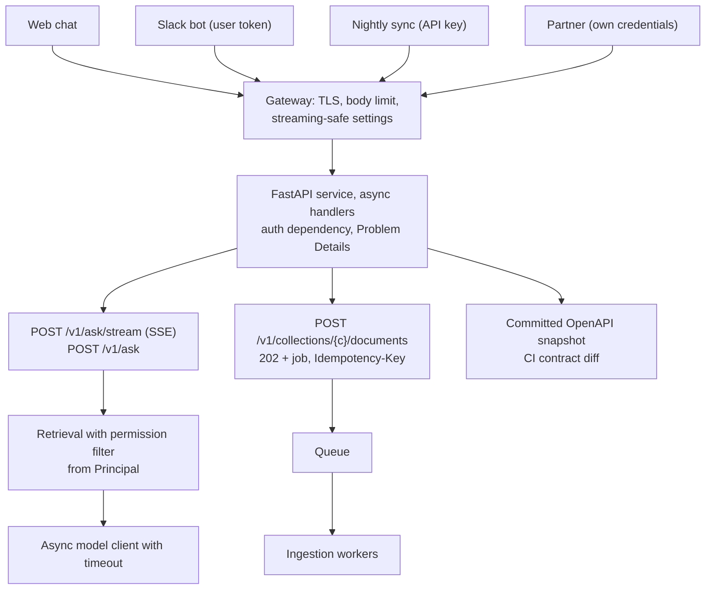

This assessment covers all eight lessons of *Backend Engineering*: FastAPI, REST APIs, request validation, authentication, async endpoints, streaming APIs, error handling and API documentation. The multiple-choice section has 19 questions, including a "what does this code do" question and scenario questions; the pass mark is 14 correct (about 75%). The conceptual questions, coding exercises, architecture challenge and troubleshooting scenarios are not scored automatically: attempt each before opening its answer, and treat any you could not answer as a pointer back to the relevant lesson. The coding solutions need Python 3.11 or later with `fastapi` and `httpx`, run offline, and their output was produced by running them. Latencies and limits in questions are assumptions for practice.

```quiz
[
  {
    "q": "Which component opens the network socket and speaks HTTP, calling your FastAPI application for each request?",
    "options": [
      "FastAPI",
      "Pydantic",
      "An ASGI server such as Uvicorn",
      "Starlette's TestClient"
    ],
    "answer": 2,
    "why": "Uvicorn is an ASGI server. FastAPI is the ASGI application it calls."
  },
  {
    "q": "In `@app.get(\"/v1/docs/{doc_id}\")` with handler `def read(doc_id: str, verbose: bool = False)`, where does `verbose` come from?",
    "options": [
      "The path",
      "The query string",
      "The JSON body",
      "A header"
    ],
    "answer": 1,
    "why": "A simple-typed parameter that is not in the path template is a query parameter."
  },
  {
    "q": "Where should an embedding model and a vector-database client be created?",
    "options": [
      "Inside each handler",
      "In a dependency that builds them per request",
      "In the lifespan function, once per process",
      "In the client application"
    ],
    "answer": 2,
    "why": "They are expensive to create and safe to share, so the lifespan creates them once."
  },
  {
    "q": "A test sets `app.dependency_overrides[get_generator] = lambda: Fake()`. What happens?",
    "options": [
      "Every route depending on get_generator receives a Fake until the override is cleared",
      "Only the next request uses Fake",
      "The real generator is deleted",
      "Nothing, unless the route is async"
    ],
    "answer": 0,
    "why": "FastAPI consults dependency_overrides whenever it resolves that dependency."
  },
  {
    "q": "A client retries a timed-out `POST` with the same `Idempotency-Key` and the same body. What should the server do?",
    "options": [
      "Process it again as a new request",
      "Reject it with 409 always",
      "Return the result (or current job state) of the first request without repeating the work",
      "Delete the first job and start again"
    ],
    "answer": 2,
    "why": "The key identifies one logical operation, so the retry must not duplicate the work."
  },
  {
    "q": "Why is cursor pagination preferred over offset pagination for a list that changes during ingestion?",
    "options": [
      "Cursors anchor on a sort key, so inserts and deletes elsewhere do not cause repeats or skips",
      "Cursors let clients jump to page 50",
      "Cursors are smaller in bytes",
      "Offsets cannot be limited"
    ],
    "answer": 0,
    "why": "Offsets count positions, which shift when items are added or removed."
  },
  {
    "q": "Which change to a `/v1` response is backwards compatible?",
    "options": [
      "Renaming `sources` to `citations`",
      "Changing `score` from number to string",
      "Adding a new optional field",
      "Removing a field nobody seems to use"
    ],
    "answer": 2,
    "why": "Adding a field is safe for clients that ignore unknown fields."
  },
  {
    "q": "A request model has `extra=\"forbid\"`. A client sends `{\"query\": \"VPN\", \"topk\": 3}`. What is the result?",
    "options": [
      "200, with top_k at its default",
      "422 with an extra_forbidden error for `topk`",
      "500",
      "200, and `topk` is renamed"
    ],
    "answer": 1,
    "why": "Unknown fields are validation errors when extras are forbidden."
  },
  {
    "q": "Why should the server build the vector-database filter from an allow-listed model rather than accept a client's raw filter?",
    "options": [
      "Raw filters are slower",
      "Clients could filter on internal fields or override server-imposed permission conditions",
      "Pydantic cannot validate dicts",
      "Vector databases reject client filters"
    ],
    "answer": 1,
    "why": "Translating a closed model on the server and appending permission conditions keeps clients to narrowing filters."
  },
  {
    "q": "A valid token for a user who lacks the required scope calls an endpoint. Which response is correct?",
    "options": [
      "401 with WWW-Authenticate",
      "403 Forbidden",
      "404 always",
      "422"
    ],
    "answer": 1,
    "why": "The caller is authenticated but not permitted: 403."
  },
  {
    "q": "What does the server-side `algorithms=[\"RS256\"]` argument to `jwt.decode` prevent?",
    "options": [
      "Slow verification",
      "Expired tokens",
      "The token's own header selecting a different algorithm such as `none`",
      "Large payloads"
    ],
    "answer": 2,
    "why": "A fixed allow-list defeats unsigned-token and algorithm-confusion attacks."
  },
  {
    "q": "What does this endpoint do under 50 concurrent requests?\n```python\n@app.get(\"/x\")\nasync def x():\n    time.sleep(1)\n    return {}\n```",
    "options": [
      "All 50 finish in about 1 second",
      "They finish one after another, about 50 seconds in total, and block the whole process",
      "They run in 40 threads, about 2 seconds",
      "It raises an error"
    ],
    "answer": 1,
    "why": "A blocking call inside async def holds the event loop, so requests are served serially."
  },
  {
    "q": "A synchronous endpoint holds a thread for 2 seconds and the pool has 40 threads. Roughly what is its maximum throughput per process?",
    "options": [
      "2 requests per second",
      "20 requests per second",
      "40 requests per second",
      "80 requests per second"
    ],
    "answer": 1,
    "why": "Throughput is workers divided by time per request: 40 / 2 = 20."
  },
  {
    "q": "What ends one Server-Sent Event in the `text/event-stream` format?",
    "options": [
      "A closing brace",
      "The `id:` field",
      "A blank line",
      "Closing the connection"
    ],
    "answer": 2,
    "why": "Fields accumulate until an empty line dispatches the event."
  },
  {
    "q": "A streamed answer has already sent 30 delta events when the model provider times out. How should the failure be reported?",
    "options": [
      "Change the HTTP status to 504",
      "Send an error event and close the stream",
      "Silently close the connection",
      "Restart the answer on the same stream"
    ],
    "answer": 1,
    "why": "The status line was sent with the first event; later failures must be signalled in-stream."
  },
  {
    "q": "The model provider returns 429 because AskMeridian exceeded its own quota. What should AskMeridian return to its caller?",
    "options": [
      "429, passed through",
      "200 with an empty answer",
      "503 with Retry-After",
      "401"
    ],
    "answer": 2,
    "why": "The caller did nothing wrong; this is the service's capacity problem."
  },
  {
    "q": "Why must `except APITimeoutError` appear before `except APIConnectionError`?",
    "options": [
      "Alphabetical order is required",
      "APITimeoutError is a subclass of APIConnectionError, so the broader clause would catch it first",
      "Timeouts are more common",
      "APIConnectionError is deprecated"
    ],
    "answer": 1,
    "why": "Python uses the first matching clause, so a base class placed first swallows its subclasses."
  },
  {
    "q": "Why set `generate_unique_id_function` on a client-facing FastAPI app?",
    "options": [
      "It speeds up the API",
      "Generated clients name methods after operation IDs, and the default IDs change when paths change",
      "Swagger UI requires it",
      "OpenAPI forbids default IDs"
    ],
    "answer": 1,
    "why": "Stable IDs keep generated client method names from changing when routes move."
  },
  {
    "q": "A CI job diffs the committed OpenAPI snapshot against a pull request. Which difference should fail the build for `/v1`?",
    "options": [
      "A new endpoint",
      "A new optional request field",
      "A better field description",
      "A response field's type changing from number to string"
    ],
    "answer": 3,
    "why": "A type change breaks clients that rely on the field; the others are additive or cosmetic."
  }
]
```

## Conceptual questions

**1.** Explain what happens, in order, between Uvicorn receiving the bytes of `POST /v1/ask` and your handler running. Which of these steps can produce a response without your handler ever being called?

<details><summary>Show model answer</summary>

Uvicorn parses HTTP and calls the ASGI application with a scope, `receive` and `send`. Middleware wraps the call. The router matches method and path (no match gives 404, wrong method 405). FastAPI gathers each parameter from the path, query, headers or body and validates it against its annotation (failures give a 422 listing every error). It resolves dependencies, calling each once per request. Only then does the handler run, on the event loop if it is `async def` and in a worker thread if it is `def`. Routing failures, validation failures and failing dependencies (such as authentication raising 401) all produce responses without the handler running.

</details>

**2.** Why is "validation" not "authorisation"? Give an example of a request that passes every schema check and must still be refused, and say which status code applies.

<details><summary>Show model answer</summary>

Validation checks the shape of a request independently of who sent it: types, sizes, allowed values. Authorisation depends on the caller's identity and the state of the system. A perfectly well-formed `GET /v1/conversations/{id}` for a conversation owned by another user passes validation and must be refused: 403, or 404 if the API should not confirm the resource exists. Likewise, a well-formed search over a collection the caller may not read must be refused or filtered by permissions derived from the authenticated principal, never left to the schema.

</details>

**3.** Describe the three execution situations for an endpoint (`async def` with awaited calls, `def` with blocking calls, `async def` with blocking calls) and what each does to the throughput and health checks of a process.

<details><summary>Show model answer</summary>

`async def` with awaited calls runs on the event loop and yields at each `await`, so one process can hold hundreds of requests in flight, limited by connection pools and upstream rate limits. `def` runs in a thread pool whose default limit is 40 per process, so throughput is capped near 40 divided by the request's duration, but health checks are unaffected. `async def` with a blocking call holds the event loop for the call's whole duration: requests are served one at a time and the health check waits too, so orchestrators may kill an apparently dead but healthy process. The fix is an asynchronous client, `run_in_threadpool`, or a plain `def`.

</details>

**4.** A teammate says: "Our streaming endpoint works in staging, so streaming is done." List four deployment-specific things that can still break it and how you would test for each.

<details><summary>Show model answer</summary>

(1) Proxy or gateway response buffering: the answer arrives all at once; test with a streamed request through the real ingress and assert the first delta arrives well before `done`. (2) Compression middleware holding bytes: same test, with compression enabled. (3) Idle timeouts at the load balancer cutting quiet streams: test with an artificially slow stream longer than the timeout, and send keep-alive comments. (4) Disconnect handling: close the client mid-stream and verify the server's `finally` ran and the upstream model stream closed. Also acceptable: browser per-origin HTTP/1.1 connection limits, and total request duration caps.

</details>

**5.** Why should AskMeridian report a provider's `401` as a 500 and a provider's `429` as a 503, rather than passing them through?

<details><summary>Show model answer</summary>

Status codes tell the caller what to do. A provider `401` means the service's own API key is wrong, which the caller cannot fix and which should page the operators, so it is an internal error with a generic body. A provider `429` means the service exceeded its quota; the caller was not at fault and waiting may help, so 503 with `Retry-After` is honest. Passing them through would send clients to re-authenticate or back off for the wrong reasons, and would leak internal details about which provider is used.

</details>

## Coding exercises

**1.** Build a small notes API with tenant isolation. `PUT /v1/notes/{note_id}` stores a note (204) and `GET` reads it. Authentication uses an `X-API-Key` header that maps to a tenant. A missing or wrong key must give 401 with a `WWW-Authenticate` header, one tenant must never read another's notes, the request model must forbid unknown fields and bound the text length, and `PUT` must be idempotent. Test it with `TestClient`.

<details><summary>Show solution</summary>

```python
from typing import Annotated

from fastapi import Depends, FastAPI, Header, HTTPException
from fastapi.testclient import TestClient
from pydantic import BaseModel, ConfigDict, Field

app = FastAPI()
KEYS = {"secret-a": "tenant-a", "secret-b": "tenant-b"}
NOTES: dict[str, dict[str, str]] = {"tenant-a": {}, "tenant-b": {}}


def tenant(x_api_key: Annotated[str | None, Header()] = None) -> str:
    if x_api_key not in KEYS:
        raise HTTPException(401, "invalid key", headers={"WWW-Authenticate": "ApiKey"})
    return KEYS[x_api_key]


class Note(BaseModel):
    model_config = ConfigDict(extra="forbid")
    text: Annotated[str, Field(min_length=1, max_length=200)]


@app.put("/v1/notes/{note_id}", status_code=204)
def put_note(note_id: str, note: Note, t: Annotated[str, Depends(tenant)]) -> None:
    NOTES[t][note_id] = note.text


@app.get("/v1/notes/{note_id}")
def get_note(note_id: str, t: Annotated[str, Depends(tenant)]) -> dict:
    if note_id not in NOTES[t]:
        raise HTTPException(404, "no such note")
    return {"id": note_id, "text": NOTES[t][note_id]}


c = TestClient(app)
a, b = {"X-API-Key": "secret-a"}, {"X-API-Key": "secret-b"}
print(c.put("/v1/notes/n1", json={"text": "hi"}).status_code)
print(c.put("/v1/notes/n1", json={"text": "hi"}, headers=a).status_code)
print(c.put("/v1/notes/n1", json={"text": "hi"}, headers=a).status_code)
print(c.get("/v1/notes/n1", headers=a).json())
print(c.get("/v1/notes/n1", headers=b).status_code)
print(c.put("/v1/notes/n2", json={"text": ""}, headers=a).status_code)
print(c.put("/v1/notes/n2", json={"text": "x", "owner": "b"}, headers=a).status_code)
```

```output
401
204
204
{'id': 'n1', 'text': 'hi'}
404
422
422
```

Tenant isolation comes from keying storage by the authenticated tenant: tenant B asking for `n1` gets 404 because the lookup never touches tenant A's data. The repeated `PUT` returns the same status and leaves the same state, which is idempotence. The empty text and the extra `owner` field are both rejected by the model before the handler runs. In production the dependency would verify a hashed key in constant time, as in the Authentication lesson.

</details>

**2.** Write an `async` endpoint `/combined` that (a) runs a blocking function off the event loop, then (b) queries two asynchronous sources concurrently, each with a 0.3-second timeout, returning whichever succeed and naming those that failed. One source takes 0.1 s and the other 1.0 s.

<details><summary>Show solution</summary>

```python
import asyncio
import time

from fastapi import FastAPI
from fastapi.concurrency import run_in_threadpool
from fastapi.testclient import TestClient

app = FastAPI()


def slow_cpu(x: int) -> int:
    time.sleep(0.1)
    return x * 2


async def source(name: str, delay: float) -> list[str]:
    await asyncio.sleep(delay)
    return [name]


@app.get("/combined")
async def combined() -> dict:
    t = time.perf_counter()
    doubled = await run_in_threadpool(slow_cpu, 21)
    results = await asyncio.gather(
        asyncio.wait_for(source("fast", 0.1), 0.3),
        asyncio.wait_for(source("slow", 1.0), 0.3),
        return_exceptions=True,
    )
    ok = [r[0] for r in results if not isinstance(r, BaseException)]
    failed = [type(r).__name__ for r in results if isinstance(r, BaseException)]
    return {"doubled": doubled, "ok": ok, "failed": failed, "seconds": round(time.perf_counter() - t, 1)}


print(TestClient(app).get("/combined").json())
```

```output
{'doubled': 42, 'ok': ['fast'], 'failed': ['TimeoutError'], 'seconds': 0.4}
```

The total is 0.4 s: 0.1 s for the blocking call plus 0.3 s for the slower source's timeout (the two sources ran concurrently, so their times did not add). `return_exceptions=True` turns the timeout into a value so the fast source's result survives. A response like this should also flag itself as degraded.

</details>

**3.** Write `parse_sse(text) -> list[dict]` that parses a Server-Sent Events payload (skipping comment lines, joining multi-line `data`), and use it to decide whether a stream is complete, meaning it contains a `done` event.

<details><summary>Show solution</summary>

```python
def parse_sse(text: str) -> list[dict]:
    events, current = [], {}
    for line in text.split("\n"):
        if line == "":
            if current:
                events.append(current)
            current = {}
        elif line.startswith(":"):
            continue
        else:
            field, _, value = line.partition(":")
            value = value.removeprefix(" ")
            current[field] = current["data"] + "\n" + value if field == "data" and "data" in current else value
    return events


raw = ': ping\n\nevent: delta\ndata: {"text": "Hi"}\nid: 1\n\nevent: delta\ndata: line one\ndata: line two\nid: 2\n\nevent: done\ndata: {}\nid: 3\n\n'
for e in parse_sse(raw):
    print(e)
print("complete:", any(e.get("event") == "done" for e in parse_sse(raw)))
print("complete:", any(e.get("event") == "done" for e in parse_sse(raw[:70])))
```

```output
{'event': 'delta', 'data': '{"text": "Hi"}', 'id': '1'}
{'event': 'delta', 'data': 'line one\nline two', 'id': '2'}
{'event': 'done', 'data': '{}', 'id': '3'}
complete: True
complete: False
```

The comment line was skipped, the two `data:` lines were joined with a newline, and the truncated copy of the stream (cut mid-event, so the unfinished event is never dispatched) has no `done`, so it is reported incomplete.

</details>

## Architecture design challenge

Design the API layer for AskMeridian v2, to be used by the web chat (staff, single sign-on), the Slack bot (acting for staff), a nightly sync job (service) and a partner company (over the internet). Requirements: answers stream; ingestion takes up to two minutes per document; document permissions must be respected; the OpenAPI contract must not break existing clients; the model provider is occasionally rate limited. Describe the endpoints, authentication, async and streaming design, error handling and documentation approach.

<details><summary>Show reference design</summary>



- **Endpoints**: resource-oriented under `/v1`. Questions are `POST /v1/ask` and `POST /v1/ask/stream`; ingestion is `POST /v1/collections/{c}/documents` returning `202` with a job and `Location`, with `GET /v1/jobs/{id}`. Lists use cursors.
- **Authentication**: user requests carry bearer tokens from the single sign-on provider, verified with a fixed algorithm allow-list, issuer, audience and expiry; the Slack bot forwards the user's token rather than using its own key, so retrieval always runs as the person. The sync job uses an API key with only the `documents:write` scope, stored hashed. The partner gets separate credentials, scopes and rate limits. Every route depends on a `get_principal` dependency attached at router level.
- **Authorisation and retrieval**: the principal's groups and tenant become mandatory `must` filters appended on the server; client filters are an allow-listed model that can only narrow.
- **Async and streaming**: handlers are `async def` with `AsyncAnthropic` and an async vector client created in the lifespan; embedding and reranking run via `run_in_threadpool` or a separate service; dense and sparse retrieval run with `gather` under a retrieval budget. Streams use SSE with `sources`, `delta`, `done` and `error` events, keep-alive pings, a concurrent-stream cap and clean-up in `finally`. Gateway buffering and idle timeouts are configured and smoke-tested.
- **Ingestion**: `202` plus a durable queue and separate workers, so slow parsing never occupies API threads; idempotency keys with a unique constraint make retries safe.
- **Errors**: RFC 9457 Problem Details with stable codes and request IDs everywhere (including stream `error` events); provider `429` becomes `503` with `Retry-After`, provider `401` becomes `500`; the reranker may degrade visibly, the model may degrade to sources-only.
- **Documentation**: stable operation IDs, described fields, declared errors and examples; the OpenAPI document is committed and diffed in CI with a direction-aware tool; the partner receives a filtered, reviewed copy and guides (credentials, streaming protocol, error catalogue, limits, deprecation policy), with live `/docs` disabled or authenticated on the internet-facing deployment.

Trade-offs: SSE over POST needs `fetch`-based clients and gives up automatic reconnection (resumable streams via a stored event log add a store and a worker); async clients scale furthest but need care that nothing synchronous creeps in; a queue adds operational pieces but isolates ingestion load; strict `extra="forbid"` catches typos at the price of rejecting newer clients talking to older servers.

</details>

## Troubleshooting scenarios

**1.** After a release, Kubernetes restarts AskMeridian pods during busy periods although CPU use is low. Liveness probes to `/health` time out. The release converted all handlers from `def` to `async def`. What is your diagnosis and fix?

<details><summary>Show diagnosis</summary>

The answer path still calls synchronous clients (the synchronous Anthropic and vector-database clients) inside `async def`, so each model call blocks the event loop for seconds. The probe's request cannot even be read during that time, so probes time out and pods are restarted, shifting load to the survivors. Confirm with a test that sends a slow request and `/health` together and measures the health latency. Immediate fix: revert the answer endpoint to `def` so it runs in the thread pool. Proper fix: switch to `AsyncAnthropic` and the async vector client created in the lifespan, wrap local CPU work in `run_in_threadpool`, and keep the CI test that fails if health latency exceeds a threshold while a slow request is in flight.

</details>

**2.** Users report that streamed answers "appear all at once after a long pause" in production but stream smoothly locally, and some long answers stop mid-sentence. What do you check, and what do you change?

<details><summary>Show diagnosis</summary>

Two separate causes are likely. All-at-once delivery points to buffering or compression between the service and the user: the gateway or proxy collecting the upstream response, or compression middleware waiting to fill blocks. Verify with `curl -N` against the service directly, then through each hop. Disable buffering for the route (the `X-Accel-Buffering: no` header covers nginx only; other gateways have their own setting) and exclude `text/event-stream` from compression. Answers that stop mid-sentence suggest an idle timeout closing connections that went quiet before the first token or during long pauses: send keep-alive comments (FastAPI's `EventSourceResponse` does so every 15 seconds when idle), raise the route's idle timeout, and check for maximum request duration caps. Add a deployment smoke test through the real ingress asserting early first delta and completion of a slow stream.

</details>

**3.** The support desk reports a spike in 500 errors. Dashboards show hundreds of `500`s with the message "RateLimitError", and the Slack bot is making things worse. What went wrong in the error handling, and what do you change?

<details><summary>Show diagnosis</summary>

The service maps every SDK exception to a generic 500 with the exception text. A provider rate limit is not a bug and not the caller's fault, so it should be 503 with `Retry-After`; as 500, client libraries retry immediately and multiply load on an already limited quota, and users see raw internals. Translate `RateLimitError` into a domain `ModelUnavailable` (503, `Retry-After` from the provider's header), keep the original as `__cause__` for logs, return Problem Details with a stable `code`, and split dashboards by `code` so rate limits are separated from real bugs. Retry in one layer only (the SDK retries by default, so reduce service-level retries), add a circuit breaker so failing calls fail fast, and consider degrading to sources-only answers while the quota recovers.

</details>
