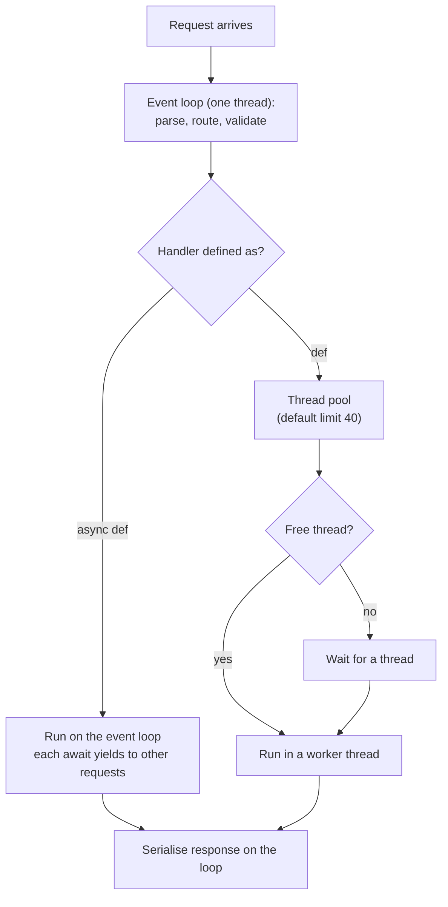

A request to AskMeridian spends almost all of its life waiting: for the vector database, for a reranker, and above all for the language model, which can take several seconds to answer. How a web service behaves while its requests wait decides how many users one process can serve, and whether one slow request makes every other request slow too. FastAPI lets you write each endpoint as either `async def` or plain `def`, and the two run in completely different ways. Choosing wrongly is one of the most common causes of a RAG service that is fast in testing and grinds to a halt under real traffic.

This lesson explains FastAPI's execution model precisely: what runs on the event loop, what runs in the thread pool, how big that pool is, and what happens when blocking code ends up in the wrong place. You will measure all three cases against a real server, then write an `async` RAG endpoint that embeds off the loop, retrieves from two sources concurrently under a time budget, and generates. The language-level mechanics of `asyncio` are assumed from [Async programming](/learn/python-for-rag-engineering/async-programming); system-wide latency tuning is left to [Async execution](/learn/performance-optimisation/async-execution).

## Learning objectives

- Explain how FastAPI runs `async def` endpoints (on the event loop) and `def` endpoints (in a bounded thread pool), and predict the behaviour of each under concurrent load.
- Identify blocking calls inside `async def` endpoints and fix them with asynchronous clients or `run_in_threadpool`.
- Calculate the maximum throughput of synchronous endpoints from the thread-pool size and request latency.
- Write an `async` RAG endpoint that runs independent retrieval calls concurrently and enforces a timeout.
- Choose between `async def` and `def` for a given endpoint based on the libraries it calls.

## Prerequisites

- [Async programming](/learn/python-for-rag-engineering/async-programming): coroutines, the event loop, `gather`, timeouts and the blocking-call trap.
- [FastAPI](/learn/backend-engineering/fastapi): path operations, lifespan and dependencies.
- [Hybrid search](/learn/hybrid-search): why a RAG service may query a dense and a sparse index for the same question.

## Why this matters

Consider AskMeridian on a Monday morning. Hundreds of staff ask questions within a few minutes, each answer takes the language model about four seconds, and the service runs as a handful of processes. How many questions can each process work on at once?

The answer depends entirely on how the endpoint is written:

- Written as `async def` with an asynchronous model client, one process can have hundreds of questions in flight, because while one waits for the model, the event loop serves the others.
- Written as plain `def` with a synchronous client, each in-flight question occupies a thread from a pool of 40. The 41st concurrent question waits in a queue before it even starts.
- Written as `async def` but calling a *synchronous* client, the process can serve exactly one question at a time. Every other request, including the health check that the load balancer uses to decide whether the process is alive, waits until the current model call finishes. Under load, health checks time out, the orchestrator restarts "unhealthy" processes, and a slow afternoon becomes an outage.

That third case is not exotic. It is what happens when someone writes `async def` because it looks modern and then calls `requests.get`, a synchronous database driver or `client.messages.create` on the synchronous Anthropic client inside it. Nothing errors. The service simply stops being concurrent.

## The intuition

Picture a restaurant kitchen with one very fast chef (the event loop) and a back room with 40 assistants (the thread pool).

The chef works on many orders at once by never standing still: put a pan on, and while it heats, chop for the next order; while that simmers, plate a third. This works only if every task is "start it and come back later". If the chef decides to stand and stare at a pot until it boils, every order in the kitchen stops.

The assistants are slower to coordinate but each can stand and wait without stopping anyone else. Hand an assistant "wait for the delivery, then bring it in" and the chef carries on. But there are only 40 of them; when all are standing at the door waiting for deliveries, new waiting jobs queue up.

`async def` endpoints are work for the chef: excellent if every wait is an `await`, catastrophic if any wait is a blocking call. `def` endpoints are work for the assistants: safe with blocking calls, but limited by the size of the back room.

## How it works

### Two execution paths

When FastAPI (through Starlette) receives a request for a path operation, it looks at how the handler was defined:

1. **`async def` handler**: FastAPI calls it and `await`s the coroutine *directly on the event loop*, the single thread that also accepts connections, parses requests and runs every other `async` handler in that process.
2. **`def` handler**: FastAPI sends the call to a worker thread with `anyio.to_thread.run_sync` and awaits its completion. The event loop is free while the thread works.

Dependencies follow the same rule: an `async def` dependency runs on the loop, a `def` dependency in a thread.



### The thread pool and its limit

The thread pool belongs to **AnyIO**, the concurrency library underneath Starlette. Its default capacity limiter allows **40** concurrent threads per process. The limit exists so that a flood of requests cannot create thousands of threads, each with its own memory stack. The consequence is a hard ceiling: at most 40 synchronous handlers (and synchronous dependencies, and other `run_in_threadpool` calls) can run at once in a process; the rest wait for a free token.

The limit can be raised, for example in the lifespan with `anyio.to_thread.current_default_thread_limiter().total_tokens = 100`, but more threads means more memory and more contention for Python's global interpreter lock on any CPU work. It is a tuning knob, not a substitute for asynchronous I/O.

### What blocks the event loop

Anything inside an `async def` that waits without `await` blocks the loop for its whole duration:

- **Synchronous network clients**: `requests`, the synchronous `httpx.Client`, synchronous database drivers, `anthropic.Anthropic().messages.create`, `QdrantClient(...).query_points`.
- **`time.sleep`**, file reads of large files, `subprocess.run`.
- **CPU-heavy work**: embedding with a local model, reranking with a cross-encoder, parsing a PDF, tokenising a long document. CPU work cannot be awaited at all; it can only be moved elsewhere.

Python will not warn you. The code runs correctly with one user and fails only under concurrency.

### Choosing for each endpoint

The rule follows from the two paths:

1. If every slow operation in the handler has an **asynchronous** client (`httpx.AsyncClient`, `anthropic.AsyncAnthropic`, `qdrant_client.AsyncQdrantClient`, async database drivers), write `async def` and `await` them. This scales furthest.
2. If the handler uses **synchronous** libraries and you cannot switch, write plain `def`. FastAPI puts it in a thread; it is safe, but capped by the pool.
3. If an `async def` handler must call one synchronous or CPU-bound function, wrap that call: `await run_in_threadpool(fn, *args)` (from `fastapi.concurrency`) runs it in the same pool and frees the loop while it runs.
4. For heavy CPU work under high load, threads are limited by the global interpreter lock for pure-Python code. Libraries such as PyTorch and NumPy release the lock during much of their native computation, so threads still help for embedding and reranking, but the scalable answer for heavy models is a separate inference service or process pool.

A handler that does nothing slow (a health check, returning a cached value) can be either; `async def` avoids the small cost of a thread hop.

### Concurrency inside one request

`async` also lets a single request do several things at once. A hybrid RAG query needs a dense search and a sparse search, which do not depend on each other. Run sequentially they cost the sum of their latencies; with `asyncio.gather` they cost the maximum. The step-by-step shape of an asynchronous RAG handler:

1. Embed the question. It is CPU-bound and synchronous, so `await run_in_threadpool(embedder.encode, question)`.
2. Start the independent retrieval calls together with `asyncio.gather`.
3. Bound them with `asyncio.timeout(...)`, so that a stalled vector database produces a clear `504` in half a second instead of hanging the request.
4. Merge and rerank the results (again in the thread pool if the reranker is a local model).
5. `await` the asynchronous model client to generate.
6. Return, or stream: see [Streaming APIs](/learn/backend-engineering/streaming-apis).

### Shared clients and connection pools

Asynchronous clients hold a pool of connections and must be created once and shared, in the [lifespan](/learn/backend-engineering/fastapi), not per request. Creating an `httpx.AsyncClient` or `AsyncAnthropic` per request discards connection reuse, so every request pays a new TCP and TLS handshake. Close them after the lifespan's `yield`. Note also that connection pools have their own limits: a shared client allowing 100 connections caps the process at 100 concurrent upstream calls, whatever the event loop could handle.

## The mathematics

### The throughput ceiling of synchronous endpoints

When requests are served by a fixed number of workers, **Little's law** (introduced in [Async programming](/learn/python-for-rag-engineering/async-programming)) connects concurrency, throughput and latency. Applied to the thread pool: if each synchronous request holds a thread for $W$ seconds and there are $c$ threads, the process completes at most

$$
X_{\max} = \frac{c}{W}
$$

requests per second, where $X_{\max}$ is the maximum throughput, $c$ is the number of concurrent workers (threads), and $W$ is the time each request occupies a worker. Above that arrival rate the queue grows without bound and latency rises until clients time out.

Worked example: AskMeridian's synchronous `ask` endpoint holds a thread for about 4 seconds, mostly waiting for the model (an assumption for the example). With the default $c = 40$:

$$
X_{\max} = \frac{40}{4} = 10 \text{ requests per second per process}
$$

If the busiest minute brings 1,200 questions, that is 20 per second, so two processes are needed at a bare minimum, before any headroom. The same endpoint written with an async model client is limited instead by the client's connection pool and the provider's rate limits; with a pool of 200 connections, the ceiling becomes $200 / 4 = 50$ requests per second per process.

```python
def max_throughput(workers: int, seconds_per_request: float) -> float:
    return workers / seconds_per_request

peak_rate = 1200 / 60  # requests per second in the busiest minute
for label, workers in [("thread pool", 40), ("async, 200 connections", 200)]:
    x = max_throughput(workers, 4.0)
    print(f"{label:<24} {x:5.1f} req/s per process -> {peak_rate / x:.1f} processes for {peak_rate:.0f} req/s")
```

```output
thread pool               10.0 req/s per process -> 2.0 processes for 20 req/s
async, 200 connections    50.0 req/s per process -> 0.4 processes for 20 req/s
```

## In code

### Experiment: three ways to wait

The first program measures the three cases from "Why this matters" against a real Uvicorn server. Each endpoint waits one second, standing in for a model call. While each burst of requests is in flight, the client also sends a `/health` request 50 ms into the burst and measures how long it takes.

```bash
pip install fastapi uvicorn httpx
```

The server, `endpoints.py`:

```python
import asyncio
import time

from fastapi import FastAPI

app = FastAPI()
WAIT = 1.0  # seconds: stands in for a vector-database or model call


@app.get("/async-blocking")
async def async_blocking():
    time.sleep(WAIT)           # a blocking call inside async def: freezes the event loop
    return {"ok": True}


@app.get("/sync-blocking")
def sync_blocking():
    time.sleep(WAIT)           # blocking, but FastAPI runs def endpoints in a worker thread
    return {"ok": True}


@app.get("/async-awaiting")
async def async_awaiting():
    await asyncio.sleep(WAIT)  # yields to the event loop while waiting
    return {"ok": True}


@app.get("/health")
async def health():
    return {"ok": True}
```

The load generator, `load.py`:

```python
import asyncio
import time

import httpx


async def burst(client: httpx.AsyncClient, path: str, n: int) -> None:
    async def timed_health() -> float:
        await asyncio.sleep(0.05)  # arrive 50 ms into the burst
        t = time.perf_counter()
        await client.get("/health")
        return time.perf_counter() - t

    start = time.perf_counter()
    *_, health_s = await asyncio.gather(*(client.get(path) for _ in range(n)), timed_health())
    total = time.perf_counter() - start
    print(f"{path:<16} n={n:<3} total {total:5.2f} s   /health during burst {health_s * 1000:5.0f} ms")


async def main() -> None:
    limits = httpx.Limits(max_connections=200, max_keepalive_connections=200)
    async with httpx.AsyncClient(base_url="http://127.0.0.1:8000", limits=limits, timeout=30) as client:
        await asyncio.gather(*(client.get("/health") for _ in range(100)))  # warm up connections
        for path in ("/async-blocking", "/sync-blocking", "/async-awaiting"):
            await burst(client, path, 5)
        await burst(client, "/sync-blocking", 60)
        await burst(client, "/async-awaiting", 60)


asyncio.run(main())
```

Start the server in one terminal with `uvicorn endpoints:app --port 8000 --log-level warning`, then run `python load.py` in another:

```output
/async-blocking  n=5   total  5.03 s   /health during burst  4975 ms
/sync-blocking   n=5   total  1.01 s   /health during burst     1 ms
/async-awaiting  n=5   total  1.00 s   /health during burst     1 ms
/sync-blocking   n=60  total  2.04 s   /health during burst     1 ms
/async-awaiting  n=60  total  1.39 s   /health during burst    27 ms
```

Read it line by line:

- **`/async-blocking`, 5 requests: 5 seconds.** `time.sleep` inside `async def` held the event loop, so the requests ran one after another. Worse, the health check sent 50 ms in took almost 5 seconds: it could not even be *read* until the loop was free. A load balancer with a 2-second health-check timeout would declare this process dead.
- **`/sync-blocking`, 5 requests: 1 second.** Each ran in its own thread, and health checks were unaffected.
- **`/async-awaiting`, 5 requests: 1 second.** The `await` let the loop interleave them.
- **`/sync-blocking`, 60 requests: 2 seconds.** Here the 40-thread limit shows: 40 requests ran in the first second, the remaining 20 waited for threads and ran in the second. This is $X_{\max} = 40 / 1 = 40$ requests per second in action.
- **`/async-awaiting`, 60 requests: about 1.4 seconds.** No thread limit; all 60 waited concurrently. The extra 0.4 seconds is per-request CPU overhead (HTTP parsing, routing, JSON) in the client and the server on the same laptop, which also shows in the slightly slower health check. It is the real cost of handling 60 requests in one Python process, and your numbers will differ with hardware.

A note on the client: `timeout=30` is there because the `/async-blocking` burst takes five seconds, which is exactly httpx's default timeout. Without it, the experiment fails with `ReadTimeout`, which is a fair simulation of what your users' clients would do.

### An asynchronous RAG endpoint

The second program is the shape you would actually deploy. The embedder is synchronous and CPU-bound, so it goes to the thread pool; the two retrieval calls and the generation are asynchronous stand-ins (each `asyncio.sleep` marks where an async client would `await` the network); retrieval runs under a 500 ms budget.

```python
import asyncio
import time
from contextlib import asynccontextmanager

from fastapi import FastAPI, HTTPException, Request
from fastapi.concurrency import run_in_threadpool
from pydantic import BaseModel


class FakeEmbedder:
    """CPU-bound and synchronous, like SentenceTransformer.encode."""

    def encode(self, text: str) -> list[float]:
        time.sleep(0.05)
        return [0.1, 0.2, 0.3]


async def dense_search(vector: list[float], delay: float) -> list[str]:
    await asyncio.sleep(delay)  # an async vector-database client would await the network here
    return ["leave", "remote"]


async def sparse_search(query: str) -> list[str]:
    await asyncio.sleep(0.15)   # an async BM25 or OpenSearch call
    return ["leave", "expenses"]


async def generate(question: str, context: list[str]) -> str:
    await asyncio.sleep(0.4)    # an async language-model call
    return f"Answer built from {context}"


@asynccontextmanager
async def lifespan(app: FastAPI):
    app.state.embedder = FakeEmbedder()
    app.state.dense_delay = 0.2
    yield


app = FastAPI(lifespan=lifespan)


class AskRequest(BaseModel):
    question: str


@app.post("/v1/ask")
async def ask(body: AskRequest, request: Request) -> dict:
    t0 = time.perf_counter()
    state = request.app.state
    vector = await run_in_threadpool(state.embedder.encode, body.question)  # off the event loop
    t1 = time.perf_counter()
    try:
        async with asyncio.timeout(0.5):  # retrieval budget
            dense, sparse = await asyncio.gather(
                dense_search(vector, state.dense_delay), sparse_search(body.question))
    except TimeoutError:
        raise HTTPException(504, "retrieval timed out")
    t2 = time.perf_counter()
    context = list(dict.fromkeys(dense + sparse))  # merge, keep first occurrence
    answer = await generate(body.question, context)
    t3 = time.perf_counter()
    timings = {"embed": t1 - t0, "retrieve": t2 - t1, "generate": t3 - t2, "total": t3 - t0}
    return {"answer": answer, "timings_ms": {k: round(v * 1000) for k, v in timings.items()}}
```

Exercised with the test client, first normally and then with a vector database that has become slow:

```python
from fastapi.testclient import TestClient

from rag_async import app

with TestClient(app) as client:
    r = client.post("/v1/ask", json={"question": "How much annual leave do I get?"})
    print(r.status_code, r.json())
    app.state.dense_delay = 2.0  # simulate a slow vector database
    r = client.post("/v1/ask", json={"question": "How much annual leave do I get?"})
    print(r.status_code, r.json())
```

```output
200 {'answer': "Answer built from ['leave', 'remote', 'expenses']", 'timings_ms': {'embed': 55, 'retrieve': 201, 'generate': 401, 'total': 658}}
504 {'detail': 'retrieval timed out'}
```

Retrieval took 201 ms, the maximum of the dense search (200 ms) and the sparse search (150 ms), not their 350 ms sum: `gather` ran them concurrently. When the dense search slowed to 2 seconds, the 500 ms budget expired, `asyncio.timeout` cancelled both searches, and the client got a prompt `504` rather than waiting. (Returning sparse-only results instead of failing is a design choice discussed in [Error handling](/learn/backend-engineering/error-handling).)

Important lines:

- `await run_in_threadpool(state.embedder.encode, body.question)` moves the CPU-bound call off the loop. Calling `state.embedder.encode(...)` directly would block every other request for its duration.
- `asyncio.gather(...)` starts both coroutines before awaiting either. Writing `await dense_search(...)` then `await sparse_search(...)` would be correct but sequential.
- `async with asyncio.timeout(0.5)` (Python 3.11 and later) cancels the work inside if it overruns and raises `TimeoutError`.

### With real clients

Switching the stand-ins for real asynchronous clients changes the calls, not the structure. This was not executed (it needs an API key and a Qdrant server); the clients are created in the lifespan and shared:

```python
import anthropic
from qdrant_client import AsyncQdrantClient


@asynccontextmanager
async def lifespan(app: FastAPI):
    app.state.llm = anthropic.AsyncAnthropic()  # reads ANTHROPIC_API_KEY from the environment
    app.state.qdrant = AsyncQdrantClient(url="http://localhost:6333")
    yield
    await app.state.qdrant.close()
    await app.state.llm.close()


async def generate(llm: anthropic.AsyncAnthropic, prompt: str) -> str:
    response = await llm.messages.create(
        model="claude-opus-5-5",
        max_tokens=1024,
        system="Answer only from the provided context. If the answer is not there, say you don't know.",
        messages=[{"role": "user", "content": prompt}],
    )
    return "".join(block.text for block in response.content if block.type == "text")
```

The common error when converting an existing service is to change `def` to `async def` and leave a synchronous client inside. Search the handler and every dependency it calls for synchronous clients before making the switch.

## A real-world example

After a refactor, AskMeridian's p50 latency in staging was unchanged, but within a day of release the on-call engineer, Tomás, saw something strange in production: during busy periods, Kubernetes restarted service pods because their liveness probes timed out, even though CPU usage was low.

The refactor had converted every endpoint to `async def` "for performance". The answer path, however, still used the synchronous Anthropic client and the synchronous Qdrant client, unchanged. Each pod's event loop now handled one question at a time. While a four-second generation was running, the pod could not even read the liveness probe's request. With one tester in staging this was invisible; with real traffic, probes failed, pods restarted, in-flight questions were lost, and load shifted to the surviving pods, which then failed the same way.

The immediate fix was to change the answer endpoint back to `def`, which restored thread-pool concurrency within minutes. The lasting fix, a week later, switched to `AsyncAnthropic` and `AsyncQdrantClient` created in the lifespan, moved local reranking into `run_in_threadpool`, and made the endpoint `async def` properly. The team also added a test that sends a slow request and a health check concurrently and fails if the health check takes longer than 100 ms, so a blocking call in an async path is caught in CI rather than by the orchestrator.

## Common mistakes

- **Calling synchronous clients inside `async def`.** The event loop blocks; the process serves one request at a time and stops answering health checks.
- **Running local models directly in `async def` handlers.** Embedding or reranking is CPU work that cannot be awaited; it must go to the thread pool or another process.
- **Assuming `def` endpoints scale without limit.** The thread pool caps concurrency at 40 per process by default, which is a hard ceiling on throughput for slow synchronous calls.
- **Creating clients per request.** New connection pools per request discard connection reuse and can exhaust sockets.
- **Awaiting independent calls one after another.** Dense and sparse retrieval cost their sum instead of their maximum.
- **No timeouts on upstream calls.** A stalled dependency holds the request, the client connection and (for `def` handlers) a thread indefinitely.

## Best practices

- Prefer `async def` with asynchronous clients for endpoints that call the network; use `def` when the libraries are synchronous.
- Wrap unavoidable synchronous or CPU-bound calls in `run_in_threadpool` inside asynchronous handlers.
- Create asynchronous clients once in the lifespan and close them on shutdown.
- Run independent retrieval calls concurrently and give each stage a timeout derived from the request's latency budget.
- Keep health endpoints trivial and `async`, and test that they stay fast while slow requests are in flight.
- Know your ceilings: thread-pool size, connection-pool size and the provider's rate limits, whichever is smallest.

## Performance considerations

The experiment's numbers are the whole story in miniature. A blocked event loop makes throughput equal to $1 / W$ per process: with a 4-second model call, a quarter of a request per second. A thread pool raises it to $40 / W$, ten per second. Asynchronous I/O raises it to the connection-pool limit divided by $W$, and in practice the bottleneck moves elsewhere: to the model provider's rate limits, measured in requests and tokens per minute, or to CPU.

CPU becomes the constraint because the event loop is one thread. Every microsecond of non-awaiting work (JSON parsing, validation, prompt assembly, token counting) is serialised across all requests in the process. In the experiment, 60 concurrent trivial requests cost roughly 0.4 seconds of overhead on one laptop; with heavier per-request work it grows proportionally. Once one core is saturated, run more processes (Uvicorn `--workers`, or more containers) rather than more concurrency per process.

Memory per request also differs. A thread reserves its own stack (typically several megabytes of virtual memory, an operating-system default you can check), whereas a waiting coroutine holds only its local state. Thousands of concurrent waits are practical with coroutines and impractical with threads, which is why streaming endpoints that hold connections open for many seconds should always be asynchronous.

## Security considerations

Concurrency limits are also denial-of-service limits. An attacker who can make each request slow (a long question, a large `top_k`, a query that triggers expensive reranking) occupies threads or upstream connections for longer, lowering the effective ceiling for everyone. Bound inputs as described in [Request validation](/learn/backend-engineering/request-validation), apply per-client rate limits after [authentication](/learn/backend-engineering/authentication), and put timeouts on every upstream call, so that no single request can hold resources indefinitely. A blocked event loop is itself a vulnerability: if one crafted request can trigger a blocking call in an async path, it can stall the whole process.

## Summary

- FastAPI runs `async def` handlers on the event loop and `def` handlers in an AnyIO thread pool limited to 40 threads per process by default.
- Any blocking call inside `async def` (synchronous clients, `time.sleep`, CPU-heavy model inference) stalls every request in the process, including health checks.
- Synchronous endpoints are safe but capped: maximum throughput is about the number of threads divided by the time each request holds one.
- `run_in_threadpool` moves individual blocking calls off the loop; asynchronous clients created in the lifespan remove the blocking altogether.
- Within one request, `asyncio.gather` runs independent retrieval calls concurrently and `asyncio.timeout` keeps them within a latency budget.

## Exercises

**1.** Predict the total time for each burst, with a one-second wait per request: (a) 100 concurrent requests to `/sync-blocking`; (b) 3 concurrent requests to `/async-blocking`; (c) 100 concurrent requests to `/async-awaiting`, ignoring per-request overhead.

<details><summary>Show solution</summary>

(a) 100 requests through 40 threads run in three waves (40, 40, 20): about 3 seconds. (b) The loop is blocked for each in turn: about 3 seconds, and any other request to the process waits up to 3 seconds too. (c) All 100 wait concurrently on the loop: about 1 second, plus the CPU overhead you saw in the experiment.

</details>

**2.** This handler is slow under load. Find the problem and give two fixes.

```python
@app.post("/v1/rerank")
async def rerank(body: RerankRequest, request: Request):
    model = request.app.state.cross_encoder
    scores = model.predict([(body.query, doc) for doc in body.documents])
    return {"scores": scores.tolist()}
```

<details><summary>Show solution</summary>

`model.predict` is synchronous, CPU-bound cross-encoder inference running directly on the event loop, so every other request in the process waits while it runs.

Fix 1: keep `async def` and move the call off the loop: `scores = await run_in_threadpool(model.predict, pairs)`. Fix 2: make the handler a plain `def`, so FastAPI runs the whole handler in a thread. Both are bounded by the thread pool, and for heavy traffic the better long-term design is a separate reranking service or worker processes, because CPU-bound threads compete for the global interpreter lock wherever the library holds it.

</details>

**3.** Modify the `ask` endpoint so that if retrieval times out, it uses whichever search *did* finish (if any) instead of returning `504`. Hint: create tasks, wait with a deadline, and cancel the stragglers.

<details><summary>Show solution</summary>

```python
    dense_task = asyncio.create_task(dense_search(vector, state.dense_delay))
    sparse_task = asyncio.create_task(sparse_search(body.question))
    done, pending = await asyncio.wait({dense_task, sparse_task}, timeout=0.5)
    for task in pending:
        task.cancel()
    results = [task.result() for task in (dense_task, sparse_task) if task in done and not task.exception()]
    if not results:
        raise HTTPException(504, "retrieval timed out")
    context = list(dict.fromkeys(item for result in results for item in result))
```

With the dense search delayed to 2 seconds, only the sparse task finishes, and the answer is built from `['leave', 'expenses']`. Record that the response is degraded (a flag in the response or a metric), so that silent quality loss is visible; see [Error handling](/learn/backend-engineering/error-handling).

</details>

**4.** Design decision. AskMeridian's ingestion endpoint parses uploaded PDFs with a synchronous library (about 3 seconds of CPU each) before queuing them. Should the endpoint be `async def` with `run_in_threadpool`, plain `def`, or something else? Consider what happens to `/v1/ask` traffic in the same process during a bulk upload of 200 files.

<details><summary>Show solution</summary>

Both `def` and `run_in_threadpool` use the same 40-thread pool. During a bulk upload, 40 parsing jobs would occupy every thread, and any synchronous work in `/v1/ask` (or its dependencies) would queue behind them; the CPU contention would also slow the event loop. Neither option isolates the two workloads.

Better: make the ingestion endpoint accept the upload, store it and return `202 Accepted` with a job, as in [REST APIs](/learn/backend-engineering/rest-apis), and do the parsing in separate worker processes fed by a queue. The API processes stay responsive for questions, and parsing capacity scales independently. If parsing must happen in the API for now, run it in a dedicated, small `ProcessPoolExecutor` (via `loop.run_in_executor`) so it neither uses the shared thread pool nor competes for the interpreter lock.

</details>

## Check your understanding

```quiz
[
  {
    "q": "An `async def` endpoint calls the synchronous `requests.get` on a URL that takes 2 seconds. Ten users call it at once. Roughly how long does the last user wait?",
    "options": [
      "About 2 seconds, because async endpoints are concurrent",
      "About 20 seconds, because the blocking call holds the event loop for each request in turn",
      "About 0.2 seconds",
      "It fails immediately with an error"
    ],
    "answer": 1,
    "why": "A blocking call inside async def is not awaited, so the loop cannot switch to other requests until it returns."
  },
  {
    "q": "How does FastAPI run a handler defined with plain `def`?",
    "options": [
      "In a worker thread from a bounded thread pool, keeping the event loop free",
      "On the event loop, blocking it",
      "In a new process per request",
      "It refuses to run it; all handlers must be async"
    ],
    "answer": 0,
    "why": "Starlette sends synchronous handlers to AnyIO's thread pool, whose default limit is 40 threads per process."
  },
  {
    "q": "A synchronous endpoint holds a thread for 2 seconds per request and the pool has 40 threads. What is the approximate maximum throughput per process?",
    "options": [
      "80 requests per second",
      "2 requests per second",
      "20 requests per second",
      "Unlimited"
    ],
    "answer": 2,
    "why": "Maximum throughput is workers divided by time per request: 40 / 2 = 20 requests per second."
  },
  {
    "q": "Inside an async RAG handler, the dense search takes 200 ms and the sparse search 150 ms, and they are independent. How should they be awaited?",
    "options": [
      "One after the other, so the total is 350 ms",
      "Each inside run_in_threadpool",
      "In a background task after the response is sent",
      "Together with asyncio.gather, so the total is about 200 ms"
    ],
    "answer": 3,
    "why": "gather starts both coroutines before waiting, so the cost is the maximum of their latencies rather than the sum."
  },
  {
    "q": "Where should an `AsyncAnthropic` client be created in a FastAPI service?",
    "options": [
      "Once in the lifespan, stored on app.state and shared",
      "Inside each request handler",
      "Inside a def dependency called per request",
      "In the client application"
    ],
    "answer": 0,
    "why": "A shared client reuses its connection pool across requests; creating one per request pays new connection set-up every time."
  }
]
```

## Further reading

- FastAPI documentation, [fastapi.tiangolo.com](https://fastapi.tiangolo.com/): "Concurrency and async / await", which explains the two execution paths.
- AnyIO documentation, [anyio.readthedocs.io](https://anyio.readthedocs.io/): working with threads and the default capacity limiter.
- Python documentation, [asyncio](https://docs.python.org/3/library/asyncio.html): tasks, `gather`, `wait` and `timeout`.
- Little, J. D. C. (1961), "A Proof for the Queuing Formula: L = λW", *Operations Research* 9(3).
- Anthropic Python SDK, [github.com/anthropics/anthropic-sdk-python](https://github.com/anthropics/anthropic-sdk-python): the synchronous and asynchronous clients.
