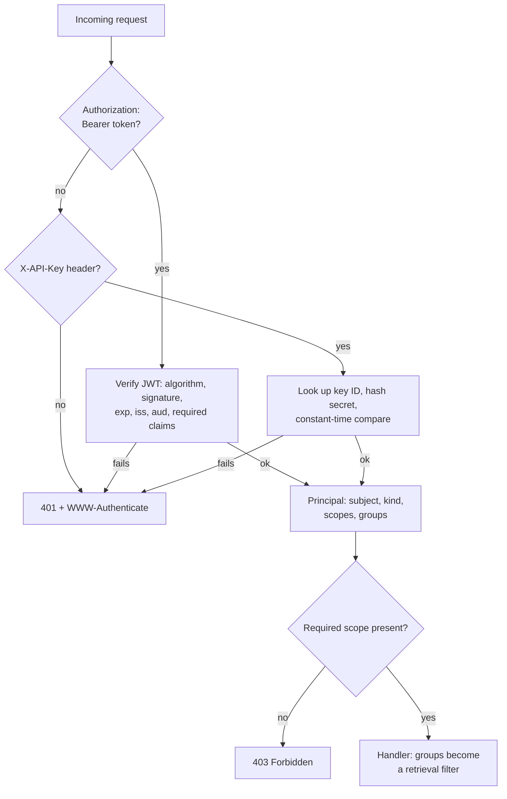

A RAG service is a window onto an organisation's documents. Before it answers a question it must know **who is asking**, because that decides which documents may be searched, whose conversation history to load, which quota to charge and what to write in the audit log. **Authentication** is the act of establishing that identity from credentials attached to the request. This lesson builds it into the AskMeridian API: API keys for other services, signed bearer tokens for people, a FastAPI dependency that turns either into a `Principal` object, and the checks that stop forged, expired or misdirected credentials.

The scope is the API layer: how a request proves who sent it and how your service verifies that proof. How identity is managed across an enterprise (single sign-on, identity providers, groups and their synchronisation) is the subject of [Authentication](/learn/access-control-and-privacy/authentication) in the security phase, and deciding what an authenticated caller may do is [Authorisation](/learn/access-control-and-privacy/authorisation). Here you will see where those plug in.

## Learning objectives

- Distinguish authentication from authorisation, and return `401` and `403` correctly, with a `WWW-Authenticate` header on `401`.
- Issue, store and verify API keys safely: high entropy, stored as hashes, compared in constant time.
- Verify a JSON Web Token's signature, algorithm, issuer, audience and expiry with PyJWT, and explain what each check prevents.
- Write a FastAPI dependency that accepts either credential type and produces a `Principal` that downstream code (including retrieval filters) can use.
- Choose between API keys, bearer tokens from an identity provider and mutual TLS for different AskMeridian clients.

## Prerequisites

- [FastAPI](/learn/backend-engineering/fastapi): dependencies and `Depends`.
- [REST APIs](/learn/backend-engineering/rest-apis): status codes, and why resource IDs alone do not protect resources.
- [Working with APIs](/learn/python-for-rag-engineering/working-with-apis): sending credentials from the client side.

## Why this matters

Without authentication, three things go wrong in a RAG service, in increasing order of seriousness.

**No accountability.** You cannot rate-limit per user, attribute cost to a team, or answer "who asked about the restructuring plan last Tuesday?" in an audit.

**No personalisation.** Conversation history, preferences and feedback need an owner. Without one, either every caller shares them (a leak) or nobody gets them.

**No permission boundary.** This is the serious one. Meridian's handbook is readable by everyone; the HR team's salary bands and the security team's incident runbooks are not. A RAG system retrieves from all of them by meaning, so the only thing stopping a question about pay from retrieving the salary bands is a filter derived from the caller's identity. If identity can be forged, or is simply absent, every document in the index is effectively public. Retrieval systems make this worse than a traditional file server, because the user does not need to know a document exists to receive its contents: a semantically close question is enough.

Authentication is also the part of the API most often implemented subtly wrong. A token that is decoded but not verified, a key compared with `==`, an algorithm taken from the token itself: each looks fine in testing and each is a known, exploited class of bug.

## The intuition

Two familiar objects capture the two main credential types.

An **API key** is like a door key cut for a particular service. Whoever holds it gets in; the door does not know or care who they are, only that the key fits. You give keys to things that run unattended, such as the nightly sync job, and if one is lost, you change the lock for that key alone.

A **signed token** is like a visitor badge issued at reception. Reception (the identity provider) checked your identity when you arrived and printed a badge with your name, your department, the building it is valid for and an expiry time, then stamped it with a seal that cannot be forged. Every door in the building checks the badge itself: is the seal genuine, is it for this building, has it expired? No door needs to phone reception, which is what makes badges fast. But a door that only glances at the name, without checking the seal, will admit anyone with a felt-tip pen.

## How it works

### Authentication, authorisation and the two status codes

- **Authentication** answers *who are you?* If the request carries no credentials, or credentials that fail verification, the answer is `401 Unauthorized` (despite its name, this code means *unauthenticated*). The response must include a `WWW-Authenticate` header naming the scheme the client should use, such as `Bearer`.
- **Authorisation** answers *may you do this?* If the caller is identified but not permitted, the answer is `403 Forbidden`. Retrying with the same credentials will not help.

Getting these right matters to clients: a `401` tells a client library to refresh its token and retry; a `403` tells it not to bother.

### Credentials travel in headers

The standard place for a credential is the `Authorization` header with a scheme, `Authorization: Bearer <token>`, defined for OAuth 2.0 bearer tokens in RFC 6750. API keys often use a custom header such as `X-API-Key`. Credentials must never go in the URL (`?api_key=...`): URLs are written to server access logs, proxy logs, browser history and `Referer` headers. And every credential must travel over TLS (HTTPS), since a header is plain text on an unencrypted connection.

### API keys

An API key is a long random string shared between your service and one client. Doing it properly involves a few details:

1. **Generate with a cryptographically secure source**: `secrets.token_urlsafe(32)` gives 32 random bytes (256 bits) encoded as 43 URL-safe characters. Never use `random`, timestamps or UUIDs derived from them.
2. **Give the key a structure**: a recognisable prefix (`amk_`, for AskMeridian key) so secret scanners can spot leaked keys in code and logs, a public **key ID** so you can look the key up and show it in dashboards, and the secret part.
3. **Store only a hash of the secret.** If the database leaks, the attacker gets hashes, not working keys. Because the secret has 256 bits of entropy, a fast hash such as SHA-256 is sufficient (see the mathematics below); slow password hashes such as Argon2 or bcrypt exist for *low*-entropy human passwords.
4. **Compare in constant time** with `hmac.compare_digest`. An ordinary `==` stops at the first differing character, so its running time leaks how many leading characters were right; constant-time comparison removes that signal.
5. **Show the full key once**, at creation, and never again. Support several active keys per client so they can rotate without downtime, record when each was last used, and make revocation immediate.

API keys suit **service-to-service** callers: the intranet sync job, the Slack bot's back end. They identify a client application, not a person, and they do not expire on their own, which is both their convenience and their risk.

### Bearer tokens and JWTs

For requests made on behalf of a **person**, the usual pattern is that the person signs in to an **identity provider** (Meridian's single sign-on, run by a product such as Microsoft Entra ID, Okta or Google), which issues an **access token**. The client sends it as a bearer token; your API verifies it. The flows by which the client obtains the token are defined by **OAuth 2.0** (RFC 6749) and **OpenID Connect**; your API's job is only to verify what arrives.

Access tokens are very often **JSON Web Tokens** (JWT, RFC 7519): three base64url-encoded parts separated by dots.

- The **header** names the signing algorithm (`alg`) and usually a key ID (`kid`).
- The **payload** holds **claims**: `iss` (issuer: who minted it), `sub` (subject: who it is about), `aud` (audience: which API it is for), `exp` (expiry time), `iat` (issued at), and application claims such as `scope` or `groups`.
- The **signature** is computed over header and payload with the issuer's key.

Anyone can *read* a JWT; the payload is encoded, not encrypted. What nobody else can do is produce a valid signature. So verification is everything:

1. **Verify the signature** with the issuer's key. Two families exist: **HMAC** algorithms (`HS256`) use one shared secret to sign and verify; **asymmetric** algorithms (`RS256`, `ES256`) sign with the issuer's private key and verify with its public key. With an external identity provider you always use asymmetric verification: the provider publishes its public keys at a **JWKS** (JSON Web Key Set) URL, and your API never holds anything that could mint tokens.
2. **Fix the allowed algorithms on the server.** Never let the token's own `alg` header choose. Historic attacks include tokens with `alg: none` (no signature at all) and tokens that switch an RS256 verifier to HS256, using the public key as an HMAC secret. Passing `algorithms=["RS256"]` (or `["HS256"]`) to the decoder defeats both.
3. **Check `exp`**, allowing a small leeway (tens of seconds) for clock differences between machines.
4. **Check `iss`**, so tokens from some other issuer are refused.
5. **Check `aud`**, so a token minted for a *different* API (say, the payroll service) cannot be replayed against yours. This is easy to forget and important: without it, any service that receives a user's token could use it against AskMeridian.
6. **Require the claims you depend on** to be present, rather than treating a missing claim as acceptable.

JWTs are verified locally, without a call to the identity provider, which makes them fast. The cost is **revocation**: a token stays valid until it expires, even if the user is disabled. Keep access-token lifetimes short (minutes, not days) and let clients refresh them.

### Putting it in FastAPI

FastAPI's `fastapi.security` module provides small helpers that read credentials from the request and document the scheme in OpenAPI: `HTTPBearer` reads `Authorization: Bearer ...`, `APIKeyHeader` reads a named header. Passing `auto_error=False` makes them return `None` when the credential is absent, so your own code decides what to do. You wrap them in a dependency that verifies the credential and returns a **principal**: a small, immutable object describing the authenticated caller.



The step-by-step procedure for each request:

1. Extract the credential from the header (never the URL).
2. Verify it completely; any failure is a `401` with `WWW-Authenticate`.
3. Build a `Principal` from verified data only.
4. Check coarse permissions (scopes such as `ask` or `documents:write`); failure is a `403`.
5. Pass the principal into the pipeline, where its groups or tenant become mandatory retrieval filters.
6. Record the principal's subject in logs and audit records.

Because it is a dependency, authentication is declared per route (or per router) and cannot be skipped by a handler that forgets to call it. Putting the dependency on the router (`APIRouter(dependencies=[Depends(get_principal)])`) makes "authenticated by default" the structure of the code, so a new endpoint is protected without anyone remembering to protect it.

### From identity to retrieval

The point of all this, for a RAG service, is step 5. The principal's groups (from the token's `groups` claim, or looked up from a directory) are turned into a filter that the server adds to every vector search, as shown in [Request validation](/learn/backend-engineering/request-validation). Authentication guarantees the groups are genuine; [Document-level permissions](/learn/access-control-and-privacy/document-level-permissions) covers how chunks are labelled and filtered so that the guarantee reaches the index.

## The mathematics

### Why a fast hash is enough for API keys

The security of a random key comes from the number of possible keys. A key with $b$ bits of entropy is one of $2^b$ equally likely values, so an attacker making $A$ guesses succeeds with probability at most

$$
P(\text{success}) \le \frac{A}{2^{b}}
$$

where $A$ is the number of attempts and $b$ the entropy in bits.

Worked example: suppose an attacker who has stolen the hash table can test a billion ($10^9$) guesses per second offline, for 100 years. That is $A \approx 10^9 \times 3.156 \times 10^9 \approx 3.16 \times 10^{18}$ attempts. Against a 128-bit key, $2^{128} \approx 3.40 \times 10^{38}$, so

$$
P \le \frac{3.16 \times 10^{18}}{3.40 \times 10^{38}} \approx 9.3 \times 10^{-21}
$$

This is why the speed of the hash does not matter for high-entropy keys: even an extremely fast hash leaves the search hopeless. A human password or a 6-digit PIN is a different story; there are only $10^6$ PINs, and an online attacker making 10 guesses per second covers them in about 28 hours. That is why passwords need slow hashes and rate limiting, and why API keys must be long and random rather than memorable. Keys from `secrets.token_urlsafe(32)` have 256 bits, a comfortable margin above 128.

```python
import math
import secrets

secrets_part = secrets.token_urlsafe(32)          # 32 random bytes, base64url-encoded
print(len(secrets_part), "characters,", 32 * 8, "bits of entropy")

bits = 128
guesses_per_second = 1e9
seconds = 100 * 365.25 * 24 * 3600
attempts = guesses_per_second * seconds
print(f"attempts in 100 years: {attempts:.3e}")
print(f"key space 2^{bits}:     {2**bits:.3e}")
print(f"probability of a hit:  {attempts / 2**bits:.1e}")
print(f"6-digit PIN at 10 guesses/s finds the key within {10**6 / 10 / 3600:.1f} hours")
```

```output
43 characters, 256 bits of entropy
attempts in 100 years: 3.156e+18
key space 2^128:     3.403e+38
probability of a hit:  9.3e-21
6-digit PIN at 10 guesses/s finds the key within 27.8 hours
```

## In code

The example protects two AskMeridian endpoints. `POST /v1/ask` needs a user token with the `ask` scope; `POST /v1/collections/{collection}/documents` needs the `documents:write` scope, which the intranet sync service has through its API key. Tokens here are signed with HS256 and a shared secret so the example runs with no identity provider; the production variant follows.

```bash
pip install fastapi httpx pyjwt
```

Save as `auth_app.py`:

```python
import hashlib
import hmac
import os
from dataclasses import dataclass
from typing import Annotated

import jwt
from fastapi import Depends, FastAPI, HTTPException, Security, status
from fastapi.security import APIKeyHeader, HTTPAuthorizationCredentials, HTTPBearer

# Configuration comes from the environment. The defaults exist only so the demo runs.
JWT_SECRET = os.environ.get("ASKMERIDIAN_JWT_SECRET", "demo-secret-at-least-32-bytes-long!!")
JWT_ISSUER = "https://login.meridian.example"
JWT_AUDIENCE = "askmeridian-api"

# API keys for service clients: store only a hash, indexed by a public key ID.
API_KEYS = {  # key_id -> (sha256 of the secret part, client name, scopes)
    "k7f3a9c2": (hashlib.sha256(b"Q9xv2LwT1sPz8RkYb4Hn").hexdigest(),
                 "intranet-sync", frozenset({"documents:write"})),
}


@dataclass(frozen=True)
class Principal:
    subject: str
    kind: str  # "user" or "service"
    scopes: frozenset[str]
    groups: frozenset[str] = frozenset()


bearer = HTTPBearer(auto_error=False)
api_key_header = APIKeyHeader(name="X-API-Key", auto_error=False)


def unauthorised(reason: str) -> HTTPException:
    return HTTPException(
        status_code=status.HTTP_401_UNAUTHORIZED,
        detail=reason,
        headers={"WWW-Authenticate": "Bearer"},
    )


def principal_from_jwt(token: str) -> Principal:
    try:
        claims = jwt.decode(
            token,
            JWT_SECRET,
            algorithms=["HS256"],  # an explicit allow-list: never trust the token's own "alg"
            audience=JWT_AUDIENCE,
            issuer=JWT_ISSUER,
            leeway=30,  # seconds of clock skew tolerated
            options={"require": ["exp", "iss", "aud", "sub"]},
        )
    except jwt.InvalidTokenError as exc:  # base class of every PyJWT validation error
        raise unauthorised(f"invalid token: {type(exc).__name__}")
    return Principal(
        subject=claims["sub"],
        kind="user",
        scopes=frozenset(claims.get("scope", "").split()),
        groups=frozenset(claims.get("groups", [])),
    )


def principal_from_api_key(raw: str) -> Principal:
    try:
        prefix, key_id, secret = raw.split("_", 2)
    except ValueError:
        raise unauthorised("malformed API key")
    record = API_KEYS.get(key_id)
    presented = hashlib.sha256(secret.encode()).hexdigest()
    if prefix != "amk" or record is None or not hmac.compare_digest(presented, record[0]):
        raise unauthorised("unknown API key")
    return Principal(subject=record[1], kind="service", scopes=record[2])


def get_principal(
    creds: Annotated[HTTPAuthorizationCredentials | None, Security(bearer)],
    api_key: Annotated[str | None, Security(api_key_header)],
) -> Principal:
    if creds is not None:
        return principal_from_jwt(creds.credentials)
    if api_key is not None:
        return principal_from_api_key(api_key)
    raise unauthorised("missing credentials")


def require_scope(scope: str):
    def check(principal: Annotated[Principal, Depends(get_principal)]) -> Principal:
        if scope not in principal.scopes:
            raise HTTPException(status.HTTP_403_FORBIDDEN, f"missing scope {scope!r}")
        return principal
    return check


app = FastAPI()


@app.post("/v1/ask")
def ask(principal: Annotated[Principal, Depends(require_scope("ask"))]) -> dict:
    # The principal's groups would become a retrieval filter here.
    return {"user": principal.subject, "groups": sorted(principal.groups)}


@app.post("/v1/collections/{collection}/documents", status_code=202)
def submit(collection: str, principal: Annotated[Principal, Depends(require_scope("documents:write"))]) -> dict:
    return {"accepted_from": principal.subject}
```

The test script `run.py` plays the identity provider (minting tokens with the same secret) and several clients, honest and otherwise:

```python
import time

import jwt
from fastapi.testclient import TestClient

from auth_app import JWT_AUDIENCE, JWT_ISSUER, JWT_SECRET, app

client = TestClient(app)
now = int(time.time())


def token(**overrides):
    claims = {"iss": JWT_ISSUER, "aud": JWT_AUDIENCE, "sub": "user:priya",
              "iat": now, "exp": now + 900, "scope": "ask", "groups": ["all-staff", "engineering"]}
    claims.update(overrides)
    return jwt.encode(claims, JWT_SECRET, algorithm="HS256")


def call(label, path, headers):
    r = client.post(path, headers=headers)
    print(f"{label:<28} {r.status_code} {r.json()} {r.headers.get('www-authenticate', '')}")


ask = "/v1/ask"
call("no credentials", ask, {})
call("valid user token", ask, {"Authorization": f"Bearer {token()}"})
call("expired token", ask, {"Authorization": f"Bearer {token(exp=now - 120)}"})
call("token for another API", ask, {"Authorization": f"Bearer {token(aud='payroll-api')}"})
forged = jwt.encode({"iss": JWT_ISSUER, "aud": JWT_AUDIENCE, "sub": "user:admin", "exp": now + 900,
                     "scope": "ask"}, "guessed-secret-guessed-secret-12345", algorithm="HS256")
call("forged signature", ask, {"Authorization": f"Bearer {forged}"})
unsigned = jwt.encode({"iss": JWT_ISSUER, "aud": JWT_AUDIENCE, "sub": "user:admin", "exp": now + 900,
                       "scope": "ask"}, None, algorithm="none")
call("alg=none token", ask, {"Authorization": f"Bearer {unsigned}"})

docs = "/v1/collections/handbook/documents"
call("user without write scope", docs, {"Authorization": f"Bearer {token()}"})
call("service API key", docs, {"X-API-Key": "amk_k7f3a9c2_Q9xv2LwT1sPz8RkYb4Hn"})
call("wrong API key secret", docs, {"X-API-Key": "amk_k7f3a9c2_wrong"})
```

```output
no credentials               401 {'detail': 'missing credentials'} Bearer
valid user token             200 {'user': 'user:priya', 'groups': ['all-staff', 'engineering']} 
expired token                401 {'detail': 'invalid token: ExpiredSignatureError'} Bearer
token for another API        401 {'detail': 'invalid token: InvalidAudienceError'} Bearer
forged signature             401 {'detail': 'invalid token: InvalidSignatureError'} Bearer
alg=none token               401 {'detail': 'invalid token: InvalidAlgorithmError'} Bearer
user without write scope     403 {'detail': "missing scope 'documents:write'"} 
service API key              202 {'accepted_from': 'intranet-sync'} 
wrong API key secret         401 {'detail': 'unknown API key'} Bearer
```

### Reading the output

Each line exercises one check:

- **No credentials**: `401` with `WWW-Authenticate: Bearer`, telling the client which scheme to use.
- **Valid user token**: the handler receives a `Principal` with Priya's subject and groups, which is what a retrieval filter would use.
- **Expired token**: refused even though the signature is genuine. Two minutes past expiry is beyond the 30-second leeway.
- **Token for another API**: genuine signature, valid expiry, but minted for `payroll-api`. The audience check stops it being replayed here.
- **Forged signature**: an attacker signed claims of their choosing (`user:admin`) with a guessed secret. Verification fails.
- **`alg=none`**: an unsigned token. Because the server passes `algorithms=["HS256"]`, PyJWT refuses any other algorithm, including `none`.
- **User without write scope**: authenticated, so not `401`, but not permitted, so `403` and no `WWW-Authenticate` header.
- **Service API key**: the intranet sync is identified as a service principal with the write scope.
- **Wrong API key secret**: the key ID exists but the secret hash does not match.

### Important lines

- `algorithms=["HS256"]`, `audience=`, `issuer=` and `options={"require": [...]}` are the verification policy. Each corresponds to one of the numbered checks above; leaving any out opens a known hole.
- `except jwt.InvalidTokenError` catches every PyJWT validation failure through their common base class.
- `hmac.compare_digest(presented, record[0])` compares hashes in constant time.
- `HTTPBearer(auto_error=False)` and `APIKeyHeader(auto_error=False)` let one dependency accept either credential. They also register the schemes in OpenAPI, so `/docs` gains an "Authorize" button.
- `require_scope` is a dependency factory: it returns a new dependency for each scope, and itself depends on `get_principal`, so FastAPI resolves the chain.

The detail messages name the exact failure, which helps when debugging. In production, consider returning a generic `invalid token` (with the RFC 6750 `error="invalid_token"` parameter in `WWW-Authenticate`) and logging the specific reason server-side, so the API does not coach an attacker.

### The production variant: verifying an identity provider's tokens

With a real identity provider, tokens are signed with RS256 or ES256 and verified against the provider's published keys. PyJWT's `PyJWKClient` fetches the JWKS, caches it, and selects the key matching the token's `kid`. This was not executed here (it needs a provider, and PyJWT's `crypto` extra for RSA support); the URL is a placeholder:

```python
import jwt

jwks = jwt.PyJWKClient("https://login.meridian.example/.well-known/jwks.json")


def verify_provider_token(token: str) -> dict:
    signing_key = jwks.get_signing_key_from_jwt(token)  # chosen by the token's "kid"
    return jwt.decode(
        token,
        signing_key.key,
        algorithms=["RS256"],
        audience="askmeridian-api",
        issuer="https://login.meridian.example",
        leeway=30,
        options={"require": ["exp", "iss", "aud", "sub"]},
    )
```

Install with `pip install "pyjwt[crypto]"`. Create one `PyJWKClient` at start-up (in the [lifespan](/learn/backend-engineering/fastapi)) rather than per request, so its key cache is shared. Swap `principal_from_jwt` to call this, and nothing else changes.

### Common errors

- **`jwt.decode` called with `options={"verify_signature": False}`**, often copied from a debugging snippet. The token's contents are then entirely attacker-controlled.
- **`InvalidAudienceError` for every token** after integrating a provider: the provider puts its own value in `aud` (often an application ID URI). Configure the expected audience to match what the provider issues for your API.

## A real-world example

When AskMeridian moved beyond the pilot, the Platform team needed to support three kinds of caller: staff using the web chat, the Slack bot acting for staff, and the nightly intranet sync. Their first design gave every client an API key. It was simple, but the Slack bot's key identified only *the bot*, so every question asked through Slack ran with the bot's permissions, which had been set broadly so that it "worked for everyone". A contractor asking through Slack could retrieve documents restricted to permanent staff.

Ines redesigned it around one principle: the identity that reaches the retriever must be the person, not the pipe. The web chat obtained access tokens from Meridian's single sign-on and sent them as bearer tokens. The Slack bot was changed to obtain a token for the specific user through the identity provider's delegation flow and forward it, rather than using its own key for searches. Only the sync job kept an API key, scoped to `documents:write` and unable to call `/v1/ask` at all.

Every request then produced a `Principal` whose groups came from the verified token, and the retriever's mandatory filter was built from those groups. The audit log could say which person asked what, through which client. The key insight the team recorded was that authentication is not finished when you know *a* caller is legitimate; it is finished when you know *which person* the request is for.

## Common mistakes

- **Decoding a JWT without verifying it.** The payload is readable by anyone and writable by anyone; only the signature makes it trustworthy.
- **Letting the token choose its algorithm.** Omitting the server-side `algorithms` allow-list reopens `alg: none` and algorithm-confusion attacks.
- **Skipping the audience check.** Tokens minted for another service can be replayed against yours.
- **Storing API keys in plain text** in the database. A database leak becomes a credential leak for every client.
- **Comparing secrets with `==`.** The comparison time leaks information about how much of the secret was right.
- **Putting credentials in query strings.** They are written to logs and history.
- **Authenticating the client application instead of the user.** A bot or front end with one broad credential turns every user into a super-user for retrieval.

## Best practices

- Make authentication a dependency on the router, so endpoints are protected by default and exceptions are explicit.
- Verify tokens fully: fixed algorithms, signature, `exp` with small leeway, `iss`, `aud` and required claims.
- Use an identity provider and asymmetric signatures for user tokens; your API should hold public keys only.
- Issue API keys with a prefix and key ID, store SHA-256 hashes, compare in constant time, show them once, and support rotation and immediate revocation.
- Keep access tokens short-lived, and give service credentials the narrowest scopes they need.
- Carry a single `Principal` type through the request, and derive retrieval filters and audit records from it alone.

## Performance considerations

Verification is cheap when done locally. An HMAC check over a JWT is microseconds of CPU; an RSA signature verification is somewhat more, but still small next to an embedding call. What can be expensive is network work: fetching the JWKS on every request, or calling the identity provider's token-introspection endpoint per request, adds a round trip (tens of milliseconds, an assumption that depends on network distance) to every question. Cache the key set (as `PyJWKClient` does) and refresh it when an unknown `kid` appears or on a schedule.

API-key lookup is one indexed database read per request. If that read is remote, cache verified keys briefly in memory, keyed by key ID and hash, with a short expiry so revocation still takes effect within a bounded time; the expiry is the trade-off between database load and revocation delay. With a 60-second cache, a revoked key works for at most 60 more seconds on each process.

Token size matters at scale too: a JWT carrying hundreds of group names can grow to several kilobytes, sent on every request. Some identity providers cap the number of groups placed in a token for this reason, which means the API may need to look groups up separately for users in many groups.

## Security considerations

This whole lesson is a security topic, so the points here are the ones most often missed. Serve only over TLS, and enable HSTS on the domain so browsers refuse plain HTTP. Never log `Authorization` or `X-API-Key` headers; configure logging and tracing to redact them (see [Logging](/learn/rag-observability/logging)). Rate-limit failed authentication attempts per client and per key ID. Scan repositories for leaked keys (the prefix makes this reliable) and revoke on discovery rather than on confirmation of abuse. Tokens forwarded from a front end must be validated by the API itself; never trust identity claims passed in a plain header such as `X-User-Id` unless the request arrived through a gateway that sets it and the API cannot be reached any other way. Finally, remember what authentication does not do: knowing who is asking is necessary for document-level permissions, but enforcing them is a separate step, and a retrieval layer that ignores the principal makes perfect authentication worthless.

## Summary

- Authentication establishes who is calling; authorisation decides what they may do. Return `401` with `WWW-Authenticate` for the first, `403` for the second.
- API keys suit unattended services: generate with `secrets`, prefix them, store hashes, compare in constant time, rotate and revoke.
- User requests carry bearer tokens from an identity provider, usually JWTs, which must be verified for signature, algorithm, expiry, issuer and audience.
- In FastAPI, a dependency turns any accepted credential into a `Principal`, and scope checks are further dependencies layered on top.
- For RAG, the principal must represent the *person*, because its groups become the retrieval filter that enforces document permissions.

## Exercises

**1.** For each situation, give the status code and say whether the response should include `WWW-Authenticate`: (a) no `Authorization` header; (b) a valid token without the `documents:write` scope calling the ingestion endpoint; (c) a token that expired an hour ago; (d) a valid token for user A requesting `/v1/conversations/{id}` belonging to user B.

<details><summary>Show solution</summary>

(a) `401`, with `WWW-Authenticate: Bearer`. (b) `403`, no `WWW-Authenticate`; the caller is known but not permitted. (c) `401` with `WWW-Authenticate` (optionally `error="invalid_token"`); the client should obtain a fresh token. (d) The caller is authenticated, so this is an authorisation failure. Return `404` rather than `403`, so the API does not confirm that conversation exists; either way, never `401`.

</details>

**2.** Explain why the audience check matters, using AskMeridian and Meridian's payroll service as the example. What could an attacker who controls (or has compromised) the payroll service do if AskMeridian skipped it?

<details><summary>Show solution</summary>

Both services accept tokens from the same identity provider, signed with the same keys. When a user calls the payroll service, they send it a token whose `aud` is `payroll-api`. If AskMeridian does not check `aud`, that token's signature, issuer and expiry are all valid at AskMeridian too. Whoever holds it, including a compromised or malicious payroll service, can call AskMeridian *as that user* and retrieve every document the user may read. The audience check confines each token to the API it was issued for, so a breach of one service does not become a breach of all of them.

</details>

**3.** Write a function `issue_api_key(client_name: str, scopes: set[str]) -> str` that creates a key in the `amk_<key_id>_<secret>` format, stores its hash in `API_KEYS`, and returns the full key once. Then show that the example's `principal_from_api_key` accepts it.

<details><summary>Show solution</summary>

```python
import hashlib
import secrets

from auth_app import API_KEYS, principal_from_api_key


def issue_api_key(client_name: str, scopes: set[str]) -> str:
    key_id = secrets.token_hex(4)            # 8 hex characters, no underscores
    secret = secrets.token_urlsafe(32)       # 256 bits
    API_KEYS[key_id] = (hashlib.sha256(secret.encode()).hexdigest(),
                        client_name, frozenset(scopes))
    return f"amk_{key_id}_{secret}"


key = issue_api_key("slack-bot-ingest", {"documents:write"})
print(principal_from_api_key(key))
```

This prints a `Principal` with `subject='slack-bot-ingest'`, `kind='service'` and the requested scopes. The key ID uses hex so it never contains the `_` separator; the secret may contain `_`, which is why the parser uses `split("_", 2)`. In a real system, `API_KEYS` would be a database table and you would also record a creation time and a `last_used_at`.

</details>

**4.** Design decision. AskMeridian is adding a browser-based chat page served from a different domain. The front-end team proposes storing a long-lived API key in the page's JavaScript "to keep it simple". Evaluate the proposal and propose a design.

<details><summary>Show solution</summary>

Anything in browser JavaScript is readable by every user of the page (view source, developer tools), so the key is effectively public; it identifies the page, not the person, so retrieval would run with one shared identity and document permissions would be lost; and a long-lived key cannot be revoked for one user.

Instead, the page should sign the user in through Meridian's single sign-on using the OAuth 2.0 authorisation code flow with PKCE (the flow intended for browser applications), obtain a short-lived access token whose audience is the AskMeridian API, and send it as a bearer token. The API verifies it as in this lesson, and the user's own groups drive retrieval. A common alternative is a back-end-for-front-end: the page talks to a small server on its own domain that holds the tokens in a secure, HTTP-only cookie session and calls the API on the user's behalf. Either way, no long-lived secret reaches the browser, and the cross-origin calls need a CORS (cross-origin resource sharing) policy, set with FastAPI's `CORSMiddleware`, that allows only that front end's origin.

</details>

## Check your understanding

```quiz
[
  {
    "q": "A request carries a valid token for a user who lacks the `documents:write` scope. What should the ingestion endpoint return?",
    "options": [
      "401 Unauthorized with WWW-Authenticate",
      "403 Forbidden",
      "404 Not Found",
      "422 Unprocessable Content"
    ],
    "answer": 1,
    "why": "The caller is authenticated but not permitted. 401 would wrongly suggest that new credentials could help."
  },
  {
    "q": "Why does the server pass `algorithms=[\"HS256\"]` (or `[\"RS256\"]`) to `jwt.decode`?",
    "options": [
      "To make decoding faster",
      "Because PyJWT cannot detect the algorithm from the token",
      "So the token's own header cannot choose a weaker algorithm such as `none`",
      "To encrypt the payload"
    ],
    "answer": 2,
    "why": "The allow-list stops algorithm-confusion and unsigned-token attacks, in which the token's header selects how it is verified."
  },
  {
    "q": "Which statement about JWT payloads is true?",
    "options": [
      "Anyone can read the payload; only the signature prevents tampering",
      "The payload is encrypted, so it can hold secrets",
      "The payload cannot be read without the issuer's private key",
      "The payload is verified by the client before sending"
    ],
    "answer": 0,
    "why": "A standard signed JWT is base64url-encoded, not encrypted. Its integrity comes from the signature."
  },
  {
    "q": "API key secrets are 256 random bits. Why is SHA-256, a fast hash, acceptable for storing them, when passwords need a slow hash?",
    "options": [
      "Because SHA-256 is reversible only by the server",
      "Because API keys are never stolen",
      "Because slow hashes cannot handle long inputs",
      "Because with 2^256 possibilities, even billions of guesses per second cannot find the key; slowness matters only for low-entropy secrets"
    ],
    "answer": 3,
    "why": "Slow hashes compensate for small search spaces such as human passwords. A high-entropy random key is already infeasible to brute-force."
  },
  {
    "q": "The Slack bot calls AskMeridian with its own API key for every user's question. What is the main problem?",
    "options": [
      "API keys are slower to verify than tokens",
      "Retrieval runs with the bot's permissions, not each user's, so document permissions are bypassed",
      "Slack cannot send custom headers",
      "API keys cannot be used over HTTPS"
    ],
    "answer": 1,
    "why": "The identity reaching the retriever must be the person asking; otherwise every user gets whatever the bot can see."
  }
]
```

## Further reading

- RFC 6750, *The OAuth 2.0 Authorization Framework: Bearer Token Usage* (Jones and Hardt, 2012), including the `WWW-Authenticate` error parameters.
- RFC 7519, *JSON Web Token (JWT)* (Jones, Bradley and Sakimura, 2015), and RFC 8725, *JSON Web Token Best Current Practices* (Sheffer, Hardt and Jones, 2020).
- RFC 6749, *The OAuth 2.0 Authorization Framework* (Hardt, 2012), and the OpenID Connect Core 1.0 specification.
- PyJWT documentation, [pyjwt.readthedocs.io](https://pyjwt.readthedocs.io/): usage, `PyJWKClient` and the exception hierarchy.
- FastAPI documentation, [fastapi.tiangolo.com](https://fastapi.tiangolo.com/): the security tutorial (`HTTPBearer`, `APIKeyHeader`, OAuth2 scopes).
- OWASP API Security Top 10, [owasp.org/API-Security](https://owasp.org/API-Security/): broken authentication and broken object-level authorisation.
