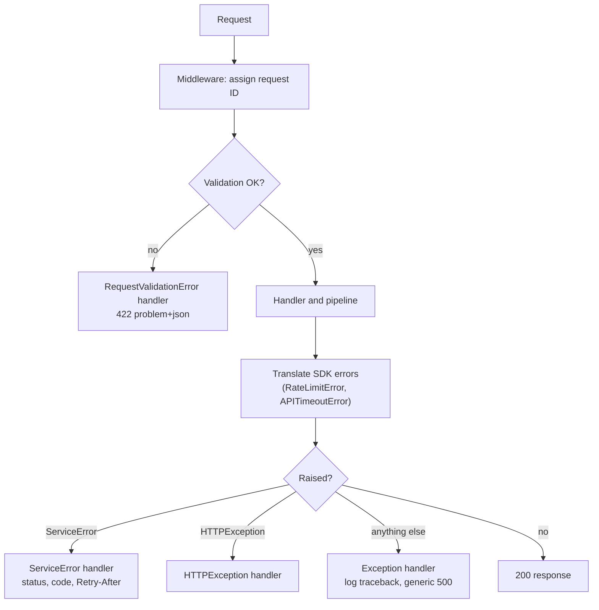

Every RAG request depends on several systems that can fail independently: the API process itself, an embedding model, a vector database, a reranker and a language-model provider. At any real volume, each of them fails every day in some small way. The question is not whether your API returns errors but what those errors look like: whether a client can tell "you sent something wrong" from "try again in ten seconds" from "we have a bug", whether the on-call engineer can find the failing request in the logs, and whether a temporary problem with one dependency takes the whole service down with it.

[Exception handling](/learn/python-for-rag-engineering/exception-handling) built the Python machinery: exception hierarchies, translation with `raise ... from`, transient versus permanent errors, retries with backoff. This lesson applies it at the HTTP boundary of the AskMeridian API: a single machine-readable error format (RFC 9457 Problem Details), FastAPI exception handlers that produce it for every kind of failure, translation of language-model SDK errors into the right status codes, request IDs that tie client reports to server logs, and graceful degradation when a dependency is down.

## Learning objectives

- Classify failures in a RAG API as client errors, upstream failures, internal bugs or non-errors, and choose a status code for each.
- Return every error in one consistent format based on RFC 9457 Problem Details, with a stable machine-readable code and a request ID.
- Register FastAPI exception handlers for domain exceptions, validation errors, HTTP exceptions and unhandled exceptions.
- Translate Anthropic SDK exceptions into service errors, including `Retry-After`, without leaking internal details.
- Calculate the availability of a chain of dependencies and explain how graceful degradation improves it.

## Prerequisites

- [Exception handling](/learn/python-for-rag-engineering/exception-handling): hierarchies, translation, retries and backoff.
- [REST APIs](/learn/backend-engineering/rest-apis): the status codes a RAG service needs.
- [Request validation](/learn/backend-engineering/request-validation): FastAPI's default `422` format.
- [Streaming APIs](/learn/backend-engineering/streaming-apis): why errors after the first byte become events.

## Why this matters

Look at the error responses of a service that never designed them. A missing collection returns `{"detail": "Not Found"}`. A validation failure returns a list of dictionaries in a different shape. A language-model timeout returns a bare `Internal Server Error` in plain text, indistinguishable from a bug. A rate limit at the model provider returns `500` too, so client libraries do not retry, while a genuine bug returns the same `500`, so the libraries that do retry hammer a broken endpoint.

Each client team then writes its own guesswork: string-matching on `detail`, retrying on every 5xx, showing users raw messages such as `AuthenticationError: invalid x-api-key`. When something goes wrong, a user reports "it said internal error at about half past ten", and the on-call engineer searches thousands of log lines for the right one.

Good error handling fixes all of this with a small amount of structure: one format, honest status codes, a stable code clients can branch on, a `Retry-After` when retrying will help, and a request ID that links the user's screenshot to the exact log entry.

## The intuition

Think of the departures board at a railway station. When a train is not running normally, the board does not just say "problem". It says *Delayed: expected 10:42* (wait, it will come), *Cancelled* (do not wait, make other plans), or *Platform changed to 4* (you did something that needs adjusting). Every train's problem is shown in the same place and the same form, so passengers know where to look and what to do. Behind the scenes, staff have the full story: which signal failed, which driver called in sick. Passengers do not need that, and are not shown it.

An API error is a departures-board message for software. The status code and error code say what kind of problem it is and whether waiting will help; `Retry-After` is the expected time; the format is the same for every endpoint; and the internal detail stays in the logs, linked to the public message by a reference number.

## How it works

### Four kinds of outcome

Sort every failure in a RAG request into one of four groups before choosing how to report it:

1. **Client errors (4xx).** The request is wrong and retrying it unchanged will fail again: invalid fields (`422`), missing or bad credentials (`401`), not permitted (`403`), no such collection (`404`), duplicate (`409`), too large (`413`), the caller's own rate limit (`429`).
2. **Upstream failures (502, 503, 504).** The request is fine, but a dependency is down or slow. Retrying later may well succeed. Use `503 Service Unavailable` with `Retry-After` when a dependency is unavailable or rate limiting *you*, and `504 Gateway Timeout` when it did not answer in time. (`502 Bad Gateway` is for an invalid response from upstream.)
3. **Internal errors (500).** A bug or a misconfiguration in your service. Retrying will not help until someone fixes it.
4. **Not errors at all.** Some outcomes feel like failures but are legitimate answers. "No relevant documents found" and "the context does not contain the answer" are successful responses (`200`) containing a refusal, as discussed in [Grounded generation](/learn/prompt-engineering-for-rag/grounded-generation). Returning `404` for "I don't know" confuses clients and monitoring alike.

Two classifications catch people out. When the *model provider* returns `429` because your organisation has exceeded its rate limit, that is not the *caller's* fault, so do not pass `429` through: it is your capacity problem, which is a `503` with `Retry-After`. And when the provider returns `401` because your API key is wrong or expired, that is not the caller's authentication failure either: it is your misconfiguration, so it is a `500`, and it should page someone.

### One format: Problem Details

**RFC 9457**, *Problem Details for HTTP APIs* (2023, replacing RFC 7807), defines a standard JSON error body with the media type `application/problem+json`. Its members:

- `type`: a URI identifying the kind of problem, ideally pointing at documentation for it.
- `title`: a short, human-readable summary of that kind of problem, the same every time.
- `status`: the HTTP status code, repeated for convenience.
- `detail`: an explanation specific to this occurrence.
- `instance`: a URI identifying this occurrence (often the request path).

The RFC allows **extension members**, and two are worth adding to every error: a short stable `code` (`model_unavailable`) for clients to branch on, and a `request_id`. Validation errors add an `errors` array. Using a standard format means clients, gateways and tools can parse your errors without bespoke code, and it forces the useful discipline of naming every kind of failure.

### Exception handlers in FastAPI

FastAPI lets you register a function that turns a given exception type into a response: `@app.exception_handler(SomeError)`. When a handler or dependency raises, FastAPI finds the most specific registered handler for that exception's class (walking up its inheritance chain). A complete setup needs four handlers:

1. **Your domain base class** (`ServiceError`): carries status, code, title and an optional retry delay, so each new error is a three-line subclass.
2. **`RequestValidationError`**: overrides FastAPI's default `422` body so validation failures use the same format. This is also where you drop the echoed `input`, which can contain things users should not have sent.
3. **Starlette's `HTTPException`**: covers `HTTPException` raised in your code and the framework's own `404` for unknown routes and `405` for wrong methods. (Register it on Starlette's class, `starlette.exceptions.HTTPException`, to catch the framework's own errors as well as FastAPI's subclass.)
4. **`Exception`**: the catch-all for bugs. It logs the full traceback and returns a generic `500` that reveals nothing internal. Starlette runs this handler in its outermost error middleware, outside any middleware you add, so the response is produced even when everything else has failed.

The request flow through these pieces:



### Translating SDK errors

Translation happens at the edge of the pipeline, where your code calls the SDK, not in the HTTP layer. The Anthropic Python SDK raises a hierarchy of exceptions: `APIConnectionError` when it cannot reach the API, its subclass `APITimeoutError` when the request times out, and `APIStatusError` subclasses for HTTP error responses, such as `RateLimitError` (429), `AuthenticationError` (401), `BadRequestError` (400) and `InternalServerError` (5xx). Map each to a domain error:

| SDK exception | Meaning for AskMeridian | Domain error | Status |
| --- | --- | --- | --- |
| `RateLimitError` | We are over our quota | `ModelUnavailable`, with the provider's `retry-after` | 503 |
| `APITimeoutError` | No answer in time | `ModelTimeout` | 504 |
| `APIConnectionError` | Network failure | `ModelUnavailable` | 503 |
| `InternalServerError` | Provider-side failure | `ModelUnavailable` | 503 |
| `AuthenticationError`, `BadRequestError` | Our key or our request is wrong | Unhandled, becomes a bug | 500 |

Two details matter. First, order `except` clauses from most to least specific: `APITimeoutError` is a subclass of `APIConnectionError`, so it must come first. Second, translate with `raise DomainError(...) from exc`, so the original exception is kept as `__cause__` for the logs while the client sees only the domain error.

The SDK also **retries** some failures itself before raising (connection errors, 408, 409, 429 and 5xx responses, twice by default, configurable with `max_retries`). Account for this when you set your own retries and timeouts: if your service retries three times and the SDK twice on each, one user request can become nine model calls. Retry in one layer, as [Exception handling](/learn/python-for-rag-engineering/exception-handling) explains under retry amplification.

### Request IDs

A **request ID** is a unique identifier attached to a request at the edge and carried everywhere it goes: every log line, the call to the model provider's logs where possible, the response header and the error body. If a client or an upstream gateway already sent one (commonly in `X-Request-ID`), reuse it, so one ID spans the whole journey; otherwise generate one. The user's support ticket then says "request ID req-rate", and the engineer finds every log line for that request in seconds. [Tracing](/learn/rag-observability/tracing) extends the same idea into full distributed traces.

### Graceful degradation

A RAG answer depends on a chain of services, and some links are optional. When the reranker fails, results in first-stage order are worse but still useful. When the language model is down, the retrieved sources can still be returned so the user can read them. Degrading instead of failing keeps the service useful, but it must be **visible**: mark the response (for example `"degraded": ["reranker"]`), count degraded responses in metrics, and never let a degraded mode become a silent permanent state. Decide in advance, per dependency, whether its failure means "fail the request" or "continue without it".

### Errors in streams

Once a [streaming](/learn/backend-engineering/streaming-apis) response has sent its first byte, the status code cannot change. Late failures are sent as an `error` event whose data is the same Problem Details object, then the stream is closed. Clients that understand your format for ordinary responses can then handle stream failures with the same code.

## The mathematics

### Availability of a chain of dependencies

If a request needs every one of $n$ independent dependencies to succeed, its success rate is the product of theirs:

$$
A_{\text{request}} = \prod_{i=1}^{n} A_i
$$

where $A_i$ is the availability (fraction of time working, or fraction of calls succeeding) of dependency $i$. The intuition is that every extra required dependency is one more way to fail, so the chain is always less available than its weakest link. Real failures are not perfectly independent, so treat it as an estimate.

Worked example, with assumed availabilities: the API itself 99.95%, the embedding service 99.9%, the vector database 99.9%, and the language-model provider 99.5%.

$$
A = 0.9995 \times 0.999 \times 0.999 \times 0.995 \approx 0.9925
$$

That is 99.25%, or about $0.0075 \times 43{,}200 \approx 323$ minutes of failure in a 30-day month. If the service degrades instead of failing when only the model is down (returning sources without an answer), the model drops out of the product for the purposes of "the request returned something useful":

$$
A_{\text{degraded}} = 0.9995 \times 0.999 \times 0.999 \approx 0.9975
$$

about 108 minutes a month. Degradation does not make answers more available; it makes the *service* more useful during an outage of its least reliable part.

```python
from math import prod

deps = {"API service": 0.9995, "embedding service": 0.999, "vector database": 0.999, "language model": 0.995}
minutes_per_month = 30 * 24 * 60

serial = prod(deps.values())
print(f"all four required:        {serial:.4%}  -> {(1 - serial) * minutes_per_month:5.0f} min/month failing")

# With degradation: if only the language model fails, return sources instead of an error.
without_llm = prod(a for name, a in deps.items() if name != "language model")
print(f"degrade when model fails: {without_llm:.4%}  -> {(1 - without_llm) * minutes_per_month:5.0f} min/month failing")
```

```output
all four required:        99.2514%  ->   323 min/month failing
degrade when model fails: 99.7502%  ->   108 min/month failing
```

## In code

The example gives AskMeridian's `ask` endpoint a complete error-handling layer: domain exceptions, translation of real Anthropic SDK exception classes, a request-ID middleware, Problem Details responses from four handlers, and a test script that makes the "model" fail in each way on demand through a dependency override.

```bash
pip install fastapi httpx anthropic
```

The SDK is installed only for its exception classes; no API call is made. Save as `errors_app.py`:

```python
import logging
import uuid
from typing import Annotated

import anthropic
from fastapi import Depends, FastAPI, Request
from fastapi.exceptions import RequestValidationError
from fastapi.responses import JSONResponse
from pydantic import BaseModel
from starlette.exceptions import HTTPException as StarletteHTTPException

logging.basicConfig(level=logging.INFO, format="log: %(levelname)s %(message)s")
log = logging.getLogger("askmeridian")
PROBLEM = "application/problem+json"


# 1. Domain errors: what went wrong, in the service's own terms.
class ServiceError(Exception):
    status = 500
    code = "internal_error"
    title = "Internal error"

    def __init__(self, detail: str, retry_after: int | None = None):
        super().__init__(detail)
        self.detail = detail
        self.retry_after = retry_after


class CollectionNotFound(ServiceError):
    status, code, title = 404, "collection_not_found", "Collection not found"


class ModelUnavailable(ServiceError):
    status, code, title = 503, "model_unavailable", "Answer generation is temporarily unavailable"


class ModelTimeout(ServiceError):
    status, code, title = 504, "model_timeout", "Answer generation timed out"


# 2. Translate the SDK's exceptions into domain errors, at the edge of the pipeline.
def generate_with_translation(generate, prompt: str) -> str:
    try:
        return generate(prompt)
    except anthropic.RateLimitError as exc:
        retry = int(exc.response.headers.get("retry-after", "10"))
        raise ModelUnavailable("The language model is rate limiting this service.", retry) from exc
    except anthropic.APITimeoutError as exc:  # subclass of APIConnectionError, so it comes first
        raise ModelTimeout("The language model did not respond in time.") from exc
    except anthropic.APIConnectionError as exc:
        raise ModelUnavailable("Could not reach the language model.", 5) from exc
    except anthropic.InternalServerError as exc:
        raise ModelUnavailable("The language model reported an internal error.", 5) from exc
    # AuthenticationError, BadRequestError and others are our bugs: let them become a 500.


def problem(request: Request, status: int, code: str, title: str, detail: str,
            headers: dict | None = None, **extra) -> JSONResponse:
    body = {"type": f"https://docs.meridian.example/errors/{code}", "title": title, "status": status,
            "detail": detail, "instance": request.url.path, "code": code,
            "request_id": request.state.request_id, **extra}
    return JSONResponse(body, status_code=status, media_type=PROBLEM, headers=headers)


app = FastAPI()


# 3. A request ID on every request, response and log line.
@app.middleware("http")
async def request_id(request: Request, call_next):
    request.state.request_id = request.headers.get("x-request-id") or uuid.uuid4().hex[:12]
    response = await call_next(request)
    response.headers["X-Request-ID"] = request.state.request_id
    return response


# 4. One handler per kind of failure, all producing the same shape.
@app.exception_handler(ServiceError)
async def service_error(request: Request, exc: ServiceError):
    log.warning("rid=%s %s: %s (cause: %r)", request.state.request_id, exc.code, exc.detail, exc.__cause__)
    headers = {"Retry-After": str(exc.retry_after)} if exc.retry_after else None
    return problem(request, exc.status, exc.code, exc.title, exc.detail, headers)


@app.exception_handler(RequestValidationError)
async def validation_error(request: Request, exc: RequestValidationError):
    errors = [{"loc": e["loc"], "type": e["type"], "msg": e["msg"]} for e in exc.errors()]  # no "input" echo
    return problem(request, 422, "validation_error", "Invalid request",
                   f"{len(errors)} field(s) failed validation.", errors=errors)


@app.exception_handler(StarletteHTTPException)
async def http_error(request: Request, exc: StarletteHTTPException):
    return problem(request, exc.status_code, f"http_{exc.status_code}", str(exc.detail), str(exc.detail))


@app.exception_handler(Exception)
async def unhandled(request: Request, exc: Exception):
    log.error("rid=%s unhandled %s", request.state.request_id, type(exc).__name__, exc_info=exc)
    return problem(request, 500, "internal_error", "Internal error",
                   "Something went wrong on our side. Quote the request ID if you contact support.")


# The pipeline, with the generator injected so tests can make it fail on demand.
def get_generate():
    return lambda prompt: "Annual leave is 25 days."


class AskRequest(BaseModel):
    question: str


@app.post("/v1/collections/{collection}/ask")
def ask(collection: str, body: AskRequest, generate: Annotated[object, Depends(get_generate)]) -> dict:
    if collection not in {"handbook", "it-runbooks"}:
        raise CollectionNotFound(f"There is no collection called {collection!r}.")
    return {"answer": generate_with_translation(generate, body.question)}
```

The test script, `run.py`, constructs real SDK exception objects and injects a generator that raises each one:

```python
import anthropic
import httpx
from fastapi.testclient import TestClient

from errors_app import app, get_generate

client = TestClient(app, raise_server_exceptions=False)  # behave like a real server on crashes
req = httpx.Request("POST", "https://api.anthropic.com/v1/messages")


def raises(exc):
    def generate(prompt):
        raise exc
    return generate


scenarios = {
    "ok": None,
    "rate limited": anthropic.RateLimitError(
        "rate limited", response=httpx.Response(429, request=req, headers={"retry-after": "7"}), body=None),
    "timeout": anthropic.APITimeoutError(request=req),
    "bad API key (our bug)": anthropic.AuthenticationError(
        "invalid x-api-key", response=httpx.Response(401, request=req), body=None),
}

for name, exc in scenarios.items():
    if exc is not None:
        app.dependency_overrides[get_generate] = lambda exc=exc: raises(exc)
    r = client.post("/v1/collections/handbook/ask", json={"question": "How much leave?"},
                    headers={"X-Request-ID": f"req-{name.split()[0]}"})
    print(f"\n[{name}] {r.status_code} {r.headers['content-type']} retry-after={r.headers.get('retry-after')}")
    print(r.json())
    app.dependency_overrides.clear()

r = client.post("/v1/collections/payroll/ask", json={"question": "salaries"}, headers={"X-Request-ID": "req-payroll"})
print(f"\n[unknown collection] {r.status_code}", r.json())
r = client.post("/v1/collections/handbook/ask", json={"question": ["my password is hunter2"]},
                headers={"X-Request-ID": "req-invalid"})
print(f"\n[invalid body] {r.status_code}", r.json())
r = client.get("/v1/nothing-here")
print(f"\n[no such route] {r.status_code}", r.json())
```

What the client sees (standard output):

```output
[ok] 200 application/json retry-after=None
{'answer': 'Annual leave is 25 days.'}

[rate limited] 503 application/problem+json retry-after=7
{'type': 'https://docs.meridian.example/errors/model_unavailable', 'title': 'Answer generation is temporarily unavailable', 'status': 503, 'detail': 'The language model is rate limiting this service.', 'instance': '/v1/collections/handbook/ask', 'code': 'model_unavailable', 'request_id': 'req-rate'}

[timeout] 504 application/problem+json retry-after=None
{'type': 'https://docs.meridian.example/errors/model_timeout', 'title': 'Answer generation timed out', 'status': 504, 'detail': 'The language model did not respond in time.', 'instance': '/v1/collections/handbook/ask', 'code': 'model_timeout', 'request_id': 'req-timeout'}

[bad API key (our bug)] 500 application/problem+json retry-after=None
{'type': 'https://docs.meridian.example/errors/internal_error', 'title': 'Internal error', 'status': 500, 'detail': 'Something went wrong on our side. Quote the request ID if you contact support.', 'instance': '/v1/collections/handbook/ask', 'code': 'internal_error', 'request_id': 'req-bad'}

[unknown collection] 404 {'type': 'https://docs.meridian.example/errors/collection_not_found', 'title': 'Collection not found', 'status': 404, 'detail': "There is no collection called 'payroll'.", 'instance': '/v1/collections/payroll/ask', 'code': 'collection_not_found', 'request_id': 'req-payroll'}

[invalid body] 422 {'type': 'https://docs.meridian.example/errors/validation_error', 'title': 'Invalid request', 'status': 422, 'detail': '1 field(s) failed validation.', 'instance': '/v1/collections/handbook/ask', 'code': 'validation_error', 'request_id': 'req-invalid', 'errors': [{'loc': ['body', 'question'], 'type': 'string_type', 'msg': 'Input should be a valid string'}]}

[no such route] 404 {'type': 'https://docs.meridian.example/errors/http_404', 'title': 'Not Found', 'status': 404, 'detail': 'Not Found', 'instance': '/v1/nothing-here', 'code': 'http_404', 'request_id': 'ac0e01996836'}
```

What the operator sees: the service's own log lines from standard error (the test client's per-request log lines are filtered out, and the `ERROR` entry is followed in the real log by the full traceback ending in `anthropic.AuthenticationError: invalid x-api-key`, omitted here for length):

```output
log: WARNING rid=req-rate model_unavailable: The language model is rate limiting this service. (cause: RateLimitError('rate limited'))
log: WARNING rid=req-timeout model_timeout: The language model did not respond in time. (cause: APITimeoutError('Request timed out or interrupted. This could be due to a network timeout, dropped connection, or request cancellation. See https://docs.anthropic.com/en/api/errors#long-requests for more details.'))
log: ERROR rid=req-bad unhandled AuthenticationError
log: WARNING rid=req-payroll collection_not_found: There is no collection called 'payroll'. (cause: None)
```

### Reading the two views together

- **Rate limited**: the client gets `503` with `Retry-After: 7`, copied from the provider's own header, and a stable `code`. A well-behaved client waits seven seconds and retries. The log keeps the original `RateLimitError` as the cause.
- **Timeout**: `504`, distinguishable from unavailability. A client might retry once; a dashboard can count timeouts separately from outages.
- **Bad API key**: the provider rejected *our* credentials. The client sees a generic `500` with no mention of keys or providers; the log has the full traceback. Passing the provider's `401` through would have told the client to re-authenticate, which would never help.
- **Unknown collection**: a domain `404` with a clear explanation.
- **Invalid body**: the same format as every other error, an `errors` array, and no echo of the rejected input, so "my password is hunter2" does not travel back in the response.
- **No such route**: even the framework's own `404` now uses the format. The request ID here was generated (the client did not send one), so it is random.

### Important lines

- `class ServiceError(Exception)` with class-level `status`, `code` and `title`: each new error is a subclass with three values, and the handler needs no changes.
- `raise ModelUnavailable(...) from exc` keeps the cause for logging while the client sees only the domain error.
- `@app.exception_handler(StarletteHTTPException)` uses Starlette's class so the router's own `404` and `405` are included.
- `TestClient(app, raise_server_exceptions=False)`: by default the test client re-raises unhandled exceptions so tests fail loudly; turning that off shows what a real client would receive.
- One limitation is visible in the code: the catch-all `500` is produced by Starlette's outermost error middleware, outside the request-ID middleware, so the `X-Request-ID` *header* is missing on that response (the body still has the ID). Setting the ID in a pure ASGI middleware placed outermost, or in the handler, closes the gap.

### Extending it

Add a `RerankerUnavailable` error and use it to degrade rather than fail: catch it in the pipeline, return unreranked results with `"degraded": ["reranker"]`, and increment a metric. Add the same Problem Details object as the payload of the `error` event in the streaming endpoint.

## A real-world example

During a busy week, the language-model provider began returning `429` responses to AskMeridian whenever traffic peaked, because the service's quota had not been raised after a new department joined. The original error handling caught every SDK exception and returned `500` with the exception text. Three things went wrong at once.

The Slack bot's client library treated `500` as retryable and retried immediately, three times, multiplying the load on an already rate-limited quota. Users saw "RateLimitError: Number of request tokens has exceeded your per-minute rate limit" pasted into Slack, and several asked IT whether *they* had done something wrong. And the on-call engineer, Priya, could not tell from the dashboard which `500`s were rate limits and which were a genuine bug introduced that week, because both looked identical.

The rework followed this lesson's structure. Rate limits became `503` with the provider's `Retry-After`, so the bot waited instead of hammering. Messages became domain titles ("Answer generation is temporarily unavailable"), with the raw exception kept in logs only. Dashboards split errors by `code`, which showed at a glance that `model_unavailable` was 95% of the week's failures and an unrelated `internal_error` was the remaining 5%, which turned out to be the bug. Finally, the team added degradation: when generation was unavailable, the bot posted the top three sources with a note that a summary was temporarily unavailable, which users rated as far better than an error.

## Common mistakes

- **Returning `500` for every failure.** Clients cannot distinguish bugs from temporary upstream problems, so they either never retry or always retry.
- **Passing upstream status codes straight through.** A provider's `429` or `401` concerns *your* account, not the caller; forwarding them sends clients down the wrong path.
- **Leaking internals in error bodies.** Exception messages, stack traces, provider names, key fragments and SQL do not belong in responses.
- **Several error formats in one API.** Framework defaults, hand-written `HTTPException`s and middleware errors each look different unless you override all of them.
- **Retrying in several layers.** SDK, service and client retries multiply each other's load during exactly the incidents where load hurts most.
- **Silent degradation.** Returning unreranked or sources-only responses without a marker or metric hides an outage until users notice quality has dropped.

## Best practices

- Classify every failure as client error, upstream failure, internal bug or legitimate non-answer, and choose the status code from that.
- Use one error format for everything, preferably RFC 9457 Problem Details with a stable `code` and a `request_id`.
- Register handlers for your domain base class, validation errors, Starlette's `HTTPException` and `Exception`.
- Translate SDK exceptions at the pipeline edge with `raise ... from`, ordering subclasses first.
- Send `Retry-After` whenever retrying later is the right action.
- Decide in advance which dependencies may degrade, mark degraded responses, and count them.

## Performance considerations

Exception handling itself is cheap: raising and catching an exception costs microseconds, irrelevant next to a model call. The performance effects of error handling come from what errors make clients and servers do.

Retries multiply load. If a client retries three times on `503`, the SDK retries twice inside each service call, and the service makes one model call per request, a sustained provider outage turns each user request into as many as $(1 + 3) \times (1 + 2) = 12$ model calls. Honour `Retry-After`, retry in one layer, and add jitter so clients do not retry in lockstep.

Fail fast when a dependency is known to be down. If every request waits 30 seconds for a model timeout during an outage, 40 threads or many coroutines are held for 30 seconds each, and the service's capacity collapses for *all* endpoints. A short timeout, or a **circuit breaker** that stops calling a dependency for a cooling-off period after repeated failures and returns `503` immediately, keeps the rest of the service responsive. [Fault tolerance](/learn/production-architecture/fault-tolerance) covers circuit breakers in depth.

Logging full tracebacks for client errors is wasteful: a burst of malformed requests can produce gigabytes of logs. Log `4xx` errors briefly, without tracebacks, and reserve tracebacks for `5xx`.

## Security considerations

Error responses are a classic information leak. Stack traces reveal file paths, library versions and code structure; exception messages reveal provider names, internal hostnames and sometimes fragments of credentials or queries. The catch-all handler should return a fixed message, with details only in logs. Avoid echoing user input in errors (as FastAPI's default `422` does), since users paste secrets and personal data into the wrong fields. Be deliberate about existence leaks: returning `403` for a document the caller cannot see confirms it exists; `404` does not. Logs, in turn, contain whatever you write into them, so keep questions and documents out of error logs unless your logging pipeline is approved for that data; see [Sensitive data exposure](/learn/rag-security-fundamentals/sensitive-data-exposure). Finally, make sure debug modes that render tracebacks in responses are off in every deployed environment.

## Summary

- Sort failures into client errors (4xx), upstream failures (503 or 504, with `Retry-After`), internal bugs (500) and legitimate non-answers (200).
- A provider's `429` or `401` concerns your account: report it as `503` or `500`, never pass it through.
- Return every error as RFC 9457 Problem Details with a stable `code` and a `request_id`, using FastAPI handlers for domain errors, validation errors, HTTP exceptions and unhandled exceptions.
- Translate SDK exceptions at the pipeline edge with `raise ... from`, and retry in only one layer.
- A chain of required dependencies is less available than its weakest link; visible graceful degradation keeps the service useful during partial outages.

## Exercises

**1.** Choose a status code (and `Retry-After` where appropriate) for each: (a) the vector database refuses connections; (b) the question is 50,000 characters, above the 1,000 limit; (c) retrieval finds nothing relevant and the model says it cannot answer; (d) the model provider returns `529 Overloaded`; (e) a `KeyError` in prompt assembly.

<details><summary>Show solution</summary>

(a) `503` with a short `Retry-After`: an upstream dependency is unavailable. (b) `422`, a validation error (or `413` if a body-size limit caught it first). (c) `200`: the service worked and the honest answer is "I don't know"; mark it as a refusal in the response body. (d) `503` with `Retry-After`: the provider is temporarily overloaded, which is not the caller's fault. (e) `500`: a bug, logged with a traceback and returned generically.

</details>

**2.** A teammate writes this translation. Find two bugs.

```python
try:
    return generate(prompt)
except anthropic.APIConnectionError:
    raise ModelUnavailable("Could not reach the model.", 5)
except anthropic.APITimeoutError:
    raise ModelTimeout("The model did not respond in time.")
```

<details><summary>Show solution</summary>

First, `APITimeoutError` is a subclass of `APIConnectionError`, so the first clause catches timeouts too and the second never runs: timeouts are reported as `503` instead of `504`. Put the subclass first. Second, the domain errors are raised without `from exc`; Python still records the original as `__context__`, but the explicit `from` marks it as the deliberate cause (`__cause__`) and makes the intent clear in tracebacks.

</details>

**3.** Extend the example with a `RerankerUnavailable` domain error and an optional reranking step: if the reranker raises it, return the unreranked context and add `"degraded": ["reranker"]` to the response instead of failing. Write the test that proves it.

<details><summary>Show solution</summary>

```python
class RerankerUnavailable(ServiceError):
    status, code, title = 503, "reranker_unavailable", "Reranking is temporarily unavailable"


def get_rerank():
    return lambda question, passages: passages  # identity reranker for the example


@app.post("/v1/collections/{collection}/search")
def search(collection: str, body: AskRequest,
           rerank: Annotated[object, Depends(get_rerank)]) -> dict:
    passages = ["leave", "remote", "expenses"]  # stand-in for retrieval
    degraded = []
    try:
        passages = rerank(body.question, passages)
    except RerankerUnavailable:
        log.warning("reranker unavailable; returning first-stage order")
        degraded.append("reranker")
    return {"results": passages, "degraded": degraded}


def test_reranker_failure_degrades():
    def broken(question, passages):
        raise RerankerUnavailable("reranker down")
    app.dependency_overrides[get_rerank] = lambda: broken
    try:
        r = client.post("/v1/collections/handbook/search", json={"question": "leave"})
        assert r.status_code == 200
        assert r.json() == {"results": ["leave", "remote", "expenses"], "degraded": ["reranker"]}
    finally:
        app.dependency_overrides.clear()
```

In production, also increment a counter labelled by the degraded component, and alert if the degraded share stays above a threshold.

</details>

**4.** Design decision. During a provider outage, every AskMeridian request waits for the SDK's timeout and retries before failing, and the service stops responding even to `/v1/documents` requests that never call the model. Propose changes to error handling and timeouts, and estimate the improvement if requests previously held a worker for 3 attempts of 20 seconds each.

<details><summary>Show solution</summary>

Each failing request held a worker for about 60 seconds (3 attempts × 20 s). With 40 threads, that is at most 40 / 60 ≈ 0.67 failing requests per second per process before the pool is exhausted, after which unrelated endpoints queue too.

Changes: (1) set an explicit, shorter SDK timeout suited to the latency budget (for example 15 seconds) and reduce SDK retries to one, retrying in a single layer; (2) add a circuit breaker around the model client: after, say, five consecutive failures, fail immediately with `503` and `Retry-After` for 30 seconds, then let one trial request through; (3) degrade by returning sources without an answer while the breaker is open; (4) make the answer endpoint asynchronous so waiting requests do not hold threads.

With the breaker open, failing requests cost milliseconds instead of a minute, so worker occupancy from the outage drops by orders of magnitude, `/v1/documents` stays responsive, and the provider is not hammered while it recovers.

</details>

## Check your understanding

```quiz
[
  {
    "q": "The language-model provider returns 429 because AskMeridian's organisation has exceeded its quota. What should AskMeridian return to its own caller?",
    "options": [
      "429 Too Many Requests, passed through",
      "200 with an empty answer",
      "503 Service Unavailable with Retry-After",
      "400 Bad Request"
    ],
    "answer": 2,
    "why": "The caller did nothing wrong; the service lacks capacity. 503 with Retry-After tells the client to wait and retry."
  },
  {
    "q": "Why must `except anthropic.APITimeoutError` come before `except anthropic.APIConnectionError`?",
    "options": [
      "APITimeoutError is a subclass of APIConnectionError, so the broader clause would catch timeouts first",
      "Python requires except clauses in alphabetical order",
      "Timeouts are more common",
      "APIConnectionError is deprecated"
    ],
    "answer": 0,
    "why": "Python uses the first matching except clause; a base-class clause placed first swallows its subclasses."
  },
  {
    "q": "Which members does an RFC 9457 Problem Details object define?",
    "options": [
      "error, message, stack",
      "code, reason, trace_id only",
      "detail and loc only",
      "type, title, status, detail and instance, plus optional extensions"
    ],
    "answer": 3,
    "why": "RFC 9457 defines those five members and allows extension members such as a code or request ID."
  },
  {
    "q": "AskMeridian's model provider rejects the service's API key with 401. What should the caller receive?",
    "options": [
      "401 with WWW-Authenticate, so the caller re-authenticates",
      "A generic 500, while the full error is logged and someone is alerted",
      "403 Forbidden",
      "The provider's error message verbatim"
    ],
    "answer": 1,
    "why": "The failure is the service's own misconfiguration. The caller cannot fix it, and the details are internal."
  },
  {
    "q": "A request needs four independent dependencies with availabilities 99.9%, 99.9%, 99.9% and 99%. Approximately what is the request's availability?",
    "options": [
      "99.9%",
      "99.0%",
      "98.7%",
      "96.0%"
    ],
    "answer": 2,
    "why": "Availabilities multiply: 0.999 cubed times 0.99 is about 0.987."
  }
]
```

## Further reading

- RFC 9457, *Problem Details for HTTP APIs* (Nottingham, Wilde and Dalal, 2023). [rfc-editor.org/rfc/rfc9457](https://www.rfc-editor.org/rfc/rfc9457).
- RFC 9110, *HTTP Semantics* (2022): definitions of `503`, `504` and the `Retry-After` header.
- FastAPI documentation, [fastapi.tiangolo.com](https://fastapi.tiangolo.com/): "Handling Errors", including overriding the default exception handlers.
- Anthropic documentation, [docs.anthropic.com](https://docs.anthropic.com/): API errors and their HTTP status codes; the Python SDK's README describes its exception classes and automatic retries.
- Beyer, Jones, Petoff and Murphy (eds.) (2016), *Site Reliability Engineering*, O'Reilly, chapters on handling overload and addressing cascading failures.
